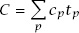
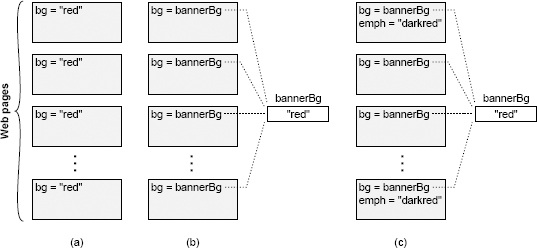

<!-- SOURCE pdf-018-b000 -->

<!-- SOURCE pdf-018-b001 -->

# 第2章 复杂性的性质 {#chapter-02}

<!-- SOURCE pdf-018-b002 -->

本书讨论如何设计软件系统，尽量降低复杂性。第一步是了解对手。“复杂性”究竟是什么？怎样判断系统存在不必要的复杂性？系统为什么会变复杂？本章先从总体上回答这些问题；后续章节会结合具体的结构特征，介绍如何在更细的层面识别复杂性。

<!-- SOURCE pdf-018-b003 -->

识别复杂性是一项至关重要的设计能力。它让你能够在投入大量精力之前发现问题，也能在多个方案之间作出恰当选择。判断设计是否简单，比创造简单的设计容易。但一旦能够识别过于复杂的系统，就可以凭借这种能力，让自己的设计理念趋向简洁。如果一个设计显得复杂，就试试其他办法，看看能否更简单。久而久之，你会发现，某些技术往往产生简单的设计，另一些则常伴随复杂性。这样就能更快地做出简单的设计。

<!-- SOURCE pdf-018-b004 -->

本章还会提出一些基本假设，作为全书其余部分的基础。后续章节将以本章内容为前提，进一步细化论点、得出结论。

<!-- SOURCE pdf-018-b005 -->

## 2.1 复杂性的定义 {#ch02-section-01}

<!-- SOURCE pdf-018-b006 -->

<!-- SOURCE pdf-019-b000 -->

在本书中，我从实际使用的角度定义“复杂性”：**软件系统结构中，凡是使系统难以理解和修改的因素，都属于复杂性。**复杂性有多种表现。例如，一段代码的工作方式可能难以理解；实现一个小改进可能需要付出大量精力，也可能难以确定究竟要修改系统的哪些部分；修复一个 bug 时，可能很难避免引入另一个 bug。软件系统难以理解和修改，就说明它复杂；容易理解和修改，就说明它简单。

<!-- SOURCE pdf-019-b001 -->

也可以从成本和收益理解复杂性。在复杂系统中，哪怕小改进也需要大量工作。在简单系统中，花更少精力就能实现更大的改进。

<!-- SOURCE pdf-019-b002 -->

复杂性是开发者在特定时刻、试图实现特定目标时所感受到的困难。它未必与系统整体的规模或功能有关。人们常用“复杂”描述规模庞大、功能精密的系统，但如果这类系统容易开发和维护，按本书的定义，它就不算复杂。当然，几乎所有规模大、功能精密的软件系统实际上都很难处理，也符合我对复杂性的定义，但两者并无必然联系。小而功能简单的系统，也完全可能相当复杂。

<!-- SOURCE pdf-019-b003 -->

复杂性取决于最常进行的活动。一个系统中即使有几个非常复杂的部分，只要几乎从来不用碰它们，它们对系统整体复杂性的影响就不大。可以用一个粗略的数学公式表示：

<!-- SOURCE pdf-019-b005 -->

系统的整体复杂性 C，由每一部分 p 的复杂性 cₚ，按开发者在该部分所花的时间占比 tₚ 加权决定。把复杂性隔离在永远不会接触到的地方，效果几乎与彻底消除它一样好。

<!-- SOURCE pdf-019-b006 -->

复杂性在读代码的人眼中，比在写代码的人眼中更明显。如果你写的代码自己觉得简单，别人却觉得复杂，那么它就是复杂的。遇到这种情况，值得向其他开发者深入了解，他们为什么觉得代码复杂；双方看法的差异，很可能会带来有价值的启发。开发者的职责既包括写出自己容易处理的代码，也包括让其他人容易处理这些代码。

<!-- SOURCE pdf-019-b007 -->

## 2.2 复杂性的症状 {#ch02-section-02}

<!-- SOURCE pdf-019-b008 -->

<!-- SOURCE pdf-020-b000 -->

复杂性主要有以下三种表现，每一种都会增加开发工作的难度。

<!-- SOURCE pdf-020-b001 -->

**变更放大。**第一种症状是，看起来简单的改动，却需要修改许多不同位置的代码。例如，一个网站有多个页面，每页都有带背景色的横幅。早期许多网站在各个页面中直接指定颜色，如图 2.1(a) 所示。要更改这类网站的背景色，开发者可能需要手动修改每一个已有页面；对于拥有数千页面的大网站，这几乎不可能完成。好在现代网站采用图 2.1(b) 所示的方法：在一个集中位置指定一次横幅颜色，各页面都引用这个共享值。这样只改一处，就能改变整个网站的横幅颜色。良好设计的目标之一，是减少每个设计决定影响的代码量，让设计变更不必伴随大量代码修改。

<!-- SOURCE pdf-020-b002 -->

**认知负担。**第二种症状是认知负担，即开发者完成一项任务需要知道多少信息。认知负担越高，学习所需信息的时间越长，也越容易因遗漏重要信息而产生 bug。例如，一个 C 函数分配内存、返回指向这块内存的指针，并假定调用者负责释放内存。这就增加了使用该函数的开发者的认知负担；忘记释放就会造成内存泄漏。如果调整系统结构，让调用者无须操心释放内存，由分配内存的模块同时负责释放，就能降低认知负担。认知负担的来源很多，包括方法众多的 API、全局变量、不一致的做法以及模块间的依赖。

<!-- SOURCE pdf-020-b003 -->

系统设计者有时认为，代码行数能够衡量复杂性。他们假定一种实现比另一种短，就必然更简单；一次修改只需几行代码，就必然容易。但这种看法忽视了认知负担的成本。我见过某些框架，只要几行代码就能写出应用，却极难弄清楚究竟该写哪几行。有时，需要更多代码行的方法实际上更简单，因为它降低了认知负担。

<!-- SOURCE pdf-021-b001 -->

**图 2.1：**网站的每个页面都显示一条有颜色的横幅。(a) 各页直接指定横幅背景色。(b) 用共享变量保存背景色，每页引用该变量。(c) 某些页面还使用比横幅背景色更深的颜色作强调；背景色改变时，强调色也必须改变。图中 Web pages 表示网页，bg 为背景色，bannerBg 为共享的横幅背景色，emph 为强调色；red 和 darkred 分别表示红色和深红色。

<!-- SOURCE pdf-021-b002 -->

**未知的未知。**第三种症状是，完成任务需要修改哪些代码，或开发者必须掌握哪些信息，都不明确。图 2.1(c) 展示了这个问题。网站用一个集中变量决定横幅背景色，看上去很容易修改。但少数页面使用更深的背景色作强调，而这个深色值直接写在各个页面里。背景色改变后，强调色也必须相应改变。遗憾的是，开发者很可能意识不到这一点，只修改中央的 bannerBg 变量，却没有更新强调色。即使知道有这个问题，也难以看出哪些页面使用了强调色，可能不得不搜索整个网站的每个页面。

<!-- SOURCE pdf-021-b003 -->

<!-- SOURCE pdf-022-b000 -->

在这三种表现中，未知的未知最糟糕。它意味着有些事情你必须知道，却无从发现它们究竟是什么，甚至无法知道问题是否存在；直到修改后出现 bug，才会发现它。变更放大很烦人，但只要明确需要修改哪些代码，完成修改后系统就能工作。类似地，高认知负担会增加修改成本，但只要知道应该阅读哪些信息，修改仍然很可能正确。面对未知的未知，既不清楚该做什么，也不知道拟定的方案能否奏效。唯一能够确认的办法，是读完系统的每一行代码；对于稍有规模的系统，这都不现实。即便如此也未必够用，因为修改可能依赖某个从未记录下来的微妙设计决定。

<!-- SOURCE pdf-022-b001 -->

良好设计最重要的目标之一，是让系统一目了然。这恰好与高认知负担、未知的未知相反。在这样的系统中，开发者可以迅速理解现有代码的工作方式，以及修改需要做什么。开发者无须费力思索，就能快速猜出做法，并且有把握这个猜测是正确的。第 18 章将介绍让代码更清楚的方法。

<!-- SOURCE pdf-022-b002 -->

## 2.3 复杂性的成因 {#ch02-section-03}

<!-- SOURCE pdf-022-b003 -->

了解复杂性的总体症状，以及它为何使软件开发困难之后，下一步是理解它的成因，以便通过设计避免这些问题。复杂性有两个来源：依赖与晦涩性。本节从总体上讨论它们，后续章节会介绍它们与更具体的设计决定之间的关系。

<!-- SOURCE pdf-022-b004 -->

本书所说的依赖，是指一段代码无法独立理解和修改的情况：它与其他代码存在某种联系，修改它时必须考虑其他代码，或者同时修改其他代码，或者两者都要做。在图 2.1(a) 的网站例子中，背景色让所有页面相互依赖。所有页面都需要相同的背景，因此一个页面改了背景，其他页面也必须改。网络协议也是一个例子。协议发送端与接收端通常各有各的代码，但双方都必须遵循协议；修改发送端代码，几乎总要相应修改接收端，反过来也一样。方法签名则在方法实现与调用它的代码之间建立依赖：给方法增加一个参数，所有调用该方法的地方都必须修改，以提供这个参数。

<!-- SOURCE pdf-022-b005 -->

<!-- SOURCE pdf-023-b000 -->

依赖是软件的基本组成部分，无法彻底消除。事实上，软件设计过程中还会主动引入依赖。每写一个新类，都会围绕它的 API 建立依赖。不过，软件设计的目标之一，就是减少依赖的数量，让剩下的依赖尽可能简单、清楚。

<!-- SOURCE pdf-023-b001 -->

再看网站的例子。旧网站在各页面分别指定背景色，所有页面彼此依赖。新网站在集中位置指定背景色，提供 API 供各页面渲染时读取，解决了这个问题。它消除了页面间的依赖，同时围绕获取背景色的 API 建立了新的依赖。好在新依赖更明显：每个页面依赖 bannerBg 颜色，这一点很清楚；开发者搜索变量名，就能轻松找到所有使用位置。编译器也有助于管理 API 依赖：如果共享变量改名，仍使用旧名字的代码就会产生编译错误。新网站用一种更简单、更明显的依赖，替换了原先隐蔽且难以管理的依赖。

<!-- SOURCE pdf-023-b002 -->

复杂性的第二个来源是晦涩性，即重要信息不明显。一个简单例子是变量名过于笼统，几乎传递不了有用信息，如 time。变量的文档也可能没有说明单位，只能去查看使用它的代码才能弄清。晦涩性经常与依赖相伴：某种依赖已经存在，但很难看出来。例如，给系统增加一种错误状态时，可能还要在保存各状态提示字符串的表中增加一项，但查看状态声明的程序员未必知道还有这么一张表。不一致也是晦涩性的重要来源：同一个变量名若用于两种不同用途，开发者就难以看清某个具体变量究竟用于哪一种。

<!-- SOURCE pdf-023-b003 -->

晦涩性很多时候源于文档不足，第 13 章会讨论这个问题。但它也是设计问题。系统设计清晰、易懂，所需文档就更少。需要大量文档往往是危险信号，说明设计有些不妥。降低晦涩性最好的方式，是简化系统设计。

<!-- SOURCE pdf-023-b004 -->

<!-- SOURCE pdf-024-b000 -->

依赖和晦涩性共同造成了 2.2 节介绍的三种复杂性表现。依赖导致变更放大和较高的认知负担；晦涩性造成未知的未知，也会增加认知负担。如果能找到尽量减少依赖与晦涩性的设计方法，就能降低软件的复杂性。

<!-- SOURCE pdf-024-b001 -->

## 2.4 复杂性逐步积累 {#ch02-section-04}

<!-- SOURCE pdf-024-b002 -->

复杂性由许多小问题逐渐累积起来，并非一次灾难性错误造成。单独一个依赖或一处晦涩，通常不会明显影响软件系统的可维护性。但成百上千个细小的依赖和晦涩之处随时间积累，就形成了复杂性。最终，这些小问题多到任何可能的修改都会受到其中几个的影响。

<!-- SOURCE pdf-024-b003 -->

逐步积累的特性，使复杂性难以控制。很容易说服自己：当前改动带来的那点复杂性，无关紧要。但如果每个开发者每次修改都这样想，复杂性就会迅速积累。积累之后又很难消除，因为单独修正一个依赖或一处晦涩，已经很难带来明显改善。要减缓复杂性的增长，就必须采用第 3 章将讨论的“零容忍”理念。

<!-- SOURCE pdf-024-b004 -->

## 2.5 小结 {#ch02-section-05}

<!-- SOURCE pdf-024-b005 -->

复杂性源自依赖与晦涩性的积累。随着复杂性增加，系统会出现变更放大、高认知负担和未知的未知。实现每项新功能都需要修改更多代码；开发者还要花更多时间收集足够信息，才能安全修改。最糟糕时，连所需信息都无法找全。复杂性让修改现有代码库变得困难且风险更高。
