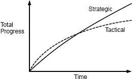

<!-- SOURCE pdf-025-b000 -->

<!-- SOURCE pdf-025-b001 -->

# 第3章 代码能运行还不够 {#chapter-03}

<!-- SOURCE pdf-025-b002 -->

*战略式编程与战术式编程*

<!-- SOURCE pdf-025-b003 -->

面对编程任务时所采取的思维方式，是良好软件设计最重要的要素之一。许多组织鼓励战术式思维，着眼于尽快让功能运行起来。但要得到好的设计，就必须采用更具战略性的方法，投入时间做出清晰的设计、修正问题。本章将讨论，为什么战略式方法能带来更好的设计，而且从长远看，成本比战术式方法更低。

<!-- SOURCE pdf-025-b004 -->

## 3.1 战术式编程 {#ch03-section-01}

<!-- SOURCE pdf-025-b005 -->

多数程序员采用一种我称为“战术式编程”的思维方式开发软件。这种方法主要关注让某件事运行起来，例如实现新功能或修复 bug。乍看完全合理：还有什么比写出能运行的代码更重要？但战术式编程几乎不可能产生良好的系统设计。

<!-- SOURCE pdf-025-b006 -->

战术式编程的问题在于目光短浅。采用这种方式时，你追求尽快完成任务，也许还面临不可更改的截止日期。为未来打算便不再优先。你不会花多少时间寻找最佳设计，只想尽快让东西跑起来。你告诉自己，只要能更快完成当前任务，增加一点复杂性，或引入一两个临时拼凑的办法，也无妨。

<!-- SOURCE pdf-025-b007 -->

<!-- SOURCE pdf-026-b000 -->

系统就是这样变复杂的。上一章说过，复杂性是逐步积累的；让系统变复杂的，通常是几十件乃至几百件小事的累积。战术式编程让每项任务都增加几处这样的复杂性。每一处看起来都像是为快速完成当前任务所作的合理妥协，但复杂性会迅速累积，所有人都采用战术式编程时尤其如此。

<!-- SOURCE pdf-026-b001 -->

没过多久，一部分复杂性就开始造成问题，你开始后悔早先走了捷径。但你又会告诉自己，让下一个功能运行起来，比回头重构已有代码更重要。重构也许长远有用，却肯定会拖慢当前任务。于是你寻找快速补丁，绕开遇到的问题。这又创造更多复杂性，需要更多补丁。很快代码就一团糟，而此时问题已经严重到需要几个月才能清理。进度安排容不下这样的延误，单修一两个问题似乎也没有明显效果，于是你继续战术式编程。

<!-- SOURCE pdf-026-b002 -->

只要在大型软件项目中工作过较长时间，我想你就见过战术式编程，也体验过它带来的问题。一旦走上这条路，就很难改变。

<!-- SOURCE pdf-026-b003 -->

几乎每个软件开发组织里，至少都有一个把战术式编程发挥到极致的开发者：战术龙卷风。这类程序员产量很高，写代码远快于别人，但完全按战术式方法做事。临时要赶一个功能，没人比他更快。有些组织的管理层把战术龙卷风视为英雄。但他们所到之处留下一片混乱，日后必须处理这些代码的工程师很少会把他们当作英雄。其他工程师通常得收拾战术龙卷风留下的残局，使这些真正值得称赞的人，看起来比战术龙卷风进展更慢。

<!-- SOURCE pdf-026-b004 -->

## 3.2 战略式编程 {#ch03-section-02}

<!-- SOURCE pdf-026-b005 -->

<!-- SOURCE pdf-027-b000 -->

成为优秀软件设计者的第一步，是认识到代码能运行还不够。为了更快完成当前任务而引入不必要的复杂性，是不可接受的。最重要的是系统的长期结构。任何系统的大部分代码，都是通过扩展现有代码库写出来的，因此开发者最重要的工作，是让未来的扩展更容易。代码当然必须能运行，但首要目标应当是做出优秀的设计，并让这个设计正常工作。这就是战略式编程。

<!-- SOURCE pdf-027-b001 -->

战略式编程需要投资心态。完成当前项目时，不能只选最快的路径，还必须投入时间改善系统设计。短期内，这些投入会让进度稍慢；长远看，它们会加快开发，如图 3.1 所示。

<!-- SOURCE pdf-027-b002 -->

有些投入是主动的。例如，为每个新类寻找简单的设计，值得多花一点时间。想到第一个方案后，先试试另外几个，再选最清晰的来实现。设想未来系统可能需要的几种变化，确认当前设计能让这些变化容易实现。编写良好的文档，也是主动投入的一个例子。

<!-- SOURCE pdf-027-b003 -->

另一些投入则是发现问题后的响应。无论前期投入多少，设计决定都难免有错，错误会逐渐显露。发现设计问题时，要多花一点时间修复，不能只忽略它或用补丁绕过。采用战略式编程，就会持续对系统设计作小幅改进。战术式编程则相反，它不断加入小块复杂性，给未来制造问题。

<!-- SOURCE pdf-027-b004 -->

## 3.3 应当投入多少？ {#ch03-section-03}

<!-- SOURCE pdf-027-b005 -->

<!-- SOURCE pdf-028-b000 -->

投入多少才合适？前期投入过大，例如试图一次设计整个系统，并不有效。这就是瀑布方法，我们已经知道它行不通。理想设计往往随着对系统经验的积累，一点一点浮现。最好的方式，是持续进行许多小额投入。我建议拿出总开发时间的约 10%–20%。这个比例足够小，不会显著影响进度，也足够大，能逐渐产生明显收益。最初的项目会比纯战术式方法多花 10%–20% 的时间。这些额外时间换来更好的软件设计，几个月内就会开始感受到收益。不久之后，开发速度就会比战术式编程至少快 10%–20%。此时，投入相当于不再增加成本：过去投入带来的收益，节省的时间已经足以支付未来的投入。最初投入的成本也会很快收回。图 3.1 展示了这一现象。

<!-- SOURCE pdf-028-b002 -->

**图 3.1：**起初，战术式编程的进展比战略式方法更快。但战术式方法下复杂性积累得更快，生产力随之下降。随着时间推移，战略式方法取得的进展更多。注意：此图仅作定性说明；我不知道有任何实证测量能确定这些曲线的精确形状。图中 Total Progress 表示累计进展，Time 表示时间，Strategic 为战略式方法，Tactical 为战术式方法。

<!-- SOURCE pdf-028-b003 -->

相反，采用战术式编程，最初的项目会快 10%–20%，但随着复杂性累积，开发速度会下降。用不了多久，编程就会至少慢 10%–20%。起初节省的时间很快就会全部还回去，在系统余下的生命周期中，开发速度都会低于采用战略式方法的情况。如果你从未在严重恶化的代码库中工作过，可以问问有这种经历的人；他们会告诉你，低劣的代码质量至少会让开发慢 20%。

<!-- SOURCE pdf-028-b004 -->

## 3.4 创业公司与投入 {#ch03-section-04}

<!-- SOURCE pdf-028-b005 -->

某些环境中，阻碍战略式方法的力量很强。例如，早期创业公司迫于巨大压力，需要尽快推出早期版本。在这些公司看来，连 10%–20% 的投入可能都负担不起。许多创业公司于是采用战术式方法，很少花精力设计，出现问题后用于清理的精力更少。它们的理由是：只要成功，以后就有足够的钱，多雇工程师收拾问题。

<!-- SOURCE pdf-028-b006 -->

<!-- SOURCE pdf-029-b000 -->

如果所在公司正在走向这条路，需要认识到，代码库一旦纠缠成团，几乎不可能修好。整个产品生命周期中，可能都要支付高昂的开发成本。好设计的收益与坏设计的代价也都来得很快，战术式方法很可能连首次产品发布都无法加速。

<!-- SOURCE pdf-029-b001 -->

还需要考虑，工程师的水平是公司成功最重要的因素之一。降低开发成本最好的方法，是雇用优秀工程师：他们的成本比平庸工程师高不了多少，生产力却高很多。但最好的工程师非常在意良好的设计。代码库若一团糟，消息就会传开，使招聘更困难。最终，公司很可能只能招到平庸工程师，未来成本上升，系统结构也可能进一步恶化。

<!-- SOURCE pdf-029-b002 -->

Facebook 就是鼓励战术式编程的创业公司实例。多年来，它的口号一直是“Move fast and break things”（快速行动，敢于破坏）。刚毕业的新工程师被鼓励立即投入公司代码库，入职第一周就向生产环境推送 commit 很正常。积极的一面是，Facebook 赢得了充分授权员工的声誉。工程师有很大自由，少有规章和限制妨碍他们。

<!-- SOURCE pdf-029-b003 -->

Facebook 作为公司取得了巨大成功，但战术式做法损害了代码库：大量代码不稳定、难理解，注释和测试很少，处理起来很痛苦。公司逐渐认识到这种文化无法持续。最终，Facebook 把口号改为“Move fast with solid infrastructure”（依靠稳固的基础设施快速行动），鼓励工程师更多投入良好设计。多年战术式编程积累的问题能否清理成功，还有待观察。

<!-- SOURCE pdf-029-b004 -->

公平地说，Facebook 的代码可能并不比创业公司的平均水平差多少。战术式编程在创业公司十分普遍，Facebook 只是一个格外显眼的例子。

<!-- SOURCE pdf-029-b005 -->

<!-- SOURCE pdf-030-b000 -->

好在硅谷也能凭战略式方法取得成功。Google 和 VMware 与 Facebook 大致在同一时期成长起来，但两家公司都采用了更具战略性的方法。它们都高度重视代码质量与良好设计，构建出精密的产品，用可靠的软件系统解决复杂问题。两家公司的技术文化在硅谷广为人知，在争取顶尖技术人才方面，少有其他公司能够与之竞争。

<!-- SOURCE pdf-030-b001 -->

这些例子说明，两种方法都可能让公司成功。不过，在重视软件设计、拥有清晰代码库的公司工作，乐趣要多得多。

<!-- SOURCE pdf-030-b002 -->

## 3.5 小结 {#ch03-section-05}

<!-- SOURCE pdf-030-b003 -->

良好的设计需要付出代价，必须持续投入，防止小问题累积成大问题。好在这些投入最终能收回成本，而且通常比预想更早。

<!-- SOURCE pdf-030-b004 -->

必须始终贯彻战略式方法，把投入安排在今天。进度紧张时，很容易想等这阵忙完再清理。但这是危险的开端：眼下的忙碌结束，几乎肯定还有下一轮，之后还有。设计改进一旦开始推迟，就很容易永远推迟，整个文化也会滑向战术式做法。拖得越久，设计问题越大，解决起来越让人望而却步，也就越容易继续拖延。最有效的方式，是每位工程师都持续为良好设计作小额投入。
