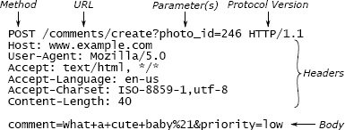

<!-- SOURCE pdf-040-b000 -->
<div id="pdf-040-b000" hidden></div>
<!-- SOURCE pdf-040-b001 -->
<div id="pdf-040-b001" hidden></div>
# 第5章 信息隐藏与信息泄漏 {#chapter-05}

<!-- SOURCE pdf-040-b002 -->
<div id="pdf-040-b002" hidden></div>
第 4 章提出模块应该有深度。本章及接下来几章，将介绍创建深模块的方法。

<!-- SOURCE pdf-040-b003 -->
<div id="pdf-040-b003" hidden></div>
## 5.1 信息隐藏 {#ch05-section-01}

<!-- SOURCE pdf-040-b004 -->
<div id="pdf-040-b004" hidden></div>
实现深模块最重要的技术是信息隐藏。这项技术由 David Parnas 首先提出[^ch05-1]。基本思想是，每个模块应封装少量知识，这些知识代表设计决定。知识蕴含在模块实现中，不出现在接口里，其他模块也就看不到。

<!-- SOURCE pdf-040-b005 -->
<div id="pdf-040-b005" hidden></div>
模块隐藏的信息通常是某种机制的实现细节，例如：

<!-- SOURCE pdf-040-b006 -->
<div id="pdf-040-b006" hidden></div>
- 如何在 B 树中存储信息并高效访问。
- 如何确定文件中各逻辑块对应的物理磁盘块。
- 如何实现 TCP 网络协议。
- 如何在多核处理器上调度线程。
- 如何解析 JSON 文档。

隐藏的信息包括与机制相关的数据结构和算法，也可以包括页面大小等低层细节，或“多数文件都很小”这样的更高层、更抽象的假设。

<!-- SOURCE pdf-040-b007 -->
<div id="pdf-040-b007" hidden></div>
<!-- SOURCE pdf-041-b000 -->
<div id="pdf-041-b000" hidden></div>
信息隐藏从两个方面降低复杂性。首先，它简化模块接口。接口呈现模块功能更简单、更抽象的视图，隐藏细节，降低使用者的认知负担。例如，使用 B 树类的开发者，无须操心节点的理想扇出数，也无须操心如何让树保持平衡。其次，信息隐藏让系统更容易演化。如果某项信息被隐藏，模块之外就不存在对它的依赖，相关设计变化只影响这一个模块。例如，TCP 协议改变了，譬如引入新的拥塞控制机制，就必须修改协议实现，但用 TCP 收发数据的上层代码应当无须修改。

<!-- SOURCE pdf-041-b001 -->
<div id="pdf-041-b001" hidden></div>
设计新模块时，应仔细思考哪些信息可以隐藏。如果能隐藏更多信息，通常也能简化接口，让模块更深。

<!-- SOURCE pdf-041-b002 -->
<div id="pdf-041-b002" hidden></div>
注意，把类的变量和方法声明为 private，并不等于信息隐藏。私有成员能阻止类外直接访问，有助于信息隐藏。但关于私有成员的信息仍可能通过 getter、setter 等公有方法暴露。此时，变量的性质和用法暴露的程度，与公有变量一样。

<!-- SOURCE pdf-041-b003 -->
<div id="pdf-041-b003" hidden></div>
最好的信息隐藏，是把信息完全藏在模块内部，让它与模块用户无关、对用户不可见。但部分隐藏也有价值。例如，某项功能或信息只有少数用户需要，并且通过单独的方法访问，在最常见的用法中不可见，那么这项信息就大体被隐藏了。与每位用户都能看到的信息相比，它造成的依赖更少。

<!-- SOURCE pdf-041-b004 -->
<div id="pdf-041-b004" hidden></div>
## 5.2 信息泄漏 {#ch05-section-02}

<!-- SOURCE pdf-041-b005 -->
<div id="pdf-041-b005" hidden></div>
<!-- SOURCE pdf-042-b000 -->
<div id="pdf-042-b000" hidden></div>
信息隐藏的反面是信息泄漏。当一个设计决定体现在多个模块中时，就发生了信息泄漏。这在模块之间建立依赖：该决定发生任何改变，所有相关模块都得修改。如果某项信息体现在模块接口中，按定义它就已经泄漏；所以接口越简单，信息隐藏往往越好。不过，即使接口中没有出现信息，它也可能泄漏。假设两个类都知道某种文件格式，一个负责读取，另一个负责写入。即便两个接口都没有暴露格式，它们仍依赖该格式：格式改变，两者都必须修改。这种暗中泄漏比接口泄漏更有害，因为它不明显。

<!-- SOURCE pdf-042-b001 -->
<div id="pdf-042-b001" hidden></div>
信息泄漏是软件设计中最重要的危险信号之一。对它保持高度敏感，是软件设计者可以学到的最佳能力之一。遇到类之间的信息泄漏时，问自己：“如何重新组织这些类，让这项知识只影响一个类？”如果相关类较小，又与泄漏信息密切相关，合并为一个类可能合理。另一种办法是从所有相关类中抽出信息，创建一个新类专门封装它。但只有找到能抽象掉细节的简单接口，这种方法才有效。如果新类仍通过接口暴露大部分知识，就没有多少价值，只不过把暗中泄漏变成了接口泄漏。

<!-- SOURCE pdf-042-b003 -->
<div id="pdf-042-b003" hidden></div>
### 危险信号：信息泄漏 {#ch05-section-03}

<!-- SOURCE pdf-042-b005 -->
<div id="pdf-042-b005" hidden></div>
同一项知识在多处使用，就发生了信息泄漏，例如两个不同的类都理解某种文件格式。

<!-- SOURCE pdf-042-b006 -->
<div id="pdf-042-b006" hidden></div>
## 5.3 按时间顺序分解 {#ch05-section-04}

<!-- SOURCE pdf-042-b007 -->
<div id="pdf-042-b007" hidden></div>
<!-- SOURCE pdf-043-b000 -->
<div id="pdf-043-b000" hidden></div>
信息泄漏的常见原因之一，是一种我称为“按时间顺序分解”的设计方式：系统结构对应操作的执行顺序。设想一个应用，读取特定格式的文件，修改内容，再写回文件。按时间顺序分解，可能得到三个类：一个读取，一个修改，一个写出新版本。读取和写入步骤都掌握文件格式，产生信息泄漏。解决办法是把文件读写的主要机制合并到同一个类，应用在读取、写入两个阶段都使用它。编程时，操作的先后顺序往往占据头脑，因此很容易落入这种陷阱。但多数设计决定会在应用运行过程中的多个不同时间点体现出来，按时间顺序分解就经常造成信息泄漏。

<!-- SOURCE pdf-043-b001 -->
<div id="pdf-043-b001" hidden></div>
顺序通常确实重要，因此会体现在应用的某个地方。但只有当这种模块结构符合信息隐藏时，例如不同阶段使用完全不同的信息，才应让顺序体现在模块结构中。**设计模块时，应关注完成各项任务所需的知识，避免仅按任务发生的先后顺序划分。**

<!-- SOURCE pdf-043-b003 -->
<div id="pdf-043-b003" hidden></div>
### 危险信号：按时间顺序分解 {#ch05-section-05}

<!-- SOURCE pdf-043-b005 -->
<div id="pdf-043-b005" hidden></div>
按时间顺序分解会让执行顺序体现在代码结构中：发生在不同时间的操作，放在不同方法或类里。如果执行过程中多个时点使用同一项知识，这项知识就会被编码在多处，造成信息泄漏。

<!-- SOURCE pdf-043-b006 -->
<div id="pdf-043-b006" hidden></div>
## 5.4 示例：HTTP 服务器 {#ch05-section-06}

<!-- SOURCE pdf-043-b007 -->
<div id="pdf-043-b007" hidden></div>
为说明信息隐藏的问题，来看软件设计课中学生实现 HTTP 协议时作出的设计决定。他们做得好的地方，以及遇到的问题，都值得了解。

<!-- SOURCE pdf-043-b008 -->
<div id="pdf-043-b008" hidden></div>
HTTP 是浏览器与 Web 服务器通信的机制。用户在浏览器中点击链接或提交表单，浏览器就通过 HTTP 经网络向服务器发送请求。服务器处理请求后，向浏览器发送响应，通常包含需要显示的新页面。HTTP 协议规定请求和响应的格式，两者都用文本表示。图 5.1 是提交表单的 HTTP 请求示例。课程要求学生实现一个或多个类，让 Web 服务器容易接收 HTTP 请求并发送响应。



```http
POST /comments/create?photo_id=246 HTTP/1.1
Host: www.example.com
User-Agent: Mozilla/5.0
Accept: text/html, */*
Accept-Language: en-us
Accept-Charset: ISO-8859-1,utf-8
Content-Length: 40

comment=What+a+cute+baby%21&priority=low
```

<!-- SOURCE pdf-044-b001 -->
<div id="pdf-044-b001" hidden></div>
**图 5.1：**HTTP 协议中的 POST 请求由经 TCP 套接字发送的文本构成。每个请求包含起始行、一组以空行结束的头部，以及可选的正文。起始行包含请求类型（POST 用于提交表单数据）、表示操作的 URL（/comments/create）及可选参数（photo_id 的值为 246），还有发送方使用的 HTTP 协议版本。每个头部行由名称（如 Content-Length）及其值组成。本例正文包含额外参数 comment 和 priority。图中 Method、Parameter(s)、Protocol Version、Headers、Body 分别表示方法、参数、协议版本、头部和正文。

<!-- SOURCE pdf-044-b002 -->
<div id="pdf-044-b002" hidden></div>
## 5.5 示例：类太多 {#ch05-section-07}

<!-- SOURCE pdf-044-b003 -->
<div id="pdf-044-b003" hidden></div>
<!-- SOURCE pdf-044-b004 -->
<div id="pdf-044-b004" hidden></div>
学生最常见的错误，是把代码划分为大量浅类，导致类之间的信息泄漏。有一组用两个类接收 HTTP 请求：第一个从网络连接读取请求，存为字符串；第二个解析字符串。这是按时间顺序分解的例子：“先读取请求，再解析。”但不解析消息的大部分内容，就无法读完 HTTP 请求，因此出现了信息泄漏。例如，Content-Length 头部指定请求正文的长度，必须解析头部才能计算请求总长度。两个类于是都要理解 HTTP 请求的大部分结构，也都包含重复的解析代码。调用者的工作也更复杂：接收一个请求，需要按特定顺序调用不同类里的两个方法。

<!-- SOURCE pdf-044-b005 -->
<div id="pdf-044-b005" hidden></div>
两个类共享这么多信息，更好的做法是合并为一个类，同时负责读取和解析请求。这样把请求格式的全部知识隔离在一个类中，信息隐藏更好；调用者的接口也更简单，只需调用一个方法。

<!-- SOURCE pdf-044-b006 -->
<div id="pdf-044-b006" hidden></div>
<!-- SOURCE pdf-045-b000 -->
<div id="pdf-045-b000" hidden></div>
这个例子体现了软件设计中的一个普遍规律：**让类稍微大一点，往往可以改善信息隐藏。**这样做的一个理由，是把与某项能力（例如解析 HTTP 请求）相关的所有代码集中起来，让一个类包含这项能力的全部内容。另一个理由是提高接口层次：例如，一次计算有三个步骤，可以用一个方法完成整个计算，无须为每一步分别提供方法。这能简化接口。前一段的例子同时体现两项好处：合并后，HTTP 请求解析代码集中在一起，对外可见的两个方法也合为一个。新类比原来的类更深。

<!-- SOURCE pdf-045-b001 -->
<div id="pdf-045-b001" hidden></div>
当然，扩大类也可能过度，例如用一个类实现整个应用。第 9 章会讨论哪些情况下适合把代码分成多个较小的类。

<!-- SOURCE pdf-045-b002 -->
<div id="pdf-045-b002" hidden></div>
## 5.6 示例：HTTP 参数处理 {#ch05-section-08}

<!-- SOURCE pdf-045-b003 -->
<div id="pdf-045-b003" hidden></div>
服务器收到 HTTP 请求后，需要访问其中一些信息。例如，处理图 5.1 请求的代码可能需要 photo_id 的值。参数可以放在请求首行，如图中的 photo_id；有时也可以放在正文，如 comment 和 priority。每个参数都有名称和值，值采用一种称为 URL 编码的特殊编码。例如，图中 comment 值用“+”表示空格，用“%21”表示“!”。处理请求时，服务器需要某些参数的值，而且希望拿到解码后的形式。

<!-- SOURCE pdf-045-b004 -->
<div id="pdf-045-b004" hidden></div>
多数学生项目在参数处理上作出了两个好的选择。第一，他们认识到服务器应用并不关心参数出现在请求首行还是正文，于是向调用者隐藏区别，把两处参数合在一起。第二，他们隐藏了 URL 编码知识：HTTP 解析器先解码，再把参数值返回给 Web 服务器，所以图中的 comment 返回为“What a cute baby!”，而不保留“What+a+cute+baby%21”。这两处信息隐藏都简化了使用 HTTP 模块的代码所面对的 API。

<!-- SOURCE pdf-045-b005 -->
<div id="pdf-045-b005" hidden></div>
<!-- SOURCE pdf-046-b000 -->
<div id="pdf-046-b000" hidden></div>
<!-- SOURCE pdf-046-b001 -->
<div id="pdf-046-b001" hidden></div>
<!-- SOURCE pdf-046-b002 -->
<div id="pdf-046-b002" hidden></div>
不过，多数学生用来返回参数的接口太浅，错失了进一步隐藏信息的机会。多数项目用 HTTPRequest 对象保存解析后的请求，并提供如下单一方法返回参数：

```java
public Map<String, String> getParams() {
    return this.params;
}
```

<!-- SOURCE pdf-046-b003 -->
<div id="pdf-046-b003" hidden></div>
<!-- SOURCE pdf-046-b004 -->
<div id="pdf-046-b004" hidden></div>
这个方法返回的是内部保存全部参数的 Map 引用，调用一次得到整张映射表，并非单个参数。它很浅，暴露了 HTTPRequest 保存参数所用的内部表示。内部表示一变，接口也得变，所有调用者都要修改。实现变化往往涉及主要数据结构的表示变化，例如为了提高性能。因此，应尽量避免暴露内部数据结构。这种做法还增加了调用者的工作：先调用 getParams，再调用另一个方法，从 Map 获取具体参数。调用者还必须知道，不能修改 getParams 返回的 Map，否则会影响 HTTPRequest 的内部状态。

<!-- SOURCE pdf-046-b005 -->
<div id="pdf-046-b005" hidden></div>
<!-- SOURCE pdf-046-b006 -->
<div id="pdf-046-b006" hidden></div>
更好的参数取值接口如下：

```java
public String getParameter(String name) { ... }
public int getIntParameter(String name) { ... }
```

<!-- SOURCE pdf-046-b007 -->
<div id="pdf-046-b007" hidden></div>
getParameter 以字符串返回参数值，接口比 getParams 稍深；更重要的是，它隐藏了参数的内部表示。getIntParameter 把 HTTP 请求中的参数字符串转换为整数，例如图 5.1 的 photo_id。调用者无须另外要求字符串转整数，转换机制也被隐藏。需要时还可以增加其他类型的方法，例如 getDoubleParameter。以上方法在参数不存在，或无法转换为所需类型时，都会抛出异常；示例代码省略了异常声明。

<!-- SOURCE pdf-046-b008 -->
<div id="pdf-046-b008" hidden></div>
## 5.7 示例：HTTP 响应的默认值 {#ch05-section-09}

<!-- SOURCE pdf-046-b009 -->
<div id="pdf-046-b009" hidden></div>
<!-- SOURCE pdf-047-b000 -->
<div id="pdf-047-b000" hidden></div>
HTTP 项目还需要支持生成 HTTP 响应。学生在这方面最常见的错误，是默认值不充分。每个响应必须指定 HTTP 协议版本，有一组要求调用者创建响应对象时显式提供版本。但响应版本必须与请求对象中的版本对应，而且发送响应时本来就必须传入请求，用它确定响应发往哪里。让 HTTP 类自动提供响应版本更合理。调用者很可能不知道该填哪个版本；如果让调用者填写，HTTP 库与调用者之间还可能产生信息泄漏。HTTP 响应也包含指定发送时间的 Date 头部，HTTP 库同样应该提供合理默认值。

<!-- SOURCE pdf-047-b001 -->
<div id="pdf-047-b001" hidden></div>
默认值体现了“让常见情况尽可能简单”的接口设计原则，也是一种部分信息隐藏：正常情况下，调用者无须知道这个有默认值的项目存在。少数需要覆盖默认值的情况，调用者才须了解该值，并调用专门的方法修改。

<!-- SOURCE pdf-047-b002 -->
<div id="pdf-047-b002" hidden></div>
只要可能，类就应主动“做正确的事”，无须显式要求，默认值正是一个例子。原书第 26 页的 Java I/O 例子从反面说明了这一点。文件 I/O 对缓冲的需求如此普遍，使用者不该还得显式提出要求，甚至无须知道它存在；I/O 类应自动提供缓冲。最好的功能，是连它存在都不知道，就已经享受到的功能。

<!-- SOURCE pdf-047-b004 -->
<div id="pdf-047-b004" hidden></div>
### 危险信号：暴露过多 {#ch05-section-10}

<!-- SOURCE pdf-047-b006 -->
<div id="pdf-047-b006" hidden></div>
如果常用功能的 API 强迫用户了解其他很少使用的功能，就会增加那些用不到罕见功能的用户的认知负担。

<!-- SOURCE pdf-047-b007 -->
<div id="pdf-047-b007" hidden></div>
## 5.8 类内部的信息隐藏 {#ch05-section-11}

<!-- SOURCE pdf-047-b008 -->
<div id="pdf-047-b008" hidden></div>
<!-- SOURCE pdf-048-b000 -->
<div id="pdf-048-b000" hidden></div>
本章例子主要讨论类的对外 API，但信息隐藏也适用于系统其他层次，例如类内部。设计私有方法时，应尽量让每个方法封装一些信息或能力，向类的其他部分隐藏。同时，尽量减少每个实例变量的使用位置。有些变量必须在类中广泛访问，另一些只在少数位置需要。减少变量的使用位置，就能消除类内依赖，降低复杂性。

<!-- SOURCE pdf-048-b001 -->
<div id="pdf-048-b001" hidden></div>
## 5.9 做过头了 {#ch05-section-12}

<!-- SOURCE pdf-048-b002 -->
<div id="pdf-048-b002" hidden></div>
只有模块外部不需要的信息，隐藏起来才有意义。外部需要的信息就不能隐藏。假设模块性能受某些配置参数影响，不同用法需要不同设置，那么就必须在接口中暴露这些参数，以便适当调整。软件设计者应尽量减少模块外所需的信息；例如，模块能自动调整配置，就比暴露配置参数更好。但必须识别外部确实需要的信息，并确保它可见。

<!-- SOURCE pdf-048-b003 -->
<div id="pdf-048-b003" hidden></div>
## 5.10 小结 {#ch05-section-13}

<!-- SOURCE pdf-048-b004 -->
<div id="pdf-048-b004" hidden></div>
信息隐藏与深模块密切相关。模块隐藏的信息越多，往往提供的功能越多，接口却更小，模块因而更深。反过来，如果隐藏的信息不多，要么功能不多，要么接口复杂；无论哪一种，模块都浅。

<!-- SOURCE pdf-048-b005 -->
<div id="pdf-048-b005" hidden></div>
把系统分解为模块时，尽量不要受运行时操作顺序影响，否则容易按时间顺序分解，导致信息泄漏和浅模块。应当思考应用完成任务需要哪些知识，让每个模块封装其中一项或少量几项。这样才能得到清晰、简单、模块具有深度的设计。

<!-- SOURCE pdf-049-b000 -->
<div id="pdf-049-b000" hidden></div>
[^ch05-1]: David Parnas，“On the Criteria to be Used in Decomposing Systems into Modules”，《Communications of the ACM》，1972 年 12 月。
