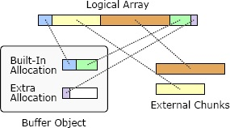
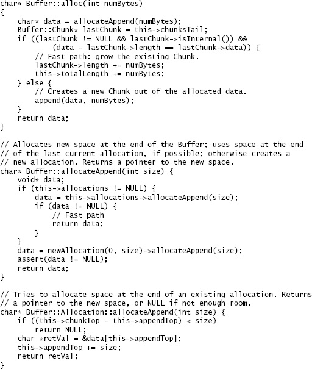
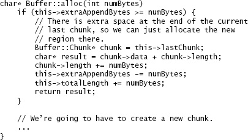

<!-- SOURCE pdf-166-b000 -->
<div id="pdf-166-b000" hidden></div>
<!-- SOURCE pdf-166-b001 -->
<div id="pdf-166-b001" hidden></div>
# 第20章 为性能而设计 {#chapter-20}

<!-- SOURCE pdf-166-b002 -->
<div id="pdf-166-b002" hidden></div>
此前关于软件设计的讨论一直围绕复杂性展开，目标是让软件尽可能简单、易懂。但如果系统还必须很快，该怎么办？性能考量应怎样影响设计过程？本章讨论如何在保持清晰设计的同时实现高性能。最重要的思想依旧是简单：简单既能改善设计，通常也能让系统更快。

<!-- SOURCE pdf-166-b003 -->
<div id="pdf-166-b003" hidden></div>
## 20.1 如何考虑性能 {#ch20-section-01}

<!-- SOURCE pdf-166-b004 -->
<div id="pdf-166-b004" hidden></div>
首先要回答：“常规开发过程中，应当多大程度地关注性能？”试图把每条语句都优化到最快，会拖慢开发，制造大量不必要的复杂性，而且很多“优化”实际上并不能改善性能。另一方面，完全忽视性能，又容易让大量明显低效的做法散布在代码中，使系统耗时轻易达到原本所需的5～10倍。这种许多小问题共同拖垮性能的情况，很难在后期改善，因为没有哪一项单独改进能产生明显影响。

<!-- SOURCE pdf-166-b005 -->
<div id="pdf-166-b005" hidden></div>
最佳做法介于两端之间：运用基本的性能知识，选择本来就高效、同时又清晰简单的设计。要培养对高成本操作的认识。以下是目前成本相对较高的一些操作：

<!-- SOURCE pdf-166-b006 -->
<div id="pdf-166-b006" hidden></div>
<!-- SOURCE pdf-167-b000 -->
<div id="pdf-167-b000" hidden></div>
- 网络通信：即使在数据中心内部，一次往返消息交换也可能耗时10～50微秒，相当于数万条指令的时间。广域网往返可能需要10～100毫秒。
- 辅助存储 I/O：磁盘 I/O 通常需要5～10毫秒，相当于数百万条指令的时间。闪存需要10～100微秒。新兴非易失性存储器可能快至1微秒，但仍相当于约2000条指令的时间。
- 动态内存分配：例如 C 的 `malloc`、C++ 或 Java 的 `new`，通常会产生显著的分配、释放和垃圾回收开销。
- 缓存未命中：从 DRAM 取数据到处理器片上缓存，需要数百条指令的时间。许多程序的整体性能，既受计算成本影响，也同样受缓存未命中影响。

了解哪些操作昂贵，最好的方法是运行微基准测试：用小程序独立测量单个操作的成本。在 RAMCloud 项目中，我们建立了一个简单的微基准测试框架。创建它花了几天，但此后新增一项微基准只需五到十分钟。我们因此积累了几十项微基准，既用来了解 RAMCloud 所用现有库的性能，也用来测量为 RAMCloud 编写的新类。

<!-- SOURCE pdf-167-b001 -->
<div id="pdf-167-b001" hidden></div>
大致知道哪些操作昂贵、哪些便宜后，就能尽量选择成本较低的操作。许多情况下，高效方式与低效方式同样简单。例如，存储大量对象并按键查找，可以用哈希表，也可以用有序映射。库中通常都提供这两种结构，使用起来都简单清楚。但哈希表的速度很容易达到有序映射的5～10倍。除非需要映射的有序性质，否则应始终使用哈希表。

<!-- SOURCE pdf-167-b002 -->
<div id="pdf-167-b002" hidden></div>
再如，在 C 或 C++ 中分配结构体数组，有两种方式。可以让数组保存结构体指针，先为数组分配空间，再逐个为结构体分配空间。也可以把结构体直接存进数组，只分配一整块内存；后者效率高得多。

<!-- SOURCE pdf-167-b003 -->
<div id="pdf-167-b003" hidden></div>
<!-- SOURCE pdf-168-b000 -->
<div id="pdf-168-b000" hidden></div>
如果提高效率必须增加复杂性，选择就更困难。如果高效设计只增加少量复杂性，而且复杂性被隐藏、不影响接口，可能值得采用，但要记住复杂性会逐步累积。如果更快的设计明显增加实现复杂性，或者让接口更复杂，可能最好先采用简单方式，等性能确实成为问题再优化。不过，如果已经有明确证据表明某处性能至关重要，也可以立即实现更快的方式。

<!-- SOURCE pdf-168-b001 -->
<div id="pdf-168-b001" hidden></div>
RAMCloud 项目的整体目标之一，是尽量降低客户端通过数据中心网络访问存储系统的延迟。为此，我们决定采用专门的网络硬件，让 RAMCloud 绕过内核，直接与网络接口控制器通信，收发数据包。尽管这增加了复杂性，我们仍作出这个选择，因为先前的测量已表明，基于内核的网络通信太慢，无法满足需求。RAMCloud 的其他大部分地方都可以优先追求简单；把这个重大问题处理好，让许多其他事情更容易了。

<!-- SOURCE pdf-168-b002 -->
<div id="pdf-168-b002" hidden></div>
通常，简单代码比复杂代码运行得快。如果通过设计消除了特殊情况和异常，就无需代码检查这些情况，系统也会更快。深类比浅类更高效，因为每次方法调用能完成更多工作。浅类导致更多跨层调用，每跨一层都会增加开销。

<!-- SOURCE pdf-168-b003 -->
<div id="pdf-168-b003" hidden></div>
## 20.2 修改前先测量 {#ch20-section-02}

<!-- SOURCE pdf-168-b004 -->
<div id="pdf-168-b004" hidden></div>
假设已经按上述方式设计，系统仍然太慢。人很容易凭直觉认定慢在哪里，马上开始调优。不要这样做！程序员对性能的直觉并不可靠，经验丰富的人也一样。凭直觉修改，会把时间浪费在无法改善性能的地方，还可能让系统更复杂。

<!-- SOURCE pdf-168-b005 -->
<div id="pdf-168-b005" hidden></div>
<!-- SOURCE pdf-169-b000 -->
<div id="pdf-169-b000" hidden></div>
任何修改之前，都先测量系统的现有行为。这有两个目的。第一，找到调优收益最大的地方。只测系统顶层性能不够：它能说明系统太慢，却不能解释原因。必须深入测量，详细识别影响整体性能的因素，最终找到少数几个具体位置：系统在那里花费了大量时间，而且自己有改进思路。第二，建立基线，以便修改后重新测量，确认性能确实改善。如果改动没有带来可测量的差异，就撤销它，除非它让系统更简单。没有明显加速，就没有理由保留额外复杂性。

<!-- SOURCE pdf-169-b001 -->
<div id="pdf-169-b001" hidden></div>
## 20.3 围绕关键路径设计 {#ch20-section-03}

<!-- SOURCE pdf-169-b002 -->
<div id="pdf-169-b002" hidden></div>
现在假设已经仔细分析性能，找出一段慢到影响系统整体性能的代码。最好的改善办法，是作根本性改变，例如引入缓存，或换一种算法方式，例如在平衡树和列表之间作不同选择。RAMCloud 绕过内核进行网络通信，就是根本性改进的例子。找到这样的办法后，可以运用前面几章的设计技巧来实现。

<!-- SOURCE pdf-169-b003 -->
<div id="pdf-169-b003" hidden></div>
遗憾的是，有时找不到根本性解决方案。这就引出了本章的主要问题：怎样重新设计已有代码，让它跑得更快？这应该是最后的手段，不应经常发生，但有时收益很大。主要思路是围绕关键路径设计代码。

<!-- SOURCE pdf-169-b004 -->
<div id="pdf-169-b004" hidden></div>
首先问自己：在常见情况下，为完成任务，最少必须执行多少代码？先不考虑现有代码结构，想象自己正在编写一个新方法，只实现关键路径，也就是最常见情况下必须执行的最少代码。现有代码可能混杂着许多特殊情况，暂时全部忽略。关键路径可能穿过多个方法调用，想象可以把相关代码全部放进一个方法。现有代码可能使用各种变量和数据结构，只考虑关键路径需要的数据，并假设可以使用最方便它的数据结构。例如，把多个变量合成一个值可能更合理。假设可以彻底重新设计系统，让关键路径必须执行的代码最少。把这段代码称为“理想代码”。

<!-- SOURCE pdf-169-b005 -->
<div id="pdf-169-b005" hidden></div>
<!-- SOURCE pdf-170-b000 -->
<div id="pdf-170-b000" hidden></div>
理想代码很可能与现有类结构冲突，也可能不切实际，但它给出了很好的目标：代码所能达到的最简单、最快的状态。下一步，是寻找尽量接近它、同时结构依然清晰的新设计。可以应用本书前面所有设计思想，只需增加一个约束：让理想代码基本保持完整。为获得清晰抽象，可能需要加入一点代码。例如，涉及哈希表查找时，增加一次对通用哈希表类的方法调用完全可以。根据我的经验，几乎总能找到清晰简单、又非常接近理想代码的设计。

<!-- SOURCE pdf-170-b001 -->
<div id="pdf-170-b001" hidden></div>
这一过程中最重要的工作之一，是把特殊情况移出关键路径。代码慢，往往因为它要处理多种情况，结构也围绕方便处理这些情况来安排。每种特殊情况都通过额外条件判断或方法调用，让关键路径多一点代码、慢一点。为性能重新设计时，尽量减少必须检查的特殊情况。理想状态是在开头只用一个 `if`，一次检测所有特殊情况。正常情况下只需这一次检查，之后就直接执行关键路径，无需再检查特殊情况。初始检查未通过，意味着出现特殊情况，代码便跳转到关键路径之外的独立位置处理。特殊情况的性能没那么重要，可以优先把这部分代码组织得简单。

<!-- SOURCE pdf-170-b002 -->
<div id="pdf-170-b002" hidden></div>
## 20.4 示例：RAMCloud 的 Buffer {#ch20-section-04}

<!-- SOURCE pdf-170-b003 -->
<div id="pdf-170-b003" hidden></div>
下面看一个例子：优化 RAMCloud 存储系统的 `Buffer` 类，使最常见操作获得约两倍的速度。

<!-- SOURCE pdf-170-b004 -->
<div id="pdf-170-b004" hidden></div>
<!-- SOURCE pdf-171-b000 -->
<div id="pdf-171-b000" hidden></div>
RAMCloud 用 `Buffer` 对象管理变长内存数组，例如远程过程调用的请求和响应消息。它的设计目的是减少内存复制和动态内存分配开销。`Buffer` 对外看起来存储一个线性字节数组，但为了效率，底层存储可以分为多个不连续的内存块，如图20.1。通过不断追加数据块来构建 `Buffer`。每个块可以是外部块或内部块。外部块的存储空间归调用者所有，`Buffer` 只保存引用；通常用于大块数据，以避免内存复制。内部块的存储空间归 `Buffer` 所有，调用者提供的数据会复制到内部存储。每个 `Buffer` 都有一小块内置分配区，可存放内部块；用完后会申请更多分配区，在 `Buffer` 销毁时释放。对于复制成本可忽略的小块数据，内部块很方便。图20.1的 `Buffer` 有五个块：第一个是内部块，随后两个是外部块，最后两个是内部块。

<!-- SOURCE pdf-171-b002 -->
<div id="pdf-171-b002" hidden></div>


**图20.1：** `Buffer` 对象使用一组内存块，存储对外看起来是线性字节数组的数据。内部块归 `Buffer` 所有，在它销毁时释放；外部块不归它所有。

图中标签：Logical Array＝逻辑数组；Built-In Allocation＝内置分配区；Extra Allocation＝额外分配区；Buffer Object＝Buffer 对象；External Chunks＝外部块。

<!-- SOURCE pdf-171-b003 -->
<div id="pdf-171-b003" hidden></div>
`Buffer` 类本身就是一种根本性改进：它消除了原本必需的昂贵内存复制。例如，RAMCloud 要组装一条响应消息，其中包含短消息头和存储系统中一个大对象的内容，可以使用包含两个块的 `Buffer`。第一个是保存消息头的内部块，第二个是引用存储系统中对象内容的外部块。这样，无需复制大对象，就能在 `Buffer` 中组装响应。

<!-- SOURCE pdf-171-b004 -->
<div id="pdf-171-b004" hidden></div>
最初实现时，除了允许不连续内存块这一根本性做法，我们没有尝试优化 `Buffer` 的代码。后来，越来越多场景使用 `Buffer`，例如每次远程过程调用至少创建四个。最终我们意识到，加快 `Buffer` 的实现可以明显改善系统整体性能，于是决定尝试优化。

<!-- SOURCE pdf-171-b005 -->
<div id="pdf-171-b005" hidden></div>
<!-- SOURCE pdf-172-b000 -->
<div id="pdf-172-b000" hidden></div>
`Buffer` 最常见的操作，是通过内部块为少量新数据分配空间，例如构建请求和响应的消息头。我们选择它作为优化的关键路径。在最简单情况下，只需扩大 `Buffer` 中最后一个已有块。但这要求最后一块是内部块，而且所属分配区有足够空间容纳新数据。理想代码只需检查一次，确认可以采用这个简单方式，然后调整已有块的大小。

<!-- SOURCE pdf-172-b001 -->
<div id="pdf-172-b001" hidden></div>
<!-- SOURCE pdf-172-b002 -->
<div id="pdf-172-b002" hidden></div>
图20.2展示了原来的关键路径代码，从 `Buffer::alloc` 开始。最快情况下，它调用 `Buffer::allocateAppend`，后者再调用 `Buffer::Allocation::allocateAppend`。从性能角度看，这段代码有两个问题。首先，许多特殊情况被分别检查：

<!-- SOURCE pdf-172-b003 -->
<div id="pdf-172-b003" hidden></div>
- `Buffer::allocateAppend` 检查当前是否已有分配区。
- 当前分配区是否有足够空间容纳新数据，被检查了两次：一次在 `Buffer::Allocation::allocateAppend` 内，另一次在 `Buffer::allocateAppend` 检查前者返回值时。

<!-- SOURCE pdf-172-b004 -->
<div id="pdf-172-b004" hidden></div>
- `Buffer::alloc` 检查 `Buffer::allocAppend` 的返回值，再次确认分配成功。

译注：原文此处写作 `Buffer::allocAppend`；图20.2中对应的方法名是 `Buffer::allocateAppend`。

<!-- SOURCE pdf-172-b005 -->
<div id="pdf-172-b005" hidden></div>
此外，代码分配新空间时没有考虑最后一个块，没有直接尝试扩大它。之后，`Buffer::alloc` 才检查新空间是否恰好与最后一块相邻；相邻就合并。这又增加了检查。总共，关键路径检查了六个不同条件。

<!-- SOURCE pdf-172-b006 -->
<div id="pdf-172-b006" hidden></div>
第二个问题是层次太多，而且每层都很浅。这既影响性能，也影响设计。除了最初调用 `Buffer::alloc`，关键路径还额外调用两个方法。每次调用都耗时，调用者还必须检查返回结果，增加了要考虑的特殊情况。第7章说过，从一层进入另一层时，抽象通常应该变化。但图20.2中三个方法签名相同，提供的抽象也基本相同，这是危险信号。`Buffer::allocateAppend` 几乎是透传方法，唯一贡献是在需要时创建新分配区。额外层次让代码既慢又复杂。

<!-- SOURCE pdf-173-b000 -->
<div id="pdf-173-b000" hidden></div>
为解决这些问题，我们围绕对性能最重要的路径重构了 `Buffer` 类。不仅考虑上述分配代码，还考虑其他常走的路径，例如获取 `Buffer` 当前存储的数据总字节数。对每条关键路径，先找出常见情况下必须执行的最少代码，再围绕它们设计类的其他部分。我们也运用本书的设计原则简化整个类，例如消除浅层次、建立更深的内部抽象。重构后的类比原来小了20%：从1886行代码减少为1476行。

<!-- SOURCE pdf-174-b000 -->
<div id="pdf-174-b000" hidden></div>


**图20.2：** 使用内部块，在 `Buffer` 末尾分配新空间的原有代码。

```cpp
char* Buffer::alloc(int numBytes)
{
    char* data = allocateAppend(numBytes);
    Buffer::Chunk* lastChunk = this->chunksTail;
    if ((lastChunk != NULL && lastChunk->isInternal()) &&
            (data - lastChunk->length == lastChunk->data)) {
        // Fast path: grow the existing Chunk.
        lastChunk->length += numBytes;
        this->totalLength += numBytes;
    } else {
        // Creates a new Chunk out of the allocated data.
        append(data, numBytes);
    }
    return data;
}

// Allocates new space at the end of the Buffer; uses space at the end
// of the last current allocation, if possible; otherwise creates a
// new allocation. Returns a pointer to the new space.
char* Buffer::allocateAppend(int size) {
    void* data;
    if (this->allocations != NULL) {
        data = this->allocations->allocateAppend(size);
        if (data != NULL) {
            // Fast path
            return data;
        }
    }
    data = newAllocation(0, size)->allocateAppend(size);
    assert(data != NULL);
    return data;
}

// Tries to allocate space at the end of an existing allocation. Returns
// a pointer to the new space, or NULL if not enough room.
char* Buffer::Allocation::allocateAppend(int size) {
    if ((this->chunkTop - this->appendTop) < size)
        return NULL;
    char *retVal = &data[this->appendTop];
    this->appendTop += size;
    return retVal;
}
```

注释译文：快速路径扩大已有块；否则使用已分配的数据创建新块。`Buffer::allocateAppend` 在 `Buffer` 末尾分配新空间，尽可能使用最后一个已有分配区末尾的空间，否则创建新分配区，返回指向新空间的指针；其中标为 Fast path 的分支是快速路径。`Buffer::Allocation::allocateAppend` 尝试在已有分配区末尾分配空间，成功则返回指针，空间不足则返回 `NULL`。

<!-- SOURCE pdf-174-b002 -->
<div id="pdf-174-b002" hidden></div>


**图20.3：** 在 `Buffer` 内部块中分配新空间的新代码。

```cpp
char* Buffer::alloc(int numBytes) {
    if (this->extraAppendBytes >= numBytes) {
        // There is extra space at the end of the current
        // last chunk, so we can just allocate the new
        // region there.
        Buffer::Chunk* chunk = this->lastChunk;
        char* result = chunk->data + chunk->length;
        chunk->length += numBytes;
        this->extraAppendBytes -= numBytes;
        this->totalLength += numBytes;
        return result;
    }

    // We're going to have to create a new chunk.
    ...
}
```

注释译文：当前最后一个块末尾有额外空间，可以直接在那里分配新区域；否则必须创建一个新块。

译注：原图首行缺少方法体的左花括号，上面的可复制转录补上了 `{`；省略号沿用原图。

<!-- SOURCE pdf-174-b003 -->
<div id="pdf-174-b003" hidden></div>
<!-- SOURCE pdf-174-b004 -->
<div id="pdf-174-b004" hidden></div>
图20.3展示了新的内部空间分配关键路径。新代码更快，也因消除了浅抽象而更易读。整条路径由一个方法处理，只用一次检查排除全部特殊情况。它引入了实例变量 `extraAppendBytes` 来简化关键路径，记录最后一个块后面紧邻的可用空间大小。没有可用空间、最后一块不是内部块，或 `Buffer` 中没有任何块时，该变量均为零。图20.3已经是处理这一常见情况所需的最少代码。

<!-- SOURCE pdf-174-b005 -->
<div id="pdf-174-b005" hidden></div>
注意：也可以在每次需要总长度时，根据各个块重新计算，这样就能省掉对 `totalLength` 的更新。但对包含很多块的大 `Buffer`，计算成本很高，而且获取总长度也是常见操作。因此，我们选择让 `alloc` 增加一点开销，保证总长度随时可直接取得。

<!-- SOURCE pdf-174-b006 -->
<div id="pdf-174-b006" hidden></div>
新代码大约是旧代码的两倍快：使用内部存储向 `Buffer` 追加一个1字节字符串的总耗时，从8.8纳秒降至4.75纳秒。其他许多操作也因这次修改而加快。例如，新建一个 `Buffer`、在内部存储中追加一个小块、再销毁它，这一整套操作从24纳秒降至12纳秒。

<!-- SOURCE pdf-175-b000 -->
<div id="pdf-175-b000" hidden></div>
## 20.5 小结 {#ch20-section-05}

<!-- SOURCE pdf-175-b001 -->
<div id="pdf-175-b001" hidden></div>
本章最重要的结论是，清晰设计与高性能能够兼得。重写 `Buffer` 类，让性能达到原来的两倍，同时简化了设计，减少了20%的代码。复杂代码往往较慢，因为它做了多余或重复的工作。清晰简单的代码则很可能已经足够快，使性能从一开始就无需过多操心。少数确实需要优化的场合，主要方法仍是简化：找出对性能最重要的关键路径，让它们尽可能简单。
