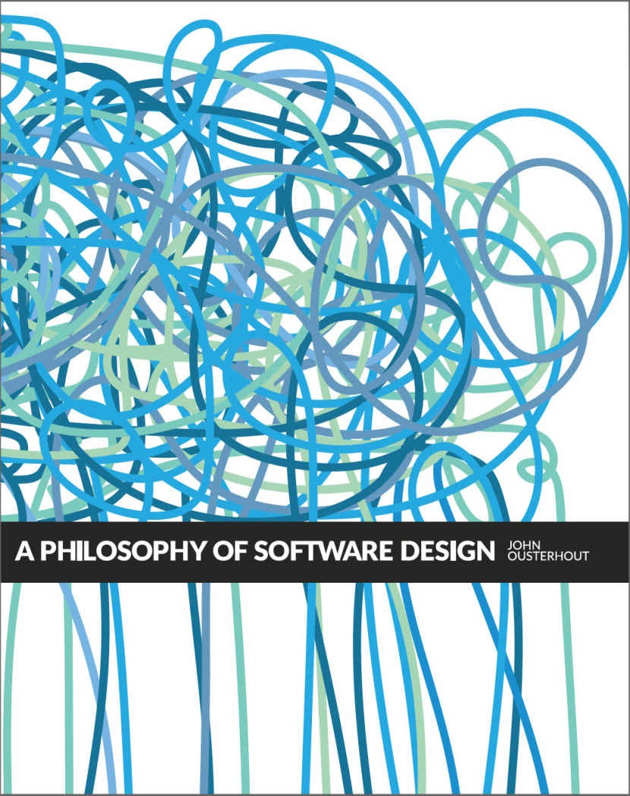

<!-- SOURCE pdf-002-b000 -->

# 软件设计的哲学 {#book-title}

*A Philosophy of Software Design*

<!-- SOURCE pdf-002-b001 -->

John Ousterhout · 斯坦福大学

第一版 · v1.01 · 中文译文

[开始阅读](preface.md) · [全书目录](toc.md) · [设计原则汇总](principles.md)

