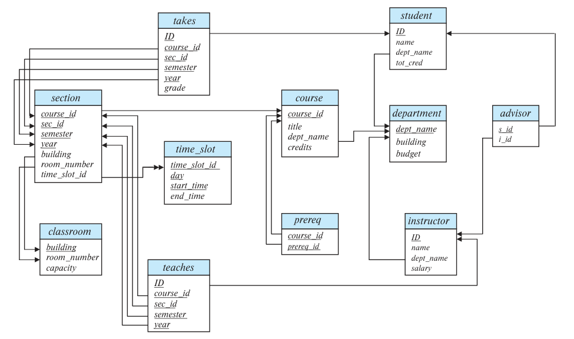

<!-- SOURCE pdf-1316-b004 -->
<!-- SOURCE pdf-1316-b005 -->
# 附录 A 大学数据库的完整模式 {#appendix-a}

<!-- SOURCE pdf-1316-b006 -->
本附录给出贯穿全书的大学数据库示例的完整资料。A.1 节介绍正文使用的完整模式及其对应的 E-R 图；A.2 节提供较完整的 SQL 数据定义，除了各属性的数据类型，还包含许多约束；A.3 节给出符合该模式的示例数据。创建全部关系并填入示例数据的 SQL 脚本，可在本书网站 [db-book.com](https://db-book.com) 获取。

<!-- SOURCE pdf-1316-b007 -->
## A.1 完整模式

<!-- SOURCE pdf-1316-b008 -->
下面列出正文使用的大学数据库完整模式。图 A.1 给出了相应的模式图，也是全书使用的模式图。

<!-- SOURCE pdf-1316-b009 -->
<!-- SOURCE pdf-1316-b011 -->
<!-- SOURCE pdf-1316-b013 -->
<!-- SOURCE pdf-1316-b015 -->
<!-- SOURCE pdf-1316-b017 -->
<!-- SOURCE pdf-1316-b019 -->
<!-- SOURCE pdf-1316-b021 -->
<!-- SOURCE pdf-1316-b023 -->
<!-- SOURCE pdf-1316-b025 -->
<!-- SOURCE pdf-1316-b027 -->
<!-- SOURCE pdf-1316-b029 -->
<!-- SOURCE pdf-1316-b031 -->
<!-- SOURCE pdf-1316-b033 -->
<!-- SOURCE pdf-1316-b035 -->
<!-- SOURCE pdf-1316-b037 -->
<!-- SOURCE pdf-1316-b039 -->
<!-- SOURCE pdf-1316-b041 -->
<!-- SOURCE pdf-1316-b043 -->
<!-- SOURCE pdf-1316-b045 -->
<!-- SOURCE pdf-1316-b047 -->
<!-- SOURCE pdf-1316-b049 -->
<!-- SOURCE pdf-1316-b051 -->
<!-- SOURCE pdf-1316-b053 -->
<!-- SOURCE pdf-1316-b055 -->
<!-- SOURCE pdf-1316-b057 -->
<!-- SOURCE pdf-1316-b059 -->
<!-- SOURCE pdf-1316-b061 -->
<!-- SOURCE pdf-1316-b063 -->
<!-- SOURCE pdf-1316-b065 -->
<!-- SOURCE pdf-1316-b067 -->
<!-- SOURCE pdf-1316-b069 -->
<!-- SOURCE pdf-1316-b071 -->
<!-- SOURCE pdf-1316-b073 -->
<!-- SOURCE pdf-1316-b075 -->
<!-- SOURCE pdf-1316-b077 -->
<!-- SOURCE pdf-1316-b079 -->
<!-- SOURCE pdf-1316-b081 -->
<!-- SOURCE pdf-1316-b083 -->
<!-- SOURCE pdf-1316-b085 -->
<!-- SOURCE pdf-1316-b087 -->
<!-- SOURCE pdf-1316-b089 -->
<!-- SOURCE pdf-1316-b091 -->
<!-- SOURCE pdf-1316-b093 -->
<!-- SOURCE pdf-1316-b095 -->
<!-- SOURCE pdf-1316-b097 -->
<!-- SOURCE pdf-1316-b099 -->
<!-- SOURCE pdf-1316-b101 -->
<!-- SOURCE pdf-1316-b103 -->
<!-- SOURCE pdf-1316-b105 -->
<!-- SOURCE pdf-1316-b107 -->
<!-- SOURCE pdf-1316-b109 -->
<!-- SOURCE pdf-1316-b111 -->
<pre>
classroom(<u>building</u>, <u>room_number</u>, capacity)
department(<u>dept_name</u>, building, budget)
course(<u>course_id</u>, title, dept_name, credits)
instructor(<u>ID</u>, name, dept_name, salary)
section(<u>course_id</u>, <u>sec_id</u>, <u>semester</u>, <u>year</u>, building, room_number, time_slot_id)
teaches(<u>ID</u>, <u>course_id</u>, <u>sec_id</u>, <u>semester</u>, <u>year</u>)
student(<u>ID</u>, name, dept_name, tot_cred)
takes(<u>ID</u>, <u>course_id</u>, <u>sec_id</u>, <u>semester</u>, <u>year</u>, grade)
advisor(<u>s_ID</u>, i_ID)
time_slot(<u>time_slot_id</u>, <u>day</u>, <u>start_time</u>, end_time)
prereq(<u>course_id</u>, <u>prereq_id</u>)
</pre>

下划线标出各关系的主键属性。

<!-- SOURCE pdf-1317-b001 -->
<!-- SOURCE pdf-1317-b002 -->
<!-- SOURCE pdf-1317-b003 -->
<!-- SOURCE pdf-1317-b004 -->
<!-- SOURCE pdf-1317-b005 -->
<!-- SOURCE pdf-1317-b006 -->
<!-- SOURCE pdf-1317-b007 -->
<!-- SOURCE pdf-1317-b008 -->
<!-- SOURCE pdf-1317-b009 -->
<!-- SOURCE pdf-1317-b010 -->
<!-- SOURCE pdf-1317-b011 -->
<!-- SOURCE pdf-1317-b012 -->
<!-- SOURCE pdf-1317-b013 -->
<!-- SOURCE pdf-1317-b014 -->
<!-- SOURCE pdf-1317-b015 -->
<!-- SOURCE pdf-1317-b016 -->
<!-- SOURCE pdf-1317-b017 -->
<!-- SOURCE pdf-1317-b018 -->
<!-- SOURCE pdf-1317-b019 -->
<!-- SOURCE pdf-1317-b020 -->
<!-- SOURCE pdf-1317-b021 -->
<!-- SOURCE pdf-1317-b022 -->
<!-- SOURCE pdf-1317-b023 -->


**图 A.1 大学数据库的模式图。**

图中关系名：`classroom` 为教室，`department` 为系，`course` 为课程，`instructor` 为教师，`section` 为课程开设的教学班，`teaches` 为授课记录，`student` 为学生，`takes` 为选课记录，`advisor` 为导师关系，`time_slot` 为上课时段，`prereq` 为先修课程关系。

属性名：`building` 为楼宇，`room_number` 为房间号，`capacity` 为容纳人数，`dept_name` 为系名，`budget` 为预算，`course_id` 为课程编号，`title` 为课程名称，`credits` 为学分，`ID` 为人员编号，`name` 为姓名，`salary` 为工资，`sec_id` 为教学班编号，`semester` 为学期，`year` 为年份，`time_slot_id` 为时段编号，`tot_cred` 为累计学分，`grade` 为成绩，`s_id` 为学生编号，`i_id` 为教师编号，`day` 为星期，`start_time` 和 `end_time` 为开始、结束时间，`prereq_id` 为先修课程编号。

<!-- SOURCE pdf-1317-b024 -->
## A.2 数据定义语言（DDL）

<!-- SOURCE pdf-1317-b025 -->
本节为示例提供较完整的 SQL 数据定义。除了指定各属性的数据类型，我们还给出了许多约束。

<!-- SOURCE pdf-1317-b026 -->
<!-- SOURCE pdf-1317-b027 -->
<!-- SOURCE pdf-1317-b029 -->
<!-- SOURCE pdf-1317-b031 -->
```sql
create table classroom
    (building    varchar (15),
     room_number varchar (7),
     capacity    numeric (4,0),
     primary key (building, room_number));
```

<!-- SOURCE pdf-1317-b032 -->
<!-- SOURCE pdf-1317-b033 -->
<!-- SOURCE pdf-1317-b035 -->
<!-- SOURCE pdf-1317-b037 -->
```sql
create table department
    (dept_name varchar (20),
     building  varchar (15),
     budget    numeric (12,2) check (budget > 0),
     primary key (dept_name));
```

<!-- SOURCE pdf-1318-b001 -->
<!-- SOURCE pdf-1318-b002 -->
<!-- SOURCE pdf-1318-b004 -->
<!-- SOURCE pdf-1318-b006 -->
<!-- SOURCE pdf-1318-b008 -->
<!-- SOURCE pdf-1318-b010 -->
```sql
create table course
    (course_id varchar (7),
     title     varchar (50),
     dept_name varchar (20),
     credits   numeric (2,0) check (credits > 0),
     primary key (course_id),
     foreign key (dept_name) references department
         on delete set null);
```

<!-- SOURCE pdf-1318-b011 -->
<!-- SOURCE pdf-1318-b012 -->
<!-- SOURCE pdf-1318-b014 -->
<!-- SOURCE pdf-1318-b016 -->
```sql
create table instructor
    (ID        varchar (5),
     name      varchar (20) not null,
     dept_name varchar (20),
     salary    numeric (8,2) check (salary > 29000),
     primary key (ID),
     foreign key (dept_name) references department
         on delete set null);
```

<!-- SOURCE pdf-1318-b017 -->
<!-- SOURCE pdf-1318-b018 -->
<!-- SOURCE pdf-1318-b020 -->
<!-- SOURCE pdf-1318-b022 -->
<!-- SOURCE pdf-1318-b023 -->
<!-- SOURCE pdf-1318-b025 -->
<!-- SOURCE pdf-1318-b027 -->
<!-- SOURCE pdf-1318-b029 -->
<!-- SOURCE pdf-1318-b031 -->
<!-- SOURCE pdf-1318-b033 -->
<!-- SOURCE pdf-1318-b035 -->
<!-- SOURCE pdf-1318-b037 -->
```sql
create table section
    (course_id    varchar (8),
     sec_id       varchar (8),
     semester     varchar (6) check (semester in
                      ('Fall', 'Winter', 'Spring', 'Summer')),
     year         numeric (4,0) check (year > 1701 and year < 2100),
     building     varchar (15),
     room_number  varchar (7),
     time_slot_id varchar (4),
     primary key (course_id, sec_id, semester, year),
     foreign key (course_id) references course
         on delete cascade,
     foreign key (building, room_number) references classroom
         on delete set null);
```

<!-- SOURCE pdf-1318-b038 -->
在上述 DDL 中，如果某个元组依赖它所引用的元组才能存在，我们就在外键约束上添加 `on delete cascade`。例如，从弱实体 section 生成的 `section` 表到 `course` 表的外键约束，就指定了级联删除；两者之间原本存在标识联系。其他外键约束则指定 `on delete set null`，允许删除被引用元组，同时将引用值设为 `null`；或者不指定删除动作，从而禁止删除仍被引用的元组。例如，删除一个系时，我们不希望一并删除该系的教师。

<!-- SOURCE pdf-1319-b001 -->
<!-- SOURCE pdf-1319-b003 -->
<!-- SOURCE pdf-1319-b005 -->
`instructor` 到 `department` 的外键约束会将 `dept_name` 属性设为 `null`。后面给出的 `prereq` 关系则会阻止删除仍作为其他课程先修要求的课程。对于后面的 `advisor` 关系，删除教师时，允许将 `i_ID` 设为 `null`；删除被引用的学生时，则删除相应的 `advisor` 元组。

<!-- SOURCE pdf-1319-b006 -->
<!-- SOURCE pdf-1319-b007 -->
<!-- SOURCE pdf-1319-b009 -->
<!-- SOURCE pdf-1319-b011 -->
<!-- SOURCE pdf-1319-b013 -->
<!-- SOURCE pdf-1319-b015 -->
<!-- SOURCE pdf-1319-b017 -->
<!-- SOURCE pdf-1319-b019 -->
<!-- SOURCE pdf-1319-b020 -->
```sql
create table teaches
    (ID        varchar (5),
     course_id varchar (8),
     sec_id    varchar (8),
     semester  varchar (6),
     year      numeric (4,0),
     primary key (ID, course_id, sec_id, semester, year),
     foreign key (course_id, sec_id, semester, year) references section
         on delete cascade,
     foreign key (ID) references instructor
         on delete cascade);
```

<!-- SOURCE pdf-1319-b021 -->
<!-- SOURCE pdf-1319-b022 -->
<!-- SOURCE pdf-1319-b024 -->
<!-- SOURCE pdf-1319-b026 -->
<!-- SOURCE pdf-1319-b028 -->
<!-- SOURCE pdf-1319-b030 -->
```sql
create table student
    (ID        varchar (5),
     name      varchar (20) not null,
     dept_name varchar (20),
     tot_cred  numeric (3,0) check (tot_cred >= 0),
     primary key (ID),
     foreign key (dept_name) references department
         on delete set null);
```

<!-- SOURCE pdf-1319-b031 -->
<!-- SOURCE pdf-1319-b032 -->
<!-- SOURCE pdf-1319-b034 -->
<!-- SOURCE pdf-1319-b036 -->
<!-- SOURCE pdf-1319-b038 -->
<!-- SOURCE pdf-1319-b040 -->
<!-- SOURCE pdf-1319-b042 -->
<!-- SOURCE pdf-1319-b044 -->
<!-- SOURCE pdf-1319-b045 -->
```sql
create table takes
    (ID        varchar (5),
     course_id varchar (8),
     sec_id    varchar (8),
     semester  varchar (6),
     year      numeric (4,0),
     grade     varchar (2),
     primary key (ID, course_id, sec_id, semester, year),
     foreign key (course_id, sec_id, semester, year) references section
         on delete cascade,
     foreign key (ID) references student
         on delete cascade);
```

<!-- SOURCE pdf-1320-b001 -->
<!-- SOURCE pdf-1320-b002 -->
<!-- SOURCE pdf-1320-b004 -->
<!-- SOURCE pdf-1320-b006 -->
<!-- SOURCE pdf-1320-b008 -->
<!-- SOURCE pdf-1320-b010 -->
<!-- SOURCE pdf-1320-b011 -->
<!-- SOURCE pdf-1320-b013 -->
<!-- SOURCE pdf-1320-b014 -->
```sql
create table advisor
    (s_ID varchar (5),
     i_ID varchar (5),
     primary key (s_ID),
     foreign key (i_ID) references instructor (ID)
         on delete set null,
     foreign key (s_ID) references student (ID)
         on delete cascade);
```

<!-- SOURCE pdf-1320-b015 -->
<!-- SOURCE pdf-1320-b016 -->
<!-- SOURCE pdf-1320-b018 -->
<!-- SOURCE pdf-1320-b020 -->
<!-- SOURCE pdf-1320-b022 -->
<!-- SOURCE pdf-1320-b024 -->
<!-- SOURCE pdf-1320-b026 -->
<!-- SOURCE pdf-1320-b028 -->
```sql
create table prereq
    (course_id varchar(8),
     prereq_id varchar(8),
     primary key (course_id, prereq_id),
     foreign key (course_id) references course
         on delete cascade,
     foreign key (prereq_id) references course);
```

<!-- SOURCE pdf-1320-b029 -->
<!-- SOURCE pdf-1320-b031 -->
下面为 `time_slot` 表给出的 `create table` 语句可以在多数数据库系统上运行，但不适用于 Oracle，至少截至 Oracle 11 版仍是如此，因为 Oracle 不支持 SQL 标准的 `time` 类型。

<!-- SOURCE pdf-1320-b032 -->
<!-- SOURCE pdf-1320-b033 -->
<!-- SOURCE pdf-1320-b035 -->
<!-- SOURCE pdf-1320-b037 -->
<!-- SOURCE pdf-1320-b039 -->
<!-- SOURCE pdf-1320-b041 -->
<!-- SOURCE pdf-1320-b043 -->
<!-- SOURCE pdf-1320-b045 -->
<!-- SOURCE pdf-1320-b047 -->
```sql
create table timeslot
    (time_slot_id varchar (4),
     day          varchar (1) check (day in ('M', 'T', 'W', 'R', 'F', 'S', 'U')),
     start_time   time,
     end_time     time,
     primary key (time_slot_id, day, start_time));
```

<!-- SOURCE pdf-1320-b048 -->
SQL 中指定时间的语法可见这些例子：`'08:30'`、`'13:55'` 和 `'5:30 PM'`。由于 Oracle 不支持 `time` 类型，我们改用下面的模式：

<!-- SOURCE pdf-1320-b049 -->
<!-- SOURCE pdf-1320-b050 -->
<!-- SOURCE pdf-1320-b052 -->
<!-- SOURCE pdf-1320-b054 -->
<!-- SOURCE pdf-1320-b056 -->
<!-- SOURCE pdf-1320-b058 -->
<!-- SOURCE pdf-1320-b060 -->
<!-- SOURCE pdf-1320-b062 -->
<!-- SOURCE pdf-1320-b064 -->
<!-- SOURCE pdf-1320-b066 -->
<!-- SOURCE pdf-1320-b068 -->
<!-- SOURCE pdf-1320-b070 -->
<!-- SOURCE pdf-1320-b072 -->
<!-- SOURCE pdf-1320-b074 -->
<!-- SOURCE pdf-1320-b076 -->
<!-- SOURCE pdf-1320-b078 -->
<!-- SOURCE pdf-1320-b080 -->
<!-- SOURCE pdf-1320-b082 -->
<!-- SOURCE pdf-1320-b084 -->
<!-- SOURCE pdf-1320-b086 -->
```sql
create table timeslot
    (time_slot_id varchar (4),
     day          varchar (1),
     start_hr     numeric (2) check (start_hr >= 0 and end_hr < 24),
     start_min    numeric (2) check (start_min >= 0 and start_min < 60),
     end_hr       numeric (2) check (end_hr >= 0 and end_hr < 24),
     end_min      numeric (2) check (end_min >= 0 and end_min < 60),
     primary key (time_slot_id, day, start_hr, start_min));
```

> 译注：原书这两段 DDL 的表名均写作 `timeslot`，前面的模式与正文使用 `time_slot`。第二段 `start_hr` 的检查条件原样写成 `start_hr >= 0 and end_hr < 24`；若要限制开始小时的有效范围，上界应检查 `start_hr < 24`。以上代码保留原书写法，实际使用时应统一表名并修正该条件。

<!-- SOURCE pdf-1320-b087 -->
<!-- SOURCE pdf-1320-b089 -->
<!-- SOURCE pdf-1320-b091 -->
<!-- SOURCE pdf-1320-b093 -->
<!-- SOURCE pdf-1320-b095 -->
<!-- SOURCE pdf-1320-b097 -->
<!-- SOURCE pdf-1320-b099 -->
区别在于，`start_time` 被拆为 `start_hr` 和 `start_min` 两个属性，`end_time` 也相应拆为 `end_hr` 和 `end_min`。

<!-- SOURCE pdf-1321-b001 -->
<!-- SOURCE pdf-1321-b003 -->
这些属性还设有约束，确保其中的数字只表示有效时间。这一版 `time_slot` 模式可用于包括 Oracle 在内的所有数据库。注意，虽然 Oracle 支持 `datetime` 数据类型，但它除了时间还包含具体的年、月、日；此处只需要时间，因此不适用。除了把时间分成小时和分钟，还有两种方案，但都不理想：其一是使用 `varchar`，这样既难以约束字符串的有效性，也难以比较时间；其二是将时间编码为自午夜起经过的分钟数或秒数，但每个查询都需要额外代码，在标准时间表示与整数编码之间转换。我们因此选择将时间分为两部分。

<!-- SOURCE pdf-1321-b004 -->
## A.3 示例数据

<!-- SOURCE pdf-1321-b005 -->
本节给出上一节定义的各个关系的示例数据。

<!-- SOURCE pdf-1321-b016 -->
<!-- SOURCE pdf-1321-b019 -->
<!-- SOURCE pdf-1321-b021 -->
<!-- SOURCE pdf-1321-b024 -->
<!-- SOURCE pdf-1321-b033 -->
<!-- SOURCE pdf-1321-b035 -->
<!-- SOURCE pdf-1321-b037 -->
<!-- SOURCE pdf-1321-b040 -->
<!-- SOURCE pdf-1321-b042 -->
<!-- SOURCE pdf-1321-b044 -->
<!-- SOURCE pdf-1321-b047 -->
<!-- SOURCE pdf-1321-b049 -->
<!-- SOURCE pdf-1321-b051 -->
<!-- SOURCE pdf-1321-b054 -->
<!-- SOURCE pdf-1321-b056 -->
<!-- SOURCE pdf-1321-b058 -->
<!-- SOURCE pdf-1321-b061 -->
<!-- SOURCE pdf-1321-b063 -->
<!-- SOURCE pdf-1321-b065 -->
<!-- SOURCE pdf-1321-b068 -->
### 图 A.2 classroom 关系：教室

| building（楼宇） | room_number（房间号） | capacity（容纳人数） |
| --- | --- | --- |
| Packard | 101 | 500 |
| Painter | 514 | 10 |
| Taylor | 3128 | 70 |
| Watson | 100 | 30 |
| Watson | 120 | 50 |

<!-- SOURCE pdf-1321-b079 -->
<!-- SOURCE pdf-1321-b081 -->
<!-- SOURCE pdf-1321-b084 -->
<!-- SOURCE pdf-1321-b087 -->
<!-- SOURCE pdf-1321-b096 -->
<!-- SOURCE pdf-1321-b098 -->
<!-- SOURCE pdf-1321-b100 -->
<!-- SOURCE pdf-1321-b103 -->
<!-- SOURCE pdf-1321-b105 -->
<!-- SOURCE pdf-1321-b107 -->
<!-- SOURCE pdf-1321-b110 -->
<!-- SOURCE pdf-1321-b112 -->
<!-- SOURCE pdf-1321-b114 -->
<!-- SOURCE pdf-1321-b117 -->
<!-- SOURCE pdf-1321-b119 -->
<!-- SOURCE pdf-1321-b121 -->
<!-- SOURCE pdf-1321-b124 -->
<!-- SOURCE pdf-1321-b126 -->
<!-- SOURCE pdf-1321-b128 -->
<!-- SOURCE pdf-1321-b131 -->
<!-- SOURCE pdf-1321-b133 -->
<!-- SOURCE pdf-1321-b135 -->
<!-- SOURCE pdf-1321-b138 -->
<!-- SOURCE pdf-1321-b140 -->
<!-- SOURCE pdf-1321-b142 -->
<!-- SOURCE pdf-1321-b145 -->
### 图 A.3 department 关系：系

| dept_name（系名） | building（楼宇） | budget（预算） |
| --- | --- | --- |
| Biology | Watson | 90000 |
| Comp. Sci. | Taylor | 100000 |
| Elec. Eng. | Taylor | 85000 |
| Finance | Painter | 120000 |
| History | Painter | 50000 |
| Music | Packard | 80000 |
| Physics | Watson | 70000 |

系名释义：Biology 为生物学，Comp. Sci. 为计算机科学，Elec. Eng. 为电气工程，Finance 为金融，History 为历史，Music 为音乐，Physics 为物理。

<!-- SOURCE pdf-1322-b015 -->
<!-- SOURCE pdf-1322-b017 -->
<!-- SOURCE pdf-1322-b020 -->
<!-- SOURCE pdf-1322-b023 -->
<!-- SOURCE pdf-1322-b025 -->
<!-- SOURCE pdf-1322-b028 -->
<!-- SOURCE pdf-1322-b038 -->
<!-- SOURCE pdf-1322-b040 -->
<!-- SOURCE pdf-1322-b042 -->
<!-- SOURCE pdf-1322-b044 -->
<!-- SOURCE pdf-1322-b047 -->
<!-- SOURCE pdf-1322-b049 -->
<!-- SOURCE pdf-1322-b051 -->
<!-- SOURCE pdf-1322-b053 -->
<!-- SOURCE pdf-1322-b056 -->
<!-- SOURCE pdf-1322-b058 -->
<!-- SOURCE pdf-1322-b060 -->
<!-- SOURCE pdf-1322-b062 -->
<!-- SOURCE pdf-1322-b065 -->
<!-- SOURCE pdf-1322-b067 -->
<!-- SOURCE pdf-1322-b069 -->
<!-- SOURCE pdf-1322-b071 -->
<!-- SOURCE pdf-1322-b074 -->
<!-- SOURCE pdf-1322-b076 -->
<!-- SOURCE pdf-1322-b078 -->
<!-- SOURCE pdf-1322-b080 -->
<!-- SOURCE pdf-1322-b083 -->
<!-- SOURCE pdf-1322-b085 -->
<!-- SOURCE pdf-1322-b087 -->
<!-- SOURCE pdf-1322-b089 -->
<!-- SOURCE pdf-1322-b092 -->
<!-- SOURCE pdf-1322-b094 -->
<!-- SOURCE pdf-1322-b096 -->
<!-- SOURCE pdf-1322-b098 -->
<!-- SOURCE pdf-1322-b101 -->
<!-- SOURCE pdf-1322-b103 -->
<!-- SOURCE pdf-1322-b105 -->
<!-- SOURCE pdf-1322-b107 -->
<!-- SOURCE pdf-1322-b110 -->
<!-- SOURCE pdf-1322-b112 -->
<!-- SOURCE pdf-1322-b114 -->
<!-- SOURCE pdf-1322-b116 -->
<!-- SOURCE pdf-1322-b119 -->
<!-- SOURCE pdf-1322-b121 -->
<!-- SOURCE pdf-1322-b123 -->
<!-- SOURCE pdf-1322-b125 -->
<!-- SOURCE pdf-1322-b128 -->
<!-- SOURCE pdf-1322-b130 -->
<!-- SOURCE pdf-1322-b132 -->
<!-- SOURCE pdf-1322-b134 -->
<!-- SOURCE pdf-1322-b137 -->
<!-- SOURCE pdf-1322-b139 -->
<!-- SOURCE pdf-1322-b141 -->
<!-- SOURCE pdf-1322-b143 -->
<!-- SOURCE pdf-1322-b146 -->
<!-- SOURCE pdf-1322-b148 -->
<!-- SOURCE pdf-1322-b150 -->
<!-- SOURCE pdf-1322-b152 -->
<!-- SOURCE pdf-1322-b155 -->
### 图 A.4 course 关系：课程

| course_id（课程编号） | title（课程名称） | dept_name（系名） | credits（学分） |
| --- | --- | --- | --- |
| BIO-101 | Intro. to Biology | Biology | 4 |
| BIO-301 | Genetics | Biology | 4 |
| BIO-399 | Computational Biology | Biology | 3 |
| CS-101 | Intro. to Computer Science | Comp. Sci. | 4 |
| CS-190 | Game Design | Comp. Sci. | 4 |
| CS-315 | Robotics | Comp. Sci. | 3 |
| CS-319 | Image Processing | Comp. Sci. | 3 |
| CS-347 | Database System Concepts | Comp. Sci. | 3 |
| EE-181 | Intro. to Digital Systems | Elec. Eng. | 3 |
| FIN-201 | Investment Banking | Finance | 3 |
| HIS-351 | World History | History | 3 |
| MU-199 | Music Video Production | Music | 3 |
| PHY-101 | Physical Principles | Physics | 4 |

课程名称释义：Intro. to Biology 为生物学导论，Genetics 为遗传学，Computational Biology 为计算生物学，Intro. to Computer Science 为计算机科学导论，Game Design 为游戏设计，Robotics 为机器人学，Image Processing 为图像处理，Database System Concepts 为数据库系统概念，Intro. to Digital Systems 为数字系统导论，Investment Banking 为投资银行学，World History 为世界史，Music Video Production 为音乐视频制作，Physical Principles 为物理原理。

<!-- SOURCE pdf-1322-b168 -->
<!-- SOURCE pdf-1322-b171 -->
<!-- SOURCE pdf-1322-b174 -->
<!-- SOURCE pdf-1322-b176 -->
<!-- SOURCE pdf-1322-b179 -->
<!-- SOURCE pdf-1322-b189 -->
<!-- SOURCE pdf-1322-b191 -->
<!-- SOURCE pdf-1322-b193 -->
<!-- SOURCE pdf-1322-b195 -->
<!-- SOURCE pdf-1322-b198 -->
<!-- SOURCE pdf-1322-b200 -->
<!-- SOURCE pdf-1322-b202 -->
<!-- SOURCE pdf-1322-b204 -->
<!-- SOURCE pdf-1322-b207 -->
<!-- SOURCE pdf-1322-b209 -->
<!-- SOURCE pdf-1322-b211 -->
<!-- SOURCE pdf-1322-b213 -->
<!-- SOURCE pdf-1322-b216 -->
<!-- SOURCE pdf-1322-b218 -->
<!-- SOURCE pdf-1322-b220 -->
<!-- SOURCE pdf-1322-b222 -->
<!-- SOURCE pdf-1322-b225 -->
<!-- SOURCE pdf-1322-b227 -->
<!-- SOURCE pdf-1322-b229 -->
<!-- SOURCE pdf-1322-b231 -->
<!-- SOURCE pdf-1322-b234 -->
<!-- SOURCE pdf-1322-b236 -->
<!-- SOURCE pdf-1322-b238 -->
<!-- SOURCE pdf-1322-b240 -->
<!-- SOURCE pdf-1322-b243 -->
<!-- SOURCE pdf-1322-b245 -->
<!-- SOURCE pdf-1322-b247 -->
<!-- SOURCE pdf-1322-b249 -->
<!-- SOURCE pdf-1322-b252 -->
<!-- SOURCE pdf-1322-b254 -->
<!-- SOURCE pdf-1322-b256 -->
<!-- SOURCE pdf-1322-b258 -->
<!-- SOURCE pdf-1322-b261 -->
<!-- SOURCE pdf-1322-b263 -->
<!-- SOURCE pdf-1322-b265 -->
<!-- SOURCE pdf-1322-b267 -->
<!-- SOURCE pdf-1322-b270 -->
<!-- SOURCE pdf-1322-b272 -->
<!-- SOURCE pdf-1322-b274 -->
<!-- SOURCE pdf-1322-b276 -->
<!-- SOURCE pdf-1322-b279 -->
<!-- SOURCE pdf-1322-b281 -->
<!-- SOURCE pdf-1322-b283 -->
<!-- SOURCE pdf-1322-b285 -->
<!-- SOURCE pdf-1322-b288 -->
<!-- SOURCE pdf-1322-b290 -->
<!-- SOURCE pdf-1322-b292 -->
<!-- SOURCE pdf-1322-b294 -->
<!-- SOURCE pdf-1322-b297 -->
### 图 A.5 instructor 关系：教师

| ID（教师编号） | name（姓名） | dept_name（系名） | salary（工资） |
| --- | --- | --- | --- |
| 10101 | Srinivasan | Comp. Sci. | 65000 |
| 12121 | Wu | Finance | 90000 |
| 15151 | Mozart | Music | 40000 |
| 22222 | Einstein | Physics | 95000 |
| 32343 | El Said | History | 60000 |
| 33456 | Gold | Physics | 87000 |
| 45565 | Katz | Comp. Sci. | 75000 |
| 58583 | Califieri | History | 62000 |
| 76543 | Singh | Finance | 80000 |
| 76766 | Crick | Biology | 72000 |
| 83821 | Brandt | Comp. Sci. | 92000 |
| 98345 | Kim | Elec. Eng. | 80000 |

<!-- SOURCE pdf-1323-b019 -->
<!-- SOURCE pdf-1323-b021 -->
<!-- SOURCE pdf-1323-b024 -->
<!-- SOURCE pdf-1323-b026 -->
<!-- SOURCE pdf-1323-b029 -->
<!-- SOURCE pdf-1323-b032 -->
<!-- SOURCE pdf-1323-b035 -->
<!-- SOURCE pdf-1323-b038 -->
<!-- SOURCE pdf-1323-b040 -->
<!-- SOURCE pdf-1323-b043 -->
<!-- SOURCE pdf-1323-b045 -->
<!-- SOURCE pdf-1323-b047 -->
<!-- SOURCE pdf-1323-b060 -->
<!-- SOURCE pdf-1323-b062 -->
<!-- SOURCE pdf-1323-b064 -->
<!-- SOURCE pdf-1323-b066 -->
<!-- SOURCE pdf-1323-b068 -->
<!-- SOURCE pdf-1323-b070 -->
<!-- SOURCE pdf-1323-b072 -->
<!-- SOURCE pdf-1323-b075 -->
<!-- SOURCE pdf-1323-b077 -->
<!-- SOURCE pdf-1323-b079 -->
<!-- SOURCE pdf-1323-b081 -->
<!-- SOURCE pdf-1323-b083 -->
<!-- SOURCE pdf-1323-b085 -->
<!-- SOURCE pdf-1323-b087 -->
<!-- SOURCE pdf-1323-b090 -->
<!-- SOURCE pdf-1323-b092 -->
<!-- SOURCE pdf-1323-b094 -->
<!-- SOURCE pdf-1323-b096 -->
<!-- SOURCE pdf-1323-b098 -->
<!-- SOURCE pdf-1323-b100 -->
<!-- SOURCE pdf-1323-b102 -->
<!-- SOURCE pdf-1323-b105 -->
<!-- SOURCE pdf-1323-b107 -->
<!-- SOURCE pdf-1323-b109 -->
<!-- SOURCE pdf-1323-b111 -->
<!-- SOURCE pdf-1323-b113 -->
<!-- SOURCE pdf-1323-b115 -->
<!-- SOURCE pdf-1323-b117 -->
<!-- SOURCE pdf-1323-b120 -->
<!-- SOURCE pdf-1323-b122 -->
<!-- SOURCE pdf-1323-b124 -->
<!-- SOURCE pdf-1323-b126 -->
<!-- SOURCE pdf-1323-b128 -->
<!-- SOURCE pdf-1323-b130 -->
<!-- SOURCE pdf-1323-b132 -->
<!-- SOURCE pdf-1323-b135 -->
<!-- SOURCE pdf-1323-b137 -->
<!-- SOURCE pdf-1323-b139 -->
<!-- SOURCE pdf-1323-b141 -->
<!-- SOURCE pdf-1323-b143 -->
<!-- SOURCE pdf-1323-b145 -->
<!-- SOURCE pdf-1323-b147 -->
<!-- SOURCE pdf-1323-b150 -->
<!-- SOURCE pdf-1323-b152 -->
<!-- SOURCE pdf-1323-b154 -->
<!-- SOURCE pdf-1323-b156 -->
<!-- SOURCE pdf-1323-b158 -->
<!-- SOURCE pdf-1323-b160 -->
<!-- SOURCE pdf-1323-b162 -->
<!-- SOURCE pdf-1323-b165 -->
<!-- SOURCE pdf-1323-b167 -->
<!-- SOURCE pdf-1323-b169 -->
<!-- SOURCE pdf-1323-b171 -->
<!-- SOURCE pdf-1323-b173 -->
<!-- SOURCE pdf-1323-b175 -->
<!-- SOURCE pdf-1323-b177 -->
<!-- SOURCE pdf-1323-b180 -->
<!-- SOURCE pdf-1323-b182 -->
<!-- SOURCE pdf-1323-b184 -->
<!-- SOURCE pdf-1323-b186 -->
<!-- SOURCE pdf-1323-b188 -->
<!-- SOURCE pdf-1323-b190 -->
<!-- SOURCE pdf-1323-b192 -->
<!-- SOURCE pdf-1323-b195 -->
<!-- SOURCE pdf-1323-b197 -->
<!-- SOURCE pdf-1323-b199 -->
<!-- SOURCE pdf-1323-b201 -->
<!-- SOURCE pdf-1323-b203 -->
<!-- SOURCE pdf-1323-b205 -->
<!-- SOURCE pdf-1323-b207 -->
<!-- SOURCE pdf-1323-b210 -->
<!-- SOURCE pdf-1323-b212 -->
<!-- SOURCE pdf-1323-b214 -->
<!-- SOURCE pdf-1323-b216 -->
<!-- SOURCE pdf-1323-b218 -->
<!-- SOURCE pdf-1323-b220 -->
<!-- SOURCE pdf-1323-b222 -->
<!-- SOURCE pdf-1323-b225 -->
<!-- SOURCE pdf-1323-b227 -->
<!-- SOURCE pdf-1323-b229 -->
<!-- SOURCE pdf-1323-b231 -->
<!-- SOURCE pdf-1323-b233 -->
<!-- SOURCE pdf-1323-b235 -->
<!-- SOURCE pdf-1323-b237 -->
<!-- SOURCE pdf-1323-b240 -->
<!-- SOURCE pdf-1323-b242 -->
<!-- SOURCE pdf-1323-b244 -->
<!-- SOURCE pdf-1323-b246 -->
<!-- SOURCE pdf-1323-b248 -->
<!-- SOURCE pdf-1323-b250 -->
<!-- SOURCE pdf-1323-b252 -->
<!-- SOURCE pdf-1323-b255 -->
<!-- SOURCE pdf-1323-b257 -->
<!-- SOURCE pdf-1323-b259 -->
<!-- SOURCE pdf-1323-b261 -->
<!-- SOURCE pdf-1323-b263 -->
<!-- SOURCE pdf-1323-b265 -->
<!-- SOURCE pdf-1323-b267 -->
<!-- SOURCE pdf-1323-b270 -->
<!-- SOURCE pdf-1323-b272 -->
<!-- SOURCE pdf-1323-b274 -->
<!-- SOURCE pdf-1323-b276 -->
<!-- SOURCE pdf-1323-b278 -->
<!-- SOURCE pdf-1323-b280 -->
<!-- SOURCE pdf-1323-b282 -->
<!-- SOURCE pdf-1323-b285 -->
### 图 A.6 section 关系：教学班

| course_id（课程编号） | sec_id（教学班编号） | semester（学期） | year（年份） | building（楼宇） | room_number（房间号） | time_slot_id（时段编号） |
| --- | --- | --- | --- | --- | --- | --- |
| BIO-101 | 1 | Summer | 2017 | Painter | 514 | B |
| BIO-301 | 1 | Summer | 2018 | Painter | 514 | A |
| CS-101 | 1 | Fall | 2017 | Packard | 101 | H |
| CS-101 | 1 | Spring | 2018 | Packard | 101 | F |
| CS-190 | 1 | Spring | 2017 | Taylor | 3128 | E |
| CS-190 | 2 | Spring | 2017 | Taylor | 3128 | A |
| CS-315 | 1 | Spring | 2018 | Watson | 120 | D |
| CS-319 | 1 | Spring | 2018 | Watson | 100 | B |
| CS-319 | 2 | Spring | 2018 | Taylor | 3128 | C |
| CS-347 | 1 | Fall | 2017 | Taylor | 3128 | A |
| EE-181 | 1 | Spring | 2017 | Taylor | 3128 | C |
| FIN-201 | 1 | Spring | 2018 | Packard | 101 | B |
| HIS-351 | 1 | Spring | 2018 | Painter | 514 | C |
| MU-199 | 1 | Spring | 2018 | Packard | 101 | D |
| PHY-101 | 1 | Fall | 2017 | Watson | 100 | A |

学期值：Summer 为夏季学期，Fall 为秋季学期，Spring 为春季学期。

<!-- SOURCE pdf-1323-b300 -->
<!-- SOURCE pdf-1323-b303 -->
<!-- SOURCE pdf-1323-b305 -->
<!-- SOURCE pdf-1323-b308 -->
<!-- SOURCE pdf-1323-b310 -->
<!-- SOURCE pdf-1323-b313 -->
<!-- SOURCE pdf-1323-b316 -->
<!-- SOURCE pdf-1323-b327 -->
<!-- SOURCE pdf-1323-b329 -->
<!-- SOURCE pdf-1323-b331 -->
<!-- SOURCE pdf-1323-b333 -->
<!-- SOURCE pdf-1323-b335 -->
<!-- SOURCE pdf-1323-b338 -->
<!-- SOURCE pdf-1323-b340 -->
<!-- SOURCE pdf-1323-b342 -->
<!-- SOURCE pdf-1323-b344 -->
<!-- SOURCE pdf-1323-b346 -->
<!-- SOURCE pdf-1323-b349 -->
<!-- SOURCE pdf-1323-b351 -->
<!-- SOURCE pdf-1323-b353 -->
<!-- SOURCE pdf-1323-b355 -->
<!-- SOURCE pdf-1323-b357 -->
<!-- SOURCE pdf-1323-b360 -->
<!-- SOURCE pdf-1323-b362 -->
<!-- SOURCE pdf-1323-b364 -->
<!-- SOURCE pdf-1323-b366 -->
<!-- SOURCE pdf-1323-b368 -->
<!-- SOURCE pdf-1323-b371 -->
<!-- SOURCE pdf-1323-b373 -->
<!-- SOURCE pdf-1323-b375 -->
<!-- SOURCE pdf-1323-b377 -->
<!-- SOURCE pdf-1323-b379 -->
<!-- SOURCE pdf-1323-b382 -->
<!-- SOURCE pdf-1323-b384 -->
<!-- SOURCE pdf-1323-b386 -->
<!-- SOURCE pdf-1323-b388 -->
<!-- SOURCE pdf-1323-b390 -->
<!-- SOURCE pdf-1323-b393 -->
<!-- SOURCE pdf-1323-b395 -->
<!-- SOURCE pdf-1323-b397 -->
<!-- SOURCE pdf-1323-b399 -->
<!-- SOURCE pdf-1323-b401 -->
<!-- SOURCE pdf-1323-b404 -->
<!-- SOURCE pdf-1323-b406 -->
<!-- SOURCE pdf-1323-b408 -->
<!-- SOURCE pdf-1323-b410 -->
<!-- SOURCE pdf-1323-b412 -->
<!-- SOURCE pdf-1323-b415 -->
<!-- SOURCE pdf-1323-b417 -->
<!-- SOURCE pdf-1323-b419 -->
<!-- SOURCE pdf-1323-b421 -->
<!-- SOURCE pdf-1323-b423 -->
<!-- SOURCE pdf-1323-b426 -->
<!-- SOURCE pdf-1323-b428 -->
<!-- SOURCE pdf-1323-b430 -->
<!-- SOURCE pdf-1323-b432 -->
<!-- SOURCE pdf-1323-b434 -->
<!-- SOURCE pdf-1323-b437 -->
<!-- SOURCE pdf-1323-b439 -->
<!-- SOURCE pdf-1323-b441 -->
<!-- SOURCE pdf-1323-b443 -->
<!-- SOURCE pdf-1323-b445 -->
<!-- SOURCE pdf-1323-b448 -->
<!-- SOURCE pdf-1323-b450 -->
<!-- SOURCE pdf-1323-b452 -->
<!-- SOURCE pdf-1323-b454 -->
<!-- SOURCE pdf-1323-b456 -->
<!-- SOURCE pdf-1323-b459 -->
<!-- SOURCE pdf-1323-b461 -->
<!-- SOURCE pdf-1323-b463 -->
<!-- SOURCE pdf-1323-b465 -->
<!-- SOURCE pdf-1323-b467 -->
<!-- SOURCE pdf-1323-b470 -->
<!-- SOURCE pdf-1323-b472 -->
<!-- SOURCE pdf-1323-b474 -->
<!-- SOURCE pdf-1323-b476 -->
<!-- SOURCE pdf-1323-b478 -->
<!-- SOURCE pdf-1323-b481 -->
<!-- SOURCE pdf-1323-b483 -->
<!-- SOURCE pdf-1323-b485 -->
<!-- SOURCE pdf-1323-b487 -->
<!-- SOURCE pdf-1323-b489 -->
<!-- SOURCE pdf-1323-b492 -->
### 图 A.7 teaches 关系：授课

| ID（教师编号） | course_id（课程编号） | sec_id（教学班编号） | semester（学期） | year（年份） |
| --- | --- | --- | --- | --- |
| 10101 | CS-101 | 1 | Fall | 2017 |
| 10101 | CS-315 | 1 | Spring | 2018 |
| 10101 | CS-347 | 1 | Fall | 2017 |
| 12121 | FIN-201 | 1 | Spring | 2018 |
| 15151 | MU-199 | 1 | Spring | 2018 |
| 22222 | PHY-101 | 1 | Fall | 2017 |
| 32343 | HIS-351 | 1 | Spring | 2018 |
| 45565 | CS-101 | 1 | Spring | 2018 |
| 45565 | CS-319 | 1 | Spring | 2018 |
| 76766 | BIO-101 | 1 | Summer | 2017 |
| 76766 | BIO-301 | 1 | Summer | 2018 |
| 83821 | CS-190 | 1 | Spring | 2017 |
| 83821 | CS-190 | 2 | Spring | 2017 |
| 83821 | CS-319 | 2 | Spring | 2018 |
| 98345 | EE-181 | 1 | Spring | 2017 |

<!-- SOURCE pdf-1324-b013 -->
<!-- SOURCE pdf-1324-b016 -->
<!-- SOURCE pdf-1324-b019 -->
<!-- SOURCE pdf-1324-b021 -->
<!-- SOURCE pdf-1324-b024 -->
<!-- SOURCE pdf-1324-b026 -->
<!-- SOURCE pdf-1324-b036 -->
<!-- SOURCE pdf-1324-b038 -->
<!-- SOURCE pdf-1324-b040 -->
<!-- SOURCE pdf-1324-b042 -->
<!-- SOURCE pdf-1324-b045 -->
<!-- SOURCE pdf-1324-b047 -->
<!-- SOURCE pdf-1324-b049 -->
<!-- SOURCE pdf-1324-b051 -->
<!-- SOURCE pdf-1324-b054 -->
<!-- SOURCE pdf-1324-b056 -->
<!-- SOURCE pdf-1324-b058 -->
<!-- SOURCE pdf-1324-b060 -->
<!-- SOURCE pdf-1324-b063 -->
<!-- SOURCE pdf-1324-b065 -->
<!-- SOURCE pdf-1324-b067 -->
<!-- SOURCE pdf-1324-b069 -->
<!-- SOURCE pdf-1324-b072 -->
<!-- SOURCE pdf-1324-b074 -->
<!-- SOURCE pdf-1324-b076 -->
<!-- SOURCE pdf-1324-b078 -->
<!-- SOURCE pdf-1324-b081 -->
<!-- SOURCE pdf-1324-b083 -->
<!-- SOURCE pdf-1324-b085 -->
<!-- SOURCE pdf-1324-b087 -->
<!-- SOURCE pdf-1324-b090 -->
<!-- SOURCE pdf-1324-b092 -->
<!-- SOURCE pdf-1324-b094 -->
<!-- SOURCE pdf-1324-b096 -->
<!-- SOURCE pdf-1324-b099 -->
<!-- SOURCE pdf-1324-b101 -->
<!-- SOURCE pdf-1324-b103 -->
<!-- SOURCE pdf-1324-b105 -->
<!-- SOURCE pdf-1324-b108 -->
<!-- SOURCE pdf-1324-b110 -->
<!-- SOURCE pdf-1324-b112 -->
<!-- SOURCE pdf-1324-b114 -->
<!-- SOURCE pdf-1324-b117 -->
<!-- SOURCE pdf-1324-b119 -->
<!-- SOURCE pdf-1324-b121 -->
<!-- SOURCE pdf-1324-b123 -->
<!-- SOURCE pdf-1324-b126 -->
<!-- SOURCE pdf-1324-b128 -->
<!-- SOURCE pdf-1324-b130 -->
<!-- SOURCE pdf-1324-b132 -->
<!-- SOURCE pdf-1324-b135 -->
<!-- SOURCE pdf-1324-b137 -->
<!-- SOURCE pdf-1324-b139 -->
<!-- SOURCE pdf-1324-b141 -->
<!-- SOURCE pdf-1324-b144 -->
<!-- SOURCE pdf-1324-b146 -->
<!-- SOURCE pdf-1324-b148 -->
<!-- SOURCE pdf-1324-b150 -->
<!-- SOURCE pdf-1324-b153 -->
### 图 A.8 student 关系：学生

| ID（学生编号） | name（姓名） | dept_name（系名） | tot_cred（累计学分） |
| --- | --- | --- | --- |
| 00128 | Zhang | Comp. Sci. | 102 |
| 12345 | Shankar | Comp. Sci. | 32 |
| 19991 | Brandt | History | 80 |
| 23121 | Chavez | Finance | 110 |
| 44553 | Peltier | Physics | 56 |
| 45678 | Levy | Physics | 46 |
| 54321 | Williams | Comp. Sci. | 54 |
| 55739 | Sanchez | Music | 38 |
| 70557 | Snow | Physics | 0 |
| 76543 | Brown | Comp. Sci. | 58 |
| 76653 | Aoi | Elec. Eng. | 60 |
| 98765 | Bourikas | Elec. Eng. | 98 |
| 98988 | Tanaka | Biology | 120 |

<!-- SOURCE pdf-1325-b017 -->
<!-- SOURCE pdf-1325-b020 -->
<!-- SOURCE pdf-1325-b022 -->
<!-- SOURCE pdf-1325-b025 -->
<!-- SOURCE pdf-1325-b027 -->
<!-- SOURCE pdf-1325-b030 -->
<!-- SOURCE pdf-1325-b033 -->
<!-- SOURCE pdf-1325-b036 -->
<!-- SOURCE pdf-1325-b048 -->
<!-- SOURCE pdf-1325-b050 -->
<!-- SOURCE pdf-1325-b052 -->
<!-- SOURCE pdf-1325-b054 -->
<!-- SOURCE pdf-1325-b056 -->
<!-- SOURCE pdf-1325-b058 -->
<!-- SOURCE pdf-1325-b061 -->
<!-- SOURCE pdf-1325-b063 -->
<!-- SOURCE pdf-1325-b065 -->
<!-- SOURCE pdf-1325-b067 -->
<!-- SOURCE pdf-1325-b069 -->
<!-- SOURCE pdf-1325-b071 -->
<!-- SOURCE pdf-1325-b074 -->
<!-- SOURCE pdf-1325-b076 -->
<!-- SOURCE pdf-1325-b078 -->
<!-- SOURCE pdf-1325-b080 -->
<!-- SOURCE pdf-1325-b082 -->
<!-- SOURCE pdf-1325-b084 -->
<!-- SOURCE pdf-1325-b087 -->
<!-- SOURCE pdf-1325-b089 -->
<!-- SOURCE pdf-1325-b091 -->
<!-- SOURCE pdf-1325-b093 -->
<!-- SOURCE pdf-1325-b095 -->
<!-- SOURCE pdf-1325-b097 -->
<!-- SOURCE pdf-1325-b100 -->
<!-- SOURCE pdf-1325-b102 -->
<!-- SOURCE pdf-1325-b104 -->
<!-- SOURCE pdf-1325-b106 -->
<!-- SOURCE pdf-1325-b108 -->
<!-- SOURCE pdf-1325-b110 -->
<!-- SOURCE pdf-1325-b113 -->
<!-- SOURCE pdf-1325-b115 -->
<!-- SOURCE pdf-1325-b117 -->
<!-- SOURCE pdf-1325-b119 -->
<!-- SOURCE pdf-1325-b121 -->
<!-- SOURCE pdf-1325-b123 -->
<!-- SOURCE pdf-1325-b126 -->
<!-- SOURCE pdf-1325-b128 -->
<!-- SOURCE pdf-1325-b130 -->
<!-- SOURCE pdf-1325-b132 -->
<!-- SOURCE pdf-1325-b134 -->
<!-- SOURCE pdf-1325-b136 -->
<!-- SOURCE pdf-1325-b139 -->
<!-- SOURCE pdf-1325-b141 -->
<!-- SOURCE pdf-1325-b143 -->
<!-- SOURCE pdf-1325-b145 -->
<!-- SOURCE pdf-1325-b147 -->
<!-- SOURCE pdf-1325-b149 -->
<!-- SOURCE pdf-1325-b152 -->
<!-- SOURCE pdf-1325-b154 -->
<!-- SOURCE pdf-1325-b156 -->
<!-- SOURCE pdf-1325-b158 -->
<!-- SOURCE pdf-1325-b160 -->
<!-- SOURCE pdf-1325-b162 -->
<!-- SOURCE pdf-1325-b165 -->
<!-- SOURCE pdf-1325-b167 -->
<!-- SOURCE pdf-1325-b169 -->
<!-- SOURCE pdf-1325-b171 -->
<!-- SOURCE pdf-1325-b173 -->
<!-- SOURCE pdf-1325-b175 -->
<!-- SOURCE pdf-1325-b178 -->
<!-- SOURCE pdf-1325-b180 -->
<!-- SOURCE pdf-1325-b182 -->
<!-- SOURCE pdf-1325-b184 -->
<!-- SOURCE pdf-1325-b186 -->
<!-- SOURCE pdf-1325-b188 -->
<!-- SOURCE pdf-1325-b191 -->
<!-- SOURCE pdf-1325-b193 -->
<!-- SOURCE pdf-1325-b195 -->
<!-- SOURCE pdf-1325-b197 -->
<!-- SOURCE pdf-1325-b199 -->
<!-- SOURCE pdf-1325-b201 -->
<!-- SOURCE pdf-1325-b204 -->
<!-- SOURCE pdf-1325-b206 -->
<!-- SOURCE pdf-1325-b208 -->
<!-- SOURCE pdf-1325-b210 -->
<!-- SOURCE pdf-1325-b212 -->
<!-- SOURCE pdf-1325-b214 -->
<!-- SOURCE pdf-1325-b217 -->
<!-- SOURCE pdf-1325-b219 -->
<!-- SOURCE pdf-1325-b221 -->
<!-- SOURCE pdf-1325-b223 -->
<!-- SOURCE pdf-1325-b225 -->
<!-- SOURCE pdf-1325-b227 -->
<!-- SOURCE pdf-1325-b230 -->
<!-- SOURCE pdf-1325-b232 -->
<!-- SOURCE pdf-1325-b234 -->
<!-- SOURCE pdf-1325-b236 -->
<!-- SOURCE pdf-1325-b238 -->
<!-- SOURCE pdf-1325-b240 -->
<!-- SOURCE pdf-1325-b243 -->
<!-- SOURCE pdf-1325-b245 -->
<!-- SOURCE pdf-1325-b247 -->
<!-- SOURCE pdf-1325-b249 -->
<!-- SOURCE pdf-1325-b251 -->
<!-- SOURCE pdf-1325-b253 -->
<!-- SOURCE pdf-1325-b256 -->
<!-- SOURCE pdf-1325-b258 -->
<!-- SOURCE pdf-1325-b260 -->
<!-- SOURCE pdf-1325-b262 -->
<!-- SOURCE pdf-1325-b264 -->
<!-- SOURCE pdf-1325-b266 -->
<!-- SOURCE pdf-1325-b269 -->
<!-- SOURCE pdf-1325-b271 -->
<!-- SOURCE pdf-1325-b273 -->
<!-- SOURCE pdf-1325-b275 -->
<!-- SOURCE pdf-1325-b277 -->
<!-- SOURCE pdf-1325-b279 -->
<!-- SOURCE pdf-1325-b282 -->
<!-- SOURCE pdf-1325-b284 -->
<!-- SOURCE pdf-1325-b286 -->
<!-- SOURCE pdf-1325-b288 -->
<!-- SOURCE pdf-1325-b290 -->
<!-- SOURCE pdf-1325-b292 -->
<!-- SOURCE pdf-1325-b295 -->
<!-- SOURCE pdf-1325-b297 -->
<!-- SOURCE pdf-1325-b299 -->
<!-- SOURCE pdf-1325-b301 -->
<!-- SOURCE pdf-1325-b303 -->
<!-- SOURCE pdf-1325-b305 -->
<!-- SOURCE pdf-1325-b308 -->
<!-- SOURCE pdf-1325-b310 -->
<!-- SOURCE pdf-1325-b312 -->
<!-- SOURCE pdf-1325-b314 -->
<!-- SOURCE pdf-1325-b316 -->
<!-- SOURCE pdf-1325-b318 -->
<!-- SOURCE pdf-1325-b321 -->
<!-- SOURCE pdf-1325-b323 -->
<!-- SOURCE pdf-1325-b325 -->
<!-- SOURCE pdf-1325-b327 -->
<!-- SOURCE pdf-1325-b329 -->
<!-- SOURCE pdf-1325-b331 -->
<!-- SOURCE pdf-1325-b334 -->
### 图 A.9 takes 关系：选课

| ID（学生编号） | course_id（课程编号） | sec_id（教学班编号） | semester（学期） | year（年份） | grade（成绩） |
| --- | --- | --- | --- | --- | --- |
| 00128 | CS-101 | 1 | Fall | 2017 | A |
| 00128 | CS-347 | 1 | Fall | 2017 | A- |
| 12345 | CS-101 | 1 | Fall | 2017 | C |
| 12345 | CS-190 | 2 | Spring | 2017 | A |
| 12345 | CS-315 | 1 | Spring | 2018 | A |
| 12345 | CS-347 | 1 | Fall | 2017 | A |
| 19991 | HIS-351 | 1 | Spring | 2018 | B |
| 23121 | FIN-201 | 1 | Spring | 2018 | C+ |
| 44553 | PHY-101 | 1 | Fall | 2017 | B- |
| 45678 | CS-101 | 1 | Fall | 2017 | F |
| 45678 | CS-101 | 1 | Spring | 2018 | B+ |
| 45678 | CS-319 | 1 | Spring | 2018 | B |
| 54321 | CS-101 | 1 | Fall | 2017 | A- |
| 54321 | CS-190 | 2 | Spring | 2017 | B+ |
| 55739 | MU-199 | 1 | Spring | 2018 | A- |
| 76543 | CS-101 | 1 | Fall | 2017 | A |
| 76543 | CS-319 | 2 | Spring | 2018 | A |
| 76653 | EE-181 | 1 | Spring | 2017 | C |
| 98765 | CS-101 | 1 | Fall | 2017 | C- |
| 98765 | CS-315 | 1 | Spring | 2018 | B |
| 98988 | BIO-101 | 1 | Summer | 2017 | A |
| 98988 | BIO-301 | 1 | Summer | 2018 | null |

<!-- SOURCE pdf-1325-b343 -->
<!-- SOURCE pdf-1325-b345 -->
<!-- SOURCE pdf-1325-b348 -->
<!-- SOURCE pdf-1325-b350 -->
<!-- SOURCE pdf-1325-b358 -->
<!-- SOURCE pdf-1325-b360 -->
<!-- SOURCE pdf-1325-b363 -->
<!-- SOURCE pdf-1325-b365 -->
<!-- SOURCE pdf-1325-b368 -->
<!-- SOURCE pdf-1325-b370 -->
<!-- SOURCE pdf-1325-b373 -->
<!-- SOURCE pdf-1325-b375 -->
<!-- SOURCE pdf-1325-b378 -->
<!-- SOURCE pdf-1325-b380 -->
<!-- SOURCE pdf-1325-b383 -->
<!-- SOURCE pdf-1325-b385 -->
<!-- SOURCE pdf-1325-b388 -->
<!-- SOURCE pdf-1325-b390 -->
<!-- SOURCE pdf-1325-b393 -->
<!-- SOURCE pdf-1325-b395 -->
<!-- SOURCE pdf-1325-b398 -->
<!-- SOURCE pdf-1325-b400 -->
<!-- SOURCE pdf-1325-b403 -->
### 图 A.10 advisor 关系：导师

| s_id（学生编号） | i_id（教师编号） |
| --- | --- |
| 00128 | 45565 |
| 12345 | 10101 |
| 23121 | 76543 |
| 44553 | 22222 |
| 45678 | 22222 |
| 76543 | 45565 |
| 76653 | 98345 |
| 98765 | 98345 |
| 98988 | 76766 |

<!-- SOURCE pdf-1326-b013 -->
<!-- SOURCE pdf-1326-b015 -->
<!-- SOURCE pdf-1326-b017 -->
<!-- SOURCE pdf-1326-b020 -->
<!-- SOURCE pdf-1326-b023 -->
<!-- SOURCE pdf-1326-b025 -->
<!-- SOURCE pdf-1326-b028 -->
<!-- SOURCE pdf-1326-b030 -->
<!-- SOURCE pdf-1326-b040 -->
<!-- SOURCE pdf-1326-b042 -->
<!-- SOURCE pdf-1326-b044 -->
<!-- SOURCE pdf-1326-b046 -->
<!-- SOURCE pdf-1326-b049 -->
<!-- SOURCE pdf-1326-b051 -->
<!-- SOURCE pdf-1326-b053 -->
<!-- SOURCE pdf-1326-b055 -->
<!-- SOURCE pdf-1326-b058 -->
<!-- SOURCE pdf-1326-b060 -->
<!-- SOURCE pdf-1326-b062 -->
<!-- SOURCE pdf-1326-b064 -->
<!-- SOURCE pdf-1326-b067 -->
<!-- SOURCE pdf-1326-b069 -->
<!-- SOURCE pdf-1326-b071 -->
<!-- SOURCE pdf-1326-b073 -->
<!-- SOURCE pdf-1326-b076 -->
<!-- SOURCE pdf-1326-b078 -->
<!-- SOURCE pdf-1326-b080 -->
<!-- SOURCE pdf-1326-b082 -->
<!-- SOURCE pdf-1326-b085 -->
<!-- SOURCE pdf-1326-b087 -->
<!-- SOURCE pdf-1326-b089 -->
<!-- SOURCE pdf-1326-b091 -->
<!-- SOURCE pdf-1326-b094 -->
<!-- SOURCE pdf-1326-b096 -->
<!-- SOURCE pdf-1326-b098 -->
<!-- SOURCE pdf-1326-b100 -->
<!-- SOURCE pdf-1326-b103 -->
<!-- SOURCE pdf-1326-b105 -->
<!-- SOURCE pdf-1326-b107 -->
<!-- SOURCE pdf-1326-b109 -->
<!-- SOURCE pdf-1326-b112 -->
<!-- SOURCE pdf-1326-b114 -->
<!-- SOURCE pdf-1326-b116 -->
<!-- SOURCE pdf-1326-b118 -->
<!-- SOURCE pdf-1326-b121 -->
<!-- SOURCE pdf-1326-b123 -->
<!-- SOURCE pdf-1326-b125 -->
<!-- SOURCE pdf-1326-b127 -->
<!-- SOURCE pdf-1326-b130 -->
<!-- SOURCE pdf-1326-b132 -->
<!-- SOURCE pdf-1326-b134 -->
<!-- SOURCE pdf-1326-b136 -->
<!-- SOURCE pdf-1326-b139 -->
<!-- SOURCE pdf-1326-b141 -->
<!-- SOURCE pdf-1326-b143 -->
<!-- SOURCE pdf-1326-b145 -->
<!-- SOURCE pdf-1326-b148 -->
<!-- SOURCE pdf-1326-b150 -->
<!-- SOURCE pdf-1326-b152 -->
<!-- SOURCE pdf-1326-b154 -->
<!-- SOURCE pdf-1326-b157 -->
<!-- SOURCE pdf-1326-b159 -->
<!-- SOURCE pdf-1326-b161 -->
<!-- SOURCE pdf-1326-b163 -->
<!-- SOURCE pdf-1326-b166 -->
<!-- SOURCE pdf-1326-b168 -->
<!-- SOURCE pdf-1326-b170 -->
<!-- SOURCE pdf-1326-b172 -->
<!-- SOURCE pdf-1326-b175 -->
<!-- SOURCE pdf-1326-b177 -->
<!-- SOURCE pdf-1326-b179 -->
<!-- SOURCE pdf-1326-b181 -->
<!-- SOURCE pdf-1326-b184 -->
<!-- SOURCE pdf-1326-b186 -->
<!-- SOURCE pdf-1326-b188 -->
<!-- SOURCE pdf-1326-b190 -->
<!-- SOURCE pdf-1326-b193 -->
<!-- SOURCE pdf-1326-b195 -->
<!-- SOURCE pdf-1326-b197 -->
<!-- SOURCE pdf-1326-b199 -->
<!-- SOURCE pdf-1326-b202 -->
<!-- SOURCE pdf-1326-b204 -->
<!-- SOURCE pdf-1326-b206 -->
<!-- SOURCE pdf-1326-b208 -->
<!-- SOURCE pdf-1326-b211 -->
<!-- SOURCE pdf-1326-b213 -->
<!-- SOURCE pdf-1326-b215 -->
<!-- SOURCE pdf-1326-b217 -->
<!-- SOURCE pdf-1326-b220 -->
<!-- SOURCE pdf-1326-b222 -->
### 图 A.11 time_slot 关系：上课时段

| time_slot_id（时段编号） | day（星期） | start_time（开始时间） | end_time（结束时间） |
| --- | --- | --- | --- |
| A | M | 8:00 | 8:50 |
| A | W | 8:00 | 8:50 |
| A | F | 8:00 | 8:50 |
| B | M | 9:00 | 9:50 |
| B | W | 9:00 | 9:50 |
| B | F | 9:00 | 9:50 |
| C | M | 11:00 | 11:50 |
| C | W | 11:00 | 11:50 |
| C | F | 11:00 | 11:50 |
| D | M | 13:00 | 13:50 |
| D | W | 13:00 | 13:50 |
| D | F | 13:00 | 13:50 |
| E | T | 10:30 | 11:45 |
| E | R | 10:30 | 11:45 |
| F | T | 14:30 | 15:45 |
| F | R | 14:30 | 15:45 |
| G | M | 16:00 | 16:50 |
| G | W | 16:00 | 16:50 |
| G | F | 16:00 | 16:50 |
| H | W | 10:00 | 12:30 |

星期代码：M 为星期一，T 为星期二，W 为星期三，R 为星期四，F 为星期五；前面 DDL 中的 S、U 分别表示星期六和星期日。

<!-- SOURCE pdf-1326-b231 -->
<!-- SOURCE pdf-1326-b233 -->
<!-- SOURCE pdf-1326-b236 -->
<!-- SOURCE pdf-1326-b238 -->
<!-- SOURCE pdf-1326-b243 -->
<!-- SOURCE pdf-1326-b245 -->
<!-- SOURCE pdf-1326-b248 -->
<!-- SOURCE pdf-1326-b250 -->
<!-- SOURCE pdf-1326-b253 -->
<!-- SOURCE pdf-1326-b255 -->
<!-- SOURCE pdf-1326-b258 -->
<!-- SOURCE pdf-1326-b260 -->
<!-- SOURCE pdf-1326-b263 -->
<!-- SOURCE pdf-1326-b265 -->
<!-- SOURCE pdf-1326-b268 -->
<!-- SOURCE pdf-1326-b270 -->
<!-- SOURCE pdf-1326-b273 -->
<!-- SOURCE pdf-1326-b275 -->
<!-- SOURCE pdf-1326-b278 -->
### 图 A.12 prereq 关系：先修课程

| course_id（课程编号） | prereq_id（先修课程编号） |
| --- | --- |
| BIO-301 | BIO-101 |
| BIO-399 | BIO-101 |
| CS-190 | CS-101 |
| CS-315 | CS-101 |
| CS-319 | CS-101 |
| CS-347 | CS-101 |
| EE-181 | PHY-101 |

<!-- SOURCE pdf-1327-b004 -->
<!-- SOURCE pdf-1327-b006 -->
<!-- SOURCE pdf-1327-b008 -->
<!-- SOURCE pdf-1327-b011 -->
<!-- SOURCE pdf-1327-b014 -->
<!-- SOURCE pdf-1327-b016 -->
<!-- SOURCE pdf-1327-b019 -->
<!-- SOURCE pdf-1327-b021 -->
<!-- SOURCE pdf-1327-b024 -->
<!-- SOURCE pdf-1327-b026 -->
<!-- SOURCE pdf-1327-b029 -->
<!-- SOURCE pdf-1327-b031 -->
<!-- SOURCE pdf-1327-b036 -->
<!-- SOURCE pdf-1327-b038 -->
<!-- SOURCE pdf-1327-b040 -->
<!-- SOURCE pdf-1327-b042 -->
<!-- SOURCE pdf-1327-b044 -->
<!-- SOURCE pdf-1327-b046 -->
<!-- SOURCE pdf-1327-b049 -->
<!-- SOURCE pdf-1327-b051 -->
<!-- SOURCE pdf-1327-b053 -->
<!-- SOURCE pdf-1327-b055 -->
<!-- SOURCE pdf-1327-b057 -->
<!-- SOURCE pdf-1327-b059 -->
<!-- SOURCE pdf-1327-b062 -->
<!-- SOURCE pdf-1327-b064 -->
<!-- SOURCE pdf-1327-b066 -->
<!-- SOURCE pdf-1327-b068 -->
<!-- SOURCE pdf-1327-b070 -->
<!-- SOURCE pdf-1327-b072 -->
<!-- SOURCE pdf-1327-b075 -->
<!-- SOURCE pdf-1327-b077 -->
<!-- SOURCE pdf-1327-b079 -->
<!-- SOURCE pdf-1327-b081 -->
<!-- SOURCE pdf-1327-b083 -->
<!-- SOURCE pdf-1327-b085 -->
<!-- SOURCE pdf-1327-b088 -->
<!-- SOURCE pdf-1327-b090 -->
<!-- SOURCE pdf-1327-b092 -->
<!-- SOURCE pdf-1327-b094 -->
<!-- SOURCE pdf-1327-b096 -->
<!-- SOURCE pdf-1327-b098 -->
<!-- SOURCE pdf-1327-b101 -->
<!-- SOURCE pdf-1327-b103 -->
<!-- SOURCE pdf-1327-b105 -->
<!-- SOURCE pdf-1327-b107 -->
<!-- SOURCE pdf-1327-b109 -->
<!-- SOURCE pdf-1327-b111 -->
<!-- SOURCE pdf-1327-b114 -->
<!-- SOURCE pdf-1327-b116 -->
<!-- SOURCE pdf-1327-b118 -->
<!-- SOURCE pdf-1327-b120 -->
<!-- SOURCE pdf-1327-b122 -->
<!-- SOURCE pdf-1327-b124 -->
<!-- SOURCE pdf-1327-b127 -->
<!-- SOURCE pdf-1327-b129 -->
<!-- SOURCE pdf-1327-b131 -->
<!-- SOURCE pdf-1327-b133 -->
<!-- SOURCE pdf-1327-b135 -->
<!-- SOURCE pdf-1327-b137 -->
<!-- SOURCE pdf-1327-b140 -->
<!-- SOURCE pdf-1327-b142 -->
<!-- SOURCE pdf-1327-b144 -->
<!-- SOURCE pdf-1327-b146 -->
<!-- SOURCE pdf-1327-b148 -->
<!-- SOURCE pdf-1327-b150 -->
<!-- SOURCE pdf-1327-b153 -->
<!-- SOURCE pdf-1327-b155 -->
<!-- SOURCE pdf-1327-b157 -->
<!-- SOURCE pdf-1327-b159 -->
<!-- SOURCE pdf-1327-b161 -->
<!-- SOURCE pdf-1327-b163 -->
<!-- SOURCE pdf-1327-b166 -->
<!-- SOURCE pdf-1327-b168 -->
<!-- SOURCE pdf-1327-b170 -->
<!-- SOURCE pdf-1327-b172 -->
<!-- SOURCE pdf-1327-b174 -->
<!-- SOURCE pdf-1327-b176 -->
<!-- SOURCE pdf-1327-b179 -->
<!-- SOURCE pdf-1327-b181 -->
<!-- SOURCE pdf-1327-b183 -->
<!-- SOURCE pdf-1327-b185 -->
<!-- SOURCE pdf-1327-b187 -->
<!-- SOURCE pdf-1327-b189 -->
<!-- SOURCE pdf-1327-b192 -->
<!-- SOURCE pdf-1327-b194 -->
<!-- SOURCE pdf-1327-b196 -->
<!-- SOURCE pdf-1327-b198 -->
<!-- SOURCE pdf-1327-b200 -->
<!-- SOURCE pdf-1327-b202 -->
<!-- SOURCE pdf-1327-b205 -->
<!-- SOURCE pdf-1327-b207 -->
<!-- SOURCE pdf-1327-b209 -->
<!-- SOURCE pdf-1327-b211 -->
<!-- SOURCE pdf-1327-b213 -->
<!-- SOURCE pdf-1327-b215 -->
<!-- SOURCE pdf-1327-b218 -->
<!-- SOURCE pdf-1327-b220 -->
<!-- SOURCE pdf-1327-b222 -->
<!-- SOURCE pdf-1327-b224 -->
<!-- SOURCE pdf-1327-b226 -->
<!-- SOURCE pdf-1327-b228 -->
<!-- SOURCE pdf-1327-b231 -->
<!-- SOURCE pdf-1327-b233 -->
<!-- SOURCE pdf-1327-b235 -->
<!-- SOURCE pdf-1327-b237 -->
<!-- SOURCE pdf-1327-b239 -->
<!-- SOURCE pdf-1327-b241 -->
<!-- SOURCE pdf-1327-b244 -->
<!-- SOURCE pdf-1327-b246 -->
<!-- SOURCE pdf-1327-b248 -->
<!-- SOURCE pdf-1327-b250 -->
<!-- SOURCE pdf-1327-b252 -->
<!-- SOURCE pdf-1327-b254 -->
<!-- SOURCE pdf-1327-b257 -->
<!-- SOURCE pdf-1327-b259 -->
<!-- SOURCE pdf-1327-b261 -->
<!-- SOURCE pdf-1327-b263 -->
<!-- SOURCE pdf-1327-b265 -->
<!-- SOURCE pdf-1327-b267 -->
<!-- SOURCE pdf-1327-b270 -->
<!-- SOURCE pdf-1327-b272 -->
<!-- SOURCE pdf-1327-b274 -->
<!-- SOURCE pdf-1327-b276 -->
<!-- SOURCE pdf-1327-b278 -->
<!-- SOURCE pdf-1327-b280 -->
<!-- SOURCE pdf-1327-b283 -->
<!-- SOURCE pdf-1327-b285 -->
<!-- SOURCE pdf-1327-b287 -->
<!-- SOURCE pdf-1327-b289 -->
<!-- SOURCE pdf-1327-b291 -->
<!-- SOURCE pdf-1327-b293 -->
<!-- SOURCE pdf-1327-b296 -->
<!-- SOURCE pdf-1327-b298 -->
<!-- SOURCE pdf-1327-b299 -->
### 图 A.13 time_slot 关系：上课时段（小时、分钟分别存储）

| time_slot_id（时段编号） | day（星期） | start_hr（开始小时） | start_min（开始分钟） | end_hr（结束小时） | end_min（结束分钟） |
| --- | --- | --- | --- | --- | --- |
| A | M | 8 | 0 | 8 | 50 |
| A | W | 8 | 0 | 8 | 50 |
| A | F | 8 | 0 | 8 | 50 |
| B | M | 9 | 0 | 9 | 50 |
| B | W | 9 | 0 | 9 | 50 |
| B | F | 9 | 0 | 9 | 50 |
| C | M | 11 | 0 | 11 | 50 |
| C | W | 11 | 0 | 11 | 50 |
| C | F | 11 | 0 | 11 | 50 |
| D | M | 13 | 0 | 13 | 50 |
| D | W | 13 | 0 | 13 | 50 |
| D | F | 13 | 0 | 13 | 50 |
| E | T | 10 | 30 | 11 | 45 |
| E | R | 10 | 30 | 11 | 45 |
| F | T | 14 | 30 | 15 | 45 |
| F | R | 14 | 30 | 15 | 45 |
| G | M | 16 | 0 | 16 | 50 |
| G | W | 16 | 0 | 16 | 50 |
| G | F | 16 | 0 | 16 | 50 |
| H | W | 10 | 0 | 12 | 30 |

<!-- SOURCE pdf-1322-b001 -->
<!-- SOURCE pdf-1322-b002 -->
## 图片来源

本附录开头的帆船照片版权为 © Pavel Nesvadba/Shutterstock。
