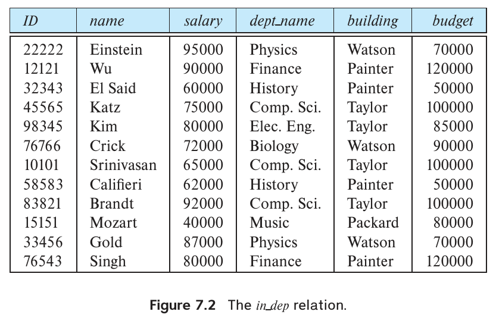
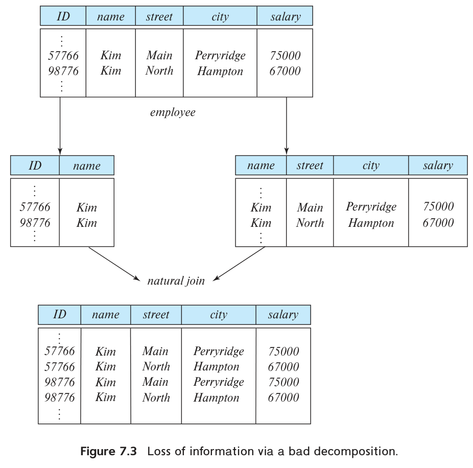
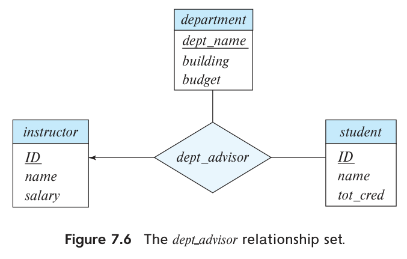

<!-- SOURCE pdf-0332-b004 -->
<!-- SOURCE pdf-0332-b005 -->
<!-- SOURCE pdf-0332-b006 -->
<!-- SOURCE pdf-0332-b007 -->
<!-- SOURCE pdf-0332-b008 -->

# 第7章 关系数据库设计 {#chapter-07}


本章讨论如何为关系数据库设计模式。许多问题与第6章使用 E-R 模型时讨论的设计问题相似。

一般来说，关系数据库设计的目标，是生成一组关系模式，使我们既能存储信息而不产生不必要的冗余，又能方便地检索信息。为此，需要把模式设计为适当的**范式**（normal form）。要判断一个关系模式是否属于所需范式，必须了解数据库所建模的现实组织。设计良好的 E-R 图已经包含部分信息，但可能还需要组织的其他信息。

本章介绍基于**函数依赖**概念的关系数据库设计形式化方法，再用函数依赖及其他数据依赖定义范式。首先，从给定实体—联系设计所导出的模式出发，考察关系设计问题。

<!-- SOURCE pdf-0332-b009 -->
<!-- SOURCE pdf-0332-b010 -->

## 7.1 良好关系设计的特征

第6章的实体—联系设计，为关系数据库设计提供了良好起点。6.7节已经说明，可以直接从 E-R 设计生成一组关系模式。所得模式的好坏，取决于最初 E-R 设计的质量。本章稍后将介绍精确评价一组关系模式的方法。不过，仅运用已经学过的概念，也能在良好设计的方向上走出很远。为便于查阅，图7.1再次列出大学数据库的模式。

<!-- SOURCE pdf-0333-b002 -->
<!-- SOURCE pdf-0333-b004 -->
<!-- SOURCE pdf-0333-b006 -->
<!-- SOURCE pdf-0333-b008 -->
<!-- SOURCE pdf-0333-b010 -->
<!-- SOURCE pdf-0333-b012 -->
<!-- SOURCE pdf-0333-b014 -->
<!-- SOURCE pdf-0333-b016 -->
<!-- SOURCE pdf-0333-b018 -->
<!-- SOURCE pdf-0333-b020 -->
<!-- SOURCE pdf-0333-b022 -->
<!-- SOURCE pdf-0333-b024 -->
<!-- SOURCE pdf-0333-b026 -->
<!-- SOURCE pdf-0333-b028 -->
<!-- SOURCE pdf-0333-b030 -->
<!-- SOURCE pdf-0333-b032 -->
<!-- SOURCE pdf-0333-b034 -->
<!-- SOURCE pdf-0333-b036 -->
<!-- SOURCE pdf-0333-b038 -->
<!-- SOURCE pdf-0333-b040 -->
<!-- SOURCE pdf-0333-b042 -->
<!-- SOURCE pdf-0333-b044 -->
<!-- SOURCE pdf-0333-b046 -->
<!-- SOURCE pdf-0333-b048 -->
<!-- SOURCE pdf-0333-b050 -->
<!-- SOURCE pdf-0333-b052 -->
<!-- SOURCE pdf-0333-b054 -->
<!-- SOURCE pdf-0333-b056 -->
<!-- SOURCE pdf-0333-b058 -->
<!-- SOURCE pdf-0333-b060 -->
<!-- SOURCE pdf-0333-b062 -->
<!-- SOURCE pdf-0333-b064 -->
<!-- SOURCE pdf-0333-b066 -->
<!-- SOURCE pdf-0333-b068 -->
<!-- SOURCE pdf-0333-b070 -->
<!-- SOURCE pdf-0333-b072 -->
<!-- SOURCE pdf-0333-b074 -->
<!-- SOURCE pdf-0333-b076 -->
<!-- SOURCE pdf-0333-b078 -->
<!-- SOURCE pdf-0333-b080 -->
<!-- SOURCE pdf-0333-b082 -->
<!-- SOURCE pdf-0333-b084 -->
<!-- SOURCE pdf-0333-b086 -->
<!-- SOURCE pdf-0333-b088 -->
<!-- SOURCE pdf-0333-b090 -->
<!-- SOURCE pdf-0333-b092 -->
<!-- SOURCE pdf-0333-b094 -->
<!-- SOURCE pdf-0333-b096 -->
<!-- SOURCE pdf-0333-b098 -->
<!-- SOURCE pdf-0333-b100 -->
<!-- SOURCE pdf-0333-b102 -->
<!-- SOURCE pdf-0333-b104 -->
<!-- SOURCE pdf-0333-b106 -->

| 关系模式 | 属性（下划线表示主键） |
| --- | --- |
| classroom | <u>building</u>, <u>room_number</u>, capacity |
| department | <u>dept_name</u>, building, budget |
| course | <u>course_id</u>, title, dept_name, credits |
| instructor | <u>ID</u>, name, dept_name, salary |
| section | <u>course_id</u>, <u>sec_id</u>, <u>semester</u>, <u>year</u>, building, room_number, time_slot_id |
| teaches | <u>ID</u>, <u>course_id</u>, <u>sec_id</u>, <u>semester</u>, <u>year</u> |
| student | <u>ID</u>, name, dept_name, tot_cred |
| takes | <u>ID</u>, <u>course_id</u>, <u>sec_id</u>, <u>semester</u>, <u>year</u>, grade |
| advisor | <u>s_ID</u>, i_ID |
| time_slot | <u>time_slot_id</u>, <u>day</u>, <u>start_time</u>, end_time |
| prereq | <u>course_id</u>, <u>prereq_id</u> |

图7.1 大学示例的数据库模式。

<!-- SOURCE pdf-0332-b011 -->
<!-- SOURCE pdf-0332-b013 -->
<!-- SOURCE pdf-0332-b014 -->
<!-- SOURCE pdf-0332-b016 -->
<!-- SOURCE pdf-0332-b018 -->
<!-- SOURCE pdf-0333-b107 -->

假设最初为大学设计数据库时，采用模式 in_dep：

in_dep(ID, name, salary, dept_name, building, budget)

它表示 instructor 与 department 对应关系的自然连接结果。乍看起来，这似乎是个好主意，因为有些查询能减少连接次数；但需要仔细考虑大学的实际情况，也就是最初 E-R 设计的依据。

<!-- SOURCE pdf-0333-b108 -->
<!-- SOURCE pdf-0333-b110 -->

考虑图7.2的 in_dep 关系实例。对于一个系中的每位教师，都必须重复一次该系的 building 和 budget 信息。例如，计算机系的信息 (Taylor, 100000)，出现在教师 Katz、Srinivasan 和 Brandt 的元组中。

<!-- SOURCE pdf-0334-b017 -->
<!-- SOURCE pdf-0334-b020 -->
<!-- SOURCE pdf-0334-b023 -->
<!-- SOURCE pdf-0334-b026 -->
<!-- SOURCE pdf-0334-b028 -->
<!-- SOURCE pdf-0334-b031 -->
<!-- SOURCE pdf-0334-b034 -->
<!-- SOURCE pdf-0334-b046 -->
<!-- SOURCE pdf-0334-b048 -->
<!-- SOURCE pdf-0334-b050 -->
<!-- SOURCE pdf-0334-b052 -->
<!-- SOURCE pdf-0334-b054 -->
<!-- SOURCE pdf-0334-b056 -->
<!-- SOURCE pdf-0334-b059 -->
<!-- SOURCE pdf-0334-b061 -->
<!-- SOURCE pdf-0334-b063 -->
<!-- SOURCE pdf-0334-b065 -->
<!-- SOURCE pdf-0334-b067 -->
<!-- SOURCE pdf-0334-b069 -->
<!-- SOURCE pdf-0334-b072 -->
<!-- SOURCE pdf-0334-b074 -->
<!-- SOURCE pdf-0334-b076 -->
<!-- SOURCE pdf-0334-b078 -->
<!-- SOURCE pdf-0334-b080 -->
<!-- SOURCE pdf-0334-b082 -->
<!-- SOURCE pdf-0334-b085 -->
<!-- SOURCE pdf-0334-b087 -->
<!-- SOURCE pdf-0334-b089 -->
<!-- SOURCE pdf-0334-b091 -->
<!-- SOURCE pdf-0334-b093 -->
<!-- SOURCE pdf-0334-b095 -->
<!-- SOURCE pdf-0334-b098 -->
<!-- SOURCE pdf-0334-b100 -->
<!-- SOURCE pdf-0334-b102 -->
<!-- SOURCE pdf-0334-b104 -->
<!-- SOURCE pdf-0334-b106 -->
<!-- SOURCE pdf-0334-b108 -->
<!-- SOURCE pdf-0334-b111 -->
<!-- SOURCE pdf-0334-b113 -->
<!-- SOURCE pdf-0334-b115 -->
<!-- SOURCE pdf-0334-b117 -->
<!-- SOURCE pdf-0334-b119 -->
<!-- SOURCE pdf-0334-b121 -->
<!-- SOURCE pdf-0334-b124 -->
<!-- SOURCE pdf-0334-b126 -->
<!-- SOURCE pdf-0334-b128 -->
<!-- SOURCE pdf-0334-b130 -->
<!-- SOURCE pdf-0334-b132 -->
<!-- SOURCE pdf-0334-b134 -->
<!-- SOURCE pdf-0334-b137 -->
<!-- SOURCE pdf-0334-b139 -->
<!-- SOURCE pdf-0334-b141 -->
<!-- SOURCE pdf-0334-b143 -->
<!-- SOURCE pdf-0334-b145 -->
<!-- SOURCE pdf-0334-b147 -->
<!-- SOURCE pdf-0334-b150 -->
<!-- SOURCE pdf-0334-b152 -->
<!-- SOURCE pdf-0334-b154 -->
<!-- SOURCE pdf-0334-b156 -->
<!-- SOURCE pdf-0334-b158 -->
<!-- SOURCE pdf-0334-b160 -->
<!-- SOURCE pdf-0334-b163 -->
<!-- SOURCE pdf-0334-b165 -->
<!-- SOURCE pdf-0334-b167 -->
<!-- SOURCE pdf-0334-b169 -->
<!-- SOURCE pdf-0334-b171 -->
<!-- SOURCE pdf-0334-b173 -->
<!-- SOURCE pdf-0334-b176 -->
<!-- SOURCE pdf-0334-b178 -->
<!-- SOURCE pdf-0334-b180 -->
<!-- SOURCE pdf-0334-b182 -->
<!-- SOURCE pdf-0334-b184 -->
<!-- SOURCE pdf-0334-b186 -->
<!-- SOURCE pdf-0334-b189 -->
<!-- SOURCE pdf-0334-b191 -->
<!-- SOURCE pdf-0334-b193 -->
<!-- SOURCE pdf-0334-b195 -->
<!-- SOURCE pdf-0334-b197 -->
<!-- SOURCE pdf-0334-b199 -->
<!-- SOURCE pdf-0334-b202 -->
<!-- SOURCE pdf-0334-b204 -->



图7.2 in_dep 关系。

图中文字：ID：教师号；name：姓名；salary：工资；dept_name：院系名；building：楼宇；budget：预算。

<!-- SOURCE pdf-0333-b111 -->
<!-- SOURCE pdf-0333-b113 -->

这些元组中的预算金额必须一致，否则数据库就会不一致。在原来的 instructor、department 设计中，每项预算只存储一次。由此可见，使用 in_dep 并不妥当：预算被冗余存储，用户可能只更新某个元组中的预算，漏掉其他元组，导致不一致。

<!-- SOURCE pdf-0333-b114 -->
<!-- SOURCE pdf-0333-b116 -->
<!-- SOURCE pdf-0333-b118 -->
<!-- SOURCE pdf-0333-b120 -->
<!-- SOURCE pdf-0334-b205 -->

即使愿意接受冗余，in_dep 模式仍有另一个问题。假设大学新设一个系，在上述替代设计中，除非该系至少已有一名教师，否则无法直接表示它的 (dept_name, building, budget) 信息，因为 in_dep 表的元组还需要 ID、name、salary 的值。这意味着，必须等新系聘任第一位教师之后，才能记录该系的信息。原设计中的 department 模式能够处理这种情况；在修改后的设计中，却必须创建一个 building、budget 为 null 的元组。学习 SQL 时已经看到，null 在某些情况下会带来麻烦。如果认为 null 在这里不成问题，也可以采用修改后的设计，但前述冗余问题仍然存在。

> 译注：原书这里把缺值字段写成了 building、budget。新院系的这两项信息已经给定，缺少的是教师的 ID、name、salary；而且若 ID 为主键，也不能用 null 填补。这进一步说明把院系与教师合并存储的局限。

<!-- SOURCE pdf-0334-b206 -->
<!-- SOURCE pdf-0334-b207 -->
<!-- SOURCE pdf-0334-b209 -->

### 7.1.1 分解

要避免 in_dep 模式中的信息重复问题，唯一办法是把它分解为两个模式，本例中就是 instructor 和 department。本章稍后介绍判断哪些模式适当、哪些不适当的算法。一般来说，重复信息的模式可能需要分解为若干较小模式。

<!-- SOURCE pdf-0334-b210 -->
<!-- SOURCE pdf-0334-b211 -->
<!-- SOURCE pdf-0334-b212 -->
<!-- SOURCE pdf-0334-b213 -->

并非所有模式分解都有益。考虑一个极端情况：所有模式都只有一个属性，那么就无法表达任何有意义的联系。再看一个不那么极端的例子，将6.8节的 employee 模式：

employee(ID, name, street, city, salary)

分解为：

employee1(ID, name)

employee2(name, street, city, salary)

<!-- SOURCE pdf-0334-b214 -->
<!-- SOURCE pdf-0335-b001 -->
<!-- SOURCE pdf-0335-b002 -->

这种分解的缺陷在于，组织中可能有两名同名雇员。现实中这种情况并不少见，许多文化里都有一些非常常见的姓名。每个人都有唯一的雇员号，所以 ID 可以作为主键。例如，假设大学有两名叫 Kim 的雇员，在原设计的 employee 关系中对应以下元组：

```text
(57766, Kim, Main, Perryridge, 75000)
(98776, Kim, North, Hampton, 67000)
```

<!-- SOURCE pdf-0335-b003 -->
<!-- SOURCE pdf-0336-b001 -->

图7.3展示了原元组、分解后模式中的相应元组，以及尝试通过自然连接恢复原元组的结果。图中，结果既包含两个原元组，也多出两个新元组，错误地混合了两名 Kim 的数据。虽然元组增加了，信息却减少了：我们能够说明某个街道、城市和工资属于一位叫 Kim 的雇员，却无法区分是哪位 Kim。分解后的设计因此无法表示大学雇员的某些重要事实。我们希望避免这类分解，称它们为**有损分解**（lossy decomposition）；不丢失信息的分解称为**无损分解**（lossless decomposition）。

<!-- SOURCE pdf-0335-b004 -->
<!-- SOURCE pdf-0335-b005 -->
<!-- SOURCE pdf-0335-b006 -->
<!-- SOURCE pdf-0335-b007 -->
<!-- SOURCE pdf-0335-b008 -->
<!-- SOURCE pdf-0335-b009 -->
<!-- SOURCE pdf-0335-b010 -->
<!-- SOURCE pdf-0335-b011 -->
<!-- SOURCE pdf-0335-b012 -->
<!-- SOURCE pdf-0335-b013 -->
<!-- SOURCE pdf-0335-b014 -->
<!-- SOURCE pdf-0335-b015 -->
<!-- SOURCE pdf-0335-b016 -->
<!-- SOURCE pdf-0335-b017 -->
<!-- SOURCE pdf-0335-b018 -->
<!-- SOURCE pdf-0335-b019 -->
<!-- SOURCE pdf-0335-b020 -->
<!-- SOURCE pdf-0335-b021 -->
<!-- SOURCE pdf-0335-b022 -->
<!-- SOURCE pdf-0335-b023 -->
<!-- SOURCE pdf-0335-b024 -->
<!-- SOURCE pdf-0335-b025 -->



图7.3 不当分解造成的信息丢失。

图中文字：employee：雇员；ID：雇员号；name：姓名；street：街道；city：城市；salary：工资；natural join：自然连接。连接结果中，同名雇员的地址与工资出现了错误组合。

<!-- SOURCE pdf-0336-b002 -->

本书接下来要求所有分解都必须是无损分解。

<!-- SOURCE pdf-0336-b003 -->
<!-- SOURCE pdf-0336-b004 -->

### 7.1.2 无损分解

设 R 是关系模式，R₁、R₂ 构成 R 的一个分解；也就是说，把 R、R₁、R₂ 看作属性集合时，R = R₁ ∪ R₂。如果用 R₁、R₂ 两个关系模式替换 R 不会丢失信息，就称这个分解为无损分解。如果 r(R) 的某个实例包含的信息，在必须改用 r₁(R₁)、r₂(R₂) 的实例后无法表示，就发生了信息丢失。更精确地说，如果对所有合法数据库实例，关系 r 的元组集合都与以下 SQL 查询的结果相同，则分解无损；“合法”将在7.2.2节中正式定义。[^ch7-1]

<!-- SOURCE pdf-0336-b005 -->
<!-- SOURCE pdf-0336-b006 -->

```sql
select *
from (select R1 from r)
     natural join
     (select R2 from r)
```

<!-- SOURCE pdf-0336-b007 -->
<!-- SOURCE pdf-0336-b008 -->
<!-- SOURCE pdf-0336-b009 -->

用关系代数可以更简洁地表示：

Π<sub>R₁</sub>(r) ⋈ Π<sub>R₂</sub>(r) = r

也就是说，把 r 分别投影到 R₁ 和 R₂，再计算两个投影结果的自然连接，就能恰好恢复 r。

<!-- SOURCE pdf-0336-b010 -->
<!-- SOURCE pdf-0336-b011 -->

相反，如果投影结果的自然连接是原关系的真超集，则分解有损。用关系代数表示为：

r ⊂ Π<sub>R₁</sub>(r) ⋈ Π<sub>R₂</sub>(r)

<!-- SOURCE pdf-0336-b012 -->

回到把 employee 分解为 employee1、employee2 的例子（图7.3），考虑两个或更多雇员同名的情况。employee1 natural join employee2 的结果是原 employee 关系的超集，但分解仍然有损，因为连接结果丢失了雇员号与地址、工资之间的正确对应信息。

<!-- SOURCE pdf-0336-b014 -->

[^ch7-1]: 无损定义假定，函数依赖左侧出现的任何属性都不能取 null。习题7.10将进一步讨论这一点。

<!-- SOURCE pdf-0337-b001 -->

元组更多、信息却更少，乍看可能不合直觉，但事实如此。分解后的表示无法表达某个姓名与某个地址或工资**不存在**关联，而不存在关联本身也是信息。

<!-- SOURCE pdf-0337-b002 -->
<!-- SOURCE pdf-0337-b003 -->
<!-- SOURCE pdf-0337-b004 -->
<!-- SOURCE pdf-0337-b005 -->
<!-- SOURCE pdf-0337-b006 -->

### 7.1.3 规范化理论

现在可以定义一种通用方法，导出一组各自具有“良好形式”的模式，也就是没有信息重复问题的模式。

设计关系数据库的这种过程，通常称为**规范化**（normalization）。目标是生成一组关系模式，使信息存储没有不必要的冗余，信息检索也方便。具体方法如下：

- 判断给定关系模式是否具有“良好形式”。良好形式有多种，称为范式，7.3节将介绍。
- 如果给定模式不具有“良好形式”，就将其分解为若干较小关系模式，使每个模式属于适当范式，而且分解必须无损。

要判断关系模式是否属于所需范式，还需要了解所建模的现实组织。最常用的方法是使用函数依赖，7.2节将介绍。

<!-- SOURCE pdf-0337-b007 -->
<!-- SOURCE pdf-0337-b008 -->
<!-- SOURCE pdf-0337-b009 -->
<!-- SOURCE pdf-0337-b010 -->
<!-- SOURCE pdf-0337-b011 -->
<!-- SOURCE pdf-0337-b012 -->
<!-- SOURCE pdf-0337-b013 -->

## 7.2 利用函数依赖进行分解

数据库为现实世界中的实体及其联系建模。现实数据通常满足各种约束或规则。例如，大学数据库预期满足以下约束：

1. 学生和教师都由各自的 ID 唯一标识。
2. 每名学生和教师都只有一个姓名。
3. 每名教师和学生都只有一个主要所属院系。[^ch7-2]
4. 每个系只有一个预算值，也只关联一栋楼宇。

<!-- SOURCE pdf-0337-b015 -->

[^ch7-2]: 现实中的多数大学允许教师关联多个系，例如联合聘任或兼职教师。学生也可能有两个或更多主修专业，或者有辅修专业。简化的大学模式只记录每名教师或学生主要关联的院系。

<!-- SOURCE pdf-0338-b001 -->

满足全部这类现实约束的关系实例，称为该关系的**合法实例**（legal instance）。一个数据库实例合法，意味着其中所有关系实例都合法。

<!-- SOURCE pdf-0338-b002 -->
<!-- SOURCE pdf-0338-b003 -->
<!-- SOURCE pdf-0338-b004 -->
<!-- SOURCE pdf-0338-b005 -->
<!-- SOURCE pdf-0338-b006 -->

### 7.2.1 记号约定

讨论关系数据库设计的算法时，需要讨论任意关系及其模式，不能只讨论示例。这里回顾第2章关系模型的介绍，汇总所用记号。

- 通常用希腊字母，例如 α，表示属性集合；用大写拉丁字母表示关系模式。r(R) 表示关系 r 的模式是 R。

    关系模式是一组属性，但并非每组属性都是模式。小写希腊字母表示的属性集合，可能是模式，也可能不是；用拉丁字母时，则明确表示这组属性是模式。
- 如果属性集合是超键，可以用 K 表示。超键针对某个具体关系模式，因此说“K 是 R 的超键”。
- 用小写名称表示关系。示例中采用接近实际的名字，例如 instructor；定义与算法中则采用 r 这样的单个字母。
- 因此，r(R) 表示模式为 R 的关系 r，同时指明关系及其模式。
- 关系在任一时刻都有确定的值，称为实例，使用“r 的实例”这一说法。上下文已经明确指实例时，也可以直接用关系名，例如 r。

为简明起见，假定每个属性名在整个数据库模式中只有一种含义。

<!-- SOURCE pdf-0338-b007 -->
<!-- SOURCE pdf-0338-b008 -->
<!-- SOURCE pdf-0338-b009 -->
<!-- SOURCE pdf-0339-b001 -->

### 7.2.2 键与函数依赖

一些最常见的现实约束，可以形式化表示为键，即超键、候选键和主键，或表示为下面定义的函数依赖。

2.3节将超键定义为一个或多个属性组成的集合，这些属性合在一起能够唯一标识关系中的元组。这里重新表述：给定 r(R)，如果对于 r(R) 的任一合法实例，以及其中任意两个元组 t₁、t₂，只要 t₁ ≠ t₂，就有 t₁[K] ≠ t₂[K]，那么 R 的子集 K 就是 r(R) 的超键。也就是说，r(R) 的任何合法实例中，都不能有两个元组在属性集 K 上具有相同值。[^ch7-3] 如果 r 中没有两个元组的 K 值相同，那么一个 K 值就唯一标识 r 的一个元组。

<!-- SOURCE pdf-0339-b002 -->
<!-- SOURCE pdf-0339-b003 -->

超键唯一标识整个元组，函数依赖则允许表达“某些属性的值被唯一确定”这一约束。考虑关系模式 r(R)，令 α ⊆ R、β ⊆ R。

- 给定 r(R) 的一个实例，如果对其中任意一对元组 t₁、t₂，只要 t₁[α] = t₂[α]，就有 t₁[β] = t₂[β]，则称该实例**满足函数依赖 α → β**。
- 如果 r(R) 的每个合法实例都满足 α → β，就称**函数依赖 α → β 适用于模式 r(R)**（holds on the schema）。

<!-- SOURCE pdf-0339-b004 -->

用函数依赖记号表示，如果函数依赖 K → R 适用于 r(R)，就说 K 是 r(R) 的超键。也就是说，在 r(R) 的每个合法实例中，对任意一对元组 t₁、t₂，只要 t₁[K] = t₂[K]，就有 t₁[R] = t₂[R]，即 t₁ = t₂，那么 K 就是超键。[^ch7-4]

<!-- SOURCE pdf-0339-b005 -->
<!-- SOURCE pdf-0339-b006 -->
<!-- SOURCE pdf-0339-b008 -->
<!-- SOURCE pdf-0339-b010 -->
<!-- SOURCE pdf-0339-b011 -->
<!-- SOURCE pdf-0339-b013 -->
<!-- SOURCE pdf-0339-b015 -->
<!-- SOURCE pdf-0339-b017 -->
<!-- SOURCE pdf-0339-b019 -->
<!-- SOURCE pdf-0339-b020 -->
<!-- SOURCE pdf-0339-b022 -->

函数依赖可以表达超键无法表达的约束。在7.1节中，考虑过模式：

in_dep(ID, name, salary, dept_name, building, budget)

函数依赖 dept_name → budget 适用于该模式，因为每个由 dept_name 标识的系，都有唯一的预算金额。

用下面的依赖，表示 (ID, dept_name) 这对属性构成 in_dep 的超键：

ID, dept_name → name, salary, building, budget

<!-- SOURCE pdf-0339-b023 -->
<!-- SOURCE pdf-0339-b024 -->
<!-- SOURCE pdf-0339-b025 -->
<!-- SOURCE pdf-0339-b026 -->
<!-- SOURCE pdf-0339-b027 -->

我们将从两方面使用函数依赖：

1. 检查关系实例是否满足给定的函数依赖集合 F。
2. 为合法关系的集合规定约束，只考虑满足给定函数依赖集合的关系实例。如果要求模式 r(R) 上的关系满足函数依赖集合 F，就说 F 适用于 r(R)。

<!-- SOURCE pdf-0339-b029 -->

[^ch7-3]: 讨论函数依赖时，等号采用通常的数学含义，不采用 SQL 三值逻辑的含义。换句话说，讨论函数依赖时，假定没有 null。

[^ch7-4]: 这里假定关系是集合。SQL 处理的是多重集。对属性集 K 声明 SQL 主键，除了要求 t₁[K] = t₂[K] 时 t₁ = t₂，还要求不能有重复元组。此外，SQL 要求 K 中的属性不能取 null。

<!-- SOURCE pdf-0340-b013 -->
<!-- SOURCE pdf-0340-b016 -->
<!-- SOURCE pdf-0340-b019 -->
<!-- SOURCE pdf-0340-b022 -->
<!-- SOURCE pdf-0340-b032 -->
<!-- SOURCE pdf-0340-b034 -->
<!-- SOURCE pdf-0340-b036 -->
<!-- SOURCE pdf-0340-b038 -->
<!-- SOURCE pdf-0340-b041 -->
<!-- SOURCE pdf-0340-b043 -->
<!-- SOURCE pdf-0340-b045 -->
<!-- SOURCE pdf-0340-b047 -->
<!-- SOURCE pdf-0340-b050 -->
<!-- SOURCE pdf-0340-b052 -->
<!-- SOURCE pdf-0340-b054 -->
<!-- SOURCE pdf-0340-b056 -->
<!-- SOURCE pdf-0340-b059 -->
<!-- SOURCE pdf-0340-b061 -->
<!-- SOURCE pdf-0340-b063 -->
<!-- SOURCE pdf-0340-b065 -->
<!-- SOURCE pdf-0340-b068 -->
<!-- SOURCE pdf-0340-b070 -->
<!-- SOURCE pdf-0340-b072 -->
<!-- SOURCE pdf-0340-b074 -->
<!-- SOURCE pdf-0340-b077 -->

| A | B | C | D |
| --- | --- | --- | --- |
| a₁ | b₁ | c₁ | d₁ |
| a₁ | b₂ | c₁ | d₂ |
| a₂ | b₂ | c₂ | d₂ |
| a₂ | b₃ | c₂ | d₃ |
| a₃ | b₃ | c₂ | d₄ |

图7.4 关系 r 的一个实例。

<!-- SOURCE pdf-0340-b078 -->

考虑图7.4的关系 r 实例，看看它满足哪些函数依赖。它满足 A → C：A 值为 a₁ 的两个元组，C 值都为 c₁；A 值为 a₂ 的两个元组，C 值都为 c₂。除此之外，没有其他两个不同元组具有相同的 A 值。但它不满足 C → A。考虑 t₁ = (a₂, b₃, c₂, d₃) 和 t₂ = (a₃, b₃, c₂, d₄)，两者的 C 值同为 c₂，A 值却分别为 a₂、a₃。因此找到一对元组，满足 t₁[C] = t₂[C]，却有 t₁[A] ≠ t₂[A]。

<!-- SOURCE pdf-0340-b079 -->

有些函数依赖被所有关系满足，称为**平凡函数依赖**（trivial functional dependency）。例如，包含属性 A 的所有关系都满足 A → A。直接按照定义看，对于任意满足 t₁[A] = t₂[A] 的元组，当然都有 t₁[A] = t₂[A]。同样，涉及属性 A 的所有关系都满足 AB → A。一般来说，若 β ⊆ α，则 α → β 是平凡函数依赖。

<!-- SOURCE pdf-0340-b080 -->
<!-- SOURCE pdf-0340-b082 -->
<!-- SOURCE pdf-0340-b084 -->
<!-- SOURCE pdf-0340-b086 -->
<!-- SOURCE pdf-0341-b001 -->
<!-- SOURCE pdf-0341-b003 -->

必须分清：某个关系实例可能碰巧满足一些函数依赖，但关系模式并不要求这些依赖。在图7.5的 classroom 实例中，room_number → capacity 得到满足。不过，现实中不同楼宇的两间教室，可能房间号相同、容量不同。因此，classroom 在某个时刻可能出现不满足 room_number → capacity 的实例，我们不会把它纳入 classroom 模式的函数依赖集合。但 building, room_number → capacity 应当适用于 classroom 模式。

<!-- SOURCE pdf-0340-b097 -->
<!-- SOURCE pdf-0340-b100 -->
<!-- SOURCE pdf-0340-b102 -->
<!-- SOURCE pdf-0340-b105 -->
<!-- SOURCE pdf-0340-b114 -->
<!-- SOURCE pdf-0340-b116 -->
<!-- SOURCE pdf-0340-b118 -->
<!-- SOURCE pdf-0340-b121 -->
<!-- SOURCE pdf-0340-b123 -->
<!-- SOURCE pdf-0340-b125 -->
<!-- SOURCE pdf-0340-b128 -->
<!-- SOURCE pdf-0340-b130 -->
<!-- SOURCE pdf-0340-b132 -->
<!-- SOURCE pdf-0340-b135 -->
<!-- SOURCE pdf-0340-b137 -->
<!-- SOURCE pdf-0340-b139 -->
<!-- SOURCE pdf-0340-b142 -->
<!-- SOURCE pdf-0340-b144 -->
<!-- SOURCE pdf-0340-b146 -->
<!-- SOURCE pdf-0340-b149 -->

| building | room_number | capacity |
| --- | --- | --- |
| Packard | 101 | 500 |
| Painter | 514 | 10 |
| Taylor | 3128 | 70 |
| Watson | 100 | 30 |
| Watson | 120 | 50 |

图7.5 classroom 关系的一个实例。building：楼宇；room_number：房间号；capacity：容量。

<!-- SOURCE pdf-0341-b004 -->

由于假定属性名在数据库模式中只有一种含义，如果指定 α → β 作为数据库约束，那么对任何满足 α ⊆ R、β ⊆ R 的模式 R，α → β 都必须适用。

<!-- SOURCE pdf-0341-b005 -->

已知函数依赖集合 F 适用于关系 r(R)，可能据此推导出其他函数依赖也适用于它。例如，给定 r(A, B, C)，若 A → B 和 B → C 适用于 r，就能推导 A → C 也适用于 r。因为给定 A 值，只能对应一个 B 值，而这个 B 值又只能对应一个 C 值。7.4.1节将讨论如何进行这种推导。

<!-- SOURCE pdf-0341-b006 -->

用 F⁺ 表示集合 F 的**闭包**，即根据 F 能推导出的全部函数依赖。F⁺ 包含 F 中的所有函数依赖。

<!-- SOURCE pdf-0341-b007 -->
<!-- SOURCE pdf-0341-b008 -->
<!-- SOURCE pdf-0341-b009 -->
<!-- SOURCE pdf-0341-b010 -->

### 7.2.3 无损分解与函数依赖

可以用函数依赖证明某些分解无损。令 R、R₁、R₂、F 的含义同前。如果以下至少一个函数依赖属于 F⁺，那么 R₁、R₂ 构成 R 的无损分解：

- R₁ ∩ R₂ → R₁。
- R₁ ∩ R₂ → R₂。

换句话说，只要 R₁ ∩ R₂ 是 R₁ 或 R₂ 的超键，分解就无损。可以像前面介绍的那样，用属性闭包高效检查超键。

<!-- SOURCE pdf-0341-b011 -->
<!-- SOURCE pdf-0341-b012 -->
<!-- SOURCE pdf-0341-b014 -->
<!-- SOURCE pdf-0341-b016 -->
<!-- SOURCE pdf-0341-b017 -->
<!-- SOURCE pdf-0341-b018 -->
<!-- SOURCE pdf-0341-b020 -->
<!-- SOURCE pdf-0341-b022 -->
<!-- SOURCE pdf-0341-b023 -->
<!-- SOURCE pdf-0341-b025 -->
<!-- SOURCE pdf-0341-b027 -->
<!-- SOURCE pdf-0341-b029 -->

以7.1节的分解为例，模式：

in_dep(ID, name, salary, dept_name, building, budget)

被分解为：

instructor(ID, name, dept_name, salary)

department(dept_name, building, budget)

两个模式的交集是 dept_name。因为有 dept_name → dept_name, building, budget，所以满足无损分解规则。

<!-- SOURCE pdf-0342-b001 -->
<!-- SOURCE pdf-0342-b002 -->

如果一次把一个模式分解为多个模式，判断无损的条件就更复杂。相关资料见本章末尾“延伸阅读”。

上述二元分解检验是无损分解的充分条件；只有在全部约束都是函数依赖时，它才也是必要条件。后面还将介绍其他约束，特别是7.6.1节的多值依赖，它能在没有函数依赖的情况下，仍然保证分解无损。

<!-- SOURCE pdf-0342-b003 -->
<!-- SOURCE pdf-0342-b004 -->
<!-- SOURCE pdf-0342-b005 -->

假设把 r(R) 分解为 r₁(R₁) 和 r₂(R₂)，其中 R₁ ∩ R₂ → R₁。[^ch7-5] 为保证分解后的内容与原模式一致，必须施加以下 SQL 约束：

- R₁ ∩ R₂ 是 r₁ 的主键。这项约束保证相应函数依赖。
- R₁ ∩ R₂ 是 r₂ 参照 r₁ 的外键。这保证 r₂ 的每个元组在 r₁ 中都有匹配元组；否则，该元组就不会出现在 r₁ 与 r₂ 的自然连接中。

如果继续分解 r₁ 或 r₂，只要保证 R₁ ∩ R₂ 的全部属性仍位于一个关系中，该关系就继承 r₁ 或 r₂ 原有的主键或外键约束。

<!-- SOURCE pdf-0342-b013 -->

[^ch7-5]: R₁ ∩ R₂ → R₂ 的情形与之对称，这里略去。

<!-- SOURCE pdf-0342-b006 -->
<!-- SOURCE pdf-0342-b007 -->
<!-- SOURCE pdf-0342-b008 -->
<!-- SOURCE pdf-0342-b009 -->
<!-- SOURCE pdf-0342-b010 -->
<!-- SOURCE pdf-0342-b011 -->
<!-- SOURCE pdf-0343-b001 -->

## 7.3 范式

如7.1.3节所述，关系数据库设计会使用多种范式。本节介绍其中最常见的两种。

### 7.3.1 Boyce–Codd 范式

**Boyce–Codd 范式（BCNF）**是比较理想的一种范式。它消除了所有能够根据函数依赖识别的冗余，不过7.6节将说明，仍可能存在其他类型的冗余。

#### 7.3.1.1 定义

相对于函数依赖集合 F，如果 F⁺ 中形如 α → β、且 α ⊆ R、β ⊆ R 的每个函数依赖，都至少满足以下条件之一，则关系模式 R 属于 BCNF：

- α → β 是平凡函数依赖，即 β ⊆ α。
- α 是模式 R 的超键。

<!-- SOURCE pdf-0343-b002 -->

如果构成数据库设计的每个关系模式都属于 BCNF，则该数据库设计属于 BCNF。

<!-- SOURCE pdf-0343-b003 -->
<!-- SOURCE pdf-0343-b004 -->
<!-- SOURCE pdf-0343-b006 -->
<!-- SOURCE pdf-0343-b008 -->
<!-- SOURCE pdf-0343-b009 -->
<!-- SOURCE pdf-0343-b011 -->
<!-- SOURCE pdf-0343-b013 -->
<!-- SOURCE pdf-0343-b015 -->
<!-- SOURCE pdf-0343-b017 -->
<!-- SOURCE pdf-0343-b018 -->
<!-- SOURCE pdf-0343-b020 -->
<!-- SOURCE pdf-0343-b021 -->
<!-- SOURCE pdf-0343-b023 -->

7.1节已经介绍过一个不属于 BCNF 的关系模式：

in_dep(ID, name, salary, dept_name, building, budget)

函数依赖 dept_name → budget 适用于 in_dep，但 dept_name 不是超键，因为一个系可以有多名不同的教师。7.1节已经看到，将 in_dep 分解为 instructor 和 department 能得到更好的设计。instructor 属于 BCNF：所有适用的非平凡函数依赖，例如：

ID → name, dept_name, salary

左侧都包含 ID，而 ID 是 instructor 的超键，在本例中还是主键。换句话说，如果左侧只有 name、dept_name、salary 的某种组合，不包含 ID，就不存在相应的非平凡函数依赖。因此，instructor 属于 BCNF。

<!-- SOURCE pdf-0343-b024 -->
<!-- SOURCE pdf-0343-b025 -->
<!-- SOURCE pdf-0343-b027 -->
<!-- SOURCE pdf-0343-b028 -->
<!-- SOURCE pdf-0343-b030 -->
<!-- SOURCE pdf-0343-b032 -->

同样，department 也属于 BCNF。所有适用的非平凡函数依赖，例如：

dept_name → building, budget

左侧都包含 dept_name，而它是 department 的超键，也是主键。因此，department 属于 BCNF。

<!-- SOURCE pdf-0343-b033 -->
<!-- SOURCE pdf-0343-b034 -->

下面给出分解非 BCNF 模式的一般规则。设 R 不属于 BCNF，则至少存在一个非平凡函数依赖 α → β，且 α 不是 R 的超键。用以下两个模式替换 R：

- α ∪ β。
- R − (β − α)。

<!-- SOURCE pdf-0343-b035 -->
<!-- SOURCE pdf-0343-b037 -->
<!-- SOURCE pdf-0343-b039 -->
<!-- SOURCE pdf-0343-b041 -->
<!-- SOURCE pdf-0343-b042 -->
<!-- SOURCE pdf-0343-b044 -->
<!-- SOURCE pdf-0343-b046 -->

在前面的 in_dep 示例中，α = dept_name，β = {building, budget}，于是用下列模式替换 in_dep：

- α ∪ β = (dept_name, building, budget)。
- R − (β − α) = (ID, name, dept_name, salary)。

<!-- SOURCE pdf-0344-b011 -->
<!-- SOURCE pdf-0344-b012 -->

本例恰好有 β − α = β。一般规则必须写成上面的形式，才能正确处理箭头两侧含有相同属性的函数依赖，具体原因见7.5.1节。

分解一个非 BCNF 模式时，得到的模式中可能仍有一个或多个不属于 BCNF。此时需要继续分解，最终得到一组 BCNF 模式。

<!-- SOURCE pdf-0344-b013 -->
<!-- SOURCE pdf-0344-b014 -->

#### 7.3.1.2 BCNF 与依赖保持

前面已经见过多种表达数据库一致性约束的方式：主键约束、函数依赖、check 约束、断言和触发器。每次更新都检查这些约束，代价可能很高，因此应让数据库设计支持高效检查。具体来说，如果检查一个函数依赖只需考虑一个关系，检查代价就较低。下面会看到，在某些情况下，分解为 BCNF 会使部分函数依赖无法高效检查。

<!-- SOURCE pdf-0344-b015 -->

为说明这一点，对大学的组织规则作一个小改动。图6.15中，学生只能有一位导师，因为 advisor 联系集从 student 到 advisor 为多对一。现在作如下“小”改动：一名教师只能关联一个系，一名学生可以有多位导师，但在任一给定院系至多有一位导师。[^ch7-6]

<!-- SOURCE pdf-0344-b020 -->

[^ch7-6]: 对修读双专业的学生，这种安排是合理的。

<!-- SOURCE pdf-0344-b016 -->
<!-- SOURCE pdf-0344-b018 -->
<!-- SOURCE pdf-0345-b001 -->

在 E-R 设计中，可以用三元联系集 dept_advisor 替换 advisor。它涉及 instructor、student、department，从 {student, department} 这一对实体集到 instructor 为多对一，见图7.6。该图表达的约束是：“一名学生可以有多位导师，但对一个给定院系，至多有一位导师。”

> 译注：原书此处把方向写成了从 {student, instructor} 到 department，与图7.6 指向 instructor 的箭头，以及下文 s_ID, dept_name → i_ID 不符。这里按图和明确列出的约束修正。

<!-- SOURCE pdf-0344-b001 -->
<!-- SOURCE pdf-0344-b002 -->
<!-- SOURCE pdf-0344-b003 -->
<!-- SOURCE pdf-0344-b004 -->
<!-- SOURCE pdf-0344-b005 -->
<!-- SOURCE pdf-0344-b006 -->
<!-- SOURCE pdf-0344-b007 -->
<!-- SOURCE pdf-0344-b008 -->
<!-- SOURCE pdf-0344-b010 -->



图7.6 dept_advisor 联系集。

图中文字：department：院系；instructor：教师；student：学生；dept_advisor：院系导师联系；dept_name：院系名；building：楼宇；budget：预算；ID：标识号；name：姓名；salary：工资；tot_cred：总学分。箭头指向 instructor，表示每个学生在每个院系最多有一位导师。

<!-- SOURCE pdf-0345-b002 -->
<!-- SOURCE pdf-0345-b004 -->
<!-- SOURCE pdf-0345-b005 -->
<!-- SOURCE pdf-0345-b007 -->
<!-- SOURCE pdf-0345-b009 -->
<!-- SOURCE pdf-0345-b011 -->
<!-- SOURCE pdf-0345-b013 -->

在新的 E-R 图下，instructor、department、student 的关系模式保持不变。dept_advisor 联系集导出的模式则变为：

dept_advisor(s_ID, i_ID, dept_name)

<!-- SOURCE pdf-0345-b014 -->
<!-- SOURCE pdf-0345-b015 -->
<!-- SOURCE pdf-0345-b017 -->
<!-- SOURCE pdf-0345-b018 -->
<!-- SOURCE pdf-0345-b020 -->
<!-- SOURCE pdf-0345-b022 -->
<!-- SOURCE pdf-0345-b024 -->
<!-- SOURCE pdf-0345-b026 -->
<!-- SOURCE pdf-0345-b028 -->
<!-- SOURCE pdf-0345-b029 -->

再假设一项没有在图中明确表示的约束：“一名教师只能代表一个系担任导师。”于是，dept_advisor 上有以下函数依赖：

i_ID → dept_name

s_ID, dept_name → i_ID

第一项来自“教师只能代表一个系担任导师”，第二项来自“学生对给定院系至多有一位导师”。

<!-- SOURCE pdf-0345-b030 -->
<!-- SOURCE pdf-0345-b032 -->
<!-- SOURCE pdf-0345-b034 -->
<!-- SOURCE pdf-0345-b036 -->
<!-- SOURCE pdf-0345-b037 -->
<!-- SOURCE pdf-0345-b039 -->
<!-- SOURCE pdf-0345-b041 -->
<!-- SOURCE pdf-0345-b043 -->
<!-- SOURCE pdf-0345-b045 -->
<!-- SOURCE pdf-0345-b046 -->

这种设计使我们每次记录教师参与 dept_advisor 联系时，都必须再写一次院系名。由于 i_ID 不是超键，dept_advisor 不属于 BCNF。按 BCNF 分解规则，得到：

(s_ID, i_ID)

(i_ID, dept_name)

这两个模式都属于 BCNF。事实上，根据定义可以验证，任何只有两个属性的模式都属于 BCNF。

<!-- SOURCE pdf-0345-b047 -->
<!-- SOURCE pdf-0345-b049 -->
<!-- SOURCE pdf-0345-b051 -->
<!-- SOURCE pdf-0345-b053 -->
<!-- SOURCE pdf-0345-b055 -->
<!-- SOURCE pdf-0345-b057 -->
<!-- SOURCE pdf-0345-b059 -->
<!-- SOURCE pdf-0345-b061 -->

但在这个 BCNF 设计中，没有一个模式包含函数依赖 s_ID, dept_name → i_ID 的全部属性。在分解后的单个关系上，唯一能直接保证的依赖是 i_ID → dept_name。只有计算分解后关系的连接，才能检查 s_ID, dept_name → i_ID。[^ch7-7]

> 译注：原书上一句漏写了教师标识符的 i_ 前缀，写成 ID → dept_name；分解后的实际属性名是 i_ID。

<!-- SOURCE pdf-0345-b062 -->

因为该设计无法在不做连接的情况下保证这个函数依赖，我们说它**不保持依赖**。7.4.4节将正式定义依赖保持。通常希望分解保持依赖，因此接下来考虑比 BCNF 稍弱、能够保持依赖的另一种范式，称为**第三范式**。[^ch7-8]

<!-- SOURCE pdf-0345-b064 -->

[^ch7-7]: 严格说来，即使一个依赖的所有属性没有同时出现在某个模式中，也可能被隐式保证，因为存在其他依赖在逻辑上蕴含它。7.4.4节将讨论这种情况。

[^ch7-8]: 读者可能发现，我们跳过了第二范式。它主要有历史意义；实践中，第三范式或 BCNF 总是更好的选择。习题7.19讨论第二范式。第一范式关注属性的域，与分解无关，见7.8节。

<!-- SOURCE pdf-0346-b001 -->
<!-- SOURCE pdf-0346-b002 -->

### 7.3.2 第三范式

BCNF 要求所有非平凡依赖 α → β 的左侧 α 都是超键。**第三范式（3NF）**稍微放宽了这个约束，允许某些左侧不是超键的非平凡函数依赖。定义3NF之前，先回顾候选键：它是极小超键，也就是说，它的任何真子集都不是超键。

<!-- SOURCE pdf-0346-b003 -->
<!-- SOURCE pdf-0346-b004 -->
<!-- SOURCE pdf-0346-b005 -->

相对于函数依赖集合 F，如果 F⁺ 中形如 α → β、且 α ⊆ R、β ⊆ R 的每个函数依赖，都至少满足以下条件之一，则关系模式 R 属于第三范式：

- α → β 是平凡函数依赖。
- α 是 R 的超键。
- β − α 中的每个属性 A，都包含在 R 的某个候选键中。

第三项并不要求同一个候选键包含 β − α 的全部属性；其中每个属性 A 可以分别属于不同候选键。

<!-- SOURCE pdf-0346-b006 -->

前两项与 BCNF 定义中的条件相同。第三项不太直观，其作用也不明显。可以把它看作对 BCNF 条件的一种最小放宽，使每个模式都能够分解为保持依赖的3NF设计。后面讨论3NF分解时，会更清楚地看到其作用。

<!-- SOURCE pdf-0346-b007 -->
<!-- SOURCE pdf-0346-b008 -->

任何满足 BCNF 的模式也满足3NF，因为它的每个函数依赖都满足前两项之一。因此，BCNF 比3NF更严格。

3NF允许某些 BCNF 不允许的函数依赖。如果 α → β 只满足3NF定义的第三项，它就被3NF允许，却不被 BCNF 允许。[^ch7-9]

<!-- SOURCE pdf-0346-b009 -->
<!-- SOURCE pdf-0346-b011 -->
<!-- SOURCE pdf-0346-b012 -->
<!-- SOURCE pdf-0346-b014 -->
<!-- SOURCE pdf-0346-b016 -->
<!-- SOURCE pdf-0346-b018 -->
<!-- SOURCE pdf-0346-b020 -->
<!-- SOURCE pdf-0346-b022 -->
<!-- SOURCE pdf-0346-b023 -->
<!-- SOURCE pdf-0346-b025 -->
<!-- SOURCE pdf-0346-b027 -->
<!-- SOURCE pdf-0346-b029 -->
<!-- SOURCE pdf-0346-b031 -->
<!-- SOURCE pdf-0346-b033 -->
<!-- SOURCE pdf-0346-b035 -->
<!-- SOURCE pdf-0346-b037 -->
<!-- SOURCE pdf-0346-b039 -->
<!-- SOURCE pdf-0347-b001 -->
<!-- SOURCE pdf-0347-b003 -->
<!-- SOURCE pdf-0347-b005 -->
<!-- SOURCE pdf-0347-b007 -->
<!-- SOURCE pdf-0347-b009 -->

再次考虑 dept_advisor 模式，函数依赖为：

i_ID → dept_name

s_ID, dept_name → i_ID

7.3.1.2节已经说明，i_ID → dept_name 使 dept_advisor 不属于 BCNF。此处 α = i_ID，β = dept_name，β − α = dept_name。因为 s_ID, dept_name → i_ID 适用于 dept_advisor，所以 dept_name 包含在一个候选键中，dept_advisor 属于3NF。

由此可见，不存在保持依赖的 BCNF 设计时，必须在 BCNF 与3NF之间作出取舍。7.3.3节将进一步说明。

<!-- SOURCE pdf-0346-b041 -->

[^ch7-9]: 这些依赖是传递依赖的例子，见实践习题7.18。最初的3NF定义使用传递依赖，本书采用的定义与它等价，但更易理解。

<!-- SOURCE pdf-0347-b010 -->
<!-- SOURCE pdf-0347-b011 -->
<!-- SOURCE pdf-0347-b012 -->
<!-- SOURCE pdf-0347-b013 -->
<!-- SOURCE pdf-0347-b014 -->
<!-- SOURCE pdf-0347-b015 -->
<!-- SOURCE pdf-0347-b016 -->

### 7.3.3 BCNF 与3NF的比较

在3NF与 BCNF 这两种关系模式范式中，3NF的优点是：总能得到既无损又保持依赖的3NF设计。但它也有缺点：某些可能出现、且有实际意义的数据联系，可能需要用 null 表示，还可能存在信息重复。

利用函数依赖设计数据库，有三个目标：

1. 满足 BCNF。
2. 无损。
3. 保持依赖。

这三个目标未必能够同时满足，有时必须在 BCNF 与保持依赖的3NF之间选择。

<!-- SOURCE pdf-0347-b017 -->

SQL 没有直接指定函数依赖的机制，只有通过 primary key 或 unique 声明超键这一特例。可以编写断言保证函数依赖，但写法稍复杂，见实践习题7.9。遗憾的是，目前没有数据库系统支持保证任意函数依赖所需的复杂断言，而且检查这些断言代价较高。即使分解保持依赖，使用标准 SQL 时，也只能高效检查左侧为键的那些函数依赖。

<!-- SOURCE pdf-0347-b018 -->

若分解不保持依赖，检查函数依赖可能需要连接。数据库系统若支持物化视图，原则上可把连接结果存为物化视图，以降低代价；但还必须支持在物化视图上定义主键或 unique 约束。这种方案有空间和时间开销，优点则是：应用程序员无须编写代码，在更新时维护冗余数据的一致性。维护物化视图是数据库系统的职责，即数据库更新时保持视图最新。16.5节将概述数据库系统如何高效维护物化视图。

<!-- SOURCE pdf-0347-b019 -->
<!-- SOURCE pdf-0348-b001 -->

遗憾的是，目前多数数据库系统限制物化视图上的约束，或完全不支持。即使允许这种约束，还必须满足一项要求：底层关系更新时，数据库要在同一事务中立即更新视图并检查约束。否则，可能在更新已经完成、引起违规的事务也已经提交之后，才发现约束被违反。

<!-- SOURCE pdf-0348-b002 -->

概括来说，即使无法得到保持依赖的 BCNF 分解，仍然更宜选择 BCNF，因为 SQL 很难检查主键约束以外的函数依赖。

<!-- SOURCE pdf-0348-b003 -->
<!-- SOURCE pdf-0348-b004 -->
<!-- SOURCE pdf-0348-b006 -->
<!-- SOURCE pdf-0348-b008 -->
<!-- SOURCE pdf-0348-b010 -->
<!-- SOURCE pdf-0348-b012 -->
<!-- SOURCE pdf-0348-b013 -->
<!-- SOURCE pdf-0348-b015 -->
<!-- SOURCE pdf-0348-b017 -->

### 7.3.4 更高的范式

在某些情况下，仅使用函数依赖分解模式，仍不足以避免不必要的信息重复。稍微修改 instructor 实体集：为每位教师记录一组子女姓名，以及一组可能由多人共用的固定电话号码。phone_number 和 child_name 都是多值属性。按从 E-R 设计生成模式的规则，分别为两个多值属性创建模式：

(ID, child_name)

(ID, phone_number)

<!-- SOURCE pdf-0348-b018 -->
<!-- SOURCE pdf-0348-b019 -->
<!-- SOURCE pdf-0348-b021 -->
<!-- SOURCE pdf-0348-b023 -->
<!-- SOURCE pdf-0348-b024 -->
<!-- SOURCE pdf-0348-b025 -->

如果将它们合并为：

(ID, child_name, phone_number)

所得模式属于 BCNF，因为没有适用的非平凡函数依赖。于是可能以为合并是个好主意。但考虑一位有两个子女、两个电话号码的教师，就会发现问题。例如，ID 为99999的教师有两个孩子 David、William，还有两个号码512-555-1234和512-555-4321。在合并模式中，必须为每个子女重复电话号码：

```text
(99999, David, 512-555-1234)
(99999, David, 512-555-4321)
(99999, William, 512-555-1234)
(99999, William, 512-555-4321)
```

<!-- SOURCE pdf-0348-b026 -->
<!-- SOURCE pdf-0348-b027 -->

如果不重复号码，只存第一个和最后一个元组，虽然记录了子女姓名与电话号码，却隐含表示 David 对应512-555-1234、William 对应512-555-4321，这种含义不正确。

基于函数依赖的范式不足以处理这类情况，因此还需要其他依赖和范式，见7.6节和7.7节。

<!-- SOURCE pdf-0349-b001 -->
<!-- SOURCE pdf-0349-b002 -->
<!-- SOURCE pdf-0349-b003 -->
<!-- SOURCE pdf-0349-b004 -->
<!-- SOURCE pdf-0349-b005 -->

## 7.4 函数依赖理论

前面的例子说明，在检查模式是否属于 BCNF 或3NF时，能够系统地推理函数依赖很有帮助。

### 7.4.1 函数依赖集的闭包

给定模式上的一组函数依赖 F，可以证明其他一些函数依赖也适用于该模式。我们说这些依赖被 F **逻辑蕴含**。检查范式时，仅考虑给出的函数依赖集合不够，还必须考虑模式上适用的全部函数依赖。

形式化地说，给定关系模式 r(R)，如果每个满足 F 的 r(R) 实例都满足 f，就称 R 上的函数依赖 f 被 R 上的函数依赖集合 F 逻辑蕴含。

<!-- SOURCE pdf-0349-b006 -->
<!-- SOURCE pdf-0349-b007 -->
<!-- SOURCE pdf-0349-b008 -->
<!-- SOURCE pdf-0349-b009 -->
<!-- SOURCE pdf-0349-b010 -->
<!-- SOURCE pdf-0349-b011 -->
<!-- SOURCE pdf-0349-b012 -->
<!-- SOURCE pdf-0349-b013 -->
<!-- SOURCE pdf-0349-b014 -->
<!-- SOURCE pdf-0349-b015 -->
<!-- SOURCE pdf-0350-b001 -->

假设关系模式为 r(A, B, C, G, H, I)，函数依赖集合为：

```text
A → B
A → C
CG → H
CG → I
B → H
```

它逻辑蕴含函数依赖 A → H。也就是说，只要关系实例满足给出的这组依赖，它也必定满足 A → H。证明如下。设元组 t₁、t₂ 满足：

t₁[A] = t₂[A]

由已知 A → B，根据函数依赖的定义，有：

t₁[B] = t₂[B]

再由已知 B → H，根据定义，有：

t₁[H] = t₂[H]

这样就证明了：只要 t₁[A] = t₂[A]，就必有 t₁[H] = t₂[H]。这正是 A → H 的定义。

<!-- SOURCE pdf-0350-b002 -->
<!-- SOURCE pdf-0350-b003 -->

设 F 是函数依赖集合。F 的**闭包**记作 F⁺，是 F 逻辑蕴含的全部函数依赖组成的集合。给定 F，可以直接依据函数依赖的形式化定义计算 F⁺。如果 F 很大，计算过程会漫长而困难，需要反复进行刚才那类论证，以证明某个依赖，例如 A → H，属于闭包。

<!-- SOURCE pdf-0350-b004 -->

公理或推理规则提供了更简单的推理方法。在下面的规则中，用希腊字母 α、β、γ 等表示属性集，用字母表开头的大写拉丁字母表示单个属性。αβ 表示 α ∪ β。

<!-- SOURCE pdf-0350-b005 -->
<!-- SOURCE pdf-0350-b006 -->
<!-- SOURCE pdf-0350-b007 -->

可以使用以下三条规则推导被逻辑蕴含的函数依赖。给定 F，反复应用这些规则，就能得到完整的 F⁺。这组规则以最初提出者的名字命名，称为 **Armstrong 公理**。

- **自反律**：如果 α 是属性集，且 β ⊆ α，则有 α → β。
- **增补律**：如果有 α → β，且 γ 是属性集，则有 γα → γβ。
- **传递律**：如果有 α → β 和 β → γ，则有 α → γ。

Armstrong 公理具有**可靠性**，因为不会推导出错误的函数依赖；也具有**完备性**，因为给定 F 后，可以推导出整个 F⁺。有关可靠性和完备性的证明，见“延伸阅读”中的参考资料。

<!-- SOURCE pdf-0350-b008 -->
<!-- SOURCE pdf-0350-b009 -->

虽然 Armstrong 公理完备，但直接用它计算 F⁺ 很繁琐。为进一步简化，列出以下规则。可以用 Armstrong 公理证明这些规则可靠，见实践习题7.4、7.5和习题7.27。

- **合并律**：如果有 α → β 和 α → γ，则有 α → βγ。
- **分解律**：如果有 α → βγ，则有 α → β 和 α → γ。
- **伪传递律**：如果有 α → β 和 γβ → δ，则有 αγ → δ。

<!-- SOURCE pdf-0350-b010 -->
<!-- SOURCE pdf-0350-b011 -->
<!-- SOURCE pdf-0351-b011 -->
<!-- SOURCE pdf-0351-b012 -->

对模式 R = (A, B, C, G, H, I) 和函数依赖集合 F = {A → B, A → C, CG → H, CG → I, B → H} 应用这些规则，可以得到 F⁺ 的若干成员：

- **A → H**。由 A → B、B → H，应用传递律即可。与本节前面直接从定义论证相比，使用 Armstrong 公理明显简单。
- **CG → HI**。由 CG → H、CG → I，应用合并律可得。
- **AG → I**。由 A → C、CG → I，应用伪传递律可得。

    也可以先对 A → C 应用增补律，得到 AG → CG，再结合 CG → I 应用传递律，得到 AG → I。

<!-- SOURCE pdf-0351-b013 -->

图7.7以形式化过程说明如何用 Armstrong 公理计算 F⁺。向 F⁺ 添加函数依赖时，该依赖可能已经存在，此时 F⁺ 不变。7.4.2节还将介绍另一种计算 F⁺ 的方法。

<!-- SOURCE pdf-0351-b002 -->
<!-- SOURCE pdf-0351-b003 -->
<!-- SOURCE pdf-0351-b004 -->
<!-- SOURCE pdf-0351-b005 -->
<!-- SOURCE pdf-0351-b006 -->
<!-- SOURCE pdf-0351-b007 -->
<!-- SOURCE pdf-0351-b008 -->
<!-- SOURCE pdf-0351-b010 -->

```text
F⁺ = F
apply the reflexivity rule /* Generates all trivial dependencies */
repeat
    for each functional dependency f in F⁺
        apply the augmentation rule on f
        add the resulting functional dependencies to F⁺
    for each pair of functional dependencies f₁ and f₂ in F⁺
        if f₁ and f₂ can be combined using transitivity
            add the resulting functional dependency to F⁺
until F⁺ does not change any further
```

图7.7 计算 F⁺ 的过程。

算法说明：先令 F⁺ = F，应用自反律，生成全部平凡依赖。随后反复对各依赖应用增补律，对可使用传递律的依赖对应用传递律，将所得依赖加入 F⁺，直到不再变化。注释译文：“生成所有平凡依赖”。

<!-- SOURCE pdf-0351-b014 -->

函数依赖的左右两侧都是 R 的子集。含 n 个元素的集合有 2ⁿ 个子集，因此可能的函数依赖总数为 2ⁿ × 2ⁿ = 2²ⁿ，其中 n 是 R 的属性数。除最后一轮外，repeat 循环的每一轮至少向 F⁺ 添加一个依赖。因此，这个过程一定会终止，但可能需要很长时间。

<!-- SOURCE pdf-0351-b015 -->
<!-- SOURCE pdf-0351-b016 -->
<!-- SOURCE pdf-0351-b017 -->

### 7.4.2 属性集的闭包

如果 α → B，就称属性 B 由 α **函数确定**。要检查 α 是否为超键，需要一种算法，计算由 α 函数确定的全部属性。一种做法是先算出 F⁺，找出左侧为 α 的所有函数依赖，再对它们的右侧求并。但 F⁺ 可能很大，代价很高。

高效计算 α 所确定属性的算法，除了能检查超键，还有其他用途，本节后面会介绍。

<!-- SOURCE pdf-0352-b001 -->

设 α 是属性集。在函数依赖集合 F 下，由 α 函数确定的全部属性组成的集合，称为 **α 在 F 下的闭包**，记作 α⁺。图7.8以伪代码给出计算算法，输入是函数依赖集合 F 和属性集 α，输出保存在变量 result 中。

<!-- SOURCE pdf-0352-b008 -->
<!-- SOURCE pdf-0352-b009 -->
<!-- SOURCE pdf-0352-b010 -->
<!-- SOURCE pdf-0352-b011 -->
<!-- SOURCE pdf-0352-b013 -->

```text
result := α;
repeat
    for each functional dependency β → γ in F do
    begin
        if β ⊆ result then result := result ∪ γ;
    end
until (result does not change)
```

图7.8 计算 α 在 F 下的闭包 α⁺ 的算法。

算法说明：result 初值为 α，反复检查 F 中每个 β → γ。如果 β 已全部包含在 result 中，就把 γ 加入 result，直到 result 不再变化。

<!-- SOURCE pdf-0352-b002 -->
<!-- SOURCE pdf-0352-b003 -->
<!-- SOURCE pdf-0352-b004 -->

用7.4.1节定义的函数依赖计算 (AG)⁺，可以说明算法的运行过程。开始时 result = AG。第一次执行 repeat 循环，逐个检查函数依赖：

- A → B 使 B 被加入 result。因为 A → B 属于 F，且 A ⊆ result，此时 result 为 AG，所以执行 result := result ∪ B。
- A → C 使 result 变为 ABCG。
- CG → H 使 result 变为 ABCGH。
- CG → I 使 result 变为 ABCGHI。

第二次执行 repeat 循环，没有新属性加入 result，算法终止。

<!-- SOURCE pdf-0352-b005 -->

下面说明图7.8算法为什么正确。第一步正确，因为自反律保证 α → α。我们断言，对 result 的任意子集 β，都有 α → β。repeat 循环开始时已有 α → result，只有当 β ⊆ result 且 β → γ 时，才会把 γ 加入 result。根据自反律有 result → β，再根据传递律有 α → β。对 α → β、β → γ 再次应用传递律，得到 α → γ。合并律则给出 α → result ∪ γ。因此，α 函数确定 repeat 循环产生的每个新 result，算法返回的每个属性都属于 α⁺。

<!-- SOURCE pdf-0352-b006 -->
<!-- SOURCE pdf-0353-b001 -->

也容易看出，算法能找到 α⁺ 的全部属性。考虑执行过程中某一时刻尚不在 result 中、但属于 α⁺ 的属性 A。一定能够用公理证明 result → A。如果 result → A 本就在 F 中，证明直接，也能保证 A 被加入 result；否则，证明中必有一步利用传递律，为某个属性 B 推出 result → B。如果 A = B，就已经证明 A 会被加入 result；否则先加入 B ≠ A。反复使用这个论证，A 最终必被加入 result。

<!-- SOURCE pdf-0353-b002 -->

在最坏情况下，该算法所需时间与 F 的大小成平方关系。还有一种更快但稍复杂的算法，运行时间与 F 的大小成线性关系，见实践习题7.8。

<!-- SOURCE pdf-0353-b003 -->
<!-- SOURCE pdf-0353-b004 -->

属性闭包算法有以下用途：

- 检查 α 是否为超键：计算 α⁺，判断它是否包含 R 的全部属性。
- 检查 α → β 是否由给定依赖推出，即是否属于 F⁺：计算 α⁺，检查 β ⊆ α⁺。本章后面会看到，这项检验很有用。
- 计算 F⁺ 的另一种方法：对每个 γ ⊆ R，求 γ⁺；对每个 S ⊆ γ⁺，输出函数依赖 γ → S。

<!-- SOURCE pdf-0353-b005 -->
<!-- SOURCE pdf-0353-b006 -->
<!-- SOURCE pdf-0353-b007 -->
<!-- SOURCE pdf-0353-b008 -->

### 7.4.3 正则覆盖

假设关系模式上有函数依赖集合 F。用户每次更新关系时，数据库系统都必须保证更新不违反任何函数依赖，也就是新的数据库状态满足 F 中的全部依赖。只要违反其中一项，就必须回滚更新。

可以检查与原集合具有相同闭包的简化依赖集合，以减少违规检查的工作。两个集合的闭包相同，因此满足简化集合的数据库，也满足原集合，反之亦然；而简化集合更容易检查。下面说明如何构造它，先给出一些定义。

<!-- SOURCE pdf-0353-b009 -->

如果删除函数依赖中的某个属性，不会改变整个函数依赖集合的闭包，就称该属性为**无关属性**（extraneous attribute）。

<!-- SOURCE pdf-0353-b010 -->
<!-- SOURCE pdf-0354-b001 -->

- 删除函数依赖左侧的属性，可能使约束变强。例如，从 AB → C 删除 B，得到可能更强的 A → C。因为 A → C 逻辑蕴含 AB → C，但 AB → C 单独并不逻辑蕴含 A → C。不过，根据整个 F 的内容，有时可以安全删除 B。例如，F = {AB → C, A → D, D → C} 时，可以证明 F 逻辑蕴含 A → C，因此 AB → C 中的 B 是无关属性。
- 删除函数依赖右侧的属性，可能使约束变弱。例如，从 AB → CD 删除 C，得到可能更弱的 AB → D。只凭 AB → D，无法再推出 AB → C。不过，根据整个 F 的内容，有时可以安全删除 C。例如，F = {AB → CD, A → C} 时，即使把 AB → CD 替换为 AB → D，仍能推出 AB → C，进而推出 AB → CD。

<!-- SOURCE pdf-0354-b002 -->
<!-- SOURCE pdf-0354-b003 -->

无关属性的形式化定义如下。考虑函数依赖集合 F 及其中的 α → β。

- **从左侧删除**：如果 A ∈ α，且 F 逻辑蕴含 (F − {α → β}) ∪ {(α − A) → β}，则 A 在 α 中无关。
- **从右侧删除**：如果 A ∈ β，且 (F − {α → β}) ∪ {α → (β − A)} 逻辑蕴含 F，则 A 在 β 中无关。

<!-- SOURCE pdf-0354-b004 -->

使用定义时，应留意蕴含的方向。如果方向颠倒，蕴含关系总会满足：无论如何，(F − {α → β}) ∪ {(α − A) → β} 都逻辑蕴含 F；而 F 也总是逻辑蕴含 (F − {α → β}) ∪ {α → (β − A)}。

<!-- SOURCE pdf-0354-b005 -->
<!-- SOURCE pdf-0354-b006 -->
<!-- SOURCE pdf-0354-b007 -->
<!-- SOURCE pdf-0354-b008 -->

下面给出高效检查无关属性的方法。设 R 为关系模式，F 为其上给定的函数依赖集合，考虑 α → β 中的属性 A。

- 若 A ∈ β，令 F′ = (F − {α → β}) ∪ {α → (β − A)}，检查能否从 F′ 推出 α → A。具体做法是计算 α 在 F′ 下的闭包 α⁺；如果包含 A，则 A 在 β 中无关。
- 若 A ∈ α，令 γ = α − {A}，检查能否从 F 推出 γ → β。具体做法是计算 γ 在 F 下的闭包 γ⁺；如果包含 β 的全部属性，则 A 在 α 中无关。

<!-- SOURCE pdf-0354-b009 -->

例如，F 包含 AB → CD、A → E、E → C。要检查 AB → CD 中的 C 是否无关，计算 AB 在 F′ = {AB → D, A → E, E → C} 下的属性闭包。闭包为 ABCDE，包含 CD，因此 C 是无关属性。

<!-- SOURCE pdf-0355-b008 -->
<!-- SOURCE pdf-0355-b009 -->
<!-- SOURCE pdf-0355-b010 -->

定义了无关属性后，就可以说明如何构造与给定依赖集合等价的简化集合。

F 的**正则覆盖**（canonical cover）F<sub>c</sub> 是一个依赖集合：F 逻辑蕴含 F<sub>c</sub> 的全部依赖，F<sub>c</sub> 也逻辑蕴含 F 的全部依赖。此外，还必须满足：

- F<sub>c</sub> 的任何函数依赖都不含无关属性。
- F<sub>c</sub> 中每个函数依赖的左侧互不相同，即不存在左侧相同的两个依赖 α₁ → β₁、α₂ → β₂。

<!-- SOURCE pdf-0355-b011 -->

图7.9给出计算 F 的正则覆盖的方法。检查无关属性时，使用的是 F<sub>c</sub> **当前值**中的依赖，不能始终使用原 F。如果函数依赖右侧只有一个属性，例如 A → C，而该属性被判定为无关，删除后右侧就成为空集。这样的函数依赖应当删除。

<!-- SOURCE pdf-0355-b002 -->
<!-- SOURCE pdf-0355-b003 -->
<!-- SOURCE pdf-0355-b004 -->
<!-- SOURCE pdf-0355-b005 -->
<!-- SOURCE pdf-0355-b007 -->

```text
Fc = F
repeat
    Use the union rule to replace any dependencies in Fc of the form
        α₁ → β₁ and α₁ → β₂ with α₁ → β₁β₂.
    Find a functional dependency α → β in Fc with an extraneous
        attribute either in α or in β.
    /* Note: the test for extraneous attributes is done using Fc, not F */
    If an extraneous attribute is found, delete it from α → β in Fc.
until (Fc does not change)
```

图7.9 计算正则覆盖。

算法说明：先令 F<sub>c</sub> = F，反复应用合并律，合并左侧相同的依赖；再查找左右任一侧含无关属性的依赖，找到后删除该属性，直到 F<sub>c</sub> 不再变化。注释译文：“无关属性的检查使用 F<sub>c</sub>，不能使用原 F。”

<!-- SOURCE pdf-0355-b012 -->

算法允许选择任意无关属性，因此同一个 F 可能有多个正则覆盖，任何一个都可以采用。可以证明，F 的每个正则覆盖 F<sub>c</sub> 都与 F 具有相同闭包，因此检查 F<sub>c</sub> 是否满足，等价于检查 F 是否满足。同时，F<sub>c</sub> 在特定意义上是极小的：没有无关属性，并且合并了左侧相同的依赖。检查 F<sub>c</sub> 比直接检查 F 代价更低。

<!-- SOURCE pdf-0355-b013 -->
<!-- SOURCE pdf-0356-b001 -->
<!-- SOURCE pdf-0356-b002 -->
<!-- SOURCE pdf-0356-b003 -->
<!-- SOURCE pdf-0356-b004 -->
<!-- SOURCE pdf-0356-b005 -->
<!-- SOURCE pdf-0356-b006 -->
<!-- SOURCE pdf-0356-b007 -->

考虑模式 (A, B, C) 上的函数依赖集合 F：

```text
A → BC
B → C
A → B
AB → C
```

计算一个正则覆盖：

- A → BC 与 A → B 左侧相同，合并为 A → BC。
- AB → C 中的 A 无关，因为 F 逻辑蕴含 (F − {AB → C}) ∪ {B → C}；B → C 本就在给定集合中。
- A → BC 中的 C 无关，因为 A → B 和 B → C 逻辑蕴含 A → BC。

于是得到正则覆盖：

```text
A → B
B → C
```

<!-- SOURCE pdf-0356-b008 -->

给定 F，某个完整的函数依赖也可能多余，即删掉它不会改变 F 的闭包。可以证明，F 的正则覆盖 F<sub>c</sub> 不含这样的多余依赖。反证：假设存在，那么该依赖右侧的属性都会是无关属性，这与正则覆盖的定义矛盾。

<!-- SOURCE pdf-0356-b009 -->
<!-- SOURCE pdf-0356-b010 -->
<!-- SOURCE pdf-0356-b011 -->
<!-- SOURCE pdf-0357-b010 -->
<!-- SOURCE pdf-0357-b011 -->
<!-- SOURCE pdf-0357-b012 -->
<!-- SOURCE pdf-0357-b013 -->
<!-- SOURCE pdf-0357-b014 -->

正则覆盖可能不唯一。例如 F = {A → BC, B → AC, C → AB}。对 A → BC 检查无关属性时，发现 B、C 在 F 下都无关，但不能同时删除它们！算法选择其中一个删除，随后有两种情况：

1. 删除 C，得到 F′ = {A → B, B → AC, C → AB}。此时在 F′ 下，A → B 右侧的 B 已不再无关。继续算法，发现 C → AB 右侧的 A、B 都可作为无关属性选择，得到两种正则覆盖：

    F<sub>c</sub> = {A → B, B → C, C → A}

    F<sub>c</sub> = {A → B, B → AC, C → B}

2. 删除 B，得到 {A → C, B → AC, C → AB}。与前一种情况对称，得到另外两种正则覆盖：

    F<sub>c</sub> = {A → C, C → B, B → A}

    F<sub>c</sub> = {A → C, B → C, C → AB}

作为练习，还能为 F 找到另一个正则覆盖吗？

<!-- SOURCE pdf-0357-b015 -->
<!-- SOURCE pdf-0357-b016 -->
<!-- SOURCE pdf-0357-b017 -->
<!-- SOURCE pdf-0357-b018 -->

### 7.4.4 依赖保持

使用函数依赖理论，可以比7.3.1.2节针对具体例子的做法更简洁地描述依赖保持。

设 F 是模式 R 上的函数依赖集合，R₁、R₂、…、Rₙ 是 R 的分解。F 在 Rᵢ 上的**限制**，是 F⁺ 中只涉及 Rᵢ 属性的全部函数依赖组成的集合，记为 Fᵢ。限制中的每个依赖都只涉及一个关系模式的属性，因此只检查一个关系，就能判断是否满足该依赖。

限制的定义使用 F⁺ 的全部依赖。例如 F = {A → B, B → C}，分解为 AC、AB。F 在 AC 上的限制包含 A → C，因为它虽不在 F 中，却在 F⁺ 中。

<!-- SOURCE pdf-0358-b001 -->

F₁、F₂、…、Fₙ 这些限制中的依赖可以高效检查。现在需要判断：只检查它们是否足够？令 F′ = F₁ ∪ F₂ ∪ ⋯ ∪ Fₙ。F′ 是模式 R 上的函数依赖集合，通常 F′ ≠ F。但即便如此，也可能有 F′⁺ = F⁺。若这个等式为真，F 中每个依赖都被 F′ 逻辑蕴含，验证 F′ 得到满足，就同时验证了 F。具有 F′⁺ = F⁺ 这一性质的分解，称为**保持依赖的分解**。

<!-- SOURCE pdf-0358-b002 -->

图7.10给出依赖保持的检验算法，输入是分解后的关系模式集合 D = {R₁, R₂, …, Rₙ} 和函数依赖集合 F。由于必须计算 F⁺，该算法代价很高。下面考虑两种替代方法。

<!-- SOURCE pdf-0357-b002 -->
<!-- SOURCE pdf-0357-b003 -->
<!-- SOURCE pdf-0357-b004 -->
<!-- SOURCE pdf-0357-b005 -->
<!-- SOURCE pdf-0357-b006 -->
<!-- SOURCE pdf-0357-b007 -->
<!-- SOURCE pdf-0357-b009 -->

```text
compute F⁺;
for each schema Rᵢ in D do
begin
    Fᵢ := the restriction of F⁺ to Rᵢ;
end
F′ := ∅
for each restriction Fᵢ do
begin
    F′ = F′ ∪ Fᵢ
end
compute F′⁺;
if (F′⁺ = F⁺) then return (true)
else return (false);
```

图7.10 检验依赖保持。

算法说明：计算 F⁺，求它在每个 Rᵢ 上的限制 Fᵢ，将所有 Fᵢ 合并为 F′，再比较 F′⁺ 与 F⁺ 是否相等；相等返回 true，否则返回 false。

<!-- SOURCE pdf-0358-b003 -->

第一种方法：如果 F 的每个依赖都能在分解后的某个关系上检查，那么分解就保持依赖。这是很容易使用的充分条件，但并非总能据此判断。有些分解保持依赖，却有 F 中的某个依赖无法在任一单独关系上检查。因此，该简单检查失败时，不能断定分解不保持依赖，仍须使用一般检验。

<!-- SOURCE pdf-0358-b004 -->
<!-- SOURCE pdf-0358-b005 -->
<!-- SOURCE pdf-0358-b006 -->
<!-- SOURCE pdf-0358-b007 -->

第二种方法可以避免计算 F⁺。先给出过程，再解释思路。对 F 中每个 α → β，执行：

```text
result = α
repeat
    for each Rᵢ in the decomposition
        t = (result ∩ Rᵢ)⁺ ∩ Rᵢ
        result = result ∪ t
until (result does not change)
```

过程中的 for each 遍历分解中的每个模式 Rᵢ；循环在 result 不再变化时结束。

<!-- SOURCE pdf-0358-b008 -->

这里的属性闭包在函数依赖集合 F 下计算。如果 result 包含 β 的全部属性，则 α → β 得到保持。当且仅当该过程表明 F 中所有依赖都得到保持时，分解保持依赖。

<!-- SOURCE pdf-0358-b009 -->
<!-- SOURCE pdf-0358-b010 -->
<!-- SOURCE pdf-0359-b001 -->
<!-- SOURCE pdf-0359-b002 -->

这个检验有两个主要思路：

- 逐个检查 F 中的 α → β 是否在 F′ 中得到保持，F′ 的定义见图7.10。为此，计算 α 在 F′ 下的闭包；当且仅当闭包包含 β 时，该依赖得到保持。当且仅当 F 中所有依赖都得到保持时，整个分解保持依赖。
- 修改属性闭包算法，直接计算 F′ 下的闭包，避免先显式算出代价很高的 F′。F′ 是所有 Fᵢ 的并，而 Fᵢ 是 F 在 Rᵢ 上的限制。算法先计算 result ∩ Rᵢ 在 F 下的属性闭包，再与 Rᵢ 求交，把所得属性加入 result。这些步骤相当于计算 result 在 Fᵢ 下的闭包。在循环中对每个 i 反复执行，就得到 result 在 F′ 下的闭包。

    为什么这种修改正确？对任意 γ ⊆ Rᵢ，γ → γ⁺ 属于 F⁺，因此 γ → (γ⁺ ∩ Rᵢ) 属于 Fᵢ，即 F⁺ 在 Rᵢ 上的限制。反过来，如果 γ → δ 属于 Fᵢ，那么 δ 必定是 γ⁺ ∩ Rᵢ 的子集。

<!-- SOURCE pdf-0359-b003 -->

这个检验只需多项式时间，计算 F⁺ 则需要指数时间。

<!-- SOURCE pdf-0359-b004 -->

## 7.5 利用函数依赖进行分解的算法

<!-- SOURCE pdf-0359-b005 -->

实际数据库模式远比书中篇幅所能容纳的示例大。为此，需要能够生成适当范式设计的算法。本节介绍 BCNF 和 3NF 的分解算法。

<!-- SOURCE pdf-0359-b006 -->

### 7.5.1 BCNF 分解

<!-- SOURCE pdf-0359-b007 -->

可以直接根据 BCNF 的定义检验一个关系是否属于 BCNF。不过，计算 F⁺ 可能相当繁琐。下面先介绍检验关系是否属于 BCNF 的简化方法。一个关系若不属于 BCNF，就可以分解为属于 BCNF 的关系。本节稍后将介绍一种算法，对关系进行无损分解，使分解后的各关系都属于 BCNF。

<!-- SOURCE pdf-0359-b008 -->

#### 7.5.1.1 BCNF 的检验

<!-- SOURCE pdf-0359-b009 -->

在某些情况下，可以简化关系模式 R 是否满足 BCNF 的检验：

<!-- SOURCE pdf-0359-b010 -->

- 要判断非平凡依赖 α → β 是否违反 BCNF，可以计算 α⁺（α 的属性闭包），检查它是否包含 R 的所有属性，也就是检查 α 是否为 R 的超键。
- 要判断关系模式 R 是否属于 BCNF，只须检查给定集合 F 中的依赖是否违反 BCNF，无须检查 F⁺ 中的所有依赖。

<!-- SOURCE pdf-0359-b011 -->

可以证明：如果 F 中的依赖都没有违反 BCNF，那么 F⁺ 中也不会有违反 BCNF 的依赖。

<!-- SOURCE pdf-0360-b008 -->

遗憾的是，关系模式分解后，后一种方法就不再适用。也就是说，对 R 的一个分解中的关系模式 Rᵢ 检验 BCNF 时，仅使用 F 并不充分。例如，考虑关系模式 (A, B, C, D, E)，函数依赖集 F 包含 A → B 和 BC → D。假设将它分解为 (A, B) 和 (A, C, D, E)。此时，F 中没有一个依赖只包含 (A, C, D, E) 中的属性，我们可能据此误判这个模式属于 BCNF。实际上，F⁺ 中有依赖 AC → D（可由 F 中的两个依赖运用伪传递律推得），它表明 (A, C, D, E) 不属于 BCNF。可见，要证明分解后的关系不属于 BCNF，有时需要使用 F⁺ 中存在而 F 中没有的依赖。

<!-- SOURCE pdf-0360-b009 -->

下面另一种 BCNF 检验方法，有时比求出 F⁺ 的每个依赖更容易。要判断 R 的分解中的关系模式 Rᵢ 是否属于 BCNF，可以进行如下检验：

<!-- SOURCE pdf-0360-b010 -->

- 对 Rᵢ 属性的每个子集 α，检查 α⁺（α 在 F 下的属性闭包）是否满足以下两种情况之一：不包含 Rᵢ − α 中的任何属性，或者包含 Rᵢ 的全部属性。

<!-- SOURCE pdf-0360-b011 -->
<!-- SOURCE pdf-0360-b012 -->
<!-- SOURCE pdf-0360-b013 -->

如果 Rᵢ 的某个属性集 α 不满足这一条件，考虑下面的函数依赖：

```text
α → (α⁺ − α) ∩ Rᵢ
```

可以证明，这个依赖存在于 F⁺ 中。它说明 Rᵢ 违反 BCNF。

<!-- SOURCE pdf-0360-b014 -->

#### 7.5.1.2 BCNF 分解算法

<!-- SOURCE pdf-0360-b015 -->
<!-- SOURCE pdf-0361-b001 -->

现在可以给出一种将关系模式分解为 BCNF 的通用方法。图7.11 展示了这一算法。如果 R 不属于 BCNF，可以用该算法将 R 分解为一组 BCNF 模式 R₁、R₂、…、Rₙ。算法利用那些说明模式违反 BCNF 的依赖来进行分解。

<!-- SOURCE pdf-0360-b002 -->
<!-- SOURCE pdf-0360-b003 -->
<!-- SOURCE pdf-0360-b004 -->
<!-- SOURCE pdf-0360-b005 -->
<!-- SOURCE pdf-0360-b007 -->

```text
result := {R};
done := false;
while (not done) do
    if (result 中存在不属于 BCNF 的模式 Rᵢ)
    then begin
        设 α → β 为适用于 Rᵢ 的一个非平凡函数依赖，
        且 α⁺ 不包含 Rᵢ，α ∩ β = ∅；
        result := (result − Rᵢ) ∪ (Rᵢ − β) ∪ (α, β);
    end
    else done := true;
```

图7.11 BCNF 分解算法。

译注：上面更新 `result` 的语句沿用原书记法；严格按模式的集合书写，应为 `result := (result − {Rᵢ}) ∪ {Rᵢ − β} ∪ {α ∪ β}`，含义是删去模式 Rᵢ，加入两个新模式。

<!-- SOURCE pdf-0361-b002 -->

算法生成的分解既属于 BCNF，也是无损分解。要理解为什么算法只产生无损分解，可以注意到：用 (Rᵢ − β) 和 (α, β) 替换模式 Rᵢ 时，依赖 α → β 适用，而且 (Rᵢ − β) ∩ (α, β) = α。

<!-- SOURCE pdf-0361-b003 -->

如果不要求 α ∩ β = ∅，那么 α ∩ β 中的属性就不会出现在模式 (Rᵢ − β) 中，依赖 α → β 也就不再适用。

译注：原书此处的意思是，上述交集将不再等于 α，不能直接据此使用无损分解判据；这并不意味着原关系中的函数依赖本身被取消。

<!-- SOURCE pdf-0361-b004 -->
<!-- SOURCE pdf-0361-b006 -->
<!-- SOURCE pdf-0361-b008 -->

容易看出，对 7.3.1 节的 in_dep 应用该算法，就会得到我们在那里给出的分解。函数依赖 `dept_name → building, budget` 满足 α ∩ β = ∅ 的条件，因此可选用它来分解模式。

<!-- SOURCE pdf-0361-b009 -->

**BCNF 分解算法**的运行时间相对于初始模式的大小呈指数增长，因为检验分解中的一个关系是否满足 BCNF 的算法可能需要指数时间。有一种算法可以在多项式时间内计算出 BCNF 分解，不过它可能造成“过度规范化”，即对关系进行不必要的分解。

<!-- SOURCE pdf-0361-b010 -->
<!-- SOURCE pdf-0361-b011 -->
<!-- SOURCE pdf-0361-b013 -->
<!-- SOURCE pdf-0361-b015 -->
<!-- SOURCE pdf-0361-b017 -->
<!-- SOURCE pdf-0361-b019 -->
<!-- SOURCE pdf-0361-b021 -->
<!-- SOURCE pdf-0361-b023 -->

作为 BCNF 分解算法的一个较大示例，假设某个数据库设计使用 class 关系，其模式如下：

```text
class(course_id, title, dept_name, credits, sec_id, semester, year,
      building, room_number, capacity, time_slot_id)
```

<!-- SOURCE pdf-0361-b024 -->
<!-- SOURCE pdf-0361-b025 -->
<!-- SOURCE pdf-0361-b027 -->
<!-- SOURCE pdf-0361-b029 -->
<!-- SOURCE pdf-0361-b031 -->
<!-- SOURCE pdf-0361-b033 -->
<!-- SOURCE pdf-0361-b035 -->
<!-- SOURCE pdf-0361-b037 -->
<!-- SOURCE pdf-0361-b039 -->
<!-- SOURCE pdf-0361-b041 -->

要求适用于这一模式的函数依赖集为：

```text
course_id → title, dept_name, credits
building, room_number → capacity
course_id, sec_id, semester, year → building, room_number, time_slot_id
```

<!-- SOURCE pdf-0361-b042 -->
<!-- SOURCE pdf-0361-b044 -->
<!-- SOURCE pdf-0361-b046 -->

该模式的一个候选键是 `{course_id, sec_id, semester, year}`。对 class 应用图7.11 的算法，过程如下。

<!-- SOURCE pdf-0361-b047 -->
<!-- SOURCE pdf-0361-b048 -->
<!-- SOURCE pdf-0361-b050 -->
<!-- SOURCE pdf-0361-b052 -->
<!-- SOURCE pdf-0361-b053 -->
<!-- SOURCE pdf-0361-b055 -->
<!-- SOURCE pdf-0361-b056 -->
<!-- SOURCE pdf-0361-b058 -->
<!-- SOURCE pdf-0361-b060 -->
<!-- SOURCE pdf-0361-b062 -->
<!-- SOURCE pdf-0361-b064 -->
<!-- SOURCE pdf-0361-b066 -->
<!-- SOURCE pdf-0361-b068 -->
<!-- SOURCE pdf-0361-b070 -->
<!-- SOURCE pdf-0362-b001 -->
<!-- SOURCE pdf-0362-b003 -->
<!-- SOURCE pdf-0362-b005 -->

首先，函数依赖

```text
course_id → title, dept_name, credits
```

适用于 class，但 course_id 不是超键，所以 class 不属于 BCNF。用具有以下模式的两个关系替换 class：

```text
course(course_id, title, dept_name, credits)
class-1(course_id, sec_id, semester, year, building, room_number,
        capacity, time_slot_id)
```

适用于 course 的非平凡函数依赖，其箭头左侧都包含 course_id。由于 course_id 是 course 的超键，course 属于 BCNF。

译注：原书 class-1 模式的 room_number 与 capacity 之间漏了逗号，此处补上。

<!-- SOURCE pdf-0362-b007 -->
<!-- SOURCE pdf-0362-b009 -->
<!-- SOURCE pdf-0362-b010 -->
<!-- SOURCE pdf-0362-b012 -->
<!-- SOURCE pdf-0362-b013 -->
<!-- SOURCE pdf-0362-b015 -->
<!-- SOURCE pdf-0362-b016 -->
<!-- SOURCE pdf-0362-b018 -->
<!-- SOURCE pdf-0362-b020 -->
<!-- SOURCE pdf-0362-b022 -->
<!-- SOURCE pdf-0362-b024 -->
<!-- SOURCE pdf-0362-b026 -->
<!-- SOURCE pdf-0362-b028 -->
<!-- SOURCE pdf-0362-b029 -->

接着，class-1 的一个候选键是 `{course_id, sec_id, semester, year}`。函数依赖

```text
building, room_number → capacity
```

适用于 class-1，但 `{building, room_number}` 不是 class-1 的超键。用具有以下模式的两个关系替换 class-1：

```text
classroom(building, room_number, capacity)
section(course_id, sec_id, semester, year,
        building, room_number, time_slot_id)
```

这两个模式都属于 BCNF。

<!-- SOURCE pdf-0362-b030 -->

class 最终分解为 course、classroom 和 section 三个关系模式，它们都属于 BCNF，也就是本章及前面各章一直使用的模式。读者可以验证，这个分解既无损，又保持依赖。

<!-- SOURCE pdf-0362-b031 -->

### 7.5.2 3NF 分解

<!-- SOURCE pdf-0362-b032 -->

图7.12 给出了一种算法，用来求出保持依赖、无损的 3NF 分解。算法所用的依赖集 F꜀ 是 F 的一个正则覆盖。需要留意，算法考虑的是模式集合 Rⱼ，其中 j = 1, 2, …, i；初始时 i = 0，这时集合为空。

<!-- SOURCE pdf-0362-b033 -->
<!-- SOURCE pdf-0362-b035 -->
<!-- SOURCE pdf-0362-b036 -->
<!-- SOURCE pdf-0362-b038 -->
<!-- SOURCE pdf-0362-b040 -->
<!-- SOURCE pdf-0362-b042 -->
<!-- SOURCE pdf-0362-b044 -->
<!-- SOURCE pdf-0362-b045 -->
<!-- SOURCE pdf-0362-b046 -->
<!-- SOURCE pdf-0362-b048 -->
<!-- SOURCE pdf-0362-b050 -->
<!-- SOURCE pdf-0362-b052 -->
<!-- SOURCE pdf-0362-b054 -->
<!-- SOURCE pdf-0362-b056 -->

将算法应用于 7.3.2 节的 dept_advisor 示例。该节已经说明，

```text
dept_advisor(s_ID, i_ID, dept_name)
```

虽然不属于 BCNF，却属于 3NF。算法使用 F 中的以下函数依赖：

```text
f₁: i_ID → dept_name
f₂: s_ID, dept_name → i_ID
```

<!-- SOURCE pdf-0362-b057 -->
<!-- SOURCE pdf-0362-b059 -->
<!-- SOURCE pdf-0362-b061 -->
<!-- SOURCE pdf-0362-b063 -->
<!-- SOURCE pdf-0362-b065 -->
<!-- SOURCE pdf-0362-b067 -->

F 中的函数依赖都没有无关属性，所以 F꜀ 包含 f₁ 和 f₂。算法随后生成 R₁ = (i_ID, dept_name)，以及 R₂ = (s_ID, dept_name, i_ID)。接着，算法发现 R₂ 包含一个候选键，于是不再创建其他关系模式。

<!-- SOURCE pdf-0363-b002 -->
<!-- SOURCE pdf-0363-b003 -->
<!-- SOURCE pdf-0363-b004 -->
<!-- SOURCE pdf-0363-b005 -->
<!-- SOURCE pdf-0363-b006 -->
<!-- SOURCE pdf-0363-b007 -->
<!-- SOURCE pdf-0363-b008 -->
<!-- SOURCE pdf-0363-b010 -->

```text
设 F꜀ 为 F 的一个正则覆盖；
i := 0;
for F꜀ 中的每个函数依赖 α → β
    i := i + 1;
    Rᵢ := αβ;
if 模式 Rⱼ（j = 1, 2, …, i）中没有一个包含 R 的候选键
    then
        i := i + 1;
        Rᵢ := R 的任意一个候选键；
/* 可选择删除冗余关系 */
repeat
    if 某个模式 Rⱼ 包含在另一个模式 Rₖ 中
        then
            /* 删除 Rⱼ */
            Rⱼ := Rᵢ;
            i := i - 1;
until 无法再删除任何 Rⱼ
return (R₁, R₂, …, Rᵢ)
```

图7.12 保持依赖、无损的 3NF 分解。

<!-- SOURCE pdf-0363-b011 -->

得到的模式集合中可能存在冗余模式，即某个模式 Rₖ 包含另一个模式 Rⱼ 的全部属性。例如，上面的 R₂ 包含 R₁ 的所有属性。算法会删除所有这类被其他模式包含的模式。在被删除的 Rⱼ 上能够检验的依赖，也能够在相应的关系 Rₖ 上检验；即使删除 Rⱼ，分解仍然无损。

<!-- SOURCE pdf-0363-b012 -->

再考虑 7.5.1.2 节中 class 关系的模式，对它应用 3NF 分解算法。该节列出的函数依赖集恰好是一个正则覆盖，因此算法得到的仍是 course、classroom 和 section 这三个模式。

<!-- SOURCE pdf-0363-b013 -->

这个例子说明了 3NF 算法的一个性质：有时结果不仅属于 3NF，也属于 BCNF。由此可以得到另一种生成 BCNF 设计的方法：先使用 3NF 算法，然后对结果中不属于 BCNF 的模式应用 BCNF 算法进行分解。如果最终结果不保持依赖，就退回原来的 3NF 设计。

<!-- SOURCE pdf-0363-b014 -->

### 7.5.3 3NF 算法的正确性

<!-- SOURCE pdf-0363-b015 -->
<!-- SOURCE pdf-0364-b001 -->

3NF 算法针对正则覆盖中的每个依赖显式构造一个模式，从而保证保持依赖。它还保证至少有一个模式包含被分解模式的候选键，从而保证分解无损。练习 7.16 有助于理解为什么这一条件足以保证无损分解。

<!-- SOURCE pdf-0364-b002 -->

这一算法也称为 **3NF 综合算法**（3NF synthesis algorithm）：它以一组依赖为输入，每次添加一个模式，无须反复分解初始模式。由于同一个函数依赖集可以有多个正则覆盖，算法的结果不唯一。一个关系即使已经属于 3NF，算法仍可能对它进行分解；不过，所得分解仍保证属于 3NF。

<!-- SOURCE pdf-0364-b003 -->

为了说明算法生成的是 3NF 设计，考虑分解中的某个模式 Rᵢ。回顾前面的讨论，检验 3NF 时，只须考虑右侧为单个属性的函数依赖。所以，要说明 Rᵢ 属于 3NF，只需确认适用于 Rᵢ 的任意函数依赖 γ → B 都满足 3NF 的定义。假设综合算法用依赖 α → β 生成 Rᵢ。由于 B 在 Rᵢ 中，而 Rᵢ 由 α → β 生成，B 必须在 α 或 β 中。下面考虑三种可能的情况。

<!-- SOURCE pdf-0364-b004 -->
<!-- SOURCE pdf-0364-b005 -->
<!-- SOURCE pdf-0364-b006 -->
<!-- SOURCE pdf-0364-b007 -->

- **B 同时在 α 和 β 中。** 此时 B 是 β 中的无关属性，依赖 α → β 就不会出现在 F꜀ 中。因此，这种情况不可能出现。
- **B 在 β 中，但不在 α 中。** 分两种情况讨论：
    - γ 是超键。这满足 3NF 的第二个条件。
    - γ 不是超键。此时 α 必须包含某个不在 γ 中的属性。由于 γ → B 在 F⁺ 中，对 γ 应用属性闭包算法，必然能够从 F꜀ 推导出它。这个推导过程不可能使用 α → β；因为一旦使用了它，α 就必定包含在 γ 的属性闭包中，这与 γ 不是超键的假设矛盾。现在，利用 α → (β − {B}) 和 γ → B，就可以推导出 α → B，因为 γ ⊆ αβ，而且 γ 不可能包含 B（γ → B 是非平凡依赖）。这意味着 B 是 α → β 右侧的无关属性，但 α → β 属于正则覆盖 F꜀，不可能有这种无关属性。所以，当 B 在 β 中时，γ 必须是超键，必定满足 3NF 的第二个条件。
- **B 在 α 中，但不在 β 中。** 由于 α 是候选键，这满足 3NF 定义中的第三个条件。

<!-- SOURCE pdf-0364-b008 -->

我们介绍的 3NF 分解算法可以在多项式时间内实现，尽管检验一个给定模式是否满足 3NF 是 NP 难问题。这意味着，人们很可能永远无法为后一任务找到多项式时间算法。

<!-- SOURCE pdf-0365-b001 -->
<!-- SOURCE pdf-0365-b002 -->

## 7.6 利用多值依赖进行分解

有些关系模式虽然属于 BCNF，仍有信息重复，似乎还没有充分规范化。考虑大学组织的一种变体：一位教师可以隶属多个院系，使用关系：

<!-- SOURCE pdf-0365-b003 -->
<!-- SOURCE pdf-0365-b005 -->

```text
inst(ID, dept_name, name, street, city)
```

<!-- SOURCE pdf-0365-b006 -->
<!-- SOURCE pdf-0365-b007 -->
<!-- SOURCE pdf-0365-b008 -->

细心的读者会发现，它不属于 BCNF，因为存在函数依赖 `ID → name, street, city`，而 ID 不是 inst 的键。

<!-- SOURCE pdf-0365-b009 -->

再假设教师可以有多个住址，例如冬季住所和夏季住所。此时不再要求 `ID → street, city`，但仍要求 `ID → name`，毕竟大学并不把同一位教师的多个化名分别登记！按 BCNF 分解算法，得到：

<!-- SOURCE pdf-0365-b010 -->
<!-- SOURCE pdf-0365-b012 -->

```text
r1(ID, name)
r2(ID, dept_name, street, city)
```

<!-- SOURCE pdf-0365-b013 -->
<!-- SOURCE pdf-0365-b015 -->
<!-- SOURCE pdf-0365-b017 -->

两者都属于 BCNF。一位教师可以属于多个院系，一个院系也可有多位教师，所以 `ID → dept_name` 与 `dept_name → ID` 都不满足。

不过，r₂ 仍有冗余：教师每隶属一个院系，就要重复记录其每处住所。继续把 r₂ 分解为以下两种模式，即可消除这个问题：

<!-- SOURCE pdf-0365-b018 -->
<!-- SOURCE pdf-0365-b020 -->

```text
r21(dept_name, ID)
r22(ID, street, city)
```

<!-- SOURCE pdf-0365-b021 -->

但目前还没有一种已定义的约束能引导我们作出这种分解。

<!-- SOURCE pdf-0365-b022 -->

为此，需要定义一种新约束，称为**多值依赖**。如同函数依赖，我们将用它定义新的范式——**第四范式（4NF）**。它比 BCNF 更严格：所有 4NF 模式都属于 BCNF，但有些 BCNF 模式不属于 4NF。

<!-- SOURCE pdf-0366-b035 -->
<!-- SOURCE pdf-0366-b036 -->

### 7.6.1 多值依赖

函数依赖排除某些元组组合。例如，若 A → B，就不能出现 A 相同、B 不同的两个元组。多值依赖则要求某种形式的其他元组必须同时存在。为此，函数依赖有时称为**等式生成依赖**，多值依赖称为**元组生成依赖**。

<!-- SOURCE pdf-0366-b037 -->
<!-- SOURCE pdf-0366-b038 -->
<!-- SOURCE pdf-0366-b039 -->

设 r(R) 为关系模式，α ⊆ R，β ⊆ R。如果 r(R) 的任意合法实例中，对于每一对满足 t₁[α] = t₂[α] 的元组 t₁、t₂，都存在元组 t₃、t₄ 满足下列条件，就说 R 上满足多值依赖 **α →→ β**：

<!-- SOURCE pdf-0366-b040 -->

```text
t1[α] = t2[α] = t3[α] = t4[α]
t3[β] = t1[β]
t3[R − β] = t2[R − β]
t4[β] = t2[β]
t4[R − β] = t1[R − β]
```

<!-- SOURCE pdf-0366-b003 -->
<!-- SOURCE pdf-0366-b006 -->
<!-- SOURCE pdf-0366-b009 -->
<!-- SOURCE pdf-0366-b014 -->
<!-- SOURCE pdf-0366-b020 -->
<!-- SOURCE pdf-0366-b025 -->
<!-- SOURCE pdf-0366-b026 -->
<!-- SOURCE pdf-0366-b027 -->
<!-- SOURCE pdf-0366-b028 -->
<!-- SOURCE pdf-0366-b034 -->

| 元组 | α | β | R − α − β |
| --- | --- | --- | --- |
| t₁ | a₁ … aᵢ | aᵢ₊₁ … aⱼ | aⱼ₊₁ … aₙ |
| t₂ | a₁ … aᵢ | bᵢ₊₁ … bⱼ | bⱼ₊₁ … bₙ |
| t₃ | a₁ … aᵢ | aᵢ₊₁ … aⱼ | bⱼ₊₁ … bₙ |
| t₄ | a₁ … aᵢ | bᵢ₊₁ … bⱼ | aⱼ₊₁ … aₙ |

**图7.13 多值依赖 α →→ β 的表格表示。**

<!-- SOURCE pdf-0366-b041 -->

这个定义没有看上去那么复杂。图7.13 展示了四个元组。直观地说，α 与 β 的联系，独立于 α 与 R − β 的联系。如果模式 R 上的所有关系都满足 α →→ β，就称它为 R 上的**平凡多值依赖**。因此，β ⊆ α 或 β ∪ α = R 时，该依赖平凡。把这两种情况代入图7.13，表格都会缩减为两列，t₁、t₂ 本身便能充当 t₃、t₄。

<!-- SOURCE pdf-0366-b042 -->
<!-- SOURCE pdf-0367-b062 -->

再次考虑 r₂，图7.14 给出一个实例。教师每有一个住址，就要重复院系名称；每属于一个院系，又要重复地址。教师与住址的联系独立于教师与院系的联系，这种重复并无必要。如果编号 22222 的教师属于 Physics，那么他的所有住址都应与该院系关联。因此，图7.15 的关系不合法。要使其合法，必须补入 `(22222, Physics, Main, Manchester)` 和 `(22222, Math, North, Rye)` 两个元组。

> 译注：原文列出的两个补充元组把院系放在 ID 之前；这里按图中 `ID, dept_name, street, city` 的列序排列，数据值保持原样。

<!-- SOURCE pdf-0367-b013 -->
<!-- SOURCE pdf-0367-b016 -->
<!-- SOURCE pdf-0367-b018 -->
<!-- SOURCE pdf-0367-b021 -->
<!-- SOURCE pdf-0367-b024 -->
<!-- SOURCE pdf-0367-b034 -->
<!-- SOURCE pdf-0367-b036 -->
<!-- SOURCE pdf-0367-b038 -->
<!-- SOURCE pdf-0367-b040 -->
<!-- SOURCE pdf-0367-b043 -->
<!-- SOURCE pdf-0367-b045 -->
<!-- SOURCE pdf-0367-b047 -->
<!-- SOURCE pdf-0367-b049 -->
<!-- SOURCE pdf-0367-b052 -->
<!-- SOURCE pdf-0367-b054 -->
<!-- SOURCE pdf-0367-b056 -->
<!-- SOURCE pdf-0367-b058 -->
<!-- SOURCE pdf-0367-b061 -->

| ID | dept_name | street | city |
| --- | --- | --- | --- |
| 22222 | Physics | North | Rye |
| 22222 | Physics | Main | Manchester |
| 12121 | Finance | Lake | Horseneck |

**图7.14 BCNF 模式上的关系仍有冗余。**

<!-- SOURCE pdf-0367-b088 -->
<!-- SOURCE pdf-0367-b091 -->
<!-- SOURCE pdf-0367-b093 -->
<!-- SOURCE pdf-0367-b096 -->
<!-- SOURCE pdf-0367-b099 -->
<!-- SOURCE pdf-0367-b109 -->
<!-- SOURCE pdf-0367-b111 -->
<!-- SOURCE pdf-0367-b113 -->
<!-- SOURCE pdf-0367-b115 -->
<!-- SOURCE pdf-0367-b118 -->
<!-- SOURCE pdf-0367-b120 -->
<!-- SOURCE pdf-0367-b122 -->
<!-- SOURCE pdf-0367-b124 -->
<!-- SOURCE pdf-0367-b127 -->

| ID | dept_name | street | city |
| --- | --- | --- | --- |
| 22222 | Physics | North | Rye |
| 22222 | Math | Main | Manchester |

**图7.15 一个不合法的 r₂ 关系。**

<!-- SOURCE pdf-0367-b063 -->
<!-- SOURCE pdf-0367-b064 -->
<!-- SOURCE pdf-0367-b065 -->
<!-- SOURCE pdf-0367-b067 -->

对照定义，我们希望满足 `ID →→ street, city`。也可以用 `ID →→ dept_name`，稍后将看到二者等价。

<!-- SOURCE pdf-0367-b068 -->
<!-- SOURCE pdf-0367-b069 -->
<!-- SOURCE pdf-0367-b070 -->
<!-- SOURCE pdf-0367-b071 -->
<!-- SOURCE pdf-0367-b072 -->

与函数依赖一样，多值依赖有两种用途：

1. 按给定的函数依赖、多值依赖集合，检验关系是否合法。
2. 为合法关系集合规定约束，只考虑满足这些依赖的关系。

<!-- SOURCE pdf-0367-b073 -->

关系 r 若不满足某个多值依赖，可以通过补充元组，构造满足它的关系 r′。

<!-- SOURCE pdf-0367-b074 -->
<!-- SOURCE pdf-0367-b075 -->
<!-- SOURCE pdf-0368-b001 -->

设 D 是函数依赖和多值依赖的集合。它的**闭包 D⁺** 包含 D 在逻辑上蕴含的全部函数依赖、多值依赖。可以按两类依赖的形式定义从 D 推导 D⁺，简单多值依赖可以这样处理。实际中的多值依赖幸而通常比较简单；依赖复杂时，最好使用推理规则系统。

<!-- SOURCE pdf-0368-b002 -->
<!-- SOURCE pdf-0368-b003 -->

对 α、β ⊆ R，可以从定义推出：

- 若 α → β，则 α →→ β，即每个函数依赖也都是多值依赖。
- 若 α →→ β，则 α →→ R − α − β。

<!-- SOURCE pdf-0368-b004 -->

28.1.1 节概述多值依赖的推理规则系统。

<!-- SOURCE pdf-0368-b005 -->
<!-- SOURCE pdf-0368-b006 -->
<!-- SOURCE pdf-0368-b007 -->
<!-- SOURCE pdf-0368-b009 -->
<!-- SOURCE pdf-0368-b010 -->

### 7.6.2 第四范式

仍看 BCNF 模式 `r2(ID, dept_name, street, city)`，其上满足 `ID →→ street, city`。7.6 节开头已说明，该设计需要为每个院系重复教师地址，仍不理想。利用这个多值依赖，可以将它分解为第四范式，改善设计。

<!-- SOURCE pdf-0368-b011 -->
<!-- SOURCE pdf-0368-b012 -->

对于函数依赖和多值依赖集 D，如果 D⁺ 中每一个形如 α →→ β 的依赖（α ⊆ R，β ⊆ R）都满足以下至少一项，就称 R 相对于 D 属于**第四范式（4NF）**：

- α →→ β 是平凡多值依赖。
- α 是 R 的超键。

<!-- SOURCE pdf-0368-b013 -->

组成数据库设计的每个关系模式都属于 4NF，该设计就属于 4NF。

<!-- SOURCE pdf-0368-b014 -->

4NF 的定义与 BCNF 只在使用多值依赖这一点上不同。每个 4NF 模式都属于 BCNF。因为 R 若不属于 BCNF，就存在非平凡函数依赖 α → β，且 α 不是超键；它又蕴含 α →→ β，故 R 不可能属于 4NF。

<!-- SOURCE pdf-0368-b015 -->

设 R₁、R₂、…、Rₙ 是 R 的一个分解。要判断各 Rᵢ 是否属于 4NF，必须找出其上满足的多值依赖。回顾函数依赖集 F 在 Rᵢ 上的限制 Fᵢ：它包含 F⁺ 中仅涉及 Rᵢ 属性的全部函数依赖。对于同时含两类依赖的 D，其在 Rᵢ 上的**限制 Dᵢ** 包含：

<!-- SOURCE pdf-0369-b001 -->
<!-- SOURCE pdf-0369-b002 -->
<!-- SOURCE pdf-0369-b003 -->
<!-- SOURCE pdf-0369-b004 -->

1. D⁺ 中仅涉及 Rᵢ 属性的全部函数依赖。
2. 所有形如 α →→ (β ∩ Rᵢ) 的多值依赖，其中 α ⊆ Rᵢ，且 α →→ β 属于 D⁺。

<!-- SOURCE pdf-0369-b005 -->
<!-- SOURCE pdf-0369-b006 -->

### 7.6.3 4NF 分解

4NF 与 BCNF 的相似性，也反映在分解算法上。图7.16 与图7.11 的 BCNF 算法基本相同，只是改用多值依赖，以及 D⁺ 在 Rᵢ 上的限制。

<!-- SOURCE pdf-0369-b007 -->
<!-- SOURCE pdf-0369-b009 -->
<!-- SOURCE pdf-0369-b011 -->
<!-- SOURCE pdf-0369-b012 -->
<!-- SOURCE pdf-0369-b014 -->
<!-- SOURCE pdf-0369-b015 -->

把算法用于 `(ID, dept_name, street, city)`，会发现 `ID →→ dept_name` 非平凡，且 ID 不是超键。因此，将它替换为 `(ID, dept_name)` 和 `(ID, street, city)` 两个模式。它们都属于 4NF，并消除了前面的冗余。

<!-- SOURCE pdf-0369-b016 -->

与只考虑函数依赖时一样，我们希望分解无损、保持依赖。下面关于多值依赖和无损性的结论，说明图7.16 只会产生无损分解。

<!-- SOURCE pdf-0369-b018 -->
<!-- SOURCE pdf-0369-b019 -->
<!-- SOURCE pdf-0369-b020 -->
<!-- SOURCE pdf-0369-b021 -->
<!-- SOURCE pdf-0369-b023 -->

```text
result := {R};
done := false;
compute D+;
Given schema Ri, let Di denote the restriction of D+ to Ri
while (not done) do
    if (there is a schema Ri in result that is not in 4NF w.r.t. Di)
    then begin
        let α →→ β be a nontrivial multivalued dependency that holds
        on Ri such that α → Ri is not in Di, and α ∩ β = ∅;
        result := (result − Ri) ∪ (Ri − β) ∪ (α, β);
    end
    else done := true;
```

**图7.16 4NF 分解算法。** `result` 初始只有 R；对其中不属于 4NF 的 Rᵢ，选择 α 不是超键且 α、β 不相交的非平凡多值依赖 α →→ β，用 Rᵢ − β 和 α ∪ β 两个模式替换 Rᵢ，直到全部模式属于 4NF。代码保留原书简写；集合赋值的明确写法为 `result := (result − {Ri}) ∪ {Ri − β, α ∪ β}`。

<!-- SOURCE pdf-0370-b001 -->
<!-- SOURCE pdf-0370-b002 -->

设 r(R) 为关系模式，D 是其上的函数依赖、多值依赖集，r₁(R₁)、r₂(R₂) 构成 R 的一个分解。**这个分解无损，当且仅当 D⁺ 中至少包含以下一个多值依赖：**

```text
R1 ∩ R2 →→ R1
R1 ∩ R2 →→ R2
```

<!-- SOURCE pdf-0370-b003 -->

7.2.3 节曾指出，若 R₁ ∩ R₂ → R₁ 或 R₁ ∩ R₂ → R₂，则分解无损。上面的结论更一般：每个二元无损分解，都必须满足上述两个多值依赖之一。证明需要两个方向：依赖满足时，Π<sub>R₁</sub>(r) ⋈ Π<sub>R₂</sub>(r) = r；反过来，连接等于 r 时，r(R) 必须满足至少一个依赖。完整证明见延伸阅读所列资料。

<!-- SOURCE pdf-0370-b004 -->

存在多值依赖时，分解的依赖保持问题更复杂，28.1.2 节进一步讨论。

<!-- SOURCE pdf-0370-b005 -->

还有一种复杂情况：多值依赖只在给定模式的真子集上满足，却无法在整个模式上表达。这种依赖可能在分解后出现，称为**嵌入多值依赖**。这类情况幸而很少，详见延伸阅读。

<!-- SOURCE pdf-0370-b006 -->
<!-- SOURCE pdf-0370-b007 -->

## 7.7 更多范式

第四范式远非“最终”范式。多值依赖帮助我们理解、消除函数依赖无法解释的一些重复。更一般的**连接依赖**可推出**投影—连接范式（PJNF）**，有些书称为**第五范式**。还有更一般的一类约束，导出**域—键范式（DKNF）**。

<!-- SOURCE pdf-0370-b008 -->

这些广义约束在实践中难以使用：推理困难，也不存在既可靠又完备的推理规则集。因此，PJNF、DKNF 很少采用。第 28 章提供更多细节。

<!-- SOURCE pdf-0370-b009 -->
<!-- SOURCE pdf-0371-b001 -->

前面没有讨论**第二范式（2NF）**，这是有意的，因为它主要具有历史意义。练习 7.19 给出定义，供读者探索。第一范式涉及另一类问题，下一节讨论。

<!-- SOURCE pdf-0371-b002 -->
<!-- SOURCE pdf-0371-b003 -->
<!-- SOURCE pdf-0371-b005 -->

## 7.8 原子域与第一范式

E-R 模型允许实体集、联系集的属性具有一定内部结构。例如图6.8 的 phone_number 是多值属性，address 可以是由 street、city、state 组成的复合属性。把这类 E-R 设计转换为表时，我们会消除这种内部结构：复合属性的每个组成部分独立成为属性，多值属性集合中的每一项各生成一个元组。

<!-- SOURCE pdf-0371-b006 -->

关系模型把“属性没有内部结构”形式化为：一个域中的元素若被视为不可分割的单元，该域就是**原子的**。关系模式 R 的全部属性域都原子时，R 属于**第一范式（1NF）**。

<!-- SOURCE pdf-0371-b007 -->
<!-- SOURCE pdf-0371-b008 -->

姓名集合就是非原子值。例如，employee 的 children 属性取值为姓名集合，则不属于 1NF。由 street、city 组成的 address 这类复合属性，也具有非原子域。

<!-- SOURCE pdf-0371-b009 -->

整数通常视为原子值，整数域因而原子；但“整数集合的集合”是非原子域。通常不把整数再分成子部分，却会把整数集看成由各个整数构成。决定原子性的，是数据库怎样使用域元素。若把每个整数当作一个有序数字列表，整数域也会变为非原子域。

<!-- SOURCE pdf-0371-b010 -->

例如，某组织给员工的编号规定：前两个字母表示部门，后四位数字是在部门内部唯一的员工号，如 `CS001`、`EE1127`。这些编号能分解为更小单元，因而非原子。若关系属性的域由这种编码构成，且按其内部含义使用，模式就不属于 1NF。

> 译注：原文说“后四位”，但示例 `CS001` 只有三位数字；此处保留原例。

<!-- SOURCE pdf-0371-b011 -->

要从这种编号得到部门，必须编写解析编号结构的代码，额外增加编程工作，并把信息编码到应用程序里。若编号还用作主键，员工调部门时就必须修改所有出现该编号的位置，工作可能很困难；不改的话，解释编号的程序又会得到错误结果。

<!-- SOURCE pdf-0372-b001 -->

据此，大学模式的课程号 `CS-101` 似乎也非原子，因为 CS 表示计算机系。对人而言确实可以这样理解；但只要应用不解析其中的部门缩写，仍把整个编号作为一个单元使用，域就可以视为原子。course 已用独立属性保存院系名，应用直接读取它即可。因此，大学模式仍可视为属于 1NF。

<!-- SOURCE pdf-0372-b002 -->

集合值属性可能引入冗余，导致不一致。例如，设计者不使用独立 teaches 关系表示教师与开课班的授课联系，而是在每位教师处保存一组开课班编号，又在每个开课班处保存一组教师编号，以各自主键作为标识。授课关系变化时，就必须同时修改两处集合；漏改一处就会不一致。只保留其中一种集合虽可避免重复，却会使部分查询复杂，也难以决定保留哪一种更合适。

<!-- SOURCE pdf-0372-b003 -->

某些非原子值仍有用，只是需要谨慎使用。复合属性常有价值，集合值属性在很多场景也有价值，这正是 E-R 模型同时支持二者的原因。在实体结构复杂的领域，强制使用 1NF，会迫使应用程序员编写转换为原子形式的代码；运行时来回转换也有开销。支持非原子值在这些领域很有帮助。现代数据库确实支持多种非原子值，第 29 章将讨论。接下来的讨论仍限定为 1NF 关系，所有域都视为原子。

> 译注：原文在“Chapter 29”之后缺少句子衔接，紧接着出现“restrict ourselves”；这里按前后语义补足句间连接，保留其对后续讨论范围的限定。

<!-- SOURCE pdf-0372-b004 -->
<!-- SOURCE pdf-0372-b005 -->

## 7.9 数据库设计过程

前面详细讨论了范式与规范化，本节考察它们在整个数据库设计过程中的位置。

<!-- SOURCE pdf-0372-b006 -->
<!-- SOURCE pdf-0372-b007 -->
<!-- SOURCE pdf-0372-b008 -->
<!-- SOURCE pdf-0373-b001 -->
<!-- SOURCE pdf-0373-b002 -->
<!-- SOURCE pdf-0373-b003 -->
<!-- SOURCE pdf-0373-b004 -->

从 7.1.1 节开始，我们一直假定已经给定 r(R)，然后对其规范化。这个模式可能来自三种途径：

1. 把 E-R 图转换为关系模式。
2. 从包含全部关注属性的一个关系模式开始，再通过规范化分解成较小模式。
3. 先凭经验设计关系，再检验是否满足所需范式。

<!-- SOURCE pdf-0373-b005 -->

下面考察这些途径的影响，并讨论为性能进行反规范化，以及规范化无法识别的不良设计等实际问题。

<!-- SOURCE pdf-0373-b006 -->
<!-- SOURCE pdf-0373-b007 -->
<!-- SOURCE pdf-0373-b009 -->
<!-- SOURCE pdf-0373-b011 -->
<!-- SOURCE pdf-0373-b013 -->
<!-- SOURCE pdf-0373-b015 -->

### 7.9.1 E-R 模型与规范化

如果 E-R 图设计仔细、正确识别了各实体集，生成的关系模式通常不需要太多后续规范化。不过，同一实体集的属性之间可能有函数依赖。例如，instructor 包含 dept_name、dept_address，且满足 `dept_name → dept_address`，由它生成的关系就需要规范化。

<!-- SOURCE pdf-0373-b016 -->
<!-- SOURCE pdf-0373-b018 -->

这类依赖大多源于 E-R 设计不当。上例中，正确设计应建立包含 dept_address 的 department 实体集，再建立 instructor 与 department 的联系。类似地，涉及两个以上实体集的联系，也可能生成不符合所需范式的模式。多数联系是二元的，因此这种情况较少；有些 E-R 表示法甚至很难或根本无法表达非二元联系。

<!-- SOURCE pdf-0373-b019 -->

函数依赖有助于发现 E-R 设计问题。如果生成的模式不符合所需范式，可以回到 E-R 图修正，把形式化规范化纳入数据建模过程。也可以在 E-R 建模时凭设计者经验处理，再对生成的关系模式正式规范化。

<!-- SOURCE pdf-0373-b020 -->
<!-- SOURCE pdf-0373-b021 -->
<!-- SOURCE pdf-0373-b022 -->
<!-- SOURCE pdf-0373-b024 -->

细心的读者会注意到，为了展示多值依赖和 4NF 的必要性，我们使用了并非从前面 E-R 设计导出的模式。E-R 设计过程通常会自然产生 4NF 设计。不能由相应函数依赖推出的多值依赖，通常源于多对多联系，或实体集的多值属性。多对多联系会为各实体集分别生成模式，并额外生成联系模式；多值属性则独立生成一个包含该属性与实体集主键的模式，例如 instructor 的 phone_number。

<!-- SOURCE pdf-0374-b001 -->

关系数据库设计的**通用关系方法**，假定最初有一个包含全部关注属性的关系模式，用这个模式定义用户、应用与数据库的交互方式。

<!-- SOURCE pdf-0374-b002 -->
<!-- SOURCE pdf-0374-b003 -->

### 7.9.2 属性与联系的命名

数据库设计中，一个理想性质是**唯一角色假设**：每个属性名在整个数据库中有唯一含义。这样可以避免同名属性在不同模式中代表不同事物。例如，若 instructor 的 number 表示电话号码，classroom 的 number 表示房间号，两者的自然连接就没有意义。用户、程序员虽然可以谨慎区分，但直接使用不同属性名，更能减少错误。

<!-- SOURCE pdf-0374-b004 -->

含义不相容的属性宜使用不同名称；不同关系中含义相同的属性，则可以同名。因此，本书对 instructor、student 都使用 name。若二者命名不同，将来概化为 person 时还得重命名。即使目前没有概化，只要预见到这种可能，也最好先在两种实体集及关系中采用同一名称。

<!-- SOURCE pdf-0374-b005 -->

从技术上说，模式中的属性顺序不影响含义，但通常把主键属性放在最前面，便于阅读 `select *` 等默认输出。

<!-- SOURCE pdf-0374-b006 -->
<!-- SOURCE pdf-0374-b008 -->
<!-- SOURCE pdf-0374-b010 -->
<!-- SOURCE pdf-0374-b012 -->

大型模式常把相关实体集的名称连接起来命名联系及其关系模式，中间可加连字符或下划线。本书用过 inst_sec、student_sec 等名称，也使用较短的 teaches、takes；联系不多时，其涉及的实体容易记住。但简单连接名称并非总合适，例如员工之间的 manager 或 works-for 联系，若叫 employee_employee，就难以表达含义。同一对实体集之间若有多个联系，也必须加上区分它们的名称成分。

<!-- SOURCE pdf-0374-b013 -->
<!-- SOURCE pdf-0375-b001 -->

不同组织对实体集的命名习惯不同，例如 student 或 students。本书统一采用单数；单复数皆可，只要所有实体集保持一致。模式越大、联系越多，属性、联系和实体的一致命名，就越能帮助数据库设计者和应用程序员。

<!-- SOURCE pdf-0375-b002 -->
<!-- SOURCE pdf-0375-b003 -->

### 7.9.3 为性能进行反规范化

有时设计者会有意保留冗余，采用未规范化的模式，以提高特定应用的性能。代价是需要额外的编码工作和执行时间，保证各份冗余数据一致。

<!-- SOURCE pdf-0375-b004 -->
<!-- SOURCE pdf-0375-b005 -->

例如，每次访问课程时，都需要同时展示全部先修课程。规范化模式必须连接 course 与 prereq。可以预先保存一个包含二者全部属性的关系，避免每次临时连接，让完整课程信息显示得更快。但每项先修要求都会重复一份课程信息，添加、删除先修要求时，应用必须维护所有副本。把规范化模式变为未规范化模式的过程称为**反规范化**，用于调整系统性能，支持时效要求高的操作。

<!-- SOURCE pdf-0375-b006 -->

许多数据库支持一种更好的办法：保留规范化模式，同时把 course 与 prereq 的连接保存为**物化视图**。物化视图把结果实际存入数据库，基础关系更新时也随之更新。它和反规范化一样，有空间、时间开销，但维护视图的工作由数据库承担，应用程序员无须自己维护。

<!-- SOURCE pdf-0375-b007 -->
<!-- SOURCE pdf-0375-b008 -->

### 7.9.4 其他设计问题

规范化并未涵盖设计的全部问题，即使范式满足，仍可能设计不当。与时间、时间范围有关的数据，就存在一些这样的情况。下面给出应避免的例子。

<!-- SOURCE pdf-0375-b009 -->
<!-- SOURCE pdf-0375-b011 -->
<!-- SOURCE pdf-0375-b013 -->
<!-- SOURCE pdf-0375-b015 -->
<!-- SOURCE pdf-0375-b017 -->
<!-- SOURCE pdf-0375-b019 -->
<!-- SOURCE pdf-0375-b021 -->
<!-- SOURCE pdf-0375-b023 -->
<!-- SOURCE pdf-0375-b025 -->
<!-- SOURCE pdf-0375-b027 -->
<!-- SOURCE pdf-0375-b029 -->
<!-- SOURCE pdf-0375-b031 -->
<!-- SOURCE pdf-0376-b001 -->

若想保存各院系历年的教师总数，可用 `total_inst(dept_name, year, size)`。唯一函数依赖为 `dept_name, year → size`，关系属于 BCNF。

另一方案是每年一个关系。例如关注 2017、2018、2019 年，就分别建立 total_inst_2017、total_inst_2018、total_inst_2019，模式均为 `(dept_name, size)`。每个关系唯一的函数依赖都是 `dept_name → size`，同样属于 BCNF。

后一方案显然不好：每年都得新建关系、改写查询以纳入新年份；跨年查询还必须引用多个关系，变得更复杂。

<!-- SOURCE pdf-0376-b002 -->
<!-- SOURCE pdf-0376-b004 -->
<!-- SOURCE pdf-0376-b006 -->
<!-- SOURCE pdf-0376-b008 -->
<!-- SOURCE pdf-0376-b010 -->
<!-- SOURCE pdf-0376-b012 -->
<!-- SOURCE pdf-0376-b014 -->
<!-- SOURCE pdf-0376-b016 -->
<!-- SOURCE pdf-0376-b018 -->
<!-- SOURCE pdf-0376-b020 -->

还有一种方案，使用 `dept_year(dept_name, total_inst_2017, total_inst_2018, total_inst_2019)`。唯一的函数依赖是从 dept_name 到其他属性，它也属于 BCNF，却有类似问题：每年要修改模式、编写新查询，查询可能涉及许多年份属性。

<!-- SOURCE pdf-0376-b021 -->
<!-- SOURCE pdf-0376-b023 -->

像 dept_year 这样，为某个属性的每个取值分别设置一列的表示称为**交叉表**，常见于电子表格、报表和分析工具。它便于向用户展示，却不适合作为数据库的基本设计。SQL 提供把普通关系表示转换为交叉表的功能，见 11.3.1 节。

<!-- SOURCE pdf-0376-b024 -->
<!-- SOURCE pdf-0376-b025 -->

## 7.10 时态数据建模

假设大学不仅保存教师当前地址，还保存已知的全部历史地址，就可以查询“找出 1981 年住在 Princeton 的所有教师”。每个教师可能有多个地址，每个地址附带开始、结束日期，说明何时住在那里。结束日期可用 null，或 9999-12-31 这样的遥远日期，表示仍居住于此。

<!-- SOURCE pdf-0376-b026 -->

一般来说，**时态数据**是带有有效时间区间的数据。[^ch7-10]

<!-- SOURCE pdf-0376-b027 -->
<!-- SOURCE pdf-0377-b088 -->

时态建模有多重困难。为 instructor 的地址记录时间变化，需要多值属性，每个值又是由地址和时间区间组成的复合值。实体自身也可能有有效期，例如学生从入学到毕业或离校；联系也可能有有效期，例如 prereq 记录某课程何时成为另一课程的先修课。因此，属性值、实体集和联系集都需要增加有效区间，E-R 图会变得难画、难懂。已有若干扩展 E-R 表示法的提案，试图简洁表达随时间变化的属性或联系，但尚无公认标准。

<!-- SOURCE pdf-0376-b029 -->

[^ch7-10]: 另一些时态数据模型还区分有效时间与事务时间；事务时间记录事实何时被写入数据库。为简化讨论，本书忽略这些细节。

<!-- SOURCE pdf-0377-b089 -->

实际设计常采用更简单的途径：先忽略时间变化，完成全部 E-R 设计和关系设计，再逐个检查关系，决定哪些需要跟踪变化。

<!-- SOURCE pdf-0377-b090 -->
<!-- SOURCE pdf-0377-b091 -->
<!-- SOURCE pdf-0377-b093 -->
<!-- SOURCE pdf-0377-b095 -->

然后为这些关系增加开始、结束时间属性。例如 course 的标题会变化，增加有效时间后得到：

```text
course(course_id, title, dept_name, credits, start, end)
```

<!-- SOURCE pdf-0377-b004 -->
<!-- SOURCE pdf-0377-b006 -->
<!-- SOURCE pdf-0377-b009 -->
<!-- SOURCE pdf-0377-b012 -->
<!-- SOURCE pdf-0377-b014 -->
<!-- SOURCE pdf-0377-b017 -->
<!-- SOURCE pdf-0377-b020 -->
<!-- SOURCE pdf-0377-b023 -->
<!-- SOURCE pdf-0377-b035 -->
<!-- SOURCE pdf-0377-b037 -->
<!-- SOURCE pdf-0377-b039 -->
<!-- SOURCE pdf-0377-b041 -->
<!-- SOURCE pdf-0377-b043 -->
<!-- SOURCE pdf-0377-b045 -->
<!-- SOURCE pdf-0377-b048 -->
<!-- SOURCE pdf-0377-b050 -->
<!-- SOURCE pdf-0377-b052 -->
<!-- SOURCE pdf-0377-b054 -->
<!-- SOURCE pdf-0377-b056 -->
<!-- SOURCE pdf-0377-b058 -->
<!-- SOURCE pdf-0377-b061 -->
<!-- SOURCE pdf-0377-b063 -->
<!-- SOURCE pdf-0377-b065 -->
<!-- SOURCE pdf-0377-b067 -->
<!-- SOURCE pdf-0377-b069 -->
<!-- SOURCE pdf-0377-b071 -->
<!-- SOURCE pdf-0377-b074 -->
<!-- SOURCE pdf-0377-b076 -->
<!-- SOURCE pdf-0377-b078 -->
<!-- SOURCE pdf-0377-b080 -->
<!-- SOURCE pdf-0377-b082 -->
<!-- SOURCE pdf-0377-b084 -->
<!-- SOURCE pdf-0377-b087 -->

| course_id | title | dept_name | credits | start | end |
| --- | --- | --- | --- | --- | --- |
| BIO-101 | Intro. to Biology | Biology | 4 | 1985-01-01 | 9999-12-31 |
| CS-201 | Intro. to C | Comp. Sci. | 4 | 1985-01-01 | 1999-01-01 |
| CS-201 | Intro. to Java | Comp. Sci. | 4 | 1999-01-01 | 2010-01-01 |
| CS-201 | Intro. to Python | Comp. Sci. | 4 | 2010-01-01 | 9999-12-31 |

**图7.17 course 关系的时态版本。** 字段依次为课程号、标题、院系名、学分、开始日期、结束日期；标题依次为生物学导论、C 语言导论、Java 导论、Python 导论。

<!-- SOURCE pdf-0377-b096 -->

每个元组都有有效区间。SQL:2011 规定区间左闭右开：在 start 时刻有效，到 end 前仍有效，在 end 时刻失效。因此一个元组的开始时刻可以等于另一个的结束时刻，而不发生重叠。闭端点用方括号表示，开端点用圆括号表示，即 `[start, end)`。SQL 标准允许的最大日期为 9999-12-31。

<!-- SOURCE pdf-0377-b097 -->

图中 CS-201 曾多次改名。若 2020-01-01 又改为 Intro. to Scala，就把 Intro. to Python 那条记录的 end 改为 2020-01-01，再增加 `(CS-201, Intro. to Scala, Comp. Sci., 4, 2020-01-01, 9999-12-31)`。

<!-- SOURCE pdf-0377-b098 -->
<!-- SOURCE pdf-0377-b099 -->
<!-- SOURCE pdf-0377-b101 -->
<!-- SOURCE pdf-0377-b103 -->
<!-- SOURCE pdf-0377-b104 -->
<!-- SOURCE pdf-0377-b106 -->
<!-- SOURCE pdf-0377-b108 -->

跟踪时间变化后，原来假定的函数依赖 `course_id → title, dept_name, credits` 可能不再满足。取而代之的是这样的约束：“在任意给定时刻 t，一门课程 course_id 只有一个 title 和 dept_name 值。”

> 译注：原文这句自然语言约束漏列了前一函数依赖中的 credits；此处保留原句范围。若学分在每个时刻也唯一，应把 credits 纳入相同的时态约束。

<!-- SOURCE pdf-0378-b001 -->
<!-- SOURCE pdf-0378-b002 -->

在某个时刻满足的函数依赖，称为**时态函数依赖**。**数据快照**表示数据在某个时刻的值，例如 course 快照包含该时刻所有课程的标题、院系等属性。形式化地，记时态函数依赖为 α —τ→ β：若 r(R) 的每个合法实例在每个时刻的快照都满足 α → β，就说该时态依赖在 r(R) 上满足。

<!-- SOURCE pdf-0378-b003 -->

时态关系原来的主键不能再唯一确定元组。把 start、end 一并加入主键，虽然能避免完全相同的键值，却不能防止有效时间重叠，所以仍不正确。时态主键必须要求：原主键值相同的任意两个元组，其有效区间不得重叠。形式化地，若 r.A 是时态主键，t₁.A = t₂.A，就必须保证 t₁、t₂ 的有效区间互不重叠。

<!-- SOURCE pdf-0378-b004 -->

被引用关系具有时态时，外键也更复杂。引用关系 r 的每个元组，既要在 s 中找到键值匹配，也必须满足时间覆盖。无须由 s 的一个元组恰好拥有相同区间，或独自包含整个区间；可以由多个匹配元组共同覆盖。形式化地，对 r.A 到 s.B 的时态外键，r 中每个有效区间为 `(l, u)` 的元组 t，都必须在 s 中找到非空子集 sₜ：每个 sᵢ 满足 sᵢ.B = t.A，且这些元组的有效区间并集包含 `(l, u)`。

> 译注：原文在此用 `(l, u)`，与前面 SQL:2011 的左闭右开约定记法不一致；若沿用该约定，应统一为 `[l, u)`，覆盖要求不变。

<!-- SOURCE pdf-0378-b005 -->
<!-- SOURCE pdf-0378-b007 -->
<!-- SOURCE pdf-0378-b009 -->

成绩单记录应引用学生修课时的课程标题。因此，引用方也需要时间信息。大学模式中，takes.course_id 引用 course；可以将 takes 的 year、semester 映射为学期开始日等代表日期，再找到有效区间包含该日期的 course 元组。也可以给 takes 指定整个学期的有效区间，查找 course_id 相同、有效区间重叠的 course 元组。只要课程信息不在学期中修改，就只会找到一条。

<!-- SOURCE pdf-0378-b010 -->
<!-- SOURCE pdf-0379-b001 -->
<!-- SOURCE pdf-0379-b003 -->
<!-- SOURCE pdf-0379-b005 -->

另一种设计是为每个关系另建**历史关系**，记录元组更新历史。例如保持 course 不变，新增 course_history，包含 course 的全部属性，再加一个记录何时进入历史表的时间戳。不过，这类方案有局限，例如可能无法把 takes 记录对应到正确的课程标题。

<!-- SOURCE pdf-0379-b006 -->
<!-- SOURCE pdf-0379-b007 -->
<!-- SOURCE pdf-0379-b008 -->

SQL:2011 增加了时态数据支持，可以把已有属性声明为元组的有效区间。例如，在扩展 course 中声明：

```sql
period for validtime (start, end)
```

这表示原本普通的 start、end 属性共同界定有效区间。

<!-- SOURCE pdf-0379-b009 -->
<!-- SOURCE pdf-0379-b010 -->
<!-- SOURCE pdf-0379-b012 -->

时态主键可以声明为：

```sql
primary key (course_id, validtime without overlaps)
```

<!-- SOURCE pdf-0379-b013 -->

SQL:2011 还支持时态外键，允许引用方和被引用方都在属性之外指定时间区间。原书写作时，除 IBM DB2、Teradata 等少数系统外，大多数数据库尚不支持时态主键；据作者当时所知，也没有系统真正支持时态外键。Teradata 虽允许声明，但至少截至 2018 年尚不强制检查。

<!-- SOURCE pdf-0379-b014 -->
<!-- SOURCE pdf-0379-b016 -->
<!-- SOURCE pdf-0379-b017 -->
<!-- SOURCE pdf-0379-b019 -->

有些数据库提供间接实现方式。例如，原书所述 PostgreSQL 虽不原生支持时态主键，却可以利用 `exclude` 约束。给以 course_id 为主键的 course 增加 tsrange 类型的 validtime 属性，记录开始、结束时间戳。PostgreSQL 的 `&&` 运算符判断两个范围是否重叠，重叠返回 true，否则 false。加入以下约束即可：

```sql
exclude (course_id with =, validtime with &&)
```

<!-- SOURCE pdf-0379-b020 -->
<!-- SOURCE pdf-0379-b022 -->

它保证 course_id 相同的两个元组，其 validtime 区间不重叠。

> 译注：前文从以 course_id 为主键的原始 course 表出发。要让同一课程保存多条历史记录，还须调整原先要求 course_id 单独唯一的主键约束；只增加排斥约束，无法解除原主键对重复课程号的限制。

<!-- SOURCE pdf-0379-b023 -->
<!-- SOURCE pdf-0380-b001 -->

关系代数的选择、投影、连接等操作，可以扩展为接受时态关系并输出时态关系。选择、投影保留对应输入元组的有效区间；**时态连接**的输出区间则是来源元组区间的交集，交集为空就丢弃该结果。据作者写作时所知，尚无数据库原生支持时态连接，但可以用显式处理时间条件的 SQL 表达。若干系统已经支持 overlaps、contains、before、after 等区间谓词，以及区间交、差等运算。

<!-- SOURCE pdf-0380-b002 -->
<!-- SOURCE pdf-0380-b003 -->

## 7.11 小结

- 本章介绍了数据库设计中信息重复、无法表示某些信息等问题，以及系统地避免这些问题的模式设计方法。
- 第6章说明了如何从 E-R 设计得到关系模式，以及何时可以安全合并模式。
- **函数依赖**是一致性约束，用于定义两种常用范式：**Boyce–Codd 范式（BCNF）**和**第三范式（3NF）**。
- **依赖保持分解**允许只考虑各个单独关系上的依赖，就在逻辑上推导出全部函数依赖。这样检查更新是否合法时，无须计算分解后各关系的连接。
- **正则覆盖**与给定函数依赖集等价，并按特定方式去除无关属性，得到精简的依赖集。
- BCNF 分解算法保证无损，但有些模式及其函数依赖集不存在保持依赖的 BCNF 分解。
- 用正则覆盖可以把模式分解为 3NF，它略微放宽 BCNF 的条件。算法保证无损、保持依赖。3NF 关系仍可能有冗余，但不存在保持依赖的 BCNF 分解时，这通常是可以接受的折中。
- **多值依赖**表达仅凭函数依赖无法表达的约束，并用于定义**第四范式（4NF）**。28.1.1 节介绍多值依赖推理。
- PJNF、DKNF 等范式可以消除更隐蔽的冗余，但难以使用、实际采用较少，详见第28章。2NF 相比 3NF 没有额外优势，主要具有历史意义。
- 关系设计通常要求每个属性使用简单原子域，这称为**第一范式**。

<!-- SOURCE pdf-0381-b001 -->

- 时间在数据库中很重要。数据库是现实世界的模型；多数数据库表示当前时刻的状态，**时态数据库**则表示现实世界随时间变化的状态。
- 即使设计无损、保持依赖并符合适当范式，也仍可能不合理。本章的例子说明，基于函数依赖的规范化虽然重要，良好的关系设计还需考虑其他方面。
- 同时保存当前、历史数据时，必须记录每个元组当前或过去有效的区间。**时态函数依赖**表示依赖在任意单个时刻都满足，但未必在整个历史关系上满足。连接也需要调整，只连接有效区间重叠的元组。
- 之所以能为关系数据库设计建立严谨方法，是因为关系模型具有坚实的数学基础，这是它相对于前面其他数据模型的一项主要优势。

<!-- SOURCE pdf-0381-b002 -->
<!-- SOURCE pdf-0381-b003 -->
<!-- SOURCE pdf-0381-b004 -->
<!-- SOURCE pdf-0381-b005 -->
<!-- SOURCE pdf-0381-b006 -->
<!-- SOURCE pdf-0381-b007 -->
<!-- SOURCE pdf-0381-b008 -->
<!-- SOURCE pdf-0381-b009 -->
<!-- SOURCE pdf-0382-b001 -->
<!-- SOURCE pdf-0382-b002 -->
<!-- SOURCE pdf-0382-b003 -->
<!-- SOURCE pdf-0382-b004 -->
<!-- SOURCE pdf-0382-b005 -->
<!-- SOURCE pdf-0382-b006 -->

## 复习术语

分解（有损分解、无损分解）；规范化；函数依赖；合法实例；超键；R 满足 F；函数依赖满足；平凡依赖；平凡依赖；函数依赖集的闭包；依赖保持；第三范式；传递依赖；逻辑蕴含；公理；Armstrong 公理；可靠性；完备性；函数决定；无关属性；正则覆盖；F 在 Rᵢ 上的限制；依赖保持分解；Boyce–Codd 范式（BCNF）；BCNF 分解算法。

第三范式（3NF）；3NF 分解算法；3NF 综合算法；多值依赖；等式生成依赖；元组生成依赖；嵌入多值依赖；闭包；第四范式（4NF）；D 在 Rᵢ 上的限制；第五范式；域—键范式（DKNF）；原子域；第一范式（1NF）；唯一角色假设；反规范化；交叉表；时态数据；快照；时态函数依赖；时态主键；时态外键；时态连接。

> 译注：原书复习术语连续两次列出 Trivial，此处保留重复项。

<!-- SOURCE pdf-0382-b007 -->
<!-- SOURCE pdf-0382-b008 -->
<!-- SOURCE pdf-0382-b009 -->
<!-- SOURCE pdf-0382-b010 -->
<!-- SOURCE pdf-0382-b011 -->

## 练习题

**7.1** 将 R = (A, B, C, D, E) 分解为 (A, B, C) 与 (A, D, E)。若满足以下函数依赖集 F，证明分解无损：

```text
A → BC
CD → E
B → D
E → A
```

<!-- SOURCE pdf-0382-b012 -->

**7.2** 列出图7.18 的关系满足的全部非平凡函数依赖。

<!-- SOURCE pdf-0382-b023 -->
<!-- SOURCE pdf-0382-b026 -->
<!-- SOURCE pdf-0382-b029 -->
<!-- SOURCE pdf-0382-b038 -->
<!-- SOURCE pdf-0382-b040 -->
<!-- SOURCE pdf-0382-b042 -->
<!-- SOURCE pdf-0382-b045 -->
<!-- SOURCE pdf-0382-b047 -->
<!-- SOURCE pdf-0382-b049 -->
<!-- SOURCE pdf-0382-b052 -->
<!-- SOURCE pdf-0382-b054 -->
<!-- SOURCE pdf-0382-b056 -->
<!-- SOURCE pdf-0382-b059 -->
<!-- SOURCE pdf-0382-b061 -->
<!-- SOURCE pdf-0382-b063 -->
<!-- SOURCE pdf-0382-b066 -->

| A | B | C |
| --- | --- | --- |
| a₁ | b₁ | c₁ |
| a₁ | b₁ | c₂ |
| a₂ | b₁ | c₁ |
| a₂ | b₁ | c₃ |

**图7.18 练习7.2 的关系。**

<!-- SOURCE pdf-0383-b001 -->
<!-- SOURCE pdf-0383-b002 -->

**7.3** 说明怎样用函数依赖表示以下情况：

- student 与 instructor 之间存在一对一联系。
- student 与 instructor 之间存在多对一联系。

<!-- SOURCE pdf-0383-b003 -->

**7.4** 用 Armstrong 公理证明合并规则可靠。提示：先用增补规则证明，α → β 蕴含 α → αβ；再对 α → γ 使用增补规则，最后应用传递规则。

<!-- SOURCE pdf-0383-b004 -->

**7.5** 用 Armstrong 公理证明伪传递规则可靠。

<!-- SOURCE pdf-0383-b005 -->
<!-- SOURCE pdf-0383-b006 -->
<!-- SOURCE pdf-0383-b007 -->

**7.6** 对 R = (A, B, C, D, E)，计算以下函数依赖集 F 的闭包，并列出 R 的候选键：

```text
A → BC
CD → E
B → D
E → A
```

<!-- SOURCE pdf-0383-b008 -->

**7.7** 使用练习7.6 的函数依赖，计算正则覆盖 F꜀。

<!-- SOURCE pdf-0383-b009 -->

**7.8** 图7.19 给出计算 α⁺ 的算法。证明它比 7.4.2 节图7.8 的算法更高效，并能正确计算 α⁺。

<!-- SOURCE pdf-0384-b001 -->
<!-- SOURCE pdf-0384-b002 -->
<!-- SOURCE pdf-0384-b003 -->
<!-- SOURCE pdf-0384-b004 -->
<!-- SOURCE pdf-0384-b005 -->
<!-- SOURCE pdf-0384-b006 -->
<!-- SOURCE pdf-0384-b007 -->
<!-- SOURCE pdf-0384-b008 -->
<!-- SOURCE pdf-0384-b009 -->
<!-- SOURCE pdf-0384-b010 -->
<!-- SOURCE pdf-0384-b011 -->
<!-- SOURCE pdf-0384-b012 -->
<!-- SOURCE pdf-0384-b013 -->
<!-- SOURCE pdf-0384-b014 -->
<!-- SOURCE pdf-0384-b015 -->
<!-- SOURCE pdf-0384-b016 -->
<!-- SOURCE pdf-0384-b017 -->
<!-- SOURCE pdf-0384-b018 -->
<!-- SOURCE pdf-0384-b019 -->

```text
result := ∅;
/* fdcount[i] 记录第 i 个函数依赖左侧
   尚不知属于 α+ 的属性数量 */
for i := 1 to |F| do
begin
    let β → γ denote the ith FD;
    fdcount[i] := |β|;
end
/* appears 为每个属性保存一个整数列表；
   i 出现在 appears[A] 中，表示 A 出现在第 i 个依赖左侧 */
for each attribute A do
begin
    appears[A] := NIL;
    for i := 1 to |F| do
    begin
        let β → γ denote the ith FD;
        if A ∈ β then add i to appears[A];
    end
end
addin(α);
return(result);

procedure addin(α);
for each attribute A in α do
begin
    if A ∉ result then
    begin
        result := result ∪ {A};
        for each element i of appears[A] do
        begin
            fdcount[i] := fdcount[i] − 1;
            if fdcount[i] := 0 then
            begin
                let β → γ denote the ith FD;
                addin(γ);
            end
        end
    end
end
```

**图7.19 计算 α⁺ 的算法。** 首先记录每个依赖尚待满足的左侧属性数，以及每个属性出现在哪些依赖左侧；`addin` 每发现一个新属性，就减少相应计数，计数归零时递归加入依赖右侧属性。

> 译注：原书 `if fdcount[i] := 0` 把赋值符放在判断中，实际应为 `if fdcount[i] = 0`。代码保留原式，注释译为中文。

<!-- SOURCE pdf-0383-b010 -->

**7.9** 给定模式 R(A, B, C) 及其上的关系 r，写 SQL 查询检验 B → C 是否满足；再写 SQL 断言强制该依赖。假定没有空值。断言属于 SQL 标准，但原书写作时尚无数据库实现支持。

<!-- SOURCE pdf-0383-b011 -->

**7.10** 无损分解的讨论隐含假定函数依赖左侧属性不能为 null。如果违反这一假定，分解可能出什么问题？

<!-- SOURCE pdf-0383-b012 -->
<!-- SOURCE pdf-0383-b013 -->
<!-- SOURCE pdf-0383-b014 -->
<!-- SOURCE pdf-0385-b001 -->

**7.11** BCNF 分解算法用 α → β 把 r(α, β, γ) 分为 r₁(α, β)、r₂(α, γ)。

a. 分解后应满足哪些主键、外键约束？

b. 如果未检查这些外键约束，举例说明错误更新可能造成什么不一致。

c. 使用 7.5.2 节算法分解为 3NF 时，预期分解后的模式应满足哪些主键、外键依赖？

<!-- SOURCE pdf-0385-b002 -->
<!-- SOURCE pdf-0385-b003 -->

**7.12** 设 R₁、R₂、…、Rₙ 为 U 的一个分解，u(U) 为一个关系，rᵢ = Π<sub>Rᵢ</sub>(u)。证明：

u ⊆ r₁ ⋈ r₂ ⋈ ⋯ ⋈ rₙ。

<!-- SOURCE pdf-0385-b004 -->

**7.13** 证明练习7.1 的分解不保持依赖。

<!-- SOURCE pdf-0385-b005 -->
<!-- SOURCE pdf-0385-b006 -->

**7.14** 用依赖集 `{X → YZ, Y → XZ, Z → XY}` 说明同一个函数依赖集可以有多个正则覆盖。

<!-- SOURCE pdf-0385-b007 -->

**7.15** 正则覆盖算法每次只删除一个无关属性。用练习7.14 的依赖说明，同时删除两个分别被判为无关的属性，可能出什么问题。

<!-- SOURCE pdf-0385-b008 -->

**7.16** 证明，对于保持依赖的 3NF 分解，只要至少一个模式包含原模式的候选键，就能保证无损。提示：证明各投影的连接不可能比原关系有更多元组。

<!-- SOURCE pdf-0385-b009 -->

**7.17** 给出模式 R′ 及依赖集 F′，使 R′ 至少有三种不同的 BCNF 无损分解。

<!-- SOURCE pdf-0385-b010 -->

**7.18** 至少出现在一个候选键中的属性称为**主属性**。设 α → β 满足，β → α 不满足；属性 A 既不在 α 也不在 β 中，且 β → A 满足，则称 A **传递依赖于 α**。据此可改写 3NF 定义：若 R 中没有非主属性传递依赖于 R 的某个键，则 R 相对于 F 属于 3NF。证明新定义与原定义等价。

<!-- SOURCE pdf-0385-b011 -->
<!-- SOURCE pdf-0385-b012 -->
<!-- SOURCE pdf-0386-b001 -->
<!-- SOURCE pdf-0386-b002 -->

**7.19** 若 α 有真子集 γ，且 γ → β，则称 α → β 为**部分依赖**，也称 β 部分依赖于 α。若 R 的每个属性 A 都满足以下至少一项，R 就属于**第二范式（2NF）**：A 出现在某个候选键中；A 不部分依赖于任何候选键。

证明每个 3NF 模式都属于 2NF。提示：证明每个部分依赖都是传递依赖。

<!-- SOURCE pdf-0386-b003 -->

**7.20** 给出一个模式及依赖集，使它属于 BCNF，却不属于 4NF。

<!-- SOURCE pdf-0386-b004 -->
<!-- SOURCE pdf-0386-b005 -->

## 习题

**7.21** 给出练习7.1 中 R 的一个 BCNF 无损分解。

<!-- SOURCE pdf-0386-b006 -->

**7.22** 给出练习7.1 中 R 的一个无损且保持依赖的 3NF 分解。

<!-- SOURCE pdf-0386-b007 -->

**7.23** 解释“信息重复”和“无法表示信息”的含义，以及为什么它们可能表明关系数据库设计不当。

<!-- SOURCE pdf-0386-b008 -->

**7.24** 为什么某些函数依赖称为平凡函数依赖？

<!-- SOURCE pdf-0386-b009 -->

**7.25** 用函数依赖定义说明 Armstrong 的自反、增补、传递三条公理都可靠。

<!-- SOURCE pdf-0386-b010 -->

**7.26** 有人提出规则：若 α → β 且 γ → β，则 α → γ。构造满足前两项、却不满足后一项的关系 r，证明规则不可靠。

<!-- SOURCE pdf-0386-b011 -->

**7.27** 用 Armstrong 公理证明分解规则可靠。

<!-- SOURCE pdf-0386-b012 -->

**7.28** 使用练习7.6 的依赖，计算 B⁺。

<!-- SOURCE pdf-0386-b013 -->
<!-- SOURCE pdf-0386-b014 -->
<!-- SOURCE pdf-0386-b015 -->

**7.29** 证明把练习7.1 的 R 分解为 (A, B, C)、(C, D, E) 是有损的。提示：找出 r(R)，使 Π<sub>A,B,C</sub>(r) ⋈ Π<sub>C,D,E</sub>(r) ≠ r。

<!-- SOURCE pdf-0386-b016 -->
<!-- SOURCE pdf-0386-b017 -->
<!-- SOURCE pdf-0387-b001 -->
<!-- SOURCE pdf-0387-b002 -->
<!-- SOURCE pdf-0387-b003 -->
<!-- SOURCE pdf-0387-b004 -->
<!-- SOURCE pdf-0387-b005 -->

**7.30** 对模式 (A, B, C, D, E, G)，考虑函数依赖集 F：

```text
A → BCD
BC → DE
B → D
D → A
```

a. 计算 B⁺。

b. 用 Armstrong 公理证明 AG 是超键。

c. 计算正则覆盖，逐步列出推导并解释。

d. 根据正则覆盖给出 3NF 分解。

e. 使用原始 F 给出 BCNF 分解。

<!-- SOURCE pdf-0387-b006 -->
<!-- SOURCE pdf-0387-b007 -->
<!-- SOURCE pdf-0387-b008 -->

**7.31** 对 R = (A, B, C, D, E, G)，设 F 为：

```text
AB → CD
B → D
DE → B
DEG → AB
AC → DE
```

R 不属于 BCNF 的原因有多种，其中之一来自 AB → CD。解释该依赖为什么违反 BCNF，并从它开始应用算法，生成 R 的 BCNF 分解。然后判断结果是否保持依赖，解释依据。

<!-- SOURCE pdf-0387-b009 -->
<!-- SOURCE pdf-0387-b010 -->
<!-- SOURCE pdf-0387-b011 -->
<!-- SOURCE pdf-0387-b012 -->
<!-- SOURCE pdf-0387-b013 -->
<!-- SOURCE pdf-0387-b014 -->

**7.32** 对 R = (A, B, C, D, E, G)，设 F 为：

```text
A → BC
BD → E
CD → AB
```

a. 找出以上三个依赖逻辑蕴含的一个非平凡、且不含无关属性的函数依赖，说明找法。

b. 从 A → BC 开始，用 BCNF 分解算法求出分解，解释步骤。

c. 判断该分解是否无损，解释原因。

d. 判断该分解是否保持依赖，解释原因。

<!-- SOURCE pdf-0388-b001 -->
<!-- SOURCE pdf-0388-b002 -->
<!-- SOURCE pdf-0388-b003 -->
<!-- SOURCE pdf-0388-b004 -->
<!-- SOURCE pdf-0388-b005 -->
<!-- SOURCE pdf-0388-b006 -->
<!-- SOURCE pdf-0388-b007 -->

**7.33** 对 R = (A, B, C, D, E, G)，设 F 为：

```text
AB → CD
ADE → GDE
B → GC
G → DE
```

用 3NF 分解算法生成分解，展示：

a. 全部候选键。

b. F 的一个正则覆盖及生成步骤。

c. 算法其余步骤及解释。

d. 最终分解。

<!-- SOURCE pdf-0388-b008 -->
<!-- SOURCE pdf-0388-b009 -->
<!-- SOURCE pdf-0388-b010 -->
<!-- SOURCE pdf-0388-b011 -->
<!-- SOURCE pdf-0388-b012 -->
<!-- SOURCE pdf-0388-b013 -->
<!-- SOURCE pdf-0388-b014 -->

**7.34** 对 R = (A, B, C, D, E, G, H)，设 F 为：

```text
AB → CD
D → C
DE → B
DEH → AB
AC → DC
```

用 3NF 分解算法生成分解，展示：

a. 全部候选键。

b. F 的一个正则覆盖。

c. 算法步骤及解释。

d. 最终分解。

<!-- SOURCE pdf-0388-b015 -->

**7.35** BCNF 算法保证结果无损，但不由该算法生成的分解，可能各模式都属于 BCNF，却仍有损。给出这样的原模式与分解。

<!-- SOURCE pdf-0388-b016 -->

**7.36** 证明：只含两个属性的模式，无论函数依赖集 F 如何，都一定属于 BCNF。

<!-- SOURCE pdf-0389-b001 -->

**7.37** 列出关系数据库设计的三个目标，解释各自的重要性。

<!-- SOURCE pdf-0389-b002 -->

**7.38** 设计关系数据库时，为什么可能选择不属于 BCNF 的方案？

<!-- SOURCE pdf-0389-b003 -->

**7.39** 根据关系数据库设计的三个目标，有理由只设计为 2NF、不满足更高范式吗？2NF 定义见练习7.19。

<!-- SOURCE pdf-0389-b004 -->

**7.40** 对 r(A, B, C, D)，A →→ BC 是否逻辑蕴含 A →→ B 与 A →→ C？若是，给出证明；否则给出反例。

<!-- SOURCE pdf-0389-b005 -->

**7.41** 解释为什么 4NF 比 BCNF 更理想。

<!-- SOURCE pdf-0389-b006 -->
<!-- SOURCE pdf-0389-b007 -->

**7.42** 根据以下约束，把模式规范化为 4NF：

```text
books(accessionno, isbn, title, author, publisher)
users(userid, name, deptid, deptname)

accessionno → isbn
isbn → title
isbn → publisher
isbn →→ author
userid → name
userid → deptid
deptid → deptname
```

<!-- SOURCE pdf-0389-b008 -->

**7.43** SQL 虽不直接支持函数依赖约束，但若数据库支持物化视图上的约束，并即时维护物化视图，就可以实现函数依赖。对 r(A, B, C)，说明如何用物化视图约束强制 B → C。

<!-- SOURCE pdf-0389-b009 -->

**7.44** 给定 r(A, B, validtime)、s(B, C, validtime)，validtime 为有效区间，写 SQL 计算二者的时态自然连接。可用 `&&` 判断区间重叠，用 `*` 计算区间交集。

<!-- SOURCE pdf-0389-b010 -->
<!-- SOURCE pdf-0389-b011 -->
<!-- SOURCE pdf-0389-b012 -->

## 延伸阅读

关系数据库设计理论最早见于 [Codd (1970)]。这篇论文也引入了函数依赖及第一、第二、第三范式。

Armstrong 公理见 [Armstrong (1974)]；BCNF 见 [Codd (1972)]。[Maier (1983)] 是经典教材，详细介绍规范化以及函数依赖、多值依赖理论。

<!-- SOURCE pdf-0390-b001 -->
<!-- SOURCE pdf-0390-b002 -->
<!-- SOURCE pdf-0390-b003 -->
<!-- SOURCE pdf-0390-b004 -->
<!-- SOURCE pdf-0390-b005 -->
<!-- SOURCE pdf-0390-b006 -->

## 参考文献

- [Armstrong (1974)] W. W. Armstrong, “Dependency Structures of Data Base Relationships”, In *Proc. of the 1974 IFIP Congress* (1974), pages 580–583.（《数据库关系的依赖结构》）
- [Codd (1970)] E. F. Codd, “A Relational Model for Large Shared Data Banks”, *Communications of the ACM*, Volume 13, Number 6 (1970), pages 377–387.（《大型共享数据库的关系模型》）
- [Codd (1972)] E. F. Codd, “Further Normalization of the Data Base Relational Model”, In [Rustin (1972)], pages 33–64 (1972).（《数据库关系模型的进一步规范化》）
- [Maier (1983)] D. Maier, *The Theory of Relational Databases*, Computer Science Press (1983).（《关系数据库理论》）
- [Rustin (1972)] R. Rustin, *Data Base Systems*, Prentice Hall (1972).（《数据库系统》）

<!-- SOURCE pdf-0390-b007 -->
<!-- SOURCE pdf-0390-b008 -->

## 图片来源

本章开头的帆船照片：© Pavel Nesvadba/Shutterstock。
