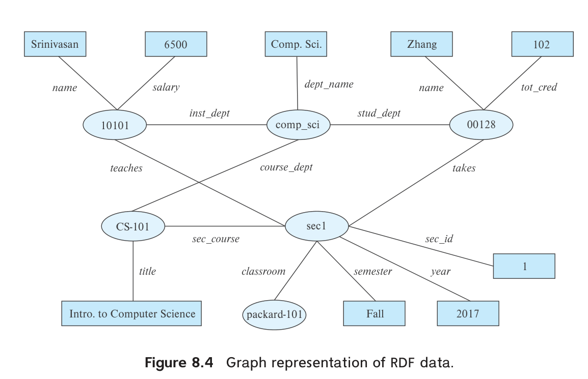
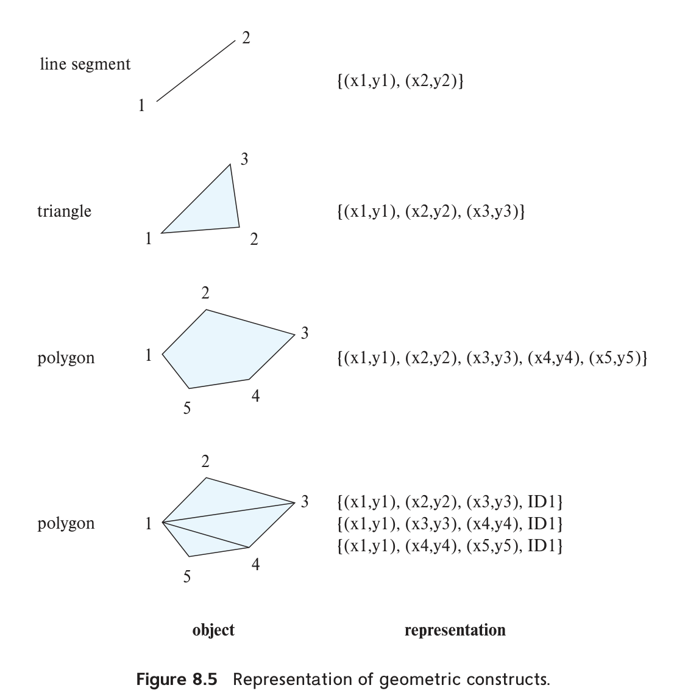
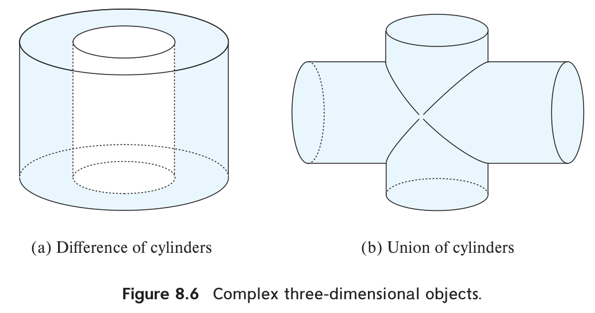
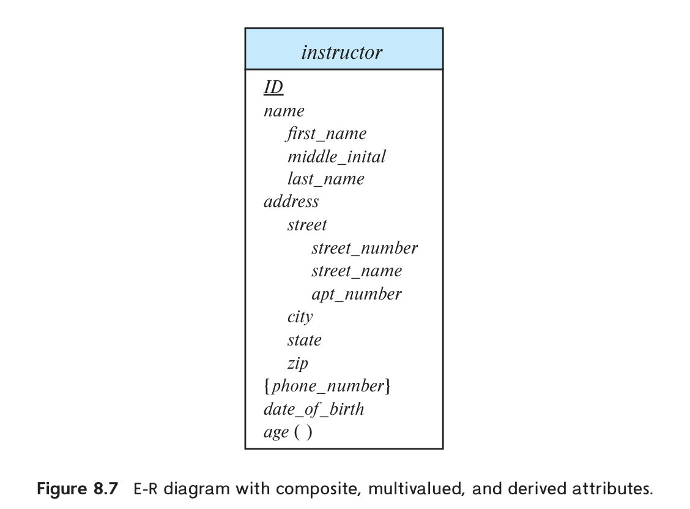
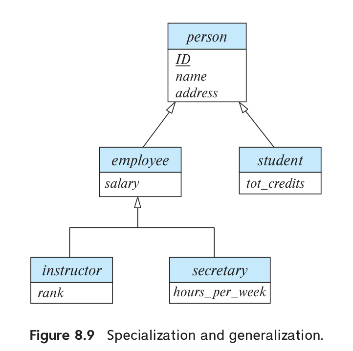

<!-- SOURCE pdf-0394-b004 -->
<!-- SOURCE pdf-0394-b005 -->
# 第 8 章 复杂数据类型 {#chapter-8}

<!-- SOURCE pdf-0394-b006 -->
关系模型广泛用于各类应用，它的一项基本要求是数据值具有原子性。基本关系模型不允许多值、复合等复杂类型，但在一些应用中，这种限制带来的问题超过了收益。本章介绍常见的非原子类型，包括半结构化数据、基于对象的数据、文本数据和空间数据。

<!-- SOURCE pdf-0394-b007 -->
<!-- SOURCE pdf-0394-b008 -->
## 8.1 半结构化数据

关系数据库的表通常有固定数量的属性，每个属性保存原子值。增加属性等模式变更比较少见，变更时还可能需要修改应用代码。这种设计适合许多组织业务。

<!-- SOURCE pdf-0394-b009 -->
快速演进的 Web 应用却常需保存更复杂、结构频繁变化的数据。例如，多个应用共享的用户资料可能有许多属性，还经常增加新属性。某些属性自身也很复杂，例如用户兴趣集合，用于推荐相关文章。虽然可以把兴趣放进单独关系并规范化存储，但直接支持集合类型，可能使按用户访问资料更高效。本节介绍这些半结构化数据模型。

<!-- SOURCE pdf-0394-b010 -->
**数据交换**也是采用半结构化表示的重要原因，对许多应用甚至比存储更重要。一种常见架构是由 Web 服务提供数据，客户端负责展示和交互；客户端既可以是移动应用，<!-- SOURCE pdf-0395-b001 -->也可以是在浏览器中运行的 JavaScript。客户端能直接响应交互，改善早期主要由后端生成 HTML 的界面体验。这要求前后端高效交换和处理复杂数据，JSON 与 XML 就广泛用于此。

<!-- SOURCE pdf-0395-b002 -->
<!-- SOURCE pdf-0395-b003 -->
### 8.1.1 半结构化数据模型概览

为了满足现代应用的存储与交换需求，关系模型得到了多种扩展。

<!-- SOURCE pdf-0395-b004 -->
<!-- SOURCE pdf-0395-b005 -->
#### 8.1.1.1 灵活的模式

一些数据库允许不同元组拥有不同属性集合，称为**宽列表示（wide column）**。属性集合不固定，可以按需增加。

<!-- SOURCE pdf-0395-b006 -->
一种限制更多的形式是预先定义大量固定属性，每个元组只使用其中一部分，其余为空，称为**稀疏列表示（sparse column）**。

<!-- SOURCE pdf-0395-b007 -->
<!-- SOURCE pdf-0395-b008 -->
#### 8.1.1.2 多值数据类型

许多数据库支持用集合、多重集或数组作为属性值。例如，应用保存用户感兴趣的主题，并据此推荐文章或广告，可以用以下集合。

<!-- SOURCE pdf-0395-b009 -->
```text
{ basketball, La Liga, cooking, anime, Jazz }
```

这些兴趣依次是篮球、西甲、烹饪、动漫和爵士乐。

<!-- SOURCE pdf-0395-b010 -->
6.7.2 节介绍过把集合值规范化的方法。但若总是按用户查找兴趣，规范化并无额外好处，还会增加存储和查询开销。

<!-- SOURCE pdf-0395-b011 -->
一些系统还支持**键值映射（map）**，即由 `(key, value)` 组成的集合，每个键至多出现一次。例如，电商商品的品牌、型号、尺寸、颜色及其他规格可能各不相同，适合用规格名作为键、具体内容作为值。

<!-- SOURCE pdf-0396-b001 -->
<!-- SOURCE pdf-0396-b002 -->
例如：

```text
{ (brand, Apple), (ID, MacBook Air), (size, 13), (color, silver) }
```

<!-- SOURCE pdf-0396-b003 -->
`put(key, value)` 添加键值对，`get(key)` 查找值，`delete(key)` 删除键值对。

<!-- SOURCE pdf-0396-b004 -->
数组对科学计算和监测应用很重要。图像是像素值的二维数组；实验和工业传感器按固定间隔产生的读数，也可看作数组。相比为每个读数存储 `(time, reading)` 元组，数组无需逐项保存可由下标推导的时间，减少元组管理开销，还便于压缩整段读数。

<!-- SOURCE pdf-0396-b005 -->
数据库早期就有人提出多值属性，对应模型称为**非第一范式模型（NFNF）**。Oracle、PostgreSQL 等关系数据库也支持集合、数组等相关类型。

<!-- SOURCE pdf-0396-b006 -->
**数组数据库**专门支持高效压缩数组存储，以及数组操作的查询语言扩展。原书列举 Oracle GeoRaster、PostgreSQL 的 PostGIS 扩展、MonetDB 的 SciQL 扩展，以及面向科学计算、提供多种数组功能的 SciDB。

<!-- SOURCE pdf-0396-b007 -->
<!-- SOURCE pdf-0396-b008 -->
#### 8.1.1.3 嵌套数据类型

复合属性可以直接对应 E-R 模型：例如 name 含 firstname、lastname。再结合集合、数组、映射，就形成数据类型的层次结构，称为**嵌套数据类型**。许多数据库把这些能力作为面向对象数据支持的一部分，见 8.2 节。

<!-- SOURCE pdf-0396-b009 -->
<!-- SOURCE pdf-0396-b010 -->
下面介绍两种常用表示：JavaScript 对象表示法 **JSON** 和可扩展标记语言 **XML**。它们允许复杂内部结构，也不要求每个值遵循固定模式。与宽表类似，记录的属性集合及属性类型都可以灵活变化。

<!-- SOURCE pdf-0397-b001 -->
此外，对象还可包含子对象，形成树状结构。

<!-- SOURCE pdf-0397-b002 -->
JSON、XML 可以把同一业务对象的多方面信息封装在一个结构内，因此广泛用于应用间交换数据。

<!-- SOURCE pdf-0397-b003 -->
JSON 常用于移动或 Web 应用的前后端通信，也用于把某个用户的相关信息组织成一个大对象，有时称为“文档”，从而减少检索时的连接操作。XML 出现更早，许多系统用它保存配置等信息，或进行数据交换。

<!-- SOURCE pdf-0397-b004 -->
<!-- SOURCE pdf-0397-b005 -->
#### 8.1.1.4 知识表示

人工智能领域长期研究如何表示人类知识，包括事实及关于事实的规则。随着 Web 发展，知识库可能包含数十亿条事实。**资源描述框架（RDF）**因适合处理大规模知识而广泛使用，尽管其表示能力比一些早期模型更简单。

<!-- SOURCE pdf-0397-b006 -->
类似 E-R 模型，RDF 把数据看作具有属性、彼此存在联系的对象。它既可以表示成三元组集合，也可以表示成图：对象与属性值为结点，联系与属性名为边。8.1.4 节详细介绍。

<!-- SOURCE pdf-0397-b007 -->
<!-- SOURCE pdf-0397-b008 -->
### 8.1.2 JSON

JSON 用文本表示复杂数据，常用于应用间通信及复杂对象存储。它支持数值、字符串、数组，以及由“属性名—值”组成的对象。原书分别提到整数和实数；JSON 的类型体系把二者统称为 number。

<!-- SOURCE pdf-0397-b009 -->
图 8.1 是一个例子。对象无需遵守固定模式，可以看作以属性名为键、属性内容为值的映射。

<!-- SOURCE pdf-0398-b002 -->
<!-- SOURCE pdf-0398-b003 -->
<!-- SOURCE pdf-0398-b004 -->
<!-- SOURCE pdf-0398-b005 -->
<!-- SOURCE pdf-0398-b007 -->
```json
{
  "ID": "22222",
  "name": {
    "firstname": "Albert",
    "lastname": "Einstein"
  },
  "deptname": "Physics",
  "children": [
    {"firstname": "Hans", "lastname": "Einstein"},
    {"firstname": "Eduard", "lastname": "Einstein"}
  ]
}
```

**图 8.1**　JSON 数据示例。

> 原书 firstname、lastname 的键名漏了闭合引号，此处补齐，使示例为合法 JSON。

<!-- SOURCE pdf-0397-b010 -->
方括号表示数组。可从概念上把数组理解为从整数下标到值的映射，方括号是方便的构造语法。

<!-- SOURCE pdf-0397-b011 -->
JSON 已成为应用与 Web 服务之间常用的数据表示。许多应用通过 Web 服务在后端存储、检索数据和执行计算。

<!-- SOURCE pdf-0398-b008 -->
Web 服务详见 9.5.2 节。简单参数可以是字符串或数字，复杂参数和返回结果则常用 JSON。例如邮件界面通过服务完成身份验证、获取邮件标题列表、读取正文、发送邮件等动作。

<!-- SOURCE pdf-0398-b009 -->
这些步骤交换的数据往往有复杂内部结构，JSON 能灵活表示这些内容。

<!-- SOURCE pdf-0398-b010 -->
JavaScript、Java、Python、PHP 等语言都有库，可在 JSON 与语言对象之间转换。与程序数据结构容易衔接，是 JSON 广泛使用的重要原因。

<!-- SOURCE pdf-0398-b011 -->
相比紧凑的关系存储，JSON 文本重复携带字段名，可能占用更多空间；解析文本获取字段也消耗 CPU。系统因此常使用便于直接访问字段的二进制表示，例如 **BSON（Binary JSON）**。

> 原书称 BSON 为“压缩二进制格式”。BSON 是二进制编码，并不保证比 JSON 文本更小；压缩是另一个可独立采用的步骤。

<!-- SOURCE pdf-0398-b012 -->
<!-- SOURCE pdf-0398-b013 -->
SQL 也从多个方面扩展了 JSON 支持：

- 用 JSON 数据类型存储数据。
- 从关系查询结果生成 JSON。

<!-- SOURCE pdf-0399-b001 -->
<!-- SOURCE pdf-0399-b002 -->
<!-- SOURCE pdf-0399-b004 -->
<!-- SOURCE pdf-0399-b006 -->
<!-- SOURCE pdf-0399-b008 -->
<!-- SOURCE pdf-0399-b010 -->
  可以逐行构造对象。例如 PostgreSQL 的 `json_build_object('ID', 12345, 'name', 'Einstein')` 返回 `{"ID": 12345, "name": "Einstein"}`。

> 原书函数参数中漏了逗号，输出示例的 name 后也误用逗号；此处按合法函数调用和 JSON 语法恢复。

<!-- SOURCE pdf-0399-b011 -->
<!-- SOURCE pdf-0399-b012 -->
<!-- SOURCE pdf-0399-b014 -->
<!-- SOURCE pdf-0399-b016 -->
<!-- SOURCE pdf-0399-b018 -->
  也可以聚合多行。PostgreSQL 的 `json_agg` 把一组值聚合为 JSON 数组；Oracle 提供 `JSON_OBJECTAGG` 生成对象，`JSON_ARRAYAGG` 生成数组，并可指定元素顺序。SQL Server 的 `FOR JSON AUTO` 可把查询结果格式化为 JSON，每行对应一个元素。

> 原书将 json_agg 的结果笼统称为对象，并把 Oracle 的 JSON_ARRAYAGG 误印为 json_arraytagg；这里按各函数的实际名称与返回结构说明。

<!-- SOURCE pdf-0399-b019 -->
<!-- SOURCE pdf-0399-b021 -->
- 从 JSON 中提取数据。例如 PostgreSQL 中，JSON 值 v 的 `v->'ID'` 返回 ID 对应的值；Oracle 支持点号路径，SQL Server 用 `JSON_VALUE(value, path)` 按路径提取标量。

<!-- SOURCE pdf-0399-b022 -->
各系统的语法和语义并不完全一致，详细参考资料见本章在线书目说明。

<!-- SOURCE pdf-0399-b023 -->
<!-- SOURCE pdf-0399-b024 -->
<!-- SOURCE pdf-0399-b025 -->
### 8.1.3 XML

XML 用尖括号标签标记文本。成对的 `<tag>`、`</tag>` 界定内容，例如：

```xml
<title>Database System Concepts</title>
```

<!-- SOURCE pdf-0399-b026 -->
<!-- SOURCE pdf-0399-b027 -->
<!-- SOURCE pdf-0399-b028 -->
<!-- SOURCE pdf-0399-b030 -->
<!-- SOURCE pdf-0399-b032 -->
<!-- SOURCE pdf-0399-b034 -->
<!-- SOURCE pdf-0399-b036 -->
关系名与属性名也可作为标签：

```xml
<course>
  <course_id> CS-101 </course_id>
  <title> Intro. to Computer Science </title>
  <dept_name> Comp. Sci. </dept_name>
  <credits> 4 </credits>
</course>
```

<!-- SOURCE pdf-0400-b002 -->
<!-- SOURCE pdf-0400-b004 -->
<!-- SOURCE pdf-0400-b005 -->
<!-- SOURCE pdf-0400-b006 -->
<!-- SOURCE pdf-0400-b007 -->
<!-- SOURCE pdf-0400-b008 -->
<!-- SOURCE pdf-0400-b009 -->
<!-- SOURCE pdf-0400-b011 -->
<!-- SOURCE pdf-0400-b013 -->
<!-- SOURCE pdf-0400-b015 -->
<!-- SOURCE pdf-0400-b017 -->
<!-- SOURCE pdf-0400-b019 -->
<!-- SOURCE pdf-0400-b021 -->
<!-- SOURCE pdf-0400-b023 -->
<!-- SOURCE pdf-0400-b025 -->
```xml
<purchase_order>
  <identifier> P-101 </identifier>
  <purchaser>
    <name> Cray Z. Coyote </name>
    <address> Route 66, Mesa Flats, Arizona 86047, USA </address>
  </purchaser>
  <supplier>
    <name> Acme Supplies </name>
    <address> 1 Broadway, New York, NY, USA </address>
  </supplier>
  <itemlist>
    <item>
      <identifier> RS1 </identifier>
      <description> Atom powered rocket sled </description>
      <quantity> 2 </quantity>
      <price> 199.95 </price>
    </item>
    <item>
      <identifier> SG2 </identifier>
      <description> Superb glue </description>
      <quantity> 1 </quantity>
      <unit-of-measure> liter </unit-of-measure>
      <price> 29.95 </price>
    </item>
  </itemlist>
  <total_cost> 429.85 </total_cost>
  <payment_terms> Cash-on-delivery </payment_terms>
  <shipping_mode> 1-second-delivery </shipping_mode>
</purchase_order>
```

**图 8.2**　采购单的 XML 表示。单据包含买卖双方、商品明细、总价、货到付款条款和配送方式。商品描述依次为原子动力火箭雪橇与强力胶，示例数据保留原文。

<!-- SOURCE pdf-0400-b026 -->
新标签很容易增加。命名恰当时，人可以从名称理解或推测内容含义，数据便有一定的自描述性。

<!-- SOURCE pdf-0400-b027 -->
标签还可表达嵌套层次，而基本关系模型不能直接表达这种结构。账单、采购单等需要在组织间交换的业务对象很适合这种表示。

<!-- SOURCE pdf-0400-b028 -->
图 8.2 展示由一个组织发给另一个组织的采购单。嵌套结构把各种相关信息自然地组合在一个文档中。

<!-- SOURCE pdf-0401-b001 -->
真实采购单通常比这个简化示例更复杂。XML 规定统一的标记方式，但双方仍需约定使用哪些标签及其含义。

<!-- SOURCE pdf-0401-b002 -->
**XQuery** 用于查询 XML，详见原书第 30 章。多家厂商提供实现，但普及程度比 SQL 低。

<!-- SOURCE pdf-0401-b003 -->
<!-- SOURCE pdf-0401-b004 -->
<!-- SOURCE pdf-0401-b005 -->
SQL 对 XML 也有扩展：

- 使用 XML 数据类型保存数据。
- 将关系数据生成 XML，可逐行构造，也可用 `XMLAGG` 把多行组合为一个文档，便于把相关数据发给其他应用。
- 从 XML 值中提取内容，例如用 **XPath** 路径表达式取得指定部分。

这些扩展也见原书第 30 章。

<!-- SOURCE pdf-0401-b006 -->
<!-- SOURCE pdf-0401-b007 -->
### 8.1.4 RDF 与知识图谱

**资源描述框架（Resource Description Framework，RDF）**是表达实体及其属性、联系的数据标准。本节作概览。

<!-- SOURCE pdf-0401-b008 -->
<!-- SOURCE pdf-0401-b009 -->
<!-- SOURCE pdf-0401-b010 -->
<!-- SOURCE pdf-0401-b011 -->
#### 8.1.4.1 三元组表示

RDF 用三元组集合表达数据，常见形式是：

1. `(ID, attribute-name, value)`；
2. `(ID1, relationship-name, ID2)`。

<!-- SOURCE pdf-0401-b012 -->
ID、ID1、ID2 标识实体，RDF 中也称为**资源**。RDF 直接表达二元联系，不能像 E-R 模型那样直接表达一般的 n 元联系，后文讨论处理办法。

<!-- SOURCE pdf-0401-b013 -->
三元组第一项称为**主语（subject）**，第二项为**谓词（predicate）**，第三项为**宾语（object）**，即 `(subject, predicate, object)`。

<!-- SOURCE pdf-0402-b002 -->
<!-- SOURCE pdf-0402-b004 -->
<!-- SOURCE pdf-0402-b006 -->
<!-- SOURCE pdf-0402-b008 -->
<!-- SOURCE pdf-0402-b010 -->
<!-- SOURCE pdf-0402-b012 -->
<!-- SOURCE pdf-0402-b014 -->
<!-- SOURCE pdf-0402-b016 -->
<!-- SOURCE pdf-0402-b018 -->
<!-- SOURCE pdf-0402-b020 -->
<!-- SOURCE pdf-0402-b022 -->
<!-- SOURCE pdf-0402-b024 -->
<!-- SOURCE pdf-0402-b026 -->
<!-- SOURCE pdf-0402-b028 -->
<!-- SOURCE pdf-0402-b030 -->
<!-- SOURCE pdf-0402-b032 -->
```text
10101   instance-of   instructor .
10101   name          "Srinivasan" .
10101   salary        "6500" .
00128   instance-of   student .
00128   name          "Zhang" .
00128   tot_cred      "102" .
comp_sci instance-of  department .
comp_sci dept_name    "Comp. Sci." .
biology instance-of   department .
CS-101  instance-of   course .
CS-101  title         "Intro. to Computer Science" .
CS-101  course_dept   comp_sci .
sec1    instance-of   section .
sec1    sec_course    CS-101 .
sec1    sec_id        "1" .
sec1    semester      "Fall" .
sec1    year          "2017" .
sec1    classroom     packard-101 .
sec1    time_slot_id  "H" .
10101   inst_dept     comp_sci .
00128   stud_dept     comp_sci .
00128   takes         sec1 .
10101   teaches       sec1 .
```

**图 8.3**　大学数据库中一部分数据的三元组表示。

> 本章使用便于说明的简写。实际 RDF 序列化与 SPARQL 查询还需使用合法 IRI 或定义命名空间前缀；这些裸名称不能直接当作完整标准语法运行。

<!-- SOURCE pdf-0402-b033 -->
图中属性值带引号，实体标识符、属性名和联系名不带引号。

<!-- SOURCE pdf-0402-b034 -->
<!-- SOURCE pdf-0402-b036 -->
<!-- SOURCE pdf-0402-b038 -->
<!-- SOURCE pdf-0402-b040 -->
<!-- SOURCE pdf-0402-b042 -->
教师、学生以 ID 标识，课程以 course_id 标识；每个属性单独形成三元组。instance-of 给出对象类型，例如 10101 是 instructor，00128 是 student。计算机系用 comp_sci 标识，图中只列出 dept_name 属性。section 的主键是复合键，因此另造标识符 sec1，并列出其学期、年份、班号，以及指向 CS-101 的课程联系。

<!-- SOURCE pdf-0402-b043 -->
<!-- SOURCE pdf-0402-b045 -->
<!-- SOURCE pdf-0402-b047 -->
<!-- SOURCE pdf-0402-b049 -->
图中包含 takes、teaches 联系。教师、学生和课程所属的系，分别通过 inst_dept、stud_dept、course_dept 表示；教学班通过 classroom 指向教室对象 packard-101，<!-- SOURCE pdf-0403-b001 --><!-- SOURCE pdf-0403-b003 -->并通过 sec_course 指向所开设的课程。

<!-- SOURCE pdf-0403-b004 -->
instance-of 连接实体与表示类型的对象；类型和子类型之间，也可用 subtype 边连接。

<!-- SOURCE pdf-0403-b005 -->
RDF 可以灵活地为对象添加新属性，或增加新的联系类型。

<!-- SOURCE pdf-0403-b006 -->
<!-- SOURCE pdf-0403-b007 -->
#### 8.1.4.2 RDF 的图表示

把实体和属性值作为结点，属性名或联系名作为有向边的标签，就得到 RDF 图。图 8.4 对应图 8.3：椭圆表示对象，矩形表示属性值，带标签的边表示联系；为简洁省略了 instance-of 边。

<!-- SOURCE pdf-0403-b009 -->
<!-- SOURCE pdf-0403-b010 -->
<!-- SOURCE pdf-0403-b011 -->
<!-- SOURCE pdf-0403-b012 -->
<!-- SOURCE pdf-0403-b013 -->
<!-- SOURCE pdf-0403-b014 -->
<!-- SOURCE pdf-0403-b015 -->
<!-- SOURCE pdf-0403-b016 -->
<!-- SOURCE pdf-0403-b017 -->
<!-- SOURCE pdf-0403-b018 -->
<!-- SOURCE pdf-0403-b019 -->
<!-- SOURCE pdf-0403-b020 -->
<!-- SOURCE pdf-0403-b021 -->
<!-- SOURCE pdf-0403-b022 -->
<!-- SOURCE pdf-0403-b023 -->
<!-- SOURCE pdf-0403-b024 -->
<!-- SOURCE pdf-0403-b025 -->
<!-- SOURCE pdf-0403-b026 -->
<!-- SOURCE pdf-0403-b027 -->
<!-- SOURCE pdf-0403-b028 -->
<!-- SOURCE pdf-0403-b029 -->
<!-- SOURCE pdf-0403-b030 -->


**图 8.4**　RDF 图。name、salary、title 等边连接属性值；takes、teaches、sec_course 等边连接实体。

<!-- SOURCE pdf-0403-b008 -->
用 RDF 图或其变体、扩展表达知识，称为**知识图谱**。它可以收集 Wikipedia、Wikidata 等 Web 来源的事实。例如“华盛顿哥伦比亚特区是美国首都”，可用 capital-of 边连接城市和国家两个实体。

<!-- SOURCE pdf-0404-b001 -->
回答“美国首都是哪座城市”时，查找通过 capital-of 指向美国的实体即可。若保存了类型信息，还可检查该实体是否通过 instance-of 连接 City 类型。

<!-- SOURCE pdf-0404-b002 -->
<!-- SOURCE pdf-0404-b003 -->
<!-- SOURCE pdf-0404-b004 -->
<!-- SOURCE pdf-0404-b005 -->
#### 8.1.4.3 SPARQL

**SPARQL** 是 RDF 查询语言，基于允许包含变量的三元组模式。例如：

```text
?cid title "Intro. to Computer Science"
```

它匹配谓词为 title、宾语为指定课程名的三元组；变量 ?cid 可以匹配任意相应值。

<!-- SOURCE pdf-0404-b006 -->
<!-- SOURCE pdf-0404-b007 -->
<!-- SOURCE pdf-0404-b008 -->
多个模式可以共享变量：

```text
?cid title "Intro. to Computer Science"
?sid sec_course ?cid
```

在图 8.3 中，第一个模式匹配 `(CS-101, title, "Intro. to Computer Science")`，第二个匹配 `(sec1, sec_course, CS-101)`。共享的 ?cid 相当于连接条件。

> 原书查询把 sec_course 写成 course，与图 8.3 数据不一致；此处统一为 sec_course。

<!-- SOURCE pdf-0404-b009 -->
<!-- SOURCE pdf-0404-b010 -->
<!-- SOURCE pdf-0404-b011 -->
以下查询返回修过“计算机科学导论”某个教学班的学生姓名，仍沿用省略命名空间的简写：

```text
select ?name
where {
  ?cid title "Intro. to Computer Science" .
  ?sid sec_course ?cid .
  ?id takes ?sid .
  ?id name ?name .
}
```

<!-- SOURCE pdf-0404-b012 -->
共享变量把各个三元组模式的匹配结果连接起来。

<!-- SOURCE pdf-0404-b013 -->
SPARQL 的谓词位置也可以是变量，从而匹配不同属性名或联系名。它还支持

<!-- SOURCE pdf-0405-b001 -->
聚合、类似外连接的可选匹配，以及子查询，进一步说明见延伸阅读。

<!-- SOURCE pdf-0405-b002 -->
<!-- SOURCE pdf-0405-b003 -->
#### 8.1.4.4 表示 n 元联系

一条边只能直接表达二元联系，复杂关系需要扩展。例如，为事实附加有效时间：假设美国在 2050 年把首都从华盛顿迁到纽约，就应分别表示截至 2050 年和 2050 年之后的两段事实。这里是说明时间建模的假设情形。

<!-- SOURCE pdf-0405-b004 -->
6.9.4 节介绍过，用人工实体代表一个 n 元联系实例，再通过二元联系连接各参与实体。原书另举一例：用 e1 表示“奥巴马在 2008—2016 年任美国总统”，以 person、country 边连接人物与国家，再以 president-from、president-till 属性边连接 2008、2016。若年份也建模为实体，则相应边变为实体间联系。

> 原书示例年份有误，实际总统任期为 2009—2017，见[美国国家档案馆](https://www.archives.gov/presidential-libraries/visit/obama)。这里保留原示例数值以说明建模方法，勿将它作为任期资料。

<!-- SOURCE pdf-0405-b005 -->
这与 6.8.5 节 E-R 聚集的想法类似：把联系当成实体处理。在 RDF 中称为**具体化（reification）**。许多知识图谱把有效时间等额外信息作为底层联系的限定信息。

<!-- SOURCE pdf-0405-b006 -->
另一类模型为三元组增加第四项**上下文（context）**，形成四元组。基本联系仍是二元的，但可关联一个上下文实体，再把有效时间等信息作为该实体的属性。

<!-- SOURCE pdf-0405-b007 -->
Wikidata、DBpedia、Freebase、YAGO 等知识库曾采用 RDF 或知识图谱表达广泛知识，也有大量领域专用图谱。**关联开放数据（Linked Open Data）**项目推动这些图谱开放，并连接独立建设的图谱，以便综合多个来源及其关联进行查询、推理。更多资料见在线书目说明。

<!-- SOURCE pdf-0405-b008 -->
<!-- SOURCE pdf-0405-b009 -->
## 8.2 面向对象

**对象关系模型**扩展了关系模型的类型系统，支持复杂类型与面向对象特性。

<!-- SOURCE pdf-0406-b001 -->
SQL 等关系查询语言也相应扩展，希望保留声明式数据访问等关系基础，同时提高建模能力。

<!-- SOURCE pdf-0406-b002 -->
许多应用用 Java、Python、C++ 等面向对象语言编写，却需要从关系数据库存取数据。对象类型与关系类型不一致，每次存取都要转换，单纯扩展数据库类型仍无法完全解决。程序员还要在编程语言与 SQL 之间切换。因此，一些应用希望直接通过语言构造或扩展访问数据库对象。

<!-- SOURCE pdf-0406-b003 -->
<!-- SOURCE pdf-0406-b004 -->
<!-- SOURCE pdf-0406-b005 -->
<!-- SOURCE pdf-0406-b006 -->
<!-- SOURCE pdf-0406-b007 -->
<!-- SOURCE pdf-0406-b008 -->
<!-- SOURCE pdf-0406-b009 -->
实践中有三种路线：

1. **对象关系数据库**：给关系数据库增加面向对象能力。
2. **对象关系映射（ORM）**：按映射规则，在程序对象和关系存储之间自动转换。
3. **面向对象数据库**：原生支持对象类型，并允许编程语言直接访问持久对象。

<!-- SOURCE pdf-0406-b010 -->
本节简要介绍前两种。第三种在语言衔接上有优势，但原书认为其普及有限：高效数据访问需要声明式查询，而普通命令式语言不直接具备这种能力；此外，经指针直接访问持久对象，指针错误可能扩大数据库损坏的风险。这里不再展开。

<!-- SOURCE pdf-0406-b011 -->
<!-- SOURCE pdf-0406-b012 -->
### 8.2.1 对象关系数据库系统

下面概述如何把对象特性加入关系数据库。

<!-- SOURCE pdf-0407-b001 -->
<!-- SOURCE pdf-0407-b002 -->
#### 8.2.1.1 用户定义类型

SQL 的对象扩展支持结构化用户定义类型、指向该类型的引用，以及以该类型为行类型的表。[^ch08-1]

<!-- SOURCE pdf-0407-b003 -->
<!-- SOURCE pdf-0407-b004 -->
<!-- SOURCE pdf-0407-b005 -->
```sql
create type Person
  (ID varchar(20) primary key,
   name varchar(20),
   address varchar(20))
  ref from(ID);
create table people of Person;
```

此处及下文的对象 SQL 沿用原书的标准化示意语法，具体数据库的可执行语法与支持范围需分别确认。

<!-- SOURCE pdf-0407-b006 -->
<!-- SOURCE pdf-0407-b007 -->
<!-- SOURCE pdf-0407-b008 -->
可以插入一个人员对象：

```sql
insert into people (ID, name, address) values
  ('12345', 'Srinivasan', '23 Coyote Run');
```

<!-- SOURCE pdf-0407-b009 -->
许多数据库支持数组或表类型，并可在不同位置使用这些类型，但支持范围与语法差异很大。例如 PostgreSQL 的 `integer[]` 表示未预先限定长度的整数数组，Oracle 的 `varray(10) of integer` 表示最多包含 10 个整数的数组。原书还给出如下表值类型示例。

<!-- SOURCE pdf-0407-b010 -->
<!-- SOURCE pdf-0407-b011 -->
<!-- SOURCE pdf-0407-b013 -->
<!-- SOURCE pdf-0407-b015 -->
<!-- SOURCE pdf-0407-b016 -->
```sql
create type interest as table (
  topic varchar(20),
  degree_of_interest int
);
create table users (
  ID varchar(20),
  name varchar(20),
  interests interest
);
```

> 原书把这段示例归于 SQL Server。SQL Server 支持用户定义表类型，但不能直接把表类型作为普通表的一列；第二个 CREATE TABLE 应视为嵌套属性的概念示意，不能原样在 SQL Server 中执行。

<!-- SOURCE pdf-0407-b017 -->
用户定义类型还可以带方法，Oracle 等部分数据库支持，本节省略细节。

<!-- SOURCE pdf-0407-b018 -->
<!-- SOURCE pdf-0407-b019 -->
#### 8.2.1.2 类型继承

在 Person、people 基础上，可以为学生和教师保存额外信息。

<!-- SOURCE pdf-0407-b021 -->
[^ch08-1]: 结构化类型不同于 4.5.5 节较简单的 distinct 类型。

<!-- SOURCE pdf-0408-b001 -->
<!-- SOURCE pdf-0408-b002 -->
<!-- SOURCE pdf-0408-b003 -->
<!-- SOURCE pdf-0408-b004 -->
学生、教师也是人员，可用继承定义：

```sql
create type Student under Person
  (degree varchar(20));
create type Teacher under Person
  (salary integer);
```

<!-- SOURCE pdf-0408-b005 -->
Student、Teacher 继承 Person 的 ID、name、address。前两者称为 Person 的**子类型**，Person 是它们的**超类型**。

<!-- SOURCE pdf-0408-b006 -->
方法也会继承，子类型还可重新定义方法行为，细节从略。

<!-- SOURCE pdf-0408-b007 -->
<!-- SOURCE pdf-0408-b008 -->
#### 8.2.1.3 表继承

**表继承**允许声明子表，对应 E-R 的特化与概化。多种数据库提供相关能力，但实现方式不同。

<!-- SOURCE pdf-0408-b009 -->
<!-- SOURCE pdf-0408-b010 -->
<!-- SOURCE pdf-0408-b011 -->
<!-- SOURCE pdf-0408-b012 -->
例如，PostgreSQL 可先建立 people，再声明：

```sql
create table students
  (degree varchar(20))
  inherits (people);
create table teachers
  (salary integer)
  inherits (people);
```

> 原书 INHERITS 后省略了括号，此处按 PostgreSQL 语法补齐。

<!-- SOURCE pdf-0408-b013 -->
people 的全部属性也会出现在 students、teachers 中。

<!-- SOURCE pdf-0408-b014 -->
<!-- SOURCE pdf-0408-b015 -->
<!-- SOURCE pdf-0408-b016 -->
<!-- SOURCE pdf-0408-b017 -->
SQL:1999 的表继承先要求定义相应类型，原书给出：

```sql
create table people of Person;
create table students of Student
  under people;
create table teachers of Teacher
  under people;
```

> 原书称这可直接用于 Oracle，但 Oracle 的对象类型继承与这里的表 UNDER 语法不能混为一谈；本段保留为 SQL 标准模型示意。

<!-- SOURCE pdf-0408-b018 -->
其中 Student、Teacher 已按前文声明为 Person 的子类型。

<!-- SOURCE pdf-0409-b001 -->
<!-- SOURCE pdf-0409-b002 -->
<!-- SOURCE pdf-0409-b003 -->
向学生子表插入时，同时提供继承属性和本地属性：

```sql
insert into students values
  ('00128', 'Zhang', '235 Coyote Run', 'Ph.D.');
```

原书此处表名误用单数 student，前文建表名为 students。

<!-- SOURCE pdf-0409-b004 -->
子表中的元组隐式属于父表。查询 people 时，也会查到 students、teachers 的元组，但只能访问 people 中定义的属性。若只要直接存于父表、不含子表的元组，可使用 `only people`。

<!-- SOURCE pdf-0409-b005 -->
<!-- SOURCE pdf-0409-b006 -->
#### 8.2.1.4 SQL 中的引用类型

Oracle 等一些系统支持引用类型。原书继续使用如下 Person 定义说明引用概念。

<!-- SOURCE pdf-0409-b007 -->
<!-- SOURCE pdf-0409-b008 -->
<!-- SOURCE pdf-0409-b009 -->
```sql
create type Person
  (ID varchar(20) primary key,
   name varchar(20),
   address varchar(20))
  ref from(ID);
create table people of Person;
```

<!-- SOURCE pdf-0409-b010 -->
引用可使用系统分配的标识符；示意语法中的 `ref from(ID)` 则要求以已有主键值构造引用。

<!-- SOURCE pdf-0409-b011 -->
<!-- SOURCE pdf-0409-b012 -->
<!-- SOURCE pdf-0409-b013 -->
<!-- SOURCE pdf-0409-b015 -->
定义 Department，其 head 引用 Person，再创建 departments 表：

```sql
create type Department (
  dept_name varchar(20),
  head ref(Person) scope people
);
create table departments of Department;
```

<!-- SOURCE pdf-0409-b016 -->
`scope people` 将引用的目标表限定为 people。原书把它描述为完成外键定义；具体实现中，限定引用范围与保证引用目标存在并非同一件事，例如 Oracle 的 scoped REF 仍可能悬空，需要另外的引用完整性约束。

<!-- SOURCE pdf-0409-b017 -->
<!-- SOURCE pdf-0409-b018 -->
<!-- SOURCE pdf-0409-b019 -->
在按 ID 构造引用的示例模型下，可以写：

```sql
insert into departments values ('CS', '12345');
```

<!-- SOURCE pdf-0410-b001 -->
这里 12345 作为 Person 的引用。若由系统生成对象标识符，可以在查询中通过 `ref(r)` 取得引用，r 是表名或别名。先创建人员，再按 ID 或姓名查出引用，赋给 head。原书用下面两步示范，以避免依赖 VALUES 中的子查询支持。

<!-- SOURCE pdf-0410-b002 -->
<!-- SOURCE pdf-0410-b003 -->
<!-- SOURCE pdf-0410-b004 -->
<!-- SOURCE pdf-0410-b005 -->
<!-- SOURCE pdf-0410-b007 -->
```sql
insert into departments values ('CS', null);
update departments
set head = (select ref(p)
            from people as p
            where ID = '12345')
where dept_name = 'CS';
```

<!-- SOURCE pdf-0410-b008 -->
<!-- SOURCE pdf-0410-b009 -->
<!-- SOURCE pdf-0410-b010 -->
SQL:1999 用 `->` 解除引用，例如查询各系负责人的姓名和地址：

```sql
select head->name, head->address
from departments;
```

`head->name` 称为**路径表达式**。

<!-- SOURCE pdf-0410-b011 -->
head 指向 people 的元组，因此访问的是该人员的 name。引用把连接操作隐藏起来：若 head 只是普通外键，取得负责人姓名和地址就要显式连接 departments、people。

<!-- SOURCE pdf-0410-b012 -->
<!-- SOURCE pdf-0410-b013 -->
也可用 `deref` 取得引用指向的元组，再访问属性：

```sql
select deref(head).name
from departments;
```

<!-- SOURCE pdf-0410-b014 -->
<!-- SOURCE pdf-0410-b015 -->
### 8.2.2 对象关系映射

ORM 允许程序员定义数据库关系中的元组与程序对象之间的映射。

<!-- SOURCE pdf-0411-b001 -->
程序可以按属性条件检索一个或多个对象。ORM 把条件转换为数据库查询，再根据预先定义的映射，将结果构造成对象。

<!-- SOURCE pdf-0411-b002 -->
程序修改对象、创建对象或标记删除后，发出保存命令，ORM 再把变化转换成对应元组的更新、插入、删除。

<!-- SOURCE pdf-0411-b003 -->
ORM 让程序员面向对象编写应用，同时保留底层关系数据库的能力。若对象已经缓存在内存中，访问它们还可能比反复查询数据库更快。

<!-- SOURCE pdf-0411-b004 -->
ORM 通常也提供针对对象模型的查询语言，并把查询转换为 SQL，再从 SQL 结果建立对象。

<!-- SOURCE pdf-0411-b005 -->
它还能隐藏不同数据库间的一些 SQL 差异，使同一套高层代码适配多个数据库，降低迁移成本。直接依赖特定 SQL 的应用，在迁移时通常需要处理更多差异。

<!-- SOURCE pdf-0411-b006 -->
代价是批量更新、或用命令式代码表达复杂查询时，ORM 可能效率较低。发现瓶颈后，可以绕过 ORM 直接操作数据库，用 SQL 编写复杂查询。

<!-- SOURCE pdf-0411-b007 -->
对许多应用，ORM 的便利超过这些代价，因此得到广泛采用。Java 中的 Hibernate，以及 Python 中的 Django ORM、SQLAlchemy 都是例子。9.6.2 节进一步介绍 Hibernate、Django。

<!-- SOURCE pdf-0411-b008 -->
<!-- SOURCE pdf-0411-b009 -->
## 8.3 文本数据

文本数据由非结构化文字组成，查询这类数据通常称为**信息检索**。传统模型以文档组织文字：数据库中的一个文本属性可视为文档，Web 上的一个网页也可视为文档。

<!-- SOURCE pdf-0412-b001 -->
<!-- SOURCE pdf-0412-b002 -->
### 8.3.1 关键词查询

信息检索系统根据关键词查找所需文档。例如 database system 查数据库系统资料，stock、scandal 查股市丑闻文章。通常文档中的所有词都可作为候选关键词，查询寻找包含指定关键词的文档。

<!-- SOURCE pdf-0412-b003 -->
最简单的系统返回包含全部查询词的文档；更复杂的系统结合词语出现情况、超链接等信息估计相关性，并按估计得分排序。

<!-- SOURCE pdf-0412-b004 -->
关键词检索最初用于组织内部文档库、研究论文等专业资料库，也适用于数据库保存的文本。

<!-- SOURCE pdf-0412-b005 -->
视频、音频、图片也可以通过描述性关键词检索。例如电影的标题、导演、演员、类型，或图片、短视频的内容标签。

<!-- SOURCE pdf-0412-b006 -->
Web 搜索引擎通过爬虫收集网页，再由检索系统匹配用户关键词。搜索引擎还会判断用户关心的主题，展示网页之外的信息：搜索 cricket 可看到板球比赛比分，搜索 New York 可看到地图、图片及相关网页。

<!-- SOURCE pdf-0412-b007 -->
<!-- SOURCE pdf-0412-b008 -->
### 8.3.2 相关性排序

Web 包含数十亿文档，一次查询可能匹配几十万条结果，相关程度却不相同。因此，系统估计相关性，优先返回排名高的结果。相关性没有唯一精确标准，但已有一些常用方法。

<!-- SOURCE pdf-0413-b001 -->
<!-- SOURCE pdf-0413-b002 -->
#### 8.3.2.1 TF–IDF 排序

**词项（term）**指文档或查询中的关键词。给定词项 t 与文档 d，可以先考察 t 在 d 中出现多少次：相关词往往多次出现。但直接计数有两个问题，一是长文档天然可能出现更多次，二是出现 10 次不意味着相关性就是出现 1 次的 10 倍。

<!-- SOURCE pdf-0413-b003 -->
<!-- SOURCE pdf-0413-b004 -->
<!-- SOURCE pdf-0413-b005 -->
<!-- SOURCE pdf-0413-b006 -->
<!-- SOURCE pdf-0413-b008 -->
<!-- SOURCE pdf-0413-b009 -->
<!-- SOURCE pdf-0413-b010 -->
一种计算 **TF(d, t)** 的方式是：

**TF(d, t) = log(1 + n(d, t) / n(d))**

其中 n(d) 是文档中的词项总次数，n(d, t) 是 t 的出现次数。这个式子考虑文档长度，得分随出现次数增加，但不按次数线性增长。

<!-- SOURCE pdf-0413-b011 -->
还可加入位置等信息：词项出现在标题、作者列表或摘要中，通常权重更高；首次出现在文档前部，可能比很晚才出现更相关。无论具体公式如何，这类描述词项在文档中重要程度的指标都称为**词频（TF）**。

<!-- SOURCE pdf-0413-b012 -->
多词查询可合并各词得分，例如求和，但不同词的信息量不同。database 很常见，Silberschatz 较少见；同时搜索两词时，只包含 Silberschatz 的文档，可能比只包含 database 的文档更有辨识力。

<!-- SOURCE pdf-0413-b013 -->
<!-- SOURCE pdf-0413-b014 -->
<!-- SOURCE pdf-0413-b016 -->
为此引入**逆文档频率（IDF）**。本书采用如下简单定义：

**IDF(t) = 1 / n(t)**

n(t) 是系统索引中包含 t 的文档数量。于是，文档 d 相对于查询词集合 Q 的相关性为：

<!-- SOURCE pdf-0414-b001 -->
<!-- SOURCE pdf-0414-b002 -->
<!-- SOURCE pdf-0414-b003 -->
<!-- SOURCE pdf-0414-b004 -->
**r(d, Q) = ∑<sub>t∈Q</sub> TF(d, t) × IDF(t)**

<!-- SOURCE pdf-0414-b005 -->
若允许用户为查询词指定权重 w(t)，可在每个求和项中再乘 w(t)。

<!-- SOURCE pdf-0414-b006 -->
综合词频和逆文档频率的方法称为 **TF–IDF**。

<!-- SOURCE pdf-0414-b007 -->
英语中的 and、or、a 等词几乎处处可见，逆文档频率很低，通常难以帮助区分文档。传统系统常定义约一百个常用**停用词**，建索引时忽略，用户查询中出现时也丢弃。

<!-- SOURCE pdf-0414-b008 -->
多词查询还可考虑词项在文档中的距离：彼此靠近通常比相距很远更相关，可把邻近性加入评分公式。

<!-- SOURCE pdf-0414-b009 -->
系统按 r(d, Q) 降序返回结果。匹配文档很多时，先给出得分最高的一小部分，用户再按需查看更多。

<!-- SOURCE pdf-0414-b010 -->
<!-- SOURCE pdf-0414-b011 -->
#### 8.3.2.2 利用超链接排序

超链接可以衡量与具体查询无关的文档整体重要性，例如被许多页面链接的文档通常更重要。

<!-- SOURCE pdf-0414-b012 -->
Google 推广的 **PageRank** 根据链接来源页面的重要程度计算目标页面的重要程度。原书认为，这种改进后的排序效果是 Google 早期迅速普及的重要原因。

<!-- SOURCE pdf-0414-b013 -->
被许多页面指向的页面更可能被访问；被高 PageRank 页面指向，也应获得更高分数。

<!-- SOURCE pdf-0414-b014 -->
因此，某页面的 PageRank 由其他页面的 PageRank 递归定义，可以写成线性方程组。先给网页编整数编号，并定义跳转概率矩阵 T：T[i, j] 表示随机访问者从 i 沿链接转到 j 的概率。

<!-- SOURCE pdf-0415-b001 -->
假设 i 的每条出链被选中的概率相同，若 i 有 Nᵢ 条出链，则对相连页面 j 有 T[i, j] = 1/Nᵢ。页面 j 的分数为：

<!-- SOURCE pdf-0415-b002 -->
<!-- SOURCE pdf-0415-b003 -->
<!-- SOURCE pdf-0415-b004 -->
<!-- SOURCE pdf-0415-b005 -->
<!-- SOURCE pdf-0415-b006 -->
**P[j] = δ/N + (1 − δ) × ∑<sub>i=1</sub><sup>N</sup> (T[i, j] × P[i])**

N 是总页面数，δ 在 0 与 1 之间，通常取 0.15。

<!-- SOURCE pdf-0415-b007 -->
常用迭代求解：所有 P[i] 先设为 1/N，每轮用上一轮的分数计算新分数；当一轮中任意 P[i] 的最大变化低于阈值时停止。

<!-- SOURCE pdf-0415-b008 -->
PageRank 是与查询无关的静态指标，实际回答关键词查询时，可与文档的 TF–IDF 得分结合。

<!-- SOURCE pdf-0415-b009 -->
排序还可使用网站访问频率、结果展示后的点击率等信号。指向页面的链接锚文本中的关键词，也常赋予较高权重。这些因素共同决定查询结果顺序。

<!-- SOURCE pdf-0415-b010 -->
<!-- SOURCE pdf-0415-b011 -->
### 8.3.3 衡量检索效果

常用两个指标：**精确率（precision）**是返回文档中真正相关的比例；**召回率（recall）**是全部相关文档中被找回的比例。用户通常只看前 10 或 20 条，因此常计算前 K 条结果上的指标，记作 precision@K、recall@K，例如 precision@10、recall@20。

<!-- SOURCE pdf-0415-b012 -->
<!-- SOURCE pdf-0415-b013 -->
### 8.3.4 结构化数据与知识图谱上的关键词查询

SQL 等语言适合查询结构化数据，但不熟悉模式或查询语言的用户难以使用。因此，研究者把关键词搜索扩展到结构化、半结构化数据。

<!-- SOURCE pdf-0415-b014 -->
一种办法是先将数据建模成图：元组为结点，外键等联系为边。查询先找到包含关键词的元组，再寻找这些结点之间的连接路径。

<!-- SOURCE pdf-0416-b001 -->
例如，在大学数据库中搜索“Zhang Katz”，可以找到学生 Zhang、教师 Katz，并通过 advisor 关系连接二者；也可能找到“Zhang 修了 Katz 教的课”这样的路径。用户不必知道精确模式或编写 SQL，就能临时浏览、查找关联信息。对普通用户，关键词通常比结构化查询语言更自然。

<!-- SOURCE pdf-0416-b002 -->
由于关键词没有完整限定查询含义，系统可能找到多类答案，必须排序。研究方法包括根据路径长度、边方向和权重评分，也可根据外键链接估计元组重要性。更多资料见在线书目。

<!-- SOURCE pdf-0416-b003 -->
知识图谱还可以与文本结合。先用图谱中的唯一实体标识符标注文本里的实体提及。例如“Stonebraker developed PostgreSQL”中的 Stonebraker，可据上下文链接到 Michael Stonebraker；图谱另存有他获得图灵奖的事实。于是，“turing award postgresql”可以综合文本与图谱的信息得到答案。[^ch08-2]

<!-- SOURCE pdf-0416-b004 -->
Web 搜索引擎也会结合大规模知识图谱与抓取的文档回答查询。

<!-- SOURCE pdf-0416-b010 -->
[^ch08-2]: 这个例子中的 PostgreSQL 开发者信息也可能已在图谱里，但许多其他事实只出现在文档中。

<!-- SOURCE pdf-0416-b005 -->
<!-- SOURCE pdf-0416-b006 -->
## 8.4 空间数据

数据库的空间支持，用于按位置高效存储、建立索引和查询数据。

<!-- SOURCE pdf-0416-b007 -->
<!-- SOURCE pdf-0416-b008 -->
两类空间数据很重要：

- **地理数据**：道路、土地利用、地形高程、行政边界、土地权属等地图信息。**地理信息系统（GIS）**专门处理这类数据，通常使用经度、纬度、高程等地球坐标。

<!-- SOURCE pdf-0417-b001 -->
- **几何数据**：描述建筑、汽车、飞机等物体的形状与结构，通常使用二维或三维欧氏空间中的 X、Y、Z 坐标。

<!-- SOURCE pdf-0417-b002 -->
原书列举的支持系统包括 Oracle Spatial and Graph、PostgreSQL 的 PostGIS、SQL Server，以及 IBM DB2 Spatial Extender。

<!-- SOURCE pdf-0417-b003 -->
本节介绍建模和查询，索引与查询处理技术见第 14、15 章。

<!-- SOURCE pdf-0417-b004 -->
具体语法因系统而异，越来越多实现采用开放地理空间联盟 **OGC** 的标准表示，使用时应查相应数据库手册。

<!-- SOURCE pdf-0417-b005 -->
<!-- SOURCE pdf-0417-b006 -->
### 8.4.1 几何信息的表示

几何信息可以用多种方式存储，图 8.5 展示其中一些规范化表示。

<!-- SOURCE pdf-0417-b007 -->
线段可用两个端点的坐标表示，例如地图上的经纬度。**折线（polyline，也称 linestring）**是首尾相接的线段序列，可按顺序保存端点坐标。任意曲线都可分段近似成折线。地图比例较小时，道路宽度可以忽略，适合表示成线；某些系统还以圆弧为基本元素，用一系列弧段表示曲线。

<!-- SOURCE pdf-0417-b008 -->
**多边形**可按顺序列出顶点，顶点序列确定区域边界。[^ch08-3] 也可把多边形划分为若干三角形，称为**三角剖分**；每个三角形携带所属多边形的标识符。圆、椭圆可使用专门类型，也可用多边形近似。

<!-- SOURCE pdf-0417-b009 -->
折线、多边形的列表表示便于查询，但属于非第一范式。若需要固定长度的第一范式元组，可给折线或曲线分配标识符，<!-- SOURCE pdf-0418-b024 -->每条线段单独存为元组，并带上所属曲线标识符。多边形的三角剖分也可类似存为第一范式关系。

<!-- SOURCE pdf-0417-b011 -->
[^ch08-3]: 一些文献把这里的多边形称为闭合多边形，把折线称为开放多边形。

<!-- SOURCE pdf-0418-b001 -->
<!-- SOURCE pdf-0418-b002 -->
<!-- SOURCE pdf-0418-b003 -->
<!-- SOURCE pdf-0418-b004 -->
<!-- SOURCE pdf-0418-b005 -->
<!-- SOURCE pdf-0418-b006 -->
<!-- SOURCE pdf-0418-b007 -->
<!-- SOURCE pdf-0418-b008 -->
<!-- SOURCE pdf-0418-b009 -->
<!-- SOURCE pdf-0418-b010 -->
<!-- SOURCE pdf-0418-b011 -->
<!-- SOURCE pdf-0418-b012 -->
<!-- SOURCE pdf-0418-b013 -->
<!-- SOURCE pdf-0418-b014 -->
<!-- SOURCE pdf-0418-b015 -->
<!-- SOURCE pdf-0418-b016 -->
<!-- SOURCE pdf-0418-b017 -->
<!-- SOURCE pdf-0418-b018 -->
<!-- SOURCE pdf-0418-b019 -->
<!-- SOURCE pdf-0418-b020 -->
<!-- SOURCE pdf-0418-b021 -->
<!-- SOURCE pdf-0418-b022 -->
<!-- SOURCE pdf-0418-b023 -->


**图 8.5**　依次为线段、三角形、多边形顶点序列，以及携带同一 ID 的三角剖分。左列为对象，右列为坐标表示。

<!-- SOURCE pdf-0418-b025 -->
三维点、线段只需多一个 z 坐标。三角形、矩形等平面图形在三维中的表示也相近。四面体、长方体可类比三角形、矩形表示；任意多面体可以划分为四面体，或列出组成其边界的多边形面，并标明每个面的哪一侧属于内部。

<!-- SOURCE pdf-0419-b001 -->
<!-- SOURCE pdf-0419-b003 -->
<!-- SOURCE pdf-0419-b005 -->
<!-- SOURCE pdf-0419-b007 -->
<!-- SOURCE pdf-0419-b009 -->
例如，SQL Server、PostGIS 提供 geometry、geography 及相关几何子类型，包括 point、linestring、curve、polygon，以及 multipoint、multilinestring、multicurve、multipolygon 等集合类型。具体类型与操作的支持范围因系统而异。

OGC 定义了文本表示，例如 `LINESTRING(1 1, 2 3, 4 4)` 连接三个点，`POLYGON((1 1, 2 3, 4 4, 1 1))` 用闭合坐标序列表示三角形。可以用转换函数构造内部对象；原书列出 `ST_GeometryFromText()`、`ST_GeographyFromText()`。`ST_Union()`、`ST_Intersection()` 分别计算并集和交集，返回相应空间对象。实际函数名称和语法需按系统确认。

<!-- SOURCE pdf-0419-b010 -->
道路线段通常还相互连接，构成**空间网络**或**空间图**。图的顶点有空间位置，边表示连接，并可携带距离、车道数、一天中不同时段的平均速度等信息。

<!-- SOURCE pdf-0419-b011 -->
<!-- SOURCE pdf-0419-b012 -->
### 8.4.2 设计数据库

传统计算机辅助设计（CAD）工具在编辑时把数据放在内存，会话结束再写文件。这既有格式转换的编程与时间成本，也常需整份读取文件。大型集成电路、整架飞机等设计甚至无法全部装入内存。CAD 需求曾是面向对象数据库的重要动机：把设计部件表示成对象，通过对象间联系表达整体结构。

<!-- SOURCE pdf-0419-b013 -->
设计数据库保存的通常是几何对象。点、线、三角形、矩形、多边形等简单二维对象，可通过并、交、差组合成复杂对象；三维对象也可由球、圆柱、长方体等组合，如图 8.6。表面还可以用线框或网格模型表达，以线段、三角形、矩形等简单元素近似。

<!-- SOURCE pdf-0420-b001 -->
<!-- SOURCE pdf-0420-b002 -->


**图 8.6**　(a) 两个圆柱的差；(b) 两个圆柱的并。

<!-- SOURCE pdf-0419-b014 -->
设计数据库还保存材质等非空间属性，<!-- SOURCE pdf-0420-b003 -->这些可以使用通常的数据建模方法，本节只讨论空间部分。

<!-- SOURCE pdf-0420-b004 -->
设计操作可能要求取出某个区域中的部分对象，14.10.1 节的空间索引适用于此。这类索引面向二维、三维空间，不局限于普通 B⁺ 树的一维顺序。

<!-- SOURCE pdf-0420-b005 -->
设计还需**空间完整性约束**，例如两根管道不能占据同一位置，以避免干涉。人工设计中的此类错误可能到制作原型时才发现，修复成本高。数据库提前检查空间约束可减少错误，也依赖高效的多维索引。

<!-- SOURCE pdf-0420-b006 -->
<!-- SOURCE pdf-0420-b007 -->
### 8.4.3 地理数据

地图和卫星影像是典型地理数据。它们既可记录边界、河流、道路的位置，还可附带高程、土壤类型、土地用途、年降雨量等信息。

<!-- SOURCE pdf-0420-b008 -->
<!-- SOURCE pdf-0420-b009 -->
#### 8.4.3.1 地理数据的应用

地理数据库用于在线地图、导航，也用于电话、电力、供水等公用设施网络，<!-- SOURCE pdf-0421-b001 -->以及生态和城市规划所需的土地利用、土地权属记录等。

<!-- SOURCE pdf-0421-b002 -->
地下电缆、管道越来越多，详细地图可以避免一个单位施工时破坏另一个单位的设施，造成大范围中断。地理数据库结合 GPS 等精确定位，有助于防止这些问题。

<!-- SOURCE pdf-0421-b003 -->
<!-- SOURCE pdf-0421-b004 -->
<!-- SOURCE pdf-0421-b005 -->
#### 8.4.3.2 地理数据的表示

主要分为两类。

**栅格数据（raster）**是二维或更高维的像素网格，例如某区域的卫星影像。除了图像，还保存位置，例如四角经纬度，以及分辨率；分辨率可用像素总数，也常用每个像素覆盖的地面范围表示。

<!-- SOURCE pdf-0421-b006 -->
栅格常按固定范围划成**瓦片**。显示一个区域时，加载所有与之重叠的瓦片。不同缩放级别各有一套瓦片，界面确定级别后只取相应区域与级别的数据。

<!-- SOURCE pdf-0421-b007 -->
栅格也可以是三维，例如各区域、各高度的温度；时间还可作为额外维度，记录地表温度随时间的变化。

**矢量数据（vector）**由点、线段、折线、三角形、多边形等二维对象，或圆柱、球、长方体、多面体等三维对象构成。地理点通常用经纬度表示，必要时加入高程。

<!-- SOURCE pdf-0421-b008 -->
道路常用折线，大湖、州、国家等区域用复杂多边形；河流根据宽度是否重要，可表示成曲线或多边形。区域年降雨量也可保存成数组，即栅格，并压缩节省空间。原书还提到用四叉树作为另一种数组表示。

<!-- SOURCE pdf-0422-b001 -->
区域信息也可按相同数值划成多边形。某些应用中，矢量更紧凑，表示道路时也比大像素网格更精确。但卫星影像等天然基于像素的数据，通常不适合强行转成矢量。

<!-- SOURCE pdf-0422-b002 -->
**地形信息**描述各点高程，可用栅格；也可划成近似等高的多边形，每区附一个高度。另一种方法是对地表进行三角剖分，每个三角形顶点都有经纬度和高程，称为**不规则三角网（TIN）**。这种表示较紧凑，便于生成区域三维视图。

<!-- SOURCE pdf-0422-b003 -->
GIS 往往同时保存栅格和矢量，并叠加显示。例如卫星影像上叠加道路、建筑和地标。地图由多个图层组成，按从下到上的顺序绘制，上层覆盖下层。

<!-- SOURCE pdf-0422-b004 -->
有时矢量在发送到浏览器前会先转成栅格：这样即使禁用 JavaScript 也能显示，也可减少直接向终端提供可提取的矢量数据。

<!-- SOURCE pdf-0422-b005 -->
Google Maps、Bing Maps 等服务提供 API，让应用在基础地图上叠加自己的信息，例如餐馆位置；可以动态只显示某种菜系，也可支持缩放、平移。

<!-- SOURCE pdf-0422-b006 -->
<!-- SOURCE pdf-0422-b007 -->
### 8.4.4 空间查询

按位置查询有多种形式。

<!-- SOURCE pdf-0422-b008 -->
<!-- SOURCE pdf-0422-b010 -->
<!-- SOURCE pdf-0422-b012 -->
**区域查询**查找全部或部分位于指定范围内的对象，例如某城镇边界内的商店。PostGIS 提供 `ST_Contains()`、`ST_Overlaps()`，<!-- SOURCE pdf-0423-b001 --><!-- SOURCE pdf-0423-b003 --><!-- SOURCE pdf-0423-b005 --><!-- SOURCE pdf-0423-b007 -->以及 `ST_Disjoint()`、`ST_Touches()` 等空间关系判断；SQL Server 有对应操作但命名不同。若 shop.location 为点，给定一个多边形，可判断哪些商店位于其中。

> 原书把这些函数笼统描述为同时用于 geometry 与 geography。PostGIS 各函数的类型支持不同，ST_Contains 直接接受 geometry；涉及 geography 时需选用该类型支持的函数，例如 ST_Covers，并注意边界语义差异。

**邻近查询**寻找距指定位置一定距离内的对象，例如附近餐馆。**最近邻查询**找最近对象，例如最近加油站，无需预先知道距离上限。

<!-- SOURCE pdf-0423-b009 -->
`ST_Distance()` 返回对象间的最小距离，可据此查找指定距离内的对象，或取距离最小者。

**空间图查询**在道路、铁路等网络上查询路径，例如两个位置之间的最短路线，是导航系统的常见操作。

<!-- SOURCE pdf-0423-b010 -->
<!-- SOURCE pdf-0423-b012 -->
<!-- SOURCE pdf-0423-b014 -->
计算两个区域集合的交集，可以看作**空间连接**。例如一个关系表示降雨，另一个表示人口密度，空间位置充当连接依据。一般来说，空间连接返回相交对象对，或这些对象对的相交区域；`ST_Contains()`、`ST_Overlaps()` 等可以作为连接条件。

<!-- SOURCE pdf-0423-b015 -->
空间与非空间条件也可组合，例如查找最近一家提供素食、每餐低于 10 美元的餐馆。

<!-- SOURCE pdf-0423-b016 -->
<!-- SOURCE pdf-0423-b017 -->
## 8.5 小结

- 许多应用需要比固定属性表更复杂的数据表示。
- SQL 的类型与查询扩展加入集合值属性、继承和元组引用，在保留声明式访问的同时扩展建模能力。

<!-- SOURCE pdf-0424-b001 -->
<!-- SOURCE pdf-0424-b002 -->
<!-- SOURCE pdf-0424-b003 -->
<!-- SOURCE pdf-0424-b004 -->
<!-- SOURCE pdf-0424-b005 -->
<!-- SOURCE pdf-0424-b006 -->
- 半结构化数据允许复杂内容和经常变化的模式。Web 服务提供数据、客户端负责显示和交互，是一种常见应用架构。
- 关系模型的扩展包括：不同元组具有不同属性集合；属性保存非原子值；用结构化属性直接对应 E-R 复合属性。

<!-- SOURCE pdf-0424-b007 -->
- JSON 是复杂数据的文本表示，广泛用于应用通信与存储。XML 也允许灵活的属性集合、类型与嵌套结构。
- RDF 用实体、属性和联系表达数据，可解释为以实体及属性值为结点、以属性及联系为边的图。SPARQL 基于三元组模式查询 RDF。
- 对象特性包括子类型、子表继承和对象引用。对象关系模型提供集合类型等更丰富的类型系统，为关系数据库用户采用对象特性提供迁移路径。
- ORM 把关系数据映射为程序对象。对象按需从数据库构造，修改再映射回关系；程序对象本身的内存身份不会像持久对象指针那样长期保存。ORM 得到了比持久化编程语言更广泛的应用。

<!-- SOURCE pdf-0425-b001 -->
<!-- SOURCE pdf-0425-b002 -->
<!-- SOURCE pdf-0425-b003 -->
<!-- SOURCE pdf-0425-b004 -->
- 信息检索系统保存、查询文本，模型较简单，但在该模型内提供丰富检索能力。用户的关键词往往无法完全表达需求，因此系统按潜在相关性排序。
- 排序依据包括词频、逆文档频率和重要性评分。
- 空间数据包括几何与地理类型，常用点、折线、多边形表示；区域、最近邻和空间图查询是常见查询形式。

<!-- SOURCE pdf-0425-b005 -->
## 复习术语

<!-- SOURCE pdf-0425-b006 -->
- 宽列、稀疏列
- 键值映射、映射
- 数组数据库
- 标签
- 三元组、资源、主语、谓词、宾语
- 知识图谱、具体化、四元组、关联开放数据
- 对象关系数据模型、对象关系数据库系统、对象关系映射

<!-- SOURCE pdf-0425-b007 -->
- 面向对象数据库系统
- 路径表达式
- 关键词、关键词查询、词项、相关性
- TF–IDF、停用词、邻近性、PageRank
- 精确率、召回率
- 地理数据、几何数据、地理信息系统
- 计算机辅助设计（CAD）
- 折线（polyline、linestring）

<!-- SOURCE pdf-0426-b001 -->
<!-- SOURCE pdf-0426-b002 -->
- 三角剖分、空间网络、空间图
- 栅格数据、瓦片、矢量数据、地形信息
- 不规则三角网（TIN）、叠加图层
- 邻近查询、最近邻查询、区域查询、空间图查询、空间连接

<!-- SOURCE pdf-0426-b003 -->
## 练习

<!-- SOURCE pdf-0426-b004 -->
<!-- SOURCE pdf-0426-b005 -->
<!-- SOURCE pdf-0426-b006 -->
<!-- SOURCE pdf-0426-b007 -->
<!-- SOURCE pdf-0426-b008 -->
**8.1**　取大学样例数据库中 Shankar 的信息，包括其 student 元组、对应 takes 元组，以及相关 course 元组，分别表示为：


**a.** 适当嵌套的 JSON；

**b.** 相同嵌套结构的 XML；

**c.** RDF 三元组；

**d.** RDF 图。

<!-- SOURCE pdf-0426-b009 -->
<!-- SOURCE pdf-0426-b010 -->
<!-- SOURCE pdf-0426-b011 -->
<!-- SOURCE pdf-0426-b012 -->
**8.2**　根据图 8.3 的 RDF 数据，用 SPARQL 查询：


**a.** 所有名为 Zhang 的学生修过的课程名称。

**b.** Zhang 修过、且相应教学班由 Srinivasan 授课的课程名称。

**c.** Srinivasan 的全部属性名与属性值，查询中不得逐个列举属性名。

<!-- SOURCE pdf-0426-b013 -->
<!-- SOURCE pdf-0426-b014 -->
**8.3**　租车公司为所有车辆保存车辆识别号、车牌号、制造商、型号、购买日期、颜色；某些类别还有特有属性：

- 卡车：载货能力。
- 跑车：马力、租车人年龄要求。
- 厢式车：乘员数。
- 越野车：离地间隙、四驱或两驱。

<!-- SOURCE pdf-0427-b007 -->
为该数据库定义 SQL 模式，并在适当位置使用继承。

<!-- SOURCE pdf-0427-b008 -->
<!-- SOURCE pdf-0427-b009 -->
**8.4**　考虑以下包含多值属性的模式：

```text
Emp = (ename, ChildrenSet multiset(Children), SkillSet multiset(Skills))
Children = (name, birthday)
Skills = (type, ExamSet setof(Exams))
Exams = (year, city)
```

<!-- SOURCE pdf-0427-b010 -->
按 8.2.1.1 节的表类型示意，为多重集属性定义 SQL 模式。

> 原题要求使用 SQL Server 的表类型语法；如前文所注，SQL Server 不支持把用户定义表类型直接嵌入为列。本题应作为嵌套类型建模题理解；在 SQL Server 实现时需转换为相应子表。

<!-- SOURCE pdf-0427-b011 -->
<!-- SOURCE pdf-0427-b013 -->
**8.5**　对图 8.7 的 instructor 实体，给出 SQL 模式定义；用 Oracle 或 PostgreSQL 的数组语法，将 phone_number 表示为最多 10 个元素的数组。

> PostgreSQL 的数组声明不会强制长度上限；若要求最多 10 项，还需 CHECK 等约束。参见[数组类型文档](https://www.postgresql.org/docs/17/arrays.html)。

<!-- SOURCE pdf-0427-b001 -->
<!-- SOURCE pdf-0427-b002 -->
<!-- SOURCE pdf-0427-b003 -->
<!-- SOURCE pdf-0427-b004 -->
<!-- SOURCE pdf-0427-b005 -->
<!-- SOURCE pdf-0427-b006 -->


**图 8.7**　教师的姓名、地址为复合属性，电话为多值属性，年龄由出生日期推导。图中 middle_inital 是原图的拼写。

<!-- SOURCE pdf-0427-b014 -->
<!-- SOURCE pdf-0427-b015 -->
<!-- SOURCE pdf-0427-b016 -->
**8.6**　考虑图 8.8 的关系模式。


**a.** 定义相应 SQL 模式，用引用表示外键联系。

**b.** 编写以下查询：

**i.** 雇员最多的公司。

<!-- SOURCE pdf-0428-b002 -->
<!-- SOURCE pdf-0428-b004 -->
<!-- SOURCE pdf-0428-b006 -->
<!-- SOURCE pdf-0428-b008 -->
<!-- SOURCE pdf-0428-b010 -->
<!-- SOURCE pdf-0428-b012 -->
<!-- SOURCE pdf-0428-b014 -->
<!-- SOURCE pdf-0428-b016 -->
<!-- SOURCE pdf-0428-b018 -->
<!-- SOURCE pdf-0428-b020 -->
<!-- SOURCE pdf-0428-b022 -->
<!-- SOURCE pdf-0428-b024 -->
```text
employee (person_name, street, city)
works (person_name, company_name, salary)
company (company_name, city)
manages (person_name, manager_name)
```

**图 8.8**　练习 8.6 的关系模式。原图中各关系下划线主键依次为 employee.person_name、works.person_name、company.company_name、manages.person_name。

<!-- SOURCE pdf-0428-b025 -->
**ii.** 工资总额最小的公司。

**iii.** 雇员平均工资高于 First Bank Corporation 平均工资的公司。

<!-- SOURCE pdf-0428-b026 -->
**8.7**　选择适当的 TF、IDF 定义，计算本章各道练习对查询“SQL relation”的相关性。

<!-- SOURCE pdf-0428-b027 -->
**8.8**　把 PageRank 使用的矩阵表示为关系，再用 SQL 实现一次迭代。整个算法可由包含该查询的循环实现。

<!-- SOURCE pdf-0428-b028 -->
<!-- SOURCE pdf-0428-b029 -->
<!-- SOURCE pdf-0428-b030 -->
<!-- SOURCE pdf-0428-b031 -->
<!-- SOURCE pdf-0428-b032 -->
**8.9**　student.location 为点，classroom.location 为多边形。用前述 PostGIS 函数编写查询：


**a.** 位于 Packard 101 教室内的学生姓名。

**b.** 距 Packard 101 不超过 100 米的全部教室，假设距离单位均为米。

**c.** 距 ID 为 12345 的学生最近的另一名学生的 ID、姓名。

**d.** 相距小于 200 米的所有学生对的 ID、姓名。

<!-- SOURCE pdf-0428-b033 -->
<!-- SOURCE pdf-0428-b034 -->
## 习题

**8.10**　将练习 8.4 的数据库分别重新设计为第一范式与第四范式。列出假设的函数依赖、多值依赖，以及两个模式中应有的全部参照完整性约束。

<!-- SOURCE pdf-0429-b009 -->
**8.11**　对 8.2.1.3 节的 people 及其 students、teachers 子表，设计表达相同信息的第三范式关系模式。结合子表约束，列出所需的全部约束，使关系模式的每个合法实例也能由继承模式表示。

<!-- SOURCE pdf-0429-b010 -->
<!-- SOURCE pdf-0429-b011 -->
<!-- SOURCE pdf-0429-b012 -->
<!-- SOURCE pdf-0429-b013 -->
<!-- SOURCE pdf-0429-b014 -->
**8.12**　对图 8.9 的 E-R 图，使用子类型、子表回答：


**a.** 给出 SQL 模式。

**b.** 查询所有非秘书人员的姓名。

**c.** 查询既非雇员、也非学生的人员姓名。

**d.** 你的模式能否表示同时是雇员和学生的人？说明做法或不能表示的原因。

<!-- SOURCE pdf-0429-b001 -->
<!-- SOURCE pdf-0429-b002 -->
<!-- SOURCE pdf-0429-b003 -->
<!-- SOURCE pdf-0429-b004 -->
<!-- SOURCE pdf-0429-b005 -->
<!-- SOURCE pdf-0429-b006 -->
<!-- SOURCE pdf-0429-b007 -->
<!-- SOURCE pdf-0429-b008 -->


**图 8.9**　person 特化为 employee 和 student；employee 再特化为 instructor、secretary。不同类型分别附带工资、学分、职级、每周工时等属性。

<!-- SOURCE pdf-0429-b015 -->
**8.13**　对一组元组进行关键词查询，每个元组只有少量属性，每个属性只有几个词。TF 在这种情形中是否有意义？IDF 呢？说明理由，并给出基于 TF–IDF 定义两个元组相似度的方法。

<!-- SOURCE pdf-0429-b016 -->
**8.14**　一些网站通过互相链接组成“链接环”，以换取曝光。

<!-- SOURCE pdf-0430-b001 -->
这种做法会怎样影响 PageRank 等重要性排序？

<!-- SOURCE pdf-0430-b002 -->
**8.15**　Google 提供按网页内容投放广告的服务。给定网页内容，说明可能如何选择合适广告。

<!-- SOURCE pdf-0430-b003 -->
## 延伸阅读

<!-- SOURCE pdf-0430-b004 -->
<!-- SOURCE pdf-0430-b006 -->
<!-- SOURCE pdf-0430-b008 -->
原书推荐 [W3Schools 的 JSON 入门](https://www.w3schools.com/js/js_json_intro.asp)。XML 进一步内容见在线第 30 章；RDF 可参阅 [W3C RDF](https://www.w3.org/RDF/)。Apache Jena 提供 RDF 与 SPARQL 实现，其网站有 [SPARQL 教程](https://jena.apache.org/tutorials/sparql.html)。

<!-- SOURCE pdf-0430-b009 -->
POSTGRES 是早期对象关系系统，见 Stonebraker 与 Rowe（1986）、Stonebraker（1986）。原书比较了 Oracle 和 PostgreSQL 的对象关系特性，实际支持范围可查各自手册。

<!-- SOURCE pdf-0430-b010 -->
Salton（1989）是较早的信息检索教材，Manning 等（2008）是后来的系统性教材。Oracle、PostgreSQL、SQL Server 的空间数据支持可查在线手册。

<!-- SOURCE pdf-0430-b011 -->
## 参考文献

<!-- SOURCE pdf-0430-b012 -->
- [Manning et al. (2008)] C. D. Manning, P. Raghavan, and H. Schütze, Introduction to Information Retrieval, Cambridge University Press (2008). 题名译文：信息检索导论。

<!-- SOURCE pdf-0430-b013 -->
- [Salton (1989)] G. Salton, Automatic Text Processing, Addison Wesley (1989). 题名译文：自动文本处理。

<!-- SOURCE pdf-0430-b014 -->
- [Stonebraker (1986)] M. Stonebraker, “Inclusion of New Types in Relational Database Systems”, In Proc. of the International Conf. on Data Engineering (1986), pages 262–269. 题名译文：在关系数据库系统中加入新类型。

<!-- SOURCE pdf-0430-b015 -->
- [Stonebraker and Rowe (1986)] M. Stonebraker and L. Rowe, “The Design of POSTGRES”, In Proc. of the ACM SIGMOD Conf. on Management of Data (1986), pages 340–355. 题名译文：POSTGRES 的设计。

<!-- SOURCE pdf-0430-b016 -->
<!-- SOURCE pdf-0430-b017 -->
## 图片署名

本章开篇的帆船照片：© Pavel Nesvadba / Shutterstock。
