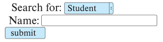
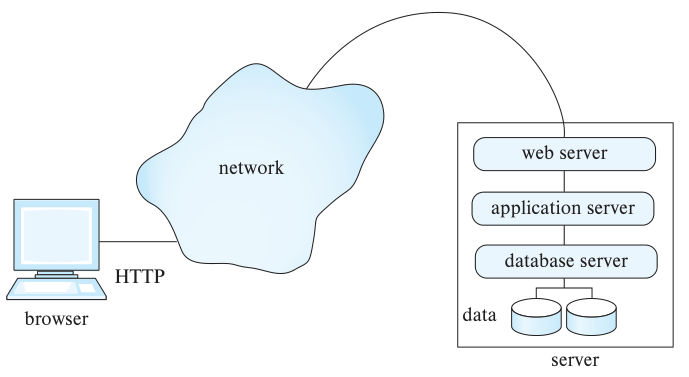
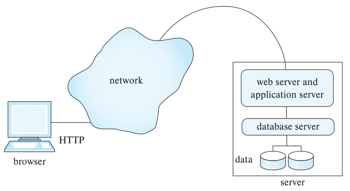
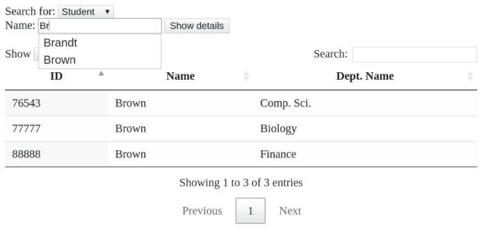
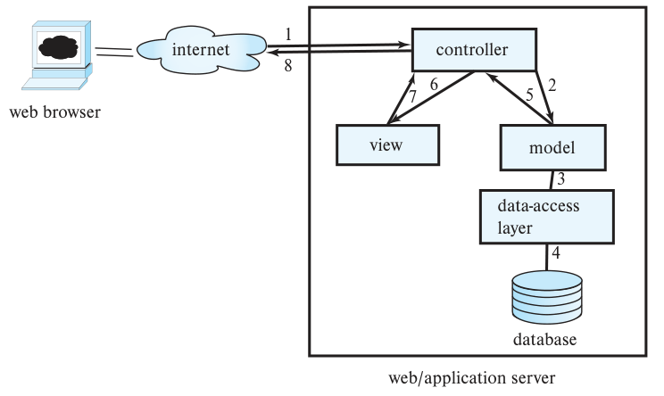

<!-- SOURCE pdf-0432-b004 -->
<!-- SOURCE pdf-0432-b005 -->
# 第9章 应用开发 {#chapter-9}


<!-- SOURCE pdf-0432-b006 -->
数据库几乎总是在应用程序内部使用，用户也几乎总是通过应用程序间接与数据库交互。本章介绍构建应用所用的工具和技术，重点讨论利用数据库存取数据的交互式应用。

<!-- SOURCE pdf-0432-b007 -->
面向用户的应用需要良好的用户界面。以数据库为后端的应用，最常见的两类界面是 Web 界面和移动应用界面。

<!-- SOURCE pdf-0432-b008 -->
本章先介绍应用程序与用户界面（9.1 节），以及 Web 技术（9.2 节），然后讨论使用常见的 Java Servlet 技术（9.3 节）和其他框架（9.4 节）开发 Web 应用后端。要让用户界面及时响应操作，JavaScript 或移动应用技术实现的客户端代码十分重要，9.5 节介绍其中一些技术。接着概述 Web 应用架构（9.6 节），讨论大型 Web 应用的性能问题（9.7 节）。最后介绍抵御攻击所需的应用安全机制（9.8 节），以及加密技术及其在应用中的用途（9.9 节）。

<!-- SOURCE pdf-0432-b009 -->
## 9.1 应用程序与用户界面

<!-- SOURCE pdf-0432-b010 -->
许多人会与数据库交互，但直接使用查询语言访问数据库系统的人很少。最常见的方式是使用**应用程序**：前端提供用户界面，后端与数据库连接。应用通常通过表单接收用户输入，再根据输入向数据库写入数据或提取信息，最后生成结果并显示给用户。

<!-- SOURCE pdf-0432-b011 -->
<!-- SOURCE pdf-0433-b001 -->
以大学选课系统为例。和其他同类应用一样，系统首先要求确认用户身份，通常使用用户名和口令进行认证。然后根据身份从数据库中提取姓名、已选课程等信息并显示出来。应用提供多种界面，供用户选课、查询课程和教师等信息。组织还使用这类应用自动处理销售、采购、会计与薪资、人力资源、库存管理等工作。

<!-- SOURCE pdf-0433-b002 -->
有时用户并未意识到自己正在使用应用程序。例如，新闻网站可能在用户没有明确填写任何表单的情况下，就展示为其定制的页面。网站实际上运行了一个应用程序，为每位用户生成个性化页面；定制依据可以是用户以前浏览过的文章。

<!-- SOURCE pdf-0433-b003 -->
典型的应用程序包含负责用户界面的前端、负责与数据库通信的后端，以及处理“业务逻辑”的中间层。业务逻辑代码执行具体的信息查询或更新请求，并落实业务规则，例如完成某项任务应采取哪些操作，以及哪些人有权执行这项任务。

<!-- SOURCE pdf-0433-b004 -->
航空订票等应用从 20 世纪 60 年代就已存在。早期应用运行在大型主机上，用户通过终端操作，有些终端已经支持表单。个人计算机普及后，带有图形用户界面（GUI）的数据库应用随之出现：个人计算机上的程序直接与共享数据库通信，这种结构称为**客户—服务器架构**。它有两个缺点：用户的机器可以直接访问数据库，带来安全风险；应用或数据库一旦改变，各台计算机上的应用副本就必须一起更新。

<!-- SOURCE pdf-0433-b005 -->
为解决这些问题，后来形成了两种做法：

- **以 Web 浏览器作为通用前端。** 各类信息服务都可使用浏览器。浏览器采用标准化的**超文本标记语言（HTML）**，既能按指定格式显示信息，也能创建表单界面。HTML 标准独立于操作系统和浏览器，几乎每台计算机都装有浏览器，因此任何联网计算机都能访问 Web 应用。

<!-- SOURCE pdf-0433-b006 -->
使用 Web 应用时，客户端机器无须安装该应用专用的软件。

<!-- SOURCE pdf-0433-b007 -->
<!-- SOURCE pdf-0434-b001 -->
今天普遍使用的复杂用户界面，功能已经远超纯 HTML 的能力。这些界面通常使用多数浏览器支持的脚本语言 JavaScript 构建。与 C 程序不同，JavaScript 程序可以在安全模式下执行，以防止其造成安全问题。程序会自动下载到浏览器中，用户无须明确执行软件安装。

<!-- SOURCE pdf-0434-b002 -->
浏览器提供交互前端，应用程序构成后端。浏览器通常把请求发给 Web 服务器，再由服务器执行应用程序处理请求。后端可以采用 Java Servlet、Java Server Pages（JSP）、Active Server Page（ASP），也可以使用 PHP、Python 等脚本语言。

- **在各台设备上安装应用程序。** 这些设备主要是移动设备。应用通过 API 与后端通信，不直接访问数据库。后端提供身份认证等服务，并确保用户只能访问得到授权的服务。

<!-- SOURCE pdf-0434-b003 -->
移动应用广泛采用后一种做法。一方面，专门的应用便于针对移动设备的小屏幕设计显示方式；另一方面，体积可能较大的应用代码可以在高速网络下下载或更新，不必每次访问网页时，再通过带宽较低或费用较高的移动网络下载。

<!-- SOURCE pdf-0434-b004 -->
随着 Web 前端越来越多地使用 JavaScript，两种做法的差异已经明显缩小。后端通常提供统一 API，移动应用和 JavaScript 代码都可调用它来完成后端任务。同一个后端也常同时支持多个前端，例如使用 JavaScript 的 Web 前端，以及 Android、iOS 等移动平台的应用。

<!-- SOURCE pdf-0434-b005 -->
## 9.2 Web 基础

<!-- SOURCE pdf-0434-b006 -->
本节为尚不熟悉 Web 底层技术的读者介绍万维网的一些基础知识。

<!-- SOURCE pdf-0434-b007 -->
### 9.2.1 统一资源定位符

<!-- SOURCE pdf-0434-b008 -->
**统一资源定位符（URL）**为 Web 上每个可访问的文档提供一个全局唯一的名称。例如：

<!-- SOURCE pdf-0434-b009 -->
```text
http://www.acm.org/sigmod
```

<!-- SOURCE pdf-0434-b010 -->
<!-- SOURCE pdf-0435-b005 -->
URL 的第一部分说明如何访问文档：`http` 表示使用**超文本传输协议（HTTP）**，这种协议用于传输 HTML 文档；`https` 表示使用 HTTP 的安全版本，也是本书写作时推荐的访问方式。第二部分给出运行 Web 服务器的机器名称。其余部分是这台机器上的文件路径，或该机器内文档的其他唯一标识。

<!-- SOURCE pdf-0435-b006 -->
URL 也可以包含 Web 服务器上某个程序的标识，以及传给该程序的参数。例如：

<!-- SOURCE pdf-0435-b007 -->
```text
https://www.google.com/search?q=silberschatz
```

<!-- SOURCE pdf-0435-b008 -->
它表示在服务器 `www.google.com` 上执行 `search` 程序，并传入参数 `q=silberschatz`。Web 服务器收到这种 URL 的请求后，会用指定参数执行程序。程序将 HTML 文档返回给服务器，服务器再把它发送到前端。

<!-- SOURCE pdf-0435-b009 -->
### 9.2.2 超文本标记语言

<!-- SOURCE pdf-0435-b002 -->
<!-- SOURCE pdf-0435-b004 -->
**图9.1 用 HTML 表示表格数据。**

```html
<html>
<body>
<table border>
<tr> <th>ID</th>    <th>Name</th>    <th>Department</th> </tr>
<tr> <td>00128</td> <td>Zhang</td>   <td>Comp. Sci.</td> </tr>
<tr> <td>12345</td> <td>Shankar</td> <td>Comp. Sci.</td> </tr>
<tr> <td>19991</td> <td>Brandt</td>  <td>History</td> </tr>
</table>
</body>
</html>
```

<!-- SOURCE pdf-0435-b010 -->
<!-- SOURCE pdf-0436-b006 -->
图9.1 是用 HTML 表示表格的例子，图9.2 是浏览器根据这段 HTML 生成的显示结果。示例展示了几种 HTML 标签：每个 HTML 页面应放在 `html` 标签内，页面正文放在 `body` 标签内；`table` 标签表示表格，其中的各行由 `tr` 标签表示。表头行使用 `th` 表示单元格，普通行使用 `td`。本书不继续展开这些标签，文献说明提供了更详细的 HTML 资料。

<!-- SOURCE pdf-0435-b011 -->
<!-- SOURCE pdf-0435-b012 -->
<!-- SOURCE pdf-0435-b013 -->
<!-- SOURCE pdf-0435-b014 -->
<!-- SOURCE pdf-0435-b015 -->
<!-- SOURCE pdf-0435-b016 -->
**图9.2 图9.1 的 HTML 源码显示结果。** 表头依次为编号、姓名、院系；数据值保持示例原样。

| ID | Name | Department |
|---|---|---|
| 00128 | Zhang | Comp. Sci. |
| 12345 | Shankar | Comp. Sci. |
| 19991 | Brandt | History |

<!-- SOURCE pdf-0436-b002 -->
<!-- SOURCE pdf-0436-b003 -->
<!-- SOURCE pdf-0436-b005 -->
**图9.3 HTML 表单。**

```html
<html>
<body>
<form action="PersonQuery" method=get>
Search for:
<select name="persontype">
    <option value="student" selected>Student </option>
    <option value="instructor"> Instructor </option>
</select> <br>
Name: <input type=text size=20 name="name">
<input type=submit value="submit">
</form>
</body>
</html>
```

<!-- SOURCE pdf-0436-b007 -->
图9.3 定义了一个 HTML 表单，用户可以从菜单选择人员类型（学生或教师），并在文本框中输入信息。图9.4 展示了浏览器中的显示效果。示例使用了两种输入方式，HTML 还支持其他方式。`form` 标签的 `action` 属性规定，用户点击提交按钮后，表单数据应发往 `PersonQuery` 这个 URL；它是相对于当前页面 URL 的相对地址。Web 服务器配置好相应的应用程序，访问该 URL 时便调用该程序，并传入用户在 `select` 和 `input` 字段中提供的 `persontype` 和 `name` 参数。程序生成 HTML 文档，再返回给用户显示。本章后面会介绍如何编写这种程序。

> 译注：原文称文本框用于输入“数字”，但图9.3 的字段是 `Name`，实际用于输入姓名。

<!-- SOURCE pdf-0436-b009 -->
<!-- SOURCE pdf-0436-b010 -->
<!-- SOURCE pdf-0436-b011 -->
<!-- SOURCE pdf-0436-b012 -->


**图9.4 图9.3 的 HTML 源码显示结果。** “Search for”表示查询对象，默认选中 Student（学生）；“Name”是姓名输入框，“submit”是提交按钮。

<!-- SOURCE pdf-0436-b008 -->
<!-- SOURCE pdf-0437-b001 -->
HTTP 定义了两种将浏览器中用户输入的值发送给 Web 服务器的方式。`get` 方法把这些值编码为 URL 的一部分。例如，Google 搜索页若使用 `get` 方法，表单参数名为 `q`，用户输入 `silberschatz` 并提交后，浏览器就会向服务器请求以下 URL：

<!-- SOURCE pdf-0437-b002 -->
```text
https://www.google.com/search?q=silberschatz
```

<!-- SOURCE pdf-0437-b003 -->
`post` 方法则向 URL `https://www.google.com` 发送请求，把参数值放在浏览器与服务器的 HTTP 通信内容中。图9.3 的表单指定使用 `get` 方法。

<!-- SOURCE pdf-0437-b004 -->
HTML 可以用普通文本编辑器编写，也有一些编辑器允许通过图形界面直接创建 HTML。用户可以从菜单选择表单、菜单、表格等结构插入文档，无须手工输入相应代码。

<!-- SOURCE pdf-0437-b005 -->
HTML 支持**样式表**。样式表可以改变 HTML 格式化结构的默认显示方式，以及页面背景色等其他显示属性。**层叠样式表（CSS）**标准允许多个 HTML 文档共用一份样式表，使网站的各个页面保持统一而有特色的外观。更多资料可参见 [W3Schools 的 CSS 教程](https://www.w3schools.com/css/)。

<!-- SOURCE pdf-0437-b006 -->
2014 年发布的 HTML5 标准提供了多种表单输入类型，例如：

<!-- SOURCE pdf-0437-b007 -->
- **日期与时间选择。** 分别使用 `<input type="date" name="abc">` 和 `<input type="time" name="xyz">`。浏览器通常会显示图形化的日期或时间选择器，输入值保存在表单属性 `abc` 和 `xyz` 中。可选的 `min`、`max` 属性用于限定可选的最小值和最大值。
- **文件选择。** 使用 `<input type="file", name="xyz">`，允许用户选择文件，并将文件名保存在表单属性 `xyz` 中。
- **输入限制。** 可以限制最小值、最大值，或要求输入符合正则表达式等。例如，`<input type="number" name="start" min="0" max="55" step="5" value="0">` 允许选择 0、5、10、15，直到 55，默认值为 0。

<!-- SOURCE pdf-0437-b008 -->
### 9.2.3 Web 服务器与会话

<!-- SOURCE pdf-0437-b009 -->
<!-- SOURCE pdf-0438-b014 -->
**Web 服务器**是运行在服务器机器上的程序，它接收浏览器的请求，并以 HTML 文档返回结果。浏览器与 Web 服务器通过 HTTP 通信。除了传输文档，Web 服务器还提供其他功能，其中最重要的是执行程序：接收用户给出的参数，运行程序，再将结果作为 HTML 文档返回。

<!-- SOURCE pdf-0438-b015 -->
Web 服务器由此成为访问各种信息服务的中介。创建并安装一个提供相应服务的应用程序，就能增加一种新服务。**通用网关接口（CGI）**标准规定了 Web 服务器与应用程序如何通信。应用程序通常通过 ODBC、JDBC 或其他协议连接数据库服务器，读取或保存数据。

<!-- SOURCE pdf-0438-b001 -->
<!-- SOURCE pdf-0438-b002 -->
<!-- SOURCE pdf-0438-b003 -->
<!-- SOURCE pdf-0438-b004 -->
<!-- SOURCE pdf-0438-b005 -->
<!-- SOURCE pdf-0438-b006 -->
<!-- SOURCE pdf-0438-b007 -->
<!-- SOURCE pdf-0438-b012 -->
<!-- SOURCE pdf-0438-b013 -->


**图9.5 三层 Web 应用架构。** browser 为浏览器，经 network（网络）使用 HTTP 连接服务器；服务器内部依次是 web server（Web 服务器）、application server（应用服务器）、database server（数据库服务器），最下方的 data 为数据库数据。

<!-- SOURCE pdf-0438-b016 -->
图9.5 的三层架构包含 Web 服务器、应用服务器和数据库服务器。多个服务器层次会增加系统开销；CGI 还为每个请求启动新进程，进一步增加开销。

<!-- SOURCE pdf-0438-b017 -->
本书写作时，多数 Web 应用因此采用图9.6 的两层 Web 应用架构，将 Web 服务器与应用服务器合并为一个服务器。后续各节将详细讨论这种架构。

<!-- SOURCE pdf-0439-b001 -->
<!-- SOURCE pdf-0439-b002 -->
<!-- SOURCE pdf-0439-b003 -->
<!-- SOURCE pdf-0439-b004 -->
<!-- SOURCE pdf-0439-b005 -->
<!-- SOURCE pdf-0439-b006 -->
<!-- SOURCE pdf-0439-b011 -->
<!-- SOURCE pdf-0439-b012 -->


**图9.6 两层 Web 应用架构。** 浏览器经网络发送 HTTP 请求；服务器侧的 web server and application server 将 Web 服务与应用服务合在一起，再访问 database server（数据库服务器）及其 data（数据）。

<!-- SOURCE pdf-0438-b018 -->
<!-- SOURCE pdf-0439-b013 -->
客户端与 Web 服务器之间没有持续不断的连接。处理请求时，双方临时建立连接，用它发送请求并接收响应，随后便可能关闭；下一个请求可以使用新连接。相比之下，用户登录计算机，或通过 ODBC、JDBC 连接数据库时，会建立一个**会话**。在会话结束之前，客户端与服务器会一直保留用户标识、用户设置的会话选项等信息。HTTP 采用这种**无连接式**交互，一个重要原因是计算机能够容纳的并发连接数有限：若大量网站同时连接某台服务器，就可能超过上限，使后续用户无法获得服务。请求完成后及时断开连接，可以将连接资源留给其他请求。[^ch9-1]

<!-- SOURCE pdf-0439-b019 -->
[^ch9-1]: 为提高性能，连接可能短暂保留，以便后续请求复用。但无法保证连接一定保持开启；应用设计应假定，请求处理完成后连接随时可能关闭。

<!-- SOURCE pdf-0439-b014 -->
多数 Web 应用仍需要会话信息，才能支持有意义的用户交互。例如，应用通常会限制信息访问，因此必须认证用户身份。每个会话认证一次即可，同一会话中的后续操作不应反复要求认证。

<!-- SOURCE pdf-0439-b015 -->
要在连接关闭后仍维持会话，客户端必须保存额外信息，并在同一会话的每个请求中返回给服务器，供服务器判断请求属于哪个用户会话。服务器也需要保留相应的会话信息。

<!-- SOURCE pdf-0439-b016 -->
客户端通常用 **Cookie** 保存这些信息。Cookie 是一小段带有名称、包含识别信息的文本。例如，`google.com` 可以设置名为 `prefs` 的 Cookie，记录用户偏好的语言、每页显示结果数等选项。用户搜索时，网站从浏览器取回 `prefs`，据此显示结果。一个域（网站）只能读取自己设置的 Cookie，不能读取其他域设置的 Cookie；不同域可以使用相同的 Cookie 名称。

<!-- SOURCE pdf-0439-b017 -->
<!-- SOURCE pdf-0440-b001 -->
为了跟踪用户会话，应用可以生成一个**会话标识符**，通常是当前尚未被其他会话使用的随机数，并发送一个名为 `sessionid` 等名称、值为该标识符的 Cookie。服务器本地也保存这个标识符。请求到来时，应用服务器读取客户端名为 `sessionid` 的 Cookie。客户端若未保存这个 Cookie，或者返回的值不在服务器当前有效的会话标识符中，应用就认为该请求不属于现有会话；若与已保存的有效标识符匹配，便可认定它属于正在进行的会话。

<!-- SOURCE pdf-0440-b002 -->
需要安全识别用户时，应用可以在身份认证成功后才设置 Cookie。例如，只有提交有效用户名和口令后才通过认证。[^ch9-2]

<!-- SOURCE pdf-0440-b003 -->
对公开新闻网站等安全要求较低的应用，浏览器和服务器可以长期保存 Cookie。用户再次访问时，不必输入身份信息，网站就能识别用户。安全要求较高的应用可以在超时或用户退出后使会话失效。通常，用户点击退出按钮，就会提交一个使当前会话失效的表单。使会话失效，只需从应用服务器的活动会话列表中移除相应的会话标识符。


<!-- SOURCE pdf-0440-b004 -->
## 9.3 Servlet

<!-- SOURCE pdf-0440-b005 -->
Java **Servlet** 规范定义了 Web／应用服务器与应用程序之间通信的 API。Java 的 `HttpServlet` 类实现了这套 Servlet API，完成具体功能的 Servlet 类继承自它。[^ch9-3] “Servlet”也常指实现 Servlet 接口的 Java 程序及其类。图9.7 给出一个例子，下面将详细说明。

<!-- SOURCE pdf-0440-b006 -->
服务器启动时，或者收到执行某个 Servlet 的远程 HTTP 请求时，会把相应代码加载进 Web／应用服务器。Servlet 负责处理请求：可能先访问数据库，取得所需信息，再动态生成 HTML 页面并返回客户端浏览器。

<!-- SOURCE pdf-0440-b007 -->
### 9.3.1 Servlet 示例

<!-- SOURCE pdf-0440-b008 -->
<!-- SOURCE pdf-0441-b001 -->
Servlet 常用于动态响应 HTTP 请求。它可以取得 HTML 表单中的输入，根据业务逻辑决定如何响应，再生成 HTML 输出发送给浏览器。Servlet 代码在 Web 服务器或应用服务器上执行。

<!-- SOURCE pdf-0441-b002 -->
<!-- SOURCE pdf-0442-b001 -->
图9.7 的 Servlet 实现了图9.3 表单所需的功能。Servlet 名为 `PersonQueryServlet`，表单则指定 `action="PersonQuery"`。服务器必须知道，应由这个 Servlet 处理 `PersonQuery` 请求；代码中的 `@WebServlet("PersonQuery")` 注解负责指定这一映射。表单使用 HTTP `get` 方式传输参数，因此服务器会调用代码中定义的 `doGet()` 方法。

<!-- SOURCE pdf-0441-b004 -->
<!-- SOURCE pdf-0441-b005 -->
<!-- SOURCE pdf-0441-b006 -->
<!-- SOURCE pdf-0441-b007 -->
<!-- SOURCE pdf-0441-b008 -->
<!-- SOURCE pdf-0441-b009 -->
<!-- SOURCE pdf-0441-b010 -->
<!-- SOURCE pdf-0441-b011 -->
<!-- SOURCE pdf-0441-b013 -->
**图9.7 Servlet 代码示例。** 省略号表示原书留待实现的代码。

```java
import java.io.*;
import javax.servlet.*;
import javax.servlet.http.*;

@WebServlet("PersonQuery")
public class PersonQueryServlet extends HttpServlet {
    public void doGet(HttpServletRequest request,
                      HttpServletResponse response)
        throws ServletException, IOException
    {
        response.setContentType("text/html");
        PrintWriter out = response.getWriter();
        ... check if user is logged in ...
        out.println("<HEAD><TITLE> Query Result</TITLE></HEAD>");
        out.println("<BODY>");

        String persontype = request.getParameter("persontype");
        String name = request.getParameter("name");
        if (persontype.equals("student")) {
            ... code to find students with the specified name ...
            ... using JDBC to communicate with the database ..
            ... Assume ResultSet rs has been retrieved, and
            ... contains attributes ID, name, and department name
            String headers = new String[]{"ID", "Name", "Department Name"};
            Util::resultSetToHTML(rs, headers, out);
        }
        else {
            ... as above, but for instructors ...
        }
        out.println("</BODY>");
        out.close();
    }
}
```

省略部分依次用于检查用户是否登录，通过 JDBC 查询指定姓名的学生，并取得含编号、姓名、院系名的 `ResultSet rs`；教师分支采用相同做法，查询教师。

> 译注：此处保留原书示意代码。原书将数组变量写成 `String headers`，应为 `String[] headers`；Java 的静态方法调用应写作 `Util.resultSetToHTML(...)`，原书误写为 `Util::...`。使用注解还需导入 `javax.servlet.annotation.WebServlet`；Servlet 的 URL 映射通常应为 `"/PersonQuery"`。

<!-- SOURCE pdf-0442-b002 -->
每个 Servlet 请求会在一个新线程中执行，因此多个请求可以并行处理。网页表单的菜单值、输入字段值以及 Cookie，通过为该请求创建的 `HttpServletRequest` 对象传入；响应则经由 `HttpServletResponse` 对象返回。

<!-- SOURCE pdf-0442-b003 -->
示例中的 `doGet()` 调用 `request.getParameter()` 取得 `persontype` 和 `name`，再用这些值查询数据库。访问数据库以及从查询结果读取属性的代码没有列出；使用 JDBC 访问数据库的方法见 5.1.1.5 节。这里假定查询结果已经作为 JDBC `ResultSet` 保存在变量 `resultset` 中。

<!-- SOURCE pdf-0442-b004 -->
Servlet 把查询结果写入 `HttpServletResponse` 对象 `response`，便可返回给请求方。具体做法是先从 `response` 取得 `PrintWriter` 对象 `out`，再把结果按 HTML 格式输出到 `out`。示例调用图9.8 的 `Util::resultSetToHTML(resultset, header, out)` 完成输出。该函数使用 `ResultSet rs` 的 JDBC 元数据功能确定列数，并接收一个列标题数组。列名也可以从 JDBC 元数据取得，但数据库字段名未必适合直接显示给用户，因此示例另外传入有意义的显示名称。

> 译注：这段说明与图9.7 的变量名不一致；图中实际使用 `rs` 和 `headers`。

<!-- SOURCE pdf-0443-b002 -->
<!-- SOURCE pdf-0443-b003 -->
<!-- SOURCE pdf-0443-b004 -->
<!-- SOURCE pdf-0443-b005 -->
<!-- SOURCE pdf-0443-b006 -->
<!-- SOURCE pdf-0443-b007 -->
<!-- SOURCE pdf-0443-b008 -->
<!-- SOURCE pdf-0443-b010 -->
**图9.8 将 ResultSet 输出为表格的工具函数。**

```java
import java.io.*;
import javax.servlet.*;
import javax.servlet.http.*;

public class Util {
    public static void resultSetToHTML(ResultSet rs,
                                      String headers[], PrintWriter out) {
        ResultSetMetaData rsmd = rs.getMetaData();
        int numCols = rsmd.getColumnCount();
        out.println("<table border=1>");
        out.println("<tr>");
        for (int i=0; i < numCols; i++)
            out.println("<th>"+ headers[i] + </th>
        out.println("</tr>");
        while (rs.next()) {
            out.println("<tr>");
            for (int i=0; i < numCols; i++)
                out.println("<td>"+ rs.getString(i) + </td>
            out.println("</tr>");
        }
    }
}
```

> 译注：原书代码有多处笔误：两条输出单元格的语句缺少字符串引号、右括号和分号；JDBC 列编号从 1 开始，读取单元格应使用 `rs.getString(i + 1)`；还需导入 `java.sql` 中的类型并处理 `SQLException`，最后输出 `</table>`。以上保留原书代码，以便对照。

<!-- SOURCE pdf-0442-b005 -->
### 9.3.2 Servlet 会话

<!-- SOURCE pdf-0442-b006 -->
浏览器与 Web／应用服务器的交互是无状态的。浏览器每次发出请求，都需要连接服务器、请求信息，再断开连接。Cookie 可以用来判断某个请求是否与之前的请求来自同一浏览器会话，但它只是底层机制，程序员需要更便于使用的会话抽象。

<!-- SOURCE pdf-0442-b007 -->
Servlet API 提供了跟踪会话和保存会话信息的方法。调用 `HttpServletRequest` 的 `getSession(false)`，可取得与发起请求的浏览器对应的 `HttpSession` 对象；若参数为 `true`，则在请求尚无对应会话时创建一个新会话对象。

<!-- SOURCE pdf-0442-b008 -->
调用 `getSession()` 时，服务器先根据客户端返回的指定名称 Cookie 识别会话。若客户端没有这个 Cookie，或者它的值无法匹配任何正在进行的会话，请求便不属于现有会话。在这种情况下，前述 `getSession(false)` 返回 `null`，Servlet 可将用户引导到登录页。

<!-- SOURCE pdf-0443-b011 -->
登录页允许用户输入用户名和口令。相应的 Servlet 验证口令是否与该用户匹配，例如根据用户名从数据库取得已保存的口令信息，再与输入进行比较。[^ch9-4]

<!-- SOURCE pdf-0443-b012 -->
用户认证通过后，登录 Servlet 调用 `getSession(true)` 取得新会话对象。服务器在内部创建会话：向浏览器设置一个名为 `sessionId` 等名称、值为会话标识符的 Cookie，创建会话对象，并将标识符与对象关联起来。

<!-- SOURCE pdf-0444-b001 -->
Servlet 还可以在 `HttpSession` 中保存和查询“属性名—值”对，在一个会话的多个请求之间保持状态。例如，认证成功、会话对象创建后，登录 Servlet 可以在 `getSession()` 返回的对象上执行以下方法，将用户标识存为会话参数：

<!-- SOURCE pdf-0444-b002 -->
```java
session.setAttribute("userid", userid);
```

<!-- SOURCE pdf-0444-b003 -->
这里假定 Java 变量 `userid` 保存了用户标识。

<!-- SOURCE pdf-0444-b004 -->
如果请求属于现有会话，浏览器会返回相应 Cookie，`getSession()` 返回对应的会话对象。Servlet 随后可执行以下方法，从该对象中取得用户标识等会话参数：

<!-- SOURCE pdf-0444-b005 -->
```java
session.getAttribute("userid")
```

<!-- SOURCE pdf-0444-b006 -->
若尚未设置 `userid` 属性，方法会返回 `null`，说明客户端用户尚未通过认证。

<!-- SOURCE pdf-0444-b007 -->
图9.7 中的 `... check if user is logged in ...` 可以用下面的代码实现。用户尚未登录时，它输出错误信息，等待 5 秒后将用户重定向到登录页。

<!-- SOURCE pdf-0444-b008 -->
<!-- SOURCE pdf-0444-b009 -->
```java
Session session = request.getSession(false);
if (session == null || session.getAttribute(userid) == null) {
    out.println("You are not logged in.");
    response.setHeader("Refresh", "5;url=login.html");
    return();
}
```

> 译注：原书这里的 `Session` 应为 `HttpSession`，属性名应写成字符串 `"userid"`，Java 的返回语句应为 `return;`。输出的提示表示“尚未登录”。

<!-- SOURCE pdf-0444-b010 -->
### 9.3.3 Servlet 的生命周期

<!-- SOURCE pdf-0444-b011 -->
Servlet 的生命周期由部署它的 Web／应用服务器控制。客户端请求某个 Servlet 时，服务器先检查实例是否已经存在；若不存在，就把相应类加载到 Java 虚拟机（JVM）中并创建实例，再调用 `init()` 初始化。每个实例只在加载时初始化一次。

<!-- SOURCE pdf-0444-b012 -->
<!-- SOURCE pdf-0445-b001 -->
确认实例存在后，服务器以请求对象和响应对象为参数，调用 Servlet 的 `service` 方法。默认情况下，服务器创建新线程执行该方法，因此多个请求可以并行执行，无须等待先前请求结束。`service` 再根据需要调用 `doGet` 或 `doPost`。

<!-- SOURCE pdf-0445-b002 -->
不再需要某个 Servlet 时，可以调用 `destroy()` 关闭它。服务器也可以配置成：超过一定时间没有收到该 Servlet 的请求，就自动关闭它。这个超时时间属于服务器参数，可按应用需要设置。

<!-- SOURCE pdf-0445-b003 -->
### 9.3.4 应用服务器

<!-- SOURCE pdf-0445-b004 -->
许多应用服务器内置 Servlet 支持。其中广泛使用的一种是 Apache Jakarta 项目的 Tomcat。其他支持 Servlet 的服务器包括 Glassfish、JBoss、BEA Weblogic Application Server、Oracle Application Server，以及 IBM WebSphere Application Server。

<!-- SOURCE pdf-0445-b005 -->
开发 Servlet 应用时，最好使用 Eclipse、NetBeans 等 IDE，它们集成了 Tomcat 或 Glassfish 服务器。

<!-- SOURCE pdf-0445-b006 -->
应用服务器除了基本的 Servlet 支持，通常还提供多种服务：部署或停止应用，监测应用服务器状态及性能统计等。许多服务器还支持 Java 2 企业版（J2EE）平台，为对象处理、跨多个应用服务器的并行处理等任务提供功能和 API。

<!-- SOURCE pdf-0440-b010 -->
[^ch9-2]: 用户标识也可以保存在客户端，例如放在名为 `userid` 的 Cookie 中。免费公开网站识别用户等安全要求较低的应用可以这样做，但安全要求较高的应用会面临风险：恶意用户能在浏览器中修改 Cookie，冒充其他用户。把 Cookie（例如 `sessionid`）设为从足够大数值空间中随机生成的会话标识符，会使冒充成功的概率极低；顺序生成的会话标识符则容易遭到冒充。

[^ch9-3]: Servlet 接口也支持非 HTTP 请求，尽管本例只使用 HTTP。

<!-- SOURCE pdf-0443-b014 -->
<!-- SOURCE pdf-0443-b016 -->
[^ch9-4]: 不应把未加密的口令保存在数据库中，因为系统管理员或入侵者等能接触数据库内容的人可能窃取口令。通常先对口令计算散列，再保存散列结果；即使看到结果，也很难推断原口令。验证时对用户输入使用同一个散列函数，与已保存结果比较。为了让使用同一口令的不同用户得到不同散列值，系统通常为每位用户保存一个不同的随机字符串，称为“盐”（salt），先将盐追加到口令后再计算散列。因此，口令关系可以采用模式 `user_password(user, salt, passwordhash)`，其中 `passwordhash = hash(append(password, salt))`。9.9.1 节将进一步介绍加密。


<!-- SOURCE pdf-0445-b007 -->
## 9.4 其他服务器端框架

<!-- SOURCE pdf-0445-b008 -->
应用服务器除了 Java Servlet，还可以使用脚本语言，以及面向 Python 等语言开发的 Web 应用框架来处理请求。

<!-- SOURCE pdf-0445-b009 -->
### 9.4.1 服务器端脚本

<!-- SOURCE pdf-0445-b010 -->
用 Java、C 等语言编写 Web 应用，即使功能简单，也可能耗费不少时间，需要很多代码，并要求程序员熟悉语言的细节。**服务器端脚本**为许多应用提供了更简便的开发方式。脚本语言允许将代码嵌入 HTML 文档。

<!-- SOURCE pdf-0445-b011 -->
采用服务器端脚本时，服务器先执行嵌入网页 HTML 中的脚本，再发送页面。每段脚本可以生成添加到页面中的文本，也可以删除页面内容。脚本源代码会从页面中移除，因此客户端甚至可能不知道页面原先包含代码。脚本也可以包含在数据库中执行的 SQL。许多脚本语言配有库和工具，共同构成 Web 应用开发框架。

<!-- SOURCE pdf-0446-b007 -->
常见的脚本框架包括 Java Server Pages（JSP）、微软的 ASP.NET、PHP 和 Ruby on Rails。它们允许将 Java、C#、VBScript、Ruby 等语言的代码嵌入 HTML，或从 HTML 页面调用这些代码。例如，JSP 允许嵌入 Java 代码，微软的 ASP.NET 和 ASP 则支持嵌入 C#、VBScript。

<!-- SOURCE pdf-0446-b008 -->
#### 9.4.1.1 Java Server Pages

<!-- SOURCE pdf-0446-b009 -->
**Java Server Pages（JSP）**允许 HTML 程序员混合静态 HTML 与动态生成的 HTML。许多动态网页的大部分内容仍是静态的，即每次生成页面时都相同；根据表单参数等生成的动态内容往往只占一小部分。若用 Servlet 编写这种页面，就得把大量 HTML 写成 Java 字符串。JSP 允许在静态 HTML 中嵌入 Java 代码，只由代码生成动态部分。JSP 脚本实际会转换成 Servlet 代码再编译，但程序员省去了编写大量 Java 代码的工作。

<!-- SOURCE pdf-0446-b002 -->
<!-- SOURCE pdf-0446-b003 -->
<!-- SOURCE pdf-0446-b004 -->
<!-- SOURCE pdf-0446-b006 -->
**图9.9 嵌入 Java 代码的 JSP 页面。**

```jsp
<html>
<head> <title> Hello </title> </head>
<body>
<% if (request.getParameter("name") == null)
   { out.println("Hello World"); }
   else { out.println("Hello, " + request.getParameter("name")); }
%>
</body>
</html>
```

<!-- SOURCE pdf-0446-b010 -->
图9.9 的 JSP 源码将 Java 代码放在 `<% ... %>` 中，与外围 HTML 区分开。代码通过 `request.getParameter()` 取得属性 `name` 的值。

<!-- SOURCE pdf-0446-b011 -->
<!-- SOURCE pdf-0447-b001 -->
浏览器请求 JSP 页面时，应用服务器据此生成 HTML 并发送给浏览器。页面的 HTML 部分原样输出；[^ch9-5] `<% ... %>` 中的 Java 代码则替换为它向 `out` 对象打印的文本。图9.9 中，若表单参数 `name` 没有值，脚本输出 `Hello World`；若提供了值，就输出 `Hello`，后面接上姓名。

<!-- SOURCE pdf-0447-b002 -->
实际应用还可以执行更复杂的操作，例如通过 JDBC 从数据库查询数据。

<!-- SOURCE pdf-0447-b003 -->
JSP 还支持**标签库**。这些标签看起来像 HTML 标签，但由服务器解释，并替换为生成的 HTML 代码。JSP 提供定义变量、控制流程（迭代、if-then-else）的标准标签，以及一种基于 JavaScript、在服务器端解释的表达式语言。标签集可以扩展，已有多种标签库，例如为大型数据集提供分页显示的库，以及简化日期时间显示和解析的库。

> 译注：JSP 使用的是独立的表达式语言 EL，原书将它说成基于 JavaScript 并不准确。参见 [Oracle EL 文档](https://docs.oracle.com/javaee/7/tutorial/jsf-el.htm)。

<!-- SOURCE pdf-0447-b004 -->
#### 9.4.1.2 PHP

<!-- SOURCE pdf-0447-b005 -->
**PHP** 广泛用于服务器端脚本。和 JSP 一样，PHP 代码可以与 HTML 混写，以 `<?php` 开始，以 `?>` 结束。下面的代码与图9.9 的 JSP 实现相同功能。

<!-- SOURCE pdf-0447-b006 -->
<!-- SOURCE pdf-0447-b007 -->
<!-- SOURCE pdf-0447-b009 -->
<!-- SOURCE pdf-0447-b011 -->
```php
<html>
<head> <title> Hello </title> </head>
<body>
<?php if (!isset($_REQUEST['name']))
      { echo 'Hello World'; }
      else { echo 'Hello, ' . $_REQUEST['name']; }
?>
</body>
</html>
```

<!-- SOURCE pdf-0447-b012 -->
<!-- SOURCE pdf-0447-b014 -->
数组 `$_REQUEST` 包含请求参数，使用参数名作为下标。PHP 数组的下标可以是任意字符串，不限于数字。`isset` 检查数组元素是否已经初始化；`echo` 将参数输出到生成的 HTML；两个字符串之间的 `.` 运算符用于拼接字符串。

<!-- SOURCE pdf-0447-b015 -->
经过适当配置的 Web 服务器会把扩展名为 `.php` 的文件视为 PHP 文件。收到请求后，服务器以类似 JSP 的方式处理文件，再将生成的 HTML 返回浏览器。

<!-- SOURCE pdf-0447-b016 -->
PHP 有许多可用的库，包括通过 ODBC 访问数据库的库，其用途类似 Java 中的 JDBC。

<!-- SOURCE pdf-0447-b017 -->
### 9.4.2 Web 应用框架

<!-- SOURCE pdf-0447-b018 -->
Web 应用开发框架通过以下功能，简化应用构建：

<!-- SOURCE pdf-0448-b001 -->
- 支持 HTML、HTTP 及会话等功能的函数库。
- 模板脚本系统。
- 控制器，将表单提交等用户交互事件映射到相应的处理函数，并管理身份认证与会话。有些框架还提供授权管理工具。
- 较为声明式的表单定义方式，允许规定输入校验约束，由系统生成实现表单的 HTML 和 JavaScript／Ajax 代码。
- 面向对象模型及对象关系映射，用于将数据存入关系数据库，见 9.6.2 节。

<!-- SOURCE pdf-0448-b002 -->
框架将构建 Web 应用所需的多种功能整合在一起：根据声明式定义生成表单，自动处理数据访问，从而减少开发者需要编写的代码。

<!-- SOURCE pdf-0448-b003 -->
不同语言都有大量框架。常用例子包括 Python 的 Django、在 Ruby 上提供 Rails 框架的 Ruby on Rails，以及基于 Java／JSP 的 Apache Struts、Swing、Tapestry 和 WebObjects。许多框架还能从对象模型或数据库生成代码，快速创建简单的 **CRUD Web 界面**，支持对象或元组的创建、读取、更新、删除。它们便于迅速做出简单应用；继续修改生成的代码，又能构建更复杂的 Web 界面。

> 译注：原书把 Swing 列在此处；Swing 是 Java 图形用户界面组件库，主要用于桌面界面。参见 [Oracle Swing 文档](https://docs.oracle.com/javase/tutorial/uiswing/start/about.html)。

<!-- SOURCE pdf-0448-b004 -->
### 9.4.3 Django 框架

<!-- SOURCE pdf-0448-b005 -->
Python 的 **Django** 是一种广泛使用的 Web 应用框架。下面用例子说明它的部分功能。

<!-- SOURCE pdf-0448-b006 -->
Django 的**视图**是函数，相当于 Java 中的 Servlet。框架需要 URL 到视图的映射，通常写在 `urls.py` 文件中。Django 应用服务器收到 HTTP 请求后，通过这个映射确定应调用哪个视图函数。

<!-- SOURCE pdf-0448-b007 -->
<!-- SOURCE pdf-0448-b009 -->
<!-- SOURCE pdf-0448-b011 -->
<!-- SOURCE pdf-0448-b013 -->
<!-- SOURCE pdf-0448-b015 -->
图9.10 使用 Django 实现了前面 Java Servlet 的人员查询任务。其中的视图名为 `person_query_view`。假定 URL `PersonQuery` 映射到该视图，并由图9.3 的 HTML 表单调用。

<!-- SOURCE pdf-0448-b016 -->
<!-- SOURCE pdf-0448-b018 -->
<!-- SOURCE pdf-0448-b020 -->
<!-- SOURCE pdf-0449-b001 -->
<!-- SOURCE pdf-0449-b003 -->
<!-- SOURCE pdf-0449-b005 -->
<!-- SOURCE pdf-0449-b007 -->
还假定应用根路径映射到 `login_view`。这里没有列出它的代码，只假定它显示登录表单，并在提交时调用 `authenticate` 视图。后者的代码也未列出，它负责检查登录名和口令：验证通过就重定向到 `person_query_form`，显示图9.3 的 HTML；失败则返回 `login_view`。

<!-- SOURCE pdf-0449-b009 -->
<!-- SOURCE pdf-0449-b011 -->
<!-- SOURCE pdf-0450-b001 -->
<!-- SOURCE pdf-0450-b003 -->
<!-- SOURCE pdf-0450-b005 -->
<!-- SOURCE pdf-0450-b007 -->
图9.10 的 `person_query_view()` 首先检查会话变量 `username`，判断用户是否登录。若未设置该变量，就把浏览器引导回登录界面；否则连接数据库，取得请求的人员信息。数据库连接细节在 Django 配置文件 `settings.py` 中指定，这里略去。程序在连接上打开一个游标（类似 JDBC 的 statement），再用游标执行查询。`cursor.execute` 的第一个参数是用 `%s` 标记参数位置的查询，第二个参数是参数值列表。最后调用 `result_set_to_html()` 遍历数据库返回的结果集，将结果转换成 HTML 字符串，再通过 `HttpResponse` 返回。

<!-- SOURCE pdf-0449-b013 -->
<!-- SOURCE pdf-0449-b014 -->
<!-- SOURCE pdf-0449-b016 -->
<!-- SOURCE pdf-0449-b018 -->
<!-- SOURCE pdf-0449-b020 -->
<!-- SOURCE pdf-0449-b021 -->
<!-- SOURCE pdf-0449-b022 -->
<!-- SOURCE pdf-0449-b023 -->
<!-- SOURCE pdf-0449-b024 -->
<!-- SOURCE pdf-0449-b026 -->
<!-- SOURCE pdf-0449-b028 -->
<!-- SOURCE pdf-0449-b029 -->
<!-- SOURCE pdf-0449-b031 -->
<!-- SOURCE pdf-0449-b032 -->
<!-- SOURCE pdf-0449-b034 -->
<!-- SOURCE pdf-0449-b036 -->
<!-- SOURCE pdf-0449-b037 -->
<!-- SOURCE pdf-0449-b039 -->
<!-- SOURCE pdf-0449-b041 -->
<!-- SOURCE pdf-0449-b042 -->
<!-- SOURCE pdf-0449-b044 -->
<!-- SOURCE pdf-0449-b046 -->
<!-- SOURCE pdf-0449-b048 -->
<!-- SOURCE pdf-0449-b050 -->
<!-- SOURCE pdf-0449-b052 -->
**图9.10 Django 实现的人员查询应用。**

```python
from django.http import HttpResponse
from django.db import connection

def result_set_to_html(headers, cursor):
    html = "<table border=1>"
    html += "<tr>"
    for header in headers:
        html += "<th>" + header + "</th>"
    html += "</tr>"
    for row in cursor.fetchall():
        html += "<tr>"
        for col in row:
            html += "<td>" + col + "</td>"
        html += "</tr>"
    html += "</table>"
    return html

def person_query_view(request):
    if "username" not in request.session:
        return login_view(request)
    persontype = request.GET.get("persontype")
    personname = request.GET.get("personname")
    if persontype == "student":
        query_tmpl = "select id, name, dept_name from student where name=%s"
    else:
        query_tmpl = "select id, name, dept_name from instructor where name=%s"
    with connection.cursor() as cursor:
        cursor.execute(query_tmpl, [personname])
        headers = ["ID", "Name", "Department Name"]
        return HttpResponse(result_set_to_html(headers, cursor))
```

> 译注：图9.3 的姓名字段名为 `name`，这里却读取 `personname`，两端需要统一。代码还假定结果列均为字符串；若包含数值或空值，直接拼接 `col` 会出错。

<!-- SOURCE pdf-0450-b008 -->
Django 还支持创建 HTML 表单并校验输入、通过注解简化身份认证检查，以及用类似 JSP 的模板生成 HTML 页面。它也提供对象关系映射系统，见 9.6.2.2 节。

<!-- SOURCE pdf-0446-b013 -->
[^ch9-5]: JSP 还支持更复杂的嵌入方式，例如将 HTML 放在 Java 的 if-else 语句中，按条件真假决定是否输出。这里不展开。


<!-- SOURCE pdf-0450-b009 -->
## 9.5 客户端代码与 Web 服务

<!-- SOURCE pdf-0450-b010 -->
最常用的两类用户界面是 Web 界面与移动应用界面。

<!-- SOURCE pdf-0450-b011 -->
早期浏览器只显示 HTML，但很快就出现了在浏览器中运行代码的需求。**客户端脚本语言**专门用于在用户的浏览器中执行代码，使交互更灵活，提供超出 HTML 及表单有限能力的功能。相比把每次交互都交给服务器处理，直接在客户端执行程序也能明显提高响应速度。

<!-- SOURCE pdf-0450-b012 -->
JavaScript 是使用最广的客户端脚本语言。现代 Web 界面大量使用它来构建复杂交互。

<!-- SOURCE pdf-0450-b013 -->
客户端界面需要从后端存取数据。直接访问数据库会暴露底层细节，也会使数据库遭受攻击，因此后端通常通过 Web 服务提供数据存取，见 9.5.2 节。

<!-- SOURCE pdf-0450-b014 -->
移动应用已经十分普遍，移动设备界面也很重要。本书不展开移动应用开发，但在 9.5.4 节介绍一些开发框架，供读者进一步了解。

<!-- SOURCE pdf-0450-b015 -->
### 9.5.1 JavaScript

<!-- SOURCE pdf-0450-b016 -->
JavaScript 可用于输入校验、灵活的用户界面、与 Web 服务交互等任务。下面分别介绍。

<!-- SOURCE pdf-0451-b001 -->
#### 9.5.1.1 输入校验

<!-- SOURCE pdf-0451-b002 -->
JavaScript 函数可以检查用户输入是否有误，例如日期字符串格式是否正确，年龄等数值是否处于合理范围。这些校验在用户输入时就在浏览器中进行，早于数据发送到 Web 服务器。

<!-- SOURCE pdf-0451-b003 -->
HTML5 允许在 `input` 标签中直接指定许多校验约束。例如：

<!-- SOURCE pdf-0451-b004 -->
```html
<input type="number" name="credits" size="2" min="1" max="15">
```

<!-- SOURCE pdf-0451-b005 -->
这将参数 `credits` 的输入限定为 1 到 15 之间的数字。HTML5 功能无法完成的复杂校验，适合使用 JavaScript 实现。

<!-- SOURCE pdf-0451-b006 -->
<!-- SOURCE pdf-0452-b001 -->
图9.11 的表单使用 JavaScript 函数校验输入。函数定义在 HTML 的 `head` 部分，表单接收开始日期和结束日期，校验函数确保开始日期不晚于结束日期。`form` 标签规定，提交时先调用校验函数；若失败，就显示提示框，成功则向服务器提交表单。

<!-- SOURCE pdf-0451-b008 -->
<!-- SOURCE pdf-0451-b009 -->
<!-- SOURCE pdf-0451-b010 -->
<!-- SOURCE pdf-0451-b011 -->
<!-- SOURCE pdf-0451-b012 -->
<!-- SOURCE pdf-0451-b013 -->
<!-- SOURCE pdf-0451-b015 -->
**图9.11 使用 JavaScript 校验表单输入。** 提示信息表示“开始日期晚于结束日期”。

```html
<html>
<head>
<script type="text/javascript">
    function validate() {
        var startdate = new Date(document.getElementById("start").value);
        var enddate = new Date(document.getElementById("end").value);
        if (startdate > enddate) {
            alert("Start date is > end date");
            return false;
        }
    }
</script>
</head>
<body>
<form action="submitDates" onsubmit="return validate()">
    Start Date: <input type="date" id="start"><br />
    End Date : <input type="date" id="end"><br />
    <input type="submit" value="Submit">
</form>
</body>
</html>
```

<!-- SOURCE pdf-0452-b002 -->
#### 9.5.1.2 响应及时的用户界面

<!-- SOURCE pdf-0452-b003 -->
JavaScript 的一项主要优势，是能在浏览器中创建响应及时的界面。它可以动态修改正在显示的 HTML。浏览器把 HTML 解析为内存中的树形结构，这种结构由**文档对象模型（DOM）**标准定义；JavaScript 可以修改这棵树来完成操作。例如，用户需要输入多行数据，如一张账单的多个条目，可以用包含文本框和其他表单控件的表格接收输入。表格初始只有若干行，用户需要更多行时，点击“添加条目”按钮。按钮调用 JavaScript 函数，修改 DOM 树，为表格增加一行。

<!-- SOURCE pdf-0452-b004 -->
虽然 JavaScript 已经标准化，不同浏览器仍存在差异，DOM 的某些细节尤其如此。因此，在一种浏览器中正常工作的代码，换一种浏览器可能无法运行。为减少这些问题，可以使用 jQuery 等 JavaScript 库，以不依赖特定浏览器的方式编程。库内部识别当前浏览器，再提供适用的 JavaScript 实现。

<!-- SOURCE pdf-0452-b005 -->
jQuery 等库还提供菜单、标签页、滑块等控件，以及自动补全等界面功能，可以通过库函数创建和执行。

<!-- SOURCE pdf-0452-b006 -->
HTML5 支持拖放、地理定位等丰富交互。地理定位允许应用在用户授权后取得位置，并据此调整数据或界面。HTML5 还支持 SSE，让后端在事件发生时通知前端。

> 译注：原书将 SSE 展开为 Server-Side Events；通常名称为 Server-Sent Events，即“服务器发送事件”。

<!-- SOURCE pdf-0452-b007 -->
#### 9.5.1.3 与 Web 服务交互

<!-- SOURCE pdf-0452-b008 -->
JavaScript 广泛用于创建动态网页，相关技术统称为 **Ajax**。JavaScript 程序可以异步地与 Web 服务器通信，即在后台获取数据，不阻塞浏览器与用户的交互，取得数据后再显示。8.1.2 节介绍的 JavaScript 对象表示法（JSON）是最常用的数据传输格式，也可以使用 XML 等格式。

<!-- SOURCE pdf-0452-b009 -->
<!-- SOURCE pdf-0453-b001 -->
应用服务器上的代码负责把数据发送给 JavaScript，再由 JavaScript 在浏览器中呈现。这样可通过调用取得所需数据的后端服务，称为 **Web 服务**。它们可以用 Java Servlet、Python 或其他语言的框架实现。

<!-- SOURCE pdf-0453-b002 -->
自动补全是 Ajax 的常见应用。用户在文本框输入时，系统会提示可能的完整值。当候选值太多、不适合用下拉列表展示时，这种功能很有用。jQuery 等库通过为文本框关联一个函数来支持自动补全：函数读取尚未输完的内容，连接后端获取可能的补全值，再显示为建议。

<!-- SOURCE pdf-0453-b003 -->
<!-- SOURCE pdf-0453-b005 -->
图9.12 使用 jQuery 实现自动补全，并用 jQuery 的 DataTables 插件显示表格。HTML 中姓名文本框的 `id` 为 `name`。脚本用 jQuery 的 `$("#name")` 定位对应 DOM 节点，再把自动补全函数关联到该节点。传给函数的 `source` 属性指定获取候选值的 Web 服务。假定已经定义了 Servlet `/autocomplete_name`，它接收参数 `term`，其中是用户当前已经输入的字符，然后返回一个 JSON 数组，包含与这些字符匹配的学生或教师姓名。

<!-- SOURCE pdf-0453-b006 -->
<!-- SOURCE pdf-0453-b008 -->
<!-- SOURCE pdf-0453-b010 -->
<!-- SOURCE pdf-0453-b012 -->
<!-- SOURCE pdf-0453-b014 -->
<!-- SOURCE pdf-0453-b016 -->
示例还展示了如何从 Web 服务取得数据并显示。这里使用 DataTables 插件，也有其他表格展示库可供选择。假定未列出的 Servlet `person_query_ajax` 与图9.7 一样，返回指定姓名的学生或教师的编号、姓名和院系名，不过将结果编码为 JSON 对象：`data` 属性包含行数组，每行是带有 `id`、`name`、`dept_name` 属性的对象。以 `myTable` 开始的语句，把 DataTable 插件关联到标识符为 `personTable` 的 HTML 表格。点击“Show details”（显示详情）按钮后，`loadTableAsync()` 先构造 URL，把人员类型与姓名传给 `person_query_ajax`，再调用 `myTable.ajax.url(url).load()`。该方法从指定 URL 获取 JSON 数据并填充表格；调用是异步的，函数立即返回，等数据到达后才填入各行。

<!-- SOURCE pdf-0454-b002 -->
<!-- SOURCE pdf-0454-b003 -->
<!-- SOURCE pdf-0454-b004 -->
<!-- SOURCE pdf-0454-b005 -->
<!-- SOURCE pdf-0454-b006 -->
<!-- SOURCE pdf-0454-b008 -->
<!-- SOURCE pdf-0454-b010 -->
<!-- SOURCE pdf-0454-b011 -->
<!-- SOURCE pdf-0454-b013 -->
<!-- SOURCE pdf-0454-b015 -->
<!-- SOURCE pdf-0454-b016 -->
<!-- SOURCE pdf-0454-b017 -->
<!-- SOURCE pdf-0454-b018 -->
<!-- SOURCE pdf-0454-b020 -->
**图9.12 使用 JavaScript 与 Ajax 的 HTML 页面。**

```html
<html> <head>
<script src="https://code.jquery.com/jquery-3.3.1.js"> </script>
<script src="https://cdn.datatables.net/1.10.19/js/jquery.dataTables.min.js"></script>
<script src="https://code.jquery.com/ui/1.12.1/jquery-ui.min.js"></script>
<script src="https://cdn.datatables.net/1.10.19/js/jquery.dataTables.min.js"></script>
<link rel="stylesheet"
      href="https://code.jquery.com/ui/1.12.1/themes/base/jquery-ui.css" />
<link rel="stylesheet"
      href="https://cdn.datatables.net/1.10.19/css/jquery.dataTables.min.css" />
<script>
    var myTable;
    $(document).ready(function() {
        $("#name").autocomplete({ source: "/autocomplete_name" });
        myTable = $("#personTable").DataTable({
            columns: [{data:"id"}, {data:"name"}, {data:"dept_name"}]
        });
    });
    function loadTableAsync() {
        var params = {persontype:$("#persontype").val(), name:$("#name").val()};
        var url = "/person_query_ajax?" + jQuery.param(params);
        myTable.ajax.url(url).load();
    }
</script>
</head> <body>
Search for:
<select id="persontype">
    <option value="student" selected>Student </option>
    <option value="instructor"> Instructor </option>
</select> <br>
Name: <input type=text size=20 id="name">
<button onclick="loadTableAsync()"> Show details </button>
<table id="personTable" border="1">
    <thead>
        <tr> <th>ID</th> <th>Name</th> <th>Dept. Name</th> </tr>
    </thead>
</table>
</body> </html>
```

<!-- SOURCE pdf-0453-b017 -->
图9.13 是浏览器显示图9.12 运行结果的截图。

<!-- SOURCE pdf-0455-b002 -->


**图9.13 图9.12 的显示结果。** 查询类型选中 Student（学生），输入 `Br` 后给出 Brandt、Brown 两个补全建议。表格的编号、姓名、院系三列显示 `(76543, Brown, Comp. Sci.)`、`(77777, Brown, Biology)`、`(88888, Brown, Finance)` 三行。界面还提供搜索框和上一页、下一页按钮，当前显示全部 3 条结果。

<!-- SOURCE pdf-0453-b018 -->
<!-- SOURCE pdf-0454-b021 -->
<!-- SOURCE pdf-0455-b003 -->
另一个 Ajax 示例是联动选择表单：先选国家，再从该国的州列表中选择州。国家未选定时，州下拉列表为空；选定国家后，Ajax 在后台从网站下载对应州列表，收到后立即加入下拉框，供用户继续选择。

<!-- SOURCE pdf-0455-b004 -->
### 9.5.2 Web 服务

<!-- SOURCE pdf-0455-b005 -->
Web 服务是一种可以通过 Web 调用的应用组件，作用类似 API。请求通过 HTTP 发送，在应用服务器上执行，再把结果返回调用方。

<!-- SOURCE pdf-0455-b006 -->
实现 Web 服务常用两种方式。较简单的一种称为**表述性状态转移（REST）**：向应用服务器的某个 URL 发送标准 HTTP 请求，以标准请求参数传入函数参数。服务器执行请求，必要时更新数据库，再生成、编码结果，并作为 HTTP 响应返回。结果通常使用 JSON 编码，也可以使用 8.1.3 节介绍的 XML。调用方解析返回内容，取得数据。

<!-- SOURCE pdf-0455-b007 -->
在许多 RESTful Web 服务（即采用 REST 的 Web 服务）中，调用方是浏览器里的 JavaScript。它使用函数调用结果更新画面。例如，在网页地图上滚动时，新出现的地图部分就可能由 JavaScript 通过 RESTful 接口获取，再显示到屏幕上。

<!-- SOURCE pdf-0455-b008 -->
<!-- SOURCE pdf-0456-b001 -->
有些 Web 服务的接口不公开，只供特定应用内部使用；有些公开接口文档，允许任何应用接入。服务可以完全开放，也可以要求登录，或者要求用户、应用开发者向服务提供方付费。

<!-- SOURCE pdf-0456-b002 -->
RESTful Web 服务种类繁多，多数前端会调用一种或多种服务完成后端工作。例如，网页邮箱、社交网站、网页地图通常由 JavaScript 呈现，并通过后端 Web 服务读取和更新数据。需要在后端保存数据的移动应用，也通常用 Web 服务完成存取。

<!-- SOURCE pdf-0456-b003 -->
后端也越来越多地调用其他后端的 Web 服务。例如，Amazon S3、Google Cloud Storage、Microsoft Azure 等存储系统提供 Web 服务 API，用于存取数据。开发者广泛采用这些服务，因为它们可以保存海量数据，每秒处理大量操作，可伸缩能力远超集中式数据库。

<!-- SOURCE pdf-0456-b004 -->
类似的 API 还有很多。文本转语音、语音识别、视觉等 Web 服务，让开发者只需较少工作，就能为应用加入语音或图像识别功能。

<!-- SOURCE pdf-0456-b005 -->
另一种更复杂、使用较少的方式有时称为“Big Web Services”。它用 XML 编码参数与结果，用专门语言正式定义 Web API，并在 HTTP 之上增加一层协议。

<!-- SOURCE pdf-0456-b006 -->
### 9.5.3 离线运行

<!-- SOURCE pdf-0456-b007 -->
许多应用希望客户端断开与服务器的连接后，仍能完成部分操作。例如，学生在笔记本电脑离线时继续填写申请表，重新联网后保存；网页邮件客户端允许用户离线撰写邮件，联网后再发送。实现这些功能需要客户端本地存储。

<!-- SOURCE pdf-0456-b008 -->
HTML5 提供可以用 JavaScript 访问的本地存储。下面代码检查浏览器是否支持本地存储：

<!-- SOURCE pdf-0456-b009 -->
```javascript
if (typeof(Storage) !== "undefined") { // browser supports local storage
    ...
}
```

注释表示“浏览器支持本地存储”。

<!-- SOURCE pdf-0456-b010 -->
若支持，就可用以下函数保存、加载或删除给定键的值：

<!-- SOURCE pdf-0457-b001 -->
```javascript
localStorage.setItem(key, value)
localStorage.getItem(key)
localStorage.deleteItem(key)
```

> 译注：原书的删除方法名有误，实际应为 `localStorage.removeItem(key)`。

<!-- SOURCE pdf-0457-b002 -->
为防止存储过多数据，浏览器可能限制每个网站可使用的容量。本书所述常见默认上限为 5 MB。

<!-- SOURCE pdf-0457-b003 -->
上述接口只能存取键值对。检索时需要提供键，否则就必须扫描全部键值对，寻找所需的值。有些应用需要对元组的多个属性建立索引，以便根据任一属性值高效访问。HTML5 支持 **IndexedDB**，允许保存 JSON 对象并为多个属性建立索引。它还支持模式版本，开发者可以提供代码，将数据从旧模式迁移到新模式。

<!-- SOURCE pdf-0457-b004 -->
### 9.5.4 移动应用平台

<!-- SOURCE pdf-0457-b005 -->
**移动应用**已经广泛普及，是许多用户主要使用的界面。两种主流移动平台是 Android 和 iOS。它们都提供适合小型触屏设备的图形界面开发方式，支持菜单、列表、按钮、复选框、进度条等标准控件，以及文字、图片、视频显示。

<!-- SOURCE pdf-0457-b006 -->
移动应用可以预先下载并保存，以后再使用。用户可以在高速网络下下载，再在低速网络下运行。Web 应用则可能在使用时才下载，从而在低速或流量昂贵的网络下产生大量传输。移动应用也可以针对小屏幕设备优化界面，并编译为机器码，降低相对 Web 应用的能耗。与早期 Web 应用相比，移动应用还能在本地保存数据，支持离线使用。它们具有较成熟的授权模型，经过用户许可后可以访问位置、相机、联系人等信息与设备功能。

<!-- SOURCE pdf-0457-b007 -->
移动应用的一个缺点是平台限制：为 Android 编写的代码不能直接在 iOS 上运行，反之亦然。除非完全放弃其中一个平台，否则开发者通常需要为同一个应用写两套实现。

<!-- SOURCE pdf-0457-b008 -->
<!-- SOURCE pdf-0458-b001 -->
让同一份高级语言代码同时运行在 Android 和 iOS 上，显然很有价值。Facebook 开发的 React Native 基于 JavaScript，Google 的 Flutter 基于 Dart，二者都以跨平台开发为目标。Dart 针对用户界面开发优化，提供异步函数调用、流操作等功能。这些框架使两种平台可以共用大部分应用代码；跨平台部分尚不支持的功能，仍可针对底层平台单独实现。

<!-- SOURCE pdf-0458-b002 -->
高速移动网络普及后，提前下载等移动应用的部分优势已不如过去重要。一类结合移动应用与 Web 应用优点的新应用——**渐进式 Web 应用（PWA）**——开始获得更多使用。它们以 JavaScript 和 HTML5 构建，并针对移动设备设计。

<!-- SOURCE pdf-0458-b003 -->
HTML5 的本地数据存储是 PWA 的一项基础能力，使设备离线时仍能使用应用。另一项能力是 JavaScript 代码编译。按本书的讨论，编译适用于遵循受限语法的代码，而任意 JavaScript 代码难以直接编译。这类编译通常采用即时方式：在代码即将执行，或已经重复执行多次时进行。将 Web 应用中计算密集的部分限制在可编译的 JavaScript 功能范围内，可以让它在移动设备上更高效地利用 CPU 和电量。

<!-- SOURCE pdf-0458-b004 -->
PWA 还利用 HTML5 的 **Service Worker**，使脚本可以脱离某个网页，在浏览器后台运行。它能在本地存储与 Web 服务之间后台同步，也能接收后端服务的推送通知。HTML5 还允许应用在用户授权后取得设备位置，供 PWA 使用。

<!-- SOURCE pdf-0458-b005 -->
作者预计，PWA 将逐渐增多，替代移动应用的许多使用场景，但不会覆盖全部场景。


<!-- SOURCE pdf-0458-b006 -->
## 9.6 应用架构

<!-- SOURCE pdf-0458-b007 -->
为控制复杂性，大型应用通常划分为几个层次：

<!-- SOURCE pdf-0458-b008 -->
- **表示层或用户界面层**，负责用户交互。同一应用可以有多个版本的表示层，对应 Web 浏览器、屏幕更小的手机等不同界面。

<!-- SOURCE pdf-0458-b009 -->
<!-- SOURCE pdf-0459-b001 -->
许多实现还会在概念上，按**模型—视图—控制器（MVC）**架构组织表示层。模型对应下文的业务逻辑层；视图定义数据的呈现方式，同一模型可以根据访问应用的软件或设备，使用不同的视图；控制器接收用户动作等事件，对模型执行操作，再向用户返回视图。许多 Web 应用框架采用 MVC 架构。

- **业务逻辑层**，提供数据及数据操作的高级抽象，详见 9.6.1 节。
- **数据访问层**，连接业务逻辑层与底层数据库。许多应用用面向对象语言编写业务逻辑，以对象表示数据，而底层使用关系数据库。此时数据访问层还负责在两种数据模型之间映射，详见 9.6.2 节。

<!-- SOURCE pdf-0459-b002 -->
图9.14 展示了这些层次以及处理浏览器请求的步骤，箭头上的数字表示先后顺序。应用服务器收到请求后，控制器将请求交给模型。模型执行相应业务逻辑，可能更新模型中的对象，再创建结果对象。模型通过数据访问层更新或查询数据库。结果对象送到视图模块，由它生成供浏览器显示的 HTML。视图可以按设备特性调整，例如区分计算机大屏幕与手机小屏幕。视图层也越来越多地由客户端代码实现。

<!-- SOURCE pdf-0459-b004 -->
<!-- SOURCE pdf-0459-b005 -->
<!-- SOURCE pdf-0459-b006 -->
<!-- SOURCE pdf-0459-b007 -->
<!-- SOURCE pdf-0459-b008 -->
<!-- SOURCE pdf-0459-b009 -->
<!-- SOURCE pdf-0459-b010 -->
<!-- SOURCE pdf-0459-b011 -->
<!-- SOURCE pdf-0459-b012 -->
<!-- SOURCE pdf-0459-b013 -->
<!-- SOURCE pdf-0459-b014 -->
<!-- SOURCE pdf-0459-b015 -->
<!-- SOURCE pdf-0459-b016 -->
<!-- SOURCE pdf-0459-b018 -->


**图9.14 Web 应用架构。** web browser 是浏览器，internet 是互联网。服务器内部的 controller、model、view 分别是控制器、模型、视图；data-access layer 是数据访问层，database 是数据库。步骤 1～8 依次表示请求进入控制器、交给模型、访问数据层与数据库、模型返回结果、生成视图，再把结果返回浏览器。

<!-- SOURCE pdf-0460-b001 -->
### 9.6.1 业务逻辑层

<!-- SOURCE pdf-0460-b002 -->
大学管理应用的业务逻辑层，可以提供学生、教师、课程、开课班次等实体的抽象，以及录取学生、为学生选课等操作。实现这些操作的代码负责确保业务规则得到满足。例如，只有修完先修课程并缴清学费的学生，才可以选修某门课。

<!-- SOURCE pdf-0460-b003 -->
业务逻辑还包括**工作流**，规定多人参与的任务如何处理。例如，申请人向大学提交申请后，工作流规定谁先查阅、审批；第一步通过后，再交给谁，直至发出录取通知或拒绝信。工作流管理还必须处理异常情况：若未在截止日期前作出决定，可能需要通知主管介入，确保申请得到处理。

<!-- SOURCE pdf-0460-b004 -->
### 9.6.2 数据访问层与对象关系映射

<!-- SOURCE pdf-0460-b005 -->
最简单的情形是业务逻辑层与数据库使用相同的数据模型，此时数据访问层只需隐藏数据库接口细节。但使用面向对象语言编写业务逻辑时，自然会把数据建模为对象，并通过对象的方法进行操作。

<!-- SOURCE pdf-0460-b006 -->
早期实现中，程序员必须手工编写代码，从数据库取回数据后创建对象，修改对象后再保存回数据库。这种手工转换很繁琐，也容易出错。一种解决办法是让数据库原生保存对象及对象间的联系，并允许以与内存对象完全相同的方式访问数据库中的对象。8.2 节介绍过这类**面向对象数据库**。不过，受多种技术和商业因素影响，它们没有取得商业上的成功。

<!-- SOURCE pdf-0460-b007 -->
另一种做法继续使用传统关系数据库保存数据，自动把关系中的数据映射为内存对象，并将修改后的对象映射回数据库中的关系。对象按需创建，因为内存通常不足以容纳数据库中的全部数据。

<!-- SOURCE pdf-0460-b008 -->
已有多种系统实现了这种**对象关系映射（ORM）**，下面介绍 Hibernate 和 Django ORM。

<!-- SOURCE pdf-0460-b009 -->
#### 9.6.2.1 Hibernate ORM

<!-- SOURCE pdf-0460-b010 -->
<!-- SOURCE pdf-0461-b001 -->
**Hibernate** 广泛用于 Java 对象与关系之间的映射，它实现了 Java 持久化 API（JPA）。每个 Java 类到一个或多个关系的映射，可以在映射文件中指定。例如，将 `Student` 类映射到 `student` 关系，将类属性 `ID` 映射到 `student.ID`，依此类推。数据库所在主机、连接所需用户名和口令等信息则写在属性文件中。程序先打开一个会话来建立数据库连接；之后，对 Java 中创建的 `Student` 对象 `stud` 调用 `session.save(stud)`，就能保存到数据库。Hibernate 自动生成把数据写入 `student` 关系所需的 SQL。

<!-- SOURCE pdf-0461-b002 -->
E-R 模型中的实体很容易对应到 Java 等面向对象语言中的对象，但联系往往无法直接对应。Hibernate 可以把联系映射为与对象关联的集合。例如，学生与开课班次之间的 `takes` 联系，可以表示为每名学生关联的班次集合，以及每个班次关联的学生集合。指定映射后，Hibernate 自动根据数据库的 `takes` 关系填充这些集合；集合发生更新时，提交会将变化反映到数据库关系中。

<!-- SOURCE pdf-0461-b003 -->
例如，为 `student` 关系创建以下 Java 类：

<!-- SOURCE pdf-0461-b004 -->
<!-- SOURCE pdf-0461-b005 -->
<!-- SOURCE pdf-0461-b007 -->
```java
@Entity public class Student {
    @Id String ID;
    String name;
    String department;
    int tot_cred;
}
```

<!-- SOURCE pdf-0461-b008 -->
严格来说，类属性应声明为 `private`，再提供 getter／setter 方法访问，示例省略了这些细节。

<!-- SOURCE pdf-0461-b009 -->
`Student` 类属性与 `student` 关系属性之间的映射，可以在 XML 映射文件中指定，也可以更方便地使用 Java 注解。`@Entity` 表示这个类映射到数据库关系；默认的关系名与类名相同，关系属性名与类属性名相同。可以通过 `@Table`、`@Column` 覆盖这些默认名称。`@Id` 指定 `ID` 是主键属性。

<!-- SOURCE pdf-0461-b010 -->
下面创建一个 `Student` 对象并保存到数据库：

<!-- SOURCE pdf-0461-b011 -->
```java
Session session = getSessionFactory().openSession();
Transaction txn = session.beginTransaction();
Student stud = new Student("12328", "John Smith", "Comp. Sci.", 0);
session.save(stud);
txn.commit();
session.close();
```

<!-- SOURCE pdf-0462-b001 -->
Hibernate 自动生成所需的 SQL `insert` 语句，在数据库中创建学生元组。

<!-- SOURCE pdf-0462-b002 -->
对象既可以通过主键取得，也可以通过查询取得：

<!-- SOURCE pdf-0462-b003 -->
<!-- SOURCE pdf-0462-b004 -->
<!-- SOURCE pdf-0462-b005 -->
<!-- SOURCE pdf-0462-b006 -->
```java
Session session = getSessionFactory().openSession();
Transaction txn = session.beginTransaction();
// Retrieve student object by identifier
Student stud1 = session.get(Student.class, "12328");
.. print out the Student information ..
List students =
    session.createQuery("from Student as s order by s.ID asc").list();
for (Iterator iter = students.iterator(); iter.hasNext(); ) {
    Student stud = (Student) iter.next();
    .. print out the Student information ..
}
txn.commit();
session.close();
```

注释表示按标识符取得学生对象；省略部分用于输出学生信息。

<!-- SOURCE pdf-0462-b007 -->
给出对象的类和主键，就可以调用 `session.get()` 取得单个对象。对象可在内存中修改；当前 Hibernate 会话的事务提交时，Hibernate 会自动更新数据库中的相应关系，保存对象变化。

<!-- SOURCE pdf-0462-b008 -->
示例还展示了 Hibernate 的 **HQL 查询语言**。HQL 以 SQL 为基础，但允许在查询中直接使用对象。Hibernate 将 HQL 自动转换为 SQL 并执行，再把结果转换为 `Student` 对象列表，`for` 循环逐个遍历这些对象。

<!-- SOURCE pdf-0462-b009 -->
这些功能向程序员提供高级数据模型，隐藏关系存储的细节。和其他 ORM 一样，Hibernate 也允许直接对数据库关系编写 SQL，绕过对象模型；编写复杂查询时，这种方式很有用。

<!-- SOURCE pdf-0462-b010 -->
#### 9.6.2.2 Django ORM

<!-- SOURCE pdf-0462-b011 -->
Python 有多种 ORM。Django 框架的 ORM 是其中广泛使用的一种，SQLAlchemy 也是常见的 Python ORM。

<!-- SOURCE pdf-0462-b012 -->
图9.15 定义了 Django 中的学生与教师模型。`student` 和 `instructor` 的所有字段都定义为相应类的字段，并指定适当类型。

<!-- SOURCE pdf-0463-b002 -->
<!-- SOURCE pdf-0463-b003 -->
<!-- SOURCE pdf-0463-b004 -->
<!-- SOURCE pdf-0463-b006 -->
<!-- SOURCE pdf-0463-b008 -->
<!-- SOURCE pdf-0463-b010 -->
<!-- SOURCE pdf-0463-b012 -->
<!-- SOURCE pdf-0463-b014 -->
<!-- SOURCE pdf-0463-b016 -->
<!-- SOURCE pdf-0463-b018 -->
<!-- SOURCE pdf-0463-b020 -->
<!-- SOURCE pdf-0463-b021 -->
<!-- SOURCE pdf-0463-b022 -->
<!-- SOURCE pdf-0463-b024 -->
<!-- SOURCE pdf-0463-b026 -->
<!-- SOURCE pdf-0463-b028 -->
<!-- SOURCE pdf-0463-b030 -->
<!-- SOURCE pdf-0463-b032 -->
<!-- SOURCE pdf-0463-b034 -->
<!-- SOURCE pdf-0463-b036 -->
<!-- SOURCE pdf-0463-b038 -->
<!-- SOURCE pdf-0463-b040 -->
**图9.15 Django 模型定义。**

```python
from django.db import models

class student(models.Model):
    id = models.CharField(primary_key=True, max_length=5)
    name = models.CharField(max_length=20)
    dept_name = models.CharField(max_length=20)
    tot_cred = models.DecimalField(max_digits=3, decimal_places=0)

class instructor(models.Model):
    id = models.CharField(primary_key=True, max_length=5)
    name = models.CharField(max_length=20)
    dept_name = models.CharField(max_length=20)
    salary = models.DecimalField(max_digits=8, decimal_places=2)
    advisees = models.ManyToManyField(student, related_name="advisors")
```

<!-- SOURCE pdf-0462-b013 -->
<!-- SOURCE pdf-0463-b041 -->
这里还把 `advisor` 关系建模为学生与教师之间的多对多联系。在教师类中，通过 `advisees` 属性访问，它保存一组学生对象的引用。从学生到教师的反向联系由 Django 自动建立；模型指定其属性名为 `advisors`，保存一组教师对象的引用。

<!-- SOURCE pdf-0463-b042 -->
<!-- SOURCE pdf-0463-b044 -->
<!-- SOURCE pdf-0463-b046 -->
<!-- SOURCE pdf-0463-b048 -->
图9.16 的 Django 视图 `person_query_model` 展示了如何直接在 Python 中访问数据库对象，无须使用 SQL。`Student.objects.filter()` 返回满足指定筛选条件的所有学生对象，此处是指定姓名的学生。程序输出学生姓名及其导师姓名。对某个学生的 `advisors` 调用 `all()`，可取得导师对象列表，再由 `get_names()` 提取并返回姓名。教师分支采用相同方式，输出教师姓名及其指导的学生姓名。

<!-- SOURCE pdf-0464-b002 -->
<!-- SOURCE pdf-0464-b004 -->
<!-- SOURCE pdf-0464-b005 -->
<!-- SOURCE pdf-0464-b006 -->
<!-- SOURCE pdf-0464-b008 -->
<!-- SOURCE pdf-0464-b010 -->
<!-- SOURCE pdf-0464-b011 -->
<!-- SOURCE pdf-0464-b012 -->
<!-- SOURCE pdf-0464-b013 -->
<!-- SOURCE pdf-0464-b014 -->
<!-- SOURCE pdf-0464-b016 -->
<!-- SOURCE pdf-0464-b017 -->
<!-- SOURCE pdf-0464-b018 -->
<!-- SOURCE pdf-0464-b019 -->
<!-- SOURCE pdf-0464-b021 -->
<!-- SOURCE pdf-0464-b023 -->
**图9.16 使用模型的 Django 视图。**

```python
from models import Student, Instructor

def get_names(persons):
    res = ""
    for p in persons:
        res += p.name + ", "
    return res.rstrip(", ")

def person_query_model(request):
    persontype = request.GET.get('persontype')
    personname = request.GET.get('personname')
    html = ""

    if persontype == 'student':
        students = Student.objects.filter(name=personname)
        for student in students:
            advisors = students.advisors.all()
            html = (html + "Advisee: " + student.name + "<br>Advisors: "
                    + get_names(advisors) + "<br> \n")
    else:
        instructors = Instructor.objects.filter(name=personname)
        for instructor in instructors:
            advisees = instructor.advisees.all()
            html = (html + "Advisor: " + instructor.name + "<br>Advisees: "
                    + get_names(advisees) + "<br> \n")
    return HttpResponse(html)
```

输出中的 Advisee／Advisees 表示受指导学生，Advisor／Advisors 表示导师。

> 译注：原书图9.15 使用小写类名 `student`、`instructor`，图9.16 则导入大写的 `Student`、`Instructor`，实际使用时需统一。学生循环里的 `students.advisors.all()` 应为 `student.advisors.all()`，因为应读取当前学生的导师，而非查询结果集合；还需导入 `HttpResponse`。这里为跨行字符串表达式补上了 Python 所需的括号，保留原有操作和数据。

<!-- SOURCE pdf-0463-b049 -->
Django 提供 `migrate` 工具，根据模型创建数据库关系。模型可以具有版本号；数据库已有旧版本时，对新版本运行 `migrate`，还会生成 SQL，将旧模式中的数据迁移到新模式。也可以从现有数据库模式生成 Django 模型。


<!-- SOURCE pdf-0463-b050 -->
## 9.7 应用性能

<!-- SOURCE pdf-0463-b051 -->
<!-- SOURCE pdf-0464-b024 -->
热门网站可能面向全球数百万用户，每秒收到数千乃至更多请求。让这些请求都在较短时间内完成，是开发者面临的一大挑战。应用可以通过缓存等技术加快单个请求的处理，也可以使用多个应用服务器并行处理。下面简要介绍这些技术。数据库应用调优也是改善性能的办法，详见 25.1 节。

<!-- SOURCE pdf-0464-b025 -->
### 9.7.1 用缓存减少开销

<!-- SOURCE pdf-0464-b026 -->
假设每个用户请求都通过 JDBC 访问数据库。建立新的 JDBC 连接可能需要几毫秒；要支持很高的事务处理速率，就不宜为每个请求都新建连接。

<!-- SOURCE pdf-0465-b001 -->
**连接池**可以减少这部分开销。连接池管理器通常是应用服务器的一部分，预先创建一组打开的 ODBC／JDBC 连接。处理用户请求的代码（通常是 Servlet）从池中申请连接，用完后归还，不必重新建立。申请时若没有空闲连接，就新建一个，但不能超过数据库支持的最大并发连接数。若许多连接长时间没有使用，管理器可以关闭其中一部分。许多应用服务器和较新的 ODBC／JDBC 驱动内置连接池管理器。

<!-- SOURCE pdf-0465-b002 -->
创建连接池的具体方式随应用服务器或 JDBC 驱动而异。多数实现需要根据主机、端口、数据库、用户标识、口令等连接信息，以及连接池参数，创建 `DataSource` 对象。调用它的 `getConnection()` 从池中取得连接，关闭连接时则将其归还池中。

<!-- SOURCE pdf-0465-b003 -->
有些请求会反复向数据库提交完全相同的查询。只要查询结果没有在数据库中改变，就可以缓存先前的结果并复用，大幅减少通信成本。有些 Web 服务器直接支持查询结果缓存，也可以由应用代码显式实现。

<!-- SOURCE pdf-0465-b004 -->
还可以缓存最终返回的网页，进一步降低开销。新请求若与先前请求的参数完全相同、不会执行更新，且结果页面仍在缓存中，就可以直接复用，省去重新生成页面的工作。缓存也可以细化到网页片段，再将片段拼成完整页面。

<!-- SOURCE pdf-0465-b005 -->
缓存的查询结果和网页都属于物化视图。底层数据库改变时，缓存结果必须丢弃、重新计算，或像 16.5 节的物化视图维护那样增量更新。有些数据库（如 Microsoft SQL Server）允许应用服务器登记查询，并在查询结果改变时接收通知。应用可利用这种机制，使缓存的查询结果保持最新。

<!-- SOURCE pdf-0465-b006 -->
常见的主存缓存系统包括 memcached 和 Redis。它们允许应用以键保存数据，并按键取回，相当于将数据放在主存中的散列映射，还能逐出不常使用的数据。

<!-- SOURCE pdf-0466-b001 -->
例如，本书以 `memcached.add(key, data)` 表示保存数据，以 `memcached.fetch(key)` 表示取回数据。若要从关系 `r` 查询键为 `key1` 的用户数据，应用先执行 `fetch("r:" + key1)`，检查缓存。将关系名加入键，是为了区分同一 memcached 实例中来自不同关系的数据。若返回 `null`，应用再查询数据库，把结果副本保存到 memcached，然后返回给用户；若命中缓存，就直接使用，无须访问数据库，速度会快得多。

<!-- SOURCE pdf-0466-b002 -->
客户端可以连接运行在不同机器上的多个 memcached 实例，从任意实例存取数据。数据放到哪个实例，由客户端代码决定。将数据分布到多台机器后，应用可以利用它们的总主存容量。

<!-- SOURCE pdf-0466-b003 -->
<!-- SOURCE pdf-0466-b005 -->
<!-- SOURCE pdf-0466-b007 -->
Memcached 不会自动使缓存失效，但应用可以跟踪数据库变化，对受更新或删除影响的键调用更新操作 `memcached_set(key, newvalue)`，或删除操作 `memcached_delete(key)`。Redis 提供类似功能。二者都支持多种语言的 API。

<!-- SOURCE pdf-0466-b008 -->
### 9.7.2 并行处理

<!-- SOURCE pdf-0466-b009 -->
应对高负载的常见办法，是并行运行多个应用服务器，让每台处理一部分请求。Web 服务器或网络路由器负责把客户端请求分配给某台应用服务器。由于服务器保存客户端会话状态，同一会话的全部请求必须送往同一台服务器。例如，可以将同一 IP 地址的请求固定路由到同一台服务器。所有应用服务器共享底层数据库，用户看到的数据库视图保持一致。

<!-- SOURCE pdf-0466-b010 -->
这种架构可以防止应用服务器成为瓶颈，但数据库只有一台服务器，仍可能成为瓶颈。设计者通常用缓存减少数据库请求；数据量或查询负载很大时，还会使用第21～23章介绍的并行数据库系统。需要服务大量用户的应用，也常使用通过 Web 服务 API 访问的并行数据存储系统。

<!-- SOURCE pdf-0466-b011 -->
## 9.8 应用安全

<!-- SOURCE pdf-0466-b012 -->
应用安全需要处理 SQL 授权之外的多种威胁和问题。

<!-- SOURCE pdf-0467-b001 -->
应用是落实安全措施的第一道关口，必须认证用户，并确保用户只能执行获得授权的任务。

<!-- SOURCE pdf-0467-b002 -->
即使数据库系统本身安全，编写不当的应用代码仍可能以多种方式破坏安全。本节先介绍可能让攻击者绕过认证和授权检查的漏洞，以及预防方法；再介绍安全的身份认证、细粒度授权和审计踪迹，后者可帮助处理未授权访问或错误更新造成的影响；最后讨论数据隐私。

<!-- SOURCE pdf-0467-b003 -->
### 9.8.1 SQL 注入

<!-- SOURCE pdf-0467-b004 -->
**SQL 注入**是指攻击者设法让应用执行由攻击者构造的 SQL 查询。5.1.1.5 节已经说明，若把用户输入直接拼接到 SQL 中再提交给数据库，就可能产生注入漏洞。再看图9.3 的表单：假定图9.7 中相应的 Servlet 用以下 Java 表达式构造查询。

<!-- SOURCE pdf-0467-b005 -->
<!-- SOURCE pdf-0467-b006 -->
```java
String query = "select * from student where name like '%"
               + name + "%' ";
```

<!-- SOURCE pdf-0467-b007 -->
`name` 保存用户输入，应用随后在数据库上执行查询。恶意用户可以在表单中输入 `'; <some SQL statement>; -- `，其中 `<some SQL statement>` 是其希望执行的任意 SQL。Servlet 于是会执行下面的字符串：

<!-- SOURCE pdf-0467-b008 -->
```sql
select * from student where name like '%'; <some SQL statement>; -- %'
```

<!-- SOURCE pdf-0467-b009 -->
攻击者插入的单引号结束字符串，分号结束原查询，后面的文本被解释为第二条 SQL，而最后的引号被注释掉。这样，攻击者就让应用执行了任意插入的 SQL。它可能造成严重破坏，因为能够绕过应用代码中的安全检查，对数据库执行操作。

<!-- SOURCE pdf-0467-b010 -->
<!-- SOURCE pdf-0468-b001 -->
如 5.1.1.5 节所述，防范此类攻击的最好办法是用预备语句执行查询。原书将其说明为：设置预备查询的参数时，JDBC 自动处理转义，使用户输入的引号无法结束 SQL 字符串。原书还指出，也可以在拼接之前，对输入调用添加转义字符的函数。

> 译注：预备语句通过参数绑定，把 SQL 结构与输入值分开。手工转义受数据库方言及配置影响，不能当作参数绑定的等价替代。参见 [OWASP SQL 注入防护指南](https://cheatsheetseries.owasp.org/cheatsheets/SQL_Injection_Prevention_Cheat_Sheet.html)。

<!-- SOURCE pdf-0468-b002 -->
另一类风险来自动态查询：应用根据表单指定的选择条件或排序属性生成 SQL。例如，用户选择查询结果按哪个属性排序，应用将表单中的属性名保存在 `orderAttribute`，再构造：

<!-- SOURCE pdf-0468-b003 -->
```java
String query = "select * from takes order by " + orderAttribute;
```

<!-- SOURCE pdf-0468-b004 -->
即使 HTML 表单用菜单限制选项，恶意用户仍可绕过界面，发送任意字符串。要防范这类注入，拼接前必须检查 `orderAttribute` 确实属于允许值集合；在本例中，就是允许的属性名。


<!-- SOURCE pdf-0468-b005 -->
### 9.8.2 跨站脚本与请求伪造

<!-- SOURCE pdf-0468-b006 -->
网站若允许用户输入评论、姓名等文本，保存后再展示给其他用户，就可能受到**跨站脚本（XSS）**攻击。恶意用户输入的内容可能是 JavaScript、Flash 等客户端脚本，而非正常的姓名或评论。其他用户查看时，浏览器执行这些代码，可能泄露私有 Cookie，或在该用户已经登录的其他服务器上执行操作。

<!-- SOURCE pdf-0468-b007 -->
例如，原书假设用户在脚本执行时恰好已登录银行账户。恶意脚本可能把登录有关的 Cookie 发送给攻击者，使其冒充原用户连接银行服务器；也可能携带特定参数访问银行页面，发起转账。后一种问题甚至不需要脚本，只用以下代码就可能出现：

<!-- SOURCE pdf-0468-b008 -->
<!-- SOURCE pdf-0468-b009 -->
```html

```

<!-- SOURCE pdf-0468-b010 -->
这里假定 `mybank.com/transfermoney` 会接收这些参数并执行转账。这后一类漏洞称为**跨站请求伪造（XSRF，也称 CSRF）**。

> 译注：前例省略了同源限制。普通恶意网站中的脚本无法直接读取银行网站的 Cookie；窃取银行会话需有银行同源 XSS 等额外条件。跨站伪造请求则可能利用浏览器自动携带的凭据。参见 [Mozilla 同源策略说明](https://developer.mozilla.org/en-US/docs/Web/Security/Defenses/Same-origin_policy)。

<!-- SOURCE pdf-0468-b011 -->
<!-- SOURCE pdf-0469-b001 -->
XSS 还可以通过其他方式发生，例如诱导用户访问嵌有恶意脚本的网站。更复杂的 XSS、XSRF 攻击不在这里展开。防护需要考虑两个方面：

<!-- SOURCE pdf-0469-b002 -->
- **防止自己的网站成为攻击其他用户的工具。** 最简单的办法是禁止用户文本包含任何 HTML 标签。可以使用检测、移除标签的函数，避免标签及脚本被展示给其他用户。若确实需要 HTML 格式，可以解析文本，只允许有限的结构，拒绝危险内容。此类功能必须谨慎设计，因为看似无害的图片也可能利用显示软件的漏洞。
- **保护网站，防止来自其他网站的 XSS、XSRF 攻击。** 用户登录本站后，再访问有漏洞的网站，浏览器中的恶意代码可能对本站执行操作，或把本站的会话信息发送给攻击者利用。风险难以完全消除，但可以采取措施降低风险。

<!-- SOURCE pdf-0469-b003 -->
<!-- SOURCE pdf-0469-b004 -->
1. HTTP 允许服务器检查访问的 `referer`，即用户点击链接前所在页面的 URL。检查来源是否有效，例如是否为同一网站的页面，可以阻止来自用户所访问其他页面的攻击。

<!-- SOURCE pdf-0469-b005 -->
<!-- SOURCE pdf-0469-b006 -->
2. 除了 Cookie，还可以把会话限制在最初通过认证的 IP 地址上。这样，即使攻击者取得 Cookie，也可能无法从另一台机器登录。

<!-- SOURCE pdf-0469-b007 -->
<!-- SOURCE pdf-0469-b008 -->
3. 不用 GET 执行更新。这样可以防止前面利用 `` 发起的攻击。HTTP 标准也规定 GET 不应执行更新。

<!-- SOURCE pdf-0469-b009 -->
<!-- SOURCE pdf-0469-b010 -->
4. 使用 Django 等 Web 框架时，应启用框架提供的 XSRF／CSRF 防护机制。

<!-- SOURCE pdf-0469-b011 -->
### 9.8.3 口令泄露

<!-- SOURCE pdf-0469-b012 -->
<!-- SOURCE pdf-0470-b001 -->
应用代码中的明文口令也是开发者必须处理的问题。例如，JSP 脚本可能包含数据库口令；若脚本放在 Web 服务器可访问的目录中，外部用户可能取得源码，进而获得应用使用的数据库账户口令。许多应用服务器提供加密保存口令的机制，在传给数据库之前由服务器解密，应用便不必保存明文。但解密密钥若同样容易泄露，这种办法仍无法充分保护口令。

<!-- SOURCE pdf-0470-b002 -->
另一种措施是限制数据库连接来源。许多数据库只允许一组指定网络地址访问，通常就是运行应用服务器的机器，拒绝其他地址发起的连接。这样，攻击者即使取得口令，也必须先能够登录允许访问的应用服务器，才能进一步破坏数据库。

<!-- SOURCE pdf-0470-b003 -->
### 9.8.4 应用层身份认证

<!-- SOURCE pdf-0470-b004 -->
**身份认证**用于验证连接应用的人或软件是谁。最简单的方法是连接时出示秘密口令。但口令容易被猜中，也可能在未经加密传输时被网络嗅探窃取。网上银行等重要应用需要更可靠的方案，而加密是这些方案的基础。9.9.3 节介绍基于加密的身份认证。

<!-- SOURCE pdf-0470-b005 -->
许多应用采用**双因素身份认证**，用两种独立的信息或过程确认用户身份。两种因素不应存在相同弱点。例如，仅要求两个口令，并不能避免它们同时被网络嗅探或用户计算机中的病毒窃取。指纹、虹膜扫描等生物识别适用于用户亲自在认证现场的情况，直接跨网络使用时意义有限。

<!-- SOURCE pdf-0470-b006 -->
多数双因素方案以口令为第一因素。第二因素可以是智能卡，或通过 USB 连接的其他加密设备，按 9.9.3 节的方法完成认证。

<!-- SOURCE pdf-0470-b007 -->
一次性口令设备也是常用的第二因素。它会定时生成新的伪随机数，例如每分钟一个。每位用户获得一台设备，认证时同时输入普通口令和设备当前显示的数字。每台设备产生不同的伪随机序列；服务器能够生成与该用户设备相同的序列，并计算认证时应该显示的数字，检查是否匹配。这要求设备与服务器的时钟保持相当接近。

<!-- SOURCE pdf-0470-b008 -->
<!-- SOURCE pdf-0471-b001 -->
另一种做法是在登录时，向用户预先登记的手机号码发送短信，内含随机生成的一次性口令。用户必须持有该号码的手机，收到短信后，将一次性口令与普通口令一同输入，才能通过认证。

<!-- SOURCE pdf-0471-b002 -->
即使采用双因素认证，也可能受到**中间人攻击**。用户试图连接应用时被引向假网站，假网站收集普通口令和第二因素口令，并立即用它们登录真实应用。9.9.3.2 节介绍的 HTTPS 能向用户证明网站身份，避免用户把假网站当成目标网站；它还加密数据，防范中间人攻击。

<!-- SOURCE pdf-0471-b003 -->
用户访问多个网站时，若每个网站都要单独认证，甚至使用不同口令，会很麻烦。集中认证系统允许用户通过一个认证服务验证身份，其他网站和应用向该服务确认用户身份，用户便可使用同一个口令访问多个站点。组织内部常用 LDAP 实现这种集中认证：LDAP 服务器保存用户名和口令信息，各应用通过它认证用户。

<!-- SOURCE pdf-0471-b004 -->
集中认证服务还可以向应用提供用户姓名、邮箱、地址等信息，免去用户在每个应用中重复填写。LDAP 可以承担这些功能，见 25.5.2 节。微软 Active Directory 等其他目录系统，也支持认证用户与提供用户信息。

<!-- SOURCE pdf-0471-b005 -->
**单点登录**更进一步：用户只需认证一次，多个应用就可以通过认证服务验证身份，无须再次要求登录。用户登录某个网站后，访问使用同一单点登录服务的其他网站时，不必重新输入用户名和口令。Kerberos 等网络认证协议早已使用这种机制，Web 应用也有相应实现。

<!-- SOURCE pdf-0471-b006 -->
<!-- SOURCE pdf-0472-b001 -->
**安全断言标记语言（SAML）**在不同安全域之间交换身份认证和授权信息，以支持跨组织单点登录。例如，某应用要允许耶鲁大学的所有学生访问，学校可以提供 Web 认证服务。用户以 `joe@yale.edu` 等用户名访问应用时，应用将其引导到耶鲁的认证服务；认证完成后，该服务告诉应用用户身份，也可以附带学生或教师等类别信息。应用看不到用户口令和其他认证因素，用户也无须专门注册这个应用。但应用必须信任大学认证服务给出的身份结论。

<!-- SOURCE pdf-0472-b002 -->
**OpenID** 是另一种跨组织单点登录协议，方式与 SAML 类似。**OAuth** 则允许用户通过共享授权令牌，授权访问某些资源。

<!-- SOURCE pdf-0472-b003 -->
### 9.8.5 应用层授权

<!-- SOURCE pdf-0472-b004 -->
SQL 标准支持相当灵活的角色授权，见 4.7 节，但在典型应用中，它对管理最终用户权限的作用有限。例如，要求每名学生只能看到自己的成绩，不能看到其他人的成绩，就至少会遇到两个问题。

<!-- SOURCE pdf-0472-b005 -->
<!-- SOURCE pdf-0472-b006 -->
1. **缺少最终用户信息。** Web 普及后，数据库访问主要来自应用服务器。最终用户通常没有独立的数据库用户标识，应用服务器的所有用户甚至可能共用一个数据库身份。SQL 授权无法据此区分每名学生。

<!-- SOURCE pdf-0472-b007 -->
<!-- SOURCE pdf-0472-b009 -->
应用服务器可以先认证最终用户，再把身份信息传给数据库。本节假定 `syscontext.user_id()` 返回当前查询所代表的应用用户标识。[^ch9-6]

<!-- SOURCE pdf-0472-b010 -->
<!-- SOURCE pdf-0472-b011 -->
2. **缺少细粒度授权。** 要让学生只看到自己的成绩，授权必须细化到单个元组。原书讨论的 SQL 标准只允许对整个关系、整个视图，或其中指定属性授权，无法直接表达这种权限。

<!-- SOURCE pdf-0472-b012 -->
可以尝试为每位学生在 `takes` 上创建一个仅显示其成绩的视图。原理上可行，但大学的每个学生都需要一个视图，维护工作过于繁琐，实际不可行。[^ch9-7]

<!-- SOURCE pdf-0472-b013 -->
另一种办法是创建如下视图：

<!-- SOURCE pdf-0473-b001 -->
<!-- SOURCE pdf-0473-b003 -->
```sql
create view studentTakes as
select *
from takes
where takes.ID = syscontext.user_id()
```

<!-- SOURCE pdf-0473-b004 -->
然后只授予用户访问视图的权限，不授予底层 `takes` 的权限。但代表学生执行的查询必须改写为访问 `studentTakes`，代表教师执行的查询可能又需要其他视图，应用开发随之变复杂。

<!-- SOURCE pdf-0473-b005 -->
实际应用常把授权完全放在应用中处理，绕过 SQL 的授权机制。应用按用户限制可访问的界面，并进一步限定可查看或更新的数据项。

<!-- SOURCE pdf-0473-b006 -->
应用层授权虽然灵活，也有问题：

<!-- SOURCE pdf-0473-b007 -->
- 授权检查与其他应用代码混在一起。
- 权限以程序代码实现，较难像声明式 SQL 那样检查是否存在漏洞。开发者一处疏忽，某个程序就可能漏做检查，让未授权用户访问机密数据。

<!-- SOURCE pdf-0473-b008 -->
要确认所有程序都做了必要的授权检查，就得通读全部应用服务器代码。大型系统中，这是一项艰巨工作：应用的攻击面很大，保护它也更困难。现实中的许多应用确实出现过安全漏洞。

<!-- SOURCE pdf-0473-b009 -->
数据库若直接支持细粒度授权，就可以在范围小得多的 SQL 层声明并执行授权策略。即使某个应用接口无意中漏掉检查，数据库仍可阻止未授权操作。

<!-- SOURCE pdf-0473-b010 -->
4.7.7 节介绍过，一些数据库提供行级授权。例如，Oracle 的**虚拟专用数据库（VPD）**允许管理员为关系关联一个函数，由它返回使用该关系的查询必须附加的谓词；更新关系时还可以使用不同函数。沿用本节取得应用用户标识的记法，`takes` 的函数可以返回：

<!-- SOURCE pdf-0474-b001 -->
<!-- SOURCE pdf-0474-b003 -->
<!-- SOURCE pdf-0474-b005 -->
```sql
ID = sys_context.user_id()
```

<!-- SOURCE pdf-0474-b006 -->
<!-- SOURCE pdf-0474-b008 -->
数据库将这个谓词加入所有访问 `takes` 的查询的 `where` 子句。假定应用把用户标识设为学生的 `ID`，每名学生就只能看到自己选修课程的元组。

> 译注：原书此处写作 `sys_context.user_id()`，前文示意函数名则为 `syscontext.user_id()`；二者记法不一致。Oracle 的具体调用方式见本节脚注。

<!-- SOURCE pdf-0474-b009 -->
这种附加谓词的做法可能改变查询含义，4.7.7 节已讨论过。例如，用户本想查询所有课程的平均成绩，最终却得到自己的平均成绩。系统对改写后的查询给出了正确结果，但与用户以为自己提交的查询并不相同。

<!-- SOURCE pdf-0474-b010 -->
PostgreSQL 和 Microsoft SQL Server 也提供类似 Oracle VPD 的行级授权。具体方法可查阅各自的在线系统手册。

<!-- SOURCE pdf-0474-b011 -->
### 9.8.6 审计踪迹

<!-- SOURCE pdf-0474-b012 -->
**审计踪迹**是对应用数据所有插入、删除和更新操作的日志，附带执行用户、执行时间等信息。无论是安全遭到破坏，还是正常操作中发生错误更新，审计踪迹都能帮助查明发生了什么、谁可能执行了操作，并帮助修复损害。

<!-- SOURCE pdf-0474-b013 -->
例如，发现学生成绩有误时，可以检查审计日志，确定何时、以何种方式、由哪个用户修改了成绩。学校还可追踪该用户的全部更新，寻找其他错误或欺诈性修改，再予以纠正。

<!-- SOURCE pdf-0474-b014 -->
审计踪迹也能帮助发现账户被入侵。例如，用户每次登录时，系统可显示该账户近期执行的更新。用户若看到自己没有做过的操作，就可能说明账户已经泄露。

<!-- SOURCE pdf-0474-b015 -->
可以为关系更新定义触发器，利用系统提供的用户名和时间变量，建立数据库级审计踪迹。许多数据库还内置更方便的审计机制。各系统的创建方法不同，应查阅相应手册。

<!-- SOURCE pdf-0474-b016 -->
<!-- SOURCE pdf-0475-b001 -->
数据库级审计通常不足以满足应用需求，因为它往往无法识别实际的最终用户，且只记录关系元组的底层更新，缺少业务含义。应用因此通常还会建立更高层的审计踪迹，记录执行了什么业务动作、由谁执行、何时执行，以及请求来自哪个 IP 地址。

<!-- SOURCE pdf-0475-b002 -->
审计踪迹本身也必须防止被入侵者修改或删除。一种办法是每产生一条记录，就立即复制到攻击者无法访问的另一台机器。更强的方案是第26章介绍的区块链技术：日志存放在多台机器上，并使用散列机制，使入侵者很难在不被发现的情况下修改或删除数据。

<!-- SOURCE pdf-0475-b003 -->
### 9.8.7 隐私

<!-- SOURCE pdf-0475-b004 -->
个人数据越来越多地出现在网上，隐私也越来越受到关注。例如，多数人希望自己的医疗资料保持私密，但治疗该患者的医生和急救人员又必须能够取得这些资料。许多国家的隐私法律规定，何时可以向谁披露数据；某些国家对违法行为还规定刑事处罚。访问此类私人数据的应用，必须在设计时认真考虑相关隐私要求。

<!-- SOURCE pdf-0475-b005 -->
汇总后的私人数据又能支持药物副作用检测、疫情传播监测等工作。如何向研究者提供数据，同时保护个人隐私，是现实中的重要问题。假设医院隐去患者姓名，只提供出生日期和邮政编码，这两项信息可能对研究有用，但结合外部数据库，在许多情况下也足以唯一识别患者。针对这种情形，一种办法是只给出生年份，不给完整日期，同时保留地址信息。这可能已经满足研究需要，又不足以唯一识别大多数个人。[^ch9-8]

<!-- SOURCE pdf-0475-b006 -->
网站还常收集地址、电话、邮箱、信用卡等个人信息，以便完成购物等交易。但顾客可能不愿信息提供给其他组织，或者希望信用卡号等信息在一段时间后删除，降低安全事件中的泄露风险。许多网站允许顾客设置隐私偏好，网站必须确保这些偏好得到遵守。

<!-- SOURCE pdf-0472-b015 -->
<!-- SOURCE pdf-0472-b017 -->
<!-- SOURCE pdf-0472-b019 -->
[^ch9-6]: 在 Oracle 中，使用其 JDBC 驱动的连接可以调用 `OracleConnection.setClientIdentifier(userId)` 设置最终用户标识；SQL 查询可以调用 `sys_context('USERENV', 'CLIENT_IDENTIFIER')` 取回该标识。

[^ch9-7]: 数据库系统擅长管理大型关系，但通常按模式信息（例如视图）的规模较小来设计管理方式，以改善整体性能。

<!-- SOURCE pdf-0475-b008 -->
[^ch9-8]: 极高龄者较少，即使只有出生年份和邮政编码，也可能足以唯一识别。因此，对 90 岁以上者，可以提供“90 岁或以上”这样的范围，不给出具体年龄。


<!-- SOURCE pdf-0476-b001 -->
## 9.9 加密及其应用

<!-- SOURCE pdf-0476-b002 -->
**加密**把数据转换为无法直接阅读的形式，只有执行反向的**解密**过程，才能恢复原内容。加密算法使用加密密钥，解密需要解密密钥；具体算法不同，两种密钥可能相同，也可能不同。

<!-- SOURCE pdf-0476-b003 -->
加密最早用于消息传递，发送者与接收者共享只有双方知道的秘密密钥。即使敌方截获消息，不知道密钥也无法解密理解内容。今天，加密广泛用于保护互联网、移动通信网络等传输中的数据，也用于身份认证等其他任务，见 9.9.3 节。

<!-- SOURCE pdf-0476-b004 -->
数据库使用加密来安全保存数据。即使未授权者取得了数据，例如存有数据的笔记本电脑被盗，没有解密密钥也无法读取内容。

<!-- SOURCE pdf-0476-b005 -->
许多数据库保存信用卡号、姓名、指纹、签名、身份证明号码等敏感客户信息，美国的社会保障号码就是一例。犯罪者取得这些数据后，可能用信用卡号购物，或冒用他人身份申领信用卡。信用卡公司等机构会利用个人信息核实服务或商品申请者的身份；信息泄露后，犯罪者就可能冒充本人取得服务或商品，这称为**身份盗用**。保存敏感信息的应用必须认真防止数据被盗。

<!-- SOURCE pdf-0476-b006 -->
为降低敏感信息落入犯罪者手中的风险，许多国家和地区通过法律要求此类数据库加密保存信息。企业若未保护数据，发生盗窃事件时可能承担刑事责任。加密因此是这类应用的重要组成部分。

<!-- SOURCE pdf-0476-b007 -->
### 9.9.1 加密技术

<!-- SOURCE pdf-0476-b008 -->
加密方法很多，简单方法未必安全，因为未授权者可能很容易破译。例如，把每个字母替换为字母表中的下一个字母：

<!-- SOURCE pdf-0476-b009 -->
<!-- SOURCE pdf-0476-b010 -->
<!-- SOURCE pdf-0476-b011 -->
```text
Perryridge → Qfsszsjehf
```

<!-- SOURCE pdf-0477-b001 -->
攻击者若只看到 `Qfsszsjehf`，可能还没有足够信息破译；但若看到大量加密后的支行名称，就可以利用字母出现频率，推测替换方式。例如，英文中最常见的字母是 E，其后是 T、A、O、N、I 等。

<!-- SOURCE pdf-0477-b002 -->
好的加密技术应具备以下性质：

<!-- SOURCE pdf-0477-b003 -->
- 授权用户能够较容易地加密和解密数据。
- 安全性依赖算法参数，即**加密密钥**，不依赖算法本身保密。**对称密钥加密**使用同一密钥加密和解密；**公钥加密（非对称密钥加密）**使用公钥、私钥两种不同密钥。
- 即使攻击者取得密文，也极难确定解密密钥。对非对称加密而言，即使公钥已知，也极难推导私钥。

<!-- SOURCE pdf-0477-b004 -->
**高级加密标准（AES）**是一种广泛使用的对称加密算法，原书将其被美国政府采用的年份记为 2000 年。它基于 **Rijndael 算法**，名称来自发明者 V. Rijmen 与 J. Daemen。算法每次处理一个 128 位数据块，密钥长度可以为 128、192 或 256 位。它执行一系列可逆的位变换，并与由密钥导出的 128 位“轮密钥”进行异或。原书在这里描述为，为每个加密数据块从密钥生成新的轮密钥；解密时再次从密钥生成轮密钥，逆向执行过程，恢复原数据。此前的**数据加密标准（DES）**于 1977 年采用，也曾广泛使用。

> 译注：NIST 在 2000 年选定 Rijndael，2001 年公布 AES 标准。AES 从密钥展开出各轮所用的轮密钥；同一密钥处理不同数据块时可复用这些轮密钥。参见 [NIST AES 发展史](https://csrc.nist.gov/Projects/cryptographic-standards-and-guidelines/Archived-Crypto-Projects/AES-Development)及 [FIPS 197，第 5.2 节](https://nvlpubs.nist.gov/nistpubs/FIPS/NIST.FIPS.197-upd1.pdf)。

<!-- SOURCE pdf-0477-b005 -->
对称加密要求通过安全机制把密钥交给授权用户。这是一个主要弱点：整个方案的安全性受限于密钥传递机制。

<!-- SOURCE pdf-0477-b006 -->
公钥加密可以避开对称加密面临的部分问题。每个用户 Uᵢ 有公钥 Eᵢ 和私钥 Dᵢ，公钥公开给所有人，私钥只由其拥有者知道。U₁ 要保存加密数据时，用自己的公钥 E₁ 加密，解密则需要私钥 D₁。

<!-- SOURCE pdf-0477-b007 -->
<!-- SOURCE pdf-0478-b001 -->
由于每位用户的加密密钥都公开，这种方法也能安全交换信息。U₁ 要把数据交给 U₂，就用 U₂ 的公钥 E₂ 加密；只有 U₂ 能够解密，因此可以安全传输。

<!-- SOURCE pdf-0478-b002 -->
公钥加密需要保证：已知公钥，仍无法在可行成本内推导私钥。有一种方案基于以下事实：

<!-- SOURCE pdf-0478-b003 -->
- 存在高效算法判断一个数是否为素数。
- 尚无已知的高效算法求一般整数的素因子。

在这个方案中，将数据视为一组整数。原书用简化方式说明密钥构造：取两个大素数 P₁、P₂，以它们的乘积构造公钥，以二者组成的数对作为私钥。只有乘积 P₁P₂ 无法直接执行解密，还需要分别知道 P₁、P₂。由于公开的只有乘积，攻击者若想窃取数据，就必须将其分解。原书指出，选择足够大的素数（超过 100 位十进制数字），可以使分解成本高到难以承受，即使最快的计算机也可能需要以年计的时间。

<!-- SOURCE pdf-0478-b004 -->
公钥加密的详细算法及其数学依据，可参见文献说明。

<!-- SOURCE pdf-0478-b005 -->
这种公钥方案虽然安全，但计算成本高。因此，安全通信常使用混合方案：随机生成一个 AES 等对称算法的密钥，用公钥加密安全交换该密钥，再用对称密钥加密后续数据。

<!-- SOURCE pdf-0478-b006 -->
对标识符、姓名等较小值域的数据加密时，还要考虑**字典攻击**，公开加密密钥时尤其如此。例如，出生日期已经加密，攻击者要推断密文 e 对应哪一天，可以把所有可能日期逐个加密，寻找与 e 匹配的结果。即使加密密钥未公开，数据分布也可能泄露含义：若数据库里 18 岁最常见，出现次数最多的年龄密文就可能代表 18。

<!-- SOURCE pdf-0478-b007 -->
加密前加入额外随机位，解密后再移除，可以抵御字典攻击。原书将 AES 中的初始化向量，以及其他场景中的盐值，都作为通过随机化增强保护的例子。

<!-- SOURCE pdf-0478-b008 -->
### 9.9.2 数据库对加密的支持

<!-- SOURCE pdf-0478-b009 -->
许多文件系统和数据库支持加密，保护数据免受那些能够接触数据、却拿不到解密密钥的人读取。文件系统通常加密较大的文件及保存文件信息的目录。

<!-- SOURCE pdf-0479-b001 -->
数据库加密可以在不同层次进行。最底层可以加密保存数据库数据的磁盘块，密钥由数据库系统软件掌握。块从磁盘读取后，先解密，再按常规方式使用。块级加密可以防范能够读取磁盘内容、但无法取得密钥的攻击者。

<!-- SOURCE pdf-0479-b002 -->
更高一层，可以加密关系中的指定属性或全部属性，不同属性可以使用不同密钥。许多数据库同时支持属性级、整个关系级，以及数据库全部关系的加密。只加密信用卡号等敏感属性，可减少解密开销，也需要用前述随机化办法防止字典攻击。按本书介绍的数据库能力，加密通常不适用于主键、外键属性，也不支持直接在加密属性上建立索引。

<!-- SOURCE pdf-0479-b003 -->
访问密文当然需要解密密钥。所有加密数据可以共用一个主密钥；采用属性级加密时，各属性也可以使用不同密钥。后者的各个解密密钥可以保存在称为“钱包”（wallet）的文件或关系中，再用主密钥加密钱包。

<!-- SOURCE pdf-0479-b004 -->
数据库连接若要访问加密属性，就必须提供主密钥，否则无法读取密文。主密钥可以保存在应用程序中，通常位于另一台机器；也可以由数据库用户记住，在连接时提供。

<!-- SOURCE pdf-0479-b005 -->
数据库层加密的时间、空间开销相对较低，也无须修改应用。例如，要防止笔记本电脑被盗后数据库内容泄露，可以使用这种加密。取得数据库备份磁带的人，同样无法在不知道解密密钥的情况下读取内容。

<!-- SOURCE pdf-0479-b006 -->
另一种做法是在数据发给数据库之前，由应用自行加密，取回后再解密。相比数据库内部完成加密，这种方式需要对应用作出较多修改。

<!-- SOURCE pdf-0479-b007 -->
### 9.9.3 加密与身份认证

<!-- SOURCE pdf-0479-b008 -->
<!-- SOURCE pdf-0480-b001 -->
操作系统和数据库广泛使用口令认证，但在网络环境下存在缺点。窃听者若能嗅探网络数据，可能在传输中取得口令；一旦知道用户名和口令，就能冒充合法用户连接数据库。

<!-- SOURCE pdf-0480-b002 -->
更安全的一种办法是**质询—响应系统**。数据库发送一个质询字符串，用户以秘密口令为密钥加密，再返回结果。数据库用相同口令解密，并与原质询字符串比较，以验证身份。这样，口令本身不会在网络上传输。

<!-- SOURCE pdf-0480-b003 -->
质询—响应也可以使用公钥系统。数据库用用户公钥加密质询字符串并发给用户，用户用私钥解密，将结果返回数据库验证。这还避免了在数据库中保存秘密口令，系统管理员也就无法从数据库看到它。

<!-- SOURCE pdf-0480-b004 -->
把私钥保存在计算机上，即使是个人计算机，也有风险：机器一旦被攻破，私钥可能泄露，攻击者就能冒充用户。**智能卡**提供了一种办法，将密钥保存在内嵌芯片中。智能卡操作系统保证密钥不可被直接读取，但允许把数据发送到卡上，由卡使用私钥执行加密或解密。[^ch9-9]

<!-- SOURCE pdf-0480-b005 -->
#### 9.9.3.1 数字签名

<!-- SOURCE pdf-0480-b006 -->
公钥技术还可用于验证数据真实性的**数字签名**，发挥纸质文件上手写签名的电子作用。原书用“私钥加密、公钥解密”的简化模型解释签名：用私钥签署数据，公布签名后，任何人都可以用公钥验证，但没有私钥就无法生成有效签名。这里公钥、私钥的作用相对于前述保密通信交换了位置。这样就可以确认，数据确实来自所声称的创建者。

<!-- SOURCE pdf-0480-b007 -->
数字签名还支持**不可否认性**。创建者若事后否认曾生成数据，相当于否认自己签过支票，签名可以作为证明，前提是私钥没有泄露给别人。

<!-- SOURCE pdf-0480-b008 -->
#### 9.9.3.2 数字证书

<!-- SOURCE pdf-0480-b009 -->
<!-- SOURCE pdf-0481-b001 -->
身份认证通常是双向过程，交互双方需要互相证明身份。客户端访问网站时也需要认证网站，防止恶意站点冒充合法站点。例如，网络路由器被攻破后，数据可能被重定向到恶意网站。

<!-- SOURCE pdf-0481-b002 -->
用户要确认网站真实，就必须获得它的公钥。但公钥若由网站自己提供，恶意网站也能给出另一个公钥，用户如何验证？**数字证书**通过认证机构解决这个问题：由公钥已广为所知的机构签署网站公钥。标准浏览器保存了根认证机构的公钥，可用它们验证这些机构签发的证书。

<!-- SOURCE pdf-0481-b003 -->
若只采用两级结构，所有证书都由根机构签发，负担会过大。因此实际使用多级体系：一个或多个根认证机构，下方分别形成认证机构树。除根机构外，每个机构都持有上级为其签发的证书。

<!-- SOURCE pdf-0481-b004 -->
原书继续采用上述简化的加密式说明：认证机构 A 签发的证书包含其公钥 Kₐ，以及可用 Kₐ 解开的文本 E。E 包含证书持有者名称和公钥 K꜀。若 A 不是根机构，E 还包含 A 的上级签发给 A 的证书，用来认证 Kₐ；该证书又可能包含更上一级的证书，依此类推。

<!-- SOURCE pdf-0481-b005 -->
验证时，用 Kₐ 解开 E，取得持有者名称，即网站所属组织。如果 A 不是验证者已知公钥的根机构，就递归验证 E 中的证书，以确认 Kₐ；到达根机构签发的证书时结束。整个过程建立网站的认证链，并给出经过认证的网站名称与公钥。

<!-- SOURCE pdf-0481-b006 -->
数字证书广泛用于向用户证明网站身份，防止恶意站点冒充其他网站。按本书的 HTTPS（HTTP 的安全版本）说明，网站向浏览器提供证书，浏览器展示证书，用户接受证书后，便使用其中的公钥加密数据。恶意站点虽然也能取得公开证书，却没有相应私钥，无法解密浏览器发出的数据；真正持有私钥的网站才能解密。公私钥加密和解密的成本远高于对称加密，因此 HTTPS 在认证后会创建一个一次性的对称密钥，用它保护该会话的后续数据。

<!-- SOURCE pdf-0480-b011 -->
[^ch9-9]: 智能卡还可保存电子现金、执行支付等，这些功能与本节讨论无关。

<!-- SOURCE pdf-0482-b001 -->
数字证书也能认证用户。用户向网站提交包含自己公钥的证书，网站验证它是否由可信机构签署，再以该公钥执行质询—响应，确认用户持有对应私钥，从而验证身份。


<!-- SOURCE pdf-0482-b002 -->
## 9.10 小结

<!-- SOURCE pdf-0482-b003 -->
- 以数据库为后端、与用户交互的应用从 20 世纪 60 年代就已出现，架构也不断演变。本书介绍的主流架构以浏览器为前端，数据库为后端，中间由应用服务器连接。
- HTML 可以定义结合超链接与表单的界面。浏览器通过 HTTP 与 Web 服务器通信，服务器将请求交给应用程序，再把结果返回浏览器。
- Web 服务器通过执行应用程序实现所需功能。Servlet 让应用运行在 Web 服务器进程内，减少开销；服务器端脚本也由服务器解释，提供应用功能。
- 客户端脚本能在浏览器中提供更丰富的交互，其中使用最广的是 JavaScript。
- 复杂应用通常采用多层架构，包括实现业务逻辑的模型、控制器，以及呈现结果的视图，还可能有实现对象关系映射的数据访问层。许多应用提供和调用 Web 服务，通过 HTTP 调用功能。
- 查询结果缓存、连接池等缓存技术，以及并行处理，可以提高应用性能。
- 开发者必须认真处理安全问题，防范 SQL 注入、跨站脚本等攻击。
- SQL 授权较粗，难以直接满足大量应用用户的需求。应用通常在数据库系统之外，实现细化到元组的权限管理。支持元组级访问控制和大量应用用户的数据库扩展已经出现，但原书指出，这些能力尚未成为统一标准。

<!-- SOURCE pdf-0483-b001 -->
- 保护隐私是数据库应用的重要任务。许多国家对信用卡、医疗等特定数据有法律保护要求。
- 加密用于保护信息、认证用户和网站。对称加密与公钥加密各有特点，也都被广泛使用。一些国家和地区依法要求数据库中的某些敏感数据加密保存。
- 加密技术还用于应用认证用户、用户认证网站，以及数字签名。

<!-- SOURCE pdf-0483-b002 -->
### 复习术语

<!-- SOURCE pdf-0483-b003 -->
应用程序；数据库的 Web 界面；HTML；超链接；统一资源定位符（URL）；表单；超文本传输协议（HTTP）；无连接协议；Cookie；会话；Servlet 与 Servlet 会话；服务器端脚本；Java Server Pages（JSP）；PHP；客户端脚本；JavaScript；文档对象模型（DOM）；Ajax；渐进式 Web 应用；应用架构；表示层；模型—视图—控制器（MVC）架构。

<!-- SOURCE pdf-0483-b004 -->
业务逻辑层；数据访问层；对象关系映射；Hibernate；Django；Web 服务；RESTful Web 服务；Web 应用框架；连接池；查询结果缓存；应用安全；SQL 注入；跨站脚本（XSS）；跨站请求伪造（XSRF）；身份认证；双因素身份认证；中间人攻击；集中认证；单点登录；OpenID；授权；虚拟专用数据库（VPD）；审计踪迹。

<!-- SOURCE pdf-0484-b001 -->
<!-- SOURCE pdf-0484-b002 -->
加密；对称密钥加密；公钥加密；字典攻击；质询—响应；数字签名；数字证书。

<!-- SOURCE pdf-0484-b003 -->
## 实践练习

<!-- SOURCE pdf-0484-b004 -->
**9.1** 尽管 Java 程序通常比 C 或 C++ 程序运行慢，Servlet 的性能却能优于使用通用网关接口（CGI）的程序。主要原因是什么？

<!-- SOURCE pdf-0484-b005 -->
**9.2** 与维持连接的协议相比，无连接协议有哪些优点和缺点？

<!-- SOURCE pdf-0484-b006 -->
**9.3** 某购物网站把每件商品价格放在发给顾客的网页隐藏表单变量中；顾客提交后，服务器用这些变量计算账单。这有什么漏洞？现实中曾有顾客利用过这样的漏洞，之后网站才发现并修复。

<!-- SOURCE pdf-0484-b007 -->
**9.4** 某 Servlet 只检查是否存在活动会话，不检查用户是否有权访问页面，因为开发者认为只有授权用户才能看到页面链接。这有什么风险？现实中，某大学招生网站的申请者登录后曾利用这种漏洞查看无权获取的信息；访问行为后来被发现，这些申请者被拒绝录取。

<!-- SOURCE pdf-0484-b008 -->
**9.5** 为什么建立 JDBC 连接时，应使用 `try-with-resources`，即 `try (...) { ... }` 语法？

<!-- SOURCE pdf-0484-b009 -->
**9.6** 列出三种利用缓存提高 Web 服务器性能的方法。

<!-- SOURCE pdf-0484-b010 -->
**9.7** Linux 和 Windows 的 `netstat` 命令可以显示活动网络连接。如何利用它判断某个网页是否没有关闭自己建立的连接，或在使用连接池时没有归还连接？需要考虑连接池中的连接不会立即关闭这一事实。

<!-- SOURCE pdf-0485-b001 -->
**9.8** 测试 SQL 注入漏洞：

<!-- SOURCE pdf-0485-b002 -->
a. 提出一种测试办法，判断应用的文本输入是否可能遭到 SQL 注入。

<!-- SOURCE pdf-0485-b003 -->
b. 文本框以外的 HTML 输入是否也可能产生 SQL 注入？若可能，应如何测试？

<!-- SOURCE pdf-0485-b004 -->
**9.9** 为安全起见，可以对关系的某些属性值加密。为什么原书讨论的数据库系统不支持在加密属性上建立索引？根据答案解释，为什么它们也不允许加密主键属性。

<!-- SOURCE pdf-0485-b005 -->
**9.10** 练习9.9 讨论的是对部分属性加密。有些数据库支持整个数据库加密，为什么这种方式可以避开前一题的问题？

<!-- SOURCE pdf-0485-b006 -->
**9.11** 某人冒充一家公司，从证书颁发机构取得了证书。这对该公司认证的采购订单、程序等内容有什么影响？对其他公司认证的内容呢？

<!-- SOURCE pdf-0485-b007 -->
**9.12** 控制数据库访问的口令，可能是数据库中最重要的数据。设计一个安全保存口令的方案，并确保系统仍能验证尝试登录的用户所提供的口令。

## 习题

<!-- SOURCE pdf-0485-b008 -->
**9.13** 编写 Servlet 及相应 HTML：用户在表单中提交数值 n，返回包含 n 个 `*` 符号的响应。

<!-- SOURCE pdf-0485-b009 -->
**9.14** 编写 Servlet 及相应 HTML：用户提交数字 n，响应说明该数字此前被提交过多少次。每个数字的历史提交次数应保存在数据库中。

<!-- SOURCE pdf-0485-b010 -->
**9.15** 编写 Servlet，根据数据库关系中的用户名和口令认证用户，并在认证成功后设置名为 `userid` 的会话变量。

<!-- SOURCE pdf-0485-b011 -->
**9.16** 什么是 SQL 注入？解释工作方式，以及应采取哪些措施防范。

<!-- SOURCE pdf-0485-b012 -->
<!-- SOURCE pdf-0486-b001 -->
**9.17** 编写管理连接池的伪代码。应包含创建连接池的函数（以数据库连接字符串、用户名、口令为参数）、从池中申请连接的函数、归还连接的函数，以及关闭连接池的函数。

<!-- SOURCE pdf-0486-b002 -->
**9.18** 解释 CRUD 和 REST。

<!-- SOURCE pdf-0486-b003 -->
**9.19** 许多网站使用 Ajax 提供丰富交互。列出两种不查看源码就能判断网站使用了 Ajax 的现象，再据此找出三个网站；可以查看页面 HTML，验证判断是否正确。

<!-- SOURCE pdf-0486-b004 -->
**9.20** XSS 攻击：

<!-- SOURCE pdf-0486-b005 -->
a. 什么是 XSS 攻击？

<!-- SOURCE pdf-0486-b006 -->
b. 如何使用 `referer` 字段检测某些 XSS 攻击？

<!-- SOURCE pdf-0486-b007 -->
**9.21** 什么是多因素身份认证？它如何降低口令被盗带来的风险？

<!-- SOURCE pdf-0486-b008 -->
**9.22** 考虑 9.8.5 节介绍的 Oracle VPD，以及基于本书大学模式的应用。

<!-- SOURCE pdf-0486-b009 -->
a. 应生成什么含子查询的谓词，使每位教师只能看到自己任教班次对应的 `takes` 元组？

<!-- SOURCE pdf-0486-b010 -->
b. 给出一个 SQL 查询，使附加谓词后的结果是原查询结果的子集。

<!-- SOURCE pdf-0486-b011 -->
c. 给出一个 SQL 查询，使附加谓词后的结果包含原查询结果中不存在的元组。

<!-- SOURCE pdf-0486-b012 -->
**9.23** 加密数据库中保存的数据有什么两个优点？

<!-- SOURCE pdf-0486-b013 -->
**9.24** 为 `takes` 关系的变化创建审计踪迹。

<!-- SOURCE pdf-0486-b014 -->
<!-- SOURCE pdf-0486-b016 -->
<!-- SOURCE pdf-0486-b018 -->
<!-- SOURCE pdf-0486-b020 -->
a. 定义触发器，将审计信息记录到 `takes_trail` 等关系中。除了旧值和新值，还应包含用户标识（假设函数 `user_id()` 可以提供）及时间戳，并给出 `takes_trail` 的模式。

<!-- SOURCE pdf-0486-b021 -->
b. 上述实现能否保证恶意数据库管理员，或取得管理员口令的人所做的更新也会进入审计踪迹？解释原因。

<!-- SOURCE pdf-0486-b022 -->
<!-- SOURCE pdf-0487-b001 -->
**9.25** 攻击者可能通过欺骗性邮件，或入侵网络基础设施，将本应发往 `mybank.com` 的流量重定向到假网站，让你误以为自己正在访问可信的银行或信用卡网站。输入的用户名和口令可能被记录，用于之后入侵真实账户。使用 `https://mybank.com` 这类 URL 时，HTTPS 如何利用数字证书验证网站真实性，防范这种攻击？

<!-- SOURCE pdf-0487-b002 -->
**9.26** 什么是用于认证的质询—响应系统？为什么它比传统口令认证更安全？


<!-- SOURCE pdf-0487-b003 -->
## 项目建议

<!-- SOURCE pdf-0487-b004 -->
以下每个项目都有一定规模，可以由一个学生小组用一学期完成。增减功能即可调整项目难度。

<!-- SOURCE pdf-0487-b005 -->
项目可以采用 HTML5 Web 前端，也可以采用 Android 或 iOS 移动端。

<!-- SOURCE pdf-0487-b006 -->
<!-- SOURCE pdf-0487-b007 -->
**项目 9.1** 选择一个喜欢的交互式网站，例如 Bebo、Blogger、Facebook、Flickr、Last.FM、Twitter 或 Wikipedia。这只是几个例子，可选的网站还有很多。这些网站大多管理着大量数据，并用数据库存储和处理数据。实现所选网站的部分功能。即使只是实现其中相当一部分功能，工作量也远超课程项目的范围；不过，仍可选出一组既有实现价值、规模又适合课程项目的功能。

<!-- SOURCE pdf-0487-b008 -->
如今流行的网站大多广泛使用 JavaScript，提供丰富的交互界面。构建这些界面需要时间，项目初期可以先简化界面，随后根据时间逐步增加功能。利用 Web 应用开发框架，或 jQuery 等网上已有的 JavaScript 库，可以加快前端开发。另一种选择是将应用实现为 Android 或 iOS 移动应用。

<!-- SOURCE pdf-0487-b009 -->
<!-- SOURCE pdf-0487-b010 -->
<!-- SOURCE pdf-0488-b001 -->
**项目 9.2** 利用 Google 或 Yahoo 地图 API 等 Web 服务创建一个“混搭”（mashup）交互式网站。例如，地图 API 可以在网页上显示地图，并在地图上叠加其他信息。可以实现一个餐厅推荐系统，让用户提供餐厅的位置、菜系、价格范围和评分等信息，并在地图上显示搜索结果。还可以加入类似 Wikipedia 的功能：允许用户补充信息、编辑其他用户提交的信息，同时安排管理员清除恶意修改。也可以加入社交功能，例如让朋友给出的评分占更大的权重。

<!-- SOURCE pdf-0488-b002 -->
<!-- SOURCE pdf-0488-b003 -->
**项目 9.3** 所在大学可能正在使用 Moodle、Blackboard 或 WebCT 等课程管理系统。实现这类系统的一部分功能。例如，提供作业提交和评分功能，并允许学生与教师或助教围绕某次作业的评分展开讨论。还可以提供投票等反馈收集机制。

<!-- SOURCE pdf-0488-b004 -->
<!-- SOURCE pdf-0488-b005 -->
**项目 9.4** 考虑第 6 章练习题 6.3 中表示联赛球队信息的 E-R 模式。设计并实现一个基于 Web 的系统，用于录入、更新和查看这些数据。

<!-- SOURCE pdf-0488-b006 -->
<!-- SOURCE pdf-0488-b007 -->
**项目 9.5** 设计并实现一个购物车系统，让顾客把商品加入购物车，再统一购买。每件商品需要提供哪些信息，由你决定。可以扩展并使用第 6 章习题 6.21 的 E-R 模式。系统应检查商品是否有货，并自行选择适当方式处理缺货情况。

<!-- SOURCE pdf-0488-b008 -->
<!-- SOURCE pdf-0488-b009 -->
**项目 9.6** 设计并实现一个基于 Web 的系统，记录大学生的选课及课程成绩信息。

<!-- SOURCE pdf-0488-b010 -->
<!-- SOURCE pdf-0488-b011 -->
**项目 9.7** 设计并实现一个课程成绩记录系统，具体记录每名学生在课程各次作业或考试中的分数，并计算加权总分。作业和考试的次数不能预先固定，必须允许随时增加。系统还应支持等级评定，允许为各个成绩等级设置分数线。

<!-- SOURCE pdf-0488-b012 -->
也可以把它与项目 9.6 的学生选课系统集成；该系统可能由另一个项目小组实现。

<!-- SOURCE pdf-0488-b013 -->
<!-- SOURCE pdf-0488-b014 -->
**项目 9.8** 设计并实现一个大学教室预约 Web 系统。必须支持周期性预约，即在整个学期内，每周固定日期和时间使用教室；还应允许取消周期性预约中的某一次课。

<!-- SOURCE pdf-0488-b015 -->
也可以把它与项目 9.6 的学生选课系统集成；该系统可能由另一个项目小组实现。这样，就能按课程预约教室，并在同一个界面中记录停课或加课。变更应同步到教室预约，并通过电子邮件通知学生。

<!-- SOURCE pdf-0489-b001 -->
<!-- SOURCE pdf-0489-b002 -->
**项目 9.9** 设计并实现一个在线选择题考试管理系统。应允许不同人员（例如助教）贡献试题，由课程负责人编辑试题，并从现有题库中组卷。系统还应能组织在线考试：可以让所有学生在同一时间考试，也可以允许学生自行选择开始时间，但限定从开始到结束的时长。两种方式至少支持一种。在规定时间结束时，系统应向学生反馈得分。

<!-- SOURCE pdf-0489-b003 -->
<!-- SOURCE pdf-0489-b004 -->
**项目 9.10** 设计并实现一个电子邮件客服管理系统。收到的邮件进入统一的邮件池，由一组客服人员回复。如果邮件属于已经展开的连续往来（通过邮件的 `in-reply-to` 字段跟踪），应尽量交给此前处理该往来的同一名客服。系统应跟踪所有来信和回复，让客服在回复前可以查看该客户的历史问题。

<!-- SOURCE pdf-0489-b005 -->
<!-- SOURCE pdf-0489-b006 -->
**项目 9.11** 设计并实现一个简单的电子交易市场，允许按不同类别发布出售或求购信息。类别应形成层次结构。还可以提供提醒服务：用户可以登记自己关注的某类商品，必要时加上其他条件，无须公开求购意向；一旦有人发布符合条件的出售信息，系统就通知该用户。

<!-- SOURCE pdf-0489-b007 -->
<!-- SOURCE pdf-0489-b008 -->
**项目 9.12** 设计并实现一个基于 Web 的体育“天梯”管理系统。多人注册后，可按过去的表现等依据获得初始排名。任何人都可以向其他人发起比赛挑战，系统根据比赛结果调整排名。一种简单的调整办法是：若获胜者原先排在落败者之后，就将获胜者移到落败者之前。也可以自行设计更复杂的排名调整规则。

<!-- SOURCE pdf-0489-b009 -->
<!-- SOURCE pdf-0489-b010 -->
**项目 9.13** 设计并实现一个出版物目录服务。该服务应允许录入标题、作者、年份、发表刊物或场合、页码等出版物信息。作者应作为独立实体，具有姓名、机构、部门、电子邮件、地址和主页等属性。

<!-- SOURCE pdf-0489-b011 -->
应用应为同一份数据提供多种视图。例如，可以列出某位作者的全部出版物，并按年份排序；也可以列出某个机构或部门所有作者的出版物。应支持对整个数据库进行关键词搜索，也支持在各个视图内部搜索。

<!-- SOURCE pdf-0489-b012 -->
<!-- SOURCE pdf-0489-b013 -->
<!-- SOURCE pdf-0490-b001 -->
**项目 9.14** 向一组人收集结构化信息，是组织中常见的工作。例如，经理需要员工填写休假计划，教授希望收集学生对某个主题的反馈，组织活动的学生希望让其他学生报名，或有人希望就某个主题开展网上投票。Google Forms 可以完成这些工作。本项目要求实现一个类似 Google Forms 的系统，同时增加填写表单的权限控制。

<!-- SOURCE pdf-0490-b002 -->
具体来说，系统应让用户方便地创建信息收集活动。创建者必须指定哪些人有资格参加；为此，系统需要维护用户信息，并允许用谓词定义用户子集。创建者应能够指定用户需要填写的一组输入项，包括类型、默认值和校验规则。活动应有截止时间，系统应能提醒尚未提交信息的用户。可以让创建者选择：按指定日期和时间自动截止，或者登录系统后手动宣布截止。系统应生成提交信息的统计结果；为此，可以允许创建者定义简单的汇总。创建者还可以决定向所有用户公开哪些汇总，以及是持续公开（例如已提交人数），还是截止后公开（例如反馈的平均分）。

<!-- SOURCE pdf-0490-b003 -->
<!-- SOURCE pdf-0490-b004 -->
**项目 9.15** 使用 jQuery 创建一个函数库，简化 Web 界面的构建。至少实现以下功能：以表格形式显示 JDBC 结果集；创建不同类型的文本和数值输入项，并用适当的 JavaScript 在客户端检查输入类型、可选取值范围等条件；根据结果集创建菜单项。还应能为指定关系的指定字段生成输入界面，并在客户端检查类型约束、外键约束等数据库约束。外键约束也可以用来提供自动补全或下拉菜单，简化字段的数据录入。

<!-- SOURCE pdf-0490-b005 -->
加分功能是支持 CSS 样式，让用户修改颜色、字体等样式参数。构建一个示例数据库应用，展示这些函数的用法。

<!-- SOURCE pdf-0490-b006 -->
<!-- SOURCE pdf-0490-b007 -->
**项目 9.16** 设计并实现一个基于 Web 的多用户日历系统。系统必须跟踪每个人的日程，包括每周例会等重复活动，以及多人共享的活动；活动创建者修改共享活动时，所有参与者看到的信息都应更新。提供安排多人活动的界面，让创建者可以添加多名受邀用户，并通过电子邮件发送活动通知。加分功能是实现一个 Web 服务，供运行在客户端机器上的提醒程序调用。

<!-- SOURCE pdf-0491-b001 -->
## 工具

<!-- SOURCE pdf-0491-b002 -->
多种集成开发环境支持 Web 应用开发。Eclipse（[www.eclipse.org](https://www.eclipse.org)）和 NetBeans（[netbeans.org](https://netbeans.org)）是流行的开源 IDE。IntelliJ IDEA（[www.jetbrains.com/idea/](https://www.jetbrains.com/idea/)）是流行的商业 IDE，原书介绍其为学生、教师和非商业开源项目提供免费许可证。Microsoft Visual Studio（[visualstudio.microsoft.com](https://visualstudio.microsoft.com)）也支持 Web 应用开发。这些 IDE 都能与应用服务器集成，直接在 IDE 中运行 Web 应用。

<!-- SOURCE pdf-0491-b003 -->
Apache Tomcat（[jakarta.apache.org](https://jakarta.apache.org)）、GlassFish（[javaee.github.io/glassfish/](https://javaee.github.io/glassfish/)）、JBoss Enterprise Application Platform（[developers.redhat.com/products/eap/overview/](https://developers.redhat.com/products/eap/overview/)）、WildFly（[wildfly.org](https://wildfly.org)，JBoss 的社区版）和 Caucho Resin（[www.caucho.com](https://www.caucho.com)）都是支持 Servlet 和 JSP 的应用服务器。原书称 Apache Web 服务器（[apache.org](https://apache.org)）是当时使用最广泛的 Web 服务器。Microsoft IIS（Internet Information Services，互联网信息服务）是 Windows 平台上广泛使用的 Web 和应用服务器，支持 Microsoft ASP.NET（[msdn.microsoft.com/asp.net/](https://msdn.microsoft.com/asp.net/)）。

<!-- SOURCE pdf-0491-b004 -->
jQuery（[jquery.com](https://jquery.com)）是创建交互式 Web 界面时广泛使用的 JavaScript 库之一。

<!-- SOURCE pdf-0491-b005 -->
Android Studio（[developer.android.com/studio/](https://developer.android.com/studio/)）是广泛使用的 Android 应用开发 IDE。Apple 的 Xcode（[developer.apple.com/xcode/](https://developer.apple.com/xcode/)）和 AppCode（[www.jetbrains.com/objc/](https://www.jetbrains.com/objc/)）是原书介绍的 iOS 开发 IDE。Google 的 Flutter 框架（[flutter.io](https://flutter.io)）基于 Dart，Facebook 的 React Native（[facebook.github.io/react-native/](https://facebook.github.io/react-native/)）基于 JavaScript，两者都支持 Android 和 iOS 跨平台应用开发。

<!-- SOURCE pdf-0491-b006 -->
开放 Web 应用安全项目 OWASP（[www.owasp.org](https://www.owasp.org)）提供技术文章、指南、工具等多种应用安全资源。

<!-- SOURCE pdf-0491-b007 -->
## 延伸阅读

<!-- SOURCE pdf-0491-b008 -->
<!-- SOURCE pdf-0492-b001 -->
[www.w3schools.com/html](https://www.w3schools.com/html) 的 HTML 教程和 [www.w3schools.com/css](https://www.w3schools.com/css) 的 CSS 教程是学习 HTML 和 CSS 的良好资源。Java Servlet 教程见 [docs.oracle.com/javaee/7/tutorial/servlets.htm](https://docs.oracle.com/javaee/7/tutorial/servlets.htm)。[www.w3schools.com/js](https://www.w3schools.com/js) 的 JavaScript 教程提供了出色的学习材料，其中也介绍 JSON 和 Ajax。[www.w3schools.com/Jquery](https://www.w3schools.com/Jquery) 的 jQuery 教程是学习 jQuery 用法的良好资源。这些教程允许直接修改示例代码并在浏览器中测试，无须下载软件。.NET 框架和 ASP.NET Web 应用开发资料见 [msdn.microsoft.com](https://msdn.microsoft.com)。

<!-- SOURCE pdf-0492-b002 -->
Hibernate ORM 与 Django（包括 Django ORM）的更多教程和文档，分别见 [hibernate.org/orm](https://hibernate.org/orm) 和 [docs.djangoproject.com](https://docs.djangoproject.com)。

<!-- SOURCE pdf-0492-b003 -->
OWASP（[www.owasp.org](https://www.owasp.org)）提供多种技术资料，包括 OWASP 测试指南、介绍重大安全风险的 OWASP Top Ten，以及应用安全验证标准。

<!-- SOURCE pdf-0492-b004 -->
密码学散列函数和公钥加密背后的概念，见 [Diffie and Hellman (1976)] 与 [Rivest et al. (1978)]。[Katz and Lindell (2014)] 是一本很好的密码学参考书，[Stallings (2017)] 则以教材形式介绍密码学和网络安全。

<!-- SOURCE pdf-0492-b005 -->
## 参考文献

<!-- SOURCE pdf-0492-b006 -->
- [Diffie and Hellman (1976)] W. Diffie and M. E. Hellman, “New Directions in Cryptography”, *IEEE Transactions on Information Theory*, Volume 22, Number 6 (1976), pages 644–654.

<!-- SOURCE pdf-0492-b007 -->
- [Katz and Lindell (2014)] J. Katz and Y. Lindell, *Introduction to Modern Cryptography*, 3rd edition, Chapman and Hall/CRC (2014).

<!-- SOURCE pdf-0492-b008 -->
- [Rivest et al. (1978)] R. L. Rivest, A. Shamir, and L. Adleman, “A Method for Obtaining Digital Signatures and Public-Key Cryptosystems”, *Communications of the ACM*, Volume 21, Number 2 (1978), pages 120–126.

<!-- SOURCE pdf-0492-b009 -->
- [Stallings (2017)] W. Stallings, *Cryptography and Network Security—Principles and Practice*, 7th edition, Pearson (2017).

<!-- SOURCE pdf-0492-b010 -->
## 图片来源

<!-- SOURCE pdf-0492-b011 -->
本章开头的帆船照片：© Pavel Nesvadba/Shutterstock。
