<!-- SOURCE pdf-0990-b004 -->
<!-- SOURCE pdf-0990-b005 -->
# 第20章 数据库系统体系结构 {#chapter-20}

<!-- SOURCE pdf-0990-b006 -->
数据库系统的体系结构，在很大程度上取决于底层计算机系统，包括处理器、内存和网络结构，也取决于并行与分布式处理的需求。本章从整体上介绍数据库体系结构，着重分析底层硬件及并行、分布式处理需求带来的影响。

<!-- SOURCE pdf-0990-b007 -->
## 20.1 概述

<!-- SOURCE pdf-0990-b008 -->
最早的数据库运行在支持多任务的单台物理机器上，这种集中式数据库至今仍广泛使用。如今，运行在集中式数据库上的企业级应用，用户量可能从几十到几千，数据规模从数 MB 到数百 GB。

<!-- SOURCE pdf-0990-b009 -->
从20世纪80年代末开始，并行数据库系统逐渐发展起来，在大量机器上并行执行任务。高端企业应用对事务处理性能、决策支持查询耗时和存储容量的要求，集中式数据库已无法满足，因此需要并行数据库。这类系统被设计为可在数百台机器上并行运行。如今，推动并行数据库发展的，除了企业应用，更主要的还有互联网规模应用：用户可能达到几百万乃至几亿，数据量可能达到许多个 PB。

<!-- SOURCE pdf-0990-b010 -->
并行数据存储系统主要用于按键存取数据。与并行数据库相比，它们通常只提供有限的事务支持，也缺少声明式查询能力。但它们能够在数千乃至数万台机器上并行运行，这是多数并行数据库无法处理的规模。

<!-- SOURCE pdf-0990-b011 -->
<!-- SOURCE pdf-0991-b001 -->
此外，数据往往在不同数据库系统中生成和保存，查询和更新事务需要跨多个数据库执行，这促成了分布式数据库的发展。在分布式数据库领域发展起来的容错技术，如今也为大规模并行数据库和数据存储系统提供很高的可靠性与可用性。

<!-- SOURCE pdf-0991-b002 -->
本章从传统集中式结构入手，介绍并行和分布式数据库体系结构。第21章讨论并行、分布式数据存储与索引；第22章讨论查询处理；第23章讨论事务处理。

<!-- SOURCE pdf-0991-b003 -->
## 20.2 集中式数据库系统

<!-- SOURCE pdf-0991-b004 -->
**集中式数据库系统**运行在一台计算机上。它既可以是在移动设备或个人计算机上运行的单用户数据库，也可以是在高性能服务器上运行的数据库，服务器拥有多个 CPU 核、多个磁盘和大量主存，所有核都能访问主存。集中式数据库广泛用于企业级应用。

<!-- SOURCE pdf-0991-b005 -->
计算机的使用方式分为单用户和多用户两类。智能手机、个人计算机属于前者。典型单用户系统供一个人使用，通常有一个处理器，一般包含多个核，以及一两个磁盘。[^20-1] 典型多用户系统则拥有多个磁盘、大量内存和多个处理器，为大量远程连接的用户提供服务，称为**服务器系统**。

<!-- SOURCE pdf-0991-b006 -->
面向单用户系统的数据库，通常缺少多用户数据库的许多功能。例如，由于访问高度并发的可能性很低，它们可能只采用简单的并发控制。崩溃恢复也可能很基础，例如更新前复制一份数据，有的甚至不提供恢复。这类系统可能不支持 SQL，通过 API 访问数据。它们称为**嵌入式数据库**，因为通常链接到某个应用程序中，只有该应用能访问。

<!-- SOURCE pdf-0991-b007 -->
多用户数据库则支持前面介绍的完整事务功能，通常以服务器形式提供服务，处理应用程序发来的请求。这些请求可以是 SQL 查询，也可以是通过 API 描述的数据读取、存储或更新操作。

<!-- SOURCE pdf-0991-b008 -->
<!-- SOURCE pdf-0992-b001 -->
如今多数通用计算机只有少量多核处理器，通常1～4个，每个处理器有少量核，通常4～8个，所有处理器共享主存。这种核数较少、共享内存的并行方式，称为**粗粒度并行**。

<!-- SOURCE pdf-0991-b010 -->
[^20-1]: 本书的“磁盘”既指机械硬盘，也指固态硬盘。

<!-- SOURCE pdf-0992-b002 -->
单处理器操作系统支持多任务，让多个进程分时运行在同一处理器上，各进程的操作因此可以交错执行。面向单处理器的数据库早就允许多个进程或线程并发访问共享数据结构，已经处理了并发数据访问等许多问题。因此，把分时单处理器数据库改造为支持粗粒度并行系统，相对容易。

<!-- SOURCE pdf-0992-b003 -->
传统上，运行在粗粒度并行机器上的数据库不会把单个查询分配给多个处理器，而是让每个查询在一个处理器上运行，多个查询并发执行。这可以提高**吞吐量**，即每秒执行更多事务，但单个事务并不会更快。近年来，连手机都支持多核，这类系统也逐渐支持单个查询的并行处理。

<!-- SOURCE pdf-0992-b004 -->
**细粒度并行**机器则有大量处理器，运行在其上的数据库会尝试把用户提交的单个任务，例如一次查询，并行化。

<!-- SOURCE pdf-0992-b005 -->
并行性已经成为软件系统设计中的重要问题，数据库也如此。过去的并行数据库是运行在专用硬件上的特殊系统，如今正逐渐成为常态。第20.4节将讨论其体系结构。

<!-- SOURCE pdf-0992-b006 -->
## 20.3 服务器系统体系结构

<!-- SOURCE pdf-0992-b007 -->
服务器系统大致可以分为事务服务器和数据服务器。

<!-- SOURCE pdf-0992-b008 -->
<!-- SOURCE pdf-0993-b001 -->
- **事务服务器系统**，也称**查询服务器系统**，向客户端提供请求接口。客户端请求某项操作，服务器执行后返回结果。通常，客户端把事务发送到服务器执行，再接收结果并负责显示。请求可以用 SQL 或专门的 API 表达。
- **数据服务器系统**允许客户端以文件、页、对象等为单位请求读取或更新数据。例如，文件服务器提供创建、更新、读取、删除文件的文件系统接口。数据库的数据服务器功能更多，支持页、元组、对象等小于文件的数据单位，还提供索引和事务功能，保证客户端机器或进程故障后，数据不会留在不一致状态。

<!-- SOURCE pdf-0993-b002 -->
事务服务器架构的应用范围远大于数据服务器架构，不过并行数据服务器也广泛用于应对互联网规模的访问量。第20.3.1和20.3.2节分别介绍这两类结构。

<!-- SOURCE pdf-0993-b003 -->
### 20.3.1 事务服务器架构

<!-- SOURCE pdf-0993-b004 -->
典型的事务服务器由多个进程组成，它们访问共享内存中的数据，如图20.1。数据库系统包括以下进程。

<!-- SOURCE pdf-0993-b005 -->
<!-- SOURCE pdf-0993-b006 -->
<!-- SOURCE pdf-0993-b007 -->
<!-- SOURCE pdf-0993-b008 -->
<!-- SOURCE pdf-0993-b009 -->
<!-- SOURCE pdf-0993-b010 -->
<!-- SOURCE pdf-0993-b011 -->
<!-- SOURCE pdf-0993-b012 -->
<!-- SOURCE pdf-0993-b013 -->
<!-- SOURCE pdf-0993-b014 -->
<!-- SOURCE pdf-0993-b015 -->
<!-- SOURCE pdf-0993-b016 -->
<!-- SOURCE pdf-0993-b017 -->
<!-- SOURCE pdf-0993-b018 -->
<!-- SOURCE pdf-0993-b019 -->
<!-- SOURCE pdf-0993-b020 -->
<!-- SOURCE pdf-0993-b021 -->
<!-- SOURCE pdf-0993-b022 -->
<!-- SOURCE pdf-0993-b027 -->
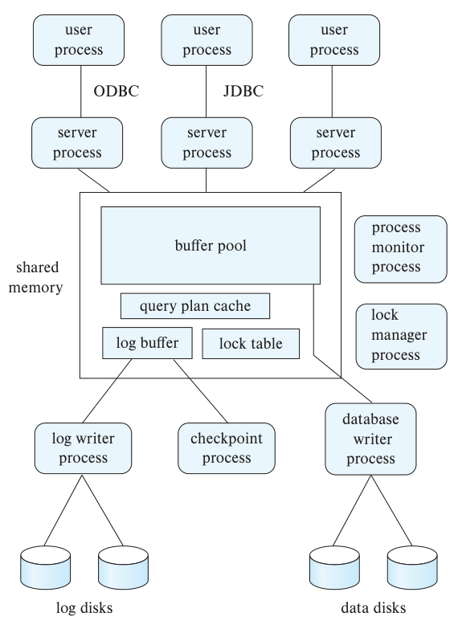

图20.1：用户进程（user process）通过 ODBC/JDBC 等接口连接服务器进程（server process）。共享内存（shared memory）中包含缓冲池（buffer pool）、查询计划缓存（query plan cache）、锁表（lock table）与日志缓冲区（log buffer）。外围包括锁管理器进程（lock manager process）、数据库写进程（database writer process）、日志写进程（log writer process）、检查点进程（checkpoint process）和进程监控器（process monitor process）；底部是数据磁盘（data disks）和日志磁盘（log disks）。

<!-- SOURCE pdf-0994-b001 -->
- **服务器进程**：接收用户查询或事务，执行后返回结果。请求可以来自用户界面、运行嵌入式 SQL 的用户进程，也可以经由 JDBC、ODBC 或类似协议提交。有些数据库为每个用户会话分配一个进程；少数数据库用单个进程服务全部会话，在进程中用多个线程并发执行查询。线程类似进程，但多个线程属于同一个进程，共享同一个虚拟地址空间，并能并发执行。许多数据库采用混合结构，运行多个进程，每个进程又有多个线程。
- **锁管理器进程**：负责授予锁、释放锁和检测死锁。
- **数据库写进程**：持续把已修改缓冲块写回磁盘，可以有一个或多个。
- **日志写进程**：把日志缓冲区中的记录输出到稳定存储器。服务器进程只需把记录追加到共享内存中的日志缓冲区；需要强制写入日志时，再请求日志写进程输出。强制写入会把内存中的日志内容送入稳定存储器。
- **检查点进程**：定期执行检查点。
- **进程监控器**：监视其他进程。若某个进程失败，就为它执行恢复，例如中止其正在执行的事务，再重启该进程。

<!-- SOURCE pdf-0994-b002 -->
共享内存包含全部共享数据，例如：

<!-- SOURCE pdf-0994-b003 -->
- 缓冲池。
- 锁表。
- 日志缓冲区，保存等待输出到稳定日志的记录。
- 缓存的查询计划，同一查询再次提交时可以复用。

<!-- SOURCE pdf-0994-b004 -->
所有数据库进程都能访问共享内存。多个进程可能同时读写其中的数据结构，因此必须保证**互斥**：同一时刻最多一个进程修改某数据结构，其他进程也不能在修改期间读取它。

<!-- SOURCE pdf-0994-b005 -->
<!-- SOURCE pdf-0996-b001 -->
互斥可以通过操作系统提供的**信号量**实现。开销更低的方法是使用硬件支持的原子指令 `test-and-set` 或 `compare-and-swap`，详见专栏20.1。如今的多处理器系统都支持这两种指令之一，更详细的说明可参阅操作系统教材。

<!-- SOURCE pdf-0995-b002 -->
#### 专栏20.1 原子指令

<!-- SOURCE pdf-0995-b003 -->
<!-- SOURCE pdf-0995-b004 -->
1. **`test-and-set(M)`** 以原子方式完成两步：读取内存位置 M 的值，再把它设为1。指令返回读到的原值。

<!-- SOURCE pdf-0995-b005 -->
   假定用 M 表示一个排他锁，初值为0。进程要取得锁，就执行 `test-and-set(M)`。如果只有它对 M 执行这条指令，返回值为0，表明已取得锁，同时 M 被设为1。用完后把 M 设回0，释放锁。

<!-- SOURCE pdf-0995-b006 -->
   如果第二个进程在锁释放前执行这条指令，会得到1，说明已有其他进程持锁。它可以定期重试，直到返回0，表明另一个进程释放锁后，它已取得该锁。

<!-- SOURCE pdf-0995-b007 -->
   如果两个进程同时执行 `test-and-set(M)`，一个会得到0，另一个会得到1。因为读取和设置作为一个原子操作执行，第一个读到0的进程也会把它设为1，第二个读到的就是1。于是只有一个进程取得锁，保证了互斥。

<!-- SOURCE pdf-0995-b008 -->
<!-- SOURCE pdf-0995-b009 -->
2. **`compare-and-swap`** 是类似的原子指令，操作数为 `(M, Vₒ, Vₙ)`，M 为内存位置，Vₒ、Vₙ 分别称为旧值和新值。指令以原子方式比较 M 的当前值与 Vₒ：相等则把 M 改为 Vₙ，并返回成功；不等则保持 M 不变，返回失败。

<!-- SOURCE pdf-0995-b010 -->
   同样，用初值为0的 M 表示锁。进程申请锁时执行 `compare-and-swap(M, 0, id)`，id 可以是任意非零值，通常取进程标识符。如果尚无进程持锁，指令把进程标识符写入 M，并返回成功；否则返回失败。

<!-- SOURCE pdf-0995-b011 -->
   与 `test-and-set` 相比，若 Vₙ 使用进程标识符，只需读取 M 就能知道当前持锁进程，这是 `compare-and-swap` 的一个优势。

<!-- SOURCE pdf-0996-b002 -->
这些原子指令可以实现互斥，相当于提供排他锁，但不直接支持共享锁，因此不能直接用来实现数据库通用锁。不过，它们可用于实现持有时间很短的闩锁，在数据库中保证互斥。

<!-- SOURCE pdf-0996-b003 -->
为避免消息传递开销，许多数据库让服务器进程直接更新共享内存中的锁表来加锁，无须向锁管理器进程发送请求。锁表见图18.10。

<!-- SOURCE pdf-0996-b004 -->
多个服务器进程可能同时访问锁表，因此必须互斥。通常，用某个内存位置表示锁表自身的锁，通过 `test-and-set` 或 `compare-and-swap` 取得互斥锁，也称闩锁。

<!-- SOURCE pdf-0996-b005 -->
事务通过直接更新共享锁表申请锁时，步骤如下：

<!-- SOURCE pdf-0996-b006 -->
1. 取得锁表的互斥锁或闩锁。
<!-- SOURCE pdf-0996-b007 -->
<!-- SOURCE pdf-0996-b008 -->
2. 按第18.1.4节的方法判断请求能否获准。可以就更新锁表，标明锁已授予；否则把请求加入该锁的等待队列。
<!-- SOURCE pdf-0996-b009 -->
3. 释放锁表的互斥锁。

<!-- SOURCE pdf-0996-b010 -->
如果因锁冲突不能立即获锁，事务可以定期读取锁表，检查其他事务释放锁后，自己的请求是否已获准。

<!-- SOURCE pdf-0996-b011 -->
释放锁的步骤如下：

<!-- SOURCE pdf-0996-b012 -->
1. 取得锁表的互斥锁。
<!-- SOURCE pdf-0996-b013 -->
2. 删除被释放锁对应的锁表条目。
<!-- SOURCE pdf-0996-b014 -->
<!-- SOURCE pdf-0996-b015 -->
3. 如果该数据项还有等待请求，而现在可以授予，就更新锁表，把这些请求标为已获准。授予规则见第18.1.4节。
<!-- SOURCE pdf-0996-b016 -->
4. 释放锁表的互斥锁。

<!-- SOURCE pdf-0997-b001 -->
反复检查锁表是一种**忙等待**。为避免忙等待，申请锁的代码可以通过操作系统信号量等待获锁通知；相应地，释放锁的代码需要用信号量通知等待事务，告知锁已授予。

<!-- SOURCE pdf-0997-b002 -->
即使用共享内存处理锁请求，系统仍会通过锁管理器进程检测死锁。

<!-- SOURCE pdf-0997-b003 -->
### 20.3.2 数据服务器与数据存储系统

<!-- SOURCE pdf-0997-b004 -->
数据服务器最初用于支持面向对象数据库的数据访问。这类数据库允许程序员通过编程语言创建、读取和更新持久对象。

<!-- SOURCE pdf-0997-b005 -->
面向对象数据库的许多目标应用，例如计算机辅助设计 CAD，需要对读出的数据进行大量计算。例如，CAD 系统保存芯片或建筑模型，读取后进行仿真等计算，可能消耗大量 CPU 时间。

<!-- SOURCE pdf-0997-b006 -->
如果所有计算都在服务器上进行，服务器就会过载。较合理的安排是把数据放在独立的数据服务器上，客户端按需读取，在本地完成全部处理，再将新数据或更新数据写回服务器。这样利用了客户端的计算能力，服务器只负责存取数据，无须承担计算。

<!-- SOURCE pdf-0997-b007 -->
近些年，为处理大量数据和事务，人们开发了许多并行数据存储系统。它们未必支持 SQL，而是通过 API 提供数据项的存储、读取和更新。数据项可以是元组、JSON 或 XML 等格式表示的对象，也可以是文件或文档。

<!-- SOURCE pdf-0997-b008 -->
本节用“数据项”统称元组、对象、文件和文档，“数据服务器”与“数据存储系统”也交替使用。

<!-- SOURCE pdf-0997-b009 -->
数据服务器支持传输完整数据项；对于很大的数据项，还可能允许只传输指定部分，例如指定块，无须读写整个数据项。

<!-- SOURCE pdf-0997-b010 -->
较早的数据服务器支持**页传送**，以数据库页为通信单位，一个页中可能有多个数据项。如今的存储系统不向客户端暴露底层存储布局，因此不再采用页传送。

<!-- SOURCE pdf-0997-b011 -->
### 20.3.3 客户端缓存

<!-- SOURCE pdf-0997-b012 -->
<!-- SOURCE pdf-0998-b001 -->
客户端应用与事务服务器或数据服务器通信，耗时通常以毫秒计，远高于不到100纳秒的本地内存访问。经网络发送消息并收到响应的时间，称为**网络往返时间**或**网络延迟**。即使客户端与数据服务器在同一地点，也可能接近1毫秒。

<!-- SOURCE pdf-0998-b002 -->
因此，客户端应用采用多种策略减轻网络延迟的影响。并行数据库中，查询所需的数据可能保存在另一台机器上，这些策略同样有用。

<!-- SOURCE pdf-0998-b003 -->
<!-- SOURCE pdf-0998-b004 -->
- **预取**。如果每次只传输一个小数据项，消息开销相对于数据量就很高。事务反复通过网络请求数据，会因网络延迟而明显变慢。因此，请求一个数据项时，可以顺便发送近期可能用到的其他数据项。这种在请求前就读取数据的做法称为预取。
- **数据缓存**。为某事务传送到客户端的数据，可以在该事务期间缓存。事务完成后仍可保留，让同一客户端的后续事务复用。

<!-- SOURCE pdf-0998-b005 -->
  但需要处理**缓存一致性**。即使找到了缓存数据，也必须确认它仍是最新版本，因为其他客户端可能已经更新甚至删除它。除非应用能接受可能过时的数据，否则仍需与服务器通信，检查有效性并取得锁。缓存之后也可能插入了新元组，而它们不在缓存中，事务可能还得访问服务器才能找到。
- **锁缓存**。如果各客户端使用的数据大体互不重叠，很少请求其他客户端也要访问的数据，就可以在客户端缓存锁。客户端既找到缓存数据项，又找到访问所需的锁，就无须与服务器通信。不过，服务器必须跟踪缓存锁。某客户端请求锁时，服务器要向其他缓存了冲突锁的客户端发起回收。考虑机器故障后，这项工作更加复杂。
- **自适应锁粒度**。事务执行中可能陆续发现自己需要锁住多个数据项，如果每次加锁都要与数据服务器往返通信，就可能把大量时间花在加锁上。

<!-- SOURCE pdf-0999-b001 -->
  这时可以用多粒度锁减少请求。例如，多个数据项位于同一页时，一个较粗的页锁可以代替多个较细的数据项锁。锁竞争很少时，这种方法效果好；竞争较高时，粗粒度锁则可能明显降低并发度。

<!-- SOURCE pdf-0999-b002 -->
  **锁降级**可以在竞争增加时自适应地减小锁粒度。数据服务器先请求客户端降低某把锁的粒度，客户端取得更细的锁后，再释放较粗的锁。

<!-- SOURCE pdf-0999-b003 -->
  切换到细粒度锁时，如果有些锁只用于保护缓存数据，而客户端当前没有事务锁住这些数据项，就可以直接将其移出缓存，无须再为它们取得细粒度锁。

<!-- SOURCE pdf-0999-b004 -->
## 20.4 并行系统

<!-- SOURCE pdf-0999-b005 -->
并行系统利用大量计算机同时工作，提高处理和 I/O 速度。并行机器日益普及，研究并行数据库也随之更加重要。

<!-- SOURCE pdf-0999-b006 -->
并行处理让多个操作同时执行，串行处理则按顺序执行各计算步骤。粗粒度并行机器由少量高性能处理器构成；大规模并行或细粒度并行机器则使用数千个较小的处理器。如今几乎所有高端服务器都提供某种粗粒度并行，拥有2个或4个处理器，每个处理器可能有20～40个核。

<!-- SOURCE pdf-0999-b007 -->
大规模并行计算机支持的并行度远高于粗粒度并行机器。让大量处理器共享内存并不现实，因此通常用许多独立计算机构建：每台都有自己的内存，往往也有自己的磁盘。每台计算机称为系统中的一个**节点**。

<!-- SOURCE pdf-0999-b008 -->
数百到数千个甚至更多节点的并行系统，通常放在数据中心。数据中心容纳大量服务器，提供内部以及通往外部的高速网络连接。过去十年，数据中心的数量和规模大幅增长，现代数据中心可能有数十万台服务器。

<!-- SOURCE pdf-0999-b009 -->
### 20.4.1 为什么需要并行数据库

<!-- SOURCE pdf-0999-b010 -->
随着计算机使用增多，组织的事务处理需求持续增长。万维网的发展又带来了大量拥有数百万访问者的网站，收集的用户数据不断增加，使许多公司的数据库规模迅速扩大。

<!-- SOURCE pdf-1000-b001 -->
推动并行数据库发展的应用，要么需要查询 PB 级超大数据库——1 PB 等于1000 TB，即10¹⁵字节——要么每秒需要处理数千个事务。集中式和客户端—服务器数据库的能力不足以满足这些需求。

<!-- SOURCE pdf-1000-b002 -->
如今，互联网规模应用通常需要数百到数千个节点，有的甚至需要数万个，以服务海量用户。

<!-- SOURCE pdf-1000-b003 -->
组织利用不断增加的数据规划业务活动和定价，例如人们购买哪些商品、点击哪些网页链接、何时打电话。服务于这些目的的查询称为**决策支持查询**，可能需要访问数 TB 数据。单节点系统无法以要求的速度处理这样的数据量。

<!-- SOURCE pdf-1000-b004 -->
数据库查询面向集合，天然适合并行化。许多商用和研究系统已经展示了并行查询处理的能力和可扩展性。

<!-- SOURCE pdf-1000-b005 -->
这些年来，计算系统成本大幅下降，并行机器逐渐普及，价格也更低。单台计算机通过多核架构本身也已成为并行机器。因此，小型组织同样负担得起并行数据库。

<!-- SOURCE pdf-1000-b006 -->
支持数百节点的商用并行数据库已有数十年历史，2000年代中期以来，产品数量明显增加。并行数据存储开源平台，如 HDFS 和 HBase，以及 Hadoop Map-Reduce、Hive 等查询处理平台，也得到广泛采用。

<!-- SOURCE pdf-1000-b007 -->
应用程序通常可以在多台应用服务器上并行执行，并通过网络与数据库服务器通信，数据库本身也可能是并行系统。本节的并行架构既可用于数据库存储和查询处理，也可用于应用程序的并行处理。

<!-- SOURCE pdf-1000-b008 -->
### 20.4.2 并行系统的性能指标

<!-- SOURCE pdf-1000-b009 -->
数据库系统主要有两个性能指标：**吞吐量**，即给定时间内能完成多少任务；**响应时间**，即从提交到完成单个任务所需的时间。处理大量小事务的系统可以并行执行多个事务，以提高吞吐量；处理大事务的系统则可以并行执行各事务的子任务，同时改善响应时间和吞吐量。

<!-- SOURCE pdf-1001-b001 -->
<!-- SOURCE pdf-1001-b002 -->
<!-- SOURCE pdf-1001-b003 -->
<!-- SOURCE pdf-1001-b004 -->
<!-- SOURCE pdf-1001-b005 -->
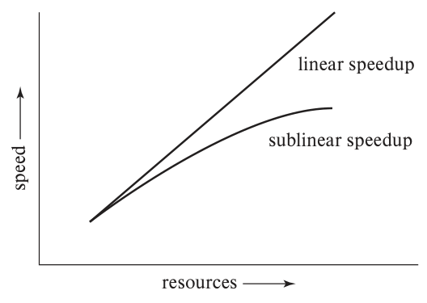

图20.2：横轴为资源（resources），纵轴为速度（speed）；直线表示线性加速（linear speedup），曲线表示次线性加速（sublinear speedup）。

<!-- SOURCE pdf-1001-b006 -->
计算机内部的并行处理可以加快数据库活动，使事务响应更快、每秒执行的事务更多。查询处理方式可以充分利用底层系统提供的并行能力。

<!-- SOURCE pdf-1001-b007 -->
研究并行性时，两个重要概念是**加速比**（speedup）和**扩展比**（scaleup）。增加并行度，以更短时间完成同一任务，属于加速；增加并行度，以处理更大任务，属于扩展。

<!-- SOURCE pdf-1001-b008 -->
设数据库应用运行在拥有一定数量处理器和磁盘的并行系统上。现在增加处理器、磁盘及其他组件，希望完成任务的时间与分配的处理器和磁盘数量成反比。若同一任务在大机器上耗时 Tₗ，在小机器上耗时 Tₛ，则加速比定义为 **Tₛ / Tₗ**。如果大系统资源是小系统的 N 倍，加速比也为 N，就称为**线性加速**；小于 N 则称为**次线性加速**。图20.2展示了二者。[^20-2]

<!-- SOURCE pdf-1001-b009 -->
<!-- SOURCE pdf-1002-b006 -->
扩展比关注增加资源后，能否在相同时间内处理更大的任务。设任务 Q 在机器 Mₛ 上耗时 Tₛ，规模为 Q 的 N 倍的任务 Qₙ，在资源为 Mₛ 的 N 倍的并行机器 Mₗ 上耗时 Tₗ。扩展比也定义为 **Tₛ / Tₗ**。若 Tₗ = Tₛ，称为对任务 Q 实现了**线性扩展**；若 Tₗ > Tₛ，则是**次线性扩展**。图20.3展示了资源随问题规模同比增长时的这两种情况。根据任务规模的衡量方法，并行数据库有两类扩展：

<!-- SOURCE pdf-1001-b011 -->
[^20-2]: 某些情况下会出现超线性加速，即资源增加到 N 倍，加速比却超过 N。例如，数据原本放不进小系统的主存，增大系统后能全部放入，从而避免磁盘 I/O；或者数据能放进大系统的缓存，减少主存访问，也可能带来超线性加速。

<!-- SOURCE pdf-1002-b001 -->
<!-- SOURCE pdf-1002-b002 -->
<!-- SOURCE pdf-1002-b003 -->
<!-- SOURCE pdf-1002-b004 -->
<!-- SOURCE pdf-1002-b005 -->
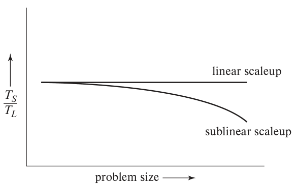

图20.3：横轴为问题规模（problem size），纵轴为 Tₛ / Tₗ；水平线为线性扩展（linear scaleup），下降曲线为次线性扩展（sublinear scaleup）。

<!-- SOURCE pdf-1002-b007 -->
- **批处理扩展**：数据库规模增加，任务是运行时间取决于数据库大小的大型作业，例如扫描一个大小与数据库成比例的关系。此时问题规模用数据库大小衡量。批处理扩展也适用于科学计算，例如把天气模拟的分辨率提高到 N 倍，[^20-3] 或把模拟时段延长到 N 倍。
- **事务扩展**：事务提交速率增加，数据库大小也同比增加。这适用于小型更新事务，例如账户存取款，账户增加使事务率增长。这类处理适合并行执行，因为各事务可以在不同节点上独立、并发运行，数据库变大后，每个事务耗时仍大致相同。

<!-- SOURCE pdf-1002-b008 -->
<!-- SOURCE pdf-1003-b001 -->
衡量并行数据库效率时，扩展比通常更重要。数据库并行化的目标通常是：数据和事务量持续增长，系统仍能保持可接受的速度。通过提高并行度增加容量，比把集中式系统更换为速度更快的机器，更便于企业平稳扩展，即使确实存在更快的机器也是如此。不过，衡量扩展比还必须看绝对性能。线性扩展的机器也可能比次线性扩展的机器慢，因为后者的起点性能可能高得多。

<!-- SOURCE pdf-1002-b010 -->
[^20-3]: 例如，天气模拟原本把某地区的大气划分为边长200米的立方体，改成边长100米后，立方体总数会增加到8倍。

<!-- SOURCE pdf-1003-b002 -->
以下因素会降低并行效率，同时影响加速比和扩展比。

<!-- SOURCE pdf-1003-b003 -->
<!-- SOURCE pdf-1003-b005 -->
- **串行计算**。许多任务只有一部分能并行，另一部分必须串行。设任务串行执行耗时 T，其中比例 p 可以由 n 个节点并行执行，则总耗时为 **(1 − p)T + (p / n)T**，加速比为：

  **1 / [(1 − p) + p / n]**

  这个公式称为**阿姆达尔定律**。

<!-- SOURCE pdf-1003-b006 -->
<!-- SOURCE pdf-1003-b008 -->
  如果 p = 9/10，那么即使 n 很大，最大加速比也只能接近10。

<!-- SOURCE pdf-1003-b009 -->
<!-- SOURCE pdf-1003-b011 -->
  再考虑问题规模增加时的扩展。如果串行部分的耗时也随问题规模增加，扩展能力同样会受限制。设执行时间中比例 p 能从增加资源中受益，比例 1 − p 为无法受益的串行部分。资源和问题规模都扩大到 n 倍时，扩展比为：

  **1 / [n(1 − p) + p]**

  原书把这个公式称为**古斯塔夫森定律**。但如果串行部分的耗时不随问题规模增长，那么随着问题变大，它对扩展的影响会减小。

<!-- SOURCE pdf-1003-b012 -->
- **启动成本**。启动一个进程有一定开销。并行操作包含数千个进程时，启动时间可能超过实际处理时间，降低加速比。
- **相互干扰**。并行进程经常访问共享资源，新进程会与已有进程争用系统总线、共享磁盘甚至锁，造成运行减慢，同时损害加速比和扩展比。
- **倾斜**。把任务分成多个并行步骤，会减少平均每步的工作量，但整个任务的耗时仍由最慢的一步决定。任务往往难以等分，工作量会不均衡。例如，规模100的任务分为10份，有的少于10，有的多于10；只要其中一份为20，并行加速比就只有5，达不到期望的10。

<!-- SOURCE pdf-1004-b001 -->
<!-- SOURCE pdf-1004-b002 -->
<!-- SOURCE pdf-1004-b003 -->
<!-- SOURCE pdf-1004-b004 -->
<!-- SOURCE pdf-1004-b005 -->
<!-- SOURCE pdf-1004-b006 -->
<!-- SOURCE pdf-1004-b007 -->
<!-- SOURCE pdf-1004-b008 -->
<!-- SOURCE pdf-1004-b009 -->
<!-- SOURCE pdf-1004-b010 -->
<!-- SOURCE pdf-1004-b011 -->
<!-- SOURCE pdf-1004-b012 -->
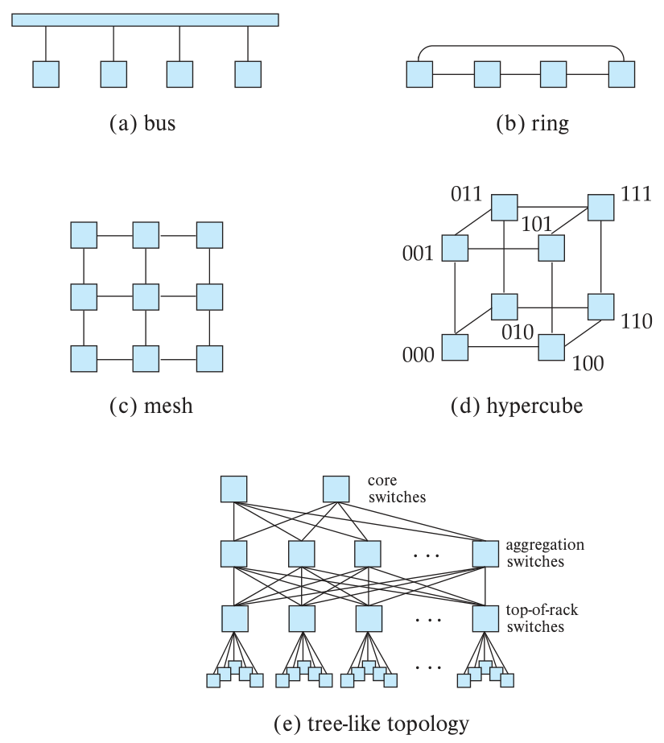

图20.4：a为总线（bus），b为环形（ring），c为网格（mesh），d为超立方体（hypercube），e为类树拓扑（tree-like topology）。类树拓扑由下向上依次是机架顶交换机（top-of-rack switches）、汇聚交换机（aggregation switches）和核心交换机（core switches）。

<!-- SOURCE pdf-1004-b013 -->
### 20.4.3 互连网络

<!-- SOURCE pdf-1004-b014 -->
并行系统中的处理器、内存和磁盘等组件，通过**互连网络**相互通信。图20.4列出了几种常见网络。

<!-- SOURCE pdf-1004-b015 -->
<!-- SOURCE pdf-1005-b001 -->
- **总线**。所有组件通过同一通信总线收发数据，如图20.4a。早期总线也用于连接网络中的多个节点，如今已不再用于这一用途，但仍用于单节点内部多个 CPU 和内存单元的连接。处理器较少时，总线效果不错；并行度提高后，由于同一时刻只能处理一个组件的通信，扩展能力较差。随着单节点内 CPU 和内存组增加，环形、网格等互连也开始用于节点内部。
- **环形**。节点排成一个环，各自连接相邻的两个节点，如图20.4b。环上的各链路可以同时传输，扩展性优于总线。但从一个节点到另一个节点，可能经过很多跳：n 个节点组成的双向环，最多需要 n/2 跳。节点增加，传输延迟也随之增加。
- **网格**。节点排列成网格，每个节点连接所有相邻节点。二维网格最多连接4个邻居，三维最多6个。图20.4c是二维网格。未直接相连的节点，通过一系列相邻中间节点转发消息。节点增加时，通信链路也随之增加，因此通信容量能更好地随并行度扩展。

<!-- SOURCE pdf-1005-b002 -->
  网格互连可用于连接处理器内的多个核，或一台服务器内的多个处理器。每个核可直接访问与它相连的内存组；访问其他内存组时，系统通过网格发送消息，透明地读取数据。

<!-- SOURCE pdf-1005-b003 -->
<!-- SOURCE pdf-1005-b004 -->
<!-- SOURCE pdf-1005-b006 -->
<!-- SOURCE pdf-1005-b007 -->
<!-- SOURCE pdf-1005-b009 -->
  不过，网格已不再用于连接节点，因为节点数增加会显著增加传输所需的跳数。最坏情况下，跳数与节点数的平方根成正比。如今并行系统节点很多，网格互连会慢到不切实际。
- **超立方体**。节点用二进制编号，两个节点编号恰好只差一位，就直接连接。n 个节点中，每个连接 log₂n 个其他节点。图20.4d是8节点超立方体。任意两个节点之间最多经过 log₂n 条链路；相比之下，二维网格最远可能相隔 **2(√n − 1)** 条链路，即使网格边缘首尾相接，也可能相隔 **√n** 条。因此，超立方体的通信延迟明显低于网格。

<!-- SOURCE pdf-1006-b001 -->
  早期大规模并行计算机曾用超立方体连接节点，如今已不常见。
- **类树结构**。数据中心的服务器通常装在机架中，每个机架最多大约40个节点。更大系统使用多个机架，如何连接这些节点就成了重要问题。

<!-- SOURCE pdf-1006-b002 -->
  机架内部通常使用安装在顶部的网络交换机。常见48端口交换机可连接整个机架的服务器。当代交换机通常支持对每台相连服务器同时提供1～10 Gbps带宽，也有更昂贵的40～100 Gbps互连设备。

<!-- SOURCE pdf-1006-b003 -->
  多个机架顶交换机，也称边缘交换机，再连接到**汇聚交换机**，实现机架间通信。机架很多时，可以分组，每组连接一台汇聚交换机，所有汇聚交换机再连接到**核心交换机**，形成三层树形拓扑。顶层核心交换机也负责连接外部网络。

<!-- SOURCE pdf-1006-b004 -->
  这种基本树结构常见于组织内部局域网，但如果一个机架中多台机器要与其他机架大量交换数据，机架间带宽往往不足。汇聚交换机之间通常有10～40 Gbps互连，也有100 Gbps设备；多条链路并行还能提高容量。但足够多的服务器以各自满带宽跨机架通信时，即使这些高速链路也会饱和。

<!-- SOURCE pdf-1006-b005 -->
  为避免树结构的带宽瓶颈，数据中心通常把每台机架顶交换机连接到多台汇聚交换机，每台汇聚交换机又连接到下一层的多台核心交换机。这称为**类树拓扑**，图20.4e展示了三层结构。它也称为**胖树拓扑**，不过胖树最初特指越靠近树顶、链路带宽越大的树形结构。

<!-- SOURCE pdf-1006-b006 -->
<!-- SOURCE pdf-1007-b001 -->
  这种结构允许机架顶交换机通过任一相连的汇聚交换机路由消息，机架间带宽明显增加。汇聚交换机之间也可通过任一相连核心交换机通信，提高汇聚层间带宽。某台汇聚或边缘交换机故障时，还可以通过其他交换机寻找替代路径。配合适当的路由算法，网络可在一个或少数交换机故障后继续运行，具备一定容错能力。

<!-- SOURCE pdf-1007-b002 -->
  三层类树结构能支持数万台机器的集群。尽管它明显提高了机架间带宽，并行存储、并行数据库等应用仍应尽量减少跨机架流量，以获得更好性能。

<!-- SOURCE pdf-1007-b003 -->
  类树拓扑及其变体已广泛用于数据中心。数据中心中这种复杂互连网络称为**数据中心交换网络**（data center fabric）。

<!-- SOURCE pdf-1007-b004 -->
拓扑关系到可扩展性，单条链路采用的网络技术同样影响性能。常见技术包括：

<!-- SOURCE pdf-1007-b005 -->
- **以太网**。当前占主导地位的网络连接技术。标准不断演进，主要使用1 Gb和10 Gb以太网，分别提供1、10 Gbps带宽。40 Gb和100 Gb以太网价格更高，使用也在增加。短距离可用较便宜的铜缆，长距离可用光纤。
- **光纤通道**（Fiber Channel）。面向存储系统与计算机之间的高速互连，主要用于第20.4.6节介绍的存储区域网络。各版本带宽持续增长，2011年已支持16 Gbps，2016年开始支持32和128 Gbps。
- **InfiniBand**。面向数据中心内部互连，专门针对同时需要高带宽和低延迟的高性能计算。其标准逐渐发展，2007年链路速度达到8 Gbps，2014年达到24 Gbps。聚合多条链路可以提供120～290 Gbps带宽。

<!-- SOURCE pdf-1007-b006 -->
  对许多应用，消息延迟与带宽同样重要。InfiniBand 的一个优势是延迟可低至0.7～0.5微秒。未经优化的以太网局域网延迟可达数百微秒，即使经过低延迟优化，仍可能需要数微秒。

<!-- SOURCE pdf-1007-b007 -->
<!-- SOURCE pdf-1008-b066 -->
降低延迟的一项重要技术，是让应用绕过操作系统，直接与硬件交互来收发消息。在标准网络协议栈中，应用先把消息交给操作系统，再由操作系统交给硬件，传送到另一台计算机；接收端又经过硬件、操作系统，最终送达应用。直接访问网络接口，可以明显减少这条路径的延迟。

<!-- SOURCE pdf-1008-b067 -->
另一项技术是**远程直接内存访问**（RDMA），允许一个节点上的进程直接读写另一个节点的内存，无须显式传递消息。硬件支持使 RDMA 兼具高传输速率和低延迟。底层物理通信可以采用 InfiniBand、以太网等技术。

<!-- SOURCE pdf-1008-b068 -->
### 20.4.4 并行数据库架构

<!-- SOURCE pdf-1008-b069 -->
并行机器有多种架构，图20.5展示了几类主要形式。其中 M 表示内存，P 表示处理器，圆柱体表示磁盘。

<!-- SOURCE pdf-1008-b070 -->
<!-- SOURCE pdf-1009-b001 -->
- **共享内存**：所有处理器共用内存，见图20.5a。
- **共享磁盘**：多个节点共用一组磁盘，每个节点拥有自己的处理器和内存，见图20.5b。共享磁盘系统有时也称为集群。
- **无共享**：节点之间既不共享内存，也不共享磁盘，见图20.5c。
- **层次结构**：混合上述三类架构，见图20.5d，是如今使用最广泛的形式。

<!-- SOURCE pdf-1008-b004 -->
<!-- SOURCE pdf-1008-b005 -->
<!-- SOURCE pdf-1008-b006 -->
<!-- SOURCE pdf-1008-b007 -->
<!-- SOURCE pdf-1008-b008 -->
<!-- SOURCE pdf-1008-b009 -->
<!-- SOURCE pdf-1008-b013 -->
<!-- SOURCE pdf-1008-b017 -->
<!-- SOURCE pdf-1008-b021 -->
<!-- SOURCE pdf-1008-b022 -->
<!-- SOURCE pdf-1008-b023 -->
<!-- SOURCE pdf-1008-b024 -->
<!-- SOURCE pdf-1008-b025 -->
<!-- SOURCE pdf-1008-b026 -->
<!-- SOURCE pdf-1008-b027 -->
<!-- SOURCE pdf-1008-b028 -->
<!-- SOURCE pdf-1008-b029 -->
<!-- SOURCE pdf-1008-b030 -->
<!-- SOURCE pdf-1008-b031 -->
<!-- SOURCE pdf-1008-b032 -->
<!-- SOURCE pdf-1008-b033 -->
<!-- SOURCE pdf-1008-b034 -->
<!-- SOURCE pdf-1008-b035 -->
<!-- SOURCE pdf-1008-b036 -->
<!-- SOURCE pdf-1008-b040 -->
<!-- SOURCE pdf-1008-b041 -->
<!-- SOURCE pdf-1008-b042 -->
<!-- SOURCE pdf-1008-b043 -->
<!-- SOURCE pdf-1008-b044 -->
<!-- SOURCE pdf-1008-b048 -->
<!-- SOURCE pdf-1008-b049 -->
<!-- SOURCE pdf-1008-b050 -->
<!-- SOURCE pdf-1008-b051 -->
<!-- SOURCE pdf-1008-b052 -->
<!-- SOURCE pdf-1008-b053 -->
<!-- SOURCE pdf-1008-b054 -->
<!-- SOURCE pdf-1008-b055 -->
<!-- SOURCE pdf-1008-b056 -->
<!-- SOURCE pdf-1008-b057 -->
<!-- SOURCE pdf-1008-b058 -->
<!-- SOURCE pdf-1008-b059 -->
<!-- SOURCE pdf-1008-b060 -->
<!-- SOURCE pdf-1008-b061 -->
<!-- SOURCE pdf-1008-b062 -->
<!-- SOURCE pdf-1008-b065 -->
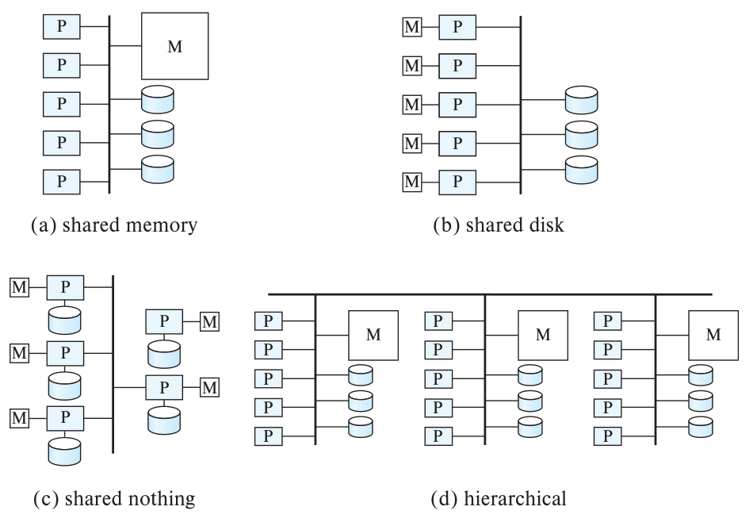

图20.5：a为共享内存（shared memory），b为共享磁盘（shared disk），c为无共享（shared nothing），d为层次结构（hierarchical）。

<!-- SOURCE pdf-1009-b002 -->
第20.4.5～20.4.8节分别介绍这些模型。

<!-- SOURCE pdf-1009-b003 -->
图20.5只是抽象表示互连网络，不应把图中的连线理解为一定是总线。实际系统使用多种网络，例如处理器内使用网格，节点之间常用类树网络。

<!-- SOURCE pdf-1009-b004 -->
### 20.4.5 共享内存

<!-- SOURCE pdf-1009-b005 -->
共享内存架构中的处理器通常通过互连网络访问公共内存，也共享磁盘。它的优势是进程间通信效率很高：任何进程都能访问共享数据，无须由软件搬运。通过内存写入发送信息，通常不到一微秒，远快于使用通信机制发送消息。

<!-- SOURCE pdf-1009-b006 -->
4～8核处理器如今在桌面计算机和手机中都很常见。截至2018年，Intel Xeon 等高端 CPU 最多有28个核，一块主板最多支持8个 CPU；Xeon Phi 协处理器约有72个核，核数还在增加。原因是集成电路逻辑门等特征尺寸持续缩小，同一芯片可以容纳更多门。给定硅片面积可容纳的晶体管数，大约每1.5～2年翻倍。[^20-4]

<!-- SOURCE pdf-1009-b007 -->
单个处理器所需逻辑门数没有同比增加，因此适合在一块芯片中放置多个处理单元。为区分片上多处理单元与传统处理器，片上的处理单元称为**核**；这样的处理器就称为多核处理器。

<!-- SOURCE pdf-1009-b009 -->
[^20-4]: Intel 联合创始人 Gordon Moore 在20世纪60年代预测了晶体管数量的这种指数增长，通常称为“摩尔定律”。严格说，它是一项观察和预测。在早期几十年里，处理器速度也随特征尺寸缩小而提高，但这一趋势在2000年代中期结束：主频超过数 GHz 会带来难以接受的功耗与发热。人们有时误以为摩尔定律预测的是处理器速度的指数增长。

<!-- SOURCE pdf-1010-b001 -->
一个处理器上的所有核通常共享内存，多个处理器也可以共享内存。晶体管集成度提升还使主存容量持续增长，每字节成本持续下降。

<!-- SOURCE pdf-1010-b002 -->
低成本多核处理器与大容量低成本内存同时普及，使共享内存并行处理近年来越来越重要。

<!-- SOURCE pdf-1010-b003 -->
#### 20.4.5.1 共享内存架构

<!-- SOURCE pdf-1010-b004 -->
早期架构让所有处理器核和内存组共享一条总线。由于所有处理器共用它，总线或互连网络会成为瓶颈。处理器增加到一定数量后，再增加也无济于事，因为大部分时间都在等轮到自己访问内存。

<!-- SOURCE pdf-1010-b005 -->
现代共享内存架构因此把内存直接连接到各处理器。本地内存访问很快，处理器也能通过高速处理器间网络访问其他处理器的内存，开销相对较低。由于访问不同区域的速度不同，这种结构称为**非一致内存访问架构**（NUMA）。

<!-- SOURCE pdf-1010-b006 -->
图20.6展示了现代多处理器共享内存系统的概念结构。每个处理器直连一个内存组，处理器之间通过高速互连连接；它们还连接到 I/O 控制器，访问外部存储。

<!-- SOURCE pdf-1010-b007 -->
<!-- SOURCE pdf-1010-b008 -->
<!-- SOURCE pdf-1010-b009 -->
<!-- SOURCE pdf-1010-b010 -->
<!-- SOURCE pdf-1010-b011 -->
<!-- SOURCE pdf-1010-b012 -->
<!-- SOURCE pdf-1010-b013 -->
<!-- SOURCE pdf-1010-b014 -->
<!-- SOURCE pdf-1010-b015 -->
<!-- SOURCE pdf-1010-b016 -->
<!-- SOURCE pdf-1010-b017 -->
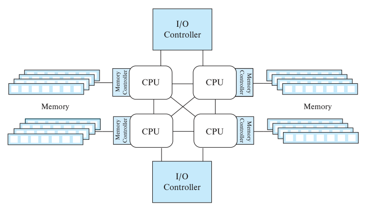

图20.6：CPU通过内存控制器（Memory Controller）访问内存（Memory），通过I/O控制器（I/O Controller）连接外部设备。

<!-- SOURCE pdf-1011-b001 -->
共享内存需要核间、处理器间专门的高速互连，能连接的核或处理器数量相对有限。因此，这种并行方式最多扩展到数百核。

<!-- SOURCE pdf-1011-b002 -->
处理器配有缓存，因为缓存访问仅需几纳秒，主存则接近100纳秒。大缓存对共享内存架构尤为重要，可以减少共享内存访问次数。

<!-- SOURCE pdf-1011-b003 -->
指令需要的数据不在缓存中时，必须从主存读取。主存比处理器慢得多，核等待数据期间会损失不少潜在处理能力。这种等待称为**缓存未命中**。

<!-- SOURCE pdf-1011-b004 -->
许多处理器支持**超线程**，也称硬件线程，让一个物理核表现为两个或更多逻辑核或线程。不同进程可以映射到不同逻辑核。原书在这里采用简化模型：一个物理核在任一时刻只执行其中一个逻辑核；当它因缓存未命中而等待内存数据时，硬件可以转去执行另一个逻辑核，避免空等。

<!-- SOURCE pdf-1011-b005 -->
典型多核处理器有多级缓存：L1 最快，也最小；L2、L3 更慢，但仍远快于主存，容量也大得多。较低层缓存通常由同一处理器的多个核共享。图20.7中，4个核各有自己的 L1 和 L2，共享 L3。缓存以**缓存行**为单位读写数据，通常一行为连续64字节。

<!-- SOURCE pdf-1011-b006 -->
<!-- SOURCE pdf-1011-b007 -->
<!-- SOURCE pdf-1011-b008 -->
<!-- SOURCE pdf-1011-b009 -->
<!-- SOURCE pdf-1011-b010 -->
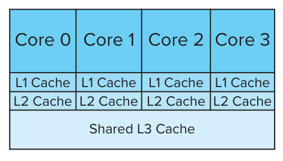

图20.7：Core 0～3 为4个处理器核，各有独立 L1、L2 缓存（Cache），共用 L3 缓存（Shared L3 Cache）。

<!-- SOURCE pdf-1012-b001 -->
#### 20.4.5.2 缓存一致性

<!-- SOURCE pdf-1012-b002 -->
多个核或处理器各有自己的缓存时，就需要处理缓存一致性。某核修改了数据，另一个核可能仍在本地缓存中读到旧值。因此，某内存位置更新时，其他缓存中保存的该位置副本必须失效。

<!-- SOURCE pdf-1012-b003 -->
许多处理器架构采用延迟失效：写入缓存与向其他缓存发送失效消息之间可能有时间差；接收端处理消息也可能有延迟。强制立即失效会明显影响性能，因此当代系统通常不这样做。一个处理器写入之后，另一个处理器随后读取，完全可能还看不到新值。

<!-- SOURCE pdf-1012-b004 -->
进程期望看到新值却没有看到，就可能出错。现代处理器为此提供**内存屏障**指令，保证屏障前后加载、存储操作之间的特定顺序。原书用失效消息来解释这些指令：x86 的存储屏障 `sfence` 要求此前更新的失效消息已发送到所有缓存，才发出后续加载或存储；加载屏障 `lfence` 则要求收到的失效消息已处理，再发出后续操作；`mfence` 同时承担这两项作用。

<!-- SOURCE pdf-1012-b005 -->
进程间同步协议必须配合内存屏障，才能正确执行。假定缓存并非“强”一致，进程 P₁ 先更新 A，再更新 B；另一个核上的 P₂ 先读 B，再读 A。在这里的一致性模型下，如果 P₂ 看见 B 的新值，也必须看见 A 的新值。若写入乱序传播，就可能看见新 B、旧 A。许多架构禁止写入乱序传播，但缺少一致性还可能带来其他微妙错误。按原书这段说明，每次写后执行 `sfence`、每次读前执行 `lfence`，可以保证读取一致的缓存状态，使新 B 只有在新 A 可见时才可见。

<!-- SOURCE pdf-1012-b006 -->
<!-- SOURCE pdf-1013-b001 -->
只要程序访问数据前加锁、更新之后再释放锁，通常无须额外编写缓存一致性代码，因为加锁、解锁函数会包含所需屏障。具体而言，释放锁时先执行 `sfence`，再实际解锁；取得锁后立即执行 `lfence`，然后才读取数据，从而保证读到最近写入的值。

<!-- SOURCE pdf-1013-b002 -->
许多语言提供的同步原语内部也执行内存屏障，使用这些原语的程序员无须自行处理缓存一致性问题。

<!-- SOURCE pdf-1013-b003 -->
许多处理器在硬件层使用类似共享锁和排他锁的机制来维持缓存一致性。常见的 **MESI 协议**可以这样理解：缓存访问以缓存行为单位，因此锁也作用于包含多个内存位置的整条缓存行。加锁由硬件实现，以达到所需的高性能。

<!-- SOURCE pdf-1013-b004 -->
MESI 跟踪每条缓存行的状态：**Modified**，取得排他权限后已修改；**Exclusive**，独占但尚未修改，或修改已写回内存；**Shared**，共享；**Invalid**，无效。读取内存时自动取得所在缓存行的共享权限，写入前则取得独占权限。与数据库锁不同，内存锁请求不等待，而是立即撤销冲突权限。请求独占权限，会使其他缓存中的副本失效并撤销共享权限；请求共享权限，会撤销已有独占权限，再把最新副本读入缓存。

<!-- SOURCE pdf-1013-b005 -->
原则上，这种基于锁的协议可以提供“强”缓存一致性，使内存屏障不再必要。但许多实现为提高速度，允许延迟发送失效消息等优化，不保证上述强一致性，因此许多处理器仍需要内存屏障。

<!-- SOURCE pdf-1013-b006 -->
### 20.4.6 共享磁盘

<!-- SOURCE pdf-1013-b007 -->
共享磁盘模型中，各节点拥有自己的处理器和内存，但都能通过互连网络直接访问全部磁盘。与共享内存相比，它有两项优势：一是能扩展到更多处理器；二是可以较低成本提供一定容错。某个节点故障后，其他节点可访问相同磁盘上的数据库，接管它的任务。

<!-- SOURCE pdf-1013-b008 -->
磁盘子系统本身可通过第12章的 RAID 获得容错能力，使个别磁盘故障时系统仍能运行。RAID 包含大量存储设备，也提供了一定的 I/O 并行能力。

<!-- SOURCE pdf-1014-b002 -->
<!-- SOURCE pdf-1014-b003 -->
<!-- SOURCE pdf-1014-b004 -->
<!-- SOURCE pdf-1014-b005 -->
<!-- SOURCE pdf-1014-b006 -->
<!-- SOURCE pdf-1014-b007 -->
<!-- SOURCE pdf-1014-b008 -->
<!-- SOURCE pdf-1014-b009 -->
<!-- SOURCE pdf-1014-b010 -->
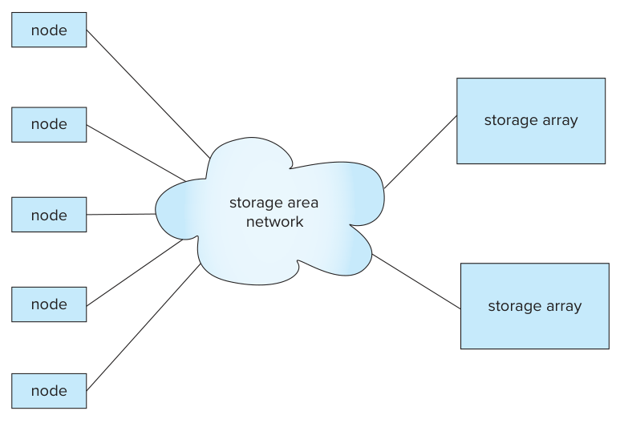

图20.8：节点（node）通过存储区域网络（storage area network）访问多个存储阵列（storage array）。

<!-- SOURCE pdf-1014-b011 -->
**存储区域网络**（SAN）是一种高速局域网，用来把大批磁盘等存储设备连接到使用数据的节点，如图20.8。设备实际由多个磁盘组成阵列，但向外提供一个或多个逻辑磁盘，隐藏物理细节。例如，逻辑磁盘可以远大于任一物理磁盘，也能通过增加物理磁盘来扩容。处理节点可以像访问本地磁盘一样访问它，虽然存储设备实际在别处。

<!-- SOURCE pdf-1014-b012 -->
SAN 通常具有冗余，例如节点间存在多条路径，因此某条链路或某个网络连接等组件故障时，网络仍能运行。

<!-- SOURCE pdf-1014-b013 -->
SAN 很适合构建共享磁盘系统。这种架构常用于并行度要求不高、但需要高可用性的应用。

<!-- SOURCE pdf-1014-b014 -->
共享磁盘比共享内存能支持更多处理器，但跨节点通信必须经过网络，速度更慢。没有专用通信硬件时，可能耗时数毫秒。

<!-- SOURCE pdf-1014-b015 -->
它的一项限制是：连接存储的网络带宽通常低于本地存储访问带宽，存储访问可能成为瓶颈，限制扩展能力。

<!-- SOURCE pdf-1014-b016 -->
### 20.4.7 无共享

<!-- SOURCE pdf-1014-b017 -->
<!-- SOURCE pdf-1015-b001 -->
无共享系统的每个节点都有处理器、内存和一个或多个磁盘，节点间通过高速网络通信。节点负责提供其自有磁盘上的数据服务。本地磁盘访问在各节点本地完成，克服了所有 I/O 都必须经过同一互连网络的问题。

<!-- SOURCE pdf-1015-b002 -->
无共享系统通常采用可扩展的类树网络等互连结构，增加节点时传输容量也随之增长，因此更容易支持大量节点。

<!-- SOURCE pdf-1015-b003 -->
主要缺点是通信和远程磁盘访问成本更高。发送数据需要两端软件参与，因此开销超过共享内存或共享磁盘架构。

<!-- SOURCE pdf-1015-b004 -->
凭借良好的扩展性，无共享架构广泛用于处理海量数据，支持数千节点，极端情况下甚至支持数万节点。

<!-- SOURCE pdf-1015-b005 -->
### 20.4.8 层次结构

<!-- SOURCE pdf-1015-b006 -->
层次结构综合了共享内存、共享磁盘和无共享的特点。顶层由互连网络连接多个节点，节点之间既不共享内存也不共享磁盘，属于无共享结构。每个节点本身可以是少量处理器组成的共享内存系统，也可以是共享磁盘系统，其中共用磁盘的每台机器又是共享内存系统。这样，最底层用少量处理器共享内存，最顶层无共享，中间可能再加入共享磁盘层。图20.5d展示了共享内存节点通过无共享方式互连的层次结构。

<!-- SOURCE pdf-1015-b007 -->
如今并行数据库通常运行在这种层次架构上：每个节点内部支持共享内存并行，多个节点之间采用无共享互连。

<!-- SOURCE pdf-1015-b008 -->
## 20.5 分布式系统

<!-- SOURCE pdf-1015-b009 -->
**分布式数据库系统**把数据库存放在地理位置分离的节点上，节点通过高速专用网络或互联网等介质通信，不共享主存和磁盘。图20.9展示了其总体结构。

<!-- SOURCE pdf-1015-b010 -->
无共享并行数据库与分布式数据库主要有以下区别。

<!-- SOURCE pdf-1016-b002 -->
<!-- SOURCE pdf-1016-b003 -->
<!-- SOURCE pdf-1016-b004 -->
<!-- SOURCE pdf-1016-b005 -->
<!-- SOURCE pdf-1016-b006 -->
<!-- SOURCE pdf-1016-b007 -->
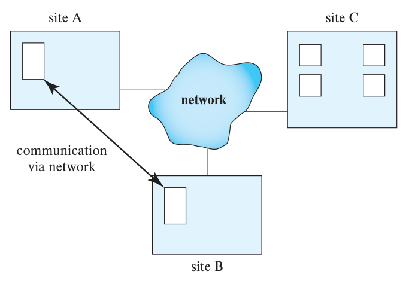

图20.9：站点A、B、C（site A/B/C）经由网络（network）通信（communication via network）。

<!-- SOURCE pdf-1016-b008 -->
- 分布式数据库的站点地理位置分离，站点间网络通常比数据中心内部网络带宽低、延迟高、故障概率大。因此，系统设计必须考虑网络延迟、故障和数据物理位置，本节稍后会讨论。通常希望在靠近最终用户的数据中心保存一个数据副本。
- 并行数据库需要处理节点故障，但地震、火灾等灾难可能破坏整个数据中心，导致大量节点同时故障。分布式数据库要保证高可用，就必须在整个数据中心失效后继续运行。这需要把数据复制到地理分离的数据中心，避免同一灾难波及全部副本。两类数据库采用的复制及其他高可用技术类似，但实现细节可能不同。
- 分布式数据库可能分别管理，各站点保留一定自治权。它们往往由已有数据库整合而成，让查询和事务跨越数据库边界。专为地域分布而构建的系统，也可能统一集中管理。
- 分布式数据库节点在规模和功能上通常差异更大，并行数据库各节点的容量则往往相近。

<!-- SOURCE pdf-1017-b001 -->
- 分布式数据库区分**局部事务**与**全局事务**。局部事务只访问事务发起节点的数据；全局事务访问其他节点的数据，或同时访问多个节点。

<!-- SOURCE pdf-1017-b002 -->
如今的互联网规模应用，通常使用同时支持并行和分布式处理的数据管理系统：数据中心内部通过并行应对高负载，多个数据中心之间通过分布式部署应对自然灾害、保证高可用。功能较少的分布式数据存储系统，可能只支持按键存取，不支持模式、查询语言或事务，这些高级功能都由应用管理；功能更完整的分布式数据库则提供这些能力。此类系统的一个共同特点是集中管理。

<!-- SOURCE pdf-1017-b003 -->
由已有数据库整合而成的分布式数据库，特点有所不同。

<!-- SOURCE pdf-1017-b004 -->
- **数据共享**。其主要优势是让一个站点的用户访问其他站点的数据。例如，大学各校区各自保存本校区数据，分布式系统允许某校区用户访问另一校区的信息。没有这种能力，转移学生记录就必须依靠外部机制。
- **自治性**。通过分布式方式共享数据，可以让各站点保留对本地数据的一定控制权。集中式系统由中央站点的数据库管理员控制；分布式系统虽然也有负责全局的管理员，但部分职责交给各站点的本地管理员。具体自治程度取决于系统设计。

<!-- SOURCE pdf-1017-b005 -->
**同构分布式数据库**的节点共享全局模式，虽然有些关系只存放在部分节点；所有节点运行相同的分布式数据库管理软件，主动协作处理查询和事务。

<!-- SOURCE pdf-1017-b006 -->
但很多时候，分布式数据库需要把多个已有系统连接起来，各系统有自己的模式，甚至运行不同的数据库软件。站点可能互不知晓，只提供有限的查询和事务协作能力。这类系统有时称为**联邦数据库**或**异构分布式数据库**。

<!-- SOURCE pdf-1018-b001 -->
分布式数据库节点通过广域网 WAN 通信。虽然广域网总带宽远大于局域网，但带宽通常由多个用户或应用共享，成本也更高，因此跨广域网应用实际可用的带宽通常较低。

<!-- SOURCE pdf-1018-b002 -->
广域网还存在明显延迟。受光速以及沿途路由器排队影响，一条消息跨越全球可能需要数百毫秒。这种延迟存在物理下限。地理分散的数据与计算应用，必须精心设计，以免延迟过度影响性能。

<!-- SOURCE pdf-1018-b003 -->
广域网还需要应对局域网中相对少见的链路故障。链路故障可能使两个站点本身都正常，却无法彼此通信，这称为**网络分区**。[^20-5] 分区发生后，用户或应用可能无法访问所需数据，系统可用性受影响。第23.4节将讨论分区时可用性与数据一致性的取舍。

<!-- SOURCE pdf-1018-b004 -->
## 20.6 并行与分布式系统中的事务处理

<!-- SOURCE pdf-1018-b005 -->
构建并行和分布式数据库时，事务原子性是重要问题。事务跨两个节点运行，如果设计不当，可能在一个节点提交、另一个节点中止，导致不一致。**事务提交协议**防止这种情况发生，其中最常用的是**两阶段提交协议**（2PC）。

<!-- SOURCE pdf-1018-b006 -->
2PC 的详细内容见第23.2.1节。基本做法是：各节点执行事务，进入部分提交状态后，把最终决定交给一个协调节点，此时称事务在该节点处于**就绪状态**。只有所有参与节点都达到就绪状态，协调者才决定提交；否则，例如某个节点中止了事务，协调者就决定中止。所有执行过该事务的节点都必须服从协调者的决定。事务就绪后若节点故障，恢复时它必须能够根据协调者的决定提交或中止。

<!-- SOURCE pdf-1018-b008 -->
[^20-5]: 不要混淆网络分区与数据分区。数据分区指把数据项划分为若干部分，这些部分可存放在不同节点上。

<!-- SOURCE pdf-1019-b001 -->
并发控制也是并行和分布式数据库的重要问题。事务可能访问多个节点的数据，多个事务管理器就需要协调。采用锁时，可在数据所在节点本地加锁，但多个节点发起的事务之间也可能出现死锁，因此需要跨节点检测。分布式系统中，计算机与通信链路都可能故障，故障更常见。数据复制保证故障后继续运行，也让并发控制更复杂。第23.3节介绍基于锁的分布式并发控制，第23.3.4节介绍基于时间戳的方法。

<!-- SOURCE pdf-1019-b002 -->
标准事务模型由单个程序单元执行多项操作。但当任务跨越多个数据库，而这些数据库无法或不愿协作实现2PC等协议时，这种模型通常不适合。此类任务一般采用基于**持久消息传递**的通信方式，第23.2.3节将讨论。

<!-- SOURCE pdf-1019-b003 -->
如果任务复杂，涉及多个数据库，或需要与人进行多次交互，协调任务和保证事务属性就更困难。**工作流管理系统**专门协助完成这类任务。

<!-- SOURCE pdf-1019-b004 -->
## 20.7 云服务

<!-- SOURCE pdf-1019-b005 -->
传统上，企业购买并运行服务器，部署数据库和应用。维护服务器成本高，要建设机房基础设施，应对空调、供电故障，更不用说 CPU、磁盘等服务器组件故障。需求突然增长时，很难迅速增加基础设施；需求下降时，设备又可能闲置。

<!-- SOURCE pdf-1019-b006 -->
**云计算**让企业应用运行在另一家公司管理的基础设施上，通常位于大型数据中心，与其他企业和用户共用大量机器。服务商可能不仅提供硬件，还提供数据库等平台和应用软件。

<!-- SOURCE pdf-1019-b007 -->
Amazon、Microsoft、IBM、Google 等大厂以及许多较小厂商都提供云服务。Amazon 是先行者之一，最初为内部需求建设了大规模计算基础设施，后来发现商业机会，开始向外提供计算基础设施服务。短短几年内，云服务便广泛普及。

<!-- SOURCE pdf-1020-b001 -->
<!-- SOURCE pdf-1020-b002 -->
<!-- SOURCE pdf-1020-b003 -->
<!-- SOURCE pdf-1020-b004 -->
<!-- SOURCE pdf-1020-b005 -->
<!-- SOURCE pdf-1020-b006 -->
<!-- SOURCE pdf-1020-b007 -->
<!-- SOURCE pdf-1020-b008 -->
<!-- SOURCE pdf-1020-b010 -->
<!-- SOURCE pdf-1020-b011 -->
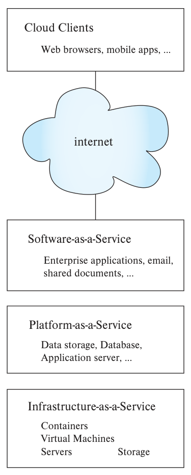

图20.10：云客户端（Cloud Clients）包括浏览器和移动应用，通过互联网连接云服务。从下到上，基础设施即服务（Infrastructure-as-a-Service）包含服务器、存储、虚拟机和容器；平台即服务（Platform-as-a-Service）提供数据存储、数据库、应用服务器；软件即服务（Software-as-a-Service）提供企业应用、电子邮件、共享文档等。

<!-- SOURCE pdf-1020-b012 -->
### 20.7.1 云服务模型

<!-- SOURCE pdf-1020-b013 -->
图20.10概括了云计算的几种使用方式，包括基础设施即服务、平台即服务和软件即服务。

<!-- SOURCE pdf-1020-b014 -->
- **基础设施即服务**（IaaS）：企业租用计算设施，例如一台或多台物理机器及磁盘空间。

<!-- SOURCE pdf-1020-b015 -->
<!-- SOURCE pdf-1021-b001 -->
  云服务商更常提供**虚拟机**（VM）。在用户看来，它像一台真实机器，实际上由软件模拟，让单台物理计算机表现为多台相互独立的计算机。本节稍后还会介绍成本更低的容器。一个物理服务器可运行多个 VM，一个 VM 或物理服务器又可运行多个容器。

<!-- SOURCE pdf-1021-b002 -->
  服务商运营拥有大量机器的数据中心，可以获得规模经济，以远低于企业自建的成本提供计算能力。

<!-- SOURCE pdf-1021-b003 -->
  另一项主要优势是服务商通常拥有大量机器和备用容量，企业可按需租用更多虚拟机，低负载时再释放。短时间内扩充或收缩容量的能力称为**弹性**。

<!-- SOURCE pdf-1021-b004 -->
  按需弹性供应服务器，使 IaaS 得到广泛采用，预计计算需求会快速增长的企业尤其受益。不过，把数据存放在企业外部有潜在安全风险，因此银行等高安全要求场景中的云计算使用仍受到限制。

<!-- SOURCE pdf-1021-b005 -->
  IaaS 模型下，企业在服务商的虚拟机上运行自己的软件，包括数据库；数据库安装、备份、恢复等维护工作由企业自己负责。
- **平台即服务**（PaaS）：服务商除提供基础设施，还部署和管理数据存储、数据库、应用服务器等平台。客户安装和维护 ERP 等应用软件，使其运行在平台提供的应用服务器、数据库或存储服务上。

<!-- SOURCE pdf-1021-b006 -->
<!-- SOURCE pdf-1021-b007 -->
  - **云数据存储平台**提供存取数据的服务，由服务商准备足够的存储与计算能力来承担负载。系统可能支持数百万个大文件，单文件从几 MB 到数千 MB；也可能支持数十亿个较小数据项，单项从几百字节到几 MB。第21.6和21.7节介绍这类分布式文件系统与数据存储系统。使用云存储的数据库应用可以运行在同一云，即同一组机器上，也可以运行在其他云上。

<!-- SOURCE pdf-1021-b008 -->
<!-- SOURCE pdf-1022-b001 -->
云存储的吸引力之一是付费即可使用，无须购买、维护和管理底层计算系统。需求增加时，只需支付更多费用即可使用更多服务器，无须自行采购部署。服务商当然仍要部署额外机器，但规模经济显著降低了部署成本，尤其缩短了部署时间。

<!-- SOURCE pdf-1022-b002 -->
费用通常按存储数据量、输入数据量和输出数据量计算。

<!-- SOURCE pdf-1022-b003 -->
<!-- SOURCE pdf-1022-b004 -->
  - **数据库即服务**提供可由客户端访问和查询的数据库。与存储服务相比，它额外提供 SQL 等查询语言及数据库功能。早期只支持单节点数据库，尽管该节点可以拥有大量处理器、内存和存储；近来，并行数据库也开始作为云服务提供。
- **软件即服务**（SaaS）：服务商直接提供应用软件，负责安装、升级等工作。客户通过网页或移动应用等前端接口使用服务，应用软件在后端运行。

<!-- SOURCE pdf-1022-b005 -->
虚拟机概念诞生于20世纪60年代，让使用不同操作系统的用户同时共享昂贵的大型机。如今计算机虽然便宜了，供电和维护仍有成本，虚拟机使多个并发用户可以分摊这些成本。它也方便迁移服务：虚拟机可在一台物理服务器上关闭，再在另一台上重启，延迟和停机时间很少，有助于硬件故障或升级时快速恢复。

<!-- SOURCE pdf-1022-b006 -->
虽然一台物理机器能运行多个 VM，但每个 VM 内部都运行完整操作系统，开销较高。组织要运行多项服务时，为每项服务各建一个 VM，开销可能很大。而把多个应用直接运行在一台机器或 VM 上，又常遇到两个问题：应用都想监听同一端口，产生冲突；应用依赖不同版本的共享库，也会冲突。

<!-- SOURCE pdf-1022-b007 -->
<!-- SOURCE pdf-1023-b018 -->
**容器**解决了这两个问题。各应用运行在自己的容器中，拥有独立 IP 地址和共享库集合。一个应用可以由多个进程组成，都在同一容器内运行。多个容器共用操作系统内核，因此开销远小于每个应用各用一个 VM。每个容器看起来有自己的文件系统，但底层文件实际存放在共同的文件系统中。容器内进程可通过文件系统和进程间通信交互；与其他容器的进程则通过网络连接交互。

<!-- SOURCE pdf-1023-b001 -->
<!-- SOURCE pdf-1023-b002 -->
<!-- SOURCE pdf-1023-b003 -->
<!-- SOURCE pdf-1023-b004 -->
<!-- SOURCE pdf-1023-b005 -->
<!-- SOURCE pdf-1023-b006 -->
<!-- SOURCE pdf-1023-b007 -->
<!-- SOURCE pdf-1023-b008 -->
<!-- SOURCE pdf-1023-b009 -->
<!-- SOURCE pdf-1023-b010 -->
<!-- SOURCE pdf-1023-b011 -->
<!-- SOURCE pdf-1023-b012 -->
<!-- SOURCE pdf-1023-b013 -->
<!-- SOURCE pdf-1023-b014 -->
<!-- SOURCE pdf-1023-b015 -->
<!-- SOURCE pdf-1023-b016 -->
<!-- SOURCE pdf-1023-b017 -->
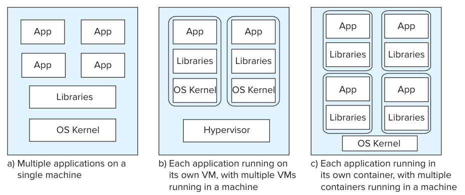

图20.11：a在单台机器上直接运行多个应用；b每个应用运行在独立虚拟机中，一台机器运行多个虚拟机；c每个应用运行在独立容器中，一台机器运行多个容器。App为应用，Libraries为程序库，OS Kernel为操作系统内核，Hypervisor为虚拟机监控器。

<!-- SOURCE pdf-1023-b019 -->
图20.11对比了这些方式。a中的多个应用共享程序库和内核；b中的每个应用有独立 VM，各 VM 由称为 **hypervisor** 的软件层管理；c中的容器各有自己的程序库，但共用内核。容器开销更低，因此一台机器能支持的容器数多于 VM 数。

<!-- SOURCE pdf-1023-b020 -->
容器还能以较低成本提供弹性：可以在已有 VM 上快速部署更多容器，无须启动新 VM。

<!-- SOURCE pdf-1023-b021 -->
如今许多应用由多项服务构成，每项服务作为独立进程运行，提供网络 API。调用功能时，先与该进程建立网络连接，再发送服务请求。把应用组织成一组小服务的方式称为**微服务架构**。容器能以很低开销运行各服务进程，与微服务架构很契合。

<!-- SOURCE pdf-1024-b001 -->
Docker 是广泛使用的容器平台；Kubernetes 则提供容器及微服务管理平台。应用可以声明式地指定容器需求，由 Kubernetes 自动部署并连接多个容器。它还能管理多个 **Pod**，让其中的容器共享存储和 IP 地址，同时保留各自的程序库。需要时可以增加容器实现弹性，也能在运行相同应用副本的容器之间分配 API 请求，实现扩展。API 用户只需连接一个共同 IP，无须知道服务运行在哪些容器 IP 上；负载均衡器把请求分发给这些容器。

<!-- SOURCE pdf-1024-b002 -->
### 20.7.2 云服务的优势与局限

<!-- SOURCE pdf-1024-b003 -->
许多企业发现云计算有益：无须维持庞大的系统支持团队，新企业也能在不投入大量前期计算设备资金的情况下开始运营。需求增长时，可以按需增加计算和存储资源。服务商通常拥有大型集群，较容易按需分配。

<!-- SOURCE pdf-1024-b004 -->
云用户必须接受数据由另一组织持有，这涉及安全与法律责任风险。服务商一旦遭到入侵，客户数据可能泄露，使客户企业面临其用户的法律追责，但客户无法直接控制服务商的安全。数据或副本存放在国外时，问题更加复杂，因为各司法辖区隐私法律不同。例如，德国公司的数据复制到纽约服务器后，可能需要同时适用美国与德国或欧盟法律，或适用美国法律。服务商可能被要求向美国政府提供数据，即使客户从不知道数据被放在美国管辖范围内。不同云服务商赋予客户的地域分布与复制控制权也不同。

<!-- SOURCE pdf-1024-b005 -->
尽管存在这些局限，云服务仍有足够收益，推动市场快速增长。

<!-- SOURCE pdf-1024-b006 -->
## 20.8 小结

<!-- SOURCE pdf-1024-b007 -->
<!-- SOURCE pdf-1025-b001 -->
- 集中式数据库完全运行在单台计算机上。多用户数据库需要完整事务功能，通常作为服务器，通过 SQL 或自有 API 接收应用请求。
- 少量核上的并行称为粗粒度并行，大量处理器上的并行称为细粒度并行。
- 事务服务器包含多个进程，可能运行在多个处理器上。数据库缓冲区等公共数据存放在共享内存中。除处理查询的进程外，还有管理锁、日志和检查点等系统进程。
- 共享内存访问通过互斥机制控制，通常以 `test-and-set` 或 `compare-and-swap` 等硬件原子指令实现。
- 数据服务器向客户端提供原始数据，并通过缓存数据和锁来减少通信。并行数据库也采用类似优化。
- 并行数据库由多个处理器和磁盘通过高速网络连接。加速比衡量增加并行度能把单个事务处理加快多少，扩展比衡量增加并行度后应对更多事务的能力。干扰、倾斜、启动开销都会阻碍理想加速与扩展。
- 互连网络包括总线、环形、网格、超立方体和类树拓扑。
- 并行数据库架构包括共享内存、共享磁盘、无共享和层次结构，在扩展性与通信速度之间各有取舍。
- 现代共享内存架构让各处理器直连一部分内存，形成 NUMA。各处理器有自己的缓存，必须保证多个缓存中的数据一致。
- SAN 是专门连接大批存储设备与多台计算机的高速局域网。
- 分布式数据库由部分独立的数据库组成，理想情况下共享模式，并协调访问远程数据的事务。

<!-- SOURCE pdf-1026-b001 -->
- 云服务分多个层次：IaaS 提供虚拟机，客户自行安装软件；PaaS 还提供存储、数据库、应用服务器，客户维护应用；SaaS 同时提供应用及底层平台。
- 云用户需要考虑技术、经济、法律等多方面因素，在数据可能存放于远程地点的情况下，保证隐私、安全与性能。

<!-- SOURCE pdf-1026-b002 -->
## 复习术语

<!-- SOURCE pdf-1026-b003 -->
- 集中式数据库系统：
<!-- SOURCE pdf-1026-b004 -->
  - 单用户系统
<!-- SOURCE pdf-1026-b005 -->
  - 多用户系统
<!-- SOURCE pdf-1026-b006 -->
  - 服务器系统
<!-- SOURCE pdf-1026-b007 -->
  - 嵌入式数据库
<!-- SOURCE pdf-1026-b008 -->
  - 服务器
<!-- SOURCE pdf-1026-b009 -->
  - 粗粒度并行
<!-- SOURCE pdf-1026-b010 -->
  - 细粒度并行
- 服务器系统体系结构：
<!-- SOURCE pdf-1026-b011 -->
  - 事务服务器
<!-- SOURCE pdf-1026-b012 -->
  - 查询服务器
<!-- SOURCE pdf-1026-b013 -->
  - 数据服务器系统
<!-- SOURCE pdf-1026-b014 -->
  - 服务器进程
- 互斥
- 原子指令
- 数据缓存
- 并行系统：
<!-- SOURCE pdf-1026-b015 -->
  - 粗粒度并行机器
<!-- SOURCE pdf-1026-b016 -->
  - 大规模并行机器
<!-- SOURCE pdf-1026-b017 -->
  - 细粒度并行机器
<!-- SOURCE pdf-1026-b018 -->
  - 数据中心
<!-- SOURCE pdf-1026-b019 -->
- 决策支持查询
- 性能指标：
<!-- SOURCE pdf-1026-b020 -->
  - 吞吐量
<!-- SOURCE pdf-1026-b021 -->
  - 响应时间
<!-- SOURCE pdf-1026-b022 -->
  - 线性加速
<!-- SOURCE pdf-1026-b023 -->
  - 次线性加速
<!-- SOURCE pdf-1026-b024 -->
  - 线性扩展
<!-- SOURCE pdf-1026-b025 -->
  - 次线性扩展
<!-- SOURCE pdf-1026-b026 -->
- 串行计算
- 阿姆达尔定律
- 启动成本
- 互连网络：
<!-- SOURCE pdf-1026-b027 -->
  - 总线
<!-- SOURCE pdf-1026-b028 -->
  - 环形
<!-- SOURCE pdf-1026-b029 -->
  - 网格
<!-- SOURCE pdf-1026-b030 -->
  - 超立方体
<!-- SOURCE pdf-1026-b031 -->
  - 类树结构
<!-- SOURCE pdf-1026-b032 -->
  - 边缘交换机
<!-- SOURCE pdf-1026-b033 -->
- 汇聚交换机
<!-- SOURCE pdf-1027-b001 -->
- 以太网
- 光纤通道
- InfiniBand
- 远程直接内存访问（RDMA）
- 并行数据库架构：
<!-- SOURCE pdf-1027-b002 -->
  - 共享内存
<!-- SOURCE pdf-1027-b003 -->
  - 共享磁盘
<!-- SOURCE pdf-1027-b004 -->
  - 集群
<!-- SOURCE pdf-1027-b005 -->
  - 无共享
<!-- SOURCE pdf-1027-b006 -->
  - 层次结构
<!-- SOURCE pdf-1027-b007 -->
- 摩尔定律
- NUMA
- 缓存未命中
- 超线程
- 硬件线程
- 缓存
<!-- SOURCE pdf-1027-b008 -->
- 共享磁盘
- 容错
- 存储区域网络（SAN）
- 分布式数据库系统
- 局部自治
- 同构分布式数据库
- 联邦数据库系统
- 异构分布式数据库系统
- 延迟
- 网络分区
- 可用性
- 云计算
- 基础设施即服务
- 平台即服务
- 云数据存储
- 数据库即服务
- 软件即服务
- 微服务架构

<!-- SOURCE pdf-1027-b009 -->
## 练习题

<!-- SOURCE pdf-1027-b010 -->
**20.1** 多用户系统一定是并行系统吗？为什么？

<!-- SOURCE pdf-1027-b011 -->
**20.2** 许多架构中的 `compare-and-swap`、`test-and-set` 等原子指令会同时执行内存屏障。从这些指令实现的互斥锁所保护的共享数据出发，说明执行屏障的原因。进程释放互斥锁前又应该做什么？

<!-- SOURCE pdf-1027-b012 -->
**20.3** 除了把共享结构存放在共享内存中，也可以把它们保存在一个专门进程的局部内存里，其他进程通过进程间通信访问。这种架构有什么缺点？

<!-- SOURCE pdf-1027-b013 -->
**20.4** 说明闩锁与事务并发控制所用锁的区别。

<!-- SOURCE pdf-1027-b014 -->
<!-- SOURCE pdf-1028-b001 -->
**20.5** 假定事务用嵌入式 SQL 的 C 程序编写，80%的时间执行 SQL，20%的时间执行 C 代码。若只并行化 SQL 部分，最多可以获得多大加速比？请解释。

<!-- SOURCE pdf-1028-b002 -->
<!-- SOURCE pdf-1028-b003 -->
**20.6** 在共享内存系统中，进程 A 先更新数据结构，再设置完成标志；进程 B 监视该标志，发现已设置后才处理数据结构。如果内存架构允许写入重排，会有什么问题？如何用 `sfence`、`lfence` 避免？

<!-- SOURCE pdf-1028-b004 -->
**20.7** 在共享内存架构中，为什么访问不同内存位置，耗时可能不同？

<!-- SOURCE pdf-1028-b005 -->
**20.8** 并行机器操作系统通常会在进程申请内存时分配本地内存，并尽量避免把进程从一个核移到另一个核。为什么这些优化对 NUMA 很重要？

<!-- SOURCE pdf-1028-b006 -->
**20.9** 连接等数据库操作，在数据能放入内存和放不进内存时，速度可能差别很大，例如连接的一个输入关系是否能全部放入。利用这一点说明，为什么可能出现加速比大于资源增长倍数的超线性加速。

<!-- SOURCE pdf-1028-b007 -->
**20.10** 同构与联邦分布式数据库的主要区别是什么？

<!-- SOURCE pdf-1028-b008 -->
**20.11** 客户为什么可能只选择基础设施即服务，而不选择其他云服务模型提供的服务？

<!-- SOURCE pdf-1028-b009 -->
**20.12** 假定数据保存在外部存储，云服务为什么更适合通过虚拟机支持传统数据库，而非直接在服务商的物理机器上运行？

<!-- SOURCE pdf-1028-b010 -->
## 习题

<!-- SOURCE pdf-1028-b011 -->
**20.13** 一家银行有多个站点，各自运行数据库。数据库之间只通过持久消息进行电子资金转账。这样的系统算分布式数据库吗？为什么？

<!-- SOURCE pdf-1028-b012 -->
<!-- SOURCE pdf-1029-b001 -->
**20.14** 企业发展后，现有计算系统已不够用，准备购买新并行计算机。如果单位时间事务量大增，但单个事务长度不变，加速比、批处理扩展比、事务扩展比中哪项指标最相关？为什么？

<!-- SOURCE pdf-1029-b002 -->
**20.15** 数据库通常由访问共享内存的一组进程或线程构成。

<!-- SOURCE pdf-1029-b003 -->
a. 如何控制共享内存区域的访问？
<!-- SOURCE pdf-1029-b004 -->
b. 用两阶段锁使共享数据结构的访问串行化，是否合适？请说明。

<!-- SOURCE pdf-1029-b005 -->
**20.16** 允许用户进程访问数据库系统的共享内存区域，是否明智？请解释。

<!-- SOURCE pdf-1029-b006 -->
**20.17** 哪些因素会妨碍事务处理系统实现线性扩展？在共享内存、共享磁盘和无共享架构中，分别哪些因素最可能起主要作用？

<!-- SOURCE pdf-1029-b007 -->
**20.18** 早期内存只有一个访问接口，如今内存划分为多个模块，每个模块可以同时服务不同请求。这会怎样影响共享内存系统可支持的处理器数量？

<!-- SOURCE pdf-1029-b008 -->
**20.19** 有数据项 d₁、d₂、…、dₙ，每个 dᵢ 都由内存位置 Mᵢ 中的一把锁保护。

<!-- SOURCE pdf-1029-b009 -->
a. 如何使用 `test-and-set` 实现 `lock-X(dᵢ)` 和 `unlock(dᵢ)`？
<!-- SOURCE pdf-1029-b010 -->
b. 如何使用 `compare-and-swap` 实现它们？

<!-- SOURCE pdf-1029-b011 -->
**20.20** 无共享系统可以通过远程过程调用或消息访问远程数据，但 RDMA 快得多。为什么？

<!-- SOURCE pdf-1029-b012 -->
**20.21** 假定大型数据库厂商将 Oracle、SQL Server 或 DB2 等数据库作为云服务提供，它属于哪类云服务模型？为什么？

<!-- SOURCE pdf-1029-b013 -->
**20.22** 企业在 PaaS 云上运行自己的 ERP 应用，何时能升级到新版本，会受到哪些限制？

<!-- SOURCE pdf-1030-b001 -->
## 延伸阅读

<!-- SOURCE pdf-1030-b002 -->
[Hennessy et al. (2017)] 对计算机体系结构有很好的介绍，包括本章涉及的共享内存、缓存一致性、并行架构和云计算。[Gray and Reuter (1993)] 是事务处理的经典教材，涵盖客户端—服务器与分布式架构。[Ozsu and Valduriez (2010)] 系统介绍了分布式数据库。[Abts and Felderman (2012)] 概述了数据中心网络。

<!-- SOURCE pdf-1030-b003 -->
## 参考文献

<!-- SOURCE pdf-1030-b004 -->
[Abts and Felderman (2012)] D. Abts、B. Felderman，“A Guided Tour of Datacenter Networking”（数据中心网络导览），*Communications of the ACM*，第55卷第6期，2012，第44–51页。

<!-- SOURCE pdf-1030-b005 -->
[Gray and Reuter (1993)] J. Gray、A. Reuter，*Transaction Processing: Concepts and Techniques*（事务处理：概念与技术），Morgan Kaufmann，1993。

<!-- SOURCE pdf-1030-b006 -->
[Hennessy et al. (2017)] J. L. Hennessy、D. A. Patterson、D. Goldberg，*Computer Architecture: A Quantitative Approach*（计算机体系结构：量化研究方法），第6版，Morgan Kaufmann，2017。

<!-- SOURCE pdf-1030-b007 -->
[Ozsu and Valduriez (2010)] T. Ozsu、P. Valduriez，*Principles of Distributed Database Systems*（分布式数据库系统原理），第3版，Prentice Hall，2010。

<!-- SOURCE pdf-1030-b008 -->
## 图片来源

<!-- SOURCE pdf-1030-b009 -->
本章开篇帆船照片：© Pavel Nesvadba / Shutterstock。
