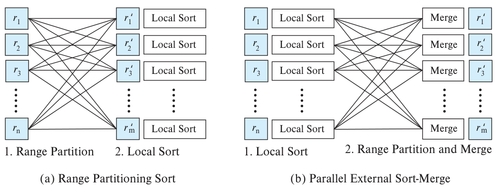
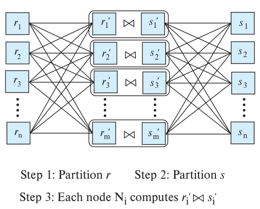
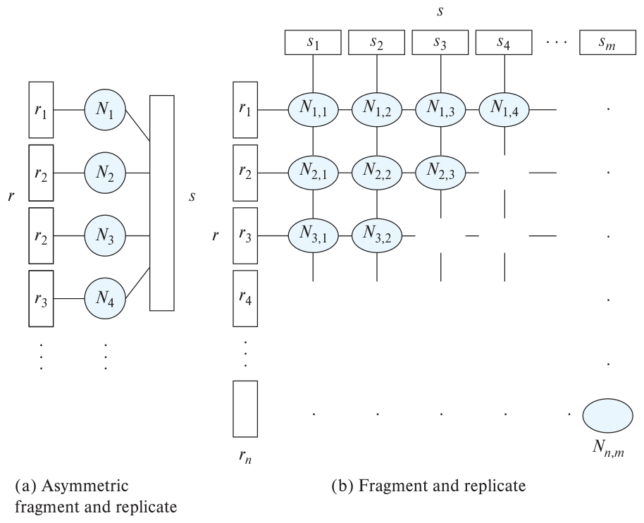
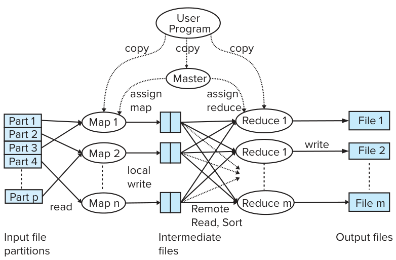
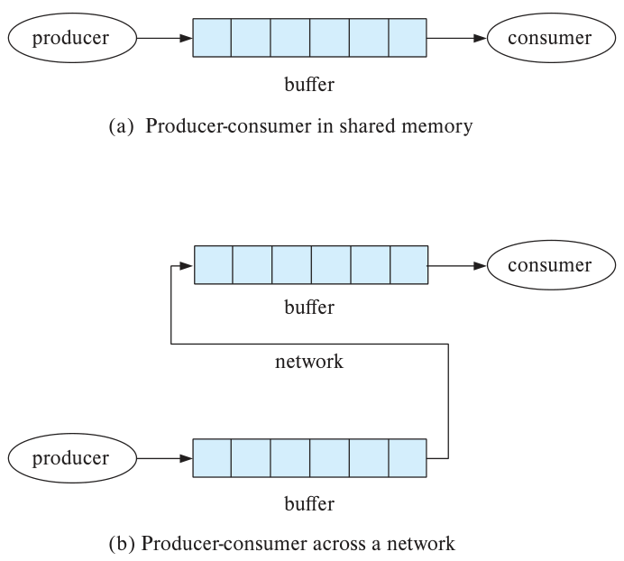
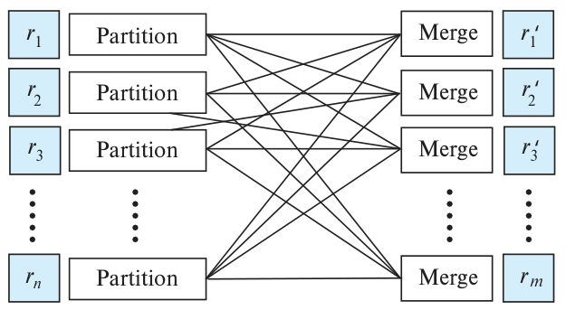
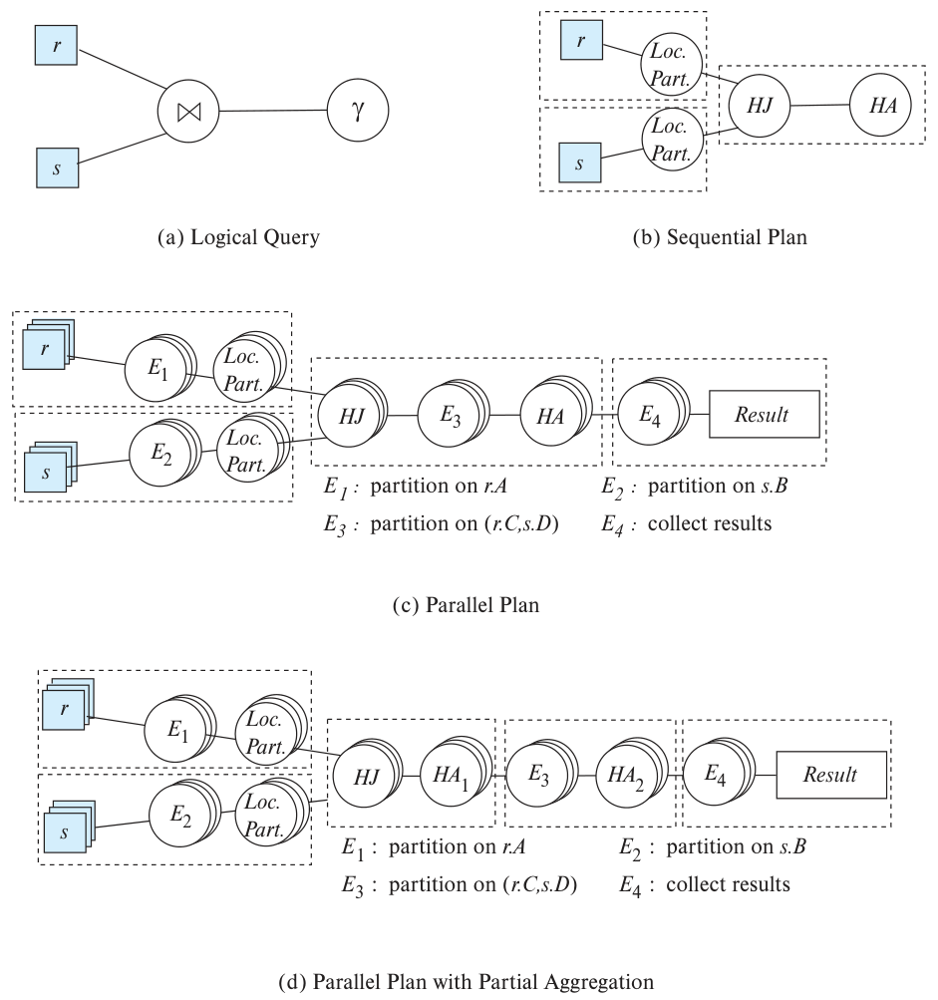
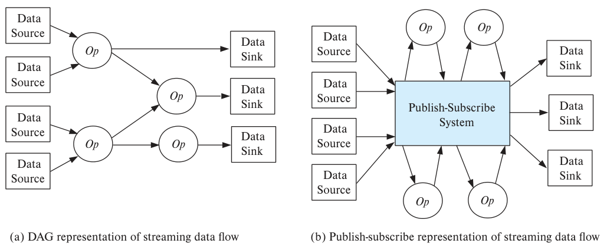

<!-- SOURCE pdf-1068-b004 --><!-- SOURCE pdf-1068-b005 -->
# 第22章 并行与分布式查询处理 {#chapter-22}


<!-- SOURCE pdf-1068-b006 -->
本章讨论并行数据库的查询处理算法。我们假定查询只读，重点考察决策支持系统。这类系统要查询海量数据，必须把查询分配到多个节点并行处理，才能将响应时间控制在可接受的范围内。

<!-- SOURCE pdf-1068-b007 -->
本章前半部分主要讨论关系查询，后面再考察其他数据模型下的并行查询处理。

<!-- SOURCE pdf-1068-b008 -->
事务处理系统需要执行大量更新查询，但每个查询通常只影响少量元组。并行执行同样是承担高事务负载的重要手段，这部分将在第23章讨论。

<!-- SOURCE pdf-1068-b009 -->
## 22.1 概述

<!-- SOURCE pdf-1068-b010 -->
数据库系统可以从两个方面利用并行。**查询间并行（interquery parallelism）**让多个查询在多个节点上同时执行；**查询内并行（intraquery parallelism）**则把同一个查询的不同部分分配到多个节点并行执行。

<!-- SOURCE pdf-1068-b011 -->
查询间并行对事务处理系统必不可少，可以提高事务吞吐量。不过，与每个事务单独运行相比，它不会缩短单个事务的响应时间。其主要用途是扩展事务处理系统，使系统每秒能够处理更多事务。相关内容见第23章。

<!-- SOURCE pdf-1068-b012 -->
要加速长时间运行的查询，则需要查询内并行，这也是本章的重点。

<!-- SOURCE pdf-1069-b001 -->
一个查询往往包含选择、连接、聚合等多个操作。要利用大规模并行，应把每个操作也分配到多个节点上执行，称为**操作内并行（intraoperation parallelism）**。关系可能包含大量元组，因此操作内并行能够达到很高的并行度，是数据库中自然可用的一种并行形式。

<!-- SOURCE pdf-1069-b002 -->
例如，一个查询需要对关系排序。如果该关系已按排序属性进行范围分区，存储在多个磁盘上，就可以并行地对各分区排序，再依次拼接各个有序分区，得到最终的有序关系。通过并行执行单个操作，整个查询也就获得了并行能力。

<!-- SOURCE pdf-1069-b003 -->
另一个来源是查询运算符树中的多个操作。互不依赖的操作可以同时执行。第15章还介绍过流水线：一个操作的输出可以直接传给另一个操作。二者在不同节点上并行运行，前者一边产生结果，后者一边消费。这两种方式都属于**操作间并行（interoperation parallelism）**，即同一个查询的不同运算符并行执行。

<!-- SOURCE pdf-1069-b004 -->
概括来说，单个查询可以采用两种并行方式：

<!-- SOURCE pdf-1069-b005 -->
- 操作内并行。接下来几节介绍排序、连接、聚合等常见关系操作的并行实现。
- 操作间并行。22.5.1节详细介绍。

<!-- SOURCE pdf-1069-b006 -->
两种方式相互补充，可以同时应用于一个查询。典型查询的操作数通常远少于每个操作处理的元组数，因此随着并行度提高，操作内并行更容易扩展。操作间并行仍然有用，在多核共享内存系统中也很重要。

<!-- SOURCE pdf-1069-b007 -->
为便于描述，下面假设系统采用无共享架构，共有 n 个节点 N₁、N₂、…、Nₙ。每个节点可以有一个或多个磁盘，但数量通常较少。本章不讨论节点内部如何在磁盘间划分数据；可以使用 RAID 在存储层利用这种并行，而无需在查询处理层处理。

<!-- SOURCE pdf-1069-b008 --><!-- SOURCE pdf-1070-b001 -->
并行查询算法的选择与机器架构有关。本章统一按无共享架构描述，明确指出何时需要在节点间传输数据。其他架构可以模拟这一模型：共享内存系统通过内存传递数据，共享磁盘系统通过磁盘传递。因此，无共享架构的算法也可用于其他架构。22.6节会讨论如何针对共享内存进一步优化。

<!-- SOURCE pdf-1070-b002 -->
本书讨论的现代并行系统通常采用混合架构：每台计算机内部是多核共享内存，多台计算机之间则无共享。分析时可以先把每个核视为无共享系统中的一个节点，再按22.6节的方法利用部分核之间共享内存的特点进行优化。

<!-- SOURCE pdf-1070-b003 -->
## 22.2 并行排序

<!-- SOURCE pdf-1070-b004 -->
设关系 r 存储在 n 个节点 N₁、N₂、…、Nₙ 上，需要对它排序。如果已经按排序属性进行范围分区，就可分别排序各分区，再拼接得到完整结果。因为数据分布在 n 个节点，并行读取整个关系所需的时间可以缩短到原来的1/n。

<!-- SOURCE pdf-1070-b005 -->
若 r 采用其他分区方式，则有两种处理办法：

<!-- SOURCE pdf-1070-b006 --><!-- SOURCE pdf-1070-b007 -->
1. 先按排序属性重新进行范围分区，再分别排序。

<!-- SOURCE pdf-1070-b008 -->
2. 使用并行的外部排序归并算法。

<!-- SOURCE pdf-1070-b009 -->
### 22.2.1 范围分区排序

<!-- SOURCE pdf-1070-b010 -->
图22.1(a)所示的**范围分区排序**分为两步：先对关系进行范围分区，再分别排序。负责排序的节点不必与原来存储关系的节点相同。设选用 N₁、N₂、…、Nₘ 进行排序，过程如下。

<!-- SOURCE pdf-1070-b011 --><!-- SOURCE pdf-1070-b012 -->
1. 按范围分区重新分配元组，第 i 个范围内的元组都发往节点 Nᵢ，暂存在其本地磁盘上。

<!-- SOURCE pdf-1070-b013 -->
   各源节点并行读取本地元组，根据分区函数发送到目标节点。目标节点 N₁、N₂、…、Nₘ 同时接收属于自己的元组并存入本地。这一步涉及磁盘 I/O 和网络通信。

<!-- SOURCE pdf-1071-b041 --><!-- SOURCE pdf-1071-b042 -->
2. 每个节点在本地对自己的分区排序，无需与其他节点交互。不同节点对不同数据集执行同一种操作，这称为**数据并行（data parallelism）**。

<!-- SOURCE pdf-1071-b043 -->
最后的合并很简单：第一阶段的范围分区保证，对任意1 ≤ i < j ≤ m，Nᵢ 上的全部键值都小于 Nⱼ 上的键值，因此顺序拼接即可。

<!-- SOURCE pdf-1071-b001 --><!-- SOURCE pdf-1071-b002 --><!-- SOURCE pdf-1071-b003 --><!-- SOURCE pdf-1071-b004 --><!-- SOURCE pdf-1071-b005 --><!-- SOURCE pdf-1071-b006 --><!-- SOURCE pdf-1071-b007 --><!-- SOURCE pdf-1071-b008 --><!-- SOURCE pdf-1071-b009 --><!-- SOURCE pdf-1071-b010 --><!-- SOURCE pdf-1071-b011 --><!-- SOURCE pdf-1071-b012 --><!-- SOURCE pdf-1071-b013 --><!-- SOURCE pdf-1071-b014 --><!-- SOURCE pdf-1071-b015 --><!-- SOURCE pdf-1071-b016 --><!-- SOURCE pdf-1071-b017 --><!-- SOURCE pdf-1071-b018 --><!-- SOURCE pdf-1071-b019 --><!-- SOURCE pdf-1071-b020 --><!-- SOURCE pdf-1071-b021 --><!-- SOURCE pdf-1071-b022 --><!-- SOURCE pdf-1071-b023 --><!-- SOURCE pdf-1071-b024 --><!-- SOURCE pdf-1071-b025 --><!-- SOURCE pdf-1071-b026 --><!-- SOURCE pdf-1071-b027 --><!-- SOURCE pdf-1071-b028 --><!-- SOURCE pdf-1071-b029 --><!-- SOURCE pdf-1071-b030 --><!-- SOURCE pdf-1071-b031 --><!-- SOURCE pdf-1071-b032 --><!-- SOURCE pdf-1071-b033 --><!-- SOURCE pdf-1071-b034 --><!-- SOURCE pdf-1071-b035 --><!-- SOURCE pdf-1071-b036 --><!-- SOURCE pdf-1071-b037 --><!-- SOURCE pdf-1071-b038 --><!-- SOURCE pdf-1071-b039 --><!-- SOURCE pdf-1071-b040 -->


图22.1：(a)先进行范围分区（Range Partition），再局部排序（Local Sort）；(b)先局部排序，再进行范围分区与归并（Range Partition and Merge）。r₁、…、rₙ 为输入分区，r′₁、…、r′ₘ 为输出分区。

<!-- SOURCE pdf-1071-b044 -->
应使用均衡的范围分区向量，使各分区元组数量大致相同，其构造方法见21.3.1节。也可以采用21.3.2节的虚拟节点分区来减少倾斜：虚拟节点数是真实节点数的数倍，每个虚拟节点对应一个分区，再将虚拟节点映射到真实节点。轮转分配有助于把虚拟节点分散到各真实节点，减轻真实节点的倾斜。

<!-- SOURCE pdf-1071-b045 -->
### 22.2.2 并行外部排序归并

<!-- SOURCE pdf-1071-b046 -->
图22.1(b)所示的**并行外部排序归并**是另一种办法。假设关系已分布在 N₁、N₂、…、Nₙ 上，原来的分区方式不限，算法分为两步。

<!-- SOURCE pdf-1071-b047 -->
1. 每个 Nᵢ 对本地数据排序。

<!-- SOURCE pdf-1071-b048 --><!-- SOURCE pdf-1071-b049 -->
2. 将各节点上的有序段归并，得到最终排序结果。

<!-- SOURCE pdf-1072-b001 -->
第二步的归并可以进一步并行化：

<!-- SOURCE pdf-1072-b002 --><!-- SOURCE pdf-1072-b003 -->
1. 各 Nᵢ 对自己的有序分区使用同一个分区向量进行范围分区，将结果发给 N₁、N₂、…、Nₘ。发送时保持有序，因此各目标节点收到的是有序元组流。

<!-- SOURCE pdf-1072-b004 --><!-- SOURCE pdf-1072-b005 -->
2. 各 Nᵢ 在接收过程中归并这些元组流，形成一个有序段。

<!-- SOURCE pdf-1072-b006 --><!-- SOURCE pdf-1072-b007 -->
3. 顺序拼接 N₁、N₂、…、Nₘ 的有序段，得到最终结果。

<!-- SOURCE pdf-1072-b008 -->
直接照这个过程发送，会出现一种执行倾斜：所有节点先把第1个分区的元组发给 N₁，再把第2个分区发给 N₂，依此类推。发送虽然并行，接收却变成先只有 N₁ 工作，再只有 N₂ 工作。解决办法是，将节点 i 发往节点 j 的有序序列 S_Iⱼ 划分成多个块。Nᵢ 先给每个 Nⱼ 发送相应序列的第一个块，再给每个 Nⱼ 发送第二个块，直到发完。这样各节点就能同时接收。按块而非逐个元组发送，还可以减少网络开销。

<!-- SOURCE pdf-1072-b009 -->
## 22.3 并行连接

<!-- SOURCE pdf-1072-b010 -->
并行连接算法把输入关系的元组分配到多个节点，由各节点完成一部分局部连接，再收集各节点结果形成最终结果。具体如何分配元组，取决于使用的连接算法。

<!-- SOURCE pdf-1072-b011 -->
### 22.3.1 分区连接

<!-- SOURCE pdf-1072-b012 -->
某些连接可以把两个输入关系分区到不同节点，再在各节点本地完成。**分区连接（partitioned join）**适用于等值条件的内连接，例如 **r ⋈<sub>r.A=s.B</sub> s**：两个关系按各自的连接属性，使用同一分区函数分区。它与散列连接中的分区步骤思想相同。后面会看到，这种方法也适用于外连接。

<!-- SOURCE pdf-1072-b013 -->
假设用 m 个节点连接 r 和 s，系统分别将二者分成 r₁、r₂、…、rₘ 和 s₁、s₂、…、sₘ。可以使用两种分区方式：

<!-- SOURCE pdf-1073-b001 -->
- 按连接属性进行范围分区。
- 按连接属性进行散列分区。

<!-- SOURCE pdf-1073-b002 -->
两种情况下都必须对两个关系使用相同的分区函数：范围分区使用相同向量，散列分区使用相同散列函数。图22.2展示了分区并行连接的数据分配方式。

<!-- SOURCE pdf-1073-b003 -->
算法先扫描一个关系，按每个元组的连接属性和分区函数将其发往对应节点。具体而言，各 Nᵢ 从本地磁盘读取关系 r 的元组，对每个 t 计算所属分区 rⱼ，并将 t 发给 Nⱼ。同时，各节点接收其他节点发来的元组，保存在本地磁盘上；发送和接收可以使用不同线程。再对关系 s 的全部元组重复这个过程。

<!-- SOURCE pdf-1073-b004 -->
分区完成后，每个 Nᵢ 可采用任意局部连接技术计算 rᵢ 与 sᵢ 的连接。因此，分区可以用于并行化各种连接实现。

<!-- SOURCE pdf-1073-b005 -->
除了内连接，分区连接也适用于左、右、全三种外连接：按连接属性分区后，各节点在本地计算相应外连接。自然连接可以表示为等值连接加投影，因此也适用。

<!-- SOURCE pdf-1073-b006 -->
如果 r、s 中的一个或两个已经按连接属性散列分区或范围分区，需要重新分区的工作就会减少。如果尚未分区，或者按其他属性分区，则必须重新分配元组。

<!-- SOURCE pdf-1073-b007 --><!-- SOURCE pdf-1073-b008 --><!-- SOURCE pdf-1073-b009 --><!-- SOURCE pdf-1073-b010 --><!-- SOURCE pdf-1073-b011 --><!-- SOURCE pdf-1073-b012 --><!-- SOURCE pdf-1073-b013 --><!-- SOURCE pdf-1073-b014 --><!-- SOURCE pdf-1073-b015 --><!-- SOURCE pdf-1073-b016 --><!-- SOURCE pdf-1073-b017 --><!-- SOURCE pdf-1073-b018 --><!-- SOURCE pdf-1073-b019 --><!-- SOURCE pdf-1073-b020 --><!-- SOURCE pdf-1073-b021 --><!-- SOURCE pdf-1073-b022 --><!-- SOURCE pdf-1073-b023 -->


图22.2：步骤1对 r 分区，步骤2对 s 分区，步骤3由各节点 Nᵢ 计算对应分区的连接。图中带撇号的 r′ᵢ、s′ᵢ 表示重新分区后的数据。

<!-- SOURCE pdf-1074-b001 -->
接下来讨论节点内部所用连接技术的具体问题。元组到达时，可以直接完成某些准备步骤，避免先写磁盘、再读回来处理。这些优化也用于非并行查询中前一操作向后一操作传递流水线结果的场景，并非并行查询专有。

<!-- SOURCE pdf-1074-b002 -->
- **分区并行散列连接。** 各节点采用局部散列连接。

<!-- SOURCE pdf-1074-b003 -->
  散列连接先将两个输入关系分成更小的分区，使较小关系，即构建关系的每个分区都能放入内存。节点 Nᵢ 收到 rᵢ、sᵢ 后，还要使用散列函数 h₁() 重新分区。如果跨节点分区使用了 h₀()，就必须保证 h₁() 与 h₀() 不同。将节点内生成的分区记为 rᵢⱼ、sᵢⱼ，j=1,…,nᵢ，其中 nᵢ 为 Nᵢ 的局部分区数。

<!-- SOURCE pdf-1074-b004 -->
  元组一到达，就可根据局部散列函数分区并写入相应分区，省去一次先写出再读入的过程。

<!-- SOURCE pdf-1074-b005 -->
  随后逐个把构建关系的分区载入内存，在连接属性上建立内存索引，再用另一关系，即探测关系的元组进行探测。若 s 为构建关系，就把 sᵢⱼ 载入内存并建立索引，再用 rᵢⱼ 的每个元组探测。

<!-- SOURCE pdf-1074-b006 -->
  如果某个关系的分区较小，各节点内存能容纳其中相当一部分，就可以采用15.5.5.5节的混合散列连接。应先分区较小的构建关系 s，再处理较大的探测关系 r。构建关系的 s₀ 分区保留在内存，并建立索引。探测元组到达后也重新分区，其中属于 r₀ 的元组直接探测 s₀ 的内存索引，无需写到磁盘再读回。

- **分区并行归并连接。** 各 Nᵢ 在本地对 sᵢ、rᵢ 排序，再归并连接。

<!-- SOURCE pdf-1074-b007 --><!-- SOURCE pdf-1075-b001 -->
  排序的第一步——生成有序段——可以直接消费到达的元组，省去此前写磁盘的过程。

- **分区并行嵌套循环连接或分区并行索引嵌套循环连接。** 各 Nᵢ 在 sᵢ 与 rᵢ 上执行相应的局部连接。

<!-- SOURCE pdf-1075-b002 -->
### 22.3.2 分片复制连接

<!-- SOURCE pdf-1075-b003 -->
分区并不适用于所有连接。例如，条件为 **r ⋈<sub>r.a<s.b</sub> s** 这样的不等式时，r 中的全部元组都有可能与 s 中某个元组匹配，反过来也一样。此时可能无法有效分区，使 rᵢ 中的元组只与 sᵢ 中的元组连接。

<!-- SOURCE pdf-1075-b004 -->
这类连接可使用**分片复制（fragment-and-replicate）**并行化。先看一个特例——**非对称分片复制连接**：

<!-- SOURCE pdf-1075-b005 --><!-- SOURCE pdf-1075-b006 -->
1. 对其中一个关系，例如 r，进行分区。可以使用任意方法，包括轮转分区。

<!-- SOURCE pdf-1075-b007 -->
2. 将另一个关系 s 复制到全部节点。

<!-- SOURCE pdf-1075-b008 -->
3. 每个 Nᵢ 在本地用任意连接算法，计算 rᵢ 与完整 s 的连接。

<!-- SOURCE pdf-1075-b009 -->
图22.3(a)展示了这一过程。如果 r 原本已分区存储，第1步就无需重新分区，只需将 s 复制到所有节点。

<!-- SOURCE pdf-1075-b010 -->
这种方法也称为**广播连接（broadcast join）**。即使是等值连接，当 s 较小、r 较大时也很有用，因为广播小关系 s 的代价可能低于重新分区大关系 r。

<!-- SOURCE pdf-1075-b011 -->
图22.3(b)是一般形式，也称为**对称分片复制连接**。将 r 分为 r₁、…、rₙ，将 s 分为 s₁、…、sₘ，二者均可采用任意分区方法。m 与 n 不必相等，但至少要有 m×n 个节点。非对称形式就是 m=1 的特例。一般形式使每个节点需要处理的关系规模进一步减小。

<!-- SOURCE pdf-1075-b012 -->
将节点记为 N₁,₁、N₁,₂、…、N₁,ₘ、N₂,₁、…、Nₙ,ₘ，由 Nᵢⱼ 计算 rᵢ 与 sⱼ 的连接。为此，把 rᵢ 复制到 Nᵢ,₁、…、Nᵢ,ₘ，即图22.3(b)的一行；把 sⱼ 复制到 N₁,ⱼ、…、Nₙ,ⱼ，即图中的一列。各节点都可采用任意连接技术。

<!-- SOURCE pdf-1075-b013 -->
因为 r 的每个元组都能与 s 的每个元组比较，分片复制适用于任意连接条件，也适用于无法使用分区连接的情形。代价是 r 的每个元组复制 m 份，s 的每个元组复制 n 份。

<!-- SOURCE pdf-1076-b001 --><!-- SOURCE pdf-1076-b002 --><!-- SOURCE pdf-1076-b003 --><!-- SOURCE pdf-1076-b004 --><!-- SOURCE pdf-1076-b005 --><!-- SOURCE pdf-1076-b006 --><!-- SOURCE pdf-1076-b007 --><!-- SOURCE pdf-1076-b008 --><!-- SOURCE pdf-1076-b009 --><!-- SOURCE pdf-1076-b010 --><!-- SOURCE pdf-1076-b011 --><!-- SOURCE pdf-1076-b012 --><!-- SOURCE pdf-1076-b013 --><!-- SOURCE pdf-1076-b014 --><!-- SOURCE pdf-1076-b015 --><!-- SOURCE pdf-1076-b016 --><!-- SOURCE pdf-1076-b017 --><!-- SOURCE pdf-1076-b018 --><!-- SOURCE pdf-1076-b019 --><!-- SOURCE pdf-1076-b020 --><!-- SOURCE pdf-1076-b021 --><!-- SOURCE pdf-1076-b022 --><!-- SOURCE pdf-1076-b023 --><!-- SOURCE pdf-1076-b024 --><!-- SOURCE pdf-1076-b025 --><!-- SOURCE pdf-1076-b026 --><!-- SOURCE pdf-1076-b027 --><!-- SOURCE pdf-1076-b028 --><!-- SOURCE pdf-1076-b029 --><!-- SOURCE pdf-1076-b030 --><!-- SOURCE pdf-1076-b031 --><!-- SOURCE pdf-1076-b032 --><!-- SOURCE pdf-1076-b033 -->


图22.3：(a)非对称分片复制，广播完整 s；(b)对称分片复制，r 的分片沿行复制，s 的分片沿列复制，每个交点节点计算一对分片的连接。

**译注：** 原图(a)的局部分片标签重复出现 r₂；其含义仍是各节点分别接收 r 的不同分片，图按原样保留。

<!-- SOURCE pdf-1076-b034 -->
对称分片复制需要复制两个关系，开销高于分区连接，因此通常只在连接不含等值条件时使用。非对称形式则如前所述，在某个关系较小时也适合等值连接。

<!-- SOURCE pdf-1076-b035 -->
非对称分片复制还可计算左外连接 **r ⟕<sub>θ</sub> s**：只要复制的是 s，各节点就能在本地计算左外连接，θ 可以是任意连接条件。

<!-- SOURCE pdf-1076-b036 -->
如果分片的是 s、复制的是 r，则无法仅靠局部计算得到 r ⟕<sub>θ</sub> s。某个 r 元组在 sᵢ 中没有匹配，却可能在 sⱼ（j≠i）中有匹配。Nᵢ 无法独自判断，是否应输出一个将 s 的属性填为 null 的 r 元组。同理，非对称分片复制不能直接计算全外连接，对称分片复制也不能直接计算任何一种外连接。

<!-- SOURCE pdf-1076-b037 -->
### 22.3.3 处理并行连接中的倾斜

<!-- SOURCE pdf-1076-b038 -->
倾斜会明显影响并行连接。若一个节点负载远高于其他节点，许多空闲节点就只能等待它完成，整个连接所需时间随之增加。

<!-- SOURCE pdf-1077-b001 -->
存储分区通过均衡向量，让各节点获得相近数量的元组；并行连接则需要平衡各节点的执行时间。除非某些连接属性值出现得十分频繁，良好的散列函数通常能较好地平衡负载。范围分区更容易出现连接倾斜，需要仔细选择范围。[^22-1]

<!-- SOURCE pdf-1077-b002 -->
虚拟节点分区也有帮助。例如，将虚拟节点轮转分配到真实节点，即使虚拟节点间存在倾斜，负载较高的虚拟节点也往往分散在不同真实节点上，从而减轻真实节点的倾斜。

<!-- SOURCE pdf-1077-b003 -->
这些方法属于**连接倾斜规避**。其中，虚拟节点分区在多数情况下都很有效。

<!-- SOURCE pdf-1077-b004 -->
但有些情况仍会产生严重倾斜，例如同一连接属性值在两个输入关系中都大量出现，导致连接结果很大。即使用虚拟节点，负载仍可能明显失衡。

<!-- SOURCE pdf-1077-b005 -->
另一类办法是动态检测并处理倾斜。系统使用虚拟节点分区，并监控各真实节点的连接进度，每个真实节点一次调度一个虚拟节点。如果某真实节点已完成全部任务而空闲，另一个节点还有多个虚拟节点等待处理，空闲节点就复制其中一个待处理虚拟节点的数据，并接手它的连接任务。只要还有排队任务，就可以重复这一过程。

<!-- SOURCE pdf-1077-b006 -->
这属于**工作窃取（work stealing）**：空闲处理器从忙碌处理器的队列中取走任务。共享内存系统中，所有数据都能快速访问，工作窃取成本较低，详见22.6节。无共享系统可能需要搬移数据，但为缩短任务完成时间，承担这项开销往往有价值。

<!-- SOURCE pdf-1077-b010 -->
[^22-1]: 应使用连接属性的直方图估算成本。一种启发式近似是，把 Nᵢ 的连接成本估为 rᵢ 与 sᵢ 的大小之和，再选择范围分区向量，使各节点的大小之和均衡。

<!-- SOURCE pdf-1077-b007 -->
## 22.4 其他操作

<!-- SOURCE pdf-1077-b008 -->
本节讨论其他关系操作，以及 MapReduce 框架中的并行处理。

<!-- SOURCE pdf-1078-b001 -->
### 22.4.1 其他关系操作

<!-- SOURCE pdf-1078-b002 -->
其他关系操作也可以并行化。

<!-- SOURCE pdf-1078-b003 -->
- **选择。** 考虑 σ<sub>θ</sub>(r)。若 θ 为 aᵢ=v，且 r 按属性 aᵢ 分区，只需在一个节点执行。若 θ 为范围条件 l≤aᵢ≤u，且 r 按 aᵢ 范围分区，只需在分区与查询范围相交的节点执行。其他情况下，则在所有节点并行执行。
- **去重。** 可用任一并行排序算法，在排序过程中一旦发现重复就消除；也可以先散列分区或范围分区，再在各节点局部去重。
- **投影。** 不要求去重时，可以在并行读入磁盘元组的过程中完成投影。需要去重时，再采用上述方法。
- **聚合。** 先按分组属性对关系进行散列分区或范围分区，再由各节点计算本地聚合值。如果关系已按分组属性分区，可以跳过第一步。

<!-- SOURCE pdf-1078-b004 -->
  对常用聚合函数，可以在分区之前先做一部分聚合，减少网络传输。例如，对 r 按 A 分组，对 B 求 sum。各 Nᵢ 先在本地 r 元组上计算分组和：对本地出现的每个 A 值输出一条元组，其中保存对应 B 值的部分和。再把这些局部结果按 A 分区，各节点对部分和再次求和，得到最终结果。

  这种优化称为**部分聚合（partial aggregation）**，可以减少重新分区时发送的元组数。它也容易推广到 min 和 max；如何支持 count 与 avg，留作练习22.2。

<!-- SOURCE pdf-1078-b005 --><!-- SOURCE pdf-1079-b001 -->
聚合的计算成本与输入大小成正比，因此倾斜通常比连接更容易处理。一般用一个良好散列函数，让分组属性值均匀分配即可。但在极端情况下，少数分组值出现得过于频繁，散列也会失衡。能够使用部分聚合时，这种优化可以有效避免倾斜；不适用时，聚合仍可能出现倾斜。

<!-- SOURCE pdf-1079-b002 -->
某些情形下，可以动态检测并处理：发现节点过载后，将它尚未处理的部分键值重新分配给其他节点。虚拟节点分区能简化这一过程，只需找出过载节点上尚未处理的虚拟节点，将它们交给其他真实节点。

<!-- SOURCE pdf-1079-b003 -->
连接及其他运算符的倾斜处理，可参阅本章末尾的延伸阅读。

<!-- SOURCE pdf-1079-b004 -->
### 22.4.2 Map 与 Reduce 操作

<!-- SOURCE pdf-1079-b005 -->
第10.3节介绍的 MapReduce 模型，旨在简化并行数据处理程序的编写。

<!-- SOURCE pdf-1079-b006 -->
程序员提供的 `map()` 会在每条输入记录上调用，输出零个或多个数据项，再交给 `reduce()`。每个输出是一个 `(key, value)` 记录，其中 key 称为**中间键**。一个 map 调用可以输出多条记录，而输入本身又有很多记录，所以总输出可能很多。

<!-- SOURCE pdf-1079-b007 -->
MapReduce 系统将 map 输出的全部记录分组，使相同中间键的记录集中到一起。随后，对每个中间键调用程序员提供的 `reduce()`，让它遍历与该键对应的全部值。

<!-- SOURCE pdf-1079-b008 -->
map 可以看作投影操作的推广：二者每次都处理一条记录，但投影每条输入只生成一条输出，map 则可以生成多条，也可以不输出。map 的结果通常要交给 reduce，因此携带一个作为分组属性的键。reduce 接收一组值并输出结果；常见 reduce 函数对输入值求聚合，因而可以看作用户定义的聚合函数。

<!-- SOURCE pdf-1079-b009 --><!-- SOURCE pdf-1080-b023 -->
MapReduce 面向并行处理，首先要求文件输入和输出能够跨机器并行，否则单台存储机器会成为瓶颈。可以使用21.6节的 HDFS 等分布式文件系统，也可以使用21.7节的并行或分布式存储系统。这些系统将数据复制到多台机器，通常为三台；即使少数机器故障，仍可从保存其数据副本的其他机器获取数据。

<!-- SOURCE pdf-1080-b001 --><!-- SOURCE pdf-1080-b002 --><!-- SOURCE pdf-1080-b003 --><!-- SOURCE pdf-1080-b004 --><!-- SOURCE pdf-1080-b005 --><!-- SOURCE pdf-1080-b006 --><!-- SOURCE pdf-1080-b007 --><!-- SOURCE pdf-1080-b008 --><!-- SOURCE pdf-1080-b009 --><!-- SOURCE pdf-1080-b010 --><!-- SOURCE pdf-1080-b011 --><!-- SOURCE pdf-1080-b012 --><!-- SOURCE pdf-1080-b013 --><!-- SOURCE pdf-1080-b014 --><!-- SOURCE pdf-1080-b015 --><!-- SOURCE pdf-1080-b016 --><!-- SOURCE pdf-1080-b017 --><!-- SOURCE pdf-1080-b018 --><!-- SOURCE pdf-1080-b019 --><!-- SOURCE pdf-1080-b020 --><!-- SOURCE pdf-1080-b021 --><!-- SOURCE pdf-1080-b022 -->


图22.4：用户程序（User Program）通过主节点（Master）分配 map、reduce 任务。输入文件分区（Input file partitions）由 map 读取（read），结果写入本地中间文件（Intermediate files，local write）；reduce 远程读取并排序（Remote Read, Sort），再写入输出文件（Output files）。copy 表示程序副本，assign 表示任务分配。原图的第二个 reduce 实例也标成 Reduce 1，按原样保留；其含义是多个并行 reduce 实例。

<!-- SOURCE pdf-1080-b024 -->
从概念上看，map 与 reduce 的并行方式和投影、聚合相同。每个系统节点上有若干并发执行的 **worker（工作进程）**，负责执行 map 和 reduce 函数。每台机器的 worker 数常设为与处理器核心数相同。

<!-- SOURCE pdf-1080-b025 -->
图22.4展示了并行处理过程。系统将输入分为多份，处理一份的工作称为**任务（task）**。可以按文件划分，大文件还可继续细分。按本章术语，任务对应虚拟节点，worker 对应真实节点；多核系统通常每核分配一个 worker。

<!-- SOURCE pdf-1080-b026 -->
系统还有一个调度器，负责把任务分配给 worker。[^22-2] worker 每完成一个任务，就获得下一个，直到任务全部分配完。

<!-- SOURCE pdf-1080-b027 --><!-- SOURCE pdf-1081-b001 -->
map 与 reduce 之间的重要步骤，是对 map 输出重新分区。分区依据中间键，即 reduce 键，保证相同键的所有记录属于同一个 reduce 任务。可以按键范围分区，也可以对键计算散列函数。每个输出分区就是一个 reduce 任务，再由调度器分配给 worker。

<!-- SOURCE pdf-1080-b029 -->
[^22-2]: 调度器在专门的主节点上运行。按原书介绍的 Hadoop MapReduce 术语，执行 map() 和 reduce() 的节点称为 slave nodes。

<!-- SOURCE pdf-1081-b002 -->
这与并行聚合中的重新分区相同：根据分组键把记录划分到多个虚拟节点。

<!-- SOURCE pdf-1081-b003 -->
处理一个 reduce 任务时，先按 reduce 键对记录排序或分组，将同一键的记录集中起来，再对每组调用 `reduce()`。

<!-- SOURCE pdf-1081-b004 -->
worker 并行执行 reduce 任务，完成一个再领取下一个，直到全部完成。一个 reduce 任务可能包含多个不同键，但一次 `reduce()` 调用只处理一个键，因此需要对任务中的每个键分别调用。

<!-- SOURCE pdf-1081-b005 -->
任务数量远多于节点数，并分配到不同节点，这正是虚拟节点分区。如22.3.3节所述，这有助于减轻倾斜。22.4.1节的部分聚合也能减少倾斜，在 MapReduce 中对应 combiner（合并器）。

<!-- SOURCE pdf-1081-b006 -->
MapReduce 实现通常还会使用22.4.1节所述的方法，动态检测并处理倾斜。

<!-- SOURCE pdf-1081-b007 -->
多数实现还包含故障处理技术，使查询执行过程中即便部分节点失败，处理仍可继续，详见22.5.4节。

<!-- SOURCE pdf-1081-b008 -->
## 22.5 查询计划的并行执行

<!-- SOURCE pdf-1081-b009 -->
22.1节区分了操作内并行与操作间并行。本章此前主要讨论前者，现在转向包含多个操作的完整查询执行计划。

<!-- SOURCE pdf-1081-b010 -->
本节先介绍操作间并行，再介绍一种并行执行模型，将处理分为两类步骤：使用 exchange 运算符对数据分区，以及只处理本地数据、不交换数据的运算。这个模型表达能力很强，广泛用于并行数据库。

<!-- SOURCE pdf-1081-b011 -->
### 22.5.1 操作间并行

<!-- SOURCE pdf-1081-b012 --><!-- SOURCE pdf-1082-b001 -->
操作间并行有流水线并行和独立并行两种。先假设每个运算符都在单个节点上运行，不使用操作内并行，再介绍这两种方式。22.5.2节随后介绍基于 exchange 的执行模型，22.5.3节介绍如何结合全部并行方式执行完整计划。

<!-- SOURCE pdf-1082-b002 -->
#### 22.5.1.1 流水线并行

<!-- SOURCE pdf-1082-b003 -->
15.7.2节介绍过，流水线允许操作 A 尚未产生全部结果时，操作 B 就开始消费 A 已输出的元组。顺序执行中使用流水线的主要好处，是一系列操作之间无需把中间结果写到磁盘。

<!-- SOURCE pdf-1082-b004 -->
并行系统使用流水线也主要出于这个考虑，同时还可让 A 与 B 在不同节点或同一节点的不同核心上运行，B 消费元组与 A 产生元组同时发生。这称为**流水线并行（pipelined parallelism）**。

<!-- SOURCE pdf-1082-b005 -->
流水线并行适用于少量节点，但扩展性有限。首先，流水线通常不够长，无法提供很高的并行度。其次，某些关系运算符需要读完全部输入才产生输出，例如集合差，无法直接流水线处理。再者，经常会有一个运算符的成本远高于其他运算符，此时流水线只能带来有限加速。

<!-- SOURCE pdf-1082-b006 -->
并行度较高时，分区比流水线能提供更多并行机会。并行查询采用流水线的主要作用，仍与顺序查询相同：避免把中间结果写到磁盘。

<!-- SOURCE pdf-1082-b007 -->
15.7.2节介绍过，流水线可使用需求驱动的拉取（pull）模型，也可使用生产者驱动的推送（push）模型。集中式数据库广泛使用拉取模型。

<!-- SOURCE pdf-1082-b008 -->
并行数据库更倾向于推送模型，因为它允许生产者与消费者同时运行。

<!-- SOURCE pdf-1082-b009 -->
推送模型需要在生产者与消费者之间设置能保存多个元组的缓冲区，否则生产者刚产生一个元组就会停下来等待。图22.5展示了这种结构。同一节点上的双方可以共享内存缓冲区，见(a)；若位于不同节点，则分别设置缓冲区：生产者端收集新生成元组，消费者端收集网络收到的元组，见(b)。

<!-- SOURCE pdf-1083-b001 --><!-- SOURCE pdf-1083-b002 --><!-- SOURCE pdf-1083-b003 --><!-- SOURCE pdf-1083-b004 --><!-- SOURCE pdf-1083-b005 --><!-- SOURCE pdf-1083-b006 --><!-- SOURCE pdf-1083-b007 --><!-- SOURCE pdf-1083-b008 --><!-- SOURCE pdf-1083-b009 --><!-- SOURCE pdf-1083-b010 --><!-- SOURCE pdf-1083-b011 -->


图22.5：producer 为生产者，consumer 为消费者，buffer 为缓冲区，network 为网络。(a)双方共享一个内存缓冲区；(b)跨网络通信，各端分别维护缓冲区。

<!-- SOURCE pdf-1083-b012 -->
网络消息通常有明显的固定开销，因此应先收集多个元组，按批发送，减少逐个发送的开销。

<!-- SOURCE pdf-1083-b013 -->
同一节点通过共享缓冲区通信时，插入和取出元组需要互斥。互斥协议也有成本，批量插入或取出可减少这项成本。

<!-- SOURCE pdf-1083-b014 -->
拉取模型在一个时刻只有生产者或消费者中的一方执行，避免了推送模型中的共享缓冲区竞争，同时也使双方无法并发运行。

<!-- SOURCE pdf-1083-b015 -->
#### 22.5.1.2 独立并行

<!-- SOURCE pdf-1083-b016 -->
查询表达式中互不依赖的操作可以并行执行，这称为**独立并行（independent parallelism）**。

<!-- SOURCE pdf-1083-b017 -->
例如，计算 r₁ ⋈ r₂ ⋈ r₃ ⋈ r₄ 时，可同时计算中间结果 t₁ ← r₁ ⋈ r₂ 和 t₂ ← r₃ ⋈ r₄。二者互不依赖，因此可以并发调度。

<!-- SOURCE pdf-1084-b001 --><!-- SOURCE pdf-1084-b002 --><!-- SOURCE pdf-1084-b003 -->
它们都完成后，再计算 **t₁ ⋈ t₂**。最后这个连接依赖前两个连接的结果，无法与它们独立并行。

<!-- SOURCE pdf-1084-b004 -->
与流水线并行相似，独立并行也不能提供很高的并行度。它适合并行度较低的场景，在高度并行系统中的作用有限。

<!-- SOURCE pdf-1084-b005 -->
### 22.5.2 Exchange 运算符模型

<!-- SOURCE pdf-1084-b006 -->
Volcano 并行数据库推广了 **exchange 运算符模型**。exchange 按指定方式重新分区数据，节点间的全部数据交换只由它完成。其他运算符与集中式数据库中的实现一样，只处理本地数据；数据可能原本就在本地，也可能由前一个 exchange 运算符送达。

<!-- SOURCE pdf-1084-b007 -->
exchange 包含两部分：源节点上的出站数据分区方案，以及目标节点上的入站数据合并方案。图22.6分别用 Partition 和 Merge 表示。

<!-- SOURCE pdf-1084-b008 -->
它可以采用以下分区方式：

<!-- SOURCE pdf-1084-b009 -->
1. 按指定属性集进行散列分区。

<!-- SOURCE pdf-1084-b010 -->
2. 按指定属性集进行范围分区。

<!-- SOURCE pdf-1084-b011 -->
3. 将输入数据复制到全部节点，即广播。

<!-- SOURCE pdf-1084-b012 -->
4. 将全部数据发送到一个节点。

<!-- SOURCE pdf-1084-b013 --><!-- SOURCE pdf-1084-b014 --><!-- SOURCE pdf-1084-b015 --><!-- SOURCE pdf-1084-b016 --><!-- SOURCE pdf-1084-b017 --><!-- SOURCE pdf-1084-b018 --><!-- SOURCE pdf-1084-b019 --><!-- SOURCE pdf-1084-b020 --><!-- SOURCE pdf-1084-b021 --><!-- SOURCE pdf-1084-b022 --><!-- SOURCE pdf-1084-b023 --><!-- SOURCE pdf-1084-b024 --><!-- SOURCE pdf-1084-b025 --><!-- SOURCE pdf-1084-b026 --><!-- SOURCE pdf-1084-b027 --><!-- SOURCE pdf-1084-b028 --><!-- SOURCE pdf-1084-b029 --><!-- SOURCE pdf-1084-b030 --><!-- SOURCE pdf-1084-b031 --><!-- SOURCE pdf-1084-b032 -->


图22.6：各输入分区 rᵢ 在源端执行 Partition（分区），目标端执行 Merge（合并），形成输出分区 r′ᵢ。

<!-- SOURCE pdf-1085-b001 -->
非对称分片复制连接需要广播。将全部数据发到单个节点，通常用于并行查询的最后一步，把分散结果集中起来。

<!-- SOURCE pdf-1085-b002 -->
exchange 的输入可以集中在一个节点，称为未分区，也可以已经分布在多个节点。重新分区已有分区数据时，每个目标节点会接收多个源节点的数据，如图22.6所示。

<!-- SOURCE pdf-1085-b003 -->
目标节点需要合并收到的数据。可以按到达顺序保存，称为**随机合并（random merge）**。到达顺序可能不确定，因为它取决于机器速度和不可预测的网络延迟。

<!-- SOURCE pdf-1085-b004 -->
如果每个来源的数据已有序，则可执行**有序归并（ordered merge）**。例如，N₁、…、Nₘ 先对本地关系排序，再按范围重新分区；各目标节点有序归并收到的元组，得到本地有序输出。

<!-- SOURCE pdf-1085-b005 -->
因此，exchange 同时负责源端分区和目标端合并。

<!-- SOURCE pdf-1085-b006 -->
此前介绍的全部并行运算符，都可表示为 exchange 与局部运算符的序列。局部运算符本身无需了解并行执行。

<!-- SOURCE pdf-1085-b007 -->
- **范围分区排序：** exchange 执行范围分区和随机合并，然后各目标节点局部排序。
- **并行外部排序归并：** 源节点先局部排序，exchange 再执行范围分区和有序归并。
- **分区连接：** exchange 完成所需分区，各节点局部连接。
- **非对称分片复制连接：** exchange 广播较小关系，再局部连接。
- **对称分片复制连接：** exchange 分区，并把每个分区广播给相应部分节点，再局部连接。
- **聚合：** exchange 按分组属性散列分区，各节点局部聚合。要使用部分聚合，只需在 exchange 前再增加一次局部聚合。

<!-- SOURCE pdf-1086-b001 -->
其他关系操作也可类似实现：各节点并行运行局部操作，在它们之间插入 exchange。

<!-- SOURCE pdf-1086-b002 -->
前文把这种“数据分区、各节点局部执行”的方式称为数据并行。exchange 模型的一大优点，是能直接复用现有数据库查询引擎作为局部引擎，无需大量修改代码，因此应用广泛。

<!-- SOURCE pdf-1086-b003 -->
某些运算符仍可以从了解并行结构中获益。例如，索引嵌套循环连接的内关系索引位于并行存储系统时，每次索引查找都可能需要远程访问，索引查找操作就必须了解底层并行性。共享内存系统中，也可以让多个处理器访问同一个共享散列表或索引；这种实现同样需要了解并行结构，22.6节会简要讨论。

<!-- SOURCE pdf-1086-b004 -->
如22.5.1.1节所述，集中式引擎常使用需求驱动的拉取迭代器模型，而并行流水线更适合推送模型。

<!-- SOURCE pdf-1086-b005 -->
exchange 可以在节点之间实现推送，同时保留局部运算符原有的拉取实现。做法是：源端 exchange 从输入连续拉取多个元组，为各目标节点形成批次；其输入仍可由采用需求驱动迭代器的局部操作计算。

<!-- SOURCE pdf-1086-b006 -->
随后，exchange 将元组批次发送到目标节点，在那里合并并放入缓冲区。目标端局部操作再按需求拉取缓冲区中的元组。

<!-- SOURCE pdf-1086-b007 -->
### 22.5.3 组合完整执行计划

<!-- SOURCE pdf-1086-b008 -->
图22.7展示一个查询及其顺序计划、两种并行计划。逻辑查询(a)先连接 r 与 s，再对连接结果聚合。具体表达式为：

**γ<sub>按 r.C、s.D 分组；sum(s.E)</sub>(r ⋈<sub>r.A=s.B</sub> s)**

<!-- SOURCE pdf-1086-b009 -->
顺序计划(b)使用散列连接 HJ，包含三个阶段：先在本地按 r.A 对 r 分区，再按 s.B 对 s 分区，最后连接二者的对应分区。聚合采用内存散列聚合 HA，假定分组数足够少，散列表能完全放入内存。

<!-- SOURCE pdf-1087-b001 --><!-- SOURCE pdf-1087-b002 --><!-- SOURCE pdf-1087-b003 --><!-- SOURCE pdf-1087-b004 --><!-- SOURCE pdf-1087-b005 --><!-- SOURCE pdf-1087-b006 --><!-- SOURCE pdf-1087-b007 --><!-- SOURCE pdf-1087-b008 --><!-- SOURCE pdf-1087-b009 --><!-- SOURCE pdf-1087-b010 --><!-- SOURCE pdf-1087-b011 --><!-- SOURCE pdf-1087-b012 --><!-- SOURCE pdf-1087-b013 --><!-- SOURCE pdf-1087-b014 --><!-- SOURCE pdf-1087-b015 --><!-- SOURCE pdf-1087-b016 --><!-- SOURCE pdf-1087-b017 --><!-- SOURCE pdf-1087-b018 --><!-- SOURCE pdf-1087-b019 --><!-- SOURCE pdf-1087-b020 --><!-- SOURCE pdf-1087-b021 --><!-- SOURCE pdf-1087-b022 --><!-- SOURCE pdf-1087-b023 --><!-- SOURCE pdf-1087-b024 --><!-- SOURCE pdf-1087-b025 --><!-- SOURCE pdf-1087-b026 --><!-- SOURCE pdf-1087-b027 --><!-- SOURCE pdf-1087-b028 --><!-- SOURCE pdf-1087-b029 --><!-- SOURCE pdf-1087-b030 --><!-- SOURCE pdf-1087-b031 --><!-- SOURCE pdf-1087-b032 --><!-- SOURCE pdf-1087-b033 --><!-- SOURCE pdf-1087-b034 --><!-- SOURCE pdf-1087-b035 --><!-- SOURCE pdf-1087-b036 -->


图22.7：(a)逻辑查询；(b)顺序计划；(c)并行计划；(d)带部分聚合的并行计划。HJ 为散列连接，HA 为散列聚合，Loc. Part. 为局部分区，Result 为结果。E₁ 按 r.A 分区，E₂ 按 s.B 分区，E₃ 按(r.C, s.D)分区，E₄ 收集结果。

<!-- SOURCE pdf-1087-b037 -->
图中的虚线框表示哪些步骤以流水线方式运行。在顺序计划中，读取 r 与散列连接的第一个分区阶段形成流水线，读取 s 与第二个分区阶段形成另一条；第三阶段的连接结果再流水线传给散列聚合。

<!-- SOURCE pdf-1087-b038 --><!-- SOURCE pdf-1088-b001 -->
并行计划(c)假定 r 和 s 已经分区，但没有按需要的连接属性分区。[^22-3] 因此，E₁ 按 r.A 重新分区 r，E₂ 按 s.B 重新分区 s，再由各节点局部散列连接。这里并不假定分区能放入内存，所以仍需经过散列连接的前两个阶段进一步局部分区，图中记为 Loc. Part.。exchange 的输出可直接流水线传给局部分区，与顺序计划一样，r、s 各有一个流水线阶段。只有 exchange 跨节点传输元组，其他边表示节点内部的数据流。

<!-- SOURCE pdf-1087-b040 -->
[^22-3]: 图中多个方框表示关系分布在多个节点，多个圆圈表示操作在多个节点并行执行。

<!-- SOURCE pdf-1088-b002 -->
随后，各参与节点并行执行散列连接，将结果流水线传给 E₃。E₃ 按后续聚合的分组属性(r.C, s.D)重新分区；接收端再把元组流水线传给散列聚合。尽管其中包含 exchange，这些步骤仍共同构成一个流水线阶段。局部散列连接与散列聚合运算符无需了解并行执行。

<!-- SOURCE pdf-1088-b003 -->
最后，E₄ 将各聚合结果集中到一个位置，形成最终关系。

<!-- SOURCE pdf-1088-b004 -->
计划(d)先对连接结果做部分聚合，再重新分区。局部运算符 HA₁ 计算部分聚合；它必须消费全部输入才输出，因此这一流水线阶段只包含局部散列连接与 HA₁。后续 E₃ 按(r.C, s.D)分区，与计算最终聚合值的 HA₂ 组成下一流水线阶段。最后仍由 E₄ 集中结果。

<!-- SOURCE pdf-1088-b005 -->
这个例子说明，流水线既可在节点内运行，也可跨节点运行，还能与操作内并行结合。有些流水线阶段依赖先前阶段的结果，必须等前一阶段完成后才能开始。r、s 最初的交换和分区阶段则互不依赖，可以同时调度。

<!-- SOURCE pdf-1088-b006 -->
执行这样的并行计划时，必须按满足阶段依赖的顺序调度流水线阶段。每个阶段还要确定为操作分配多少节点。这些决定通常在查询开始之前的调度阶段作出。

<!-- SOURCE pdf-1088-b007 -->
### 22.5.4 查询计划的容错

<!-- SOURCE pdf-1088-b008 --><!-- SOURCE pdf-1089-b001 -->
在数百个节点这样中等规模的系统中，可以不专门设计查询容错：故障时移除失败节点，重新执行查询即可，存储层复制保证数据仍然可用。但节点达到数千乃至数万、查询持续数小时时，执行过程中发生故障的概率就不可忽视。重启查询后还可能再次故障，整体重跑便难以接受。

<!-- SOURCE pdf-1089-b002 -->
理想情况下，系统应只重做失败节点的计算，保留其他节点已经完成的工作。

<!-- SOURCE pdf-1089-b003 -->
面向大规模并行的 MapReduce 可以通过以下方式容错：

<!-- SOURCE pdf-1089-b004 -->
1. 每个节点执行 map 后，将输出写入本地文件。

<!-- SOURCE pdf-1089-b005 --><!-- SOURCE pdf-1089-b006 -->
2. 下一步的 reduce 从多个节点的文件中读取数据，收齐全部所需数据后才开始处理。

<!-- SOURCE pdf-1089-b007 --><!-- SOURCE pdf-1089-b008 -->
3. reduce 将输出写入会复制数据的分布式文件系统或存储系统，使结果在故障时仍可用。

<!-- SOURCE pdf-1089-b009 -->
这样，某个 map 节点失败时，只需在备用节点上重做它的任务，其他 map 节点不受影响。reduce 尚未收齐数据就不会计算，map 失败只意味着改从备用节点获取数据。虽然需要等待重算，但无需重复整个查询。

<!-- SOURCE pdf-1089-b010 -->
reduce 完成后的结果进入复制存储，不会因一个存储节点故障而丢失。如果 reduce 节点在完成前故障，就在备用节点重新执行该任务，其他 reduce 不受影响；已经完成的 reduce 无需重做。

<!-- SOURCE pdf-1089-b011 -->
map 输出也可以放入复制存储，但这会明显增加执行成本。因此通常只保存在本地，接受这样的风险：若其他 reduce 尚未取齐所需数据时 map 节点故障，就重做该 map 任务。

<!-- SOURCE pdf-1089-b012 --><!-- SOURCE pdf-1090-b001 -->
有些节点没有完全失败，只是运行很慢，称为**拖后节点（straggler node）**。一个拖后节点就可能耽误下一阶段全部节点，或拖延最后阶段完成。可以像处理故障一样，在其他节点重新执行其任务；原任务也可继续，二者谁先完成就采用谁的结果。这种办法能明显缩短 MapReduce 作业的完成时间。

<!-- SOURCE pdf-1090-b002 -->
这种容错方式也有开销：reduce 必须等前一 map 阶段完成才能计算；[^22-4] 连续多个 map/reduce 阶段时，下一 map 也必须等前一 reduce 完成。阶段之间无法直接流水线传递，数据总要先物化，再交给下一阶段。物化开销可能显著拖慢计算。

<!-- SOURCE pdf-1090-b003 -->
Apache Spark 用**弹性分布式数据集（RDD）**实现容错。10.4.2节介绍过，RDD 可以看作集合，Spark 的代数操作以 RDD 为输入和输出。Spark 记录生成 RDD 的操作，故障造成 RDD 丢失时，可重做这些操作来恢复。但重算可能耗时，因此也支持复制以减少丢失概率，并在 shuffle（exchange）时保存数据的本地副本，将重算尽量限制在失败节点的计算范围。

<!-- SOURCE pdf-1090-b004 -->
研究者还提出了允许流水线、同时避免单次故障导致整个查询重启的方案。通常需要各节点跟踪已从每个源节点收到哪些数据。源节点失败后，备用节点重做其工作，可能再次发出此前已接收的元组；接收端利用已收数据记录识别并消除这种重复。这些思想也适用于连接等其他代数操作。使用 exchange 实现数据并行时，可以通过扩展 exchange 来实现容错。

<!-- SOURCE pdf-1090-b005 -->
基于 exchange 扩展的容错流水线，以及 MapReduce、Spark 的容错方案，详见本章延伸阅读。

<!-- SOURCE pdf-1090-b009 -->
[^22-4]: 某个 map 节点完成任务后，即使其他 map 仍在运行，也可以开始把该节点的结果发送给 reduce；但 reduce 的实际计算仍需等全部 map 任务和结果重新分配完成。

<!-- SOURCE pdf-1090-b006 -->
## 22.6 共享内存架构上的查询处理

<!-- SOURCE pdf-1090-b007 --><!-- SOURCE pdf-1091-b001 -->
无共享架构的并行算法也可用于共享内存：把每个处理器视为拥有独立内存分区，暂时忽略内存共享即可。但如果利用所有处理器都能快速访问共享内存的特点，执行效率还能进一步提高。

<!-- SOURCE pdf-1091-b002 -->
虽然许多大型系统可以运行在单台共享内存机器上，规模最大的系统通常采用20.4.8节所述的层次架构：外层无共享，各节点内部共享内存。前面介绍的存储、索引、查询技术用于在节点间分配任务，各节点内部再并行执行分配到的查询任务。本节优化就可以应用于每个节点内部。

<!-- SOURCE pdf-1091-b003 -->
共享内存系统通常采用线程进行并行处理。线程是与其他线程共享全部内存的执行流。[^22-5] 系统可以启动多个线程，再由操作系统调度到可用处理器上。

<!-- SOURCE pdf-1091-b004 -->
前面的并行算法在共享内存中可以采用如下优化。

<!-- SOURCE pdf-1091-b005 --><!-- SOURCE pdf-1091-b006 -->
1. **共享广播连接的小关系。** 非对称分片复制连接无需为每个处理器单独复制小关系，只需在共享内存中保存一份，供所有处理器访问。处理器数量多时，收益更明显。

<!-- SOURCE pdf-1091-b007 --><!-- SOURCE pdf-1091-b008 -->
2. **低成本调整负载。** 处理器越多，倾斜问题越突出。无共享系统将任务从过载节点交给空闲节点需要网络传输；共享内存中，另一处理器可以直接访问分配给前一处理器的数据。

<!-- SOURCE pdf-1091-b009 -->
   可以采用虚拟节点分区，在发现过载时重新分配任务；也可以让完成全部虚拟节点的处理器，从其他处理器的待处理任务中取走一部分，即22.3.3节的工作窃取。共享内存省去了大量数据搬移，成本远低于无共享环境。

<!-- SOURCE pdf-1091-b011 -->
[^22-5]: 严格按操作系统术语说，共享的是地址空间。

<!-- SOURCE pdf-1092-b001 -->
3. **两种散列连接组织方式。**

<!-- SOURCE pdf-1092-b002 --><!-- SOURCE pdf-1092-b003 -->
   a. 与无共享散列连接类似，把两个关系分区给各处理器，再分别连接。每个构建分区的散列索引必须能放入为该处理器分配的那部分共享内存。

<!-- SOURCE pdf-1092-b004 --><!-- SOURCE pdf-1092-b005 -->
   b. 把关系分成较少的分区，使一个构建分区的散列索引能放入整个公共内存，不再局限于某处理器的份额。此时全部处理器共同并行构建和探测内存索引。

<!-- SOURCE pdf-1092-b006 -->
   探测较容易并行：每个处理器负责探测关系的一部分即可。也可以采用虚拟节点思想，把探测关系切成许多小块，有时称为 **morsel（小份任务）**。处理器每次领取一块，处理完再找下一块，直到全部完成。

<!-- SOURCE pdf-1092-b007 -->
   共享散列索引的并行构建更复杂，因为多个处理器可能同时修改同一部分。可以加锁，但锁有开销；也可利用无锁数据结构并行构建索引。

<!-- SOURCE pdf-1092-b008 -->
共享内存并行连接的更多实现细节，见本章延伸阅读。

<!-- SOURCE pdf-1092-b009 -->
共享内存算法还必须考虑 NUMA：内存分成多个存储体，各自直接连接到某个处理器。处理器访问直连内存较快，访问连接到其他处理器的内存较慢。这称为**非一致内存访问（NUMA）架构**。

<!-- SOURCE pdf-1092-b010 -->
算法要取得较好性能，应感知 NUMA，尽量让某处理器上的线程访问该处理器的本地内存。操作系统从两个方面协助：

<!-- SOURCE pdf-1092-b011 --><!-- SOURCE pdf-1092-b012 -->
1. 每次调度一个线程时，尽量让它继续在同一个处理器核上运行。

<!-- SOURCE pdf-1092-b013 --><!-- SOURCE pdf-1092-b014 -->
2. 线程申请内存时，尽量分配该处理器核的本地内存。

<!-- SOURCE pdf-1092-b015 --><!-- SOURCE pdf-1093-b001 -->
共享内存优化与处理器缓存优化可以配合使用，后者包括14.4.7节的缓存感知索引，以及缓存感知的关系运算算法。

<!-- SOURCE pdf-1093-b002 -->
各处理器核拥有自己的缓存，共享数据可能在另一个核上更新。原书据此提醒：修改共享结构的查询算法，必须防止旧值读取，以及两个核同时更新同一内存位置带来的竞态。实现时结合锁与20.4.5节介绍的屏障指令，保证共享数据更新所需的一致性。

<!-- SOURCE pdf-1093-b003 -->
此前讨论的并行允许每个处理器独立执行自己的代码。另一类系统支持**单指令多数据（SIMD）**，同一条指令同时作用于多个数据项，通常是数组元素。SIMD 在最初用于加速图形任务的 GPU 中广泛应用，后来也用于其他并行任务，包括关系运算。原书还列举 Intel Xeon Phi 协处理器：除了单芯片多核，它还支持同时处理多个字的 SIMD 指令。如何在这类架构上并行执行关系运算已有大量研究，相关参考资料见本章在线书目说明。

<!-- SOURCE pdf-1093-b004 -->
## 22.7 并行执行的查询优化

<!-- SOURCE pdf-1093-b005 -->
并行查询优化比顺序查询更复杂。首先，候选计划空间更大：必须考虑输入和中间结果的不同分区方式，它们会改变执行成本，顺序计划中没有这项选择。

<!-- SOURCE pdf-1093-b006 -->
其次，成本模型也更复杂，需要计算分区开销，并考虑倾斜、资源争用等因素。

<!-- SOURCE pdf-1093-b007 -->
### 22.7.1 并行查询计划空间

<!-- SOURCE pdf-1093-b008 -->
15.1节中，顺序计划表示为代数表达式树，每个节点是排序、散列连接、归并连接等物理运算符。按15.7节的方法，还可标明哪些操作使用流水线、哪些中间结果需要物化。

<!-- SOURCE pdf-1094-b001 -->
并行计划除此之外还必须指定：

<!-- SOURCE pdf-1094-b002 -->
- 每个操作如何并行化，包括所用算法，以及输入、中间结果的分区方式。exchange 可用于输入、中间结果和最终结果的分区。
- 如何调度计划，具体包括以下选择。

<!-- SOURCE pdf-1094-b003 -->
  - 每个操作使用多少节点。

<!-- SOURCE pdf-1094-b004 -->
  - 哪些操作在同一节点内或跨节点形成流水线。

<!-- SOURCE pdf-1094-b005 -->
  - 哪些操作按顺序逐个执行。

<!-- SOURCE pdf-1094-b006 -->
  - 哪些操作独立并行执行。

<!-- SOURCE pdf-1094-b007 -->
例如，连接 **r ⋈<sub>r.A=s.A ∧ r.B=s.B</sub> s** 可以只按 r.A、s.A 分区，也可以只按 r.B、s.B 分区，还可以按(r.A, r.B)、(s.A, s.B)分区。只考虑这个连接时，最后一种往往更合适，因为单个属性的不同值数量较少时容易倾斜，联合分区可以降低这种风险。

<!-- SOURCE pdf-1094-b008 -->
但如果查询是先做上述连接，再按 r.A 分组求 sum(s.C)，情况就不同：

**γ<sub>按 r.A 分组；sum(s.C)</sub>(r ⋈<sub>r.A=s.A ∧ r.B=s.B</sub> s)**

若连接时按(A, B)分区，聚合前还要按 r.A 重新分区；若一开始分别按 r.A、s.A 分区，连接和聚合就可连续执行，无需再次分区，可能降低成本。A 的不同值多、重复少时，倾斜风险较小，这一方案更可能合适。

<!-- SOURCE pdf-1094-b009 -->
优化器因此必须把分区纳入选择，考察更大的候选空间。相关实现资料见本章延伸阅读。

<!-- SOURCE pdf-1094-b010 -->
### 22.7.2 并行查询执行成本

<!-- SOURCE pdf-1094-b011 -->
顺序计划通常按总资源消耗估算成本，将各运算符的 CPU、I/O 成本相加。并行系统也可采用这种模型，再加入网络成本。15.2节已经指出，即使在顺序系统中，资源消耗模型也不能保证单次查询完成时间最短。其他模型可以更准确地估算完成时间，但资源模型能降低优化本身的成本，因此广泛使用。本节后面再介绍其他模型。

<!-- SOURCE pdf-1095-b001 -->
按资源消耗模型估算数据并行计划时，除 exchange 外，各操作都在本地运行。假定输入在 n 个节点间均匀分区，每个节点取得总输入的1/n，就可以用第15章的方法估算局部成本。

<!-- SOURCE pdf-1095-b002 -->
exchange 的成本根据网络拓扑、传输数据量和带宽估算，同样假设各节点负载均匀。各操作成本相加，就得到计划的总资源成本。

<!-- SOURCE pdf-1095-b003 -->
然而，资源消耗相同的两个并行计划，完成时间可能差别很大。**响应时间成本模型**尝试直接估算查询完成时间。例如，一个操作的 CPU 与 I/O 能够重叠时，应使用 **max(CPU成本, I/O成本)**，而非二者之和。若 o₁、o₂ 在同一节点形成流水线，CPU 成本分别为 c₁、c₂，I/O 成本为 io₁、io₂，则响应时间估为 **max(c₁+c₂, io₁+io₂)**；如果二者顺序执行，则为 **max(c₁, io₁)+max(c₂, io₂)**。

<!-- SOURCE pdf-1095-b004 -->
跨多个节点并行执行时，响应时间模型还需考虑：

<!-- SOURCE pdf-1095-b005 -->
- 在多个节点启动操作的开销。
- 工作分配倾斜。部分节点取得更多元组，完成更慢；最慢节点决定整个操作的完成时间。

<!-- SOURCE pdf-1095-b006 -->
因此，节点间工作量的倾斜会明显影响性能。

<!-- SOURCE pdf-1095-b007 -->
最慢节点的耗时高度依赖数据，估算并不容易。可以参考分区属性的不同值数量、值分布直方图、最常见值的频数等统计信息，评估倾斜风险。21.3节介绍的能够检测并减轻倾斜的分区算法，也有重要作用。

<!-- SOURCE pdf-1095-b008 -->
### 22.7.3 选择并行查询计划

<!-- SOURCE pdf-1095-b009 --><!-- SOURCE pdf-1096-b001 -->
并行候选计划远多于顺序计划，逐一考察的优化成本也更高。因此，通常采用启发式方法减少候选数量。下面介绍两种常见办法。

<!-- SOURCE pdf-1096-b002 --><!-- SOURCE pdf-1096-b003 -->
1. **先选顺序计划，再并行化。** 先找出最高效的顺序执行计划，再决定如何并行执行其中各操作。选顺序计划时，可使用普通顺序成本模型，也可采用考虑部分并行因素、但不考虑分区和调度的简单模型。这样只需很少修改，就能复用现有顺序查询优化器。

<!-- SOURCE pdf-1096-b004 -->
   随后，在所选顺序计划基础上，以成本为依据选择分区技术和运算符调度，构造较好的并行计划。

<!-- SOURCE pdf-1096-b005 -->
   因为第一步未使用准确的并行成本公式，所选计划可能并非并行环境下的最优解，但许多情况下效果仍然不错。

<!-- SOURCE pdf-1096-b006 --><!-- SOURCE pdf-1096-b007 -->
2. **在并行假设下直接优化。** 假定每个操作在全部节点并行执行，输入很小的操作可用较少节点，再寻找最佳计划。这个阶段暂不考虑将相互独立的操作安排到不同节点同时执行。

<!-- SOURCE pdf-1096-b008 -->
   估算计划成本时考虑输入和中间结果的分区，将分区作为一种物理属性，加入已有查询优化方法。它类似顺序计划中的排序属性：为了得到指定顺序加入排序运算符，为了得到指定分布加入 exchange。实践中通常仍使用资源消耗模型；响应时间模型虽然更准确地估算执行耗时，但优化过程本身成本更高。相关资料见本章延伸阅读。

<!-- SOURCE pdf-1096-b009 --><!-- SOURCE pdf-1097-b001 -->
另一个优化方向是物理存储组织。例如，关系可以按不同属性分区，也可保存多个副本，各自采用不同分区方式。r(A, B, C) 的一份按 A 分区，另一份按 B 分区，优化器选择适合当前查询的副本。不同查询偏好的组织不同，数据库管理员应根据预期查询组合选择整体合适的物理设计。

<!-- SOURCE pdf-1097-b002 -->
### 22.7.4 数据共置

<!-- SOURCE pdf-1097-b003 -->
即使采用并行存储和并行计算，有些查询仍达不到应用的速度要求。一个查询只访问少量数据，但数据分散在多个节点时，并行执行可能比所有数据都在单节点上的局部执行慢得多。许多应用恰恰要求这类查询以很低延迟返回。

<!-- SOURCE pdf-1097-b004 -->
一种重要办法是**数据共置（colocation）**：将查询需要的数据放到同一节点。例如，应用需要同时访问学生及其所修课程，可以把 student 按 ID 分区，让 takes 按 ID 采用完全相同的分区方式；较小的 course 则复制到全部节点。这样，涉及这三个关系、只查询一个 ID 的请求便可全部在单个节点完成。查询引擎确定该 ID 对应哪个节点，将查询发送过去即可。

<!-- SOURCE pdf-1097-b005 -->
许多存储系统支持不同关系的元组共置。若底层不原生支持，可以把共享同一个键的相关元组合成对象，例如同一 ID 的 student 与 takes 记录，再以该 ID 为键存储。

<!-- SOURCE pdf-1097-b006 --><!-- SOURCE pdf-1097-b008 --><!-- SOURCE pdf-1097-b010 -->
但不同查询需要同一关系按不同属性分区时，单一共置方式无法直接满足。例如，要找出选修某个教学班的全部学生，takes 应按教学班信息 `(course_id, year, semester, sec_id)` 分区，而非按学生 ID 分区。

<!-- SOURCE pdf-1097-b011 --><!-- SOURCE pdf-1097-b013 --><!-- SOURCE pdf-1097-b015 --><!-- SOURCE pdf-1098-b001 -->
可以保存按不同属性分区的多个关系副本，把它们看作按不同属性分区的索引；关系更新时，同步更新这些副本以保持一致。上述例子中，一份 takes 按 ID 分区，与 student 共置；另一份按 `(course_id, year, semester, sec_id)` 分区，与 section 共置。

共置可以优化两关系连接。如果其他关系被复制，或者全部关系共享一组连接属性，也可推广到三个或更多关系。后一种情况按共同连接属性分区，将可连接的元组放在一起。查询只要求某个特定连接属性值时，就能在单节点完成。但并非所有连接查询都能这样处理，下面的物化视图提供了更一般的方法。

<!-- SOURCE pdf-1098-b002 -->
### 22.7.5 物化视图的并行维护

<!-- SOURCE pdf-1098-b003 -->
4.2.3节介绍的物化视图也能加速并行数据库查询。数据库更新后，要按16.5节的方法维护视图。并行数据库中的视图可能很大，因此也需要分区存放在多个节点。

<!-- SOURCE pdf-1098-b004 -->
与集中式系统一样，物化视图通过增加更新时的维护开销，换取更快的查询。

<!-- SOURCE pdf-1098-b005 -->
最简单的一种视图，是为关系保存一个按其他属性分区的额外副本。它能加速部分查询，维护时只需把更新发送到对应分区。

<!-- SOURCE pdf-1098-b006 -->
索引也可看作物化视图。回顾21.5节的并行索引维护：关系 r(A, B, C) 以 A 为主键，在 B 上建立辅助索引，索引按 B 排序，并保存唯一键 A；假定还保存 C。若将元组(a₁, b₁, c₁)的 B 从 b₁ 改成 b₂，就要从索引删除(b₁, a₁, c₁)，再插入(b₂, a₁, c₁)。辅助索引本身也分区，因此应根据唯一键属性(B, A)，将这两项更新发到相应分区。

<!-- SOURCE pdf-1098-b007 --><!-- SOURCE pdf-1098-b009 --><!-- SOURCE pdf-1098-b011 --><!-- SOURCE pdf-1098-b013 --><!-- SOURCE pdf-1098-b015 --><!-- SOURCE pdf-1098-b017 --><!-- SOURCE pdf-1098-b019 -->
有些视图只需先分区，再在本地维护。例如，按 `(course_id, year, semester, sec_id)` 对 takes 分组，统计每个教学班的学生数。物化视图也按这些分组属性分区；保存一份按同样属性分区的 takes，在每个节点局部物化聚合即可。takes 发生插入、删除等更新时，按同一个分区规则发送到相应节点，该节点根据收到的本地元组更新维护聚合值。

<!-- SOURCE pdf-1098-b020 -->
更复杂的视图无法仅靠一次分区和局部维护完成，需要更一般的方法。

<!-- SOURCE pdf-1098-b021 --><!-- SOURCE pdf-1099-b001 -->
先考虑一个结果已物化的运算符 o，其某个输入关系发生插入或删除。假设 o 按22.5.2节的 exchange 模型并行执行：先分区输入，各节点再处理分配到本地的数据。要支持维护，在首次计算视图时，除物化各节点的 o 输出，还应保存发送到该节点的输入分区。

<!-- SOURCE pdf-1099-b002 -->
之后，o 的输入发生更新时，用初次计算相同的分区函数把更新发到相应节点。该节点就可仅利用本地数据，采用标准的非并行视图维护技术更新本地结果。

<!-- SOURCE pdf-1099-b003 -->
22.5.2节介绍的多种操作都可用 exchange 并行化，因此这种方法也为它们提供了并行视图维护方式。

<!-- SOURCE pdf-1099-b004 -->
再考虑包含多个运算符的查询。仍按 exchange 模型执行：exchange 在节点间重新分区，各节点处理一个或多个局部操作。

<!-- SOURCE pdf-1099-b005 -->
将各节点的输入和输出都物化。某节点输入改变后，先用标准局部维护算法计算本地物化结果 v 的变化。若 v 是最终结果，维护就完成了；否则，其上方还有 exchange，利用它把 v 的插入或删除变化发送给下一个运算符。下一个运算符继续计算输出变化，必要时向上传播，直到到达原物化视图的根。

<!-- SOURCE pdf-1099-b006 -->
底层关系并发更新时如何保证物化视图一致性，将在23.6.3节讨论。

<!-- SOURCE pdf-1099-b007 -->
## 22.8 流数据的并行处理

<!-- SOURCE pdf-1099-b008 -->
10.5节介绍过网络监控、股票市场等流数据应用，其中许多场景的元组到达速率很高，单台计算机无法处理，必须并行。流系统会对输入执行多种操作，下面介绍其中一些操作的并行方式。

<!-- SOURCE pdf-1099-b009 -->
从源端数据进入系统开始，查询处理的各阶段都需要并行。因此，系统必须支持大量数据入口。

<!-- SOURCE pdf-1099-b010 --><!-- SOURCE pdf-1100-b001 -->
例如，监控 Google、Bing 等搜索引擎查询的系统，需要跟上极高的查询速率。搜索引擎本身把用户查询分配到大量机器，每台机器都成为查询流的来源。流处理系统也必须设多个入口，接收这些源数据，并在系统内部路由。

<!-- SOURCE pdf-1100-b002 -->
处理过程需要把元组从生产者发送到消费者。22.8.1节讨论路由，22.8.2节讨论流操作并行，22.8.3节讨论容错。

<!-- SOURCE pdf-1100-b003 -->
许多实时分析应用还要保存数据，供后续采用其他方式分析。因此，常把输入流复制为两份：一份发送到存储系统，一份发送到流处理系统。这称为 **Lambda 架构**，希腊字母 λ 用来形象表示数据分成两路，进入两个系统。

<!-- SOURCE pdf-1100-b004 -->
Lambda 架构方便快速搭建流系统，但会重复开发：程序员既要按数据库支持的格式和语言存储、查询数据，又要按流系统支持的语言编写查询。为减少重复，后来也有系统尝试在同一个系统中同时处理数据流与已存储数据。

<!-- SOURCE pdf-1100-b005 -->
### 22.8.1 元组路由

<!-- SOURCE pdf-1100-b006 -->
数据处理通常包含多个运算符，因此路由十分重要。先看逻辑结构，再看考虑并行执行的物理结构。

<!-- SOURCE pdf-1100-b007 --><!-- SOURCE pdf-1101-b001 -->
逻辑路由可以表示为以运算符为节点的**有向无环图（DAG）**，边定义元组流向。运算符产生的每个元组沿全部出边送给消费者，同时它接收全部入边的数据。图22.8(a)中，Op 表示运算节点；数据源节点是入口，从原始数据流接收元组并注入系统；数据汇节点是出口，输出可写入数据存储、文件系统，或采用其他方式交付。

<!-- SOURCE pdf-1100-b008 --><!-- SOURCE pdf-1100-b009 --><!-- SOURCE pdf-1100-b010 --><!-- SOURCE pdf-1100-b011 --><!-- SOURCE pdf-1100-b012 --><!-- SOURCE pdf-1100-b013 --><!-- SOURCE pdf-1100-b014 --><!-- SOURCE pdf-1100-b015 --><!-- SOURCE pdf-1100-b016 --><!-- SOURCE pdf-1100-b017 --><!-- SOURCE pdf-1100-b018 --><!-- SOURCE pdf-1100-b019 --><!-- SOURCE pdf-1100-b020 --><!-- SOURCE pdf-1100-b021 --><!-- SOURCE pdf-1100-b022 --><!-- SOURCE pdf-1100-b023 --><!-- SOURCE pdf-1100-b024 --><!-- SOURCE pdf-1100-b025 --><!-- SOURCE pdf-1100-b026 --><!-- SOURCE pdf-1100-b027 --><!-- SOURCE pdf-1100-b028 --><!-- SOURCE pdf-1100-b029 -->


图22.8：(a)流数据的 DAG 表示；(b)通过发布订阅系统（Publish-Subscribe System）连接数据流。Data Source 为数据源，Data Sink 为数据汇，Op 为运算符。

<!-- SOURCE pdf-1101-b002 -->
一种实现方式是在配置中指定图，系统开始处理时读取配置，并据此路由。Apache Storm 就通过配置文件定义图，在其术语中称为 topology（拓扑）；数据源叫 spout，运算节点叫 bolt，边连接这些节点。

<!-- SOURCE pdf-1101-b003 -->
另一种方式使用**发布订阅系统（publish-subscribe，简称 pub-sub）**。发布者为文档或其他数据指定主题（topic），订阅者订阅主题。某主题发布新文档时，系统向该主题的全部订阅者各发送一份。

<!-- SOURCE pdf-1101-b004 -->
用于流路由时，可把元组看作文档，并为每个元组标注主题。入口发布带主题的元组，运算符订阅一个或多个主题，系统将相应元组送到全部订阅者。运算符也可把输出附上主题，再发布回系统。

<!-- SOURCE pdf-1101-b005 -->
这种方式便于添加和移除运算符。图22.8(b)中，每个数据源与每个运算符输出都有唯一主题名。运算符订阅其输入主题，发布到输出主题；数据源向自己的主题发布，数据汇订阅需要接收结果的运算符主题。

<!-- SOURCE pdf-1101-b006 -->
Apache Kafka 用发布订阅模型管理流路由。发布到主题的元组会保存一段指定时间，称为**保留期**，即使当前没有订阅者也会保留。订阅者通常尽早处理；如果处理延迟或因故障暂时停止，在保留期结束前仍能读取这些元组。

<!-- SOURCE pdf-1101-b007 -->
Google Millwheel、Muppet 等系统使用“流”一词代替“主题”，为流命名，运算符根据名称发布或订阅元组。

<!-- SOURCE pdf-1101-b008 --><!-- SOURCE pdf-1102-b001 -->
物理层面，无论采用哪一种逻辑模型，每个逻辑运算符都要有多个物理实例，在不同节点并行运行。输入元组需要通过分区函数，路由到合适的实例。

<!-- SOURCE pdf-1102-b002 -->
发布订阅中的每个主题，也可视为一个独立逻辑运算符：接收元组，再转交给全部订阅者。主题可能包含大量元组，所以也需要跨节点并行。Kafka 将主题分为多个**主题分区（topic-partition）**，每个元组只进入其中一个分区。元组可附带分区键，系统保证相同键进入相同分区。

<!-- SOURCE pdf-1102-b003 -->
消费者可注册到指定的**消费者组（consumer group）**。组对应逻辑运算符，组内各消费者对应并行物理实例。主题中的每个元组只发送给组内一个消费者。更准确地说，同一主题分区的全部元组交给同一个消费者，但一个消费者可处理多个分区，即分区与消费者为多对一关系。

<!-- SOURCE pdf-1102-b004 -->
许多流处理系统用 Kafka 路由元组。Kafka Streams 提供支持流代数操作的客户端库，可在 Kafka 发布订阅系统之上构建流应用。

<!-- SOURCE pdf-1102-b005 -->
### 22.8.2 流操作的并行处理

<!-- SOURCE pdf-1102-b006 -->
标准关系操作可以沿用此前的并行执行技术处理流数据。

<!-- SOURCE pdf-1102-b007 -->
选择、投影可在不同元组上独立并行。分组则要将同一组的全部元组集中到一台机器。[^22-6] 分组聚合可以利用预聚合减少传输，但每组的相关信息仍需汇集到一个位置。

<!-- SOURCE pdf-1102-b008 --><!-- SOURCE pdf-1103-b001 -->
**窗口**是流系统的重要操作。10.5.2.1节介绍过，输入通常按时间戳划分窗口，也可按元组数量划分。窗口常与分组聚合结合，计算窗口内各组的聚合值。一旦确定不会再有新元组属于某个窗口，就可输出其结果。例如，每5分钟一个窗口，系统确定未来元组时间戳都晚于窗口终点后，便可输出该窗口的聚合。与分组不同，窗口之间可以重叠。

<!-- SOURCE pdf-1102-b010 -->
[^22-6]: 分组结合窗口时，一组包含同一窗口中分组属性值相同的全部元组。

<!-- SOURCE pdf-1103-b002 -->
窗口与分组聚合结合且窗口重叠时，最好只按分组属性分区。否则，一个元组属于多个窗口，就需要发送到多个窗口对应位置；只按分组属性分区可以避免这项传输开销。

<!-- SOURCE pdf-1103-b003 -->
许多系统允许用户定义运算符，并通过多个实例并发执行实现并行。通常要求每个元组关联一个键，同一键的元组送到同一实例，不同键可送到不同实例。

<!-- SOURCE pdf-1103-b004 -->
流操作常需保存状态。例如，窗口仍有效时，可能要保留窗口内已看到的全部元组；也可能先保存每分钟聚合，供后面计算每小时聚合。状态还可能出于其他需要，用户定义运算符的内部局部变量也需要保存。

<!-- SOURCE pdf-1103-b005 -->
状态可以保存在各运算符实例所在节点，也可统一交给并行数据存储系统。本地保存成本较低，但故障时更容易丢失，详见下一节。

<!-- SOURCE pdf-1103-b006 -->
### 22.8.3 流数据容错

<!-- SOURCE pdf-1103-b007 -->
22.5.4节通过重做查询或局部计算，为已存储数据提供容错。但流场景存在两个问题：许多应用对延迟敏感，重启造成的结果延迟难以接受；系统连续输出数据，重做全部或部分处理还可能重复输出元组，而许多应用不允许这种重复。

<!-- SOURCE pdf-1103-b008 -->
流系统因此需要明确交付语义：

- **至少一次（at-least-once）：** 每个元组至少输出一次，故障恢复时允许重复。
- **至多一次（at-most-once）：** 每个元组最多交付一次，不重复，但故障可能导致部分元组丢失。
- **恰好一次（exactly-once）：** 无论是否发生故障，每个元组都恰好交付一次。这是多数应用需要的模型；部分应用不介意重复，可以接受至少一次。

<!-- SOURCE pdf-1104-b001 -->
为提供这些保证，系统必须跟踪各运算符已处理哪些元组、输出哪些元组。通过与既有输出比较，可以检测并消除恢复产生的重复。原书给出的前提是：系统保证正常处理时没有重复；否则，直接去重可能删除查询本来就应产生的重复元组，改变查询语义。

<!-- SOURCE pdf-1104-b002 -->
一种办法是在运算符间的路由子系统中提供容错。例如，Kafka 可把每个主题分区保存到两个或更多节点，一个节点失败时，其他节点仍可用；各节点还把元组写入磁盘，避免断电或重启导致丢失。流处理系统可复用这些底层机制，在更高层提供容错与高可用。

<!-- SOURCE pdf-1104-b003 -->
运算符所在节点失败后，可以在其他节点重启。系统还应至少定期记录各输入流已消费的位置。恢复时，从合适位置重放输入，使运算符正确输出故障前尚未输出的元组。无状态运算符较容易恢复，有状态运算符则需要额外恢复之前的状态。例如，窗口运算符可能要从窗口起点重放。

**译注：** 原文在讨论恢复状态时再次写成“无状态运算符”，与前后文及窗口例子矛盾，此处按“有状态运算符”理解。

<!-- SOURCE pdf-1104-b004 -->
窗口很大时，从很早的位置重放效率很低。运算符可以定期对状态建立检查点，同时保存输入处理位置。故障后恢复最新检查点，只需重放检查点之后处理过的元组。

<!-- SOURCE pdf-1104-b005 -->
其他有状态运算符也可采用同样办法。本地保存检查点时，必须等原节点恢复才能继续；若将状态存入有复制能力的分布式文件系统或并行存储，即使原节点失败，也能在其他节点从最后检查点恢复并重放输入。

<!-- SOURCE pdf-1104-b006 -->
底层没有容错时，运算符也可自行避免元组丢失。例如，保存全部已输出元组，只有确认所有消费者即使发生故障也不再需要它时，才将其丢弃。

<!-- SOURCE pdf-1104-b007 --><!-- SOURCE pdf-1105-b001 -->
有些系统要求故障时仍保持低延迟，会让每个运算符的多个副本同时运行。一个失败，就取另一个的输出，但必须防止向消费者重复交付。一份副本作为主副本，另一份作为热备副本；热备见19.7节。

<!-- SOURCE pdf-1105-b002 -->
以上是流系统容错的总体思路，具体实现可参阅本章延伸阅读。

<!-- SOURCE pdf-1105-b003 -->
## 22.9 分布式查询处理

<!-- SOURCE pdf-1105-b004 -->
分布式查询最初来自组织跨多个数据库查询的需要，这些数据库往往分处不同地域。后来，即使没有地域因素，组织也会把数据存入不同数据库与存储系统，需要在一次查询中访问多个来源。

<!-- SOURCE pdf-1105-b005 -->
### 22.9.1 多数据源集成

<!-- SOURCE pdf-1105-b006 -->
企业各部门可能因自动化历史不同、公司合并等原因，使用不同数据库。整体迁移到统一系统往往费时费钱。另一种办法是保留独立数据库，同时向用户提供数据集成后的逻辑视图。各系统可能采用不同逻辑模型、数据定义与操作语言，并发控制和事务管理机制也可能不同。部分来源可能只是数据存储系统或文件，也可能是通过 Web 服务访问的云端来源。一个查询可能需要同时访问其中多个来源。

<!-- SOURCE pdf-1105-b007 -->
为操作这些分散信息，需要在现有系统之上增加软件层。它提供逻辑上的数据库集成，无需物理合并数据库，有时称为**联邦数据库系统（federated database system）**。

<!-- SOURCE pdf-1105-b008 -->
数据库集成可以采用不同方式。

<!-- SOURCE pdf-1105-b009 -->
- **联邦数据库方式。** 为全部来源建立公共的**全局模式**，各数据库保留自己的**局部模式**。将多个局部模式统一为全局模式的工作，称为**模式集成**。

<!-- SOURCE pdf-1105-b010 -->
  用户面向全局模式查询，系统将查询转换为各站点局部模式上的查询，再将局部结果转换回全局模式并合并。

<!-- SOURCE pdf-1106-b001 -->
  一般还需要把全局模式上的更新映射为各数据库的更新。只支持公共模式及其查询、不支持更新的系统，有时称为**中介系统（mediator system）**。

- **数据虚拟化方式。** 允许应用访问多个来源，但不强制采用统一模式。用户需要了解不同数据库的模式，却无需处理数据具体存于哪个系统，以及怎样组合多个来源的信息。
- **外部数据方式。** 管理员提供其他数据库中数据的模式，以及访问所需连接、授权等信息。从本数据库能够访问的外部来源数据称为**外部数据**。**外部表（foreign table）**是在本数据库定义的视图，实际数据保存在外部来源。能否读写取决于来源支持的操作；支持更新时，还需将外部表更新转换为来源上的更新。

<!-- SOURCE pdf-1106-b002 -->
  外部数据方式主要用于方便访问其他来源，无需构成完整的分布式数据库。SQL 标准的 SQL Management of External Data（SQL/MED，外部数据管理）部分规定了相关访问标准。

<!-- SOURCE pdf-1106-b003 -->
来源支持 SQL 时，可以通过 ODBC 或 JDBC 连接访问。HBase 等不支持 SQL 的并行存储，则通过其 API 访问。

<!-- SOURCE pdf-1106-b004 -->
**包装器（wrapper）**将来源数据按需要的模式呈现为视图。例如，局部模式不同于全局模式时，包装器可将其转换为全局视图。Web 服务、平面文件（如 Web 日志）、目录系统等非关系来源，也能通过包装器提供关系视图。

<!-- SOURCE pdf-1106-b005 -->
包装器还负责将全局查询转换成局部查询，并将结果转换回来。它可以由各站点提供，也可作为联邦系统的一部分开发。许多关系数据库支持针对特定文件格式的包装器，将文件系统中的数据呈现为关系。

<!-- SOURCE pdf-1106-b006 --><!-- SOURCE pdf-1107-b001 -->
若集成只为决策支持查询服务，11.2节的数据仓库是常用选择。它把多来源数据导入一个可能并行运行的系统，采用集中模式。通常周期性导入，例如每天或每几小时一次，也越来越多地使用持续导入。原始数据一般先经过处理和清洗，再进入仓库。

<!-- SOURCE pdf-1107-b002 -->
但某些应用产生的数据规模很大，建立与维护仓库成本可能很高。源库更新到仓库导入之间还有延迟，查询不能访问最新数据。另一方面，仓库能更高效地处理查询，也不会影响源系统的其他查询与事务。企业应按需求决定使用仓库，还是在每次查询时直接访问来源。

<!-- SOURCE pdf-1107-b003 -->
**数据湖（data lake）**指一种架构：数据以不同格式分布在多个存储系统和文件系统中，却可由一个系统统一查询。它不要求预先完成数据预处理，但编写查询时要付出更多工作，因此被视为数据仓库的一种替代方案。

<!-- SOURCE pdf-1107-b004 -->
### 22.9.2 模式与数据集成

<!-- SOURCE pdf-1107-b005 -->
统一数据视图的第一项任务，是将各系统的概念模式集成为公共模式。困难主要来自**语义异构**：不同数据库里相同的属性名，可能表示不同含义。

<!-- SOURCE pdf-1107-b006 -->
除了定义全局模式，还要规定局部数据如何映射过去。可以在各站点建立视图，把局部表示转换为全局表示，再将各站点的全局视图取并集。这称为**全局即视图（global-as-view，GAV）**方法。

<!-- SOURCE pdf-1107-b007 -->
例如，两个站点以不同方式保存学生信息。

<!-- SOURCE pdf-1107-b008 --><!-- SOURCE pdf-1107-b010 --><!-- SOURCE pdf-1107-b012 --><!-- SOURCE pdf-1107-b014 --><!-- SOURCE pdf-1107-b016 -->
- s₁ 使用 `student1(ID, name, dept_name)` 和 `studentCreds(ID, tot_cred)`。
- s₂ 使用 `student2(ID, name, tot_cred)` 和 `studentDept(ID, dept_name)`。

<!-- SOURCE pdf-1107-b017 --><!-- SOURCE pdf-1107-b019 --><!-- SOURCE pdf-1107-b021 -->
选取全局模式 `student(ID, name, dept_name, tot_cred)`。

<!-- SOURCE pdf-1108-b001 -->
s₁ 上的全局模式视图定义为：

<!-- SOURCE pdf-1108-b002 --><!-- SOURCE pdf-1108-b004 --><!-- SOURCE pdf-1108-b006 --><!-- SOURCE pdf-1108-b008 --><!-- SOURCE pdf-1108-b010 --><!-- SOURCE pdf-1108-b012 -->
```sql
create view student_s1(ID, name, dept_name, tot_cred) as
select ID, name, dept_name, tot_cred
from student1, studentCreds
where student1.ID = studentCreds.ID;
```

<!-- SOURCE pdf-1108-b013 -->
s₂ 上则定义为：

<!-- SOURCE pdf-1108-b014 --><!-- SOURCE pdf-1108-b016 --><!-- SOURCE pdf-1108-b018 --><!-- SOURCE pdf-1108-b020 --><!-- SOURCE pdf-1108-b022 --><!-- SOURCE pdf-1108-b024 -->
```sql
create view student_s2(ID, name, dept_name, tot_cred) as
select ID, name, dept_name, tot_cred
from student2, studentDept
where student2.ID = studentDept.ID;
```

**译注：** 两段 SQL 沿用原书。各 `from` 子句中的两张表都包含 `ID`，实际执行时应将 `select ID` 分别限定为 `select student1.ID`、`select student2.ID`，以免列名歧义。

<!-- SOURCE pdf-1108-b025 --><!-- SOURCE pdf-1108-b027 --><!-- SOURCE pdf-1108-b029 -->
全局 student 最后定义为 student_s1 与 student_s2 的并集。这样，student 上的查询容易转换为两站点的局部查询。但全局更新转换更困难，因为如4.2节所述，可能没有唯一的局部更新方式。

<!-- SOURCE pdf-1108-b030 -->
更复杂的映射还可处理站点间重复信息，并支持更新转换。其中一种是**局部即视图（local-as-view，LAV）**，把各站点的局部数据定义为概念上的统一全局关系的视图。

<!-- SOURCE pdf-1108-b031 --><!-- SOURCE pdf-1108-b033 --><!-- SOURCE pdf-1108-b035 --><!-- SOURCE pdf-1108-b037 -->
例如，student 按 dept_name 分布到两个站点：s₃ 保存“Comp. Sci.”系学生，s₄ 保存其他院系学生。可以把实际存储的 student_s3、student_s4 定义为全局 student 的下列视图。

<!-- SOURCE pdf-1108-b038 --><!-- SOURCE pdf-1108-b040 --><!-- SOURCE pdf-1108-b042 -->
```sql
create view student_s3 as
select *
from student
where student.dept_name = 'Comp. Sci.';
```

<!-- SOURCE pdf-1108-b043 -->
以及：

<!-- SOURCE pdf-1108-b044 --><!-- SOURCE pdf-1108-b046 --><!-- SOURCE pdf-1108-b048 -->
```sql
create view student_s4 as
select *
from student
where student.dept_name != 'Comp. Sci.';
```

<!-- SOURCE pdf-1109-b001 -->
有了这些信息，优化器就知道，查询计算机科学系学生只需访问 s₃，无需访问 s₄。更多模式集成资料见本章在线书目说明。

<!-- SOURCE pdf-1109-b002 -->
第二项任务是处理数据类型和值的差异。一个系统的类型可能不受其他系统支持，类型转换也未必简单。即使类型相同，物理表示也可能不同：原书举例包括8位 ASCII 与16位 Unicode、不同浮点表示，以及整数的大端和小端格式。语义上，一个系统以英寸记录长度，另一个以毫米记录，集成时必须选择统一单位并转换。类型映射可以放入局部模式与全局模式之间的视图定义中。

<!-- SOURCE pdf-1109-b003 -->
还有更深的问题：同一个实体在不同系统中可能有不同名称。例如，美国系统把德国科隆写作 Cologne，德国系统写作 Köln。可以建立全局唯一命名体系，并在模式映射视图中将名称转为唯一标识。例如，国际标准化组织为国家及其州、省提供唯一代码；[GeoNames](https://www.geonames.org) 为数百万个城市、地理特征、道路、建筑等地点提供唯一名称。

<!-- SOURCE pdf-1109-b004 -->
没有标准命名体系时，可以显式声明名称等价，例如 Cologne 与 Köln 指同一对象。Linked Data 项目采用这种方式集成大量使用 RDF 的数据库，RDF 见8.1.4节，但这种情况下查询更复杂。

<!-- SOURCE pdf-1109-b005 -->
前面的视图假设数据仍保存在局部数据库，全局模式只是逻辑视图。也可以用这些视图把全局数据物化到数据仓库；此时必须将底层更新传播到仓库。

<!-- SOURCE pdf-1109-b006 -->
### 22.9.3 跨数据源查询处理

<!-- SOURCE pdf-1109-b007 --><!-- SOURCE pdf-1110-b001 -->
最直接的办法是把全部所需数据取到一个数据库，再执行查询。但如果大关系中只有极少记录满足选择条件，而来源支持本地选择，就应在来源先筛选，仅传输结果；其他操作再在发起查询的数据库执行。

<!-- SOURCE pdf-1110-b002 -->
各来源支持的查询能力可能不同。键值存储可能只支持键属性上的选择；Web 来源可能限制可筛选字段，还要求必须指定某些字段的条件；SQL 数据库则可能支持连接、聚合，可直接在来源执行，只传回结果。因此，查询往往分成若干部分，分别在来源和发起站点运行。

<!-- SOURCE pdf-1110-b003 -->
成本既包括局部执行，也包括数据传输。低带宽广域网中，减少传输量尤为必要。

<!-- SOURCE pdf-1110-b004 -->
下面讨论分布式查询处理和优化中的具体问题。

<!-- SOURCE pdf-1110-b005 -->
#### 22.9.3.1 连接位置与连接顺序

<!-- SOURCE pdf-1110-b006 --><!-- SOURCE pdf-1110-b007 -->
考虑关系代数表达式 **r₁ ⋈ r₂ ⋈ r₃**。

<!-- SOURCE pdf-1110-b008 -->
设 r₁、r₂、r₃ 分别位于 S₁、S₂、S₃，查询从 S_I（下标 I 表示发起站点）发出，最终结果也需送回该站点。可采用以下策略：

<!-- SOURCE pdf-1110-b009 -->
- 把三个关系都复制到 S_I，使用第16章的方法选择局部执行计划。
- 将 r₁ 复制到 S₂，计算 temp₁=r₁⋈r₂；将 temp₁ 发到 S₃，计算 temp₂=temp₁⋈r₃；最后把 temp₂ 发到 S_I。
- 交换 S₁、S₂、S₃ 的角色，设计类似策略。

<!-- SOURCE pdf-1110-b010 -->
此外还有其他可行策略。

<!-- SOURCE pdf-1110-b011 -->
没有一种总是最佳。需要考虑传输量、每对站点之间传输一个块的成本，以及各站点的处理速度。例如，S₂、S₃ 已有适合连接的索引时，全部传到 S_I 就要重新建立索引，或改用可能更昂贵的连接方法。重建索引增加计算和磁盘访问。第二种策略又可通过调整连接顺序产生多种变体。

<!-- SOURCE pdf-1111-b001 -->
各策略成本取决于中间结果大小、网络传输和节点计算成本，优化器应根据估算选择。

<!-- SOURCE pdf-1111-b002 -->
#### 22.9.3.2 半连接策略

<!-- SOURCE pdf-1111-b003 -->
设 r₁、r₂ 分别存于 S₁、S₂，模式为 R₁、R₂，需要在 S₁ 得到 r₁⋈r₂。如果 r₂ 中大量元组与 r₁ 毫无匹配，直接传输 r₂ 会发送许多无用数据。网络成本较高时，应先过滤这些元组。

<!-- SOURCE pdf-1111-b004 -->
可以采用以下步骤：

<!-- SOURCE pdf-1111-b005 -->
1. 在 S₁ 计算 **temp₁ ← Π<sub>R₁∩R₂</sub>(r₁)**。

<!-- SOURCE pdf-1111-b006 -->
2. 把 temp₁ 从 S₁ 发到 S₂。

<!-- SOURCE pdf-1111-b007 -->
3. 在 S₂ 计算 **temp₂ ← r₂ ⋈ temp₁**。

<!-- SOURCE pdf-1111-b008 -->
4. 将 temp₂ 从 S₂ 发回 S₁。

<!-- SOURCE pdf-1111-b009 -->
5. 在 S₁ 计算 **r₁ ⋈ temp₂**，结果就是 r₁⋈r₂。

<!-- SOURCE pdf-1111-b010 --><!-- SOURCE pdf-1111-b011 -->
先验证正确性。第3步得到 temp₂=r₂⋈Π<sub>R₁∩R₂</sub>(r₁)，第5步计算：

**r₁ ⋈ r₂ ⋈ Π<sub>R₁∩R₂</sub>(r₁)**

<!-- SOURCE pdf-1111-b012 --><!-- SOURCE pdf-1111-b013 -->
根据连接的结合律和交换律，可改写为：

**(r₁ ⋈ Π<sub>R₁∩R₂</sub>(r₁)) ⋈ r₂**

<!-- SOURCE pdf-1111-b014 -->
由于 r₁⋈Π<sub>R₁∩R₂</sub>(r₁)=r₁，最终确实等于所需的 r₁⋈r₂。

<!-- SOURCE pdf-1111-b015 --><!-- SOURCE pdf-1111-b016 -->
该方法称为**半连接策略**，名称来自16.4.4节的半连接运算符 ⋉。自然半连接定义为：

**r₁ ⋉ r₂ ≝ Π<sub>R₁</sub>(r₁ ⋈ r₂)**

<!-- SOURCE pdf-1111-b017 --><!-- SOURCE pdf-1111-b018 -->
它从 r₁ 中选出对 r₁⋈r₂ 有贡献的元组。上述第3步就是 temp₂=r₂⋉r₁。也可推广到 θ 连接：

**r₁ ⋉<sub>θ</sub> r₂ ≝ Π<sub>R₁</sub>(r₁ ⋈<sub>θ</sub> r₂)**

<!-- SOURCE pdf-1112-b001 -->
多个关系连接时，可以扩展为一系列半连接步骤，再由优化器按成本选择策略。

<!-- SOURCE pdf-1112-b002 -->
当 r₂ 中只有少量元组参与连接时，这种方式很有优势。例如，r₁ 是包含选择操作的关系表达式结果时，temp₂=r₂⋉r₁ 可能远小于 r₂。节约来自只传输半连接结果，无需把整个 r₂ 发到 S₁。

<!-- SOURCE pdf-1112-b003 -->
代价是还要把 temp₁=Π<sub>R₁∩R₂</sub>(r₁) 发到 S₂。如果 r₂ 中参与连接的比例足够小，这项开销会小于节省的传输成本。还可以进一步减少 temp₁ 的传输：在连接优化中，半连接可以采用**上界近似**，结果包含全部真正匹配元组，同时允许少量多余元组。后续正式连接会去掉多余元组。

<!-- SOURCE pdf-1112-b004 -->
可以用基于位图的概率数据结构——**布隆过滤器（Bloom filter）**——高效计算这种近似，详见24.1节。为实现 r₂⋉r₁，创建长度为 m、初始全0的位图 b。对 r₁ 每个元组的连接属性计算0到 m−1的散列值，将对应位设为1。将远小于 r₁ 的位图发到 r₂ 所在站点，再对 r₂ 的连接属性用同一散列函数计算。对应位为1，就接受该元组；否则拒绝。

<!-- SOURCE pdf-1112-b005 -->
不同值 v₁、v₂ 可能产生同一个散列值。即使 r₁ 只有 v₁、没有 v₂，过滤结果也可能接受 r₂ 中值为 v₂ 的元组，这称为**假阳性**。但只要 v₁ 存在于 r₁，就绝不会错误拒绝 r₂ 中值为 v₁ 的元组，这保证了正确性。

<!-- SOURCE pdf-1112-b006 -->
将这个包含 r₂⋉r₁ 的结果关系发送到 S₁，再计算 r₁⋈result，便得到所需连接。假阳性产生的多余元组会在正式连接中消失。

<!-- SOURCE pdf-1112-b007 --><!-- SOURCE pdf-1113-b001 -->
为降低假阳性率，位图位数通常设为连接属性不同值数量的数倍。还可用 k>1 个独立散列函数，为每个值确定 k 个位并全部置1。检查时，任一位为0就判定该值不存在。例如，n 个不同连接值使用10n位、k=7个散列函数，假阳性率约为1%。

<!-- SOURCE pdf-1113-b002 -->
#### 22.9.3.3 分布式查询优化

<!-- SOURCE pdf-1113-b003 -->
优化分布式计划，需要对已有优化技术作几项扩展。

<!-- SOURCE pdf-1113-b004 -->
第一，将数据位置作为物理属性记录下来，类似已有的排序属性。排序运算符改变顺序，exchange 则改变数据所在站点。

<!-- SOURCE pdf-1113-b005 -->
第二，跟踪运算符执行位置。优化器原本会为连接等逻辑操作选择散列连接、归并连接等算法，现在还需为每种算法考虑不同执行站点。操作在某站点运行前，输入必须满足“位于该站点”的物理属性。

<!-- SOURCE pdf-1113-b006 -->
第三，考虑半连接以减少数据传输。可以把半连接引入逻辑变换规则，但简单地枚举会大幅扩大搜索空间。一个降低优化成本的启发式办法，是只对数据库基表应用半连接，不对中间连接结果应用。

<!-- SOURCE pdf-1113-b007 --><!-- SOURCE pdf-1113-b009 --><!-- SOURCE pdf-1113-b011 -->
第四，利用模式信息缩小必须访问的节点集合。22.9.2节的 LAV 能描述关系分区。例如，s₃ 保存计算机科学系学生，s₄ 保存其他学生；查询含 `dept_name='Comp. Sci.'` 时，优化器应识别出无需访问 s₄。

<!-- SOURCE pdf-1113-b012 -->
再如，s₅ 的 student 是 s₃ 的副本，优化器可比较成本，选择其中一个站点执行，无需同时查询两处。

<!-- SOURCE pdf-1113-b013 -->
### 22.9.4 分布式目录系统

<!-- SOURCE pdf-1113-b014 -->
目录列出某类对象的信息，例如人员信息。既可查找特定对象，也可反向查找满足条件的对象。多种目录访问协议为目录数据提供了标准访问方式。

<!-- SOURCE pdf-1113-b015 --><!-- SOURCE pdf-1114-b001 -->
常见例子是互联网**域名服务（DNS）**，将 db-book.com、www.cs.yale.edu 等域名映射到机器的 IP 地址。用户看到域名，底层网络却按 IP 路由，因此这种转换是互联网运行所必需的。另一个广泛使用的协议是**轻量级目录访问协议（LDAP）**，用于组织信息。

<!-- SOURCE pdf-1114-b002 -->
目录数据也可以用关系模型表示，存进关系数据库，再通过 JDBC、ODBC 访问。那么，为什么还要专门设计目录协议？主要有以下原因。

<!-- SOURCE pdf-1114-b003 -->
- 目录协议针对有限类型的数据访问作了简化，与数据库访问标准并行发展。
- 目录系统支持类似文件目录的对象层次命名，许多应用需要这种方式。例如，以 yale.edu 结尾的名称属于 Yale，以 iitb.ac.in 结尾的名称属于 IIT Bombay；yale.edu 下还有计算机科学系 cs.yale.edu、数学系 math.yale.edu 等子域。
- 从分布式系统角度看，目录数据按层次分布存储，并由不同组织控制。

<!-- SOURCE pdf-1114-b004 -->
例如，Yale 的 DNS 服务器保存本校计算机名称、IP 等信息，Lehigh、IIT Bombay 各自保存其域内信息。Yale 的信息还可进一步分布到计算机科学系、数学系的 DNS 服务器。

<!-- SOURCE pdf-1114-b005 -->
目录系统自动将查询转发到实际存储信息的站点，为用户与应用提供统一视图。

<!-- SOURCE pdf-1114-b006 -->
实现通常还支持复制，使部分节点故障时数据仍可用。

<!-- SOURCE pdf-1114-b007 -->
组织目录则保存员工编号、姓名、邮箱、所属部门、房间号、电话，以及原书所称的“加密口令”等信息。LDAP 标准规定了这类数据的模式，基于 LDAP 的目录系统常用于用户认证。LDAP 数据表示详见25.5节。

<!-- SOURCE pdf-1115-b001 -->
过去按组织单元分布存储很重要，但这类目录后来也常采用集中部署。有些实现直接使用关系数据库，不再专门开发存储系统。由于数据表示与访问协议已经标准化，这些协议仍然广泛使用。

<!-- SOURCE pdf-1115-b002 -->
## 22.10 本章小结

<!-- SOURCE pdf-1115-b003 --><!-- SOURCE pdf-1115-b004 --><!-- SOURCE pdf-1115-b005 --><!-- SOURCE pdf-1115-b006 --><!-- SOURCE pdf-1115-b007 -->
- 现代并行系统通常采用混合架构：机器内部多核共享内存，机器之间无共享。
- 查询间并行让多个查询跨节点同时执行；查询内并行让同一查询的不同部分跨节点同时执行。

<!-- SOURCE pdf-1115-b008 -->
- 查询间并行适合提高事务处理吞吐量，查询内并行适合加速长查询。
- 单个查询包含多个关系操作。要实现大规模并行，需要让每个操作跨节点并行，即操作内并行。
- 排序、选择、去重、投影、聚合都适合并行。
- 范围分区排序先分区，再分别排序；并行外部排序归并先局部排序，再归并各有序段。
- 并行连接将输入元组分配到多个节点，分别计算局部连接，再收集结果。
- 倾斜是主要问题，并行度越高越突出。直方图、均衡分区向量、虚拟节点等技术可减轻倾斜。

<!-- SOURCE pdf-1116-b001 --><!-- SOURCE pdf-1117-b001 -->
- MapReduce 简化了命令式并行数据处理程序的编写，适用于一些难以用 SQL 表达的任务。具备容错的实现可承担超大规模任务；基于代数运算的扩展也越来越重要。Hive 可将 SQL 编译成 MapReduce，并使用后者作为执行引擎。
- 操作间并行包括流水线并行与独立并行。流水线通常采用推送模型，在操作之间设置缓冲区。
- exchange 按指定方式重新分区。可以由它独自负责节点间交换，其他操作只处理本地数据，沿用集中式实现。
- 故障时可以重启查询，但大规模系统更需要局部容错，避免每次失败都从头执行。
- 无共享算法可以用于共享内存，但进一步利用快速共享访问能改善性能。
- 并行优化可采用资源消耗或响应时间成本模型，必须考虑分区，以减少往往占据较大成本的数据交换。物化视图也能明显降低查询成本。
- 高吞吐流应用依赖并行处理，需要路由输入和中间结果。Kafka 等发布订阅系统可承担路由，其持久化机制有助于提供容错和许多应用所需的恰好一次语义。
- 多来源处理需要模式与数据集成。外部数据机制允许像本地数据一样查询外部来源；GAV、LAV 支持将全局查询改写为局部查询。基于布隆过滤器的半连接能减少分布式连接传输。分布式目录是面向目录存储与查询的一类分布式数据库。

<!-- SOURCE pdf-1117-b002 -->
## 复习术语

<!-- SOURCE pdf-1117-b003 -->
- 查询间并行；查询内并行；操作内并行；操作间并行。
- 范围分区排序；数据并行；并行外部排序归并。
- 分区连接；分区并行散列连接；分区并行归并连接；分区并行嵌套循环连接；分区并行索引嵌套循环连接。
- 非对称分片复制连接；广播连接；分片复制连接；对称分片复制连接。
- 连接倾斜规避；动态处理连接倾斜；工作窃取。
- 并行选择；并行去重；并行投影；并行聚合；部分聚合；中间键；流水线并行。

<!-- SOURCE pdf-1117-b004 -->
- 独立并行；exchange 运算符；未分区；随机合并；有序归并；并行查询执行计划。
- 共享内存查询处理；线程；单指令多数据（SIMD）；响应时间成本模型；并行视图维护。
- 流数据；Lambda 架构；流路由；发布订阅；主题分区；至少一次、至多一次、恰好一次语义。
- 联邦数据库；全局模式；局部模式；模式集成；中介系统；数据虚拟化；外部数据；外部表。

<!-- SOURCE pdf-1118-b001 --><!-- SOURCE pdf-1118-b002 -->
- 数据湖；全局即视图（GAV）；局部即视图（LAV）；Linked Data。
- 半连接策略；半连接；θ 半连接；布隆过滤器；假阳性。
- 目录访问协议；域名服务（DNS）；轻量级目录访问协议（LDAP）。

<!-- SOURCE pdf-1118-b003 -->
## 实践练习

<!-- SOURCE pdf-1118-b004 -->
**22.1** 对以下任务，查询间、操作间、操作内并行中，哪一种最重要？

<!-- SOURCE pdf-1118-b005 -->
a. 提高执行大量小查询的系统吞吐量。

<!-- SOURCE pdf-1118-b006 -->
b. 磁盘和处理器数量很多时，提高执行少量大查询的系统吞吐量。

<!-- SOURCE pdf-1118-b007 -->
**22.2** 如何为 count 和 avg 实现部分聚合，以减少数据传输？

<!-- SOURCE pdf-1118-b008 -->
**22.3** 使用流水线时，即使有很多可用处理器，也常适合把多个操作放在同一个处理器上。

<!-- SOURCE pdf-1118-b009 -->
a. 解释原因。

<!-- SOURCE pdf-1118-b010 -->
b. 共享内存架构中，a 的理由是否仍适用？解释原因。

<!-- SOURCE pdf-1118-b011 -->
c. 独立并行是否也有类似情况：操作没有形成流水线、可用处理器很多，仍适合让多个操作在同一个处理器执行？

<!-- SOURCE pdf-1118-b012 -->
**22.4** 使用范围分区的对称分片复制连接时，如果连接条件为 **|r.A−s.B|≤k**，其中 k 是较小常数，如何优化？|x| 表示绝对值，这种连接称为**带连接（band join）**。

<!-- SOURCE pdf-1118-b013 --><!-- SOURCE pdf-1118-b014 -->
**22.5** r 按 A 分区并建索引，s 按 B 分区并建索引。考虑查询：

**γ<sub>按 r.C 分组；count(s.D)</sub>((σ<sub>A>5</sub>(r)) ⋈<sub>r.B=s.B</sub> s)**

<!-- SOURCE pdf-1118-b015 -->
a. 使用 exchange 给出只计算其中选择、连接子树的并行计划。

<!-- SOURCE pdf-1119-b001 -->
b. 扩展计划以计算聚合，使用预聚合尽量减少数据传输。

<!-- SOURCE pdf-1119-b002 -->
c. 聚合倾斜可能很严重，解释为什么上述预聚合也能明显减轻倾斜。

<!-- SOURCE pdf-1119-b003 -->
**22.6** r 按 A 分区并建索引，s 按 B 分区并建索引，计算 r⋈<sub>r.B=s.B</sub>s。s 较小，但还没有小到适合广播连接；r 很大，而且其中多数元组与 s 无匹配。可在散列连接中使用半连接过滤减少传输。说明布隆过滤器如何用于这一并行场景。

<!-- SOURCE pdf-1119-b004 -->
**22.7** 计算左外连接 **r ⟕<sub>r.A=s.A</sub> s**。

<!-- SOURCE pdf-1119-b005 -->
a. 若 s 很小，r 按 r.B 分区，给出高效并行算法。

<!-- SOURCE pdf-1119-b006 -->
b. 若 r 很小，而 s 很大并按 s.B 分区，给出高效并行算法。

<!-- SOURCE pdf-1119-b007 -->
**22.8** s 按 s.B 分区，需要按(A, B)分组计算 sum(C)。若 s.B 不同值很多，各值对应的元组数量较均匀，如何尽量减少或避免重新分区，高效完成聚合？

<!-- SOURCE pdf-1119-b008 -->
**22.9** MapReduce 可仅重做失败的 mapper 或 reducer。普通分区并行连接即使只失败一个节点，也常需整体重跑。如何采用类似 MapReduce 的容错，让节点故障只需重做与该节点有关的工作？说明分区时发送端和接收端分别需要做什么。

<!-- SOURCE pdf-1119-b009 -->
**22.10** 并行存储中有 r、s 两个关系，需要连接它们。若将连接维护为物化视图，对整体吞吐量、空间使用、查询响应时间分别有哪些收益和开销？

<!-- SOURCE pdf-1119-b010 -->
**22.11** 说明如何通过 MapReduce 实现下列连接。

<!-- SOURCE pdf-1119-b011 -->
a. 广播连接，即非对称分片复制连接。

<!-- SOURCE pdf-1120-b001 -->
b. 内关系存储在并行数据存储中的索引嵌套循环连接。

<!-- SOURCE pdf-1120-b002 -->
c. 分区连接。

<!-- SOURCE pdf-1120-b003 -->
## 习题

<!-- SOURCE pdf-1120-b004 -->
**22.12** 分区连接能否用于 **r ⋈<sub>r.A<s.A ∧ r.B=s.B</sub> s**？解释答案。

<!-- SOURCE pdf-1120-b005 -->
**22.13** 分别为下列操作提出合适的并行方法。

<!-- SOURCE pdf-1120-b006 -->
a. 差运算。

<!-- SOURCE pdf-1120-b007 -->
b. count 聚合。

<!-- SOURCE pdf-1120-b008 -->
c. count distinct 聚合。

<!-- SOURCE pdf-1120-b009 -->
d. avg 聚合。

<!-- SOURCE pdf-1120-b010 -->
e. 连接条件只有等值比较的左外连接。

<!-- SOURCE pdf-1120-b011 -->
f. 连接条件包含非等值比较的左外连接。

<!-- SOURCE pdf-1120-b012 -->
g. 连接条件包含非等值比较的全外连接。

<!-- SOURCE pdf-1120-b013 -->
**22.14** 使用无共享并行处理大量小事务。

<!-- SOURCE pdf-1120-b014 -->
a. 是否需要查询内并行？如果不需要，为什么？应该使用哪种并行？

<!-- SOURCE pdf-1120-b015 -->
b. 这类负载中，哪种倾斜比较重要？

<!-- SOURCE pdf-1120-b016 --><!-- SOURCE pdf-1120-b018 --><!-- SOURCE pdf-1120-b020 --><!-- SOURCE pdf-1120-b022 --><!-- SOURCE pdf-1120-b024 --><!-- SOURCE pdf-1120-b026 -->
c. 大部分事务访问一条 account 记录，其中包含 account_type 属性，同时访问相应的 account_type_master 记录以取得账户类型信息。如何分区或复制数据以加速事务？可以假定 account_type_master 很少更新。

<!-- SOURCE pdf-1120-b027 -->
**22.15** 共享内存系统中，结合虚拟节点进行工作窃取有什么作用？为什么在无共享系统中可能没有同样高的效率？

<!-- SOURCE pdf-1120-b028 -->
**22.16** 关系的分区属性会明显影响查询成本。

<!-- SOURCE pdf-1120-b029 -->
a. 给定单个关系上的一组 SQL 查询，哪些属性适合作为分区候选？

<!-- SOURCE pdf-1121-b001 -->
b. 如何根据查询负载，在不同分区技术之间选择？

<!-- SOURCE pdf-1121-b002 -->
c. 能否按多个属性对关系分区？解释答案。

<!-- SOURCE pdf-1121-b003 -->
**22.17** 系统处理关系 r 的元组流，属性为(A, B, C, timestamp)。目标是在每个基于元组时间戳的5分钟窗口中，统计每个 A 值的元组数。应如何设计主题及主题分区？解释原因。

<!-- SOURCE pdf-1121-b004 -->
## 工具

<!-- SOURCE pdf-1121-b005 -->
并行查询处理已有多种开源和商业工具，其中不少也提供托管云服务。以下介绍沿用原书写作时的产品背景。

<!-- SOURCE pdf-1121-b006 -->
Teradata 是最早的商业并行数据库之一，当时仍占有较大市场份额。Red Brick Warehouse 也是早期系统；Red Brick 被 Informix 收购，后者又被 IBM 收购。其他商业系统包括 Teradata Aster Data、IBM Netezza、Pivotal Greenplum。后三者均以各节点独立运行的 PostgreSQL 为底层，再增加数据分区与跨节点并行查询层。

<!-- SOURCE pdf-1121-b007 -->
[Hadoop](https://hadoop.apache.org) 包括 HDFS 和 Hadoop MapReduce。原书列举的相关 SQL 系统包括最初由 Facebook 开发的 [Hive](https://hive.apache.org)、Cloudera 开发的 [Impala](https://impala.apache.org)，以及 Pivotal 开发的 [HAWQ](https://hawq.apache.org)。起源于加州大学伯克利分校的 [Spark](https://spark.apache.org)，以及 [Tez](https://tez.apache.org)，支持 map、reduce 之外的多种运算，Hive 查询可在这两个框架上执行。其他框架包括起源于 Yahoo! 的 [Pig](https://pig.apache.org)、加州大学欧文分校的 [Asterix](https://asterix.ics.uci.edu)，以及 [Flink](https://flink.apache.org)，后者源于柏林工业大学、洪堡大学与哈索·普拉特纳研究所的 Stratosphere 项目。Spark 和 Flink 还提供并行机器学习库。

<!-- SOURCE pdf-1121-b008 --><!-- SOURCE pdf-1122-b001 -->
这些系统可访问不同格式的数据，包括 HDFS 文件和 HBase 中的对象。Hadoop 最初多使用文本文件，后来支持可保存二进制数据的 Sequence File、支持半结构化模式的 Avro，以及列式格式 Parquet。

<!-- SOURCE pdf-1122-b002 -->
[Kafka](https://kafka.apache.org) 常用于流数据路由。流查询系统包括 [Storm](https://storm.apache.org)、[Kafka Streams](https://kafka.apache.org/documentation/streams/) 和 Twitter 开发的 [Heron](https://apache.github.io/incubator-heron/)。[Flink](https://flink.apache.org)、Spark 的流组件 [Spark Streaming](https://spark.apache.org/streaming/)，以及 [Apex](https://apex.apache.org)，同时支持流数据分析与已存储数据分析。

<!-- SOURCE pdf-1122-b003 -->
其中许多工具也作为 Amazon AWS、Google Cloud、Microsoft Azure 等云平台的服务提供。

<!-- SOURCE pdf-1122-b004 -->
## 延伸阅读

<!-- SOURCE pdf-1122-b005 -->
早期并行数据库研究包括 GAMMA [DeWitt (1990)]、XPRS [Stonebraker et al. (1989)] 和 Volcano [Graefe (1990)]。[Graefe (1993)] 系统综述了查询处理，也包括并行查询。[Graefe (1990)] 与 [Graefe and McKenna (1993)] 推广了 exchange 模型。[DeWitt et al. (1992)] 介绍并行连接中的倾斜处理。

<!-- SOURCE pdf-1122-b006 -->
[Ganguly et al. (1992)] 讨论基于响应时间模型的并行优化，[Zhou et al. (2010)] 介绍如何扩展优化器以考虑分区属性和并行计划。[Agrawal et al. (2009)] 介绍并行存储中的视图维护。

<!-- SOURCE pdf-1122-b007 -->
[Dean and Ghemawat (2010)] 描述 Google 的容错 MapReduce 实现，它推动了这一模型的普及。[Kwon et al. (2013)] 综述 Hadoop MapReduce 的倾斜处理，[Herodotou and Babu (2013)] 介绍执行参数优化。[Zaharia et al. (2016)] 概述 Spark，[Zaharia et al. (2012)] 介绍其基础容错抽象 RDD。[Shah et al. (2004)] 讨论为 exchange 增加容错，重点是连续查询；Google MillWheel 的容错流处理见 [Akidau et al. (2013)]。

<!-- SOURCE pdf-1122-b008 -->
[Leis et al. (2014)] 介绍共享内存多核系统中的 morsel 驱动执行。[Kersten et al. (2018)] 比较了使用 SIMD 等优化的向量化查询处理与生产者驱动流水线。

<!-- SOURCE pdf-1123-b001 -->
[Carbone et al. (2015)] 介绍 Flink 中的流与批处理。[Ozsu and Valduriez (2010)] 是系统介绍分布式数据库的教材。

<!-- SOURCE pdf-1123-b002 -->
## 参考文献

<!-- SOURCE pdf-1123-b003 -->
[Agrawal et al. (2009)] P. Agrawal, A. Silberstein, B. F. Cooper, U. Srivastava, and R. Ramakrishnan. “Asynchronous view maintenance for VLSD databases”（VLSD 数据库的异步视图维护）. Proc. of the ACM SIGMOD Conf. on Management of Data, 2009, pp. 179–192.

<!-- SOURCE pdf-1123-b004 -->
[Akidau et al. (2013)] T. Akidau, A. Balikov, K. Bekiroğlu, S. Chernyak, J. Haberman, R. Lax, S. McVeety, D. Mills, P. Nordstrom, and S. Whittle. “MillWheel: Fault-tolerant Stream Processing at Internet Scale”（MillWheel：互联网规模的容错流处理）. Proceedings of the VLDB Endowment, 6(11), 2013, pp. 1033–1044.

<!-- SOURCE pdf-1123-b005 -->
[Carbone et al. (2015)] P. Carbone, A. Katsifodimos, S. Ewen, V. Markl, S. Haridi, and K. Tzoumas. “Apache Flink: Stream and Batch Processing in a Single Engine”（Apache Flink：单一引擎中的流处理与批处理）. IEEE Data Eng. Bull., 38(4), 2015, pp. 28–38.

<!-- SOURCE pdf-1123-b006 -->
[Dean and Ghemawat (2010)] J. Dean and S. Ghemawat. “MapReduce: a flexible data processing tool”（MapReduce：灵活的数据处理工具）. Communications of the ACM, 53(1), 2010, pp. 72–77.

<!-- SOURCE pdf-1123-b007 -->
[DeWitt (1990)] D. DeWitt. “The Gamma Database Machine Project”（Gamma 数据库机器项目）. IEEE Transactions on Knowledge and Data Engineering, 2(1), 1990, pp. 44–62.

<!-- SOURCE pdf-1123-b008 -->
[DeWitt et al. (1992)] D. DeWitt, J. Naughton, D. Schneider, and S. Seshadri. “Practical Skew Handling in Parallel Joins”（并行连接中的实用倾斜处理）. Proc. of the International Conf. on Very Large Databases, 1992, pp. 27–40.

<!-- SOURCE pdf-1123-b009 -->
[Ganguly et al. (1992)] S. Ganguly, W. Hasan, and R. Krishnamurthy. “Query Optimization for Parallel Execution”（面向并行执行的查询优化）. Proc. of the ACM SIGMOD Conf. on Management of Data, 1992, pp. 9–18.

<!-- SOURCE pdf-1123-b010 -->
[Graefe (1990)] G. Graefe. “Encapsulation of Parallelism in the Volcano Query Processing System”（Volcano 查询处理系统中的并行性封装）. Proc. of the ACM SIGMOD Conf. on Management of Data, 1990, pp. 102–111.

<!-- SOURCE pdf-1123-b011 -->
[Graefe (1993)] G. Graefe. “Query Evaluation Techniques for Large Databases”（大型数据库的查询执行技术）. ACM Computing Surveys, 25(2), 1993.

<!-- SOURCE pdf-1123-b012 -->
[Graefe and McKenna (1993)] G. Graefe and W. McKenna. “The Volcano Optimizer Generator”（Volcano 优化器生成器）. Proc. of the International Conf. on Data Engineering, 1993, pp. 209–218.

<!-- SOURCE pdf-1123-b013 -->
[Herodotou and Babu (2013)] H. Herodotou and S. Babu. “A What-if Engine for Cost-based MapReduce Optimization”（基于成本的 MapReduce 优化假设分析引擎）. IEEE Data Eng. Bull., 36(1), 2013, pp. 5–14.

<!-- SOURCE pdf-1123-b014 -->
[Kersten et al. (2018)] T. Kersten, V. Leis, A. Kemper, T. Neumann, A. Pavlo, and P. A. Boncz. “Everything You Always Wanted to Know About Compiled and Vectorized Queries But Were Afraid to Ask”（关于编译式与向量化查询，你一直想知道却不敢问的那些事）. Proceedings of the VLDB Endowment, 11(13), 2018, pp. 2209–2222.

<!-- SOURCE pdf-1124-b001 -->
[Kwon et al. (2013)] Y. Kwon, K. Ren, M. Balazinska, and B. Howe. “Managing Skew in Hadoop”（Hadoop 中的倾斜管理）. IEEE Data Eng. Bull., 36(1), 2013, pp. 24–33.

<!-- SOURCE pdf-1124-b002 -->
[Leis et al. (2014)] V. Leis, P. A. Boncz, A. Kemper, and T. Neumann. “Morsel-driven parallelism: a NUMA-aware query evaluation framework for the many-core age”（Morsel 驱动并行：面向众核时代的 NUMA 感知查询执行框架）. Proc. of the ACM SIGMOD Conf. on Management of Data, 2014, pp. 743–754.

<!-- SOURCE pdf-1124-b003 -->
[Ozsu and Valduriez (2010)] T. Ozsu and P. Valduriez. Principles of Distributed Database Systems（《分布式数据库系统原理》）, 第3版. Prentice Hall, 2010.

<!-- SOURCE pdf-1124-b004 -->
[Shah et al. (2004)] M. A. Shah, J. M. Hellerstein, and E. A. Brewer. “Highly-Available, Fault-Tolerant, Parallel Dataflows”（高可用、容错的并行数据流）. Proc. of the ACM SIGMOD Conf. on Management of Data, 2004, pp. 827–838.

<!-- SOURCE pdf-1124-b005 -->
[Stonebraker et al. (1989)] M. Stonebraker, P. Aoki, and M. Seltzer. “Parallelism in XPRS”（XPRS 中的并行性）. Proc. of the ACM SIGMOD Conf. on Management of Data, 1989.

<!-- SOURCE pdf-1124-b006 -->
[Zaharia et al. (2012)] M. Zaharia, M. Chowdhury, T. Das, A. Dave, J. Ma, M. McCauly, M. J. Franklin, S. Shenker, and I. Stoica. “Resilient Distributed Datasets: A Fault-Tolerant Abstraction for In-Memory Cluster Computing”（弹性分布式数据集：内存集群计算的容错抽象）. Procs. USENIX Symposium on Networked Systems Design and Implementation (NSDI), 2012, pp. 15–28.

<!-- SOURCE pdf-1124-b007 -->
[Zaharia et al. (2016)] M. Zaharia, R. S. Xin, P. Wendell, T. Das, M. Armbrust, A. Dave, X. Meng, J. Rosen, S. Venkataraman, M. J. Franklin, A. Ghodsi, J. Gonzalez, S. Shenker, and I. Stoica. “Apache Spark: a unified engine for big data processing”（Apache Spark：统一的大数据处理引擎）. Communications of the ACM, 59(11), 2016, pp. 56–65.

<!-- SOURCE pdf-1124-b008 -->
[Zhou et al. (2010)] J. Zhou, P. Larson, and R. Chaiken. “Incorporating partitioning and parallel plans into the SCOPE optimizer”（将分区与并行计划纳入 SCOPE 优化器）. Proc. of the International Conf. on Data Engineering, 2010, pp. 1060–1071.

<!-- SOURCE pdf-1124-b009 -->
## 图片版权

<!-- SOURCE pdf-1124-b010 -->
本章开头的帆船照片：© Pavel Nesvadba / Shutterstock。
