# 01 · 欢迎来到未来
南京大学 · 蒋炎岩 · 2026 · [原视频](https://www.bilibili.com/video/BV1pb8o6yE8f/)

## 我按了一下，课就开始了 {#l01-src-001}

*[原片 00:00:00–00:07:12](https://www.bilibili.com/video/BV1pb8o6yE8f/?t=0)*
{: #l01-src-002}

这是我的 Neovim。按下 F5，打开浏览器，我们就可以开始上课了。
{: #l01-src-003}

[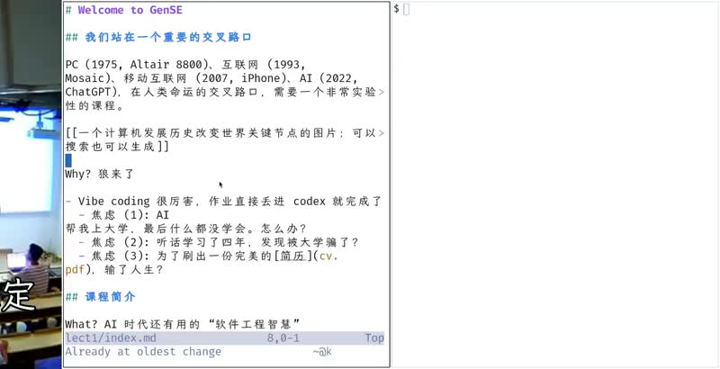](../assets/01-01.jpeg)
{: #l01-src-004}

*图 1：00:00 左右，讲义还在 Neovim 里。文件是 `lect1/index.md`，标题写着 Welcome to GenSE。*
{: #l01-src-005}

今天我们站在一个重要的交叉路口。从进入计算机专业开始，大家就会学习计算机发展的历史。这段历史经历了多次变革，其中一个反复出现的变化，就是昂贵的能力逐渐成为日用品。
{: #l01-src-006}

图片左边是 1975 年的 Altair 8800。这张图由 AI 生成，痕迹还比较明显，用的模型可能也不算强。我希望课堂保持比较松散的讨论氛围，课后再把内容切片、整理。
{: #l01-src-007}

[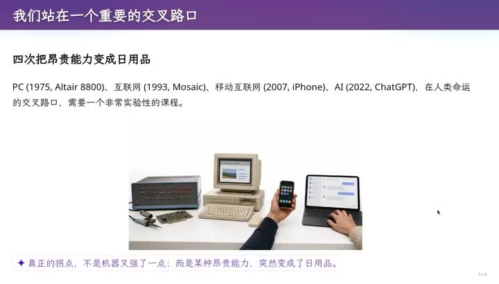](../assets/01-02.jpeg)
{: #l01-src-008}

*图 2：00:00:40 的幻灯片。Altair 8800、早期 PC、手机和笔记本排在一张桌上。底下紫色的句子是模型后加的。*
{: #l01-src-009}

PC 之后是互联网，它把世界各地的人连接起来。我小学快毕业时装过一个叫 ICQ 的软件，腾讯后来做的 OICQ 改名成了 QQ。那时可以随机加到世界另一端的人，碰上英语母语者，对方打字飞快，我却只学过 hello、good morning，根本看不懂。
{: #l01-src-010}

移动互联网又改变了生活。我印象很深，仿佛一夜之间，菜场卖菜的人都摆出了支付宝和微信二维码。
{: #l01-src-011}

到了 2022 年，ChatGPT 出现，成为人类历史上增长最快的产品之一。上课的方式、该学什么，都需要重新考虑。
{: #l01-src-012}

在这个背景下，我决定开一门 vibe coding 课。有一种说法叫“AI 替我上大学”：老师用豆包出题，学生用豆包做作业，整个闭环里，只有学生没有受到训练。
{: #l01-src-013}

过去，操作系统课的作业会折磨大家，大家也在这个过程中获得提升。现在，把作业链接丢给 Codex 就能做，连复制粘贴都省了。也可以直接告诉它：“帮我实现蒋老师操作系统课的第八个实验。”
{: #l01-src-014}

在这样的时代，还应不应该学编程？有些能力依然需要，有些学习方式需要改变。具体怎么做，我们还不知道，大家也因此感到焦虑。
{: #l01-src-015}

第一种焦虑是：AI 帮我上完了大学，我却什么都没学会。假设每门课都开卷，题目交给 AI，全都答对了，毕业后发现自己第一个就被 AI 取代。
{: #l01-src-016}

第二种焦虑来自认真听课、认真做作业的同学。延续中学时的习惯，老师说什么就做什么，四年下来确实学到了知识，却发现这些事情 AI 都会做，同样感到迷茫。
{: #l01-src-017}

[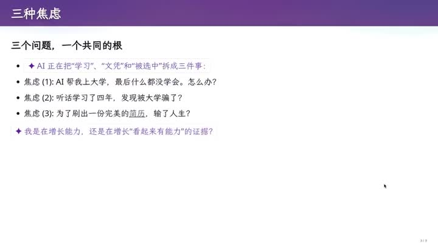](../assets/01-03.jpeg)
{: #l01-src-018}

*图 3：约 00:02。三种焦虑写在同一页。底下紫色字问：增长的是能力，还是看起来有能力的证据。*
{: #l01-src-019}

眼下大家最切身的压力是保研。你们海投简历，我也收到了很多，其中不少让我失望。
{: #l01-src-020}

看这份简历。屏幕上的匿名处理由 AI 完成：我告诉它，上课要展示一份简历，请去掉个人信息。它把相应字符换成 Unicode 方块，复制粘贴得到的也会是黑色方块。
{: #l01-src-021}

[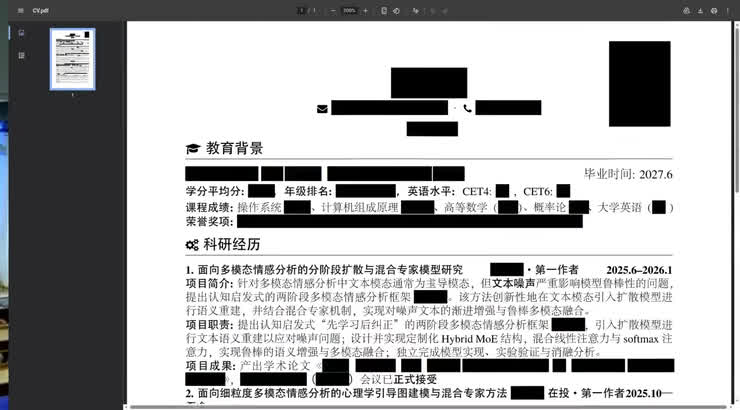](../assets/01-04.jpeg)
{: #l01-src-022}

*图 4：约 00:04:40。他让模型把姓名、联系方式和成绩盖成黑块，再投到屏幕上。看得见的是教育背景和科研经历，成果里写着在投。*
{: #l01-src-023}

这份简历看起来很完美，列着 CCF 期刊列表上的论文和 accepted。当然，大家也会说，“在投”等于不存在，因为看不到成果。可这份简历在我这里是零分：没有 GitHub 链接，没有个人主页，也没有论文的 preprint。我无法了解这个同学实际做了什么。更糟糕的是，我收到过无数份类似的简历，你们的简历也多多少少长这样。
{: #l01-src-024}

[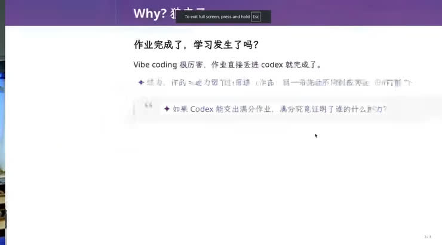](../assets/01-05.jpeg)
{: #l01-src-025}

*图 5：约 00:05:54。这一页问：作业完成了，学习发生了吗。紫色字把满分作业和“这证明了谁的能力”拆开。*
{: #l01-src-026}

当所有人都有实习、奖项、论文和在投稿件时，你和竞争者就难以区分。什么能让你脱颖而出？如果连刚才那份简历都无法打动我，应该怎样向未来的导师展示自己？
{: #l01-src-027}

我希望这门课能缓解一些焦虑，让大家体验到 vibe coding 的快乐。我从中获得过很多快乐，也希望大家在实践中理解软件工程怎样工作，做出有趣的作品，让简历更有说服力。
{: #l01-src-028}

对我来说，你有一篇发表论文，可能只是一个加分项。对很多其他人来说，可能还不是。
{: #l01-src-029}

## 这门课到底打算讲什么 {#l01-src-030}

*[原片 00:07:12–00:14:26](https://www.bilibili.com/video/BV1pb8o6yE8f/?t=432)*
{: #l01-src-031}

这门课叫生成式软件工程，依然要回答软件工程的问题：怎样把软件造出来，怎样避免工程失败。
{: #l01-src-032}

大家常开玩笑说，人相对 AI 的优势是“可以坐牢”。大学教育还能帮助你获得几种重要的能力和条件。
{: #l01-src-033}

首先是信息差。掌握别人不知道的信息，才能做别人做不到的事。学校里也存在利用信息差的恶性竞争：比如只有你拿到了往年试卷，就可能在考试中占优。社会中还有许多不便明说的信息差。
{: #l01-src-034}

此外，人要承担责任，也要能驾驭复杂的事情。大学教育应该帮助你成长，让你毕业时能够说：我比以前更有能力，能做到别人做不到的事。这门课尝试帮助大家建立驾驭人工智能的能力。
{: #l01-src-035}

[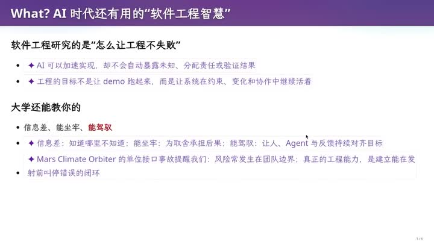](../assets/01-06.jpeg)
{: #l01-src-036}

*图 6：约 00:07 的幻灯片。黑字是我预先写的：信息差、能坐牢、能驾驭。紫色是模型补上的解释，并举了火星气候轨道器单位接口的事故。*
{: #l01-src-037}

课程会以案例为主，组织方式比较松散。想讨论、质疑我的做法，欢迎来线下。如果主要希望听课获取知识，我建议可以不用到课，也不用看直播。
{: #l01-src-038}

今年我想尝试一种新的授课方式。左边是我课前写的 Markdown 讲义，规定了大致的时间安排和例子，也约束了 AI 的工作范围。按 F5 播放后，会看到一些紫色内容，那是 GPT-5.6 在讲义上补充的。
{: #l01-src-039}

我使用一个叫 make-slides 的 skill，让模型在写好的演讲稿上扩展内容。其中有一套类似“AI 耿同学”的做法：生成三个性格不同的 subagent，在各自隔离的上下文里工作，再由主 agent 汇总。这个方法很有效，让我可以用更多算力换取更好的思考结果。
{: #l01-src-040}

我对比过几个提示词版本：每改一版就重新生成 slides，再让另一个模型盲评，逐步调整到质量较好的版本。你看到的图片也全部由模型生成。
{: #l01-src-041}

[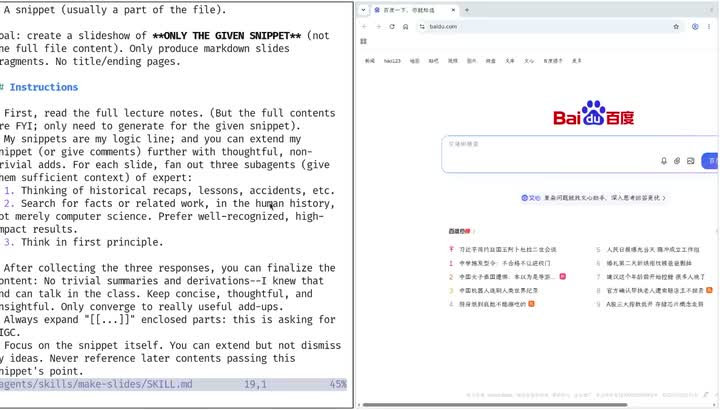](../assets/01-07.jpeg)
{: #l01-src-042}

*图 7：约 00:10:45，左侧是 `make-slides/SKILL.md`。它要求只扩写给定片段，并为每一页派出三个有不同性格的subagent。右侧浏览器还停在百度。*
{: #l01-src-043}

我希望探索一条可能改变大学授课方式的路径。为了让学习更高效，老师需要思考怎样更好地呈现知识。对我来说，上课是一场表演：按照预设的剧本，调动情绪，与大家交流，现场也会即兴发挥。表演结束后还要 review，比如某个例子不够恰当，换一个案例也许更容易理解。即兴发挥总会有不完善的地方。
{: #l01-src-044}

课后，我可以把录像切片，重新组织内容。课程本来就从 content、从 code 出发，Everything is code。把课堂表演重新还原成可维护的代码，继续丰富它，就有机会实现课程的“数字永生”。
{: #l01-src-045}

这套 slides 展示了 Everything is code 的思路。图片和幻灯片可以用代码生成，桌椅、电脑等物品也可以通过计算机辅助设计来描述。
{: #l01-src-046}

课前的 Markdown 是 source of truth，图片和幻灯片由 AIGC 生成。我让 agent 扩写选中的片段，形成 Markdown slides，再在浏览器中渲染。通过切片，课程的要点、逻辑和讲法可以沉淀成一个可维护的程序。现在由我维护，将来也可以交给其他人。我已经不再上操作系统课，也希望把 B 站录像整理成这种形式，让全世界的人共同维护、按需要定制。这可能改变大学的授课方式。我会在这门课里先做一个小规模尝试，也欢迎反馈。
{: #l01-src-047}

课程鼓励大家把时间花在实践上，重新体会“上课耽误学习”。我推荐可以不来听课，但要动手尝试。后面会有很多实际案例，帮助大家适应 AI 时代学习和工作方式的变化。
{: #l01-src-048}

课程要求禁止古法编程。我知道大家都很擅长手写代码，因为保研机试还要考，看到往年的题，还得去 LeetCode 刷题。我相信这套要求总有一天会改变，只是改变一个体系需要时间。我想先尝试推动一点变化。
{: #l01-src-049}

## Token 自费，作业尽量不评分 {#l01-src-050}

*[原片 00:14:26–00:20:32](https://www.bilibili.com/video/BV1pb8o6yE8f/?t=866)*
{: #l01-src-051}

第一条课程要求是 token 自费。我本来想拉一些赞助，看到选课人数后放弃了：去争取这么多 token，也比较麻烦。
{: #l01-src-052}

我的个人观点是：手上没有付费 token，就应该立即退学。这不意味着需要像硅谷流行的 token maxxing 那样拼命消耗 token。课堂会使用足够便宜、能力也过得去的 DeepSeek-V4-Flash 完成任务；slides 为了追求更好的质量，使用了更聪明的模型。
{: #l01-src-053}

[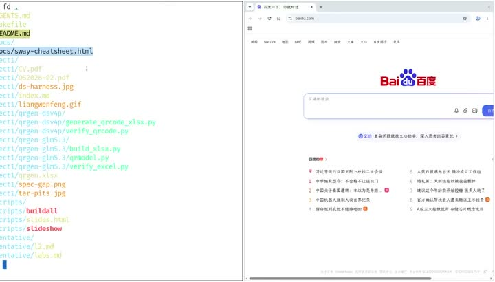](../assets/01-08.jpeg)
{: #l01-src-054}

*图 8：终端中列出了课件相关文件，右侧浏览器停在百度页面。*
{: #l01-src-055}

计算机专业的学生常在夜里工作，DeepSeek 夜间价格也比较便宜。白天上课是“梁文峰”时间，晚上回去做作业就是“梁文谷”了。大家可以先充 100 元；如果确实有困难，可以联系我想办法。
{: #l01-src-056}

我希望这门课采用“通过／不通过”的评价方式，申请课程时也是这样填的。教务反馈，专业选修课通常不这样考核，形势与政策之类的课程才常用这种方式。但我们还不知道合适的评分标准：同一个任务，用更好的模型，结果可能就更好。Claude 家族可能比 DeepSeek-V4-Flash 做得更快、更好，而我们又无法限制每个人使用的模型。对于以 project 为主的 vibe coding 课程，应该如何评分？
{: #l01-src-057}

[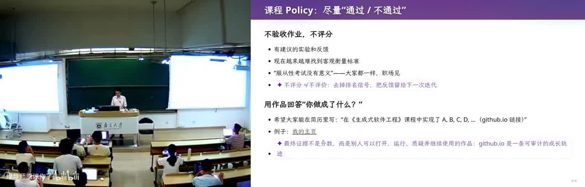](../assets/01-09.jpeg)
{: #l01-src-058}

*图 9：约 00:20，教室全景。右侧幻灯片写着尽量“通过 / 不通过”，作业不评分，希望简历上留下别人打得开的作品。*
{: #l01-src-059}

我会在课程网站上提供一些建议。比如实现一个邮件管理系统：我用指定邮箱发邮件，你的系统负责回复。可以用 vibe coding 做出这个服务，让它跑在宿舍里一台持续开机的小电脑上。有的同学做得复杂些，有的简单些，我可以用邮箱与大家通信。
{: #l01-src-060}

这样的系统该给多少分，很难判断。对你们来说，最终检验大学学习成果的，是找工作或保研时交出去的简历，以及它能否把你带到更高的平台。为了走到那一步，仍然需要较好的 GPA，也可能不得不 reward hacking、overfit 考试题。但最后还要问：敢不敢向门槛很高的地方投简历？［机构名未确认。］
{: #l01-src-061}

我希望你们最终能在简历中写下：在生成式软件工程课里完成了 A、B、C、D、E。每件作品都有可以打开的链接，也能说清楚设计、实现和有价值的部分。
{: #l01-src-062}

我还想过一个令人不安的设想：如果每台电脑都装上监控，记录大学四年的全部活动，AI 就能评价这四年是怎样度过的。摸鱼、观看不想让别人知道的视频，都可能被记录。我们不知道社会是否会走到这一步，但需要保持开放的思考。
{: #l01-src-063}

课程要求先介绍到这里，接下来进入技术内容。
{: #l01-src-064}

## 大语言模型，然后是 Agent {#l01-src-065}

*[原片 00:20:32–00:29:46](https://www.bilibili.com/video/BV1pb8o6yE8f/?t=1232)*
{: #l01-src-066}

从使用者的角度，可以把大语言模型理解为一个学到的概率分布，可以用概率统计课里的条件概率题来类比：已知几次投掷的结果之和，再问第一次出现某个点数的概率。［例题具体数字未确认。］输入可以是文字，也可以是图像。比如给它一本书，再写上“能不能帮我总结一下”，它就不断预测下一个 token。可以粗略理解为一个字符接一个字符地输出。模型见过大量材料，训练非常困难，这也是 frontier lab 的能力所在。这门课关注如何使用它：打开 DeepSeek 网页，问什么是大语言模型、怎样体验，它会告诉你，现在就在体验。入门使用并不要求先掌握模型内部知识。
{: #l01-src-067}

我第一次感受到大语言模型明显超过我的能力，是 2023 年的 GPT-4。当时模型的幻觉很严重，我们也在尝试 prompt engineering。有一天给五岁的孩子讲故事，讲到了扫描电子显微镜，我不知道怎么继续，就请 GPT-4 用朴素的语言和合适的比方解释。它给出的比方比我的好。
{: #l01-src-068}

它说，假设闭着眼睛，看不到一座山的形状，却可以向不同方向扔石头。有的石头穿过去，有的弹回来发出声音，便能像 ray tracing 一样推测山的形状。孩子大概听懂了，虽然不可能完全理解。这个回答让我震惊：它既掌握相关知识，也能解释。我后来查过资料，认为这个比方基本可用。
{: #l01-src-069}

[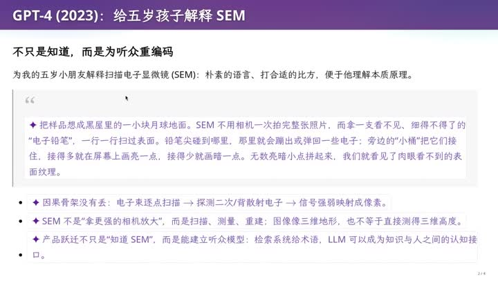](../assets/01-10.jpeg)
{: #l01-src-070}

*图 10：约 00:22。这一页是 GPT-5.6 写得更严的版本：不用“扔石头猜山”，而用一支看不见的铅笔逐点扫一块黑球，旁边的小桶接住弹回的电子。底下紫色字写明，SEM 不是更强的相机，是扫描、测量、重建。*
{: #l01-src-071}

GPT-5.6 有 reasoning，给出的解释更加严谨。GPT-4 时代，我们已经尝试过用一个 prompt 在大项目里找出大约一百五十处问题。［项目名称未确认。］到了今天，类似任务用一句话就能提出，不需要再对 GPT 做专门调整。
{: #l01-src-072}

随着模型能输出更长的文本、接受更长的上下文，agent 出现了。推理模型与 coding 场景中的 ReAct agent 可以输出特殊的 token，发起程序调用；程序运行结果再送回 agent，进入下一轮循环。面对复杂任务，它就能持续尝试、自主运行。
{: #l01-src-073}

课堂环境也由 agent 帮忙配置。我使用 Sway 窗口管理器，提高对比度、去掉顶栏，让展示更清楚。除了普通的 top，还配置了更现代的进程显示界面，可以看到 OBS 的运行情况和剩余内存。
{: #l01-src-074}

另一个细节是，输入 `ls` 时会自动使用 `eza`，输入 `find` 时会换成 `fd`。`fd` 的行为和 `find` 略有不同；`eza` 会以不同样式显示目录、Markdown 和 Makefile。这些配置都来自一个请求：“把我的命令行和系统环境配置得现代、好用一些。”使用的就是 DeepSeek-V4-Flash。
{: #l01-src-075}

ReAct agent 会不断调整配置，出错后尝试其他方法，直到完成任务。去年上操作系统课时，agent 还常常出错，做不完就停；今年已经好用了很多。现在 agent 产品大量出现，豆包也提供了这种 ReAct 类型的 agent。
{: #l01-src-076}

[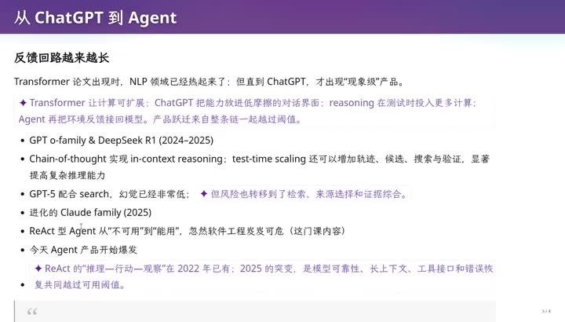](../assets/01-11.jpeg)
{: #l01-src-077}

*图 11：从 ChatGPT 到 Agent，模型能力的发展与工具调用形成的反馈循环。*
{: #l01-src-078}

我认为 agent 的能力还没有充分释放。Next token prediction 的效率仍有限，另一条路线是 diffusion 语言模型。打开 Inception，可以看到它从随机噪声开始，逐渐生成一段很长的文本，就像模糊的画面逐渐清晰。
{: #l01-src-079}

[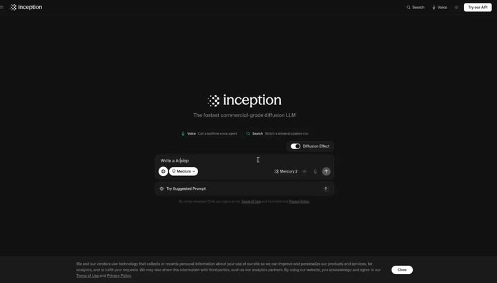](../assets/01-12.jpeg)
{: #l01-src-080}

*图 12：约 00:28，浏览器打开 Inception。页面写着 commercial-grade diffusion LLM，Diffusion Effect 的开关开着。*
{: #l01-src-081}

Diffusion 语言模型还带来其他可能性：除了预测后续 token，也可能修改已有上下文、缩短很长的文本。这些都是正在研究的方向。
{: #l01-src-082}

现在模型已经很强，而三个月、一年之后可能还会出现突破，整个 AI research 都在押注这件事。摩尔定律仍在延续。我无法预测哪条路线、哪种模型会胜出，也很难想象未来的样子，但这个世界会发生很大变化。每个人都需要思考自己该怎样面对。
{: #l01-src-083}

接下来回到具体操作：怎样实际使用 agent，这也是课程主要讨论的内容。
{: #l01-src-084}

## 先假设你们不太会用 {#l01-src-085}

*[原片 00:29:46–00:32:19](https://www.bilibili.com/video/BV1pb8o6yE8f/?t=1786)*
{: #l01-src-086}

先从普通使用者的视角出发。除了“帮我做作业”，大家可能还不太会使用 agent。上学期期末，我出过一道题：如果让 agent 给这门课出期末卷，应该怎么办？从答案看，大家还有不少能力可以探索。课堂也欢迎随时提出想法。
{: #l01-src-087}

[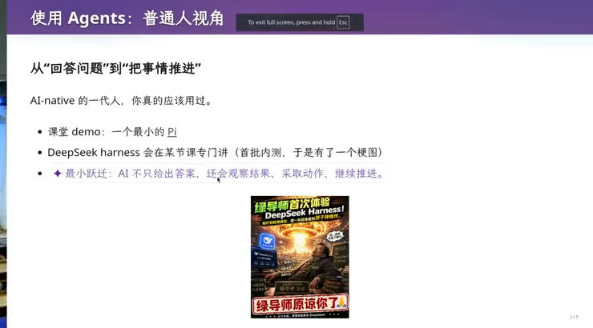](../assets/01-13.jpeg)
{: #l01-src-088}

*图 13：约 00:31。这一页写课堂 demo 用一个最小的 Pi。底下是他自己的梗图。*
{: #l01-src-089}

课堂使用 Pi。给它合适的指令就可以开始，也可以通过 `AGENTS.md` 配置行为。问“你是谁”，它会回答自己服务于南大《生成式软件工程》，负责课件、资料整理和课堂演示。
{: #l01-src-090}

再问：“你只是个模型，怎么知道生成式软件工程？”它解释了两个来源：训练时见过这些词，以及当前仓库临时提供的 `AGENTS.md`。使用 agent 的两个原则，就是现在开始用，遇到问题随时问它。
{: #l01-src-091}

[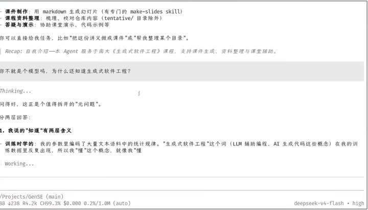](../assets/01-14.jpeg)
{: #l01-src-092}

*图 14：约 00:31:28。Pi 先按 `AGENTS.md` 自我介绍，再被追问“你不就是个模型吗”。右下角模型是 deepseek-v4-flash ·high。*
{: #l01-src-093}

想象力会限制你使用 agent 的上限。课间可以想想：没有 agent 时，自己做过最酷的一件事是什么？
{: #l01-src-094}

## 一句话，把系统装进 U 盘 {#l01-src-095}

*[原片 00:32:19–00:38:05](https://www.bilibili.com/video/BV1pb8o6yE8f/?t=1939)*
{: #l01-src-096}

第一个例子就是今天上课用的系统。刚才展示的安装和配置，全由 AI 完成。
{: #l01-src-097}

我上操作系统课一直有个习惯：带一个装着 Linux 的 U 盘，插到教室电脑上启动。屏幕上可以看到 U 盘和电脑原有的硬盘。有一年我误把教室硬盘抹掉了，导致下一位老师遭遇教学事故。这也提醒我，必须弄清楚系统是怎么安装的。
{: #l01-src-098}

装机曾经很费劲。我以前热衷于定制系统，课件还放了一个 2021 年 7 月的知乎链接。今天这件事只需一句话：去 `mirrors.nju.edu.cn` 找 Debian 13 的镜像，装进已插好的 U 盘，确保能启动，并用模拟器验证。
{: #l01-src-099}

其中最重要的要求是“用模拟器验证”。我知道安装过程该怎么做，也知道应该检查什么。Agent 装好系统后，真的在 QEMU 里启动，进入登录界面，验证了登录；用户名、密码和用户创建也一并处理了。随后我从 U 盘启动系统，让它继续安装平铺式窗口管理器。
{: #l01-src-100}

[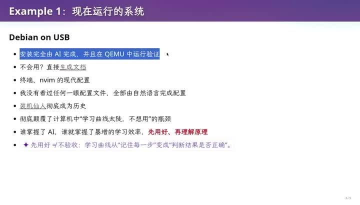](../assets/01-15.jpeg)
{: #l01-src-101}

*图 15：约 00:34。Example 1 把“在 QEMU 里验证能启动”标成这一步的要点。*
{: #l01-src-102}

现在按 Windows 加回车，右边就会出现一个新终端；按 Windows 加空格，可以把窗口从平铺切换为浮动。假如你在 B 站看到别人这样操作，也想用，却不知道快捷键，可以让 DeepSeek-V4-Flash 读取当前配置，生成一份操作指南。
{: #l01-src-103}

它生成的指南写明：Super 加 Enter 打开 foot 终端，Super 加 D 打开 fuzzel 应用启动器。我按 Windows 加 D，就能启动 OBS 或 Chrome。包括终端、Neovim 在内的配置，我没有逐个打开配置文件看；我用自然语言说明要交付什么，再让它检查，便完成了配置。
{: #l01-src-104}

[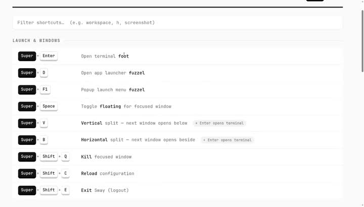](../assets/01-16.jpeg)
{: #l01-src-105}

*图 16：约 00:35:10，一份从 `~/.config/sway/config` 生成的 cheat sheet。Mod 键是 Super。Enter 开 foot，D 开 fuzzel。*
{: #l01-src-106}

我大四时也读过几千页的 Intel CPU 规格手册，研究每个 CPU feature 的用途。作为教计算机的老师，我花了很长时间积累这些知识。现在却有一个可以对话的系统，读过这些资料，理解它们，还能把事情做出来。我的任务随之变成了怎样调动它已有的能力。
{: #l01-src-107}

学习知识的方式正在变化。你需要知道 AI 能做什么、做到什么程度，再带着它完成更大的、目前还无法独立完成的任务。我认为，人此时的作用就在于此。如果连这种能力也没有，就可能被淘汰。这也是我说“没有 token 就可以退休”的意思；这是我个人的观点。
{: #l01-src-108}

Agent 降低了“学习曲线太长，所以不想用”的门槛。比如配置一个漂亮终端，以前改一点 `.zshrc` 就可能报错。有了 agent，它可以帮你改，还能逐项解释修改原因。你有新想法可以继续提，它也会耐心回应。
{: #l01-src-109}

前几天我在小红书开玩笑，说 token 比学生好用：我可以骂 agent，它不会还嘴，学生当然不能这样对待。掌握 agent 后，学习可以先从做出东西开始，再复盘、理解背后的原理，效率会比从零逐项搭建高很多。不过，这种方式也有风险：你以为自己理解了，实际理解却可能还有缺口。这个差距需要认真对待。
{: #l01-src-110}

## 收发邮件，还有一张发票 {#l01-src-111}

*[原片 00:38:05–00:40:33](https://www.bilibili.com/video/BV1pb8o6yE8f/?t=2285)*
{: #l01-src-112}

第二个例子是收发邮件、起草回复。我有一个自己的 skill，数据库里保存着历史回信。新邮件到来后，它自动标为已读，再按我的口吻拟好草稿。目前效果还不够好：简单的例行邮件可以直接使用，大多数回复仍需修改。不过，一些事务已经可以交给这个 bot，比如识别收到的发票，保存到指定归档位置。这些行为都有事先写好的 instructions。
{: #l01-src-113}

类似 OpenClaw、Hermes 能完成的任务，我也可以通过自己的 Apple Reminders 来安排。例如，在提醒事项里写一句“把今天的发票打印出来”。我们现在就试一下，花一张打印纸。
{: #l01-src-114}

我在名为 bot 的列表里新建任务：“把收到的上一张发票打印出来。”确认后，任务便提交给后台处理。这个过程类似在 Telegram 里和 bot 对话。打印完成后，系统会通过 Reminders 向手表推送通知，告诉我可以去取。日常事务里，只要我放心交给它的，都可以这样安排。我个人更喜欢这个入口。OpenClaw 出现以前，我就在用这套流程；我也认为 OpenClaw 和 Hermes 之后，个人 agent 的产品形态还会继续变化。
{: #l01-src-115}

[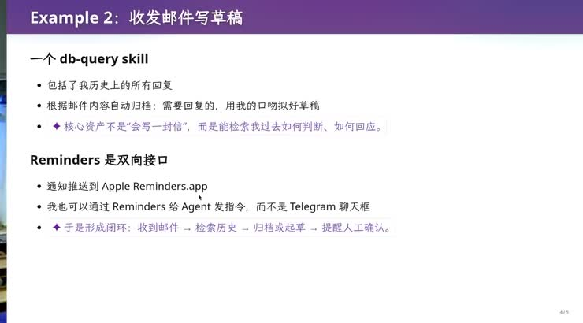](../assets/01-17.jpeg)
{: #l01-src-116}

*图 17：约 00:39，第二则例子。上面是按历史回信写草稿，下面写 Reminders 可以把手表通知和给 agent 的指令接成一个来回。*
{: #l01-src-117}

## 读书、读论文、看两个小时的视频 {#l01-src-118}

*[原片 00:40:33–00:48:35](https://www.bilibili.com/video/BV1pb8o6yE8f/?t=2433)*
{: #l01-src-119}

你们还在读书、看论文吗？读论文会觉得痛苦吗？有人说不痛苦，大家都笑了。
{: #l01-src-120}

我以前很喜欢读书，读大学时每年会看几十本教科书，也读不少闲书。今天我会说，自己已经“不看书”了。不过，为了讲生成式软件工程，我还是买了几本书带来；这些书当年都仔细读过，有些读过不止一遍。
{: #l01-src-121}

一本是 Fred Brooks 的《人月神话》，英文叫 The Mythical Man-Month。我觉得中文书名容易让人误解：“人月”听起来像人和月亮，实际指人力投入；“神话”又容易让人想到盘古开天地那类美好故事。我开玩笑说，叫“人月鬼话”可能更贴近它想揭示的问题。
{: #l01-src-122}

另一本是 John Ousterhout 的 A Philosophy of Software Design。这本书很紧凑，里面有许多值得学习的软件设计经验。手上这个版本看起来比我当年读的英文版还紧凑一些。
{: #l01-src-123}

这次我重读第一章后，就启动了 agent。我给自己的“AI 耿同学”安排了几种思考方式，批评也更严厉。准备每页课件时，我会先让 GPT-5.6 回看相关历史案例，找能提供启发或印证的经验；再查相关研究，范围不限于计算机科学，优先考虑广受认可、有影响的经典工作；还会要求从基本原理出发思考。AI 耿同学里有更多这样的角色，也会随机选择角色，让它们讨论分歧。主 agent 再把尚未解决的分歧交回讨论，直到收敛。这是我用更多计算换取更深入思考的一种做法。
{: #l01-src-124}

读论文、审稿时，我通常让它先明确人类已有的知识，再找出论文新增的最少那部分内容。已有知识当然不等于没有价值，只是这一次可以视为已知。这样，一篇 12 页论文里需要集中研究的内容就会少很多。随后我拿着原文、总结和进一步的分析，继续与它讨论。我仍然读论文原文，也会核对这些总结；微信公众号文章不能替代这一步。
{: #l01-src-125}

[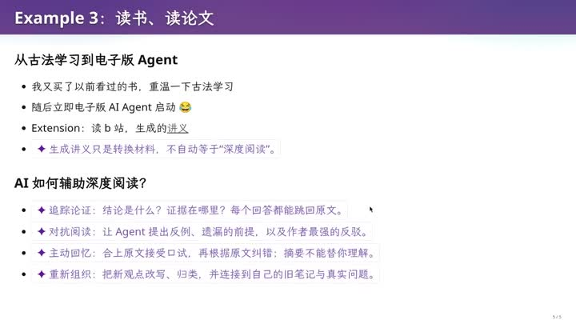](../assets/01-18.jpeg)
{: #l01-src-126}

*图 18：约 00:42:10 的第三则例子。紫色字提醒：生成的讲义只是转换材料，不自动等于深度阅读。*
{: #l01-src-127}

这时手表收到通知：发票已经打印好了，我回到打印机旁取走即可。这个例子说明，agent 可以调动那台电脑原本能控制的设备。我还想过，将来有时间可以接一个机械手，让它做更多事。目前还没做到，但控制打印机已经可以了。
{: #l01-src-128}

除了书和论文，我也让 AI 帮我看 B 站视频。纯粹为了娱乐的内容，例如“华强买瓜”的衍生视频，当然还是自己看更合适。
{: #l01-src-129}

处理学习视频时，给它一个 BVID 就行。例如上学期那节《应用视角的操作系统》，编号是 BV1KNPhzPEra，长约一小时二十七分钟。我也会处理讲软件工程实践的播客，不过其中一些经验未必适合这门课。Agent 会把视频整理成图文时间轴，文字比原始字幕更易读。实际抽帧密度比最终图文里的图片密度高：两个画面相隔到一定程度，就再截一张，以便保留视频讲了什么、展示了什么的依据。
{: #l01-src-130}

[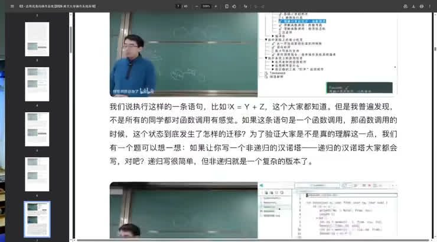](../assets/01-19.jpeg)
{: #l01-src-131}

*图 19：约 00:46:30。这个 BVID 打开以后，左边是课，右边已经整理成图文。*
{: #l01-src-132}

有了这些材料，AI 耿同学再根据对我的了解，过滤掉我已熟悉、不必重看的内容。我便能在几分钟里了解一两个小时视频中对我有新意的部分。我认为，这样基本可以掌握其中值得关注的差异。
{: #l01-src-133}

我判断，会用 agent 学习的人与不会用的人，学习效率可能出现十倍、百倍的差距。这又回到开头那份简历：当眼前所有人的简历看起来差不多，你还需要想一想，那些学习效率远高于你、却没有出现在眼前的人，他们的简历会是什么样。
{: #l01-src-134}

先休息一会儿，大家可以想想这个问题。后面还有一些演示。我反复说“人类完了”，是因为这些变化确实让我有危机感。我也确信有人做得比我更好。我上有老、下有小，上学期又花了很多时间教操作系统，能投入这些探索的时间有限。那些时间原本也可以用来改进自己的工作方式。
{: #l01-src-135}

## 采集卡断了，就让它自己插回去 {#l01-src-136}

*[原片 00:48:35–00:50:28](https://www.bilibili.com/video/BV1pb8o6yE8f/?t=2915)*
{: #l01-src-137}

休息时正好出了一个可以现场解决的问题：直播画面的 USB 采集卡断了。教室的设备把另一台机器的视频接过来，还有几台机器共同工作。我觉得这套方案成本偏高，也许五百到一千元就能解决类似需求。现在另一台摄像头还能拍到我挥手，USB 采集卡那一路却中断了，原因还不清楚。
{: #l01-src-138}

[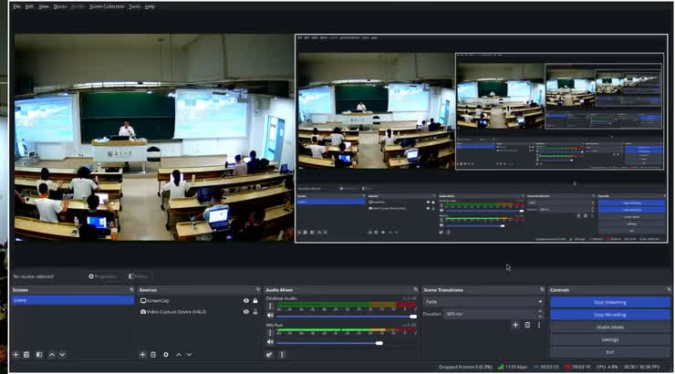](../assets/01-20.jpeg)
{: #l01-src-139}

*图 20：约 00:48:30。OBS 里同时看着教室全景、讲台和采集卡那一路。*
{: #l01-src-140}

{: #l01-src-141}

*图 21：约 00:49:13。USB 那路断掉以后，画面白了一块。*
{: #l01-src-142}

我给 agent 发了一句话：“USB video 有问题，能不能 reconnect？”DeepSeek-V4-Flash 先检查系统里的 USB 设备，找到对应采集卡，再用 Linux 的软件操作让设备断开、重新连接，画面便恢复了。物理接口在机器后面，我够不到；这次重连完全通过软件完成。其中一些操作我知道有这个概念，但并不熟悉具体用法。
{: #l01-src-143}

现在视频恢复正常了。如果再次中断，请提醒我，我再重置。
{: #l01-src-144}

刚才用的是基本配置的 Pi：从网站安装，填上 DeepSeek-V4-Flash 的 API key，就能具备这样的能力。Agent 还能继续扩展。
{: #l01-src-145}

## 把浏览器接进来 {#l01-src-146}

*[原片 00:50:28–01:05:10](https://www.bilibili.com/video/BV1pb8o6yE8f/?t=3028)*
{: #l01-src-147}

Agent 背后还有一个生态。一个领域里合理的需求，通常也会有别人遇到。在 AI 之前，开源社区常通过 GitHub 分享脚本，供别人下载、修改和使用。现在可以分享 skill，也可以在 Pi 的插件生态里寻找插件，复用别人的能力变得更容易。
{: #l01-src-148}

接下来，普通用户可以尝试用插件接入浏览器和电脑操作能力。
{: #l01-src-149}

Chrome 是一个复杂的软件工程产品。看起来只是显示网页，内部却要处理图形、渲染、性能优化和大量用户交互，代码规模远超操作系统内核。它还提供了专门面向开发者的 Chrome DevTools，在 Chromium 里按 F12 就能打开。
{: #l01-src-150}

在 DevTools 里，可以删掉当前页面上的一个元素，也可以调试页面、查看 HTTP 请求。以前一些网站会在控制台放招聘广告，我记得 B 站也放过，今天打开却没看到。更实用的是，你能把请求复制成 curl 命令，带上 cookie 和浏览器当时的状态，再执行同样的请求。这些原本主要由开发者完成的操作，现在普通用户也能借助大模型使用。
{: #l01-src-151}

2020 年我们做过一个项目：让 Java 或 Kotlin 编写的 Android 应用在 OpenJDK 上运行，计算每个界面控件的位置和文字，再直接用浏览器绘制界面。例如，Chrome 里会出现一个计算器，每个按钮的位置、文字都正确，点击以后应用状态也会变化。这样可以在本机执行 Android 应用。这个工具很有用，不过今天先不展开。
{: #l01-src-152}

我们来操作教务系统。我自己也不喜欢用它，后面还会拿它说明软件工程里容易出现的问题。
{: #l01-src-153}

我先扫码登录，再把界面放大一些。
{: #l01-src-154}

刚才已经让 Pi 打开浏览器，这个浏览器可以由它操作。现在教学周历还是空的，我们就拿填周历作为例子。
{: #l01-src-155}

[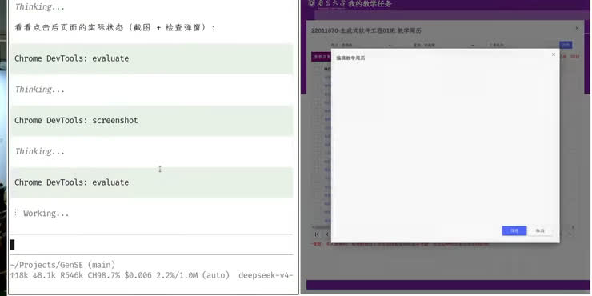](../assets/01-22.jpeg)
{: #l01-src-156}

*图 22：约 00:59。编辑教学周历的窗口还是空的，下面只有保存和取消。地址栏没有收进这张图。*
{: #l01-src-157}

做这类日常任务时，我常按一个键，打开豆包输入法，用语音给 agent 下指令。不过今天这台 Linux 没有安装豆包输入法，也没有配置好语音输入，还是打字。
{: #l01-src-158}

我输入：把空白的教学周历填起来，随便生成一些 AI slop，不要查阅别的材料。特意加上最后一句，是因为它如果发现当前目录是课程仓库，就可能去读 lecture notes；这次演示不需要它这样做。
{: #l01-src-159}

它起初没有按要求直接填写，还在做其他事。这是我使用 DeepSeek-V4-Flash 时会遇到的问题。模型的指令遵循能力仍在进步，更强的模型通常会好一些。课上选择 Flash，也有响应更快的考虑。
{: #l01-src-160}

它继续尝试，检查哪里不对，再寻找可行的操作。最后发现直接注入事件没有成功，模拟真实鼠标点击却能完成，于是开始填写。Chrome DevTools 提供了很强的操作能力；这类流程走通后，就可以减少人工值守。
{: #l01-src-161}

[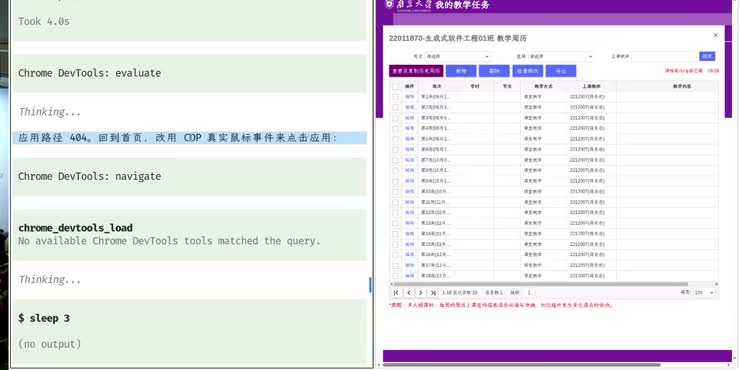](../assets/01-23.jpeg)
{: #l01-src-162}

*图 23：约 00:59:04。左边日志写着打开的路径是 404，于是改用真实鼠标去点。右边是教学周历的列表。*
{: #l01-src-163}

可以了，我对这个结果很满意。
{: #l01-src-164}

流程成功一次后，session 中的操作经历可以留下来，整理成确定性的脚本或记忆：该走哪条路径，哪些方法成功，哪些会失败。网页操作也能这样复用。我认为，自动选课、抢课之类的系统也可以沿这个思路做。眼前这次演示，它已经在帮我填周历；需要提交这些表格时，我就可以借助这样的流程。
{: #l01-src-165}

[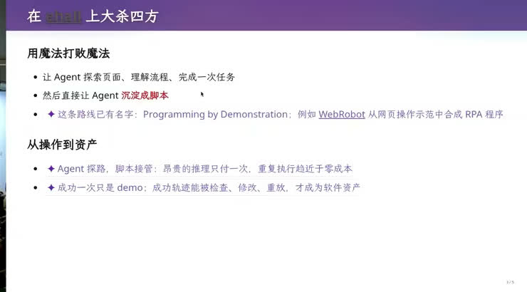](../assets/01-24.jpeg)
{: #l01-src-166}

*图 24：约 01:00。这一页把刚才的操作收成：先探路，再沉淀成脚本。成功一次还只是 demo。*
{: #l01-src-167}

这些例子背后是一个可以组合的生态。教操作系统时，我们会讲 Unix 的管道：程序能够自由组合、反复复用，组合以后往往能完成单个程序做不到的事。
{: #l01-src-168}

同样，从上下文提取记忆和脚本的能力、控制浏览器的 skill、浏览网页的 skill，可以组合起来互相调用。我判断，agent 生态正在接近一个临界点，这些组合会进一步放大个人能力，可能达到成百上千倍。
{: #l01-src-169}

普通用户也能先接入自己需要的信息源。例如，有些 AI 早报通过 RSS 推送，早上刷牙时就能听；B 站、arXiv、Hacker News 也有各自的内容来源。每接通一个来源，就把方法保存成 skill 或脚本，逐步建立信息处理系统。大量信息进入系统，经过处理，产出对自己有用的知识。许多步骤只需用自然语言描述，底层代码交给 agent 完成。持续调整流程，就能让它持续提供有用内容。
{: #l01-src-170}

这种持续改进的信息处理能力，也解释了 OpenClaw、Hermes 为什么能带来惊喜。以自动整理记忆为例，作为计算机从业者，我理解它是怎么做的，但并不总喜欢它自动总结：有时它记住了我不想保存的内容，又漏掉我希望保留的内容。所以我更常明确调用自己的流程，指定把什么写入数据库，再交给 AI 执行。
{: #l01-src-171}

这些问题也许只是产品和模型还不够成熟。将来模型越过某个能力门槛，连我现在比它多的那一点判断也能取代，我同样会受到影响。
{: #l01-src-172}

还可以继续想：把一天的操作录屏交给 AI，请它找出工作流程里可以改进的地方。初学阶段往往还有很大的改进空间。你们这一代在 AI 普及的环境里成长，有机会从一开始就这样学习。我如今需要处理许多事务，能用于重新探索的时间已经少了。
{: #l01-src-173}

演示中仍有小问题，需要继续修，也可能需要更强的模型。即便如此，亲手使用这些工具带来的感受，仍和只读公众号消息很不一样。我很难理解为什么有人面对这些变化，仍然每天重复同样的事务，却不尝试改进。这个变化值得认真思考。
{: #l01-src-174}

[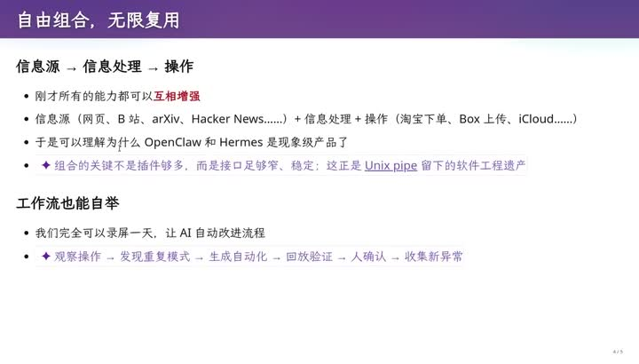](../assets/01-25.jpeg)
{: #l01-src-175}

*图 25：约 01:02。课件将网页、B 站、arXiv、Hacker News，以及淘宝、网盘、iCloud 等能力连接起来。紫色补充强调接口应当小而稳定，才能像 Unix 管道一样组合复用。*
{: #l01-src-176}

## 改完卷子，我知道哪一步不能交给模型 {#l01-src-177}

*[原片 01:05:10–01:09:28](https://www.bilibili.com/video/BV1pb8o6yE8f/?t=3910)*
{: #l01-src-178}

前面主要从普通用户的角度看 agent，下面换成计算机从业者的视角。只让 Codex 完成操作系统作业，还远没有用尽它的能力。我们的优势在于了解编程能做什么，知道怎样把需求落实成可以确定、快速执行的步骤，也知道哪些部分应当复用为代码，哪些适合保留为 skill。普通用户可能提出了需求，却不清楚为什么做不好，或该怎样指导 agent。
{: #l01-src-179}

举个统分的例子。试卷批改后，以前常让助教拿计算器，把 12、13、14、15、16 这样的各题得分相加，再仔细核对。我觉得没必要让学生反复做这些事，今年就尝试了另一套流程。
{: #l01-src-180}

我先用自然语言让 agent 编写脚本和测试，验证之后再批量运行。桌上有一台向下拍摄的摄像头，固定好试卷位置后，按一次回车就拍一张照片。随后在本地用千问识别姓名、学号和每道题的分数，写入文本文件。一张卷子对应一次回车；拍得不好，可以调整位置重拍。
{: #l01-src-181}

第二轮按相反顺序核对试卷。我左手按回车，右手拿笔，程序依次播报姓名、学号和各题分数。OCR 会出错，所以每个数字都必须人工检查，确保对每位同学负责。确认后，再把播报的总分写到卷面上。总分由脚本做加法，避免让大模型直接计算而产生算错的风险；输入分数是否准确，则由我逐项核对。
{: #l01-src-182}

[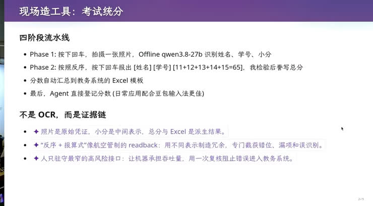](../assets/01-26.jpeg)
{: #l01-src-183}

*图 26：约 01:08。幻灯片把统分写成四段：回车拍照、反序播报、汇总到 Excel、再登记。紫色字写：照片是原始凭证，加法不交给模型。*
{: #l01-src-184}

最后，分数自动汇总到教务处的 Excel 模板中。我再上传文件，抽样检查，确认无误后提交。
{: #l01-src-185}

再配上语音输入，这套操作还可以更方便。作为计算机从业者，我知道本地可以通过 Ollama 使用一个 27B 的千问模型，也知道该怎样安排流程，减少人与 agent 反复沟通的成本。如果只对模型说“140 张卷子已经批好了，请帮我统分”，即使用很强的模型，也未必能迅速得到这套方案。目前有些工作仍需要人与 AI 共同设计。但我也相信，未来 AI 可能充分理解我的工作环境，给出更完整的方案。
{: #l01-src-186}

## 三个空间之间有缝 {#l01-src-187}

*[原片 01:09:28–01:29:00](https://www.bilibili.com/video/BV1pb8o6yE8f/?t=4168)*
{: #l01-src-188}

回到生成式软件工程，我们来做一个小产品。前些天群里聊到受管控的电脑：假设一家金融公司的机器允许把 Word、Excel 文件复制进去，却不允许把文件复制出来，也不能运行不受信任的程序或打开不受信任的网页。屏幕仍然能显示内容，那信息还有没有别的传递方式？这是一个可以运用计算机知识来分析的问题。
{: #l01-src-189}

我做了一个 Excel 程序，把输入内容转换成二维码。比如输入 hello world，二维码就会跟着变化；扫出来的是带有帧号的 Base64 编码字符串。内容长时，它会变成连续多帧的二维码动画，按 F9 刷新就能看到帧号变化，并且可以循环播放。
{: #l01-src-190}

这个例子利用屏幕显示来传递数据：把循环播放的画面完整拍下来，就能收集各帧内容。演示还讨论了远程桌面里的另一种信息通道——用鼠标沿不同方向移动表示不同的二进制值。结合输入和屏幕输出，理论上可以构造双向通信，类似在远程桌面上模拟一块网卡。不过，在目标机器安装额外程序通常会受到限制。学过操作系统和计算机网络，就能分析这里需要哪些组件，再判断哪些部分可以交给 agent 实现。
{: #l01-src-191}

屏幕上这个二维码程序由 AI 生成，使用的是 Excel 公式；演示时强调这些公式兼容 Excel 2019 及更早版本。这只是展示编程可能性的一个例子：知道计算机能做什么，会影响你能提出什么方案。
{: #l01-src-192}

前面的例子说明，普通用户可以借助 AI 学习、读书、整理材料，形成信息处理流程，也可以用 computer use、browser use 完成日常操作。许多内容能通过代码生成，包括视频和论文。我还在和一位同学尝试用自然语言控制 3D 打印：通过 Python 代码描述物体，再让打印机把它做出来，从 bit 走向实体。随着 AI 能力继续增强，我们需要考虑这些变化何时到来，以及怎样面对。
{: #l01-src-193}

接下来进入生成式软件工程要讨论的问题。前面的演示可能已经改变了大家对 AI 的认识，但它仍有做不好的地方。
{: #l01-src-194}

大模型出现以前，有个老笑话：“想法都有了，就差一个程序员，我们去挣一个亿吧。”还有人连 A、B、C、D 轮融资都想好了，只差天使投资人。现实当然没有这么简单。
{: #l01-src-195}

产品是系统性的工程。以外卖网站为例，前端、后端、交互和运营都要配合，任何一部分做不好，都可能使整个产品失败。AI 可以分别参与这些工作，也读过大量相关资料，但组织方式不合适，结果依然会失败。
{: #l01-src-196}

[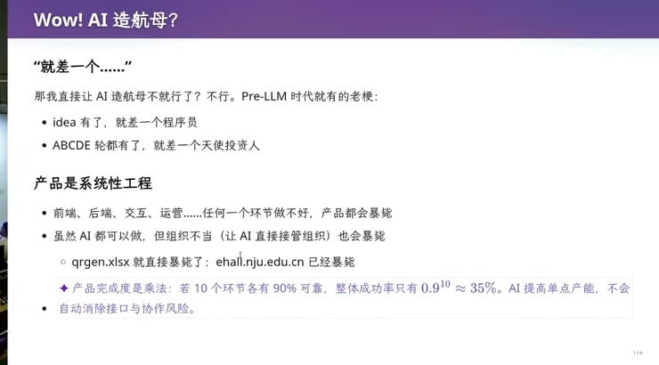](../assets/01-27.jpeg)
{: #l01-src-197}

*图 27：约 01:16。这一页把“就差一个程序员”收成老梗，并写明 qrgen 和教务系统都是直接上手就失败的例子。*
{: #l01-src-198}

我做过实验，让 AI 直接实现需求，得到的代码却难以维护。教务系统也有类似问题：每年都要花钱维护，因为需求不断变化。例如，在苏州校区出现以前，原来的系统可能没有“校区”字段；后来要求两个校区分别选课，就得调整数据库和相关逻辑。从产品经理的角度看，只是多加一个校区；对已有系统而言，却可能牵涉许多地方。这是典型的软件工程问题。
{: #l01-src-199}

二维码任务的要求看起来也很明确：只用兼容 Excel 2019 的公式，把输入字符串转换成二维码动画。Agent 经常做到一半停下来问，我要求它持续完成。可 GPT-5.6 仍然误解了目标。GPT-5.2 曾提醒，AI 容易在边界情况上出错；GPT-5.6 则一开始就追求覆盖所有输入、所有细节的完整正确性，把规格扩大了。我希望它先明确最小范围，做出简单、可靠的版本，再往前推进。
{: #l01-src-200}

后来我又做了受控实验。第一个版本由我带着 AI 完成，进展较顺利；这次直接把规格交给模型。GLM-5.3 先思考了 25 分钟，随后输出超过 32K token，触发 Claude Code 的默认输出上限而被截断。它继续运行，我没有持续监管，总共花了六小时，最后结果正确。这说明它确实能持续推进较长的任务。
{: #l01-src-201}

DeepSeek-V4-Pro 也被我放着运行了一晚。第二天发现，它把部分结果写死了：需求是让 Excel 公式对输入字符串做 Base64 编码，它却先用 Python 算出结果，再贴进单元格，输入变化后结果不会跟着变。我指出问题，它才承认设计有缺陷并重新处理。两个模型最终都完成了任务，但代码都难以继续维护。它们一上来就把当前需求做出来，却没有安排好支持后续变化的架构，逐渐陷入维护困境。
{: #l01-src-202}

可以把问题推远一点：一个软件能不能活一百年，乃至更久？几十年间，操作系统、图形界面、用户交互和应用程序都发生过很大变化。软件要长期演化，就需要能够适应变化的架构；GPT-5.6 当时也没有替我解决这个问题。
{: #l01-src-203}

我的做法是先让 AI 设计一个小型中间语言。它有点像编译器里的中间表示，用 Python 类表达位运算、XOR、拼接等操作，同一份表达既能直接在 Python 中执行，也能翻译成 Excel 公式。这样，我可以分别验证编码结果、二维码像素，以及每种操作到 Excel 公式的翻译是否正确。各部分验证通过后，再统一生成完整表格。刚升级到 GLM-5.3 时，我用少量 prompt，在 200K 上下文内就得到了第一个正确版本。代码规模仍有一些，但结构清楚，也更容易维护。
{: #l01-src-204}

不同实现路线的差距很大。那两份大量硬编码的实现，光是把工作区换个位置，就要修两个小时：改动一处，验证又会失败，只能让 agent 接着修。它最终也许能修好，但这种持续修补本身就是软件工程要处理的问题。另一个 Excel 文件我没有提交进仓库，屏幕上可以先看这些不同的实现。
{: #l01-src-205}

[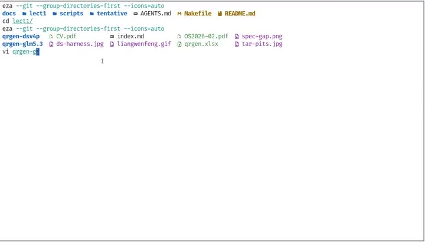](../assets/01-28.jpeg)
{: #l01-src-206}

*图 28：约 01:23。终端中打开二维码生成项目的工作目录，用来比较不同实现路线。*
{: #l01-src-207}

这也是今天仍然需要生成式软件工程的原因。我会把自己做软件时积累的经验拿来讨论。模型可能已经读过这些知识，但它急于立即动手解决问题，未必会主动采用合适的工程方法。我怀疑这与后训练形成的倾向有关。
{: #l01-src-208}

用 AI 解决软件问题时，可以区分三个空间。
{: #l01-src-209}

第一个是意图空间，intention：提出需求的人脑中想要什么。例如，“做一个国民级应用”，或者“做一个方便学生点外卖的小程序，挣一个亿”。有人想做外卖，有人想做 AI 读论文，有人想做 AI 耿同学。这些意图各自都有许多可能的实现方式。
{: #l01-src-210}

第二个是规格空间，specification：程序提供什么功能、满足哪些要求，有几个界面，各自能做什么。第三个是实现空间，implementation：具体如何把规格做出来。刚才想做那个特殊 Excel 是意图；“用兼容 Excel 2019 的公式生成二维码动画”是规格。满足同一份规格，仍然可以采用差异很大的架构和实现。
{: #l01-src-211}

软件工程的困难就出现在这些空间之间。提出意图的老板或客户可能没有计算机背景，只说“我们需要教务系统，把学生相关事务信息化”。落实到规格时，界面如何呈现就有很多选择；进入实现，还要决定数据库分几张表、各有哪些列，使用键值数据库还是关系型数据库。每个选择都会改变后面的结果。
{: #l01-src-212}

[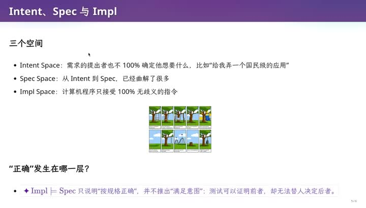](../assets/01-29.jpeg)
{: #l01-src-213}

*图 29：约 01:27。幻灯片把三个空间写成 Intent、Spec、Impl，并问“正确”发生在哪一层。右下角是秋千梗图的缩略。*
{: #l01-src-214}

软件工程里有一张经典的秋千漫画，画的就是这些理解差异：客户怎样描述，项目负责人怎样理解，分析员怎样设计，程序员怎样实现，宣传人员又怎样介绍。最后做出来的东西，和客户需要的相距很远。这种偏差来自不同参与者和不同阶段之间的理解落差。
{: #l01-src-215}

[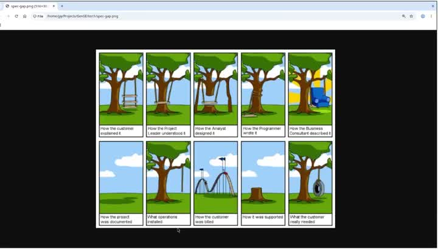](../assets/01-30.jpeg)
{: #l01-src-216}

*图 30：约 01:28:40，他在仓库里打开的那张梗图。客户口述的、负责人理解的、分析员设计的、程序员写的、顾问描述的、文档里的、装上去的、账单上的、维护时的，和客户真正需要的，全都不一样。*
{: #l01-src-217}

软件工程需要处理这些落差，生成式软件工程也一样。今天模型常靠猜测补齐没有说明的部分：它根据一句需求推测含义，然后马上实现。我认为，这与后训练的奖励有关——完成任务、通过测试会得到奖励，模型便倾向于尽快动手。它因此越来越擅长完成简单任务，但这种倾向未必适合所有软件问题。
{: #l01-src-218}

计算机和软件工程专业的学生通常从另一端开始学习。大一先学 C 语言，了解实现空间里有哪些工具和做法，逐渐熟悉一个需求可以怎样实现。之后再学软件工程，把需求、规格和实现之间的关系补充完整。
{: #l01-src-219}

到了 AI 时代，我们既要减少它随意猜测造成的偏差，也要利用它执行任务的能力。怎样处理这两件事，就是本学期要讨论的问题。
{: #l01-src-220}

**课件补充**：模型会猜测需求中的空白，但把每个细节都提前写清也有成本。当猜错后的返工比事先澄清更昂贵时，可以先做小实验。影响较小的决策先尝试、再验证；影响大且难以回退的决策，则应先弄清楚。
{: #l01-src-221}

## 人月神话，以及为什么要招你 {#l01-src-222}

*[原片 01:29:00–01:39:59](https://www.bilibili.com/video/BV1pb8o6yE8f/?t=5340)*
{: #l01-src-223}

《人月神话》用焦油坑来比喻软件项目。大型动物一旦陷进去，很难逃脱；濒死的动物又会引来掠食者，把更多动物拖进同一个坑。
{: #l01-src-224}

书里有一个经典论断：项目已经陷入失败时，再增加人手，可能让它进一步恶化。我把它类比到刚才的 AI 任务：当实现方向已经出了问题，再投入 token，模型可能只是在失败的结构上继续修补，直到成本无法承受。
{: #l01-src-225}

教务系统让我想到这种现象：每年增加一些功能，也继续投入维护费用。我有时开玩笑说，又花了不少纳税人的钱，至少促进了经济活动。
{: #l01-src-226}

[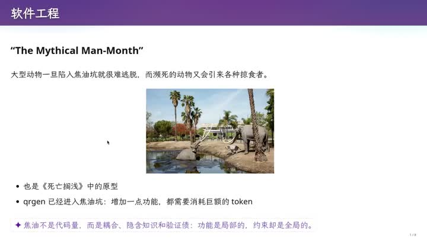](../assets/01-31.jpeg)
{: #l01-src-227}

*图 31：约 01:31:20。标题是 The Mythical Man-Month。他口头讲的是：失败的项目里再加人，只会更失败；AI 已经开始产出 slop 时，再灌 token 也一样。*
{: #l01-src-228}

软件工程研究的是，在这些理解落差确实存在的情况下，怎样把足够大的事情做成。从一个小工具，到教务系统、能产生商业收益的产业产品，再到国民级应用，都需要组织方法。许多方法来自昂贵的失败经验：投入数十亿美元，组织了大量聪明人，项目依然可能陷入焦油坑。
{: #l01-src-229}

软件工程也有具体的技术研究。例如南大一些老师研究程序分析、测试：给定实现代码，能否自动生成更多测试用例，或进行代码审查，在代码不满足规格、可能偏离意图时发出警告？这些技术解决的是前面那张大图中的具体问题。
{: #l01-src-230}

开始做研究时，人容易只盯着局部，忘记软件工程的整体范围。它包含技术，也涉及人类学、社会学和管理学。团队成员可能不听安排、离职或加入竞争对手，这些都带来需要管理的风险。生成式软件工程把部分执行者换成了 AI，又出现了另一种问题：你管理的 agent 常会回答“you are absolutely right”，并顺着指令继续做。
{: #l01-src-231}

软件工程的研究方向很广：AI for SE、SE for AI、架构、可靠性、演化、长期维护、人和社会因素，以及需求。需求阶段的问题需要认真对待，因为早期的一点偏差，可能在后续实现中不断放大，最终影响整个系统。许多大型项目就是在这里没有处理好。
{: #l01-src-232}

[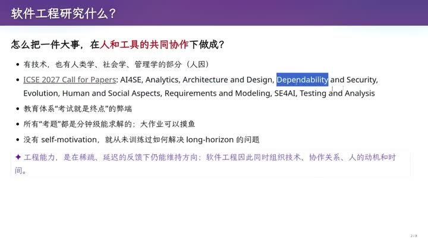](../assets/01-32.jpeg)
{: #l01-src-233}

*图 32：约 01:32。这一页问软件工程研究什么，列出会议征稿里的那些方向。紫色字写：工程能力是在又少又晚的反馈里还能维持方向。*
{: #l01-src-234}

这也让我想到教育方式的问题。长期以来，考试训练的往往是几分钟能解出的题：人五分钟完成，agent 可能五秒钟完成。这样的训练目标，和模型通过短期奖励学习完成任务很接近。模型有更多数据、更明确的反馈，在这类题上就可能比人做得更好。
{: #l01-src-235}

如果没有好奇心去理解世界怎样运行、一个产品怎样开发，也缺少主动探索的动力，就很少有机会训练自己处理长期任务。结果可能是，连需要长时间推进的问题，也做不过 agent。
{: #l01-src-236}

有些软件工程同学抱怨课程像文科。把技术问题放回组织、管理和需求的背景中，就会发现这些内容为什么要学。《人月神话》确实有管理学的性质，里面也包含值得研究的科学问题。
{: #l01-src-237}

大模型时代，软件失败的原因仍然可能是意图、规格、实现之间的转换出了错：做出的规格偏离原来的目标，或者实现无法满足规定的正确性、性能等要求。我认为，当前模型对长期结果的奖励还学得不够，常倾向于机械完成眼前任务。面对 Excel 的例子，无论 GPT、Claude、GLM 还是 DeepSeek，都没有主动提出先设计 DSL。它们有能力设计合适的中间语言，但第一反应仍是直接开始做题。
{: #l01-src-238}

我们还没有充分训练出 AI 的工程品味，但我不认为它永远学不会。既然能解决数学和复杂的编程逻辑，又见过那么多好设计，为什么不能把合适的设计用到当前问题中？我也有一些 skill 在尝试引导它这样做。这让我保有危机感：也许三个月后，甚至这门课还没结束，今天讲的一些问题就已经被新能力改变了。大家也可以继续想这个问题。
{: #l01-src-239}

至少在这次实验里，GPT-5.6 给出的两种设计都很糟糕，我判断它们会失败。至于今后 AI 能否学会工程品味，会怎样改变我们的工作方式，目前还有很多不确定性。
{: #l01-src-240}

最后，古法编程已经死了，agent 在完成单个任务上已经无人能敌。软件工程暂时还没有死。我也不敢说自己的探索都正确，但希望大家经过这门课，能回答导师可能会问的一句话：“为什么我要招你，而不直接买一个 200 美元的 Claude Max？”
{: #l01-src-241}

GPT-5.6 给过一个不错的回答：找到值得解决的问题，把未知转化为成本较低的实验，用证据及时停止错误方向，并对长期结果负责。我认可这个回答；在我的实际使用中，它还没有做到这些。
{: #l01-src-242}

{: #l01-src-243}

*图 33：约 01:39。最后一页的问题是：为什么要招你，而不是买一个 200 美元的 Claude Max。紫色字把“能坐牢”收成责任、最终决策权和停止权，并写了一个词：moral crumple zone。*
{: #l01-src-244}

今天先到这里。我之后会重新剪辑、整理课程，可能先发布保留课堂过程的生肉版，再提供精修版本，大家可以对照阅读和观看。
{: #l01-src-245}

下课。
{: #l01-src-246}
