# 04 · 软件仓库管理 (2)
南京大学 · 蒋炎岩 · 2026 · [原视频](https://www.bilibili.com/video/BV1Q6en6NEUo/)

## 会成长的个人助手 {#l04-src-001}

*原片 00:00:00–00:06:37*
{: #l04-src-002}

这周继续讲版本管理。我已经发布第一个作业，仍按此前约定自愿选做，最终会验收。若学校要求提交成绩，可能让大家提交作品链接，再由我的机器人辅助评分。
{: #l04-src-003}

第一个 lab 叫“会成长的个人助手”。实现方式不限，鼓励大家用 vibe coding 完成。今天也会留时间现场尝试，看看直接让模型开发会遇到什么问题。
{: #l04-src-004}

本周日调休周二的课程，还会讲软件架构，并继续这个例子。个人助手应该先对自己有用。例如，把计算机网络、概率等课程资料放进学习数据库，也可以整理研究组的论文、文献和教科书，形式不限。
{: #l04-src-006}

数据库也能保存个人资料，辅助填写姓名、学号、身份证号和简历等表格。我已经把不少填表任务交给 agent，效率提升很明显。疫情期间招过一位研究生，研究自动填表三年，毕业时 ChatGPT 突然出现，让他担心方向被替代。我劝他先完成答辩。技术变化确实很快。
{: #l04-src-007}

{: #l04-src-008}

*图 1：00:08，仙1-107。讲者在讲台，右侧课件是《Lab1：会成长的个人助手》。*
{: #l04-src-009}

[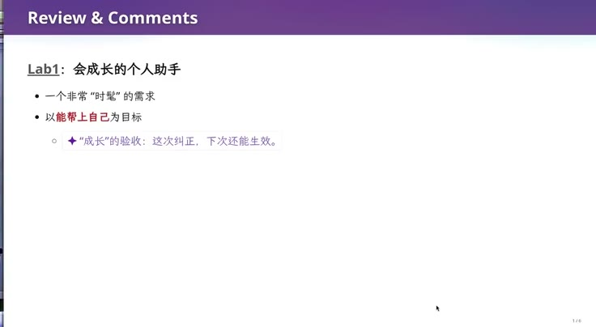](../assets/04-02.jpeg)
{: #l04-src-010}

*图 2：00:08，《Lab1：会成长的个人助手》。时髦的需求，以能帮上自己为目标；“成长”的验收是这次纠正，下次还能生效。*
{: #l04-src-011}

还可以关联 smail 邮箱，收到邮件后自动处理或回复。例如，两周后我半夜发邮件，你的助手能及时回应。用一两百元的小设备放在宿舍，维持后台 agent loop，也能尝试持续运行。再结合个人资料，办理 ehall 事务。
{: #l04-src-012}

也可以做手机端联动，采用网页、Apple 或 Android 应用。把需求说清楚，让 agent 安装所需工具并实现。
{: #l04-src-014}

{: #l04-src-015}

*图 3：01:15，课程页《实验 (1)：会成长的个人助手》的实验要求。五项是个人数据库、持续关联 smail、办理 ehall 事务、手机端联动、能力组合。*
{: #l04-src-016}

这些任务看起来都在 AI 能力范围内，但直接把要求交给模型，它会自行作出许多设计决定。随着功能增加，维护可能越来越困难，最后陷入焦油坑：不断消耗 token 修补，直到决定重做或退回早期版本。让大家经历这种过程，也是实验的目的。
{: #l04-src-017}

下一个 lab 会紧密关联这次的助手：现有功能已经可用时，再加入一个与多处关联、甚至存在冲突的新需求。改动可能让原有设计的问题暴露出来。如果直接删掉重做，就错过了理解软件演化的机会。
{: #l04-src-019}

## 文件装得下什么 {#l04-src-021}

*原片 00:06:37–00:16:12*
{: #l04-src-022}

回顾一下，项目是文件的集合，保存意图、设计和实现等内容。我不喜欢过长的 AI README；它应该清楚说明初衷、产品效果、少量截图和重要设计。
{: #l04-src-023}

假设你有一个创业想法，要说服技术伙伴加入，一份简明 README 可以先讲清最初的 intent。至于数据库、语言、项目结构、模块接口，以及用户从一到一亿时怎样扩展，可以由具备相应能力的人继续设计。这些逐渐形成 spec，再落实为代码。它们现在通常都存在同一个项目目录中。
{: #l04-src-024}

[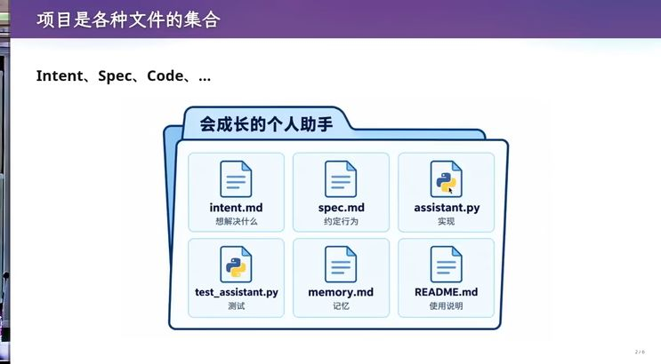](../assets/04-04.jpeg)
{: #l04-src-025}

*图 4：06:14，《项目是各种文件的集合》。文件夹《会成长的个人助手》里是 intent.md、spec.md、assistant.py、test_assistant.py、memory.md、README.md。*
{: #l04-src-026}

用文件系统组织项目，有历史上的便利。早期操作系统主要提供文件存储，关系数据库尚未出现，程序员便用文件管理资料。长期沿用后，这成为习惯。但我认为，文件树未必能充分表达项目需要的信息。
{: #l04-src-027}

文档容易写下意图和规格，测试也能记录输入、输出和运行中必须保持的条件。困难在于这些材料之间还有许多隐含关联。
{: #l04-src-028}

例如，为提高性能，把链表实现换成树，代码改好了，某份 Markdown 却仍写着“使用 linked list 管理”。文档、代码和测试之间本有关系，但文件系统没有强制维护它。随着演化，不一致积累为技术债。后来换了电脑、对话历史丢失，即使仓库留下部分修改记录，也可能难以判断该以文档还是实现为准。
{: #l04-src-029}

[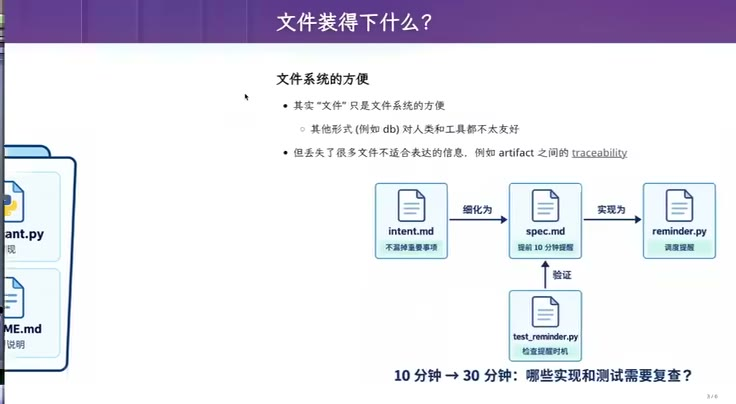](../assets/04-05.jpeg)
{: #l04-src-030}

*图 5：06:50，《文件装得下什么？》。intent.md 细化为 spec.md，实现为 reminder.py，测试从下面验证规格。页底问：10 分钟到 30 分钟，哪些实现和测试需要复查。*
{: #l04-src-031}

软件工程长期研究的 traceability，就是可追踪性：文档中的某个要求、测试用例与代码之间是什么关系，能否在软件演化过程中持续维护？课件引用的 2014 年综述还回顾了更早的研究。
{: #l04-src-032}

[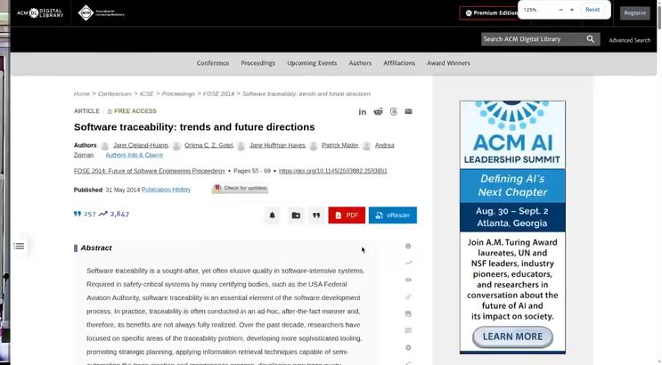](../assets/04-06.jpeg)
{: #l04-src-033}

*图 6：09:49，ACM 上的综述 Software traceability: trends and future directions，FOSE 2014，Jane Cleland-Huang 等，2014年 5 月 31 日发表。*
{: #l04-src-034}

压缩包交换项目难以持续维护后，人们发展出 SVN、Git。那 Git 之后还会有什么？今天会介绍另一种版本管理工具，也讨论更远的可能性。
{: #l04-src-035}

[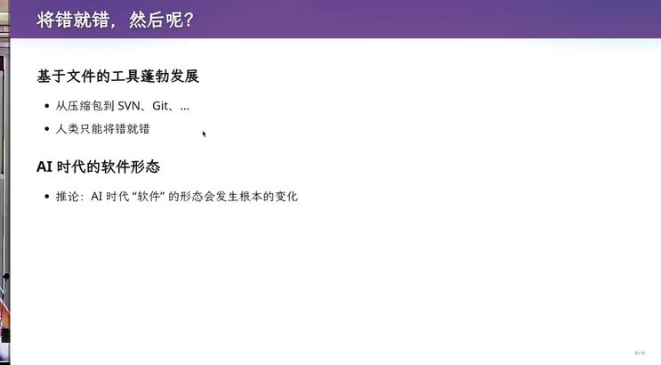](../assets/04-07.jpeg)
{: #l04-src-037}

*图 7：11:13，《将错就错，然后呢？》。基于文件的工具从压缩包到 SVN、Git；推论是 AI 时代“软件”的形态会发生根本变化。页码 4/6。*
{: #l04-src-038}

如果未来人很少直接读写代码，项目能否组织成对象和关系？代码实现某条规格，测试验证某个实现，文档又解释相关测试。它们可以任意连接，甚至形成环，适合表达为图，单一的目录树无法直接呈现这些关系。
{: #l04-src-039}

设想把这些对象放进 `repo.db`。人类现有的 Unix 文件工具未必适合维护它，但可以设计供 AI 使用的工具和反馈机制，让模型学习操作这种仓库。
{: #l04-src-041}

无论项目规模多大，已经运行的软件通常都是逐步增改功能。Git 用文件、目录、快照及其关系记录小步修改：修 bug、改文档，形成提交，再通过 merge、rebase 等方式协作，留下可追踪的历史。这个经验仍可借鉴。
{: #l04-src-042}

未来的目标可以是让 AI 自动维护各种软件材料的一致性：文档描述的数据结构与实现一致，要求的测试确实存在。每次对话提出一个小需求，例如修 bug、调整幻灯片样式，大型项目中通常只有少量内容相关，其他文件不必全部查看。
{: #l04-src-043}

AI 可以根据需求提取相关实现、测试和文档，生成面向这次修改的视图。这借用了数据库 view 的概念：底层数据不变，通过查询以不同方式展示。我们看到的可以是一个说明本次改动及关联关系的看板，而不必直接浏览所有文件和 diff。
{: #l04-src-044}

修改后，`repo.db` 从 v0 进入 v1，相关实现、测试和文档一同更新，从一个一致状态走向另一个一致状态。这是我设想的软件生产方式，人可能不再逐行查看代码。
{: #l04-src-046}

Cursor 等 IDE 已经朝 agent 交互移动。它默认打开类似聊天的 agent mode，我有时并不喜欢，因为仍习惯传统 IDE，想直接控制代码。但未来也许会更多采用这种方式。
{: #l04-src-047}

这种未来会让学生焦虑：既然系统可能很快改变，过去学的知识还有用吗？刚才的设计恰好借用了数据库视图、实体与关系，以及 Git 的增量演化经验。更强模型也许能一次完成巨大的变更，但如何做到还不清楚；至少初期，仍需要这些积累下来的概念与方法。
{: #l04-src-048}

## 同学说，rebase 用不上 {#l04-src-049}

*原片 00:16:12–00:22:55*
{: #l04-src-050}

上节课提到面试者不了解 rebase，有位可能已经毕业的同学提出：学生主要独立做作业，很少协作，自然缺少 merge、rebase 的场景。这个解释合理，课程作业确实可能用不到。
{: #l04-src-051}

[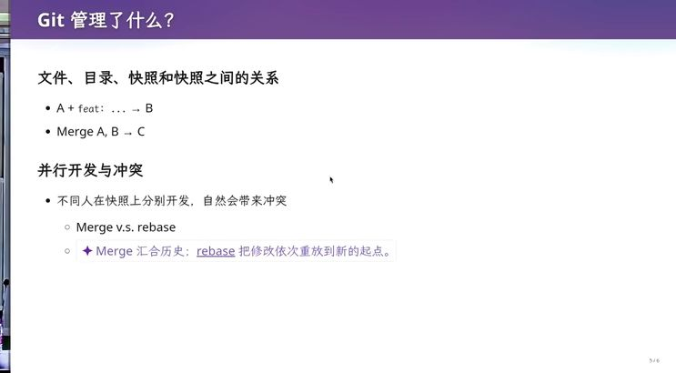](../assets/04-08.jpeg)
{: #l04-src-052}

*图 8：16:12，《Git 管理了什么？》。文件、目录、快照和快照之间的关系：A 加 feat 到 B，Merge A、B 到 C。rebase是把修改依次重放到新的起点。页码 5/6。*
{: #l04-src-053}

我的回应是，可以主动接触开发者社区。很多项目有 `CONTRIBUTING.md`，说明总体结构、分支、提交信息和 PR 流程。某天看到贡献指南要求先 rebase、保持线性历史，就有了理解这个工具的具体机会。多看几个项目，逐渐熟悉这些约定。
{: #l04-src-054}

高中以升学为目标，聚焦老师教的、考试考的内容，有现实理由。到了大学，继续只学明确被要求的部分，便可能错过大量经验。留意外界材料，主动提出问题，能缩小这种差距。
{: #l04-src-055}

[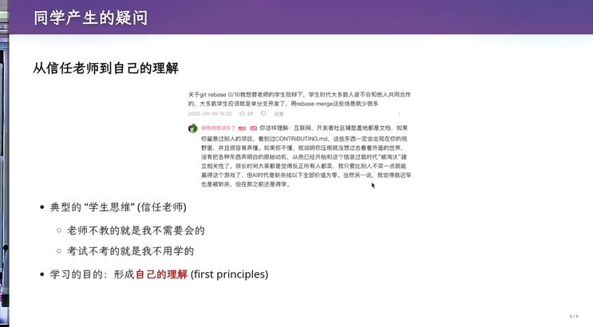](../assets/04-09.jpeg)
{: #l04-src-056}

*图 9：22:26，《同学产生的疑问》。页上贴着关于 git rebase 0/10 的留言，以及讲者的回复：互联网、开发者社区铺天盖地都是文档。下面写着典型的“学生思维”，学习的目的是形成自己的理解。页码 6/6。*
{: #l04-src-057}

我担心 AI 会使部分基础智力劳动失去市场价值。目前可能还未直接影响各位计算机专业学生，但很多从业者面临替代压力。我读过关于会计行业规模的报道，具体人数记不清，也许是千万级；行业顶端与基础岗位的处境并不一样。学习操作系统、编译器和软件工程里的经典知识，最终应形成自己的理解。
{: #l04-src-058}

## 我们想搬的是修改 {#l04-src-060}

*原片 00:22:55–00:29:10*
{: #l04-src-061}

回到版本管理。Git 保存目录快照，两名开发者可以分别提交。合并两条路线时，可以创建一个带两个 parent 的 merge commit，保留两边的历史和合并结果。
{: #l04-src-062}

合并也会影响修改归属的理解。例如 A 合并 B 的代码，没有冲突的部分通常还能追溯原提交；冲突处理后新写出的结果，则由合并者负责。判断某段改动由谁作出，可能因此变得复杂。
{: #l04-src-063}

Rebase 尝试把一条路线上的修改依次移到新的起点。假设 A 改文档、加测试，B 加功能、加测试，可以先尝试把 B 的功能接到 A 之后，再重放 B 的测试。若修改兼容，就得到线性历史；若双方改了同一处，或测试与功能不兼容，就需要处理冲突。
{: #l04-src-064}

Rebase 过程中可能多次冲突，每次都要理解当前状态并解决，可以请 agent 解释。它还会产生新提交：原提交基于旧起点，新提交基于新起点，ID 随之改变。普通 merge 保留已有提交再新增合并点，rebase 则重写这段历史。
{: #l04-src-065}

我们常希望操作的是“修改”，把这项或那项修改移过去。Git 主要用 commit 与 parent 之间的差异来表达 change，没有独立的 change 对象。若把 change 也作为一等公民，会产生怎样的新设计？
{: #l04-src-066}

## Change 是一等公民 {#l04-src-067}

*原片 00:29:10–00:36:51*
{: #l04-src-068}

Jujutsu 可以使用 Git 后端，并引入稳定的 change 身份。Rebase 改变 commit ID 时，change ID 仍可保留；冲突也能被记录下来，让整个重放先继续完成，再统一解决。底层仍能与 Git 协作，但用户对修改的理解更连续。
{: #l04-src-069}

[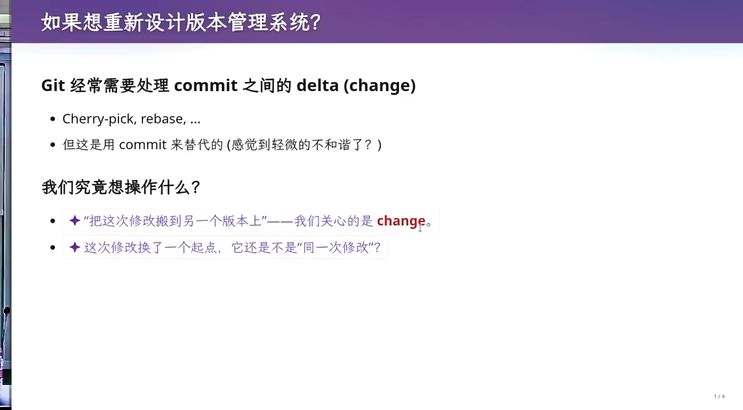](../assets/04-10.jpeg)
{: #l04-src-070}

*图 10：28:40，《如果想重新设计版本管理系统？》。Git 经常要处理 commit 之间的 delta，却用 commit 来替代。我们究竟想操作的是 change。页码 7/8。*
{: #l04-src-071}

[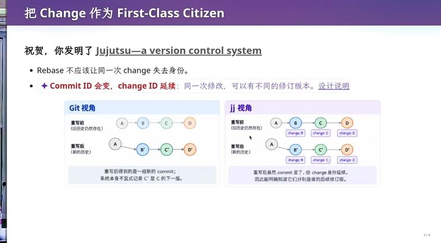](../assets/04-11.jpeg)
{: #l04-src-072}

*图 11：29:55，《把 Change 作为 First-Class Citizen》。左边 Git 重写后得到一批新 commit，C′ 只是 C 的下一版。右边jj 的 commit ID 变了，change ID 还在。*
{: #l04-src-073}

另一个特点是无需 staging area。想象 Git 中一个未完成、尚不能编译的修改，突然需要切换去修紧急 bug：可以先 stash 当前工作。刚修到一半，又来更紧急任务，就可能再 stash。多层未完成工作堆在栈里，管理起来会越来越麻烦。
{: #l04-src-074}

[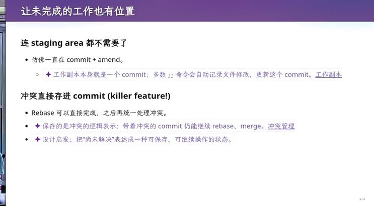](../assets/04-12.jpeg)
{: #l04-src-075}

*图 12：33:39，《让未完成的工作也有位置》。连 staging area 都不需要了，仿佛一直在 commit 加 amend。冲突可以直接存进 commit，rebase 可以先完成，再统一处理冲突。页码 3/8。*
{: #l04-src-076}

Jujutsu 把未完成的工作也视为一个 change。可以把它想成工作区状态不断更新一个工作提交，类似持续 commit 加 amend；这只是理解方式，并不意味着每敲一个字符都留下新的线性历史。这样，尚未完成的工作本身就有位置，无需另外使用暂存区。
{: #l04-src-077}

从“让 change 成为一等公民”出发，就能推导出不同的版本管理方式。可以让 agent 带着这个问题读 jj 的教程，看看它为什么没有 staging area、怎样管理未完成工作。这有助于理解设计取舍，也可能对 agent 协作更友好。
{: #l04-src-078}

我已经形成 Git 的操作习惯，比我更早的一代可能习惯 SVN。即使理解新设计，也未必有时间重新训练操作习惯。这给还没有固定习惯的同学留下机会。
{: #l04-src-080}

[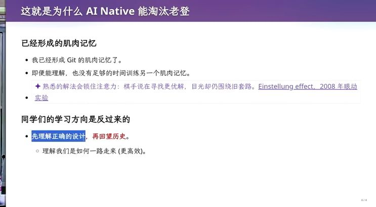](../assets/04-13.jpeg)
{: #l04-src-081}

*图 13：34:54，《这就是为什么 AI Native 能淘汰老登》。已经形成的肌肉记忆很难再训一套。同学们的方向是反过来的：先理解正确的设计，再回望历史。页上还写着 Einstellung effect，2008 年的眼动实验。页码 4/8。*
{: #l04-src-082}

可以先理解新工具试图解决的问题，再回头看历史。Git 解决了当时许多问题，持久化快照模型很有价值；后来 rebase 的使用范围扩大，又暴露了 change 身份等需求。Jujutsu 沿着这些需求继续设计。工具是否合适，要放回它面对的问题中判断。
{: #l04-src-083}

这门课还要再往前问：为 agent 设计版本系统，应该突破什么限制？Agent 已经很擅长操作 Git、处理 rebase，单纯改善人类操作体验，对它的帮助可能有限。
{: #l04-src-084}

## 人是单线程的，Agent 不是 {#l04-src-085}

*原片 00:36:51–00:51:09*
{: #l04-src-086}

过去的版本系统主要面向人。讲并发时，我常把线程比作一个人：读取共享变量，再根据读到的值写入，是不同操作；要把读改写合为不可分割的一步，需要原子操作。
{: #l04-src-087}

可以想象一个人看清目标位置后，闭眼扔粉笔。观察与行动之间，目标可能已经移动。线程也可能在读取后被中断、切换出去，恢复时寄存器里仍是旧值。根据旧值写回，就可能出错。共享内存里的并发需要处理这种时间差。
{: #l04-src-088}

[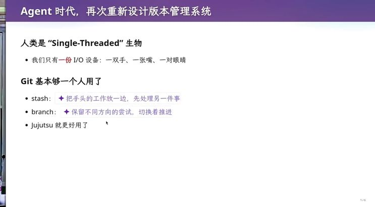](../assets/04-14.jpeg)
{: #l04-src-089}

*图 14：37:24，《Agent 时代，再次重新设计版本管理系统》。人类是 single-threaded 生物，只有一双手、一张嘴、一对眼睛。stash 是把手头的工作放一边，branch 是保留不同方向的尝试。页码 1/8。*
{: #l04-src-090}

人的工作速度和沟通方式影响了工具设计。一个模块可能由十几人维护，写一次修改通常花几十分钟甚至几小时；同事之间先沟通二三十秒，或晨会分配半小时，就能划清工作范围。产生代码的速度通常慢于协调速度。
{: #l04-src-091}

因此，临时 stash 当前工作常是合理的。更紧急任务不断插入并不频繁，栈通常不深；人也可以拒绝插入任务，按优先级排队。Git 的很多习惯建立在这种工作节奏上。
{: #l04-src-092}

Agent 的节奏不同。单个 agent 在已有上下文里可能几十秒甚至几秒就完成修改，同时还容易组织十倍、百倍的团队。测试流水线虽能减慢提交速度，但总体产出仍显著加快，为人设计的协调模型可能跟不上。
{: #l04-src-093}

最直接的方式是沿用人的协作模型：每个 agent 有独立机器或容器、独立仓库，通过 remote、push、pull 交换提交。
{: #l04-src-095}

课堂用两个 tmux session 演示。可以把它们想成两台隔离机器，各自执行任务，另有一个会话负责协调。我当场用 master、slave 给会话命名；名称只是演示里的角色标记。
{: #l04-src-096}

还可以让不同模型分工，例如 Codex 设计、Claude 审查，由主 agent 查看输出、转达意见、协调分歧。若大家直接操作同一仓库，就容易互相影响；独立仓库可以通过远端交换提交，遇到冲突再修，必要时向协调者发消息。这已经能构成简单的多 agent 系统。
{: #l04-src-098}

现有 Git 还提供 worktree。听说这个概念后，可以立即问 agent：“老师说它能改进并行工作，能把两个 tmux 会话放到不同 worktree 吗？”看到 sandbox、container 等陌生方法，也可以带着具体问题尝试。
{: #l04-src-100}

Agent 正在写脚本创建 worktree。每个工作树都可以有自己的工作目录和提交状态，提供隔离的编辑环境。
{: #l04-src-101}

主仓库的 `.git` 通常是目录，包含 objects、logs 等内容；关联 worktree 里的 `.git` 则是文本文件，通过 gitdir 指向相应管理目录。每个工作树有自己的 HEAD、index、logs，又共享仓库对象。这样，提交在本地可以互相访问，不必像独立虚拟机中的仓库那样来回 push、pull。冲突仍需要合并处理，但工作环境更轻量。
{: #l04-src-102}

[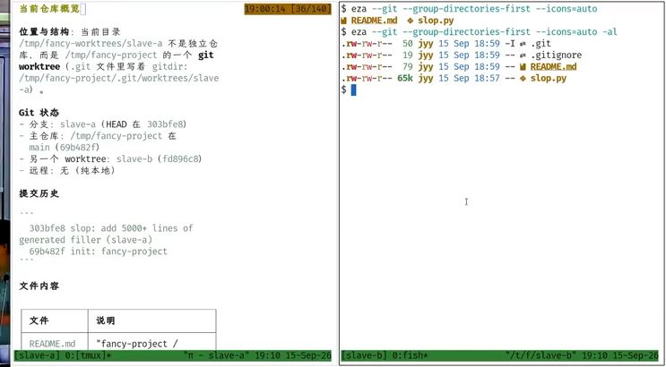](../assets/04-15.jpeg)
{: #l04-src-103}

*图 15：48:29，现场终端。左边 slave-a 的说明写着分支 slave-a、主仓库在 /tmp/fancy-project，另有 worktree slave-b；一次提交写着 add 5000+ lines of generated filler。右边是 jyy 的目录，README.md 和 slop.py。底栏是 tmux。*
{: #l04-src-104}

## 还要不要 blame，要不要先上锁 {#l04-src-105}

*原片 00:51:09–01:03:14*
{: #l04-src-106}

进一步思考 agent team 时，要回到版本控制的动机。人的生产速度有限，沟通也有成本：即使双方都很聪明，也未必能迅速解释清楚一个数学问题。团队越大，协调越复杂，一百人的产出通常达不到十人团队的十倍，有两三倍也可能已经不错。
{: #l04-src-107}

[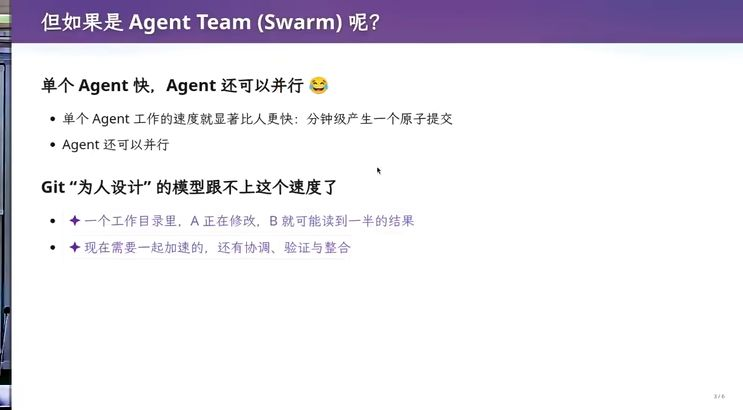](../assets/04-16.jpeg)
{: #l04-src-108}

*图 16：51:06，《但如果是 Agent Team (Swarm) 呢？》。单个 agent 以分钟级产生原子提交，还可以并行。一个工作目录里，A 正在修改，B 就可能读到一半的结果。页码 2/6。*
{: #l04-src-109}

小步提交留下可追溯的修改。出问题时，除了查看代码，还能找到开发者当时的任务、会议和沟通记录，判断误解发生在哪里。bisect、blame 等工具帮助人理解这些历史。
{: #l04-src-110}

如果开发者都是 agent，还需要以同样方式 blame 吗？这是我提出的一个设想：人会因反复出错承担组织责任，agent 却没有同样的处境。相同模型的多个实例虽然回答有随机性，方向上又可能趋同。此时是否可以更关注把问题修好、推动项目前进，减少对“是谁做错”的追究？
{: #l04-src-111}

[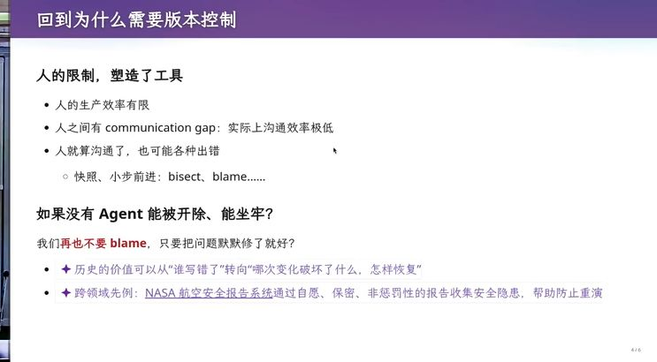](../assets/04-17.jpeg)
{: #l04-src-112}

*图 17：52:21，《回到为什么需要版本控制》。人的生产率有限，沟通效率极低，沟通了也可能出错。页上问：如果没有 agent 能被开除、能坐牢，我们再也不要 blame，只要把问题默默修了就好？历史的价值可以从“谁写错了”转向“哪次变化破坏了什么，怎样恢复”。下面还有 NASA 航空安全报告的例子。页码 4/6。*
{: #l04-src-113}

快照仍然需要。方向走错后，有时恢复旧状态比持续修补更便宜。历史也应保留项目演化的经验，只是价值可以更多放在怎样恢复和改进，而非追责。
{: #l04-src-114}

这又联系到数据库并发控制。一个事务可以先读取数据，做复杂计算，再更新；两个事务交错执行时，可能产生数据依赖或锁等待。发现无法安全完成的依赖关系或死锁时，系统可能中止某个事务并回滚。
{: #l04-src-115}

Git 的协作有点像乐观并发控制：先假设修改不冲突，各自推进，最后检查和合并。团队提前沟通、划分范围后，这种假设常能奏效。数据库里，许多用户只访问各自的数据，也有类似的独立操作场景。
{: #l04-src-116}

Agent 速度提高、任务数量增加，若协调不足，冲突可能更频繁。虽然它能继续修复，但也可以考虑事先加锁：使用共享资源前先 acquire，持有期间其他访问者等待，release 后再继续。把可能冲突的操作先排好顺序。
{: #l04-src-117}

我的设想是，在任务开始前锁定它要使用的范围。主 agent 规划后，子 agent 取得相应锁，读取最新状态、修改、提交，再释放。文件级锁至少可以避免两个 agent 同时修改同一文件；其他不相交任务仍能继续执行。这样的悲观控制可能适合某些高速协作场景。
{: #l04-src-118}

[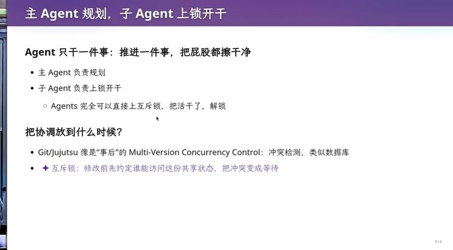](../assets/04-18.jpeg)
{: #l04-src-119}

*图 18：58:35，主 Agent 负责规划，子 Agent 分工执行；用互斥锁和并发控制协调共享状态。*
{: #l04-src-120}

锁会让冲突范围内的操作串行，限制并行度。但若系统里还有许多互不依赖的任务，即使分别持锁，整体仍可以高效推进。操作系统中的这些经验，为重新设计版本管理提供了思路。
{: #l04-src-121}

从需求出发，我们要管理快照、版本、change，以及越来越快的 change。Git 是一种路线，结合其他并发控制方式还可能有不同设计。即使 SQL 已经交给 AI 写，数据库里的事务、advisory lock 等概念仍能帮助我们思考新问题。
{: #l04-src-122}

[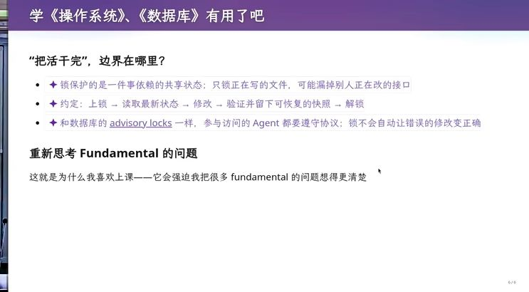](../assets/04-19.jpeg)
{: #l04-src-123}

*图 19：63:34，《学〈操作系统〉、〈数据库〉有用了吧》。锁保护的是一件事依赖的共享状态。约定是上锁、读最新状态、修改、验证并留下可恢复的快照、解锁。页上写着，这就是他喜欢上课的原因。页码 6/6。*
{: #l04-src-124}

这也是我喜欢讲课的原因。备课迫使我重新检查熟悉的设计，并把上层思想用大家能理解的逻辑讲出来。我未必每次讲得好，也欢迎借助 AI 再核对和理解。
{: #l04-src-125}

关于版本管理，我们从历史动机讲到 Git，再讨论了未来可能的设计。
{: #l04-src-126}

## 斩杀线还没到团队管理 {#l04-src-127}

*原片 01:03:14–01:08:00*
{: #l04-src-128}

版本控制只是工具，更难的是组织任务和管理进度。目前，一句话还难以直接生成微信那样的高质量产品。只要整体产品设计和团队管理仍需要人，软件工程就还有要解决的问题。
{: #l04-src-129}

模型可能继续变强、更小、更快，也许有一天会改变这个判断。但今天，把大产品分为可协作的任务仍很困难。人数增加，潜在沟通关系按平方级增长。能把百人团队组织为若干小组，并让各组成果最终拼成产品的负责人很稀缺，带好小团队也不容易。《人月神话》讨论的正是这些问题。
{: #l04-src-130}

[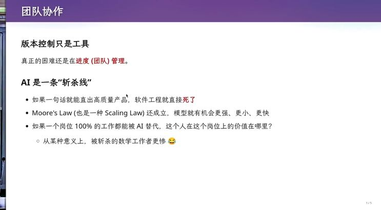](../assets/04-20.jpeg)
{: #l04-src-131}

*图 20：64:49，《团队协作》。版本控制只是工具，真正的困难在进度管理。AI 是一条斩杀线。如果一句话就能直出高质量产品，软件工程就直接死了。摩尔定律，也是一种 scaling law，还成立。页码 1/5。*
{: #l04-src-132}

[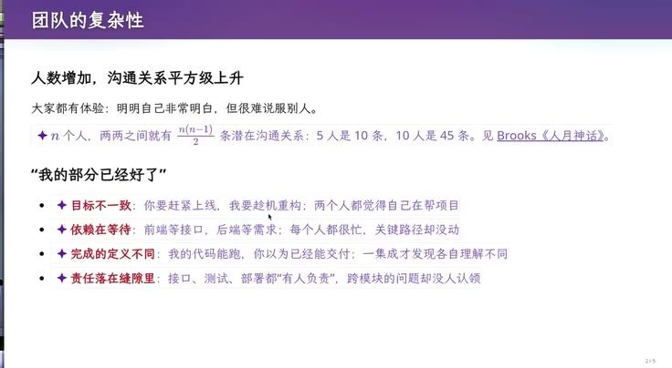](../assets/04-21.jpeg)
{: #l04-src-133}

*图 21：66:25，《团队的复杂性》。n 个人，两两之间有 n(n−1)/2 条潜在沟通关系。页上写 5 人是 10 条，10 人是 45条，并指向 Brooks《人月神话》。下面是目标不一致、依赖在等待、完成的定义不同、责任落在缝隙里。页码 2/5。*
{: #l04-src-134}

每个人都把分内工作做好，仍可能因为不了解其他人的修改而发生冲突，例如自己写的测试在另一部分代码上无法通过。
{: #l04-src-135}

现在就可以用 agent 练习组织能力：怎样安排两个、三个或更多 agent，怎样确定任务边界，何时提交、何时合并。把前面版本管理的概念带入实际流程，自己担当协调者。
{: #l04-src-136}

版本控制凝结了长期工程经验，但工具本身不会替你完成管理。需要在使用中形成自己的判断。
{: #l04-src-137}

[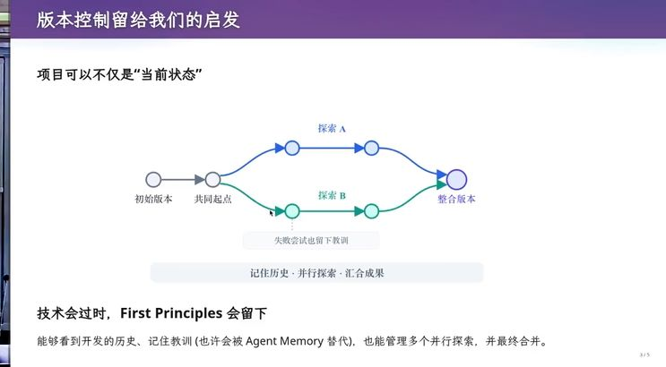](../assets/04-22.jpeg)
{: #l04-src-138}

*图 22：67:19，《版本控制留给我们的启发》。项目可以不仅是当前状态。从共同起点分出探索 A 和探索 B，失败尝试也留下教训，再汇成整合版本。技术会过时，first principles 会留下。页码 3/5。*
{: #l04-src-139}

## 小朋友的汉诺塔，也可以是一段历史 {#l04-src-140}

*原片 01:08:00–01:18:13*
{: #l04-src-141}

再看一个看似无关的例子：只能沿规定方向移动的汉诺塔。普通解法中，大盘可能直接移到目标柱；加入单向约束后，这一步未必允许，必须安排中间移动。即使盘数不大，要输出完整方案或步数，也需要理解递归关系。
{: #l04-src-142}

思考时可以先看最大盘。为了让它沿允许方向逐步到达目标，要先把小盘移开，再移动最大盘，然后重新安排小盘。最大盘需要走的方向决定了中间几个子问题。
{: #l04-src-143}

我写了一个演示程序，按这个递归关系执行。最大盘的必要移动无法省去，再结合对子问题的归纳，讨论方案为什么最优。今天主要借它说明产品设计，算法细节先不展开。
{: #l04-src-145}

如果把这个教学工具提供给小朋友，代码应能随时编辑，画面随执行变化。写错以后，可以拖动时间轴，定位违反汉诺塔规则的语句和状态，帮助学生自己理解问题。
{: #l04-src-146}

[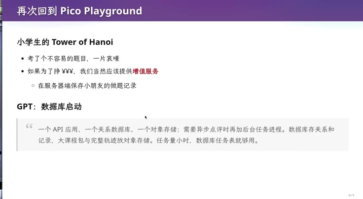](../assets/04-23.jpeg)
{: #l04-src-147}

*图 23：69:04，《再次回到 Pico Playground》。小学生的汉诺塔，考了个不容易的题目，一片哀嚎。如果为了挣钱，就在服务器端保存小朋友的做题记录。下面是 GPT 给的架构：一个 API 应用、一个关系数据库、一个对象存储。页码4/5。*
{: #l04-src-148}

还可以增加 AI 助教。学生实在做不下去时请求指导，系统消耗模型 token 并记录费用。我开玩笑说可以收取服务费，但还是希望成本尽量低。教师的价值在于把教学经验转化为提示，让助教找出学生卡在哪里，给出个性化指导。
{: #l04-src-149}

这就需要一个信息系统。我让学生设计，也请 GPT 梳理需求。它给出的常见架构是 API 应用、关系数据库、对象存储，异步点评时再加后台任务。数据库保存关系和记录，课程包与完整轨迹放对象存储，任务少时用数据库任务表。这是正常方案，但我并不喜欢它用于当前探索。
{: #l04-src-150}

我想到 Overleaf 支持通过 Git 获取文档。修改学生论文时，可以 clone 到本地，让 Codex 和子 agent 分别检查 tex 文件的语法，按提示改进质量，省去在网页中逐处操作的负担。
{: #l04-src-151}

Pico Playground 也有版本管理需求：学生编辑后运行、切换或暂停，可以保存一个状态；申请 AI 助教时，把点评关联到当时的版本，必要时保留分支。AI 点评的成本远大于保存这些历史的成本。数据库可能在压缩、性能上有优势，但早期我更关心如何记录演化过程。
{: #l04-src-152}

甚至可以先把学生练习历史放在一个代码仓库中，探索目录、提交说明和文件组织，等结构稳定后再考虑迁移数据库。理解 Git 和协作方式，就有机会想到不同于默认架构的方案。
{: #l04-src-153}

[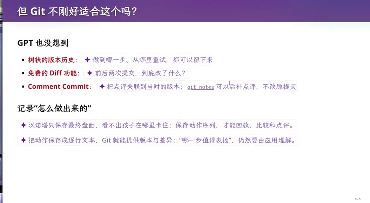](../assets/04-24.jpeg)
{: #l04-src-154}

*图 24：75:20，《但 Git 不刚好适合这个吗？》。GPT 也没想到：树状的版本历史、免费的 diff、用 git notes 把点评补到当时的版本上，不改原提交。只保存最终盘面，看不出孩子在哪里卡住。页码 5/5。*
{: #l04-src-155}

[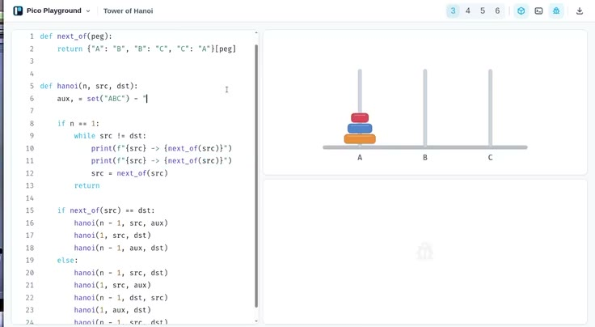](../assets/04-25.jpeg)
{: #l04-src-156}

*图 25：76:00，Pico Playground 里的 Tower of Hanoi。三个盘子还叠在 A，代码按单向规则走 next_of。*
{: #l04-src-157}

[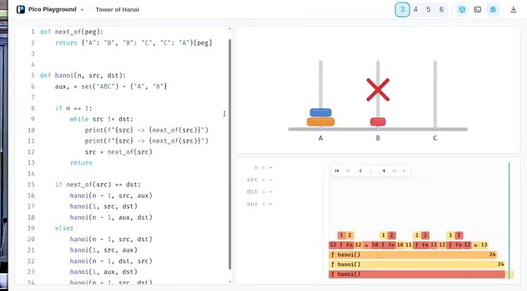](../assets/04-26.jpeg)
{: #l04-src-158}

*图 26：78:37，汉诺塔程序运行到违规步骤时显示红色叉号，下面的时间轴保留了函数调用和出错位置。*
{: #l04-src-159}

## 你就是包工头，现在就开干 {#l04-src-160}

*原片 01:18:13–01:29:39*
{: #l04-src-161}

现在现场开始做个人助手。项目早期，需求还没对齐，先与一个能力较强的 agent 多轮讨论更合适。我没有提前演练，直接打开课程作业，观察它怎样响应。
{: #l04-src-162}

[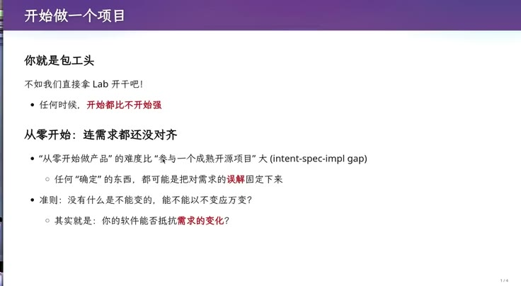](../assets/04-27.jpeg)
{: #l04-src-163}

*图 27：78:15，《开始做一个项目》。你就是包工头。任何时候，开始都比不开始强。从零开始，连需求都还没对齐。准则是没有什么是不能变的，能不能以不变应万变。页码 1/4。*
{: #l04-src-164}

一种方式是把要求直接提交，看它会怎么做；大家也可以亲自体验。更强的模型有时会先进入规划，询问事实，再组织工作流。例如复杂任务中，可以生成 JavaScript 或 TypeScript，通过包含自然语言任务的 agent 调用、循环等结构协调工作。
{: #l04-src-165}

眼前这个 agent 已经开始执行，输出速度大约每秒 300 token。先让它继续。
{: #l04-src-166}

这也暴露了提示词工程的问题：模型会努力满足上下文中的具体词句。把一份开放的讨论稿直接当要求交给它，它可能过早把每条建议落实成固定设计，最后表面符合指令，却偏离你真正的目标。
{: #l04-src-167}

作业最重要的目标是“持续为你工作的个人助手”，后面几项只是可能的方向。要先问自己：最近一个月最大的痛点是什么，第一个功能应该解决什么？对许多同学来说是学习：收集外部资料，分层归档，提供好用的界面，提高学习效率。
{: #l04-src-168}

我问正在开发的 agent：我更想要一个能收集外部信息、综合整理、依据学习进度提供帮助的助手，当前哪部分支持它？它却在忙数据库、smail 和邮件回复。那些功能符合条目，但未必对应我脑中的优先需求。
{: #l04-src-169}

例如提 ehall，只是想用它检验通用的浏览器办事能力，能把个人资料填进网页即可。未必需要一开始就围绕教务系统设计大量专用结构。README 看起来每条都实现了，仍可能得到不想要的产品。
{: #l04-src-170}

我还发现它最初没有初始化 Git 仓库。成熟团队通常在写代码前就会讨论项目如何管理、怎样协作。模型却可能把任务当成一次性实现，直接开写；这也是需要提前说明的内容。
{: #l04-src-171}

这次演示消耗了一些 token。参与 DeepSeek Harness 内测获得的一千元额度还没用完，足够继续尝试。开始项目时仍应先建立仓库，再明确下一小步要验证什么，逐步推进。
{: #l04-src-172}

从零开始容易生成难以维护的东西，在成熟项目中完成局部任务却可能更顺利。设计架构时，我会问：当未来需求明显变化，这套方法能否承受？
{: #l04-src-173}

教学助手将来可能改成文字、图像或交互式指导，合作方式也可能变化。希望架构用尽量少的修改应对这些变化。理解现有操作系统、数据库为什么这样设计很重要，软件工程还要进一步考虑未来需求。
{: #l04-src-174}

## 记住现在，记住历史，记住教训 {#l04-src-175}

*原片 01:29:39–01:38:29*
{: #l04-src-176}

版本管理要记住现在、历史和教训。仓库保存当前材料；历史让删掉或放弃的内容可以恢复；失败分支和后续选择说明项目为什么走到这里。这些经验能帮助我们决定下一步，而不只是保留最终代码。
{: #l04-src-177}

演示里的助手已经实现了不少条目，例如奖学金申请、退课，还生成一次提交。它报告了 HTTP 手机服务、Pi 集成和部分尚未接通的邮箱能力，并划分入口、编排、能力、数据等层。我没有继续逐项审查，但它已经很像一个具体业务系统，可能把早期方向锁得太死。
{: #l04-src-178}

[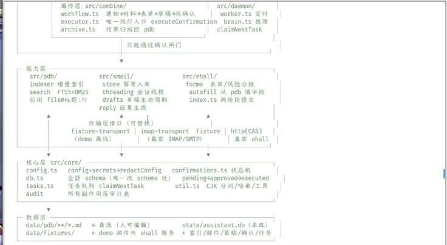](../assets/04-28.jpeg)
{: #l04-src-180}

*图 28：约 92 分钟，agent 写在屏幕上的分层。编排层、能力层、核心层、数据层分开，ehall、smail、确认和归档都进了这张图。这是它跟着实验条目长出来的结构，不是讲者事先画的。*
{: #l04-src-181}

从零开发时，可以先做 MVP，即最小可行产品。产品开发的一大风险是做出没人需要的东西。最小版本逼迫我们先想清楚，什么需求确实必须验证，避免把所有建议一次做完。
{: #l04-src-182}

[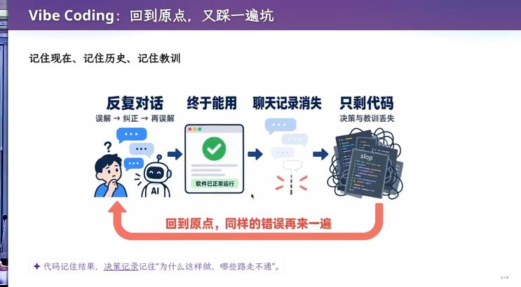](../assets/04-29.jpeg)
{: #l04-src-183}

*图 29：89:45，《Vibe Coding：回到原点，又踩一遍坑》。反复对话，终于能用，聊天记录消失，只剩代码，同样的错误再来一遍。代码记住结果，决策记录记住为什么这样做、哪些路走不通。页码 2/4。*
{: #l04-src-184}

如果最重要的是提高学习和工作效率，第一个 MVP 也许用文件就够了。以后资料规模和组织方式稳定，再提取数据库。过早引入数据库，每次改结构都要迁移；文件目录对人更直观，调整负担较小。应当选择自己能理解、又能验证需求的简单方案，先接通资料和通知的流转。
{: #l04-src-185}

[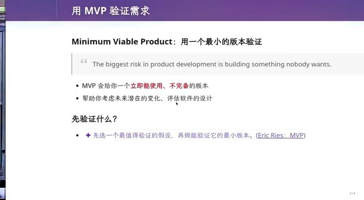](../assets/04-30.jpeg)
{: #l04-src-186}

*图 30：92:36，《用 MVP 验证需求》。The biggest risk in product development is building something nobody wants. 先选一个最值得验证的假设，再做能验证它的最小版本。页上署名 Eric Ries。页码 3/4。*
{: #l04-src-187}

我自己的邮件助手目前也没有数据库：收取邮件后，把邮件 ID、分类、是否垃圾邮件、回复草稿等同步到共享云盘，再由后续步骤处理。需要明确的是有哪些处理阶段、怎样协作、哪些材料通过云盘传递。希望邮件资料都与云盘同步，本身就是会影响架构的需求。
{: #l04-src-188}

眼前方案把个人资料、邮件归档、索引和草稿放进 `system.db`，现在未必有明显问题。但架构好不好，还要看需求变化时的修改代价。可以一开始大步做全，再背着积累的问题维护；也可以从最小需求出发，逐渐形成合适的结构。
{: #l04-src-189}

学生练习历史用 Git 管理后，许多操作自然变得容易。在真正遇到性能瓶颈前，我暂时不想迁移数据库。这说明早期提示词会深刻影响项目走向：直接把整份 README 交给模型，和先要求验证一个 MVP，会得到不同结果。
{: #l04-src-190}

下一课在周日，继续讲软件架构和构造。今天下课。
{: #l04-src-191}
