# 06 · 需求和架构 (1)
南京大学 · 蒋炎岩 · 2026 · [原视频](https://www.bilibili.com/video/BV1Rch76WEfQ/)

## 后面发现错了，会把前面染掉 {#l06-src-001}

*原片 00:00:00–00:03:58*
{: #l06-src-002}

上一节回顾了软件工程的起源：软件危机让人们意识到，需要工程化的方法解决开发中的问题，也读了 Royce 的论文。从 intent 到 spec，再到 implementation，软件逐渐形成；实现以后还要维护，生命周期并未结束。这些阶段连接起来，就像一个向下流动的瀑布。
{: #l06-src-003}

需求阶段形成的认识逐渐进入 specification，建立起依赖；实现阶段又产生模块、函数、代码、测试等 artifact。它们与前面的产物存在直接或间接的 data dependency，交织成网。理解这张网，是理解软件工程的一个起点，Royce 批评的开发模式也与它有关。
{: #l06-src-004}

{: #l06-src-005}

*图 1：00:08，仙1-107。讲者在讲台，右侧课件是《上一讲的三个关键词》。*
{: #l06-src-006}

[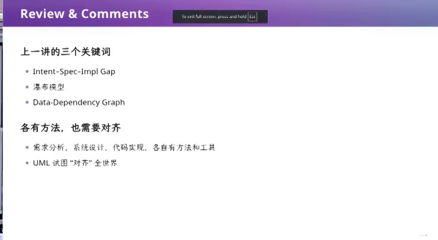](../assets/06-02.jpeg)
{: #l06-src-007}

*图 2：00:02，《上一讲的三个关键词》：Intent-Spec-Impl Gap，瀑布模型，Data-Dependency Graph。需求分析、系统设计、代码实现各有方法和工具，UML 试图对齐全世界。*
{: #l06-src-008}

如果到后期才发现问题，向前追溯，可能是需求或设计出了错。依赖它的下游部分也会被 taint，失去有效性，重做成本很高。软件工程研究各阶段怎样降低这种风险：需求与设计时使用什么方法，怎样用 checklist、怎样管理团队，编码时怎样测试、自动分析。这些内容展开，就是整个软件工程领域。
{: #l06-src-009}

pre-AI 时代有一个值得了解的尝试。人和人难以对齐，如果只留下代码、不写文档，出错后甚至不知道该追溯到哪一次决定，于是有了 traceability，可追踪性。理想情况下，每个测试、每段代码都能关联到设计，让人知道修改会影响谁、设计变化需要调整哪些测试。再用带明确语义的结构化语言表示这些关系，就有了 UML 这样的探索，希望对齐不同人的软件工程实践。
{: #l06-src-010}

## 椅背是软的，软件不是 {#l06-src-012}

*原片 00:03:58–00:08:40*
{: #l06-src-013}

软件工程还有一个困难：软件“不软”。教室里的椅背有弹性，靠下去会变形，起来后弹回，下次还能坐。软件却是纯粹的逻辑制品，程序有形式语义，细微差错就可能破坏行为。写程序时，大家通常没有考虑过内存里的一个 bit 翻转以后，它还能不能正确运行。
{: #l06-src-014}

例如从 stdin 读入 n，再循环读取 n 个数组元素。输入原本是 n = 1，如果程序运行在卫星上，宇宙射线使这个 unsigned integer 的最高位变成 1，n 就突然成了很大的数。程序可能不停读输入，没有输入就等待、hang 住，也可能在读了 100 或 1000 个数以后发生 memory error。
{: #l06-src-015}

这是运行环境中的极端情况。数据中心也会遇到硬件问题：制程越来越先进，某些密集指令在热噪声等条件下可能产生 silent error，同一条指令在不同机器上结果不同，甚至持续运行一段时间才暴露制造缺陷。软件既承载复杂逻辑，又要承载客户需求。今天会用教务系统说明怎样设计、怎样避免它越堆越难维护，这也是软件工程的问题。
{: #l06-src-016}

[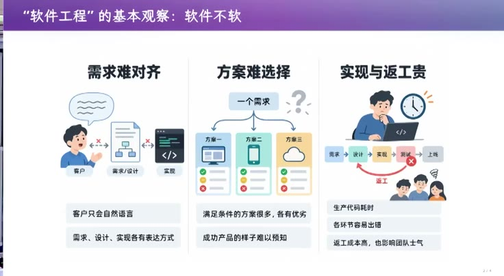](../assets/06-03.jpeg)
{: #l06-src-017}

*图 3：04:30，《“软件工程”的基本观察：软件不软》。需求难对齐，方案难选择，实现与返工贵。客户只会自然语言；满足条件的方案很多，各有优劣；返工成本高，也影响团队士气。页码 2/4。*
{: #l06-src-018}

计算机专业通常都要上软件工程课，但虽然这门学科覆盖整个生命周期，学习却被迫从编码开始。不理解代码，没有经历开发中的困难，很难判断一个产品能否实现、需要多少成本，也很难做好产品经理。过去往往先学基础、较老、仍有人使用的语言，再逐渐理解已有方案如何失败、新语言为什么出现，一点点往上走。
{: #l06-src-019}

## 几个字，MVP 就走向另一边 {#l06-src-021}

*原片 00:08:40–00:15:03*
{: #l06-src-022}

今天的主题是需求、产品与架构，主要处于 intent 到 spec 的阶段，也是系统从零开始时重要的方向选择。前面先讲版本管理，因为做 lab 或新项目都要从空仓库出发。接下来要决定软件往哪里走，就像船先决定航向；最初的选择会深刻影响后续开发。
{: #l06-src-023}

需求、产品、架构很难定量研究，今天只能借例子来讲。教材常列出需求要做什么、产品要满足什么。南京大学有很多软件工程研究者，也号称软件工程世界第一；但若统计计算机软件方向的论文，大部分仍集中在编码与 implementation 相关问题上。
{: #l06-src-024}

[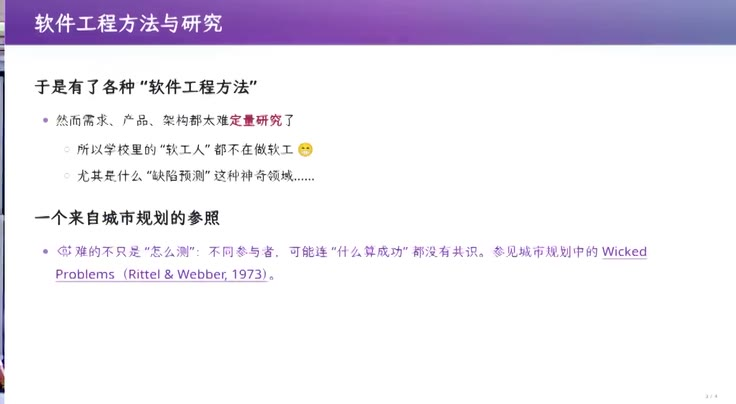](../assets/06-04.jpeg)
{: #l06-src-025}

*图 4：06:00，《软件工程方法与研究》。需求、产品、架构难以定量研究，不同参与者对成功标准也可能缺乏共识。课件引用城市规划中的 Wicked Problems（Rittel 与 Webber，1973）。*
{: #l06-src-026}

也有人从 NLP 出发，研究怎样从数据中自动推导 traceability，毕竟它对软件很重要；也许 GPT-6 就能完成一些工作。今天更想讲的是：在 AI 时代，生成目标明确的代码已经很便宜。只要边界划清，我现在确实不再逐行看实现。稍后会展示 GPT-6 昨天写的代码，形式已经超出人类容易理解的范围，却能正确运行。只要知道怎样做有效 validation，就能并行使用 agent swarm，构造有一定质量保证的软件。
{: #l06-src-026-body}

影响系统能走多远的压力，就转向需求与架构。做 minimum viable product 当然有用，它能快速打通一条 intent、spec、implementation 的切片。MVP 不完整，应先完成最重要的功能，通常不必一开始就调按钮样式。样式依赖界面设计，界面又依赖功能；上游尚未确定时先做细节，设计一变，就可能白做。
{: #l06-src-027}

[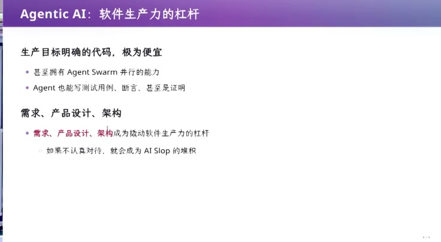](../assets/06-05.jpeg)
{: #l06-src-028}

*图 5：11:40，《Agentic AI：软件生产力的杠杆》。目标明确的代码生成成本很低，Agent Swarm 可以并行工作，agent 也能写测试、断言甚至证明。需求、产品设计、架构对最终效果的影响随之增大；忽略它们，产物就可能不断堆积成 AI slop。*
{: #l06-src-029}

我们通常都不愿花精力研究即将丢弃的东西，所以 MVP 应选择重要功能，先做出能运行的版本。但今天的 AI 未必主动从需求、产品设计和架构角度考虑，往往需要 prompt 明确指出。哪怕只多几个字，结果都会不同。同一个 coding agent 或 lab1 随身 agent，要求 client-server 架构，或要求 CLI，功能可能接近，实现方向却差很多。CLI 可能引入类似 Claude Code 使用的 JavaScript 命令行库；client-server 可能先设计存储、选数据库。一旦 db.ts 写出来，它就进入 agent 的上下文，后面的需求都会带着这段历史继续发展。
{: #l06-src-030}

这涉及 technical debt，技术债。做决定时就可能背上债务，而做 MVP 时未必知道这个决定好不好。决定来自需求：你想做学习助手，还是已经进科研组，需要帮助读论文，软件的走向会不同。产品设计也一样。最初只供自己使用的工具，可以贴合自己的知识和偏好；换一个人，可能就不习惯这套工作方式。
{: #l06-src-031}

还需要考虑软件以后会变成什么样，所以我会用两讲讨论需求和架构。刚才现场也出了故障：系统 UI 正常，OBS 仍在推流，但键盘、鼠标都失效，插入新鼠标也没用。我让 AI 查日志诊断，还不确定能否找到原因。这提醒我们，软件需要足够的日志。至少我观察到，如果不明确告诉 AI，它可能生成完全没有日志的系统，这也是留下的技术债。接下来回到需求工程。
{: #l06-src-032}

## 教务系统里的需求一层层叠上去 {#l06-src-034}

*原片 00:15:03–00:32:28*
{: #l06-src-035}

需求工程过去很难讲。学生通常不会面对真实客户，从入门到毕业的能力增长，也未必足以独立承接完整系统。AI 之前，只有少量开发者经过几年开源社区积累，才成为有付费用户的独立开发者。现在独立开发者数量猛增，倒是付费用户开始瑟瑟发抖。
{: #l06-src-036}

[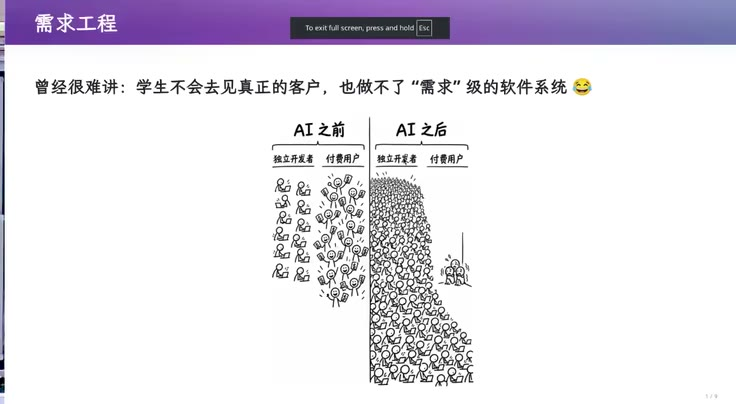](../assets/06-06.jpeg)
{: #l06-src-037}

*图 6：15:02，《需求工程》。曾经很难讲：学生不会去见真正的客户，也做不了“需求”级的软件系统。图是 AI 之前和AI 之后，独立开发者与付费用户的数量。页码 1/8。*
{: #l06-src-038}

今天用教务系统作例子，可以称得上需求爆炸。我昨天打开时发现登录方式变成了扫码，这几年它一直在更新，还增加了 AI 搜索。我试着问“仙林教学楼的灯一直没修，应该打给谁”，它开始理解问题。我知道可能涉及基建处，之前也在平台上提过，但基建处退回说不归他们管，还得再打电话确认。
{: #l06-src-039}

再问“我现在在上什么课”。我不确定它有没有载入个人上下文，但我已登录，也许能读到。它找到了本科教师课表，内容正确。我此前一直在快捷搜索栏等入口出现就点击，没注意新增了这个功能。教务系统是典型的需求不断叠加的系统，开发和算力应该花了不少钱。我甚至觉得，有些功能的投入还不如给大家 token 补贴：刚才的查询若用 Pi 完成，可能只花一两毛钱。
{: #l06-src-040}

[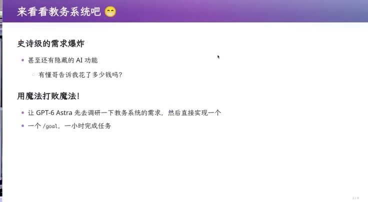](../assets/06-07.jpeg)
{: #l06-src-041}

*图 7：15:43，《来看看教务系统吧》。史诗级的需求爆炸，甚至还有隐藏的 AI 功能。用魔法打败魔法：让 GPT-6 Astra先去调研教务系统的需求，然后直接实现一个。一个 /goal，一小时完成任务。页码 2/8。*
{: #l06-src-042}

这是一个典型业务系统。我收藏了教学任务入口，里面还能看学生信息，但不点开，因为可能显示电话号码，我觉得这项设计有问题。上次演示过让 AI 填教学周历，目前还没人审计填写内容。相比这些功能，我更希望教室的灯先修好。
{: #l06-src-043}

界面里有编辑联系方式、当前教学学期、最新排课学期、历史授课信息等功能。历史授课信息需要选择学年学期，体验有些别扭，但也能看出做过需求分析。期末考试签到表只能在相应阶段打印，未到开放时间就弹窗提示。编辑教材本应打开另一页面，现场尝试却没成功；大纲能查看。教学安排需要先选教学班，页面等了很久才刷新出来，这样的响应速度可能不符合需求。
{: #l06-src-044}

[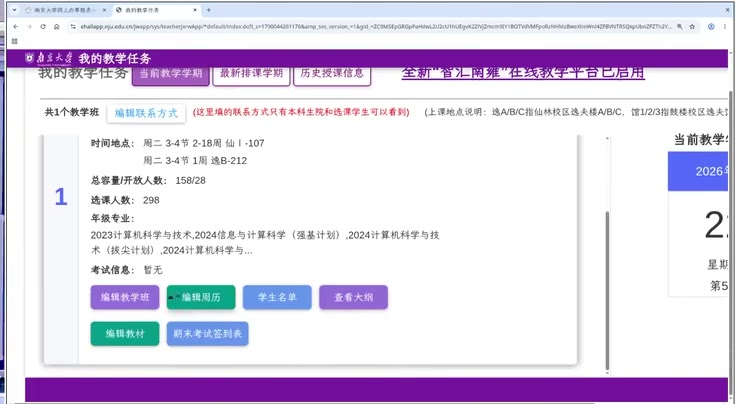](../assets/06-08.jpeg)
{: #l06-src-045}

*图 8：19:10，教务系统“我的教学任务”。画面列出周二 3—4 节的仙Ⅰ-107 与逸B-212 教室；“总容量／开放人数”为 158/28，选课人数为 298。下方有教学班、周历、学生名单、大纲、教材和考试签到表入口。*
{: #l06-src-046}

再看看助教功能。我这门课好像没有助教，搜索框要填学号，不能直接搜教师姓名。系统还区分课内教学班与慕课助教。可以想象需求怎样叠加：疫情以前没有慕课，后来要求给教师加慕课，再加慕课助教，又要求它与普通教学班助教分开，于是长出了新的功能。现场点击删除、新增，都提示“请在可维护时段内操作”，课内教学班也是，现在已不能申请助教。看到这些页面，就能理解为什么过去向没有实际项目经验的学生讲需求工程很难。
{: #l06-src-047}

学生通常也不敢承诺：“给我 20 万，我找几位同学，把南大的教务系统做完。”合同若规定到期必须满足功能和非功能要求，你可能承担不起责任。成年人当然可以开公司签协议，但未必敢接。现在可以先让 agent 试试。
{: #l06-src-049}

我让 GPT 探索教务系统里与教师相关的功能，只看教师端，生成一份《南京大学本科教学服务平台需求说明书》。这就成了身边真实系统的需求报告案例。软件工程课可能展示企业文档片段，今天可以直接把身边的系统变成学习材料，无需只寻找远处的经典案例。
{: #l06-src-050}

文档目录包括调研方法、证据边界、业务目标、成功标准、详细用例规约、功能需求目录，最后还有术语和配套文件。乍看像突然生成了很多 slop，但 GPT 确实懂这些工程要求的用途。面对客户时，术语表就能帮助双方对齐理解；这还处于意图沟通阶段，不必等到 UML 才开始澄清概念。
{: #l06-src-051}

功能需求目录还做了 traceability。每个需求点都有明确 ID，并关联前面的角色、参与者或业务目标。编号让关联可引用、可检查，比仅在自然语言中说“教学班与学生管理有关”更清晰。
{: #l06-src-052}

{: #l06-src-053}

*图 9：25:06，需求说明书第 6 节，功能需求目录。6.1 是门户与身份。FR-001 到 FR-003，列着优先级、系统应提供的行为、候选验收口径和依据。*
{: #l06-src-054}

例如“门户与身份”要求提供分类、服务检索和应用入口；同一服务支持多种已分配身份时，要允许选择并显示当前身份。这些细节若不说清，就不知道系统到底该不该做。刚才打开教师课表时，确实出现身份选择，我选了本科生教师。服务页还要显示当前学期、学年、届次或业务批次，并允许在授权范围内切换。这来自领导或一线教师对实际使用的期待。教务系统中的下拉框、学期选择，说明设计者考虑过用户在当时会想做什么。
{: #l06-src-055}

教学周历、课程与大纲、教材选用，每项都写清楚很 tedious，学生可能觉得对学分和能力提升没有直接帮助，还不如做一道算法题，为保研机试多拿分。但规模一大，这类规格就变得必要。数字逻辑电路、计算机系统基础的作业也需要需求文档。做 Full System Emulator，可能是大家第一次面对较长的规格；更早的 OJ 题通常很短，输入、输出明确，几个空格分隔的整数用 cin 就能读完。
{: #l06-src-056}

计算机系统基础要求实现 NEMU。第一个 lab 可能只做调试器，不必解释指令；第二个实验开始实现指令解释，看似一句话，却必须先明白“指令”的行为，而这些行为在更大的文档里。当系统达到一定规模，各种训练就相通了，学这门课也在学习一部分软件工程。
{: #l06-src-057}

需求报告里还有验收场景与结构化清单。管理者可以把前 20 项交给一个团队、后 20 项交给另一个团队，追踪完成情况，知道谁落后于计划。有了 traceability，才能把这些工作管理起来，而本科课通常较少涉及这种实践。
{: #l06-src-058}

接着，我让 GPT 开一个 subagent，不看任何其他教务系统，只凭需求说明书实现演示系统。做出的版本与刚才的教师端很像，让人突然有信心觉得，也许真能接下 20 万的合同。演示里可以返回教学任务、管理教材、修改记录并保存，也能查看学生名单。它生成的名字很文雅，有自己的偏好。缺课次数输入负数时被限制，但另一条超过总上课次数的记录仍保存了，这同样不合理。即使如此，当需求足够清楚时，AI 已能完成大量编码、追踪与测试工作，需求文档的价值就显现出来了。
{: #l06-src-059}

[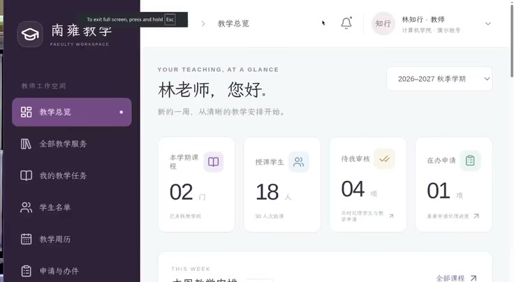](../assets/06-10.jpeg)
{: #l06-src-060}

*图 10：30:31，演示教师工作台“南雍教学”（Faculty Workspace）。林知行是计算机学院的演示账号，概览列出本学期课程 02 门、授课学生 18 人、待审核 04 项、在办申请 01 项。*
{: #l06-src-061}

## 需求一列出来，债就背上了 {#l06-src-063}

*原片 00:32:28–00:42:27*
{: #l06-src-064}

完整教务系统覆盖从入学到毕业的流程，还涉及权限、规则版本、数据同步、操作留痕。需求工程要通过持续沟通，把客户想要的东西弄清楚，小到是否显示当前学期、哪里放修改按钮，都需要对齐。用户与开发者可能很不一样：不能因为自己是 geek，就假设所有人都会编程。比如一位 53 岁、再过两年退休的教务老师，她上大学时可能没用过电脑。系统要同时服务她、服务我，也服务年轻人，需要同理心。怎样获得完整需求表，是另一个值得专门讨论的问题；这门课更关心，当系统按刚才那样不断增长的功能列表建设时，已经开始陷入维护困境。
{: #l06-src-065}

[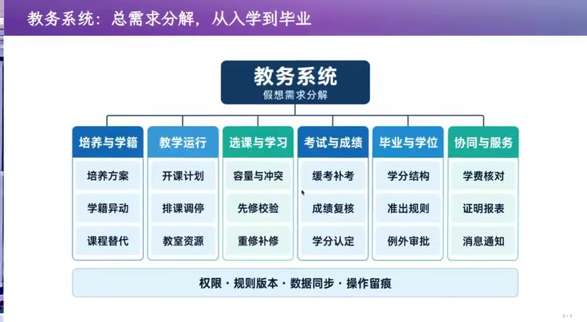](../assets/06-11.jpeg)
{: #l06-src-066}

*图 11：32:33，《教务系统：总需求分解，从入学到毕业》。六块：培养与学籍、教学运行、选课与学习、考试与成绩、毕业与学位、协同与服务。底下是权限、规则版本、数据同步、操作留痕。页码 3/8。*
{: #l06-src-067}

行业经验由此形成壁垒。一家做了 20 年的公司了解教务员、学位授予流程，知道怎样把业务写成需求；本科生从零开始，容易理解偏差。但无论经验多少，空项目里原本没有积累的偏差，一旦写出需求列表，让人或 AI 实现出第一版，就开始背上技术债。
{: #l06-src-068}

需求永远难以一次说清，而且还会变。AI 帮我构造了案例，我也想到真实可能发生的情况：我们觉得最初的离散数学课没有充分教会数学语言，于是把它分成上下学期两门。课程一改，毕业准出和保研要求也会变，新旧规则难衔接。原系统要求计算机专业学生毕业前修过“离散数学”，现在是否要允许“离散数学”或“离散数学一”？这里出现了“或”的关系，最初沟通需求时未必想过。
{: #l06-src-069}

[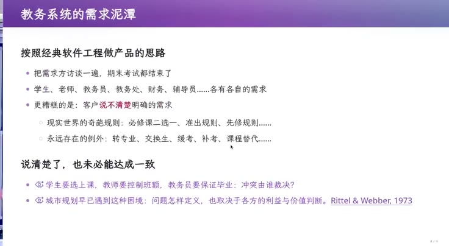](../assets/06-12.jpeg)
{: #l06-src-070}

*图 12：34:00，《教务系统的需求泥潭》。把需求方访谈一遍，期末考试都结束了。客户说不清楚明确的需求。现实世界的奇葩规则，和永远存在的例外：转专业、交换生、缓考、补考、课程替代。学生要选上课，教师要控制班额，教务员要保证毕业，冲突由谁裁决。页码 4/8。*
{: #l06-src-071}

第一版需求可能只要求：毕业要求页面有下拉框和“增加一条”按钮，每条选择一门课。当时合理，课程分成两门后却装不下新规则。只好修改需求文档，在下拉框中加入“或”，再重构系统。不断叠加功能，维护困难就开始累积。改需求会破坏原来相对一致的设计，裂缝沿依赖关系传到各处，看似小改动也可能牵动整个系统。
{: #l06-src-072}

[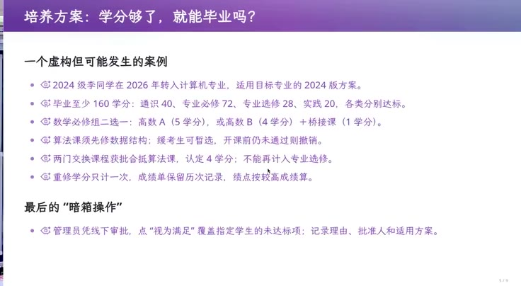](../assets/06-13.jpeg)
{: #l06-src-073}

*图 13：35:36，《培养方案：学分够了，就能毕业吗？》。课件上是另一则虚构案例：2024 级同学 2026 年转入计算机专业，160 学分如何拆开，数学可以二选一，算法课的先修和缓考，两门交换课合抵，重修只计一次学分。最后是“暗箱操作”：管理员凭线下审批，点“视为满足”。页码 5/8。*
{: #l06-src-074}

还有重修、交换课程、课程抵扣。别的院系转来的学生修过一门离散数学，能抵扣计算机学院的一、二两门，还是只能抵扣一，还得补二？面对开放世界，例外会越来越多。系统没有规则时，仍需要 override。假设学生已经读了六年，恰好只差这门课，而课程被分开，新课在另一学期开设，毕业前已无法补修，教学负责人可能认定旧课可以替代新课。
{: #l06-src-076}

系统最终可能只能打电话给工程师，把数据库里的毕业条件改成满足。线下仍有档案可查，审批到教学院长确认替代关系，在人类业务规则里可以得到合理解释。但软件没表达这些关系，只能靠额外操作完成。这就是系统的复杂处：做出需求分析并开始实现，也就开始承担后续变化带来的技术债。
{: #l06-src-077}

我大概在 2018 年第一次上课时，首次使用老教务系统的教师端，发现可以填写缺课次数。我当时不理解为什么要把这个功能放进系统。按我的想法，教师保存签到表、点名表，必要时扫描留证也可以。学生手册规定，无故缺课达到一定程度可能给予开除处分，证据未必一定要在教务系统里录入成一个数字。
{: #l06-src-078}

我试着绕过前端校验，把一名学生的缺课次数从 0 改为 -1，以为不会造成什么危害。结果凡是能查询到这名学生选课记录的页面全部 crash，直接返回 500。我只好通知教务，第二天恢复了，猜测是工程师在数据库里修复了那条负数记录。刚才 GPT 的演示版本对超大输入曾直接拒绝，质量看起来还不错，我也相信它考虑了前后端校验；但真实系统里的小错误，就可能产生这种连锁影响。
{: #l06-src-079}

[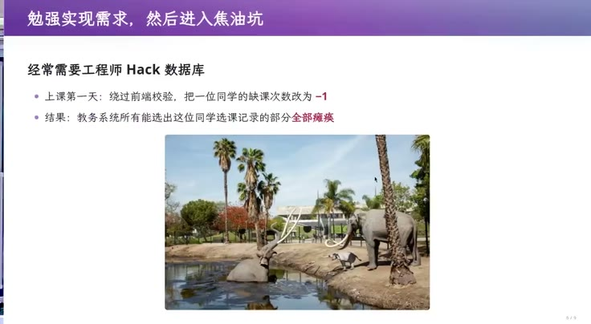](../assets/06-14.jpeg)
{: #l06-src-080}

*图 14：40:41，《勉强实现需求，然后进入焦油坑》。上课第一天，绕过前端校验，把一位同学的缺课次数改为 -1。结果是教务系统所有能选出这位同学选课记录的部分全部瘫痪。页码 6/8。*
{: #l06-src-081}

需求与产品设计可以单独开一门课，这里先通过案例理解。Agentic AI 时代做 MVP 前所未有地容易，先实现重要功能，看见产品后也更容易发现设计问题，早期返工成本低。但连续修好三版，可能让人误以为已经完全掌控系统。真实系统运行足够久，遇到计算机系改成计算机学院等原设计未考虑的变化，麻烦才会暴露。这是整个软件工程领域共同面对的问题。
{: #l06-src-082}

## 银弹没有，最小的代码也有架构 {#l06-src-084}

*原片 00:42:27–00:50:52*
{: #l06-src-085}

There is no silver bullet。传说中普通子弹杀不死狼人，银弹可以；软件工程却没有这样的万能解法。软件要持续生存、挣钱，早期决策会不断影响后续。课程项目可以清零重做，上线系统却已经与现实世界交互，必须带着技术债继续维护。早期考虑不够长远，维护成本就可能越来越高。
{: #l06-src-086}

架构是应对这些问题的一种方式。MVP 阶段尚未纳入全部需求，就应思考第一步怎样走，才有利于系统长期生存。刚才 AI 生成的教务系统已接近小型产品原型，维护可能很困难。我们需要考虑怎样构造最小的软件，使它在需求增长和改变时仍有一定韧性。
{: #l06-src-087}

[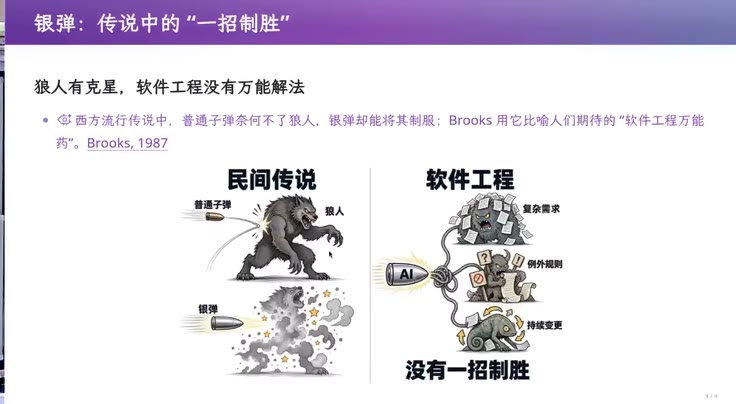](../assets/06-15.jpeg)
{: #l06-src-088}

*图 15：43:36，《银弹：传说中的“一招制胜”》。狼人有克星，软件工程没有万能解法。左边是民间传说里的狼人和银弹，右边是复杂需求、例外规则、持续变更，AI 打上去，没有一招制胜。页上引用 Brooks, 1987。页码 7/8。*
{: #l06-src-089}

[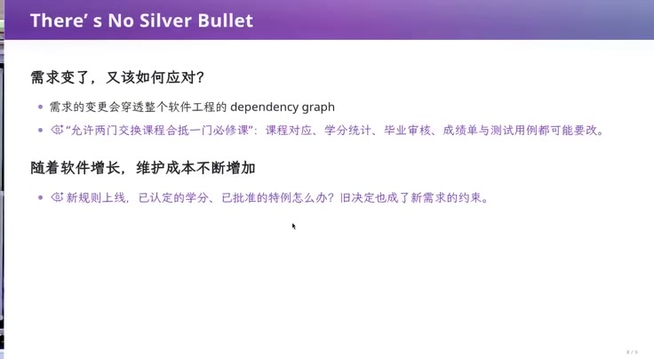](../assets/06-16.jpeg)
{: #l06-src-090}

*图 16：43:47，《There's No Silver Bullet》。需求的变更会穿透整个软件工程的 dependency graph。允许两门交换课程合抵一门必修课，课程对应、学分统计、毕业审核、成绩单和测试用例都可能要改。新规则上线，已认定的学分、已批准的特例怎么办。页码 8/8。*
{: #l06-src-091}

再小的代码也有架构，其作用包括解除不必要的耦合。不要一开始就认定所有需求都该装进一个数据库。这样确实容易快速做出可运行原型，但如果没有想清系统中哪些概念可以分开，后续维护就容易陷入困境。
{: #l06-src-092}

架构并不只属于宏大系统。从第一次设计代码开始，就在选择如何控制复杂性。代码稍有规模，就可以考虑把复杂性分配给哪些部分，让变化有边界。
{: #l06-src-093}

{: #l06-src-094}

*图 17：45:40，《好的架构：复杂性有归处，变化有边界》。几个装着齿轮的方块连在一根轴上，上面有一块可以转开。页码 2/8。*
{: #l06-src-095}

例如写 OJ 时，是否会把 main 分成 read_input、parse_input、process_input、write_output？命令行程序还有 argc、argv，这是操作系统与进程之间的约定，参数作为字符串向量传进来。如果机试要求处理 argv，难道每项都自己 strcmp？学过或在 coreutils、ls 等项目里见过 getopt，就知道可以复用解析机制。命令行参数有长选项、短选项、子命令等复杂约定，自己在 C 里写 parser 很费力。POSIX 规定了一部分约定，getopt 可以处理相应选项，程序通常只需 while 循环和 switch case；长选项还可使用 getopt_long。这就是把解析复杂性隔离起来的一种架构。
{: #l06-src-096}

[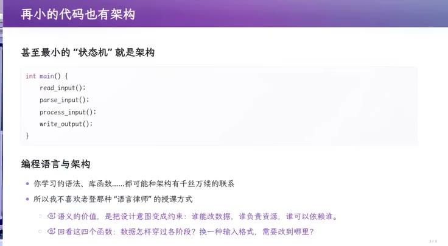](../assets/06-18.jpeg)
{: #l06-src-097}

*图 18：46:05，《再小的代码也有架构》。main 里依次是 read_input、parse_input、process_input、write_output。页上写着：不喜欢老登那种“语言律师”的授课方式。语义的价值，是把设计意图变成约束。页码 3/8。*
{: #l06-src-098}

[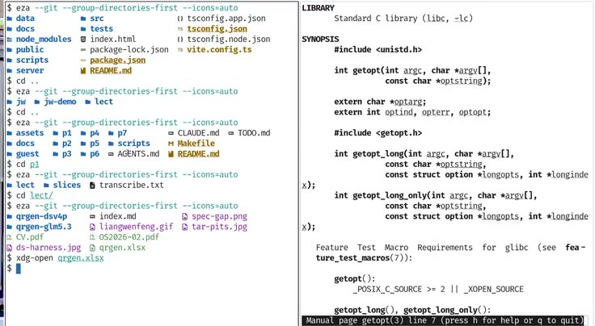](../assets/06-19.jpeg)
{: #l06-src-099}

*图 19：01:04:45，右边是 getopt 的 man page，能看见 getopt、getopt_long，以及 POSIX 的说明。左边终端停在讲义和二维码相关的目录上。*
{: #l06-src-100}

从这个小例子可以学到 parser 的架构模式。好的代码通常都有设计，设计背后又对应需求。需求、specification、implementation 存在于任何软件工程活动中，模块也可以有需求、架构和优雅的表达，无需等到教务系统那么大才讨论。
{: #l06-src-101}

我不喜欢只讲语法细节的“语言律师”式教学。大模型出现前，曾和学院教师讨论 C++11、14、17 的特性及用途，对方说已经讲了，但所谓讲 lambda，只是演示接收 a、b，return a + b。没有解释应用场景，学习价值有限。看到好的 README、项目或 getopt，还应继续追问背后的模式：复杂字符串被转换成简单的 parsing state，后续程序只处理状态。argv 的形式可以变化，解析机制把变化隔开，这正是抵抗需求变化的一种办法。
{: #l06-src-102}

## 同一个汉诺塔，四种放复杂性的地方 {#l06-src-104}

*原片 00:50:52–00:57:49*
{: #l06-src-105}

先从十来行代码看架构。为什么说模型的架构能力还不够好，或说架构涉及品位？因为架构与需求相连。没有需求，架构无从评价；面向未来变化的设计，更取决于你对需求理解到了什么程度。
{: #l06-src-106}

我喜欢用非递归 Tower of Hanoi 作例子。刚开始教课时，曾问保研研究生能否写非递归汉诺塔，大家摇头，于是把它变成课堂案例。短短十来行代码，就能追问：为什么大家写不出来，困难到底在哪里？
{: #l06-src-107}

[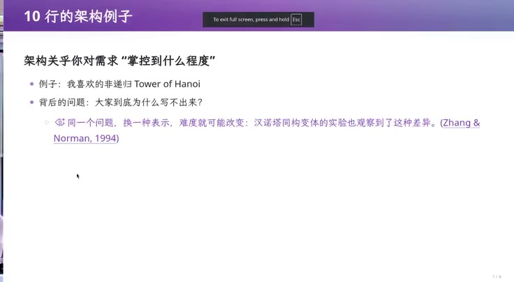](../assets/06-20.jpeg)
{: #l06-src-108}

*图 20：50:52，《10 行的架构例子》。架构关乎你对需求掌握到什么程度。例子是非递归的 Tower of Hanoi。背后的问题是：大家到底为什么写不出来。页上还写着，同一个问题换一种表示，难度就可能改变。页码 4/8。*
{: #l06-src-109}

同样问“写一个非递归汉诺塔”，GPT-6 找到的是数学规律，好像在说“我不做人类了，你写不出来是因为数学不如我”。它用步号二进制末尾 0 的个数加 1，决定移动哪个盘子，每个盘子的移动方向固定。它似乎希望凭数学能力解决一切。这种写法不直观，却很精简。我倾向于认为它正确，不过还没有专门让它模拟验证。
{: #l06-src-110}

[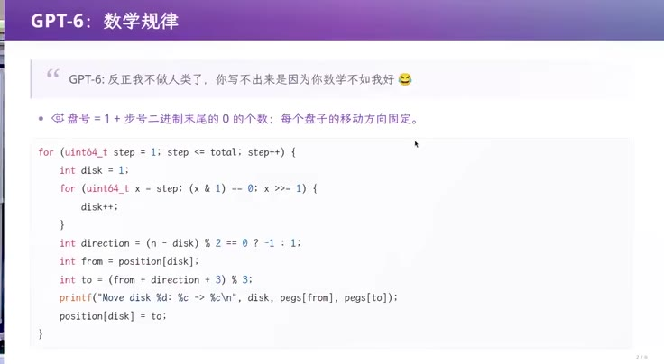](../assets/06-21.jpeg)
{: #l06-src-111}

*图 21：56:59，《GPT-6：数学规律》。盘号等于 1 加上步号二进制末尾 0 的个数，每个盘子的移动方向固定。循环里用 step 的二进制末尾有多少个 0 来决定 disk，再按奇偶决定方向。页码 5/8。*
{: #l06-src-112}

同样的 prompt，DeepSeek V4 Flash 写出了更容易理解的标准方案：把尚未完成的搬盘任务放进栈里，每次执行栈顶任务。它利用递归对应栈的知识，得到一个清晰的非递归实现。
{: #l06-src-113}

我也试了豆包。它选了类似的任务栈方案，但生成的代码有瑕疵，这里就不展示了。
{: #l06-src-114}

作为架构师，我的目标还包括解释大家为什么写不出来：往往是对递归理解不深。上过我操作系统课的同学见过另一种实现，我把程序视为状态机，花一整节课讲 C 的状态与 operational semantics，也就是操作语义。Hanoi(n-1) 这样的调用，在语言中有明确的小步语义，我们可以模拟它，写一个简化的 C 解释器。理解了这种表示，不仅汉诺塔，连 F 调 G、G 又调 F 的相互调用，也能按形式语义转换成状态机，非递归实现就不再神秘。
{: #l06-src-115}

[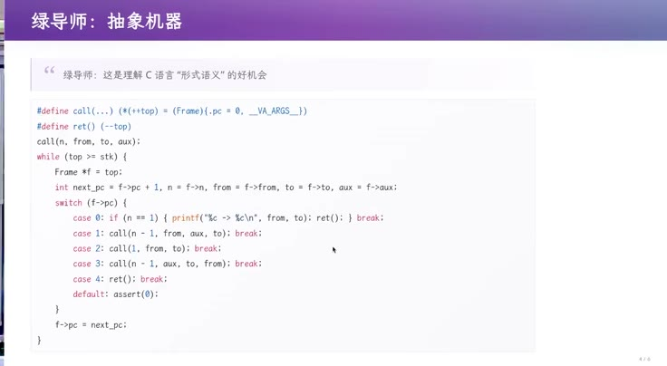](../assets/06-22.jpeg)
{: #l06-src-116}

*图 22：54:43，《绿导师：抽象机器》。页上的引文是：这是理解 C 语言形式语义的好机会。代码用一个 Frame 栈模拟call 和 ret，pc 从 0 走到 4：只剩一个盘子就移动并返回，否则先搬 n-1，再搬最大的，再把 n-1 搬到目标。页码 6/8。*
{: #l06-src-117}

这个抽象机器方案对汉诺塔可能显得 overkill，因为它还能处理更一般的程序。但经过简化、优化，就能得到任务栈式的实现，两者可以等价转换。对我的教学需求而言，它提供了理解 C 语言形式语义的机会。
{: #l06-src-118}

不同目标会得到不同设计。现在我还能保留自己的这点品位：GPT 也许懂形式语义，却未必主动往教学方向想。我相信强化学习也能引导它，在适当场景选择这样的实现。
{: #l06-src-119}

最后，我在百度搜非递归汉诺塔，第一条结果还是递归版本，继续往下找到 CSDN 的非递归代码，质量让我失望，甚至比 AI slop 的问题还严重。里面有一个 Move，而标准库已有 move；旁边评论也不知是否由 AI 生成，营造出文章很好的印象。学习时接触这类低质量内容，还不如向 DeepSeek 学习；GPT-6 的数学解法则已经不太像人类通常的写法了。
{: #l06-src-120}

[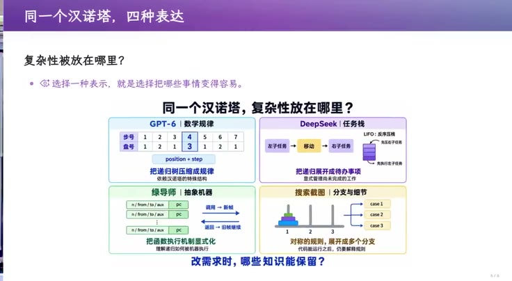](../assets/06-23.jpeg)
{: #l06-src-121}

*图 23：56:41，《同一个汉诺塔，四种表达》。GPT-6 把复杂性放在数学规律里，DeepSeek 放在任务栈里，绿导师放在抽象机器里，搜索截图那一格是展开成多个分支。底下问：改需求时，哪些知识还能保留。*
{: #l06-src-122}

同一个汉诺塔，复杂性被放在四个不同位置。GPT-6 跳到数学规律，DeepSeek 使用任务栈，把语料中反复出现的“递归依靠栈”实现出来；我再往外看程序语言，用形式语义解释递归与非递归。搜索到的代码则把复杂性留在多个分支里。这说明架构与抽象有关，小到十来行代码，也能看出设计者怎样理解问题、控制复杂性。
{: #l06-src-123}

## 公式太长的时候，缺的是一层中间语言 {#l06-src-125}

*原片 00:57:49–01:12:29*
{: #l06-src-126}

再看约 2000 行的项目。架构能力从哪里来？来自学过的好设计，以及学校和社会中的积累：代码之外有客户的规律，客户之外有社会规律，再往外还有自然规律。把这些经验压缩成原则，才能在新问题里推导方案。与教材、题目之外的人交流也很重要，才会知道即将退休的教务老师怎样看系统。你想要最好的数据库、最高性能，她可能只希望字大一点、按钮别挨得太近，免得点错。这需要共情。
{: #l06-src-127}

[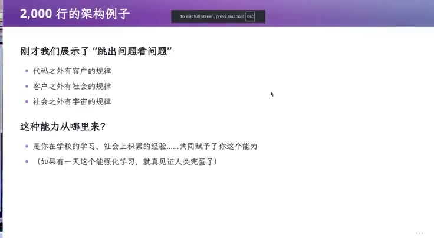](../assets/06-24.jpeg)
{: #l06-src-128}

*图 24：57:49，《2,000 行的架构例子》。刚才展示了跳出问题看问题：代码之外有客户的规律，客户之外有社会的规律，社会之外有宇宙的规律。这种能力来自学校里的学习和社会上的积累。页码 1/7。*
{: #l06-src-129}

前面课程展示过 QR Code Generator，用 Excel 公式生成可扫描二维码。输入单元格是一段字符串，输出单元格组成 0、1 矩阵。与教务系统相比，任务看起来明确、确定，但这里仍有架构问题。
{: #l06-src-130}

Agent 似乎会估计自己的能力。让它把第二张 sheet 的实验成绩按学号带入第一张 sheet 的期末成绩表，它通常直接写公式，任务在能力范围内。但用 Excel 生成二维码困难得多，它就会尝试分解问题、做架构。不过至少今天的模型，在这种架构选择上仍有不足。
{: #l06-src-131}

若直接把算法写成一个 Excel 公式，公式会长得难以处理。就像那个 Lisp 笑话：偷到一个国防部程序，翻到最后一页，看到的全是闭合括号。
{: #l06-src-132}

Excel 提供的计算表达方式有限，像用 Brainfuck 写《毁灭战士》这样的复杂程序，代码会难以驾驭，此时需要增加抽象。
{: #l06-src-133}

我看到的两个 AI 版本还忽略了一点：需求虽看似明确，却藏着许多条件。Excel 不同版本支持的函数不同，也在持续演化。按学号查成绩，以前常用 VLOOKUP，后来有了更方便的 XLOOKUP。大家可能都不是 Excel power user，但在 agent 时代，许多操作确实可以直接用语言提出。版本差异却不能忽略：二维码文件是否要兼容教务老师的旧 Excel，还是只供自己临时用，可以采用最新语法？这会影响实现方式。
{: #l06-src-134}

[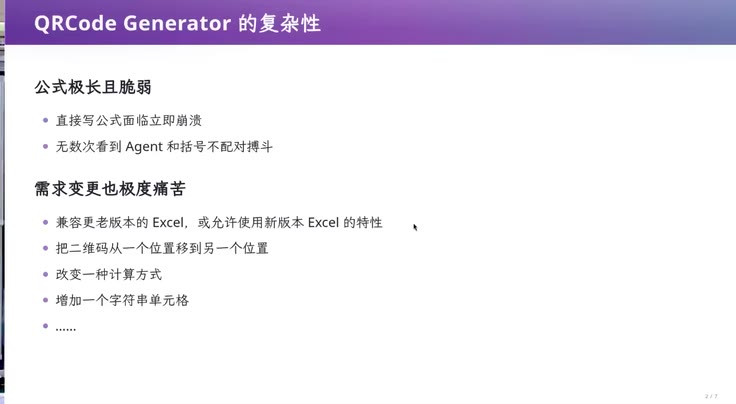](../assets/06-25.jpeg)
{: #l06-src-135}

*图 25：01:00:00，《QRCode Generator 的复杂性》。公式极长且脆弱，直接写公式面临立即崩溃，无数次看到 Agent 和括号不配对搏斗。需求变更也极度痛苦：兼容更老或更新的 Excel，把二维码移动位置，改变计算方式，增加一个字符串单元格。页码 2/7。*
{: #l06-src-136}

假如 AI 使用新版本公式写完后，才被要求兼容更老版本，例如从“Excel 2023”改成 2019、再改成 2003，设计与实现就可能全部重来。2000 行的小项目尚可重做，一旦嵌入大型教务系统、与其他模块关联，就需要更多人力和预算。这也是架构没有隔离变化的代价。
{: #l06-src-137}

布局也可能变化。生成以后觉得位置不合适，要把二维码整体向右移一格；若所有单元格坐标都硬编码，就会立即出问题，说明实现难以适应需求调整。
{: #l06-src-138}

换个角度看，这是编译问题。我让 AI 给出字符串转二维码的伪代码，这个任务很明确，它却还想先读文件。二维码有完整规范，算法可以写得很短：选定版本、纠错等级、掩码和大小，先做数据编码，用 0100 标识 byte 模式，加入长度、各字节、终止与填充，再计算 Reed–Solomon 纠错码，最终形成 134 个码字，摆入矩阵。
{: #l06-src-139}

[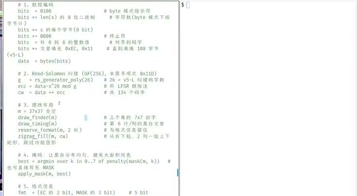](../assets/06-26.jpeg)
{: #l06-src-140}

*图 26：01:08:05，屏幕上的二维码生成步骤：数据编码、Reed-Solomon 纠错、摆放布局、掩码，以及格式信息。注释里写着 8 bit 字节、终止符、对齐到码字。*
{: #l06-src-141}

算法用 qr.py 就很容易描述，为什么放到 Excel 就困难？甚至可以考虑把“实现算法并输出 0、1 矩阵”作为机试题，测试学生的实现能力。但这里的交付要求是 Excel，这就是需要跨越的表达差距。
{: #l06-src-142}

我们手头没有一个能把任意 Python 程序直接编译成所需 Excel 公式的工具，我暂且称它为 Pyxlc。Excel 主要面向财务报表、成绩管理等任务，不能直接假定所有 Python 写法都能搬进去。若只把伪代码或自然语言交给大模型，让它立即写公式，需求一变，仍会遇到刚才的问题。
{: #l06-src-143}

可以在 Python 与 Excel 之间设计一种中间语言，既容易翻译成 Excel，又能表达二维码所需的一部分 Python 运算。比如用表达式树表示加法、取字符串中的某个元素等操作。大家写过表达式求值：递归处理左右子树，再按当前节点组合，就能生成 Python。同样，为每种节点定义 Excel 翻译规则，将结果放到任意单元格，再用其他单元格引用它，就能生成公式。中间语言限制在我们需要且两端都能表达的运算上。
{: #l06-src-144}

这样就可以让大模型先用中间语言写二维码逻辑，翻译成 Python 验证计算正确，再生成 Excel。它与前面的 getopt 思路相通：先把命令行转换成 parsing state，后续程序处理这个中间表示，避免直接面对复杂输入。
{: #l06-src-145}

大家可以把自己看成 unsupervised learner，多看好设计，并有意识地追问为什么这样做。某天读到一篇 blog，或听到一个例子，过去的知识就可能联系起来，产生泛化。这里得到的是一份中间语言、两种执行方式：LLM 生成中间表示，一端用于验证，一端用于交付。理解了这个结构，具体由 AI 生成的代码细节就没那么重要了。
{: #l06-src-146}

中间语言还可以承载优化。性能不好或生成代码太长时，可以定义改写规则，把程序变成等价而高效的形式。比如循环中反复计算、结果不变的表达式，可以移到循环外，编译器能做，人或模型也能做。还可以先测量瓶颈，再依据 profile 优化，这就用上了 profile-guided optimization 的思路。以后 Excel 版本改变，只需调整一些算子的实现。算法、验证与交付被分开后，变化就有了对应的位置。这与 AI infra 的一些工作也相通，不同领域中积累的好设计值得互相学习。
{: #l06-src-147}

[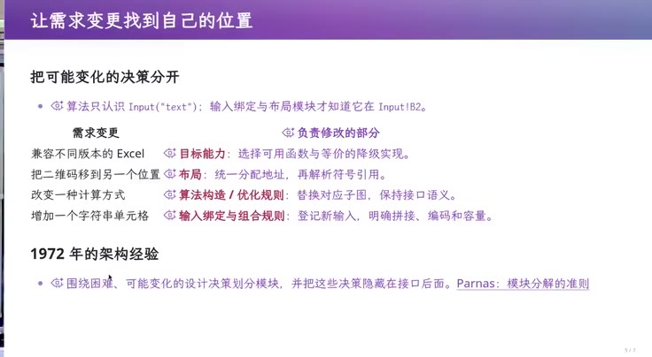](../assets/06-27.jpeg)
{: #l06-src-148}

*图 27：01:11:00，《让需求变更找到自己的位置》。算法只认识名为 text 的输入，输入绑定和布局才知道它在哪个单元格。兼容不同版本的 Excel，归到目标能力。移动二维码，归到布局。改变计算方式，归到算法构造和优化规则。增加一个输入单元格，归到输入绑定。页下引用 Parnas 1972 年的模块分解准则。页码 5/7。*
{: #l06-src-149}

## 只留当前状态，历史就没了 {#l06-src-151}

*原片 01:12:29–01:26:27*
{: #l06-src-152}

十行、2000 行的例子讲完，再看 50 万行规模的架构。说到架构师，大家常想到数据库、微服务、流式数据处理、应用框架，再用框图把它们连起来。但仍要先跳出眼前实现，理解教务系统的问题。
{: #l06-src-153}

先看 AI 实现的架构。生成过程中我看到了代码，还当场发了条小红书，说 GPT-6 像是“不做人了”：只要逻辑对，它可以用人很难读的方式写。后来它又用格式化工具整理了一遍，才更易读。演示系统仍是 monolithic，一个大约 83KB 的 TSX 文件、一个约 38KB 的 services 文件，但确实能工作。
{: #l06-src-154}

[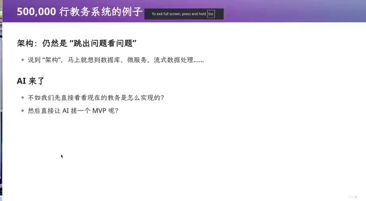](../assets/06-28.jpeg)
{: #l06-src-155}

*图 28：01:12:29，《500,000 行教务系统的例子》。说到架构，马上就想到数据库、微服务、流式数据处理。不如先直接看看现在的教务是怎么实现的，然后让 AI 搓一个 MVP。页码 1/10。*
{: #l06-src-156}

我另外开了一个独立 session，问这个系统是否还能维护，也让 DeepSeek 评价 GPT 的设计。回答是可以，只是业务逻辑挤在几个大文件里。它采用经典三层单体、前后端分离，还有乐观锁、idempotency、事务、审计和统一错误处理等设计，这些以后会讲。它也考虑了数据驱动、扩展性，同时存在不足。模型确实具备一些需要工程师实践几年才能积累的直觉，AI 生产软件的方式可能很快就会超出人的习惯。
{: #l06-src-157}

{: #l06-src-158}

*图 29：01:13:24，《新增功能，越来越像拆盲盒》。GPT-6 Astra xhigh 还认为能维护，但现在是把业务逻辑挤在几个大文件里的演示原型。再不拆分和统一规则，新增功能就会越来越像拆盲盒。图上的台词是：我不当人类了。页码3/10。*
{: #l06-src-159}

但在我看来，这个 CRUD，也就是增删改查架构，仍未充分解决问题。它从一种常见认识出发：软件是现实过程在信息世界中的投影，世界有状态，系统也可以建模为 state transition system。持久状态存进数据库，例如学生表记录学号、姓名、院系，其他表记录学院、选课。数据库课要求用 normal form 减少冗余：另一张表引用学生时，存唯一学号 1234，尽量不要复制姓名。姓名可能重复，也可能合法变更；只保存 ID 关联，改姓名时改一处即可，必要时记录曾用名。若存了两份姓名，就必须知道两处都要更新，这增加了依赖和维护成本。
{: #l06-src-160}

[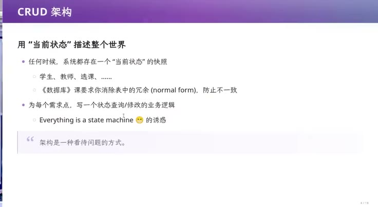](../assets/06-30.jpeg)
{: #l06-src-161}

*图 30：01:16:28，《CRUD 架构》。任何时候，系统都存在一个当前状态的快照：学生、教师、选课。数据库课要求消除表中的冗余，防止不一致。为每个需求点写一个状态查询或修改的业务逻辑。页上把 Everything is a state machine 叫作诱惑，并写着：架构是一种看待问题的方式。页码 4/10。*
{: #l06-src-162}

当前状态表示此刻有哪些学生、教师，以及谁选了什么课。经典的前后端分离系统围绕这个状态工作。假如开个玩笑，有人因为买不起 token 而退学，系统就更新数据库，迁移到下一个状态，原来的在籍记录可能不再存在。网页随时展示当前状态的一个投影，系统努力维持一致性。这是一种经典且有效的架构。
{: #l06-src-163}

问题是，如果教务系统只保留当前状态，表面一切正常，形成这个状态的历史却丢了。例如某条授予记录把当时姓名直接写进一段字符串，没有用 ID 关联。后来学生改名，当前学生表与历史文字就出现差异。仅看眼前数据，很难判断差异来自错误，还是来自真实历史。
{: #l06-src-164}

GPT 还给了一个例子：学生表中有“是否允许毕业”列。它由学分、毕业设计状态等多项信息计算而来，每次相关条件变化都要重新计算。教务员和辅导员需要导出当前不能毕业的学生，逐个联系，这当然是合理需求。但如果只留下最终的 0 或 1，没有保留当时的计算依赖，就只知道能不能毕业，不知道为什么。计算过程消失了。
{: #l06-src-165}

软件对现实做了有损映射，未建模的部分只好通过其他途径处理。政策已更新、领导已批准，新培养方案却还没导入系统；学期已开始，课也上了，系统仍未反映现实。第一周仙林教室维修不能使用，系统也没有充分表达这个情况，只能人工重新安排，我就到另一间教室上课。随着时间推移，数据里积累了难解释的不一致：明明按规则不该毕业，或者还有学费未缴，为什么最终显示已经毕业？没有历史依据，就会变成难以追查的问题。
{: #l06-src-166}

[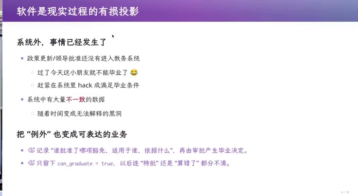](../assets/06-31.jpeg)
{: #l06-src-167}

*图 31：01:22:22，《软件是现实过程的有损投影》。政策更新、领导批准还没有进入教务系统。过了今天，这小朋友就不能毕业了，赶紧在系统里 hack 成满足毕业条件。只留下 can_graduate = true，以后连特批还是算错了都分不清。页码 6/10。*
{: #l06-src-168}

面对这类变化，只维护当前状态的 CRUD 就会很吃力。比如南京大学调整院系，我们原来的计算机系改为计算机学院。若系统把数据库视为 single point of truth，那么 department 对象该怎么办？直接把“计算机系”的 name 改成“计算机学院”，或保留不变，两种做法都有问题。
{: #l06-src-169}

直接改名，我的毕业记录查出来就可能变成“2011 年毕业于南京大学计算机学院”，但 2011 年还没有这个学院，打印证明便与事实不符。若不改，现在学生的 department ID 又仍然指向计算机系。于是需要数据迁移、创建新对象，并明确新旧对象之间的关系。
{: #l06-src-170}

{: #l06-src-171}

*图 32：01:24:12，屏幕打开南学发〔2024〕99 号《关于成立南京大学数学学院的通知》。现场以院系调整为背景，口头举的例子是计算机系改为计算机学院。*
{: #l06-src-172}

如果现实到数据的映射永远不变，CRUD 很适用；若需求发生大幅变化，就可能需要一次次迁移数据库、重写业务逻辑。代码能重写，丢失的历史却无法补出。一次 transaction 更新后，只剩新状态，迁移时便要猜测过去可能发生的情况，而旧库还可能已有大量不一致，很难制定完整规则。测试环境迁移成功，与全校真实数据迁移成功的难度不同；操作不当也可能像缺课次数 -1 那样，使系统失效。
{: #l06-src-173}

[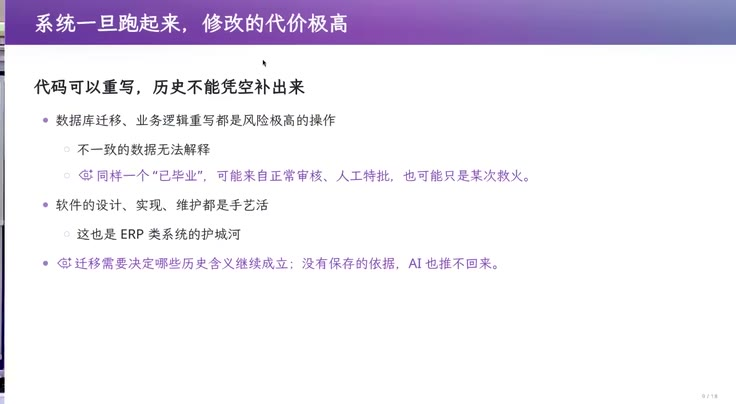](../assets/06-33.jpeg)
{: #l06-src-174}

*图 33：01:26:26，《系统一旦跑起来，修改的代价极高》。代码可以重写，历史不能凭空补出来。同样一个“已毕业”，可能来自正常审核、人工特批，也可能只是某次救火。软件的设计、实现、维护都是手艺活。这也是 ERP 类系统的护城河。页码 8/10。*
{: #l06-src-175}

这也是教务、ERP 等系统的设计、实现、维护长期依赖经验的原因。我刚才说它有做得好的一面，说错了，这里想说的是它确实有做得不好的地方。但回看厂商的处境：假设公司在 2000 年进入市场，当时参考企业架构做出了 CRUD 系统，随后就得背着这些早期决定，经历中国大学几十年的教育改革，持续承接变化。维护这种系统是一门手艺。
{: #l06-src-176}

## 先把发生过的事记下来 {#l06-src-178}

*原片 01:26:27–01:36:50*
{: #l06-src-179}

读 PhD 时，我在软件所，隔壁软件工程组接过学校研究生院教务系统的订单，大约二三十万元。对学生似乎很大，对需要长期维护的定制软件却不算大。我室友参与其中，我们常讨论设计，我也批评它是典型 CRUD，预料会遇到许多问题。随后几年研究生大幅扩招，学生类型、培养类型增加，还有压力带来的各种调整，都超出最初需求预期。系统越来越难维护，后来被公司维护的统一系统替代。厂商至少积累了一些领域知识，知道怎样维持复杂系统运行。
{: #l06-src-180}

如果让我重做，会先警惕只留当前状态这个 single point of truth：一旦不一致，很难恢复来龙去脉。数据结构课中的 persistent data structure 提供了启发，它能保留多个历史版本。普通数据库像一个数据结构，操作后进入新状态；持久化数据结构还能保留操作之前的版本。
{: #l06-src-181}

例如一棵树，更新节点时保留旧节点，再复制从该节点到根的路径，未变化的子树可以继续共享，就能以较少开销保存历史。记录状态版本、记录操作、记录状态变化的 delta，是理解历史的几种视角。操作日志让人想到 write-ahead journal，delta 让人想到 Git、SVN 等版本管理。若保存了足够的历史信息，就可以回放并得到相应状态；只保存 CRUD 的当前快照则没有这些历史。
{: #l06-src-182}

我的思路是先记录发生过的事情：今天张三退学，后来又复学。若最初没有考虑复学，退学时直接删除学生及关联记录，后来要恢复就很费力。若保留操作历史，就能 replay 出退学前的状态，数据没有丢。复学的业务逻辑仍然要补写，记录历史不会让逻辑自动减少；但系统里的各个视图都有事实依据。做错了可以退回过去的快照，修复逻辑再重建，迁移时就更有把握。开个玩笑，张三又买到 token，就回来上学了。
{: #l06-src-183}

院系调整也更容易解释：在某个时间记录“院系调整”事件，查询过去的毕业信息，就取当时的版本；查询当前关系，则结合后续事件。比如学生 2007 年入学、2011 年毕业，当时属于计算机系，系在 2024 年改为学院。系统可以截取与他相关的历史并 replay，得到查询所需的过去或现在状态，既保留事实，也能展示变化。
{: #l06-src-184}

[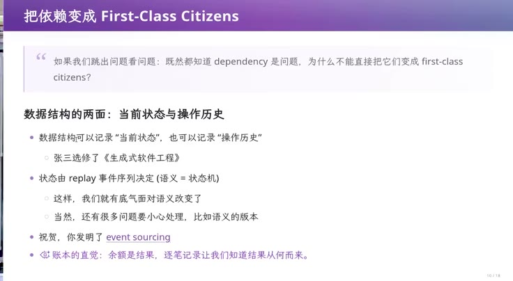](../assets/06-34.jpeg)
{: #l06-src-185}

*图 34：01:30:50，《把依赖变成 First-Class Citizens》。数据结构可以记录当前状态，也可以记录操作历史。例子是张三选修了《生成式软件工程》。状态由 replay 事件序列决定。页上写着：祝贺，你发明了 event sourcing。账本的直觉是，余额是结果，逐笔记录让我们知道结果从何而来。页码 10/10。*
{: #l06-src-186}

这就得到经典模式 Event Sourcing：由历史事件生成状态。可以在 agent 帮助下进一步学习。首先可能担心大量 replay 的性能，但快照、缓存等技术可以优化，这是取舍。已经运行很久的复杂系统要改成 Event Sourcing 很困难，从一开始采用这种设计，则能提前避免一些历史丢失和解释不清的问题。
{: #l06-src-187}

[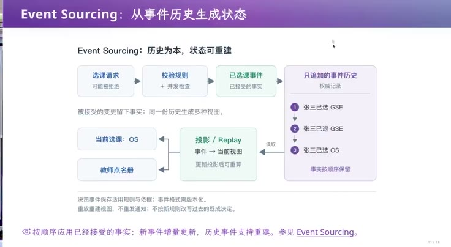](../assets/06-35.jpeg)
{: #l06-src-188}

*图 35：01:35:09，《Event Sourcing：从事件历史生成状态》。选课请求经过规则和并发检查，成为已接受的事实，只追加。同一份历史可以投影成当前选课和教师点名册。例子是张三已选 GSE、已退、又选了另一门。重放重建视图，不重发通知。页码 11/18。*
{: #l06-src-189}

相关概念还有 CQRS，Command Query Responsibility Segregation，它与 Event Sourcing 相互独立；以及 Domain-Driven Design。这些 buzzwords 可以去了解，但更重要的是回到最初的问题：设计 50 万行教务系统时，先跳出已有框架，识别根源性的困难。即使没听过这些名称，也可能推导出合适的设计。
{: #l06-src-190}

[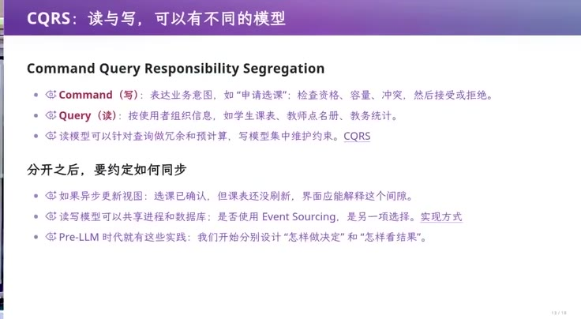](../assets/06-36.jpeg)
{: #l06-src-191}

*图 36：01:36:14，《CQRS：读与写，可以有不同的模型》。Command 表达业务意图，比如申请选课，检查资格、容量、冲突，然后接受或拒绝。Query 按使用者组织信息。如果异步更新视图，选课已确认，课表还没刷新，界面要能解释这个间隙。页码 13/18。*
{: #l06-src-192}

[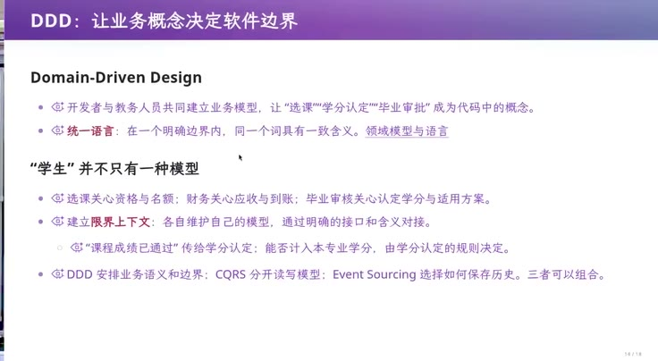](../assets/06-37.jpeg)
{: #l06-src-193}

*图 37：01:36:26，《DDD：让业务概念决定软件边界》。选课、学分认定、毕业审批应成为明确的业务概念。统一语言有具体的适用边界：选课关心资格与名额，财务关心应收与到账，毕业审核关心认定学分与适用方案。*
{: #l06-src-194}
