# 08 · Agent-native 开发
南京大学 · 蒋炎岩 · 2026 · [原视频](https://www.bilibili.com/video/BV11LWw6VEHW/)

## 没有额度，搜索就浅 {#l08-src-001}

*原片 00:00:00–00:05:08*
{: #l08-src-002}

课程进行到一半左右，今天讨论 Agent-native 开发。今天早上有人宣布额度要重置，大家有没有提前安排长任务？我积攒了一些耗 token 的工作，例如不知道如何完成的复杂数学证明，可能会用掉一周额度。离开办公室前，我就让模型继续证明，等今天重置。
{: #l08-src-003}

第二个实验已经发布。第一个实验更像开发自己的 agent 产品，你可能发现类似产品已经出现了。Grok 这类机器人开课前就有，最近才流行起来。我把一些日常任务迁了过去，例如每天给小朋友生成开车时听的 podcast，后面调用 Claude Code 里表达比较自然的模型。
{: #l08-src-004}

我还设置了每日论文和 GitHub trending 推送。Morning paper 的 prompt 专门调过，效果与直接要求 AI 总结不同。第一个实验已有个人 agent，可以整理邮件或查询自己的数据库；第二个实验希望进一步用算力换取质量。Agent 能做长程任务，解决问题的直觉仍有限，这很像博士生：发现一个问题和看似合理的方法后，先做原型，再优化和改进实验，沿一个方向深入。例如软件工程中的某类 Python 补全问题，可以在庞大设计空间中找到不错的解。模型训练常给“完成任务”奖励，但浅层分叉处的选择就可能大幅影响结果。算力有限，搜索需要同时考虑宽度和深度。这个实验就是让大家自己实现 agent loop。
{: #l08-src-005}

我在一个讨论多 agent 协作的群里，看过大家投入大量 token 后的经验：让 GPT 和 Claude 相互 review、挑问题比较有效。不同模型有不同偏见，能拓展搜索方向；同一模型连续迭代，可能找到更好的解，也可能停滞。这有点像人的互补，但人也容易附和同伴。另一种办法是建设知识库。Deeper research 的数据库不能只有实验作业、奖学金申请和个人简历，还应收集论文、博客、GitHub 项目和书中片段。实验保留了框架，也允许自由扩展，可以做得简单。即使不做，课程也可能通过，但亲手实践、观察 agent 轨迹，才能形成自己的经验。
{: #l08-src-006}

[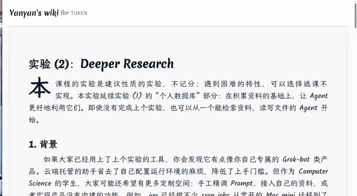](../assets/08-01.jpeg)
{: #l08-src-007}

*图 1：00:42，他打开自己的 wiki，停在《实验（2）：Deeper Research》。这一页写实验是建议性质，不记分，做不完可以逃课；它延续实验（1）的个人数据库，让 agent 更好地用这些资料。*
{: #l08-src-008}

## 一条线走到黑，会差很远 {#l08-src-010}

*原片 00:05:08–00:11:09*
{: #l08-src-011}

回到软件工程。Intent、specification、implementation 各自都是一个空间，彼此之间又是一对多关系。人的认知有限，小团队或个人往往只从中选取一个点。Reviewer 可以通过几轮讨论帮助达成共识，再推进下一步。需求阶段可以访谈、使用 checklist，与甲方确认意图；规格阶段可以请架构师讨论数据库或 event sourcing 等选择。最近 Pi 的开发者说，他们采用另一种 functional 设计来保留发生过的事，没有使用 event sourcing。
{: #l08-src-012}

讨论会产生多个方案，最终实现的可维护性、可观测性，可能与一开始选定方向后直接做到底相差很大。软件工程利用 UML 等工具，帮助团队早期形成共同理解。工具也从 IDE、VS Code，延伸到 Git worktree、Jujutsu 等版本管理工具。可以让 agent 每天推送 GitHub trending，选一个项目追问几分钟，看看不同技术栈中的设计，逐渐积累经验与判断力。这些是课程前半部分讨论的内容。
{: #l08-src-013}

AI 让人随时可以开始学习、思考和实现。哪怕只有一个初步想法，也可以先让它做一版；结果可能难以维护，或者质量不符合预期，但能帮助判断设计正在变好还是变坏，再继续讨论和修改。AI 可以承担一位员工或一个团队的工作。需求若能分成相对独立的两个模块，就能并行交给两个 agent。我实际开发时会用 tmux 开四个 agent，再多就难以跟上输出。这样可以快速探索方案，同时推进独立需求，这就是 let it fail。
{: #l08-src-014}

在只有 intent 或 spec 的阶段，如果 AI 成本足够低，就可以先实现，用来预测架构面对真实用户、更多用户以及模块交互时会怎样。许多问题做出来才看得见。想法尚不完整，也可以先做原型，再用典型 use case 评审。要让 AI 做好这个原型，就需要 agent loop。
{: #l08-src-015}

[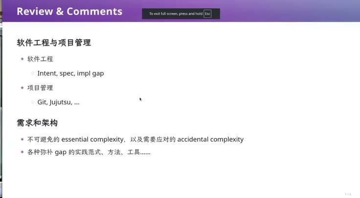](../assets/08-02.jpeg)
{: #l08-src-016}

*图 2：05:39，《Review & Comments》。软件工程对着 intent、spec、implementation 的 gap。项目管理写着 Git、Jujutsu。需求和架构写着躲不开的 essential complexity，以及要应对的 accidental complexity。*
{: #l08-src-017}

## 一百五十行的循环 {#l08-src-019}

*原片 00:11:09–00:22:34*
{: #l08-src-020}

回顾产品演进，大家应该熟悉 ChatGPT。2023 年时，你们大概还在初高中，社交媒体已经在讨论模型的能力和幻觉：它很强，却不能完全相信。Devin 是较早的一批 coding agent，也宣称能解决数学问题。当时 GPT-4 幻觉明显，还没有后来带思维链的模型，大家对自主完成任务仍在观望。理论上，不知疲倦的系统可以反复尝试，直到找到较好的解；但模型训练中有很强的完成任务奖励，会影响它实际选择的路径。
{: #l08-src-021}

博士生也会遇到类似取舍：有人想在设计前读完所有文献，导师则会要求边做边学，看到什么、需要什么，再学什么。这是在平衡广度与深度。今天 ReAct 式 agent 自己调用工具，也承受尽快完成任务的压力，容易选择较短的路径。DeepSeek 的思维链中常出现“等一等，也许还有别的可能”，但一旦认定方向，就会继续往下。任务太难时，它也可能直接表示无法解决并停止；这些倾向与强化学习有关。
{: #l08-src-022}

理论上，模型足够强时，给它 Bash 或 Python，就可以让它尝试造芯片、证明黎曼猜想。假如把我知道的东西都蒸馏进去，再给它 Bash，它似乎也能完成我能做的事。早期 Unix 没有今天的图形界面，Knuth 写 The Art of Computer Programming 的年代，人们就通过 shell 和工具工作。现代模型还没有达到最优秀的人在各种任务上的能力，需要 agent loop 帮助组织工作。
{: #l08-src-023}

我准备了一个具体的 agent。大家可以亲手写一个 ReAct 原型，再与成熟产品比较：先抓住最简单的实现，观察复杂系统增加了什么、能否逐步加入自己的原型。软件由小变大，经验也在这个过程中形成。
{: #l08-src-024}

这里特意复用了 Pi agent 的鉴权方式，避免展示 API key。密钥要保管好：离开电脑未锁屏，终端又能直接读取密钥，别人拍下 `cat` 的输出就可能造成泄露。
{: #l08-src-025}

这个 agent 只有一个 Bash tool，用可序列化为 JSON 的 Python 对象描述：`type` 是 `function`，`name` 是 `bash`，包含 description，参数名为 `command`，交给 Bash 执行。我把 timeout 写死了，这就体现出最小原型与产品的差距。实际 coding agent 会根据任务设置超时，但它对环境的估计未必准确。例如国内访问 GitHub 的速度与国外差别很大；我第一次看到国外下载能跑满网卡带宽时，才意识到自己的预期受环境限制。超时设得不合适，进程就会被杀掉，还要重新调整。这个最小实现尚不支持灵活处理，后续可能需要补一层架构；先做原型，才会暴露这些问题。
{: #l08-src-026}

模型请求直接调用 DeepSeek 的 chat completions。循环是一个 `while`：从终端读用户输入，加入 messages，读取回复。没有 tool call 就打印回复；有 tool call 则取出参数，若工具是 Bash，就执行命令，再根据 tool call id 把结果放回上下文。模型依然在输出文本，只是 API 帮忙解析了工具调用。这样的 agent 约一百五十行，已经能实际工作。
{: #l08-src-027}

我让它生成一张介绍生成式软件工程的 HTML 卡片。只有 Bash 也能通过字符串写出页面，只是输出 token 较多。接着要求它在浏览器中打开，它就开始探测环境、实现并核对结果。协议并不复杂，模型已有能力参与实现。生成风格有些奇怪，也许受项目中已有内容影响，先观察它如何继续执行。
{: #l08-src-028}

这个模型没有复杂的预设，prompt 都由我提供，却会表现出自己的倾向：它打开两个浏览器，截图验证后还问我是否满意。有时用户只希望它继续把任务完成，并不需要中途确认。模型的思维链会自行探索，harness 则用于把行为限制在希望的范围内。
{: #l08-src-029}

[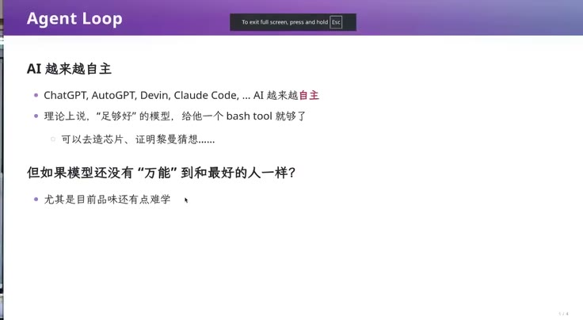](../assets/08-03.jpeg)
{: #l08-src-030}

*图 3：11:10，《Agent Loop》。ChatGPT、AutoGPT、Devin、Claude Code，AI 越来越自主。理论上，足够好的模型给一个 bash tool 就够了，可以去造芯片、证明黎曼猜想。模型还没有万能到和最好的人一样，目前的品位还有点难学。*
{: #l08-src-031}

[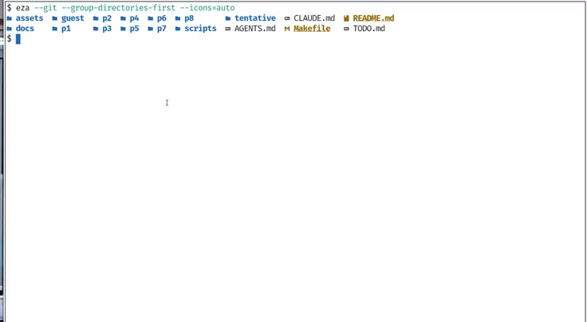](../assets/08-04.jpeg)
{: #l08-src-032}

*图 4：15:14，终端里用 eza 看仓库。可见 CLAUDE.md、README.md、AGENTS.md、Makefile、TODO.md，以及 p1到 p8。*
{: #l08-src-033}

[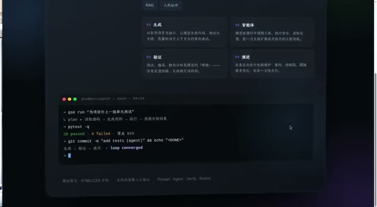](../assets/08-05.jpeg)
{: #l08-src-034}

*图 5：20:42，它在浏览器里打开的简介页。深色卡片，底下嵌着一段终端。*
{: #l08-src-035}

## 同一个 prompt，世界在变 {#l08-src-037}

*原片 00:22:34–00:27:33*
{: #l08-src-038}

今天常见的一种 harness 机制叫 Ralph loop，实际实现可能远不止三行。Agent 也能产生 subagent。Claude 今年某个版本加入了类似能力：像调用 Bash 一样生成 TypeScript，在 `for` 循环中调用 agent，把循环变量或计算出的字符串填入自然语言任务。调用可以异步执行，再等待结果。我不记得具体语法，可能通过 `await` 等待某个 agent 完成。
{: #l08-src-039}

Ralph loop 的名字来自《辛普森一家》中的 Ralph：有点笨、有点可爱，却不放弃。最简单的循环不断把同一个 prompt 交给 `claude -p`，重复执行任务、检查和修改。模型给过一句贴切的概括：“The prompt stays the same, but the world changes.” 理想情况下，足够强的模型只需 Bash 就能探索方案；现实中的模型仍会偏离方向，也会受已有代码影响。它通常倾向于遵守指令、保留用户现有内容，即使这些内容质量很差。
{: #l08-src-040}

导师可以严厉指出学生代码不合格，要求推倒架构重来；师生之间通常能理解这种要求的用意。模型却常试图修补上下文中已有的低质量代码。重构很难让行为百分之百不变，有些变化能改善设计，也可能不符合用户当前诉求：线上服务出错时，用户或许只想一分钟内恢复运行。遵守现有结构与推动重构各有理由，但始终迁就已有代码，也可能让项目继续积累问题。
{: #l08-src-041}

可以用 prompt、loop 等方式管理设计空间，要求模型兼顾广度研究与深入实现。Ralph loop 提供了一种线性推进方式。长任务容易超过上下文容量：Codex 原本进展顺利，突然开始 compact，需要等待、消耗额度，压缩后还可能暂时丢失重要信息，重新积累上下文后才恢复。最近上下文扩展到 500K，确实改善了这个问题，但长任务仍需要分阶段推进。我倾向于把它理解成状态机，物理世界也可以看作状态转移系统。
{: #l08-src-042}

[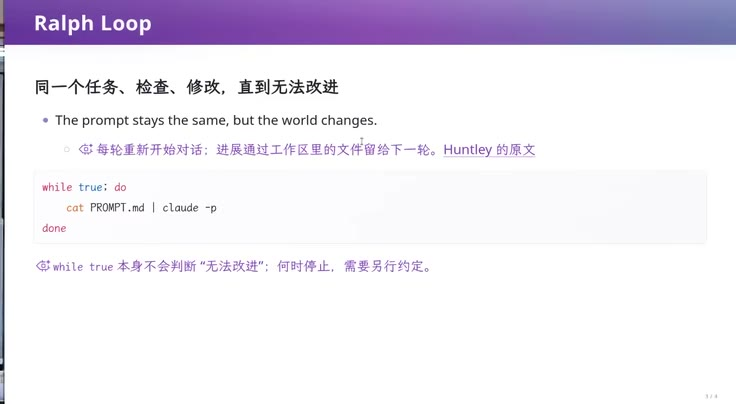](../assets/08-06.jpeg)
{: #l08-src-043}

*图 6：23:34，《Ralph Loop》。同一任务反复执行、检查与修改，每轮开启新对话，进展留在工作区文件里。示例命令为 `while true; do cat PROMPT.md | claude -p; done`。循环本身不会判断何时无法改进，停止条件需要另行约定。*
{: #l08-src-044}

## 工作区是状态 {#l08-src-046}

*原片 00:27:33–00:33:24*
{: #l08-src-047}

可以把 workspace 看作软件开发的完整状态。最初只有 `spec.md`，几乎没有实现；循环读取任务与 prompt，执行一轮后进入下一状态，可以做一次 git commit，再开始下一轮。Prompt 可以限制每次工作量，要求检查结果，或请另一个 agent review。这样把长任务分为许多可检查的小步，形成一个非确定的状态机。
{: #l08-src-048}

同一个状态上可以选择不同操作：让 GPT 开发、Claude review，或 DeepSeek 执行任务。也可以定期做架构检查，例如每周评估项目是否积累了 AI slop，再进入重构。重构 agent 可以先移除有问题的实现并提交，再由另一个 agent 用更合适的架构重做。可选操作形成搜索树，实际执行时则逐步选择路径，直到完成任务。每次开发都是一次状态迁移。
{: #l08-src-049}

这也解释了 subagent 并行：在不同 Git worktree 中同时重构 A、B 模块，再合并变更。状态可以保存在工作区，long-horizon task 就能超过一次会话的长度。早期线性 ReAct agent、AutoGPT，或单次 `claude -p`，可能因上下文超限而越做越差；外层循环帮助继续推进。模型厂商又在提高单次会话能力，外层工作流也随之支持更复杂的任务。
{: #l08-src-050}

我觉得，在导师已经想清研究方向的情况下，agent 已经能替代博士生承担一些执行工作。培养人仍然重要，从不会到会的过程有独立价值；但如果教授只看论文、研究成果和项目等指标，部分博士生的执行能力可能还不如经过 prompt 调整、配好 loop 的 agent，即使已经毕业也一样。
{: #l08-src-051}

[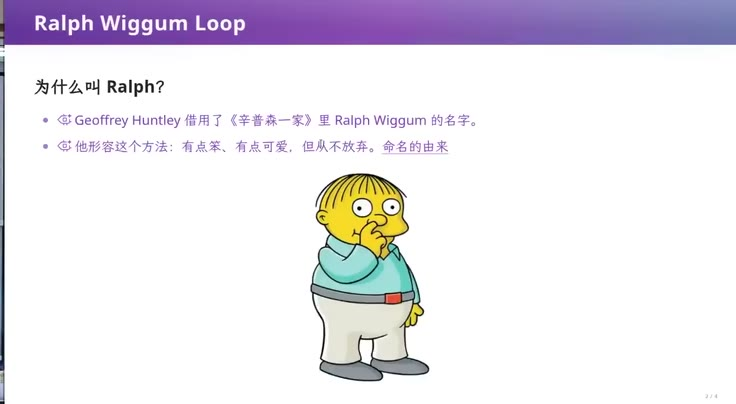](../assets/08-07.jpeg)
{: #l08-src-052}

*图 7：32:36，《Ralph Wiggum Loop》。Geoffrey Huntley 借用了《辛普森一家》里 Ralph Wiggum 的名字。他形容这个方法：有点笨、有点可爱，但从不放弃。*
{: #l08-src-053}

## 同一句话，两次结果不一样 {#l08-src-055}

*原片 00:33:24–00:40:06*
{: #l08-src-056}

我也实现了一个简单的 loop，由 prompt 驱动：每轮先检查当前状态，只推进明确步骤；未完成时把下一步写入文件，所有状态留在仓库中。只有确认整个任务完成，才输出 `RALPH_DONE`，外层循环看到这个标记就停止。这份 prompt 也可能由 AI 根据我的一两句话生成。
{: #l08-src-057}

可以用同一任务比较两个 agent：一个套 loop，一个直接生成名片。结果有随机性，不能据此断言哪种方式总是更好。直接生成的那张很花哨，有玻璃动效和 macOS 风格终端，也许受已有上下文影响，但邮箱和头衔都错了。Loop 生成的版本朴素，计算机学院副教授、邮箱和 GitHub 信息却是正确的。差异也与 loop 中的 prompt 有关。
{: #l08-src-058}

同一模型投入的算力和 prompt 不同，结果可能差很多。网上推荐的 prompt、skill 可以借鉴，但长期使用后，可能还是自己写的更符合需求。与模型反复磨合，才能判断哪些任务可以放手执行、哪些结果需要核对。
{: #l08-src-059}

那份“世界上最好的编程语言”调研还在运行，等它输出 `RALPH_DONE`。它由一百五十行 agent 和几行脚本驱动，已有结论是不存在绝对最好的语言，也整理了一些材料。我先移走已有 research，再用同样 prompt 跑一次，完成后比较结果。这些工具只有 Bash，模型在这种限制下仍能完成不少工作。
{: #l08-src-060}

Agent loop 没有公认的最佳设计。Codex、Claude Code、Pi 哪个更好，很难一概而论。Pi 本身没有 subagent，生态中已有多个相关插件，流行程度也不同。模型升级还可能改变原有 prompt 的效果。新版本发布时，可以先暂时移除已有 skill，用熟悉任务做对照：没有这些额外指令，模型也可能表现更好。当前工具仍在快速变化。眼前的调研结果中，loop 版本显得更保守，至少说明外层循环会明显影响输出。
{: #l08-src-061}

## 别信开发者 {#l08-src-063}

*原片 00:40:06–00:48:10*
{: #l08-src-064}

Loop 中一条重要要求是：每轮检查当前状态，只推进一个明确步骤，然后验证和评估结果。模型训练和当前上下文都可能使它偏离目标，限制为小规模状态迁移，再停下来检查，可以挡住一部分问题。检查可以由另一个模型 review，也可以运行测试和脚本，以此确认项目正在改善。
{: #l08-src-065}

软件工程早就在处理开发者不可靠的问题。计算机系统基础课有两条提醒：机器按规则执行，先怀疑自己的代码。人天然会相信自己，觉得只改一句文档、把循环起点从 1 改为 0，或者单元测试已过，就应该没问题。做 OJ 时也会反复判断“能交了吗”。但这种自信可能漏掉影响，现实中确实有小小的 PR 导致生产系统故障。
{: #l08-src-066}

我们希望每次迁移后的状态都满足要求。检查失败，就继续修复，不能直接结束；检查充分、未发现问题后，才进入发布。这个思路就是一二十年前逐渐普及的 CI/CD：把开发看作状态转移，在每步之后自动检查，满足条件后再自动推进。仅要求实习生或学生认真测试并不可靠。做 OJ 时，许多人过了样例就提交，因为提交免费，十秒内可能得到正确反馈；失败后再认真检查。这种尝试捷径的心理，不能作为生产流程的保障。
{: #l08-src-067}

于是要把检查条件写进自动执行的脚本，不能依赖开发者记得手动运行。GitHub 项目中的 `.github` 就承载着许多配置。Pre-LLM 时代，学生难理解 CI/CD，也因为它涉及容器、独立执行环境、企业流程与结果展示。基本思路仍然清楚：在适当时机执行检查，通过后再集成、构建、验证或发布。否则一次提交可能让整个项目无法编译。上线可以由人决定，也可以让通过检查的变更自动发布，例如出现 release tag 时构建并上传发布产物。
{: #l08-src-068}

开发过程有 commit、push、pull request、merge，以及合并到 protected branch 等事件，都能设置 hook。之前我让 Pi 在需要输入时播放声音，最初失败，现在已经能在输出结束后响一声。我让 Codex 总结 CI 流程，完成时也会提醒。Hook 就是在状态迁移前后执行指定动作。今天有大语言模型辅助，配置复杂流程比以前容易。
{: #l08-src-069}

[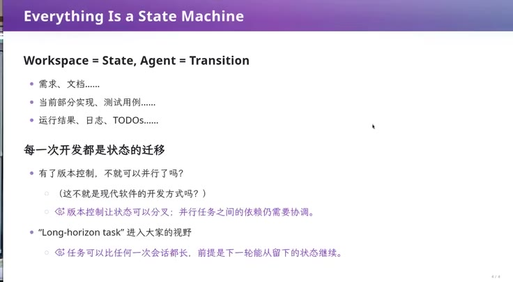](../assets/08-08.jpeg)
{: #l08-src-070}

*图 8：40:20，《Everything Is a State Machine》。Workspace 等于 state，agent 等于 transition。需求、文档、当前实现、测试用例、运行结果、日志、待办，都在这个状态里。有了版本控制就可以并行，状态可以分叉，并行任务之间的依赖还是要协调。long-horizon task 可以比任何一次会话都长，前提是下一轮能从留下的状态继续。*
{: #l08-src-071}

[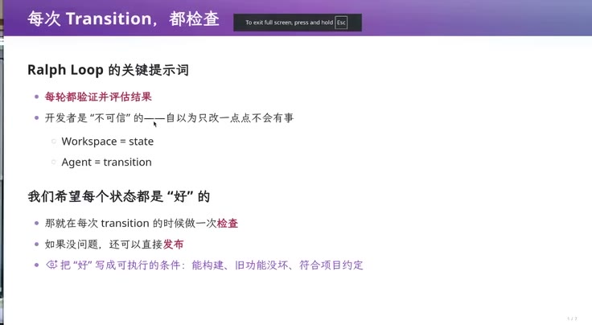](../assets/08-09.jpeg)
{: #l08-src-072}

*图 9：42:14，《每次 Transition，都检查》。每轮都验证并评估结果。开发者是不可信的，自以为只改一点点不会有事。希望每个状态都是好的：能构建，旧功能没坏，符合项目约定。没问题就可以发布。*
{: #l08-src-073}

## 检查要有约束力 {#l08-src-075}

*原片 00:48:10–00:59:32*
{: #l08-src-076}

`.github` 中可能有许多 workflow。过去需要手写 YAML、嵌入仓库名、学习这类 DSL；今天可以先明确哪种状态迁移触发什么操作，再让模型实现。例如提交或合并时运行检查，本地 pre-commit 先编译、lint。
{: #l08-src-077}

Lint 泛指无需运行程序即可执行的静态检查，包括缩进、换行和空格等，例如 `a = 1` 这样的赋值表达式也应使用一致格式。初学者容易忽略格式，写久了就会发现，可读性规范是软件工程最基础的约束，连这些都不一致，后续更容易出问题。Pre-commit 适合快速检查，提交后 CI 可以在容器中运行更完整的任务。国内有免费容器服务，虽然排队长、速度慢；GitHub Actions 也提供额度，我记得每月大约 2000 分钟。还可以在上面运行 Claude Code 和 Ralph loop：push 一个任务，hook 启动 agent，修改并提交，再触发后续流程。要防止流程把自己破坏，可能需要分两段设计，订阅未必能直接使用，可能要走 API。前提是清楚什么时候运行 lint、单元测试、集成测试或长时间模糊测试，后面的课会继续讲。
{: #l08-src-078}

Agentic AI 让 CI 更重要。Agent 与人的思维方式不同，容易生成难维护的产物。要求写文档，它可能一次提交 20KB，细节多到难以阅读，还把思考过程和开发中的临时问题全部写进去。此后 `doc.md` 与 `implementation.py` 形成隐含关联，换一个 agent 或压缩上下文后，这种关联可能被遗忘；代码修改了，文档没有更新，项目就开始积累不一致。它还可能在无关细节上过度处理，却忽视设计中的重要选择。做网页时反复截图、调用开发工具，也容易塞满上下文。有人建议让 subagent 看图，只向主上下文返回简短结论，避免后续一直携带截图。模型有时会写出人难以阅读的代码，又自信能够维护它。
{: #l08-src-079}

项目如果还需要人与 AI 共同维护，就必须约束这些行为。最近一场关于超级智能的讨论把人比作狗眼中的超级智能：狗不理解人类如何工作，却生活在人类创造的世界里，世界上大约有十亿只狗。完全把任务交给 AI、放弃理解，是一种选择；今天仍要由人参与维护的项目，需要守住可理解性。一旦文档膨胀到无法定位内容，代码也难以阅读，人就只能继续依赖 agent 修改，维护能力会持续下降。
{: #l08-src-080}

CI 可以设置硬性条件，例如文档不得超过 1000 字，测量字符串长度，超过就失败，无法合入主分支。Agent 在本地运行 pre-commit 时也能立刻看到问题，再回头检查 README 或 AGENTS.md。它会想起 README 或 AGENTS.md 中写着文档不能超过 1600 字。即使上下文号称有一百万 token，只把“文档禁止膨胀”写进指令，也未必能持续得到遵守；仓库增长到十万行以上后，模型对约束的注意力可能下降。
{: #l08-src-081}

过去很少有人专门用 CI 要求文档不超过 1000 字，因为人积累低质量文本的速度远低于 AI。今天这类可判定规则变得重要，可以把原本容易忽略的要求变成持续执行的检查。这也是 CI/CD 的作用。
{: #l08-src-082}

[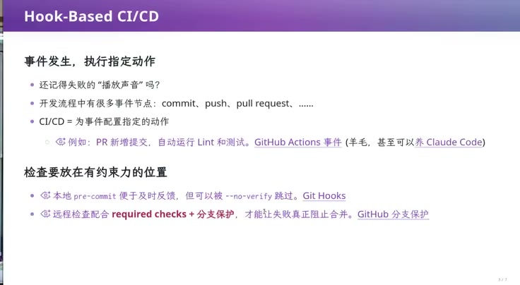](../assets/08-10.jpeg)
{: #l08-src-083}

*图 10：48:21，《Hook-Based CI/CD》。Commit、push、pull request 等事件可以触发指定动作，例如 PR 新增提交后自动运行 lint 和测试。本地 pre-commit 反馈快，却能被 `--no-verify` 跳过；远程检查结合 required checks 与分支保护，才能在失败时阻止合并。*
{: #l08-src-084}

[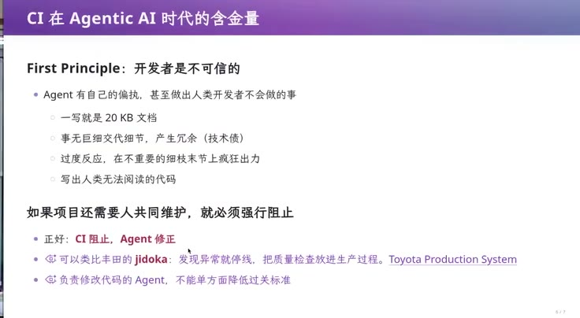](../assets/08-11.jpeg)
{: #l08-src-085}

*图 11：52:45，《CI 在 Agentic AI 时代的含金量》。第一条：开发者是不可信的。agent 会一写就是 20KB 文档，事无巨细，在细枝末节上过度反应，写出人无法阅读的代码。项目还要人一起维护，就必须强行阻止。页上写的是：正好，CI 阻止，agent 修正。可以类比丰田的 jidoka：发现异常就停线。负责改代码的 agent，不能单方面把过关标准放低。*
{: #l08-src-086}

## 从空仓库开始 {#l08-src-088}

*原片 00:59:32–01:06:58*
{: #l08-src-089}

Ralph loop 把 workspace 当作状态，借助 Git 逐步推进，并在 pre-commit、post-commit、pre-push、pre-merge 等位置设置检查。这就是 agent-native 开发的一部分。OpenAI 的文章 Harness engineering: leveraging Codex in an agent-first world 发布时引起过不少讨论。Codex、Claude Code 的团队都谈到减少人工写代码。我记得 Claude Code 曾出现 source map 泄露；在我看来，这应该通过门控检查公开产物中的明文内容。
{: #l08-src-090}

文章写道：“We started with an empty git repository.” 人从空仓库开始组织 agent 工作，仍然需要定义环境、约束、反馈和验证。例如 push 前检查明文和 API key 泄露。公开 Codex 仓库中的 CI 按 PR 做快速检查，进入 main 后做全量验证，发布时再检查一轮。可见内容包括 lint、Cargo 格式化，以及文件、函数过大等基础规则；main 阶段运行更多测试，发布阶段打标签。
{: #l08-src-091}

文章还有 What we're still learning，讨论如何让 agent 流程支撑以年计的软件维护。我看过公开 CI 后，判断内部应该还有大量未公开的检查；我确信仅靠这些 lint，很难保持这样的工程质量。我的批评是，文章没有附上内部可以直接复用的完整门控配置。文章本身明确提到了 lint、结构测试和 CI，并非完全没有讨论这些机制。
{: #l08-src-092}

Anthropic 的经验也值得看：16 个 agent 一起编译 Linux 时，可能卡在同一个 bug 上，重复修复、覆盖彼此改动。实际工作仍需调度和协调。我们的一个项目有 `architecture.md`，能自动生成架构图；agent loop 的 logbook 记录任务，再通过 GitLab CI 更新 dashboard。图上能看到哪个模块正在修改、有几个 agent 参与，以及估计进度。我作为 lead，带几位同学，每位又管理几个 agent，协调并不容易。这张图让我能了解当前状态，估计一小时后的变化，并调整任务安排。
{: #l08-src-093}

我还没有放心地把所有工作交给一个主 agent，但想尝试让它在 logbook 中创建任务，再组织执行。开源社区已有许多实践可以学习。相比 OpenAI 公开的材料，我更愿意仔细看 DeepSeek harness，它公开了许多具体机制，是 agent-native 开发的一个参考案例。
{: #l08-src-094}

[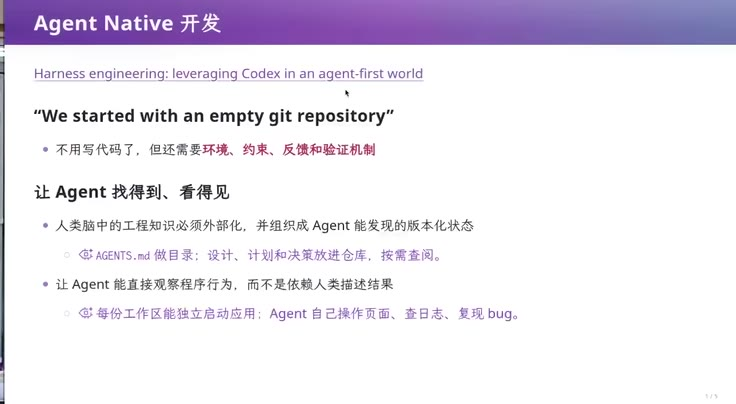](../assets/08-12.jpeg)
{: #l08-src-095}

*图 12：01:00:12，《Agent Native 开发》。副标题是 Harness engineering: leveraging Codex in an agent-first world。引文是We started with an empty git repository。不用写代码了，还需要环境、约束、反馈和验证。人脑子里的工程知识要变成agent 找得到的版本化状态。AGENTS.md 拿来放设计、计划和决策。每份工作区要能自己把应用跑起来，agent 自己操作页面、查日志、复现 bug。*
{: #l08-src-096}

[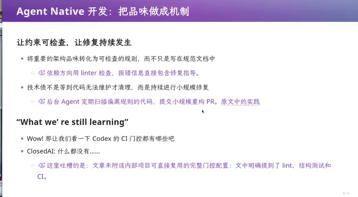](../assets/08-13.jpeg)
{: #l08-src-097}

*图 13：01:01:30，《把品味做成机制》。把架构要求变成可检查规则，例如用 linter 检查依赖方向，在报错中提供修复方向，再由后台 agent 定期提交小规模重构。What we’re still learning 讨论长期维护中的未知问题；文章未附完整的内部门控配置。*
{: #l08-src-098}

[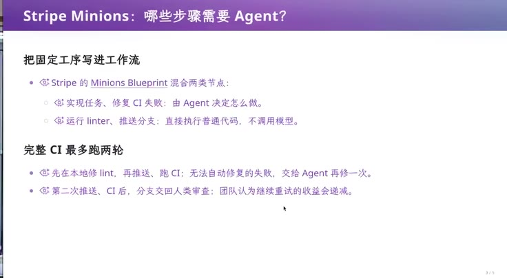](../assets/08-14.jpeg)
{: #l08-src-099}

*图 14：01:03:52，《Stripe Minions：哪些步骤需要 Agent？》固定工序写进工作流。实现任务、修 CI 失败，由 agent 决定怎么做。跑 linter、推送分支，直接执行普通代码，不调模型。完整 CI 最多两轮。第二次推送之后，分支交回人来审。*
{: #l08-src-100}

[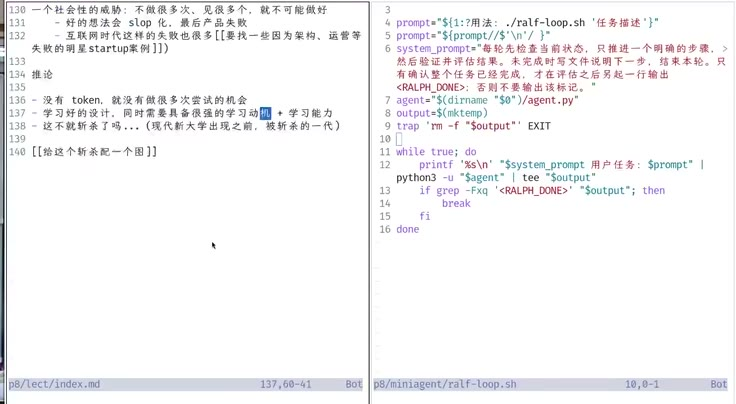](../assets/08-15.jpeg)
{: #l08-src-101}

*图 15：01:06:57，左边是讲稿，右边是 `ralf-loop.sh`。循环里把任务交给 `agent.py`，输出里出现 `RALPH_DONE` 就停。*
{: #l08-src-102}

## 中文和英文得是同一件事 {#l08-src-104}

*原片 01:06:58–01:18:01*
{: #l08-src-105}

Clone DeepSeek harness 后，首先会发现它的项目组织与常见仓库不同。作为中文母语者，我读中文仍比英文快，可能快一倍，这有助于从整页文档中快速定位信息。但项目面向全球，又需要同时维护中文与英文。文档随时修改，数量一多，怎样持续保持双语一致？这种问题通常需要实践经验才能提前意识到。
{: #l08-src-106}

打开 docs 中的 architecture，能看到清楚的结构和大量交叉引用。我检查到的这些链接是有效的，文档之间也保持一致。它通过规范和门控维护双语：每篇文档与同目录中的另一语言版本、i18n YAML 文件形成配对。两种语言具有对等权威，本次先修改的一侧就是源，另一侧由 agent 翻译更新，要求两者表达同一件事。
{: #l08-src-107}

项目用 pnpm 脚本检查 translation pairing，在旁边的文件记录 hash，Git 历史保留过往状态，据此判断哪一侧发生变化、哪一侧尚未同步。需要翻译时，只处理本次补丁涉及的位置，其他段落保持不动。程序负责检查版本对应关系，AI 负责翻译差异；例如中文侧记录对应英文版本的 hash，用很少的元数据跟踪同步状态。
{: #l08-src-108}

软件项目内部关系复杂，单纯的文件目录很难完整表示。DeepSeek harness 为此增加了配对文件，目录看上去不那么简洁，但可以通过 IDE 配置隐藏不想看的内容。例如中文读者隐藏英文与 i18n 辅助文件，英文读者隐藏中文文件，日常仍然只看自己需要的文档。类似 `.vscode` 的个人配置不必强制加入项目。开发体验可以保持清楚，底层则保存 agent 工作所需的关系。
{: #l08-src-109}

更新遵循最小补丁，只翻译变化部分。项目把自然的文风写成可校准规范，虽然样例仍有一些 AI 痕迹，但大量文档保持可维护，显然依赖了这些机制。规范按需加载：翻译或写文档时才读取相应要求，避免全部堆进 AGENTS.md，让常驻上下文膨胀。术语表规定中英文统一译法，也可以辅以机械检查。例如比较对应术语出现次数，容许一定差异；“加减三”只是我举的例子，阈值需要调试，避免误判正常译文。这些门控共同约束 agent，减少双语文档逐渐偏离的问题。
{: #l08-src-110}

我还让模型回溯这套文档一致性机制由谁、何时引入，经历了哪些大变化。此前我并不知道答案，而仓库保留的开发历史让这件事可以追查。
{: #l08-src-111}

[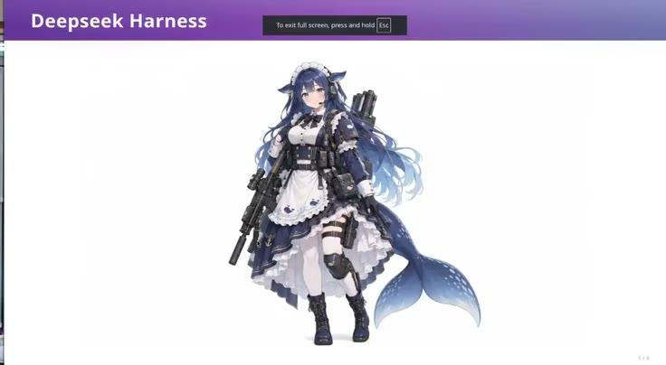](../assets/08-16.jpeg)
{: #l08-src-112}

*图 16：01:07:00，《DeepSeek Harness》课程过渡页。*
{: #l08-src-113}

[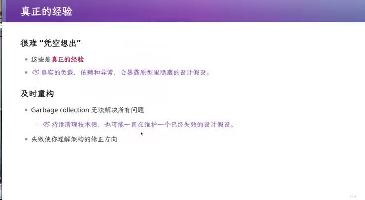](../assets/08-17.jpeg)
{: #l08-src-114}

*图 17：01:07:21，《真正的经验》。很难凭空想出。真实的负载、依赖和异常，会把原型里藏着的设计假设暴露出来。垃圾回收解决不了所有问题。持续清理技术债，也可能一直在维护一个已经失效的设计假设。失败让你看见架构该往哪边改。*
{: #l08-src-115}

## 从空仓库长到今天 {#l08-src-117}

*原片 01:18:01–01:28:30*
{: #l08-src-118}

仓库历史中，2026 年 6 月 10 日晚上 11 点有一次从零开始的提交。项目从空仓库发展到今天，过程都保留着。参与者包括 turtle、张子雅和崔天逸，他们也在我们讨论的群里。6 月 25 日先加入 terminology，当时还没有配对机制，只有术语约定，说明他们已经意识到文档的重要性。7 月开始加入配对与门控，7 月 3 日出现对等权威和 sidecar，并接入自动化流程。我不确定设计借鉴了哪个项目；pre-LLM 时代已有类似思想，例如 Python 的 Sphinx、Java 的 Javadoc，以及 C++ 的文档提取工具，用规定格式的注释生成 API 参考。Agent 时代把同步工作交给模型，配对机制就更有价值。项目很早就确定了这套方式，随后持续维护中英文版本。
{: #l08-src-119}

这也是项目第一眼就显得不同的原因。我很感谢 DeepSeek 和 DeepSeek harness 开源这些经验。相比之下，OpenAI 公开仓库展示的主要是基础 lint、测试和构建配置。我的判断是，它们内部还有更多维护机制，例如定期 agent review；博客提过早期每周做一次此类评审，但完整配置并未随可编译代码一起公开。
{: #l08-src-120}

常驻指令采用分层 AGENTS.md，各子目录可以有自己的版本，并设置文档预算：root 不超过 1960 词，architecture 不超过 2400 词，防止内容无限增长。Agent notes 记录 implemented、proposed、rejected、archived 等状态，有些像 Ralph loop 的任务记录。我们的实现用 logbook、状态字段、GitLab CI 与架构图组织任务；它们采用相近思路，也可以扩展 dashboard，但未必认为需要。此外还有许多按需使用的 skill。
{: #l08-src-121}

界面也在变化。ChatGPT 越来越常生成动态内容，把图片嵌入文字进程，比集中堆在前面更容易阅读。纯终端交互有局限，Web 可能承载更多这类工作。仓库中的评审、code review、写作、工程质量规范和产品 skill，也都能成为学习材料。面对陌生项目，只要先有一些判断：什么设计好、什么没见过，就能借助工具更快理解别人的经验。
{: #l08-src-122}

项目还有本地 CI、人工评审和评分，新增文案需要通过语义评审。除双语一致外，还检查交叉链接，以及文档代码块是否与源码一致。例如文档中的 interface，必须逐字符出现在指定文件中，以防代码和文档各自变化后互相矛盾。
{: #l08-src-123}

我们把这个思路进一步用于带执行语义的代码块。通过轻量扩展 Markdown 围栏语法，可以声明代码块必须出现在某个位置，或按某种规则与其他内容保持关联，再由检查器验证。
{: #l08-src-124}

这些 skill 还处理事务与机制的分离，配合文档同步、静态检查、覆盖率、快照等机械门控。代价是每次代码提交前要运行许多检查，但人更多负责制定 plan，与 AI 明确做什么、做到什么程度，再交给它实现。我们的 plan 写在 logbook 中，只修改计划、没有改代码时，无须跑全部 CI。项目还有客户端界面、翻译配对、入口和 TypeScript 等检查，例如文档中粘贴的类型必须与源码等价。单条规则很小，合起来支撑了维护，再加上文档分层、任务到机制的路由，形成 agent-native 工作方式。
{: #l08-src-125}

从去年到今年，尤其是今年年初这半年，变化很快。项目从六月开始规划，在短时间里形成了不少可学习的经验。看见后会觉得合理，凭空却很难想全。只在教室里讨论语言规则，容易局限于当前上下文，看不到其他设计方向。这些开发者与我年龄相近，崔老和我是同龄人。他们经历过实践与失败，才形成这些办法。即使经验丰富，项目仍可能需要重构。我也会要求学生从新的空白实现开始，逐步迁回旧功能，保持清楚的架构。持续清理无法解决全部问题，必要时需要在模块或整个项目范围内重构。
{: #l08-src-126}

## 重构没赶上，人就走了 {#l08-src-128}

*原片 01:28:30–01:34:00*
{: #l08-src-129}

历史上也有重构来不及的案例。早期社交网络 Friendster 很快吸引大量用户，架构却无法承担负载，出现延迟与宕机。那是 pre-LLM 时代，今天 agent 也许能提供更多帮助。这样的失败经验，同样启发了 agent-native 开发机制。
{: #l08-src-130}

我担心实践机会出现差距。没有多次尝试、失败和构建的经历，很难把系统做好。即使 intent 很好，缺少经验的团队也可能沿着一个方向积累大量 AI slop，最后被别人用更好的实现追上。有经验的团队更可能收敛到合适方案。开学时说“没有 token 的学生应该立即退学”是玩笑，但 token 少确实意味着尝试机会少。阅读优秀开源项目能帮助理解设计，仍然需要亲手试错。
{: #l08-src-131}

这可能形成就业门槛：如果毕业生的执行能力还不如 agent，用人单位可能选择给资深员工更多 token。培养新人需要四五年，企业未必等得起，而 agent 已经可用且持续进步。我最近在 Grok 的机器人中使用 Claude Code，20 美元订阅下的 Opus 额度对我还算够用，能力也强；本科生达到这样的执行水平并不容易。资深开发者再配合自己的 harness，差距可能继续扩大。如果这些经验一直只留在企业内部，后来者更难追上。DeepSeek 的开源在这方面有价值。这个社会问题也许只有大学有机会认真处理，因为大学的目标不应只剩盈利与 KPI。
{: #l08-src-132}

## 样板课换了执行的人 {#l08-src-134}

*原片 01:34:00–01:37:09*
{: #l08-src-135}

但大学也有自己的考核结构。科研经费等指标、基金委与科技部项目、优青杰青等评价，形成了一套近似公司化运行的体系。我的激烈判断是：当学生与教师的工作方式都受到 agent 冲击，这套体系可能失效，大学肯定要崩溃。另一方面，培训机构可能形成新的学校形态：投入资金，请优秀的人设计样板课，其他教师执行；未来执行环节又可由教师与 AI 共同完成。它们能重新投资课程设计，现有大学却有较大惯性，仍需沿用当前授课方式。未来究竟怎样，我也不知道。
{: #l08-src-136}

我感谢开源社区，这些理解很大程度上来自阅读其中的优秀项目，也促成了这门课。大家可以从 DeepSeek harness 开始继续探索。它与今天演示的小循环共享基本思路：那份 `agent.py` 还不是完整的 Ralph loop，却可以看作 harness 的最小内核。成熟项目进一步把能力插件化，许多具体经验都放在插件中。
{: #l08-src-137}

今天下课。
{: #l08-src-138}

[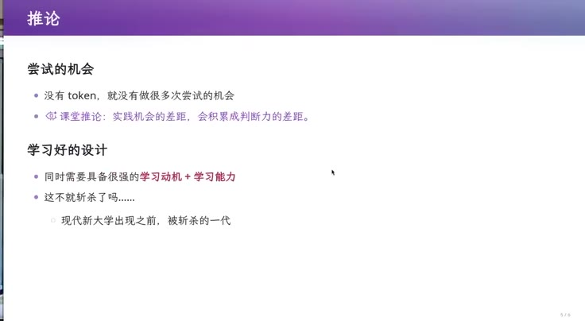](../assets/08-18.jpeg)
{: #l08-src-139}

*图 18：01:34:10，《推论》。没有 token，就没有做很多次尝试的机会。课堂推论写着：实践机会的差距，会积累成判断力的差距。学好的设计，要同时有很强的学习动机和学习能力。下面一句是：这不就斩杀了吗。*
{: #l08-src-140}

[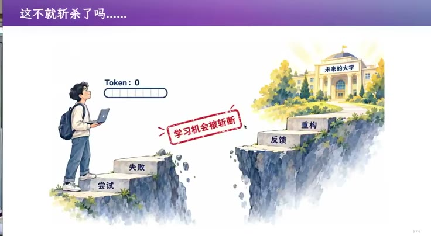](../assets/08-19.jpeg)
{: #l08-src-141}

*图 19：01:35:19，《这不就斩杀了吗》。左边的人电脑上 Token 是 0，脚下两级台阶写着尝试、失败，中间盖着“学习机会被斩断”。对面更高的台阶写着反馈、重构，上面是一座“未来的大学”。*
{: #l08-src-142}

[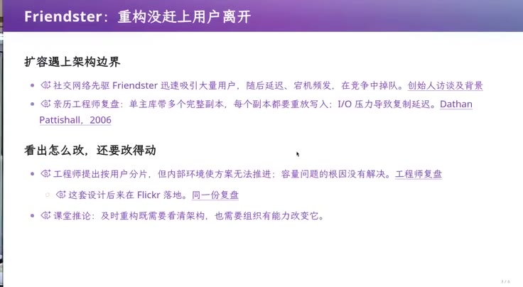](../assets/08-20.jpeg)
{: #l08-src-143}

*图 20：01:36:44，《Friendster：重构没赶上用户离开》。单主库与多个完整副本遇到扩展瓶颈，每个副本都要重放写入，I/O 拖慢复制。课件引用 Dathan Pattishall（2006）：工程师提出按用户分片，但内部未能推动，后来在 Flickr 落地。及时重构需要架构判断，也需要组织执行能力。*
{: #l08-src-144}
