# 12 · 软件质量保障（2）

南京大学 · 蒋炎岩 · 2026 · [原视频](https://www.bilibili.com/video/BV1LaW36WErp/)
{: #l12-p001}

## 从 fault 到 failure，测试为什么依赖架构 {#l12-section-01}

*[原片 00:00:00–00:02:10](https://www.bilibili.com/video/BV1LaW36WErp/?t=0)*

今天继续讲软件质量保障。上一次课讲到调试理论，先心疼一下程序员。以前讲计算机系统基础、教大家调 NEMU 时，我也会讲这个故事。程序员写进程序的是 fault，可能是手滑写错一个地方，也可能是算法设计有误。要让这个缺陷变成运行时的错误状态，也就是 error，需要一个能够触发它的测试用例。
{: #l12-p002}

有些 error 是 silent 的。一个数字算错了，或者某个内存地址被意外覆盖，但后续计算刚好没有受到可见影响，程序看起来仍然正常。即使当前状态已经违反 specification，开发者也可能误以为程序正确。
{: #l12-p003}

只有错误状态继续传播，才可能变成可以观察到的 failure。例如，本来应该 0.01 秒运行完的程序，一分钟还没有结果，可能挂住了；程序 crash，或者输出错误结果，也都是 failure。程序有 bug，需要测试去触发；触发了 error，还需要断言和观测手段把它暴露出来。Testing、specification 和 assertions 在这个过程中共同保障质量。
{: #l12-p004}

[](../assets/12-01.jpg)

*图 1：00:00:00，从缺陷、错误状态到可观察的失败。*

表面上是在讲测试，但软件架构决定了系统应该怎样测试，也决定了测试是否容易。面对一个真实系统，需要用工程经验判断哪些测试最合适。现在的 AI 模型还没有完全掌握好的 system design，这也是这门课仍然需要讨论的内容。
{: #l12-p005}

## 给游戏引擎做测试，先看清状态与视图 {#l12-section-02}

*[原片 00:02:10–00:06:50](https://www.bilibili.com/video/BV1LaW36WErp/?t=130)*

前面我们许愿做过一个 CSGO，可以在教室场景里射击。一个自然的问题是，怎样给这个系统做测试？假设架构已经比较合理，游戏引擎负责碰撞判定、射击、角色等逻辑，界面负责把这些内容画出来，两者应该能够分开。
{: #l12-p006}

玩家眼里是一张地图和拿着枪的人，程序内部却是一份游戏状态。例如，一颗子弹有坐标、速度和类型，类型决定它是哪种枪发射的子弹。游戏每经过一个 frame 或 tick，就更新一次状态，计算子弹前进了多少、是否发生碰撞，以及碰撞后的结果。即使渲染速度跟不上，状态更新仍然需要跟上实时游戏和网络另一端玩家的节奏。
{: #l12-p007}

在给定输入的情况下，这个状态更新甚至可以完全确定。从相同状态出发，执行相同逻辑，就会到达相同的下一个状态。输入既包括子弹移动这样的内部事件，也包括玩家指令，例如 player 1 按下左键。
{: #l12-p008}

底层引擎处理这些状态时，不需要生成图像，可以分别测试函数，也可以进行 replay 测试。另一个过程负责把游戏状态映射成显示状态，再渲染成屏幕上的场景。人物的手臂等对象也可以有状态，只是这些状态最终会参与画面的生成。
{: #l12-p009}

玩家视角和 OB 视角可以看作同一份游戏状态的不同投射。大家在时间轴上需要对游戏状态达成一致，玩家看到第一人称画面，OB 则可以看到全局。Replay 也依赖这种状态与显示的区分。
{: #l12-p010}

[](../assets/12-02.jpg)

*图 2：00:05:30，游戏引擎状态、输入与渲染的关系。*

如果没有这样的测试框架，Agent 很容易陷入截图、微调、再截图的循环。看 DeepSeek 之前开发游戏的 trajectory，就能看到它在某个时刻以后不断这样尝试，消耗大量 token。想停下来改善测试，可以问 GPT，怎样把 unit test、module test 和 system test 分开。
{: #l12-p011}

GPT 给出的工程方案是，把源代码放在 `src/`，测试分到 `tests/unit/`、`tests/module/` 和 `tests/system/`，外面用一个 `justfile` 作为入口。`just` 可以理解为一种简化的命令执行工具，和我们用 Makefile 组织命令的想法相近。需要运行哪一类测试，就执行相应命令。目录分好后，让 Agent 继续实现即可。
{: #l12-p012}

## 用一份文档维护测试策略 {#l12-section-03}

*[原片 00:06:50–00:12:35](https://www.bilibili.com/video/BV1LaW36WErp/?t=410)*

为什么还说测试和软件设计需要工程判断？因为项目的规模和目标不同。如果只是花两天让 DeepSeek 写一个 CSGO，发布一段演示，前面的组织方式可能已经够用。但如果要维护一个从十万行继续发展到一百万行的项目，我会稍微换一种组织方法。
{: #l12-p013}

我们的项目本来就维护文档，可以在 `docs/testing.md` 中放一张测试登记表，让它成为 single source of truth，也就是单一事实来源。课件上的示意表是这样的。
{: #l12-p014}

| Scope | Level | Runner | Args | Metadata |
| --- | --- | --- | --- | --- |
| `crates/*` | `unit` | `cargo-test` | `--workspace` | `fast` |
| `packages/*` | `unit` | `bun-test` |  | `fast` |
| `tests/modules/*` | `module` | `script` |  | `isolated` |
| `tests/system/*` | `system` | `qemu-test` |  | `requires-vm` |

[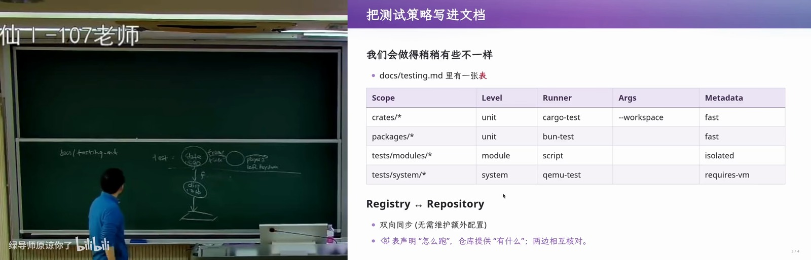](../assets/12-03.jpg)

*图 3：00:08:00，在 docs/testing.md 中登记测试策略。*

这张 Markdown 表说明测试覆盖哪里、属于哪个层级、由什么 runner 执行、带什么参数，以及有什么标签。需要新能力时，也可以扩展自己的 DSL。例如，要对 Rust crate 运行单元测试，就在登记表中写相应命令、参数和标签。实际项目的具体实现可以不同，这里展示的是组织方式。
{: #l12-p015}

以后每增加一种测试，就在表中增加记录。开发者阅读文档时，就能看到系统有哪些测试、分别怎样运行。仓库提供实际存在的测试对象，登记表声明执行方式，两者可以互相核对。这样，测试说明和执行入口有共同依据，减少额外配置、文档和 `justfile` 之间需要反复同步的内容。
{: #l12-p016}

项目扩大以后，总要有地方写清测试策略。如果说明写在文档中，执行逻辑又散落在别处，这些文件就会相互依赖。人或模型可能只改一处，另一处没有跟上，维护问题也就出现了。
{: #l12-p017}

在这个设计中，后台可以有一个统一框架，把 Markdown 表格编译成执行配置。还可以在文档中声明，pre-commit 时运行带某个 tag 的测试，例如 unit test 全部通过才允许 commit；运行 CI 时做完整的 system test，通过之后才允许 merge request 合并。文档中相关的代码和规则可以集中维护。
{: #l12-p018}

我希望项目使用自己定义的术语表达这些规则，减少对某个平台目录和配置格式的直接依赖。例如，commit hook 和 CI 往往分别引入配置文件，GitHub 的流程又写在 `.github` 中。项目可以先描述自己的测试语义，再生成这些平台配置，也可以生成 Bazel rules。这和一些成熟构建系统的设计思路相通。
{: #l12-p019}

[](../assets/12-04.jpg)

*图 4：00:10:30，Single Source of Truth 与测试配置。*

大家都知道要做测试，也知道 unit、module、system 这些层级。具体怎样组织，仍然要在实践中观察不同系统，积累判断。这里的反馈可能很弱，或者要很久之后才看得出维护效果。
{: #l12-p020}

这和强化学习里尽快完成任务的倾向存在张力。建设基础设施、复用部分已有框架，会消耗时间和 token，让眼前任务完成得慢一些。人类开发者仍可能判断，这样的大项目以后更容易维护。
{: #l12-p021}

## 从测试转向证明程序正确 {#l12-section-04}

*[原片 00:12:35–00:17:15](https://www.bilibili.com/video/BV1LaW36WErp/?t=755)*

上节课引用过 Dijkstra 的话，测试能够展示 bug 的存在，却无法展示 bug 的不存在。我们可以靠测试找到并修复很多错误，提高软件质量。那么，有没有可能做出一个能够证明正确的软件？
{: #l12-p022}

做 NEMU、操作系统内核、数据库或其他复杂系统时，大家似乎已经默认，系统总会有 bug。常见的过程是先堆出一个大致能运行的程序，再不停测试、修复，让它逐渐可靠。计算机科学的先驱很早就想过另一种途径，直接证明程序满足 specification，并让计算机检查这个证明。
{: #l12-p023}

课件引用了 John McCarthy 在 1962 年的设想。要让计算机检查证明，需要形式系统，也需要能够在其中书写证明。Turing、冯·诺伊曼等先驱，也曾讨论怎样用严格的数学方法描述计算。
{: #l12-p024}

[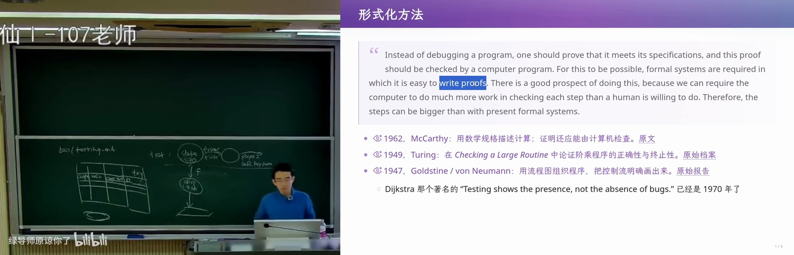](../assets/12-05.jpg)

*图 5：00:15:00，早期形式化方法与机器检查证明的设想。*

[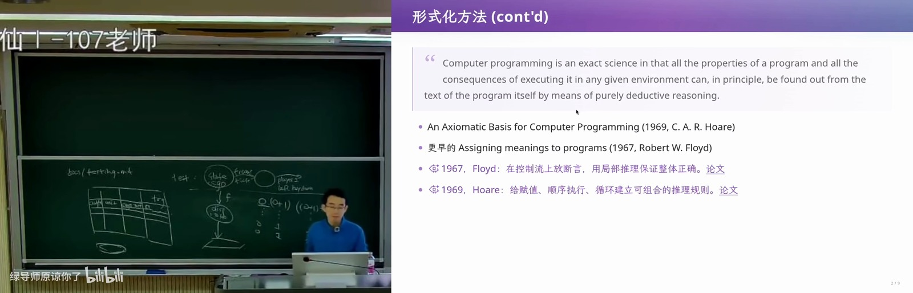](../assets/12-06.jpg)

*图 6：00:17:00，程序的公理基础与形式化方法的发展。*

离散数学一开始就讲逻辑和证明。很多同学被五学分的离散数学折磨过，每个字都听得懂，遇到一道看起来很简单的题，却无从下手。课程结束后，终于可以回到编程世界，直接写出一个能够运行的游戏。可是，程序也可以像自然数一样，成为严格的数学对象。
{: #l12-p025}

例如，从零是自然数，以及每个自然数的后继仍是自然数出发，可以依次构造一、二等自然数。这些对象的名字可以用十进制表示，也可以用二进制表示，名称和数学对象可以区分。在皮亚诺算术的基础上，还能定义运算、递归和函数。
{: #l12-p026}

初中学过的 `x² + 2x + 1 = (x + 1)²` 可以严格证明。我们也希望对程序采用同样严格的处理，这就是形式化方法的一个目标。早期研究者很多来自逻辑和数学，在二十世纪六七十年代就取得了成果。
{: #l12-p027}

## Hoare 三元组与循环不变式 {#l12-section-05}

*[原片 00:17:15–00:21:35](https://www.bilibili.com/video/BV1LaW36WErp/?t=1035)*

Tony Hoare 的论文《An Axiomatic Basis for Computer Programming》讨论计算机程序的公理基础，试图像研究几何那样，借助公理和规则探索程序的逻辑基础。篇幅并不长，影响却延续了很久。
{: #l12-p028}

[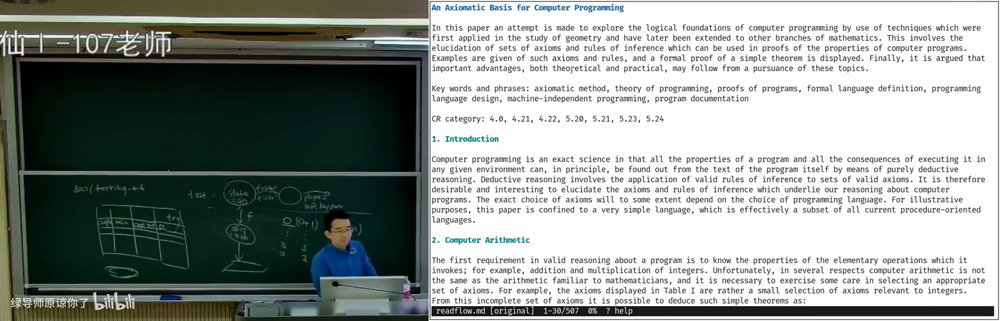](../assets/12-07.jpg)

*图 7：00:17:30，Hoare 关于计算机程序公理基础的论文。*

Hoare 三元组把前置条件、程序和后置条件联系起来。程序可以看作状态迁移，同一个程序在不同输入和初始状态下，会有不同执行过程。我们希望把所有可能行为概括起来，证明满足前置条件 `P` 时，执行程序 `C`，在它终止后满足后置条件 `Q`。
{: #l12-p029}

```text
{P} C {Q}
```

例如，已知 `x = n`，执行 `x := x + 1`，就希望得到 `x = n + 1`。知道两段程序各自满足什么性质后，还可以把顺序执行的证明连接起来。
{: #l12-p030}

[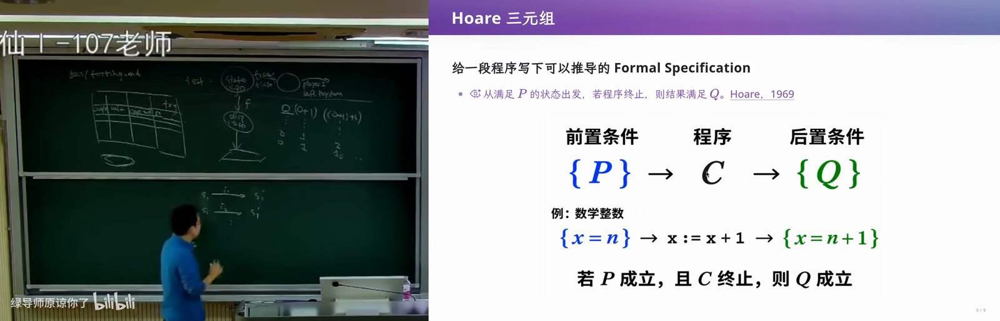](../assets/12-08.jpg)

*图 8：00:19:30，Hoare 三元组的前置条件、程序和后置条件。*

困难往往出现在循环。对于 `while condition`，循环退出时，我们知道 `condition` 为假。但只知道退出条件还不够，还需要找到每一轮循环都保持的性质，也就是 invariant。把不变式与退出条件结合，才能推出所需结果。
{: #l12-p031}

这部分可以花很长时间讲数学。大家先记住直觉，寻找一个足够好的命题，说明循环执行多少次都满足什么，再把整个执行过程连起来。形式化的证明目标可以包括数组访问不越界、指针访问合法，以及数据结构始终满足约束。
{: #l12-p032}

## 把数据结构的约束写成断言 {#l12-section-06}

*[原片 00:21:35–00:25:37](https://www.bilibili.com/video/BV1LaW36WErp/?t=1295)*

假设要实现一棵带 parent 指针的平衡二叉搜索树。它需要满足节点值的顺序关系，还要维护父子指针。只要做过树的旋转，就知道这些指针很容易改错。第一次独立实现时，改着改着就可能把某个节点丢掉。
{: #l12-p033}

有经验的开发者会写很多 assertions。暂时忽略空指针等边界情况，对某个节点 `p`，希望它确实是父节点的左孩子或右孩子。
{: #l12-p034}

```c
assert(p->parent->left == p || p->parent->right == p);
```

旋转把树结构改坏，或者 parent 错误地指向下面的节点时，这类断言可以尽早暴露问题。还可以检查节点值和左右子节点值的关系。课上这里只是示意，并没有展开全部 guard 和树的约束。
{: #l12-p035}

[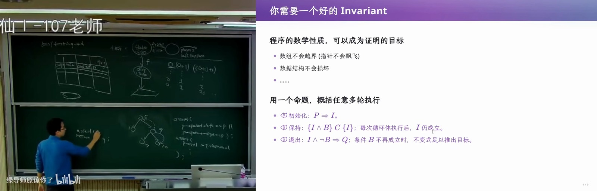](../assets/12-09.jpg)

*图 9：00:24:30，树结构约束与板书中的指针断言。*

每条语句也可能隐含正确性要求。例如，希望指针访问合法，希望程序执行除法时分母非零。写 `return p / q`，就隐含着对 `q != 0` 的要求。断言表达的是对当前程序状态的判断。
{: #l12-p036}

如果要检查从运行开始到现在的某种性质，也可以记录执行轨迹，再对包含这段历史的状态进行判断。理论上，历史可以放进一个列表。形式化方法希望进一步证明，这些写出来的数学性质在所有相关执行中都得到满足，让程序携带正确性证明。
{: #l12-p037}

这个愿景很美好，但在当时的编程语言和工程环境中，为每个程序附带证明的成本很高。我觉得它多少有些生不逢时。
{: #l12-p038}

## Boyer–Moore 投票算法为什么难证明 {#l12-section-07}

*[原片 00:25:37–00:28:58](https://www.bilibili.com/video/BV1LaW36WErp/?t=1537)*

看一个很短的例子。选票逐张到来，我们要找出得票严格超过一半的候选人。手里只保存一个名字和一个计数，遇到相同名字就加一，遇到不同名字就减一。计数变成零后，再用后续选票更换候选人。
{: #l12-p039}

```python
candidate, cnt = None, 0
for vote in votes:
    if cnt == 0:
        candidate = vote
    if vote == candidate:
        cnt += 1
    else:
        cnt -= 1
```

如果确实存在得票严格超过一半的人，最终留下的候选人就是他。这里有存在多数候选人的前提；计数 `cnt` 是抵消后的余量，并非候选人的实际得票数。
{: #l12-p040}

[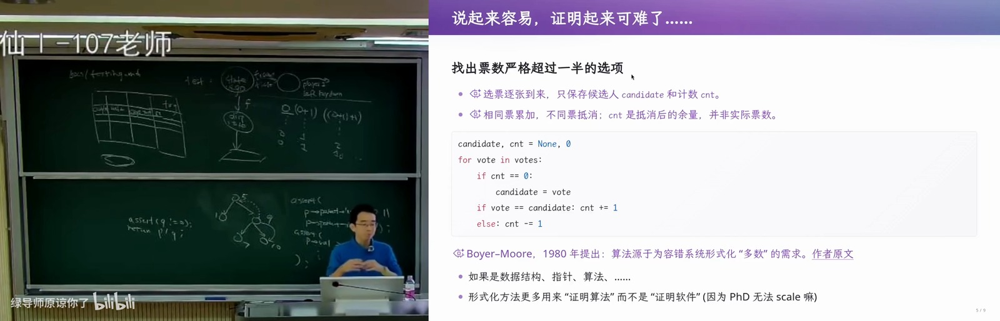](../assets/12-10.jpg)

*图 10：00:27:00，Boyer–Moore 多数投票算法。*

算法只留下候选人和计数，处理过的历史都丢掉了。程序像一次有损压缩，把正确性解释留给后人的智慧。要做证明，就得找到足够巧妙的循环不变式，概括所有可能历史怎样对应当前状态。
{: #l12-p041}

这么短的算法尚且如此，数据结构、指针操作和复杂算法的证明就更费力。在很长一段时间里，研究者花大量智力证明平衡树等对象，提出新的逻辑，再说明它证明某种数据结构时更方便。普通程序员既不熟悉数理逻辑，也很难仅为这种改善去学习一套新逻辑。
{: #l12-p042}

过去，人类智力难以按需扩展。今天的情况有变化，复制模型权重，就能复制一份有较高推理能力的智能。那些先驱的理论工作可能做得太早，现在才出现新的应用条件。与此同时，另一种更容易被程序员接受的形式化路线也逐渐发展起来，它在数理逻辑与直接枚举之间寻找平衡，相关工作也获得了图灵奖。
{: #l12-p043}

## 穷举状态空间，也能构成证明 {#l12-section-08}

*[原片 00:28:58–00:32:56](https://www.bilibili.com/video/BV1LaW36WErp/?t=1738)*

Everything is a state machine。既然程序有初始状态，每执行一步就到达下一个状态，为什么不能直接用计算来证明它正确？例如，执行 `x = 1` 后，就得到 `x = 1` 的状态，解释执行这一条语句并不困难。
{: #l12-p044}

麻烦来自外界输入。如果下一条语句是 `y = int(input())`，每个输入值都可能产生不同状态。即使把输入限制在 −10 到 10 之间，也会一下子出现许多分支。
{: #l12-p045}

[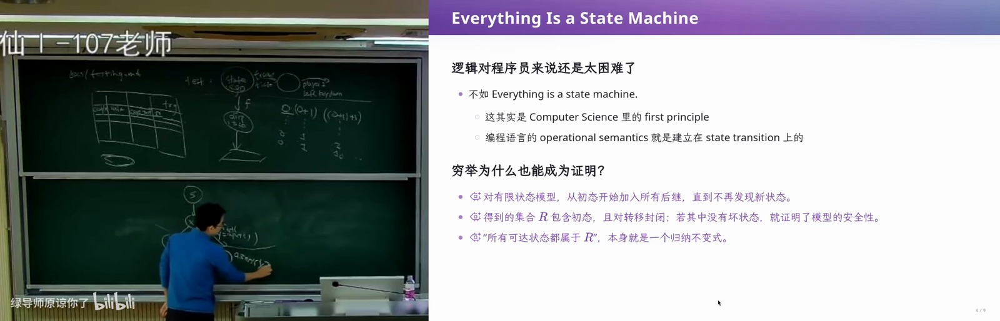](../assets/12-11.jpg)

*图 11：00:30:30，程序执行与状态迁移。*

先不考虑代价，假如能构建完整的状态迁移图，就可以在每个状态上检查断言。例如，检查 `y > 0`，发现不满足它的可达状态，就找到错误。程序员只要理解执行和 assertions，就比较容易理解这条路线，学习公理推理的负担也会小一些。穷尽全部状态空间，同样能够给出正确性证明。
{: #l12-p046}

并发程序更容易展示状态空间怎样增长。假设许多线程反复执行 `sum++`，最后可能得到什么结果？课堂上讲过，即使线程很多、循环很多次，某种很奇怪的调度也可能让最后的 `sum` 等于 2。具体结果取决于执行交错。
{: #l12-p047}

[](../assets/12-12.jpg)

*图 12：00:32:00，用穷举理解并发程序的执行。*

程序顺序执行时只有一条路径，进入并发后，每个状态可能选择线程 1 执行一步，也可能选择线程 2。分支不断叠加，很快发生状态空间爆炸。尽管代价巨大，概念仍然直接，写出程序解释器、枚举可能执行，并检查每个状态。后续几十年的许多研究，都是设法让这条路线处理更大的问题。
{: #l12-p048}

[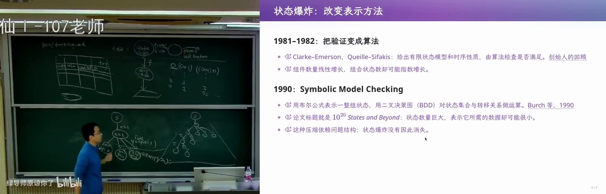](../assets/12-13.jpg)

*图 13：00:32:30，早期模型检查与符号模型检查。*

## 用自动售货机理解模型检查 {#l12-section-09}

*[原片 00:32:56–00:38:33](https://www.bilibili.com/video/BV1LaW36WErp/?t=1976)*

如果程序太大，无法直接穷举，可以先提取它要表达的逻辑，建立一个更小的模型。Model checking 领域很喜欢用自动售货机举例。今天的售货机可能要展示商品、生成二维码，甚至支持刷脸；在早期的例子中，人们通常讨论纸币入口、硬币入口和退币按钮。
{: #l12-p049}

实际控制程序需要识别纸币和硬币，可能根据重量等信息判断币种，包含许多实现细节，代码可能有几千上万行。当计算机资源有限时，直接枚举整个程序的状态会很困难。但可以对投币、选择商品、退币这些行为做抽象。
{: #l12-p050}

例如，初始余额为零，投入一元后变成一，投入五元后变成五，五元状态再投入一元就变成六。假设商品及价格的种类有限，状态迁移图就可能比较小。退币和选择按钮也会对应迁移。这里画的是一个不够完善的示意，实际还有许多不同的建模方式。
{: #l12-p051}

[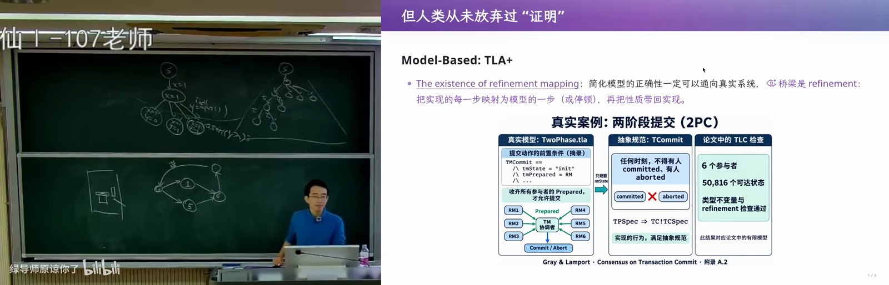](../assets/12-14.jpg)

*图 14：00:36:00，自动售货机的抽象与 TLA+ 建模。*

如果一个售货机能抽象成几十或几百个状态，就有机会穷举。系统卡住等不允许发生的情况，可以标为坏状态。检查是否存在从初始状态到坏状态的路径，在直觉上就像做广度优先搜索或深度优先搜索。真正的模型检查更复杂，但可以先这样理解。
{: #l12-p052}

模型验证通过以后，再把它实现成控制程序。这时需要留意，计算机验证的是模型，代码是否实现了同样的行为，还需要建立对应关系。假如代码第一行就 `return`，它显然没有执行模型中的过程。
{: #l12-p053}

即使控制流程与模型一致，实现细节也可能出问题。识别硬币时的除法，如果分母为零，售货机仍然可能 crash。现实环境也会带来模型未包含的情况。有一次我买东西，商品没有掉下来，机器自动退款；我又买了一次，结果掉下来两个。传感器检测、机械卡住与后续掉落的行为，未必已经进入原来的抽象模型。
{: #l12-p054}

## 从模型到实现，逐步建立对应关系 {#l12-section-10}

*[原片 00:38:33–00:42:44](https://www.bilibili.com/video/BV1LaW36WErp/?t=2313)*

Lamport 参与的《The Existence of Refinement Mappings》讨论这种对应关系。我们可以从一个简单模型出发，逐步构造更复杂的模型，建立层与层之间的 refinement mapping，最终把证明推进到代码。
{: #l12-p055}

[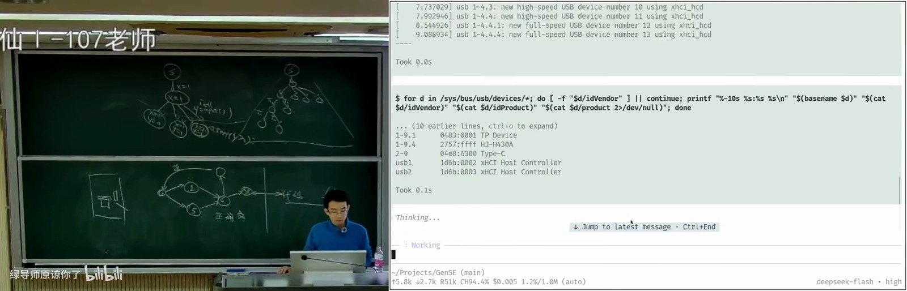](../assets/12-15.jpg)

*图 15：00:39:30，Refinement mapping 的论文及模型实现关系。*

即使没有资源把最终代码完全证明一遍，也可以通过测试增加信心。例如，每次代码发生与模型相关的状态迁移时，打印一条日志。对模型和实现输入同一个测试用例，比较两边经过的状态。如果实现日志与模型过程相符，至少可以排除“代码开头就直接返回”这样的明显偏差，确认实现大致遵循了模型。
{: #l12-p056}

模型已经经过严格检查，实现又在测试中表现出相应行为，这就比只看一份模型更有依据。实现中的除零、memory corruption 等问题，还可以借助其他手段处理，例如使用能够避免某类内存错误的编程语言。
{: #l12-p057}

TLA+ 是 Lamport 的代表性工作，可以用于检查分布式共识协议等对象。模型还能够帮助生成测试用例。先从形式化模型中采样各种特殊执行，得到预期最终状态，再把同一测试交给实现，检查实现是否也落到相应状态。能够把代码状态映射回模型状态时，就更容易判断这两边是否一致。
{: #l12-p058}

早期研究可能只处理几十个状态的系统，但这些思路逐渐进入了真实的大型软件工程。验证模型、约束实现、测试映射关系，可以互相配合。
{: #l12-p059}

## 用方程压缩执行路径，理解符号执行 {#l12-section-11}

*[原片 00:42:44–00:48:41](https://www.bilibili.com/video/BV1LaW36WErp/?t=2564)*

人类一直在改进直接探索程序执行的方法。假设程序从外界读取一个整数，是否可以推迟展开所有输入值，先用数学公式表示一整组状态？
{: #l12-p060}

例如，程序依次执行下面的语句。
{: #l12-p061}

```python
x = 1
y = int(input())
z = x + y
```

此时可以用一组约束表示当前情况，`x = 1`，`y` 是任意整数，`z = x + y`。每执行一条语句，就为新的状态关系增加方程，而不必立即为每个 `y` 建一条分支。
{: #l12-p062}

[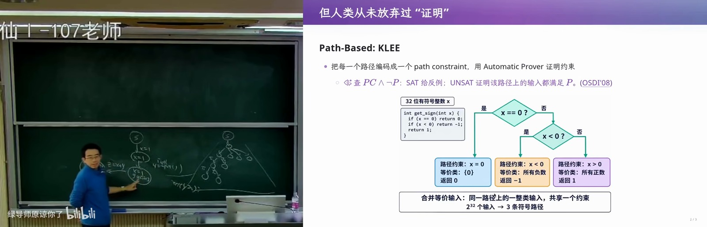](../assets/12-16.jpg)

*图 16：00:44:30，KLEE 与符号路径条件。*

如果接下来执行 `if z > 5`，才把状态分为两组。一组增加约束 `z > 5`，程序计数器进入 taken 分支；另一组增加 `z <= 5`，程序计数器进入 not-taken 分支。两组仍然共享前面的关系 `x = 1` 和 `z = x + y`。
{: #l12-p063}

```text
taken      x = 1 ∧ z = x + y ∧ z > 5
not-taken  x = 1 ∧ z = x + y ∧ z <= 5
```

这样，许多具体执行就被方程和路径条件概括起来。问题转化为这些约束是否有解。有解时，解会给出一组能够沿相应路径运行的输入，也就生成了一个测试用例。
{: #l12-p064}

同样，可以把断言失败写成一个需要搜索的分支。例如，`assert(y != 0)` 对应着检查能否在 `y == 0` 的情况下到达这里。若能找到满足路径条件的输入，就找到了反例。可以把这个检查理解成遇到 `y == 0` 时调用 `abort()`，再问程序入口到这个位置有没有路径。
{: #l12-p065}

[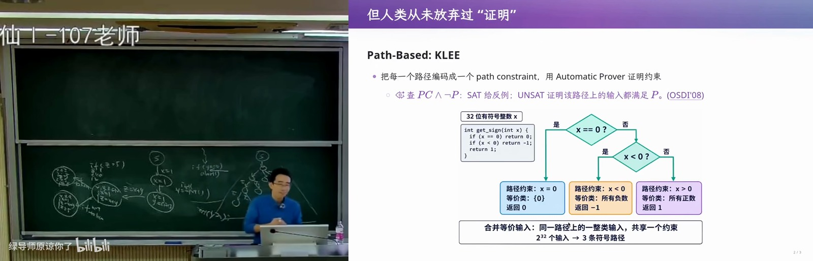](../assets/12-17.jpg)

*图 17：00:47:00，分支约束和断言失败路径。*

这就是符号执行背后的直觉，课件举了 KLEE 的例子。要真正分析现实代码，工程量很大。需要选择中间表示或指令集，例如 LLVM IR、WASM，模拟其中的指令，并为运算、内存操作和跳转建立约束。好处是能够直接探索真实程序的路径。
{: #l12-p066}

这类方法还依赖好的约束求解器。求解器发展到一定程度，相关方法才逐渐可用。模型检查依靠模型之间的映射逐步接近代码，符号执行则通过约束表达代码的许多执行过程。人类也始终在尝试更直接的公理化证明。
{: #l12-p067}

## CompCert 与 seL4，给基础软件写证明 {#l12-section-12}

*[原片 00:48:41–00:51:48](https://www.bilibili.com/video/BV1LaW36WErp/?t=2921)*

有些人确实做了耗费巨大智力的尝试。两个值得了解的例子，是经过形式化验证的编译器 CompCert，以及经过形式化验证的操作系统内核 seL4。
{: #l12-p068}

编译器可能有 bug。输入一个合法程序，编译器可能 crash，也可能成功输出错误的机器代码。例如，源程序明明写的是返回 1，编译器却把 2 放进返回值寄存器。一般程序员很难逐条检查机器指令，工程中通常依赖对编译器的信任。
{: #l12-p069}

CompCert 要证明的是，编译转换保留程序语义。可以把编译器看成接收一个字符串、输出另一个字符串的函数，再严格描述合法输入和输出之间的语义关系。课件给出的 2009 年工作量约为 3 人年、4.2 万行 Coq，其中 76% 是证明。那时仍是较早版本，一些直达机器语义的环节还没有完全覆盖。
{: #l12-p070}

seL4 则证明内核 C 实现符合抽象规范。课件列出的 2009 年设计到验证成本约为 25 人年、20 万行证明脚本。课堂上我一度犹豫过年份，展示的资料列的是 2009 年。
{: #l12-p071}

[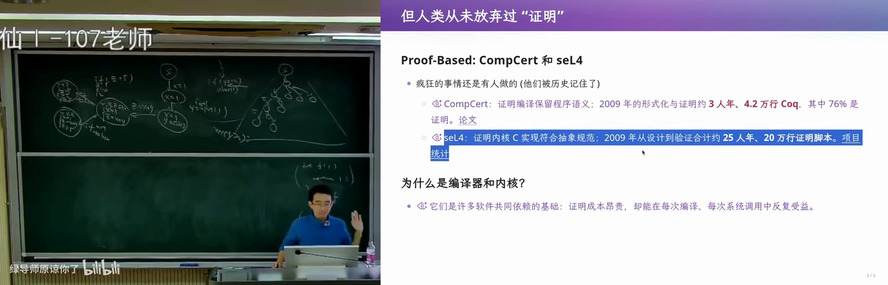](../assets/12-18.jpg)

*图 18：00:50:30，CompCert 与 seL4 的证明成本和范围。*

编译器和内核是许多软件共同依赖的基础。证明成本昂贵，但可以在每次编译和系统调用中持续受益。如果代码承担月球探测等任务，编译器把正确程序翻译错，后续测试未必能消除这种担忧。这些工作展示了严格证明软件性质的可能性。
{: #l12-p072}

到了今天，OpenAI 又发布了大量数学证明成果。我开玩笑说，它给数学研究投下了一颗“核弹”。无论是验证编译器、验证内核，还是证明数学命题，背后都有 proof assistant。它提供严格的反馈机制，也给强化学习训练数学推理提供了可以检查的结果。
{: #l12-p073}

## 证明助手怎样检查每一步 {#l12-section-13}

*[原片 00:51:48–00:54:36](https://www.bilibili.com/video/BV1LaW36WErp/?t=3108)*

中学数学的日常练习未必处处严格。选择题可以猜，草稿中间也可能算错，最后阴差阳错得到正确答案；阅卷人检查得快时，推导中的问题还可能漏过去。要排除这种错误，可以要求草稿里的每一步都接受形式系统的检查。
{: #l12-p074}

[](../assets/12-19.jpg)

*图 19：00:52:30，Proof assistant 的严格反馈机制。*

做几何证明时，每一步都要有依据。证明助手把这个要求变成可执行的规则，告诉它要用哪条规则、作用于哪个对象，再由计算机检查并执行变换。例如，想使用乘法分配律，表达式中却没有对应结构，系统就会拒绝；没有说明对哪个乘号操作，下一步也可能走不下去。
{: #l12-p075}

Proof assistant 仍然需要人或其他工具提供证明路线，它负责检查推导。可以把证明状态理解为两部分，一边是已知条件，一边是待证目标。已知和待证完全相同时，这个目标就能结束。课堂上用“逐字相同”的直觉说明最简单的闭合情形，复杂目标则需要不断应用合法规则，逐步转化到能够由已有事实解决的状态。
{: #l12-p076}

[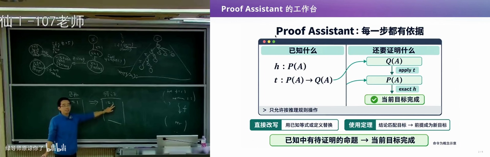](../assets/12-20.jpg)

*图 20：00:54:30，证明助手中的已知条件和待证目标。*

程序性质、逻辑性质和数学性质，都可以进入这样的过程。每一步是否正确由检查器判断，寻找下一步则留给证明者。
{: #l12-p077}

## 存在、任意、归纳和假设 {#l12-section-14}

*[原片 00:54:36–01:01:02](https://www.bilibili.com/video/BV1LaW36WErp/?t=3276)*

假设要证明“班上至少有一个同学考了 100 分”，也就是 `∃x, P(x)`。已知 A 考了 90 分、B 考了 100 分，还有其他成绩事实。可以先选择一个候选对象，把存在性目标变成对这个对象的证明。
{: #l12-p078}

如果选 A，目标变成“A 考了 100 分”。这种变换规则本身允许使用，但现有条件无法完成这个目标，因为“A 考了 90 分”和它对不上。换成 B 后，目标与已知事实一致，就可以结束。合法地变换目标，并不保证选择的证明路线一定能继续。
{: #l12-p079}

[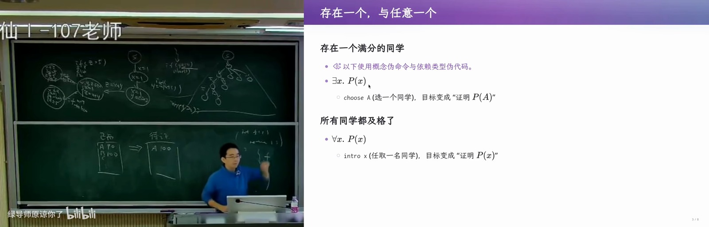](../assets/12-21.jpg)

*图 21：00:56:30，存在量词的见证与任意对象。*

如果目标是“所有同学都及格”，也就是 `∀x, P(x)`，可以先任取一个 `x`，把它引入证明上下文，再证明 `P(x)`。这里的 `x` 仍然是任意对象，后续推导必须对任意这样的对象都有效，不能偷偷换成某个特殊学生。通常还需要相关领域的其他事实，才能完成证明。
{: #l12-p080}

对于自然数上的命题 `∀n ∈ ℕ, P(n)`，数学归纳法可以产生两个目标，分别证明 `P(0)`，以及对任意 `n`，由 `P(n)` 推出 `P(n + 1)`。证明基础情况和归纳步骤后，就能得到对所有自然数的结论。
{: #l12-p081}

```text
base  P(0)
step  ∀n ∈ ℕ, P(n) → P(n + 1)
```

另一个例子是“保研的同学都及格”，可以表达为 `P(x) → Q(x)`。证明蕴含时，把 `P(x)` 放入已知条件，再以 `Q(x)` 作为待证目标。课件用 `intro h` 表示把前提引入上下文的操作。
{: #l12-p082}

[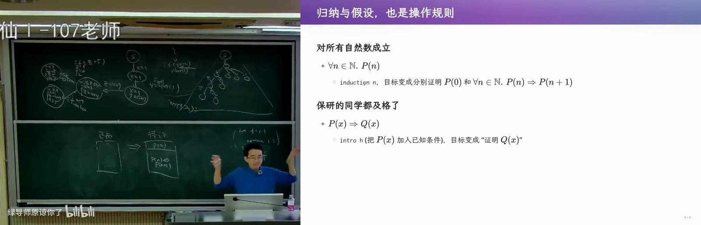](../assets/12-22.jpg)

*图 22：00:59:00，归纳与引入假设的证明规则。*

这些操作会改变 proof state。常见的证明助手可以用 proof stack 来理解，归纳把一个目标变成两个子目标；如果 `P(0)` 已经在已知中，就先解决它，接着处理另一个。证明者不断操作这些目标，直到全部完成。
{: #l12-p083}

从自然数、递归和归纳出发，可以构造计算机科学里大量对象。证明系统还可以在共同的逻辑基础上提供不同表示方式，例如引入 Hoare 逻辑中的规则，让人用更熟悉的形式推理。
{: #l12-p084}

## Curry–Howard 对应，命题即类型、证明即程序 {#l12-section-15}

*[原片 01:01:02–01:07:51](https://www.bilibili.com/video/BV1LaW36WErp/?t=3662)*

Curry–Howard correspondence 是我很喜欢的计算机科学思想之一，常用“命题即类型，证明即程序”来概括。解释起来有些绕，我也是第一次在这门课上讲它。南大有“程序设计语言的形式语义”这样的课程，会专门学习这些内容，需要花时间处理抽象的函数和证明。
{: #l12-p085}

[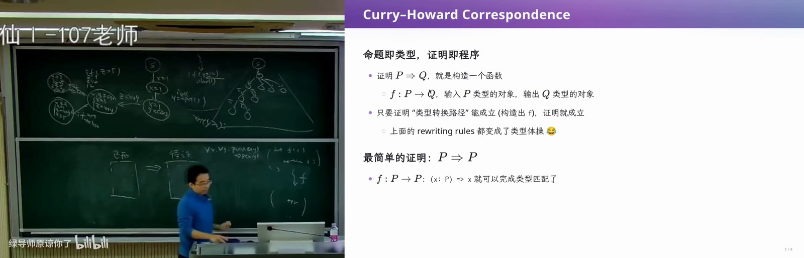](../assets/12-23.jpg)

*图 23：01:02:30，Curry–Howard 对应与恒等函数。*

一个命题可以很复杂。例如，所有保研学生的课程都及格，可以写成带量词和蕴含的公式；哥德巴赫猜想也可以用自然数上的性质表达；“程序在任意一步都不会到达 crash 状态”，同样可以写成逻辑命题。即使状态图无限，也能用步数来描述执行到哪里，再对所有步数提出要求。
{: #l12-p086}

程序自身还可以编码成字符串，再编码成自然数。离散数学中学过，可数对象之间能够建立相应编码，字符串和自然数之间也能建立对应关系。这样，“对于任意程序，编译器的输出都满足某种性质”，也能成为一个数学命题。表达式虽然复杂，构造它的基本逻辑结构仍然可以逐层处理。
{: #l12-p087}

例如，要证明 `P → Q`，可以把 `P` 对应为一种类型，把 `Q` 对应为另一种类型。需要构造一个函数，接收 `P` 类型的对象，通过系统允许的构造，产生 `Q` 类型的对象。这里不能靠随意的强制类型转换蒙混过去，必须使用公理和已证明定理所允许的操作。
{: #l12-p088}

有整数，可以构造整数二元组；有逻辑上的与、或等结构，也会有相应类型构造。证明栈里那些变换，在这种表示中变成了对类型和程序项的构造。只要得到合法的相应程序，就给出了命题的证明。
{: #l12-p089}

最简单的命题是 `P → P`。输入一个 `P` 类型的对象，直接返回它，就构造了所需函数。
{: #l12-p090}

```text
fun (x : P) => x
```

用 Python 的直觉看，它就像 `lambda x: x`。输入和输出属于同一类型，对应于已知事实与证明目标相同的情况。更复杂的证明规则，也能找到相应的程序构造。
{: #l12-p091}

## 归纳证明对应递归程序 {#l12-section-16}

*[原片 01:07:51–01:10:50](https://www.bilibili.com/video/BV1LaW36WErp/?t=4071)*

归纳法会对应到递归。为了证明所有自然数上的 `P(n)`，需要一份 `P(0)` 的证明，以及一个从 `P(k)` 的证明构造 `P(k + 1)` 证明的步骤。
{: #l12-p092}

课件用类似 TypeScript 的伪代码展示这个递归构造。
{: #l12-p093}

```text
(base, step) => {
    const f = (n: Nat): P(n) =>
        n === 0 ? base : step(n - 1, f(n - 1));
    return f;
}
```

[](../assets/12-24.jpg)

*图 24：01:09:00，归纳证明对应递归程序。*

当输入为零时使用 base，输入更大时使用 step，并递归获得前一个自然数的证明。这样构造的函数，其类型就对应整个归纳命题。递归与归纳之间的联系，可以从这个过程直接看出来。课件还提醒，递归必须终止。如果允许 `f(n) = f(n)` 这样的无限递归，就能假装返回任意命题的证明，证明系统也就失去了约束。
{: #l12-p094}

例如，要证明对任意 `a`、`b`，`a + b = b + a`，即使我们觉得它十分显然，在形式系统里也要按规则处理。对 `a` 归纳时，基础目标是对任意 `b`，有 `0 + b = b + 0`；另一个目标是在归纳假设下推出下一步。初次做这种证明时，会发现简单结论也需要认真推导。我这里主要展示构造方式，没有把加法交换律的全部证明在黑板上写完。
{: #l12-p095}

我学 proof assistant 已经是很多年前的事了。现在设计课程时，会想离散数学能否加入一些证明助手内容，让学生更早看到数学规则怎样被计算机检查。
{: #l12-p096}

## 把 Lean 变成可以编程和观察图形的环境 {#l12-section-17}

*[原片 01:10:50–01:13:01](https://www.bilibili.com/video/BV1LaW36WErp/?t=4250)*

甚至可以想得更早一些，让高年级小学生也接触这种数学与编程相结合的环境。大家已经在学 Scratch、Python 或 C++，也可以接触另一种能够写程序的语言。我曾把上课演示过的 Python playground 改成 Lean playground，想看看这种方式能做什么。
{: #l12-p097}

Lean 既能够写证明，也可以作为函数式编程语言使用。在 tactic mode 下，会看到 `simp only` 等证明命令；在普通编程模式下，也能定义计算函数。
{: #l12-p098}

[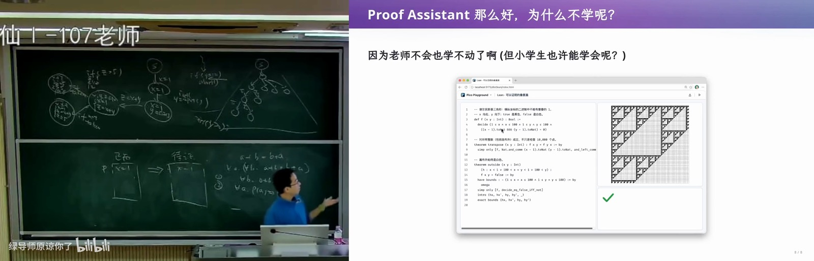](../assets/12-25.jpg)

*图 25：01:12:00，Lean playground 与谢尔宾斯基三角形。*

例如，定义一个函数，把计算结果连接到 JavaScript 世界，再画成一个 100 × 100 的谢尔宾斯基三角形。小朋友可以看到，定义函数会产生一幅图，接着还可以为函数证明性质。
{: #l12-p099}

检查一万个点能增加信心，而证明可以对所有相关整数给出保证。例如，某些画布范围外的点始终为白色。这种编程与证明放在一起的体验，可能给数学教学带来新的机会。
{: #l12-p100}

## 一个搁置多年的博士研究问题 {#l12-section-18}

*[原片 01:13:01–01:17:01](https://www.bilibili.com/video/BV1LaW36WErp/?t=4381)*

接下来讲一个与 proof assistant 有关的经历。我以前写过读博士的回忆录，其中提到博士研究里有一个没有完成的问题。
{: #l12-p101}

观测和恢复程序执行时，记录的信息量与后续恢复的代价之间存在取舍。记录得多，后面恢复的代价可以小一些；记录得少，后面的工作就更多。我观察到，人们研究了很多年，却一直没能同时把记录成本和恢复成本都降得很低，就猜测这块区域是否根本不存在可行方案。
{: #l12-p102}

[](../assets/12-26.jpg)

*图 26：01:15:00，博士研究中搁置的猜想。*

要把这个猜想严格写出来，涉及对任意程序、任意某种程序修改的讨论，并说明如果某个任务可以在多项式时间完成，会推出 `P = NP`。我当时处理不了这种一般性，只证明了一个受限情况，就把剩余问题搁置了。
{: #l12-p103}

那时我还不会用 proof assistant，手里只有 informal proof。我反复检查了很多遍，担心证明中有漏洞，也担心一般猜想哪天被推翻。后来今年有一天，手里还有没用完的模型额度，就想起可以借助一种超出自己能力范围的力量。
{: #l12-p104}

GPT 先写了一份非形式化证明，中间也曾放弃过，认为好像证不出来。我根据对问题的印象和直觉，补充了一些鼓励和提示，它又继续推导，最后给出证明。我再让 Claude 交叉检查，得到的反馈是没有发现明显问题。接着继续消耗 token，写了约两万行 Lean，把证明形式化。
{: #l12-p105}

Lean 检查通过后，我顺着这项结果又推导出一些结论。课件记录了模型对论文程度的评价，GPT-6 认为可以投 PODC，Claude Opus 5.5 认为在 borderline。PODC 是分布式计算理论领域的会议，我自己并非这个方向的研究者。模型的评价不等于论文已经发表，我也没有打算继续投稿。让我受到触动的是，这些工具帮助我把当年停下来的问题继续做了下去。
{: #l12-p106}

## 当证明也成为可以承担的成本 {#l12-section-19}

*[原片 01:17:01–01:20:14](https://www.bilibili.com/video/BV1LaW36WErp/?t=4621)*

以前，CompCert、seL4 这样的工作，需要集中许多顶尖研究者的智力。现在从软件构建的角度看，有较强推理能力的工具可以反复调用，情况开始变化。
{: #l12-p107}

[](../assets/12-27.jpg)

*图 27：01:17:30，提出问题的经验与借助模型完成证明。*

做研究时，除了写代码、做实验的 engineering tax，还常常要付出包装和讲述工作的 storytelling tax，以及把问题精确写成数学对象的 formalization tax。Coding agent 已经改变了工程实现的成本，数学建模也能得到帮助。现在，写证明本身也开始成为工具能够承担的一部分工作。
{: #l12-p108}

不一定每个人都能独立重做 Curry–Howard 对应的全部推导。我以前推过，现在在课堂上也可能卡住。但知道这个领域有哪些概念、什么工具能提供帮助，仍然可以让我们借助它们解决自己理解范围内的问题，再逐渐扩展能力。
{: #l12-p109}

Anthropic 最近的博客讨论了大语言模型怎样让更大规模的形式化软件验证变得可行，课堂上还提到其中一个与 64 MB 内存环境有关的验证例子。那篇文章有一句话，这只是开始。我不知道这样的变化会在什么时候全面进入工程，但它已经值得认真考虑。
{: #l12-p110}

现在的 Lean、Coq 等系统，proof stack 的交互方式主要沿着数学证明发展。将来是否需要更适合程序验证的语言，我也没有确定答案。AI 连汇编都能写，现有证明语言也许并不会成为决定性障碍。
{: #l12-p111}

以前，普通程序员能理解形式化验证的基本原理就已经不容易，更深入的数学要求限制了应用。当相关推理和证明的成本下降，大型系统验证就可能有新的空间。曾经把数学证明作为创业方向、为此融资的公司，也会面对模型能力进步带来的竞争。
{: #l12-p112}

## 证明的命题，是否对应真正的问题 {#l12-section-20}

*[原片 01:20:14–01:23:32](https://www.bilibili.com/video/BV1LaW36WErp/?t=4814)*

数学证明能力提高以后，仍要处理它和现实软件之间的关系。软件工程里一直有 intent、specification 和 implementation 之间的 gap。人类的意图、写出来的规范和最终实现，需要相互对应。
{: #l12-p113}

[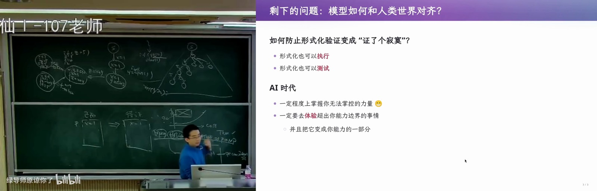](../assets/12-28.jpg)

*图 28：01:21:30，形式化定理、模型与现实需求之间的关系。*

Proof assistant 可以检查一个形式化定理的证明，但还要问，这个定理是否描述了 implementation，implementation 是否满足 spec，spec 是否真实反映人的意图。当证明本身变便宜，这些问题仍然存在。
{: #l12-p114}

过去就有过声称解决重大复杂性问题、附带很长 Lean 证明，最后却被发现定义有误的情况。我记得是关于 `P ≠ NP` 的声称，具体方向这里不展开。它可能实际处理了原问题中一个很小、恰好容易解决的特例，却把这个特例当成整个问题。形式检查能够接受写下来的命题，命题和原始问题之间的缺口却还没有解决。
{: #l12-p115}

有领域知识时，可以为形式化结果增加其他检查。例如，我们讨论的是程序和程序执行，就可以把已知合法、非法的执行分别送进形式化模型。期望允许的执行能够通过，应该拒绝的执行确实被拒绝，再结合对定义的检查，增加“这个模型描述了原问题”的信心。
{: #l12-p116}

这和前面 model checking 的思路相通，模型不仅用于证明，也可以执行、模拟，并与测试相互核对。把非形式化描述转成形式表达，涉及 autoformalization。我们可能需要使用超出当前独立推导能力的工具，再通过体验、测试和核对，逐渐把它纳入自己能够判断的范围。
{: #l12-p117}

## Proof-Carrying Code，代码能否自带证明 {#l12-section-21}

*[原片 01:23:32–01:27:18](https://www.bilibili.com/video/BV1LaW36WErp/?t=5012)*

软件质量保障的未来，会重新遇到一个很早的想法，proof-carrying code。相关工作在 1996 年 OSDI 上展示，后来又在 1997 年 POPL 发表，名字一直被人们记住。
{: #l12-p118}

[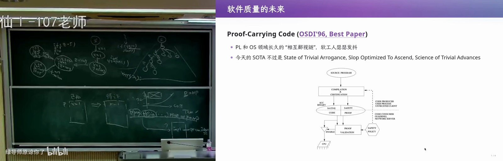](../assets/12-29.jpg)

*图 29：01:25:00，Proof-Carrying Code 的代码、证明与校验流程。*

它设想代码交给使用者时，同时提供证明。使用者可以不预先信任代码生产者，而是让 proof validation 根据安全策略检查代码附带的证明。
{: #l12-p119}

日常开发中，大家习惯信任编译器。一方面，常见路径里的许多 bug 已经在长期使用中被触发和修复；另一方面，编译器也依赖大量 regression tests 来保障质量。但编译器本身仍然可能出错。附带证明提供了另一种可以检查的依据。
{: #l12-p120}

早期的 proof-carrying code 关注的性质可能比较有限，例如内存安全和避免某类 crash。今天的 eBPF 与它有一些相似的追求，但机制有区别。希望放进内核的代码受到约束，执行时不会破坏内核中的其他内容。
{: #l12-p121}

Specification 也可以直接出现在代码中。前面树结构的例子，父节点的某个孩子必须是当前节点，就是一条规范。运行时 `assert` 可以检查当前执行；收集 trace 后，还能检查与历史执行相关的性质。
{: #l12-p122}

如果将来模型能把这些断言自动翻译成证明系统中的命题和证明，我们是否能要求，证明没有通过，代码就无法完成相应的构建检查？代码提供 specification 和 assertions，工具负责产生并检查证明。
{: #l12-p123}

在大语言模型出现以前，我可能会怀疑这件事三十年内有没有希望。现在觉得，它可能比原先想象得更快。过去，严格证明“链表始终是合法链表”“树始终满足树的约束”，需要很多数学能力。如果这些证明能够普遍生成，软件可靠性的教学和实践也会跟着改变。
{: #l12-p124}

## 回头看已有的计算机科学思想 {#l12-section-22}

*[原片 01:27:18–01:29:10](https://www.bilibili.com/video/BV1LaW36WErp/?t=5238)*

Proof-carrying code 在 OSDI 1996 获得了最佳论文。可是，逻辑和 Curry–Howard 对应等思想早就出现了。为什么已有思想进入另一个系统场景，还能够产生有影响的工作？
{: #l12-p125}

PL 和 OS 领域常有一些相互调侃。研究编程语言的人，会更关心理论构造本身；研究操作系统的人，会更关心这些东西能否用来解决实际问题。我开玩笑说，两边互相看不惯，做软件工程的人就在后面瑟瑟发抖。这里说的是不同研究传统的关注点。
{: #l12-p126}

[](../assets/12-30.jpg)

*图 30：01:28:30，早期系统研究与对 SOTA 的调侃。*

我昨天重新读这些老论文时，还拿 SOTA 开了个玩笑，把它展开成 “State of Trivial Arrogance”“Slop Optimized To Ascend”“Science of Trivial Advances”。大家为了毕业，可能都要写一篇号称 SOTA 的论文，但也可以回头看看先驱已经做过的工作。在理解这些思想之后，我们还有机会在它们的基础上继续往前走。
{: #l12-p127}

## 形式化仍然需要独立、简洁的正确性描述 {#l12-section-23}

*[原片 01:29:10–01:31:20](https://www.bilibili.com/video/BV1LaW36WErp/?t=5350)*

我相信形式化方法未来会有更多发展，但软件工程仍然没有银弹。即使能够证明实现中的许多性质，intent、spec 和 implementation 之间的缺口依旧需要处理。
{: #l12-p128}

[](../assets/12-31.jpg)

*图 31：01:30:00，形式化软件验证仍然没有银弹。*

可以设想，足够多的算力帮助我们证明程序不 crash、数据结构正确，甚至满足某些性能和 cache miss rate 的要求。形式化之所以有价值，是因为我们能用独立于实现、比实现更简洁的方式描述“正确”。例如，对任何程序状态中的内存访问，都不允许越界。这条要求很短，也无需重复整个程序实现。
{: #l12-p129}

现实需求未必都能如此表达。软件构建中很困难的部分，是确定到底要造什么。把人的非形式化想法转换成形式化描述，就是 autoformalization 所面对的问题。
{: #l12-p130}

即使对象是比较明确的数学性质，这一步也会出错。OpenAI 发布的某项证明中，我看到过自然语言陈述和 Lean 实际证明的内容没有完全对应的情况。最终数学结论在相应公理基础下可能仍然可以证明，但中间的自然语言与形式语言已经出现不一致。我也不知道这是模型翻译时的幻觉，还是其他原因。
{: #l12-p131}

## 教务系统与折叠屏，怎样表达“满意” {#l12-section-24}

*[原片 01:31:20–01:33:20](https://www.bilibili.com/video/BV1LaW36WErp/?t=5480)*

假设需求是做一个领导满意的教务系统，到底怎样算满意？可能需要猜测他实际关心什么。他未必首先关心性能或偶发 crash，也许更在意向上汇报时展示的界面和 dashboard。需求判断就进入了人的处境和表达习惯。
{: #l12-p132}

另一个例子是用户满意的折叠屏关闭特效。窗口带着毛玻璃效果缓缓折起，再在外屏上接续，可能让人觉得自然。但这只会是许多合理设计中的一个。用户想要的是自然、协调、符合预期的体验，具体视觉效果需要联系人的心理去判断。
{: #l12-p133}

[](../assets/12-32.jpg)

*图 32：01:32:00，教务系统与折叠屏效果的自动形式化难题。*

模型学习了大量语料，在数学推理中也表现出很强的能力，但它仍需要理解人那些细微、受当下状态和生理因素影响的想法。还有许多问题介于两端，原则上也许能形式化，表达式却可能长到人难以检查。
{: #l12-p134}

课件也提到 Brooks 对需求的讨论。原型与迭代反馈能帮助用户发现自己究竟想要什么，需求本身也要通过对话逐渐形成。这些事情给自动形式化带来的困难，和检查一个明确的内存安全命题很不一样。
{: #l12-p135}

## 关于推理、随机性与 AI 对齐的猜想 {#l12-section-25}

*[原片 01:33:20–01:35:10](https://www.bilibili.com/video/BV1LaW36WErp/?t=5600)*

最后说一个个人猜想。我倾向于认为，人类的 System 2，也就是用于数学等活动的推理系统，可以用理性的过程解释。有人认为创造力来自某种不可解释的天赋，我对自己的经历有不同看法。
{: #l12-p136}

别人也许会觉得我有一些创新性，能够写出论文、设计课程，或者在小红书上发表一些古怪想法。但从我的角度看，这些输出可能来自一个近似确定的推理系统，加上把判断与人类世界联系起来的感知和打分机制。后者可以想象为神经网络或类似系统，这只是帮助表达想法的说法。
{: #l12-p137}

[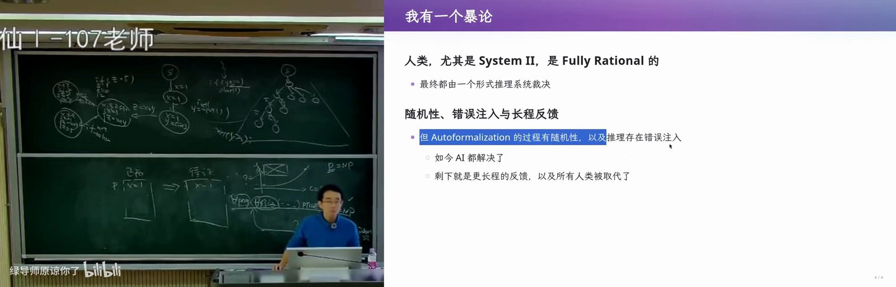](../assets/12-33.jpg)

*图 33：01:34:30，对人类推理、随机性和 AI 对齐的猜想。*

人类把感知转换成判断的过程具有随机性。今天觉得一个东西好，明天可能就不这么想，当时的环境也会影响判断。推理中还会犯错误，把整个思考过程带往另一个方向，最后表现为发现新东西、想到一个不同的办法。
{: #l12-p138}

AI 今天已经能够处理许多形式化世界中的问题，也能在一定程度上完成 autoformalization。我猜 OpenAI、Anthropic 等团队接下来希望进一步对齐人类意图，再结合模型的形式化推理能力。如果能够把这些能力连接起来，让它像人一样理解和行动，我觉得那时 AGI 可能就到了。
{: #l12-p139}
